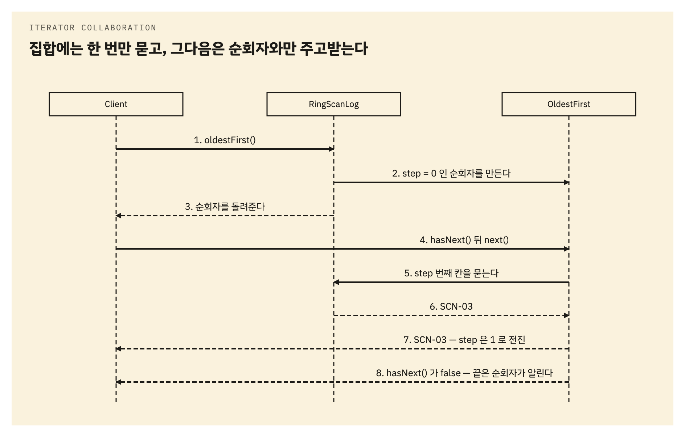
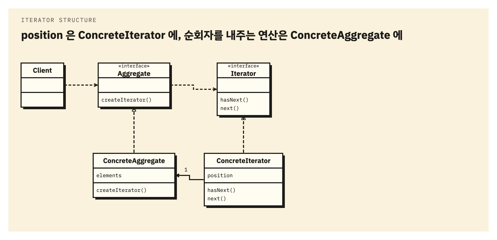

# Iterator — 어디까지 봤는지를 집합 밖으로 꺼내 별도 객체에 맡기기

## 한눈에 보는 개요

물류 창고의 컨베이어가 상자를 스캔하고, 그 기록을 최근 다섯 건만 보관하는 기록함에 넣는다고 해 봅시다. 기록함 안쪽은 칸이 다섯 개인 배열이고, 여섯 번째 기록이 들어오면 첫 칸을 덮어씁니다. `SCN-01` 부터 `SCN-07` 까지 일곱 건을 넣으면 배열은 `SCN-06 · SCN-07 · SCN-03 · SCN-04 · SCN-05` 순서로 채워져 있어요. 그런데 보고서를 찍는 쪽이 기록함에게 배열을 달라고 해서 `for (int i = 0; i < raw.length; i++)` 로 순회하면, 찍히는 순서가 배열에 놓인 순서 그대로입니다. 실제로 실행해 보면 `SCN-06 SCN-07 SCN-03 SCN-04 SCN-05` 가 나와요. 오래된 것부터 보고 싶었는데 중간부터 시작한 셈이죠.

Iterator 의 해법은 **「지금 어디까지 봤는가」를 가지고 있는 객체를 따로 두고, 그 객체를 집합이 만들어 주는 것**입니다. 보고서 쪽은 배열도 칸 번호도 모른 채 「다음 것 주세요」만 되풀이하고, 칸 번호를 순환시키는 계산은 그 객체 안에 한 번만 적혀요. 순서를 바꾸고 싶으면 다른 객체를 받아 가면 됩니다.

```text
Before : 부르는 쪽이 기록함의 배열을 받아 칸 번호로 순회한다

  기록함.slots()  ──▶  [SCN-06][SCN-07][SCN-03][SCN-04][SCN-05]
                        i=0     i=1     i=2     i=3     i=4
  보고서   for i in 0..4   →  SCN-06 SCN-07 SCN-03 SCN-04 SCN-05   (틀린 순서)
  알람     같은 다섯 줄을 복사해서 한 번 더
  정산     같은 다섯 줄을 복사해서 한 번 더

After : 기록함이 「어디까지 봤는지」를 가진 순회자를 만들어 준다

  보고서 ──▶ 기록함.oldestFirst() ──▶ 순회자(step=0) ─┐
                                                     │ step 번째 칸이 어디인지는
  보고서 ──▶ 순회자.hasNext() / next() ───────────────┘ 순회자만 계산한다
             →  SCN-03 SCN-04 SCN-05 SCN-06 SCN-07   (들어온 순서)

  기록함.newestFirst() ──▶ 다른 순회자 ──▶ SCN-07 SCN-06 SCN-05 SCN-04 SCN-03
             기록함의 저장 코드는 한 줄도 안 바뀐다
```

이 패턴의 분류는 행위 패턴이고 다른 이름은 Cursor 예요. 자주 함께 쓰는 패턴은 셋입니다. 트리 같은 재귀 구조를 순회할 때 쓰는 [Composite](../composite/composite-guide_v1.0.1.md), 순회자를 내주는 연산 자리에서 겹치는 [Factory Method](../factory-method/factory-method-guide_v1.0.1.md), 그리고 순회 상태를 밖에 담아 두었다 이어 갈 때의 [Memento](../memento/memento-guide_v1.0.1.md) 고요. 이 글은 시나리오 셋을 따라갑니다. 기록 다섯 건이 들어온 순서대로 나오는 길, 최신 우선 순회가 더해지고 두 순회가 동시에 진행될 때, 순회 위치를 기록함 안으로 들였을 때 어디서 어긋나는가. 끝까지 읽으면 어떤 코드를 Iterator 라고 불러도 되는지 필수 조건 셋으로 판정할 수 있고, Composite 나 색인 루프와도 구분할 수 있게 됩니다.

## 패턴 자세히 들여다보기

### 시나리오 1 — 스캔 기록 일곱 건 중 남은 다섯 건이 들어온 순서대로 나오는 길

기록함 `RingScanLog` 는 칸이 다섯인 배열을 가지고 있고, 오늘 `SCN-01` 부터 `SCN-07` 까지 일곱 건이 들어왔습니다. 여섯 번째부터는 앞 칸을 덮어썼으니 남아 있는 것은 `SCN-03`(7건) · `SCN-04`(21건) · `SCN-05`(9건) · `SCN-06`(15건) · `SCN-07`(4건) 다섯이고, 배열에는 `SCN-06 · SCN-07 · SCN-03 · SCN-04 · SCN-05` 순으로 놓여 있어요. 보고서가 받아야 할 것은 들어온 순서대로 줄지은 `SCN-03 SCN-04 SCN-05 SCN-06 SCN-07` 한 줄입니다. 이 장면에는 넷이 등장해요. 기록을 담아 둔 기록함 `RingScanLog`(패턴에서는 ConcreteAggregate 라고 부르는 역할), 어디까지 봤는지를 가지고 있는 `OldestFirst`(ConcreteIterator), 순회자들이 공통으로 따르는 연산 모양 `hasNext()`·`next()` 를 선언한 `ScanCursor`(Iterator), 그리고 기록함에 순회자를 청해 한 줄을 만드는 보고서 코드(Client)입니다. 이름은 여기서 한 번씩만 소개하고 정식 정의는 개념 정리에서 해요.



1. 보고서가 `RingScanLog` 에게 `oldestFirst()` 로 순회자를 청합니다. 보고서가 순회자를 직접 만들지 않고 기록함에게 청하는 이유는, 어느 순회자가 이 기록함의 저장 구조에 맞는지는 기록함만 알기 때문이에요. 보고서가 만들려면 칸이 배열인지 연결된 마디인지를 알아야 하고, 그 순간 개요의 Before 로 돌아갑니다.
2. `RingScanLog` 가 자기 구조에 맞는 `OldestFirst` 를 만들어 돌려줍니다. 새로 만든 순회자의 `step` 은 0 이에요. 이 단계가 새 객체를 만드는 단계인 이유는 순회가 시작될 때마다 위치가 0 부터여야 해서예요. 기록함이 순회자 하나를 만들어 두고 다시 쓰면 두 번째 보고서가 끝난 자리에서 시작합니다.
3. 보고서가 받은 것을 `ScanCursor` 타입으로 가지고 있습니다. `OldestFirst` 라는 이름으로 받지 않는 이유는, 그 이름을 받는 순간 기록함이 다른 순회자를 돌려주도록 바뀌면 보고서도 함께 바뀌기 때문이에요. 4단계에서 부를 연산은 `ScanCursor` 가 선언한 둘뿐입니다.
4. 보고서가 `hasNext()` 로 더 남았는지 묻습니다. 남았다는 답을 먼저 받고 `next()` 를 부르는 이유는, 끝을 아는 쪽이 순회자이기 때문이에요. 보고서가 기록함에게 크기를 물어 자기 셈으로 다섯 번 반복하면 칸 수가 여덟로 늘 때 보고서도 고쳐야 합니다.
5. `next()` 를 받은 `OldestFirst` 가 자기 `step` 번째 칸이 배열의 어디인지를 기록함에게 묻습니다. 시작 칸이 2 번이라 `step` 0 은 배열의 2 번 칸이에요. 이 셈을 순회자가 하고 보고서가 하지 않는 이유는, 칸 번호가 순환하는 규칙이 기록함의 저장 방식이지 보고서의 일이 아니어서입니다. 여기서 다음 원소를 계산하는 일을 기록함 쪽 조회 연산에 맡기고 순회자는 위치만 가지는 모양을 썼는데, 순회자가 배열을 직접 가지고 계산하는 모양도 같은 패턴이에요.
6. 기록함이 그 칸의 `SCN-03` 을 돌려주고, `OldestFirst` 가 `step` 을 1 로 올린 뒤 보고서에 `SCN-03` 을 건넵니다. 올리는 일을 `next()` 안에서 하는 이유는 「값을 주는 일」과 「한 칸 나아가는 일」이 한 번의 요청으로 묶여야 해서예요. 보고서가 따로 `advance()` 를 불러 주게 하면 그것을 잊은 호출부에서 같은 값이 다섯 번 나옵니다.
7. 보고서가 4~6단계를 되풀이해 `SCN-04`·`SCN-05`·`SCN-06`·`SCN-07` 을 차례로 받고, `step` 이 5 가 되면 `hasNext()` 가 false 를 돌려줍니다. 끝났다는 신호가 순회자에게서 오기 때문에 보고서에는 다섯이라는 수가 한 번도 적히지 않아요. 기록함의 칸 수를 여덟로 바꿔도 보고서는 그대로입니다.

```text
단계   부르는 쪽 → 받는 쪽              넘기는 것        돌아오는 것
 1     보고서 → RingScanLog            —                (2단계에서 순회자)
 2     RingScanLog → OldestFirst       —                step = 0 인 새 순회자
 3     RingScanLog → 보고서            —                ScanCursor 타입으로 받음
 4     보고서 → OldestFirst            —                hasNext() = true
 5     OldestFirst → RingScanLog       step = 0         배열의 2번 칸
 6     RingScanLog → OldestFirst       —                SCN-03  (step 은 1 로)
 7     보고서 → OldestFirst            —                SCN-04 … SCN-07, 그다음 false
```

잠깐, 확인 하나만 해 볼까요? 5단계에서 `step` 이 0 인데 배열의 2 번 칸을 읽었습니다. `step` 이 3 이면 몇 번 칸일까요?

0 번 칸입니다. 시작 칸 2 에 3 을 더하면 5 이고, 칸이 다섯이니 5 를 다섯으로 나눈 나머지 0 이에요. 그래서 `SCN-06` 이 나옵니다. 이 「더하고 나머지를 취하는」 두 줄이 순회자 안에 한 번만 있으면, 보고서·알람·정산 세 곳이 같은 계산을 복사해 갖지 않아도 돼요.

```text
step        0      1      2      3      4
배열 칸     2      3      4      0      1
기록      SCN-03 SCN-04 SCN-05 SCN-06 SCN-07
```

이 시나리오가 보여 준 것은 역할 넷과 그 사이의 호출 방향입니다. 순회자를 만드는 일(1·2단계)은 집합이, 어디까지 봤는지를 유지하고 전진시키는 일(5·6단계)과 끝을 알리는 일(7단계)은 순회자가, 원소를 받아 쓰는 일(3·4단계)은 Client 가 맡아요. Client 가 아는 이름은 집합과 `ScanCursor` 둘뿐이고, 배열이라는 낱말은 한 번도 나오지 않습니다.

### 시나리오 2 — 최신 우선 순회가 더해지고, 두 순회가 동시에 진행될 때

운영팀이 요청을 하나 추가했습니다. 알람 화면에는 최신 기록부터 보여 달라는 것이고, 기대하는 줄은 `SCN-07 SCN-06 SCN-05 SCN-04 SCN-03` 이에요. 그리고 점검 화면에서는 가장 오래된 것과 가장 새것을 짝지어 `SCN-03/SCN-07 SCN-04/SCN-06 SCN-05/SCN-05 SCN-06/SCN-04 SCN-07/SCN-03` 다섯 쌍을 한 줄에 찍어야 합니다. 같은 기록함을 두 방향으로, 그것도 동시에 순회해야 하는 요구예요.

1. 개발자가 `NewestFirst` 클래스를 새로 씁니다. 연산 모양은 시나리오 1 의 `hasNext()`·`next()` 그대로이고 본문만 「`step` 번째가 아니라 뒤에서 `step` 번째 칸」이에요. 모양을 바꾸지 않는 이유는 그 모양이 보고서·알람과 모든 순회자 사이의 계약이라서, 모양이 바뀌면 이미 동작하고 있는 보고서 코드가 전부 따라 바뀌기 때문입니다.
2. `RingScanLog` 에 `newestFirst()` 한 줄이 늘어납니다. 늘어난 것은 그 한 줄뿐이고, 기록을 넣는 `add`·칸 수 계산·칸 번호를 순환시키는 `at` 은 한 글자도 바뀌지 않아요. 새 순회 방식이 저장 방식을 건드리지 않는 이유는, 순회자가 기록함에게 묻는 것이 언제나 「몇 번째 칸」 하나이기 때문입니다.
3. `OldestFirst` 도 바뀌지 않습니다. 두 순회자는 서로를 모르고 각자 자기 `step` 만 가지고 있어서, 하나를 더하거나 지울 때 다른 쪽 코드를 열 일이 없어요. 순서를 정하는 규칙이 순회자마다 따로 있기 때문에 생기는 성질입니다.
4. 점검 화면이 `oldestFirst()` 와 `newestFirst()` 를 각각 불러 순회자 둘을 받습니다. 둘은 서로 다른 객체이고 `step` 도 따로예요. 이 자리가 짝 맞추기가 성립하는 이유입니다. 위치가 기록함 하나에 있었다면 한쪽이 전진시킨 값을 다른 쪽이 이어받아, 다섯 쌍이 아니라 세 쌍이 나옵니다. 시나리오 3 에서 그 수를 직접 세어 봅니다.
5. 점검 화면이 두 순회자에게 번갈아 `next()` 를 불러 다섯 쌍을 만듭니다. 가운데 쌍이 `SCN-05/SCN-05` 인 것은 다섯 칸의 한가운데에서 두 순회자가 만나기 때문이에요. 두 순회가 같은 기록함을 읽기만 하고 아무것도 쓰지 않아서, 읽는 순서를 바꿔도 결과가 같습니다.

```text
변화                    바뀐 곳                              안 바뀐 곳
최신 우선 순회 추가      NewestFirst 클래스 (새로 씀)           RingScanLog 의 add · at · 칸 수 계산
                        RingScanLog 의 newestFirst() 한 줄      ScanCursor 의 연산 모양 · OldestFirst
짝 맞추기 추가           점검 화면의 pair 함수                   위 전부 (순회자를 두 개 받기만 함)
```

| 순회자 | step 0 | step 1 | step 2 | step 3 | step 4 |
| --- | --- | --- | --- | --- | --- |
| `OldestFirst` | SCN-03 | SCN-04 | SCN-05 | SCN-06 | SCN-07 |
| `NewestFirst` | SCN-07 | SCN-06 | SCN-05 | SCN-04 | SCN-03 |

여기서 헷갈리기 쉬운 포인트는 순회 방식이 늘면 집합도 함께 커진다고 보는 것입니다. 2단계에서 늘어난 것은 순회자를 내주는 한 줄이고, 저장에 관한 코드는 그대로예요. 기록함을 배열에서 연결된 마디로 바꿔도 이 한 줄의 모양은 같습니다. 구현 예시에서 실제로 `ChainScanLog` 라는 두 번째 기록함을 두고 같은 `ScanCursor` 로 순회해 보는데, 그때 보고서 코드는 기록함이 무엇으로 바뀌었는지 모른 채 그대로 동작합니다.

이 시나리오가 보여 준 것은 변화의 범위와 겹친 순회입니다. 새 순회 방식이 들어올 때 바뀌는 곳은 새 순회자 클래스 하나와 그것을 내주는 한 줄이고, 저장 코드와 기존 순회자는 그대로예요(1~3단계). 그리고 순회자마다 자기 위치를 갖기 때문에 한 집합에서 순회 둘을 동시에 진행할 수 있습니다(4·5단계). 이 두 가지가 순회 위치를 집합 밖으로 꺼내서 얻는 것이에요.

### 시나리오 3 — 순회 위치를 기록함 안으로 들이면 어디서 어긋나는가

같은 창고의 다른 코드베이스는 기록함을 조금 다르게 짰습니다. `RingScanLog` 에 `cursor` 필드를 두고 `hasNext()`·`next()` 를 기록함 자신이 제공해요. 순회자 클래스가 없으니 코드가 짧아 보이고, 한 번 순회할 때는 시나리오 1 과 똑같은 다섯 줄이 나옵니다. 여기에 시나리오 2 의 요구(두 번 순회하기·짝 맞추기)가 들어오고, 별도로 보고서 코드가 기록함에게 배열을 달라고 하기 시작해요. 아래 결과는 Java 21 로 실제로 컴파일해 실행한 것입니다.

1. 보고서가 `while (log.hasNext()) log.next()` 로 한 번 순회합니다. 결과는 `SCN-03 SCN-04 SCN-05 SCN-06 SCN-07` 이고 시나리오 1 과 같아요. 이렇게 짜는 이유는 대개 편의입니다. 클래스를 하나 덜 만들어도 되니까요. 그 대가로 「어디까지 봤는가」가 기록함이라는 한 곳에만 있게 됩니다.
2. 같은 기록함에 알람 화면이 한 번 더 순회합니다. 이번에는 아무것도 나오지 않아요. 실행하면 `(none)` 입니다. `cursor` 가 이미 5 에 가 있어서 `hasNext()` 가 처음부터 false 이기 때문이에요. 되돌리려면 `reset()` 같은 연산을 두고 두 화면이 순서를 지켜 불러야 하는데, 그 순서를 아는 코드가 화면마다 생깁니다.
3. 점검 화면이 짝 맞추기를 시도합니다. 같은 기록함을 왼쪽·오른쪽으로 넘겨 번갈아 `next()` 를 부르면 다섯 쌍이 아니라 `SCN-03/SCN-04 SCN-05/SCN-06 SCN-07/SCN-03` 세 쌍이 나와요. 한쪽이 전진시킨 `cursor` 를 다른 쪽이 이어받기 때문입니다. 마지막 쌍의 `SCN-03` 은 `cursor` 가 5 가 된 뒤 칸 번호가 순환해 다시 읽힌 값이라, 있지도 않은 기록이 짝으로 찍힌 것이에요.
4. 갈래를 하나 더 봅니다. 보고서 코드가 기록함에게 `slots()` 로 배열을 받아 `for (int i = 0; i < raw.length; i++)` 로 순회합니다. 찍히는 줄은 `SCN-06 SCN-07 SCN-03 SCN-04 SCN-05` 예요. 시작 칸이 2 라는 사실이 기록함 안에만 있는데 보고서는 0 부터 세었기 때문입니다. 개요의 Before 그림이 이 자리예요.
5. 같은 배열을 받은 보고서가 `raw[0] = new ScanRecord("SCN-99", 0)` 한 줄을 쓰면 기록함 안의 기록도 `SCN-99` 로 바뀝니다. 돌려준 것이 배열의 복사본이 아니라 그 배열 자체이기 때문이에요. 읽기만 하려던 코드가 기록함의 내용을 고칠 수 있게 된 것이고, 이것이 내부 표현을 그대로 내줄 때 따라오는 두 번째 대가입니다.
6. 두 갈래를 되돌리는 길은 서로 다릅니다. 앞은 `cursor` 필드와 두 연산을 기록함에서 빼내 순회자 클래스로 옮기는 일이고, 뒤는 `slots()` 를 지우고 보고서가 `oldestFirst()` 를 부르게 하는 일이에요. 앞은 위치가 어디 있는가의 문제이고 뒤는 무엇을 내주는가의 문제라, 최소 조건 절에서도 둘은 다른 조건(1번과 2번)에 해당합니다.

```text
Before (시나리오 3)                              After (시나리오 1·2 의 모양)

  RingScanLog                                    RingScanLog
    slots · written · cursor  ← 위치가 여기          slots · written
    hasNext() · next()                             oldestFirst() · newestFirst()
    slots()  ← 배열을 그대로 내줌
                                                 OldestFirst { step }   ← 위치가 여기
  첫 순회   SCN-03 … SCN-07                        NewestFirst { step }
  둘째 순회 (none)
  짝 맞추기 세 쌍, 마지막은 SCN-07/SCN-03          첫 순회·둘째 순회 모두 다섯 줄
  색인 루프 SCN-06 SCN-07 SCN-03 SCN-04 SCN-05     짝 맞추기 다섯 쌍
  raw[0] = SCN-99 → 기록함 안도 SCN-99             색인 루프가 필요 없음
```

이 시나리오가 보여 준 것은 규칙 둘이 어디서 어긋나는지입니다. 위치가 집합 안에 있으면 순회를 두 번 할 수 없고(2단계), 겹쳐 순회하면 서로의 위치를 전진시켜 답이 틀립니다(3단계). 저장 구조를 그대로 내주면 부르는 쪽이 순서를 잘못 세고(4단계) 집합의 내용을 밖에서 고칠 수 있게 돼요(5단계). 앞은 최소 조건 1번, 뒤는 2번이 막는 자리입니다.

### 개념 정리

시나리오에 나온 역할 넷과 Client 를 정식으로 정의합니다. 넷은 패턴의 참여자이고 Client 는 그 밖에서 순회자를 청해 쓰는 쪽인데, 시나리오와 구현에 늘 나오므로 함께 정의해요.

- **Iterator** — 원소에 접근하고 순회를 진행시키는 연산을 선언합니다. Client 는 이 선언만 보고 부르고(시나리오 1 의 3·4단계), ConcreteIterator 가 이 선언을 구현해요. 기록함 예에서는 `hasNext()` 와 `next()` 를 선언한 `ScanCursor` 가 Iterator 입니다. 「다음 것이 있는가」와 「다음 것을 달라」를 한 연산으로 합쳐 「없음」을 뜻하는 값을 돌려주는 모양도 같은 역할이에요.
- **ConcreteIterator** — Iterator 가 선언한 연산을 실제 순회로 구현하고, **순회의 현재 위치를 자기 필드에 둡니다.** 한 집합 위에 이 객체를 여럿 두면 순회 여럿이 동시에 진행될 수 있어요(시나리오 2 의 4·5단계). 기록함 예에서는 `step` 을 가진 `OldestFirst`·`NewestFirst`·`FromHead` 가 각각 ConcreteIterator 입니다.
- **Aggregate** — 원소를 담고 있는 집합의 추상 타입이고, **자기 순회자를 내주는 연산을 선언합니다**(시나리오 1 의 1단계). 이 타입으로 참조하는 코드는 안쪽이 배열인지 연결된 마디인지 몰라도 순회를 시작할 수 있어요. 기록함 예에서는 `oldestFirst()` 를 선언한 `ScanArchive` 가 Aggregate 입니다.
- **ConcreteAggregate** — Aggregate 를 구현해 원소를 실제로 담아 두고, 자기 저장 구조에 맞는 ConcreteIterator 를 만들어 돌려줍니다(시나리오 1 의 2단계). 기록함 예에서는 다섯 칸 배열을 순환해 쓰는 `RingScanLog` 와 마디를 이어 붙이는 `ChainScanLog` 가 각각 ConcreteAggregate 예요. 같은 `ScanArchive` 를 구현하므로 Client 코드는 둘을 구분하지 않습니다.
- **Client** — Aggregate 에게 순회자를 청해(시나리오 1 의 1단계) Iterator 타입으로 참조하며 원소를 받아 씁니다(3·4단계). 기록함 예에서는 한 줄을 만드는 `walk`·`pair` 함수와 진입점이 Client 예요. Client 가 집합 안쪽을 다루는 코드를 한 줄도 갖지 않는 것이 이 패턴이 겨냥하는 상태입니다.



그림에서 `position` 이 적힌 칸이 ConcreteIterator 쪽이라는 점을 봐 두세요. 같은 이름이 ConcreteAggregate 칸으로 옮겨 적히면 그 그림은 시나리오 3 의 모양이고, 최소 조건 1번에서 빠집니다. ConcreteAggregate 에서 나가는 점선은 순회자를 만드는 자리이고, ConcreteIterator 에서 ConcreteAggregate 로 들어가는 실선은 시나리오 1 의 5단계에서 칸을 물어본 그 선이에요.

> 집합은 순회자를 만들어 주고, 순회자는 어디까지 봤는지를 가진다.

## 사용 목적

Iterator 가 필요할 때는 코드나 요구에서 보이는 단서가 있습니다. 셋을 차례로 봅시다.

**단서 1. 같은 순회 코드가 호출부마다 복제돼 있습니다.** 기록함의 시작 칸을 구하고 칸 수로 나머지를 취하는 다섯 줄이 보고서·알람·정산 세 파일에 그대로 복사돼 있으면 신호예요. 칸 수를 5 에서 8 로 바꾸는 변경 하나에 세 파일이 함께 수정 목록에 오릅니다. 시나리오 1 의 5단계가 그 다섯 줄을 한 곳으로 모은 자리였어요.

```text
변경 이력                    수정된 곳
──────────────────────────   ────────────────────────────────
보관 칸 수 5 → 8             보고서의 순회 루프 · 알람의 순회 루프 · 정산의 순회 루프
덮어쓰기 규칙 변경            같은 세 곳
빈 칸 건너뛰기 추가           같은 세 곳
```

**단서 2. 집합이 자기 저장 구조를 그대로 내주는 조회 연산을 갖고 있습니다.** `slots()`·`getItems()`·`getNodes()` 처럼 안쪽 배열이나 마디를 돌려주고, 부르는 쪽이 그 위에서 직접 루프를 실행하는 모양이에요. 시나리오 3 의 4·5단계에서 본 대로 순서가 틀리거나 밖에서 내용을 고칠 수 있게 됩니다. 코드에서는 돌려주는 타입이 집합의 필드 타입과 똑같은 조회 연산으로 보여요.

```text
RingScanLog 의 필드      내주는 연산        부르는 쪽이 하게 되는 일
────────────────────     ──────────────    ───────────────────────────────
ScanRecord[] slots       slots()           시작 칸을 스스로 계산 · 배열을 덮어쓸 수 있음
int written              size()            남은 개수를 스스로 세어 끝을 판단
```

**단서 3. 같은 집합을 두 가지 순서로 순회해야 하고, 두 순회가 동시에 진행됩니다.** 알람은 최신부터, 보고서는 오래된 것부터 보고, 점검 화면은 둘을 짝지어 봅니다. 순회 상태가 집합 안에 하나뿐이면 시나리오 3 의 2·3단계처럼 두 번째 순회가 원소 없이 끝나거나 답이 틀려요. 요구 문서에서는 「같은 목록을 정렬 방향만 바꿔 보여 준다」, 「앞뒤를 맞대어 비교한다」 같은 말로 나타납니다.

비슷한 단서에서 다른 것을 골라야 하는 경우가 둘 있습니다. 집합이 트리이고 순회 순서가 늘 한 가지라면 노드 자신이 재귀로 순회하는 Composite 쪽이 간단하고, 원소 타입마다 할 일이 달라진다면 순회만으로는 모자라 Visitor 가 필요해요. 둘과의 차이는 다음 절에서 풉니다. 그리고 아래 상황에서는 Iterator 를 쓰면 얻는 것보다 잃는 것이 큽니다.

| 쓰지 말아야 할 상황 | 쓰면 잃는 것 |
| --- | --- |
| 언어 표준 컬렉션을 그대로 쓰고 있고 순회 순서도 한 가지 | 이미 표준 컬렉션이 순회자를 주는데 그 위에 순회자 클래스를 한 겹 더 만들게 됨. 타입이 늘고 읽을 파일이 늘 뿐 바뀌는 것이 없음. 단점 정리는 [refactoring.guru — Iterator](https://refactoring.guru/design-patterns/iterator) |
| 집합의 저장 구조를 알고 곧장 접근하는 편이 확실히 빠른 자리 | 칸 번호로 바로 접근할 수 있는 배열을 원소마다 호출 두 번으로 순회하게 됨. 특화된 집합을 직접 다루는 것보다 느려질 수 있음 |
| 원소가 몇 개인지 이미 알고 한 번만 순회하는 코드 | 순회자 객체가 요청마다 새로 생김. 시나리오 1 의 2단계가 매번 실행되므로 짧은 순회에서는 그 비용이 얻는 것보다 큼 |

## 패턴의 경계

### 디자인 패턴을 충족하는 최소 조건

어떤 코드를 Iterator 라고 불러도 되는지 가르는 기준입니다. `[필수]` 가 하나라도 빠지면 Iterator 가 아니고, `[선택]` 은 갖추면 좋은 구조예요. 조건은 언어와 상관없이 코드에서 확인할 수 있는 모양(타입 선언·참조 보유·호출 방향·생성 위치)으로 적었고, 조건마다 그것을 보여 준 시나리오의 단계를 가리킵니다.

판정 단위를 먼저 정해 둘게요. **판정 대상은 「원소를 담고 있는 집합 타입 하나와 그 집합을 차례로 읽는 순회자 타입」의 짝**입니다. 타입 하나만 떼어 놓고는 답이 나오지 않아요. 원전의 조건 문장들이 Iterator·ConcreteIterator·Aggregate·ConcreteAggregate 넷을 각각 주어로 삼고 있어서, 어느 타입이 어느 주어 자리인지 정해야 조건을 댈 수 있기 때문입니다.

```text
판정 단위 = 짝 하나

  집합 쪽                              순회자 쪽
  RingScanLog                          OldestFirst
    원소를 담아 둔다                      위치를 가진다      ← 조건 1
    순회 연산을 갖지 않는다  ← 조건 3       순회 연산을 선언한다 ← 조건 3
    순회자를 내준다         ← 조건 4

  부르는 쪽(Client)이 이 짝 밖에서 무엇을 아는가  ← 조건 2

  짝의 한쪽만 놓고는 조건 1·3 을 댈 수 없다 — 「어디에 있는가」가 조건이기 때문이다
```

1. [필수] 순회의 현재 위치를 집합이 아니라 순회자 객체가 가지고, 전진시키는 일도 순회자가 합니다 — 「지금 어디까지 봤는가」를 나타내는 필드가 집합 클래스가 아니라 순회자 클래스에 선언돼 있고, 그 필드를 다음 자리로 옮기는 코드가 순회자 안에 있습니다. 시나리오 1 의 2단계에서 그 필드가 0 으로 생기고 6단계에서 1 로 오르는 자리예요 (근거: GoF 원서 Iterator 절 Participants — ConcreteIterator 는 집합을 순회하는 동안의 현재 위치를 추적한다 · Collaborations — ConcreteIterator 는 집합의 현재 객체를 추적하고 순회상 다음 객체를 계산할 수 있다 · Consequences — 순회자마다 자기 순회 상태를 갖기 때문에 한 집합에 둘 이상의 순회를 동시에 진행할 수 있다).
   - 빠지면: 시나리오 3 의 1~3단계입니다. `cursor` 를 기록함 필드로 두면 한 번은 제대로 동작하지만 두 번째 순회가 `(none)` 으로 끝나고, 같은 기록함을 두 자리에 넘겨 짝을 맞추면 다섯 쌍이 아니라 세 쌍이 나옵니다. 마지막 쌍 `SCN-07/SCN-03` 은 `cursor` 가 5 를 넘긴 뒤 칸 번호가 순환해 다시 읽힌 값이에요. 직접 컴파일해 실행한 결과입니다.
   - 근거가 받쳐 주는 범위: 위 괄호가 대는 것은 **위치를 누가 가지고 누가 전진시키는가**까지입니다. 그 위치를 색인으로 둘지 마디 참조로 둘지, 필드 이름을 무엇으로 할지는 원전이 정하지 않았어요.
2. [필수] 원소를 얻는 코드가 집합의 저장 구조를 직접 다루지 않습니다 — 부르는 쪽 코드에 배열 색인 계산, 마디의 다음 연결 필드 따라가기, 집합의 내부 컬렉션을 그대로 받아 순회하는 자리가 없고, 원소는 순회자가 선언한 연산으로만 들어오고, **그 반환값으로 집합에 담긴 원소에 접근합니다.** 시나리오 1 의 3·4단계가 그 통로이고, 시나리오 3 의 4·5단계가 그 통로를 건너뛴 모양이에요 (근거: GoF 원서 Iterator 절 Intent — 집합 객체의 내부 표현을 드러내지 않으면서 그 원소들에 차례로 접근하는 방법을 준다 · Applicability — 집합 객체의 내부 표현을 노출하지 않고 그 내용에 접근하려 할 때).
   - 빠지면: 시나리오 3 의 4단계입니다. `slots()` 로 배열을 받아 0 번 칸부터 순회하면 `SCN-06 SCN-07 SCN-03 SCN-04 SCN-05` 가 찍혀 순서가 틀리고, 5단계처럼 받은 배열의 0 번 칸에 값을 쓰면 기록함 안의 기록도 함께 바뀝니다. 둘 다 직접 컴파일해 실행해 확인했어요.
   - 근거가 받쳐 주는 범위: 위 괄호가 대는 것은 **부르는 쪽이 집합의 내부 표현에 접근하지 않는다**와 **부르는 쪽이 그 반환값으로 접근하는 것이 그 집합의 원소다**까지입니다. 뒤쪽은 원전이 「집합 객체의 원소들에 차례로 접근하는 방법」이라고 적었으니 접근하는 대상이 원소라는 뜻이 근거 안에 들어 있어요. 어떤 연산 이름을 쓸지, 원소를 값으로 줄지 참조로 줄지는 원전이 정하지 않았습니다.
   - 반환값의 겉모양은 조건이 아닙니다. 원소를 그대로 돌려주든, 「없음」까지 함께 담는 값으로 감싸 돌려주든 그 값으로 원소에 접근하면 이 조건을 만족해요. 빠지는 것은 원소에 아예 접근하지 못하는 경우입니다. 원소가 아니라 **계산 결과**만 돌려주면 그 자리예요. 투표지 묶음을 순회하는 커서가 표 하나가 아니라 여태까지의 찬성 누계를 돌려준다면, 위치도 순회자에 있고 순회 연산도 순회자에 선언돼 있지만 부르는 쪽은 끝내 원소에 접근하지 못해요. 그런 코드는 순회자가 아니라 집계기입니다.
3. [필수] 원소를 읽고 순회를 진행시키는 연산이 순회자 타입에 선언돼 있고, 집합 타입에 같은 연산이 겹쳐 있지 않습니다 — 순회자 노릇을 하는 타입이 그 연산들을 선언하고 있고, 집합 타입 쪽에는 「다음 원소를 달라」에 해당하는 연산이 겹쳐 있지 않습니다. 시나리오 1 의 3·4단계에서 Client 가 부른 이름이 전부 `ScanCursor` 에 선언돼 있는 것이 이 모양이에요 (근거: GoF 원서 Iterator 절 Participants — Iterator 는 원소에 접근하고 순회하는 인터페이스를 정의한다 · Consequences — 순회자가 순회 인터페이스를 맡으므로 집합에 같은 인터페이스를 둘 필요가 없어져 집합의 인터페이스가 단순해진다).
   - 빠지면: 시나리오 3 의 1단계입니다. `hasNext()`·`next()` 가 기록함에 붙으면 순회자 타입 자체가 없어져, 순회 방식을 하나 더하려면 기록함을 열어야 하고 2·3단계의 겹친 순회도 성립하지 않아요. 순회자 객체가 아예 없이 집합의 노드가 재귀로 순회하는 형태도 이 조건에서 빠지는데, 그 자리는 비교 절에서 Composite 로 가릅니다.
   - 근거가 받쳐 주는 범위: 위 괄호가 대는 것은 **순회 인터페이스가 순회자 쪽에 있고 집합에 겹쳐 있지 않다**까지입니다. 연산을 몇 개로 나눌지는 다음 조건에서 따로 다룹니다.
4. [선택] 집합 타입이 자기 순회자를 내주는 연산을 갖습니다 — 순회자를 얻는 자리가 집합의 연산이고, 구체 집합이 자기 저장 구조에 맞는 구체 순회자를 만들어 돌려줍니다. 시나리오 1 의 1·2단계가 이 자리예요 (근거: GoF 원서 Iterator 절 Participants — Aggregate 는 Iterator 객체를 만드는 인터페이스를 정의하고 ConcreteAggregate 는 그 생성 인터페이스를 구현해 알맞은 ConcreteIterator 를 돌려준다. 다만 원전은 이 연산이 필요 없게 구현한 사용 사례도 함께 적어 두었고, 다형적 순회가 필요할 때만 쓰라고 권하는 구현 선택지로 다루므로 선택에 둡니다).
   - 이 조건이 빠진 코드는 Client 가 `new OldestFirst(ring)` 처럼 순회자를 직접 조립하는 모양입니다. 1~3번은 그대로 만족하니 Iterator 이기는 한데, 어느 순회자가 어느 집합에 맞는지를 Client 가 알아야 해서 집합의 구체 클래스가 바뀔 때 Client 도 함께 바뀌어요. 구현 절에서 이 연산의 선언 한 줄을 비우고 컴파일하면 javac 이 3건을 냅니다 — 상위 로직의 호출 한 곳과 두 구체 집합의 재정의 두 곳이에요.
   - 겹치는 자리: 이 연산은 Factory Method 이기도 합니다. 비교 절의 마지막 문단에서 따로 다뤄요.
5. [선택] 순회가 끝났다는 것을 순회자가 알립니다 — 더 남았는지 묻는 연산이 따로 있거나, 다음 원소를 주는 연산이 「없음」을 뜻하는 값으로 끝을 알립니다. 부르는 쪽이 집합에 크기를 물어 자기 셈으로 끝을 판단하지 않아요. 시나리오 1 의 7단계에서 보고서에 다섯이라는 수가 한 번도 적히지 않은 것이 이 모양입니다 (근거: GoF 원서 Iterator 절 Implementation — 최소 인터페이스를 첫 원소로 가기·다음으로 가기·끝났는지 묻기·현재 원소 얻기 넷으로 들면서 이들을 하나로 합치는 변형도 함께 적은 구현 선택지라 선택에 둡니다).
6. [선택] 저장 구조가 서로 다른 집합들을 같은 순회 인터페이스로 순회합니다 — 순회자 타입이 하나이고 그것을 구현한 순회자들이 서로 다른 집합에 붙습니다. 시나리오 2 의 끝에서 예고하고 구현 절에서 `RingScanLog` 와 `ChainScanLog` 를 같은 `ScanCursor` 로 순회한 것이 이 모양이에요 (근거: GoF 원서 Iterator 절 Applicability — 서로 다른 집합 구조를 균일한 인터페이스로 순회하게 하려 할 때. 셋 가운데 하나라서 선택에 둡니다).
7. [선택] 한 집합에 순회 방식이 둘 이상 붙습니다 — 같은 집합을 차례로 읽는 순회자 클래스가 둘 이상 있고, 어느 것을 쓸지는 순회자 인스턴스를 바꾸는 것으로 정해집니다. 시나리오 2 의 1~3단계가 이 자리입니다 (근거: GoF 원서 Iterator 절 Consequences — 순회자 인스턴스를 바꾸는 것만으로 순회 방식을 갈아 끼울 수 있고 순회자의 하위 타입으로 새 순회를 더할 수 있다. 하나만 있어도 패턴이 성립하므로 선택에 둡니다).
8. [선택] 순회 중에 집합이 바뀌는 일을 막거나 감지합니다 — 순회가 진행되는 동안 집합에 원소를 더하거나 빼는 코드가 컴파일 단계에서 막히거나, 실행 중에 감지돼 예외로 알려집니다. 구현 해설에서 Rust 가 이 자리를 컴파일할 때 막고 Java 는 막지 않는 것을 실제로 실행해 봅니다 (근거: 이 가이드의 정책 — 원전이 견고한 순회자를 구현 선택지로 다루고 복사 비용을 이유로 늘 권하지는 않기 때문입니다).

필수 셋을 앞에 둔 데는 순서가 있습니다. 1번은 위치가 어디 있는지만, 2번은 부르는 쪽 코드만, 3번은 타입 선언만 보면 되어서 앞에서 걸리면 뒤는 읽지 않아도 돼요. 실제로 가장 흔하게 걸리는 것은 1번입니다.

**조건 셋을 글자대로 만족해도 판정 대상이 아닌 코드가 있습니다.** 아래는 난수를 끝없이 만들어 내는 코드예요.

```java no-compile
final class SampleStream {
    private final long seed;

    SampleStream(long seed) {
        this.seed = seed;
    }

    SampleCursor cursor() {                  // 4번처럼 보이는 생성 연산
        return new SampleCursor(seed);
    }
}

final class SampleCursor {
    private long state;                      // 1번처럼 보이는 위치 필드

    SampleCursor(long seed) {
        this.state = seed;
    }

    boolean hasNext() {                      // 3번처럼 보이는 순회 인터페이스
        return true;
    }

    long next() {
        state = state * 6364136223846793005L + 1442695040888963407L;
        return state >>> 33;
    }
}
```

`state` 는 `SampleCursor` 에 있고(1번), 부르는 쪽은 저장 구조를 만지지 않으며(2번의 앞 절반), 순회 연산은 `SampleCursor` 에 선언돼 있고(3번), `SampleStream.cursor()` 가 그것을 내줍니다(4번). 그런데 `SampleStream` 안에는 순회할 원소가 하나도 없어요. 값은 호출할 때 계산돼 나옵니다. 조건들의 주어인 「집합」과 「그 집합의 원소」가 이 코드에는 없으니, 조건을 댈 자리 자체가 없는 것이지 조건을 만족한 것이 아닙니다. 판정 단위를 「원소를 담고 있는 집합과 그 순회자의 짝」으로 정해 둔 이유가 이것이에요.

같은 이유로 이 글은 Rust 의 `Read::bytes()` 를 사례로 싣지 않습니다. `Read` 는 원소를 담아 둔 집합이 아니라 바이트를 차례로 전달하는 통로이고, 그 연산이 무엇을 하는 자리인지는 [Adapter 편](../adapter/adapter-guide_v1.0.1.md)이 이미 판정했어요. 표준 라이브러리가 「iterator adapters」라고 부르는 `map`·`filter`·`take` 도 이 글의 사례가 아닙니다. 그 이름의 자리는 [Decorator 편](../decorator/decorator-guide_v1.0.1.md)이 다룹니다.

| 코드 | 1번 | 2번 | 3번 | 판정 |
| --- | --- | --- | --- | --- |
| 구현 절의 `RingScanLog` 와 `OldestFirst`·`NewestFirst` | 만족 | 만족 | 만족 | Iterator |
| 구현 절의 `ChainScanLog` 와 `FromHead` | 만족 | 만족 | 만족 | Iterator |
| 시나리오 3 의 `cursor` 를 단 `RingScanLog` | 빠짐 | 만족 | 빠짐 | Iterator 아님 |
| 시나리오 3 의 `slots()` 를 받아 순회하는 보고서 | 해당 없음 | 빠짐 | 해당 없음 | Iterator 아님 |
| `oldestFirst()` 선언을 지우고 Client 가 순회자를 조립한 판 | 만족 | 만족 | 만족 | Iterator, 4번만 빠짐 |
| 위 `SampleStream` 과 `SampleCursor` | 글자로는 만족 | 앞 절반만 닮음 | 글자로는 만족 | 판정 대상 아님, 집합이 없음 |

> 어디까지 봤는가가 집합 밖에 있으면 순회 둘을 동시에 진행할 수 있다.

### 비슷한 패턴·안티패턴과의 차이

Iterator 와 구조가 닮았거나 같은 단서에서 떠오르는 대상 셋을 비교하고, 마지막에 차이가 아니라 겹침인 자리를 하나 따로 다룹니다. 먼저 같은 트리 위에서 순회를 나눠 갖는 Composite, 그다음 이 패턴으로 오해받는 색인 루프, 그리고 함께 쓰이면서 자주 혼동되는 Visitor 예요.

| 비교 대상 | 구분 기준 (코드에서 보는 것) | Iterator 를 고르면 얻는 것 | 포기하는 것 |
| --- | --- | --- | --- |
| Composite | 순회 순서를 **누가** 정하는가 — 집합의 노드 자신인가, 노드 밖의 순회자 객체인가 | 순회 순서를 밖에서 고름. 순회자 클래스를 갈아 끼우면 노드는 그대로(시나리오 2 의 1~3단계) | 노드가 재귀로 순회하는 단순함. 순회자가 집합의 안쪽에 접근할 길이 따로 있어야 하고 타입이 둘 늘어남 |
| 색인 for 루프 (오해받는 코드) | 부르는 쪽 코드에 집합의 저장 구조를 다루는 자리가 있는가 | 저장 구조를 바꿔도 부르는 쪽이 그대로. 순회 코드가 한 곳에만 있음(시나리오 3 의 4단계) | 칸 번호로 바로 접근하는 속도. 원소마다 호출이 둘 늘어남 |
| Visitor | 원소들이 공통 타입 하나로 다뤄지는가, 원소의 구체 타입마다 할 일이 달라지는가 | 원소를 차례로 건네는 일만 맡고 무엇을 할지는 부르는 쪽에 둠 | 원소 타입마다 다른 연산을 골라 주는 일. 그 갈래가 필요하면 Visitor 를 따로 둠 |

**Composite 와의 차이.** 구분 기준은 순회 순서를 누가 정하는지입니다. [Composite 편](../composite/composite-guide_v1.0.1.md)은 이 기준을 자기 쪽에서 적었어요. 거기서는 묶음 노드가 자식 목록을 순회하는 순서가 곧 순회 순서이고, 그래서 깊이 우선 말고 너비 우선으로 바꾸려면 노드 클래스를 고쳐야 한다고 합니다. 이 글은 같은 기준을 반대 방향에서 봅니다. **Iterator 는 그 순서를 정하는 책임을 집합 밖의 순회자 객체로 뺍니다.** 그래서 시나리오 2 의 1~3단계처럼 순회자 클래스 하나와 그것을 내주는 한 줄만 늘고 저장 코드는 그대로예요. 코드에서 보는 자리는 「순회 순서를 정하는 코드가 어느 클래스에 있는가」 한 곳입니다.

```java no-compile
// Composite 쪽 — 순서를 정하는 코드가 노드 안에 있다
final class GiftBox implements Component {
    private final List<Component> children = new ArrayList<>();

    public long weightInGrams() {
        long sum = packagingGrams;
        for (Component child : children) {   // 이 줄의 순서가 곧 순회 순서
            sum += child.weightInGrams();
        }
        return sum;
    }
}

// Iterator 쪽 — 순서를 정하는 코드가 순회자 안에 있다
final class NewestFirst implements ScanCursor {
    private int step = 0;

    public ScanRecord next() {
        return log.at(log.size() - 1 - step++);   // 이 줄만 바꾸면 순서가 바뀐다
    }
}
```

두 쪽은 배타적이지 않아요. 같은 트리에 깊이 우선 순회자와 너비 우선 순회자를 나란히 두고 부르는 쪽이 고르게 할 수 있고, 그때 노드 클래스는 하나도 안 바뀝니다. 노드가 차례를 정하고 밖의 순회자는 위치만 가지는 중간 모양도 있는데, 그 자리는 두 패턴이 포개진 것이지 어느 한쪽에 속하는 것이 아닙니다. 다만 Iterator 를 고르면 치르는 것이 있어요. 순회자가 집합의 안쪽에 접근해야 하므로 집합이 그 길을 따로 열어 줘야 하고, 타입이 순회자 인터페이스와 구현 둘만큼 늘어납니다. 구현 절에서 `RingScanLog` 가 `size()`·`at()` 을 순회자에게 열어 둔 것이 그 길이에요. 트리를 늘 한 가지 순서로만 순회한다면 노드가 재귀로 순회하는 쪽이 짧습니다.

**색인 for 루프와의 차이.** 구분 기준은 부르는 쪽 코드에 집합의 저장 구조를 다루는 자리가 있는지입니다. 시나리오 3 의 4단계가 그 코드였어요. 여기서 헷갈리기 쉬운 포인트는 `for` 문을 썼는지 여부로 가르려는 것입니다. 기준은 문법이 아니라 부르는 쪽이 무엇을 아는가예요.

```java no-compile
// 둘 다 for 문이지만 아는 것이 다르다
for (int i = 0; i < raw.length; i++) {       // 배열이라는 것과 0 부터 센다는 것을 안다
    System.out.println(raw[i].id());
}

ScanCursor cursor = ring.oldestFirst();      // 배열인지 마디인지 모른다
while (cursor.hasNext()) {
    System.out.println(cursor.next().id());
}
```

위 루프는 기록함의 칸이 배열이라는 것, 0 번부터 세면 된다는 것, 길이가 곧 개수라는 것 셋을 알고 있습니다. 그래서 셋 중 하나만 바뀌어도 이 루프가 함께 바뀌어요. 아래 루프가 아는 것은 `ScanCursor` 의 연산 둘뿐입니다. Iterator 를 고르면 저장 구조를 바꿔도 부르는 쪽이 그대로이고, 순회 코드가 순회자 한 곳에만 있어요. 대신 칸 번호로 곧장 하던 접근이 원소마다 호출 둘로 바뀝니다. 개수가 적고 구조가 바뀔 일이 없는 배열이라면 위 루프가 더 짧고 빠릅니다.

**Visitor 와의 차이.** 구분 기준은 원소들이 공통 타입 하나로 다뤄지는지, 원소의 구체 타입마다 할 일이 달라지는지입니다. 이 물음은 둘 중 하나를 고르라는 것이 아니라 Iterator 만으로 끝나는 일인지를 가려요. 기록함 예에서는 원소가 전부 `ScanRecord` 하나라서 순회자가 차례로 건네주면 끝입니다. 만약 기록함에 스캔 기록·온도 기록·오류 기록이 공통 부모 없이 섞여 있고 종류마다 다른 계산이 필요하다면, 순회자가 원소를 건네준 뒤에도 부르는 쪽에 타입을 가르는 분기가 남아요. 그 분기를 원소 쪽으로 넘겨 각 타입이 자기에게 맞는 연산을 부르게 하는 것이 Visitor 이고, 그때도 트리를 순회하는 일은 여전히 순회자가 맡습니다. 둘은 자주 함께 쓰여요.

```text
원소가 공통 타입 하나      Iterator 만으로 끝난다
  ScanRecord               cursor.next() 를 받아 그대로 쓴다

원소 타입마다 할 일이 다름  Iterator 는 건네주고, 갈래는 Visitor 가 맡는다
  ScanRecord               순회자가 차례로 건넨다  →  방문자가 타입별 연산을 고른다
  TempRecord
  ErrorRecord
```

**겹치는 자리 — Factory Method.** 이것은 차이가 아닙니다. 최소 조건 4번의 「집합이 자기 순회자를 내주는 연산」은, 그 연산의 반환 타입이 추상 순회자이고 재정의할 수 있는 인스턴스 연산이라면 **동시에 Factory Method 이기도 합니다.** [Factory Method 편](../factory-method/factory-method-guide_v1.0.1.md)이 `Iterable.iterator()` 와 `IntoIterator::into_iter()` 를 그 패턴의 최소 조건 다섯에 하나씩 대어 보고 팩토리 메서드로 판정해 두었어요. 그 판정은 원전이 순회자를 만드는 연산을 팩토리 메서드의 예로 직접 든 데서 옵니다(근거: GoF 원서 Iterator 절 Motivation — 순회자를 만드는 연산을 팩토리 메서드의 한 예로 든다). 이 글의 `ScanArchive.oldestFirst()` 도 같은 자리예요. 반환 타입이 인터페이스 `ScanCursor` 이고, 구현마다 다른 순회자를 돌려주며, `ScanArchive` 의 `totalCount()` 는 순회자를 오직 그 연산으로만 얻습니다. 두 패턴의 조건표는 서로 다른 것을 묻습니다. Iterator 는 순회 위치가 어디 있는가를 보고, Factory Method 는 그 순회자를 만드는 연산이 재정의될 수 있는가를 봐요. 그래서 한 코드가 둘 다일 수 있고, `Iterable.iterator()` 가 바로 그런 코드입니다.

> 겹친다고 같은 패턴은 아니다. 두 조건표가 서로 다른 자리를 본다.

**경로 둘로 같은 답이 나오는지 맞춰 봅시다.** 경로 A 는 최소 조건의 `[필수]` 1~3번만으로, 경로 B 는 이 절의 구분 기준만으로 판정한 것입니다. 경로 B 의 물음은 둘입니다(겹침 판정은 이 두 물음의 소관 밖이라 Factory Method 는 경로 B 칸에 적지 않았어요) — 물음 1 「순회 순서를 집합의 노드 자신이 정하는가, 밖의 순회자 객체가 정하는가」, 물음 2 「부르는 쪽이 집합의 저장 구조를 다루는가」. 물음 1 의 「순회 순서」는 **원소가 나오는 차례**를 뜻하고, 칸 주소를 구하는 셈은 저장 방식이라 여기에 세지 않습니다. 시나리오 1 의 5단계에서 칸 번호를 순환시키는 계산을 기록함에 맡기고도 순서는 순회자가 정한다고 한 것이 그 구분이에요. Visitor 를 가르는 물음은 이 패턴인지가 아니라 이 패턴만으로 끝나는지를 묻는 것이라 판정에 넣지 않았습니다.

| 시험 사례 | 경로 A — `[필수]` 1~3번 | 경로 B — 물음 1·2 | 같은가 |
| --- | --- | --- | --- |
| 구현 절의 `RingScanLog` · `OldestFirst`·`NewestFirst` | 셋 다 만족 → Iterator | 밖의 순회자가 정함 · 저장 구조 안 다룸 → Iterator | 같음 |
| 구현 절의 `ChainScanLog` · `FromHead` | 셋 다 만족 → Iterator | 같은 답 → Iterator | 같음 |
| 시나리오 1 의 5단계가 인정한 변형 — 순회자가 배열을 직접 가지고 계산 | 셋 다 만족 → Iterator | 밖의 순회자가 정함 · 저장 구조 안 다룸 → Iterator | 같음 |
| 개념 정리가 인정한 변형 — 두 연산을 합쳐 「없음」 값으로 끝을 알림 | 셋 다 만족 → Iterator | 같은 답 → Iterator | 같음 |
| `ScanArchive.totalCount()` 의 안쪽 순회 | 셋 다 만족 → Iterator | 같은 답 → Iterator | 같음 |
| 시나리오 3 의 `cursor` 를 단 `RingScanLog` | 1·3번 빠짐 → 아님 | 집합 자신이 정함 → 아님 | 같음 |
| 시나리오 3 의 `slots()` 색인 루프 | 2번 빠짐 → 아님 | 저장 구조를 다룸 → 아님 | 같음 |
| `oldestFirst()` 선언을 지우고 Client 가 조립한 판 | 셋 다 만족 → Iterator | 밖의 순회자가 정함 · 저장 구조 안 다룸 → Iterator | 같음 |
| Composite 편의 `GiftBox.weightInGrams()` | 순회자 타입이 없어 1·3번 빠짐 → 아님 | 노드 자신이 정함 → Composite | 같음 |
| 비교 절이 인정한 형태 — 같은 트리에 깊이 우선·너비 우선 순회자를 나란히 | 셋 다 만족 → Iterator | 밖의 순회자가 정함 → Iterator | 같음 |
| 원소를 안 주고 누계만 돌려주는 커서 | 2번 빠짐 → 아님, 순회자가 아니라 집계기 | 밖의 커서가 정함 · 저장 구조 안 다룸 → Iterator 로 보임 | **여기만 다름 — 조건 2 가 가른다** |
| Java `ArrayList` + `Iterable.iterator()` | 셋 다 만족 → Iterator, 그리고 Factory Method | 밖의 순회자가 정함 · 저장 구조 안 다룸 → Iterator | 같음 |
| Java `Iterable.forEach` 의 안쪽 순회 | 셋 다 만족 → Iterator | 같은 답 → Iterator | 같음 |
| JavaScript 반복 프로토콜 `[Symbol.iterator]()` | 셋 다 만족 → Iterator | 밖의 순회자가 정함 · 저장 구조 안 다룸 → Iterator | 같음 |
| Rust `Vec` + `IntoIterator::into_iter()` | 셋 다 만족 → Iterator, 그리고 Factory Method | 밖의 순회자가 정함 · 저장 구조 안 다룸 → Iterator | 같음 |
| 스스로 점검하기 1번의 `ShiftBoard` | 1·3번 빠짐 → 아님 | 집합 자신이 정함 → 아님 | 같음 |
| 스스로 점검하기 2번의 `PageWalker` | 셋 다 만족 → Iterator | 밖의 순회자가 정함 · 저장 구조 안 다룸 → Iterator | 같음 |
| 스스로 점검하기 3번 — 한 순회자를 `pair` 양쪽에 넘긴 판 | 셋 다 만족 → Iterator, 쓰는 쪽이 틀린 것 | 같은 답 → Iterator | 같음 |
| 위 `SampleStream` · `SampleCursor` | 집합이 없어 판정 대상 아님 | 집합이 없어 판정 대상 아님 | 같음 |

표에서 두 경로의 답이 다른 줄은 하나입니다. 원소를 안 주고 누계만 돌려주는 커서는 물음 1·2 만으로는 걸러지지 않아요. 두 물음이 「순서를 누가 정하는가」와 「부르는 쪽이 무엇을 아는가」만 보고 「부르는 쪽이 무엇을 받는가」는 안 보기 때문입니다. 그 자리를 보는 것이 조건 2 이고, 그래서 비교 절의 물음만으로는 판정이 끝나지 않습니다. 경로 B 는 이웃과 가르는 물음이지 성립 요건 전부가 아니에요.

`Iterable.iterator()` 와 `IntoIterator::into_iter()` 두 줄은 이 표에서 또 다른 이유로 중요합니다. 두 경로 모두 Iterator 라고 답하고, 같은 코드가 Factory Method 의 조건 다섯도 만족해요. 두 패턴이 배타적이었다면 이 두 줄에서 두 경로의 답이 달라졌을 텐데 달라지지 않습니다. 겹치는 것이 맞기 때문이에요.

## 구현 예시

### 상황 설정

시나리오 1·2 의 기록함 장면을 세 언어로 똑같이 구현합니다. 들어온 기록을 보관하는 일은 고정이고, 그 기록을 어떤 순서로 내어 주느냐가 바뀌는 부분이에요.

- 고정되는 것: 기록 하나의 모양(기록 번호와 건수), 순회자의 연산 모양(더 남았는지 묻기·다음 기록 받기), 기록함이 순회자를 내주는 연산의 모양
- 바뀌는 것: 순회 순서 둘(들어온 순서·최신 순서)과 기록함의 저장 구조 둘(다섯 칸 배열을 순환해 쓰는 것·마디를 이어 붙이는 것)
- 입력 범위: 건수는 0 이상의 정수이고, 건수와 그 합계까지 세 언어의 수 타입(Java `long` · TypeScript `number` · Rust `u64`)이 모두 정확히 담는 크기만 씁니다. 기록 번호는 `SCN-01` 처럼 ASCII 문자만 써요. 세 언어의 문자열 색인 단위가 다르기 때문입니다(Java·TypeScript 는 UTF-16 코드 단위, Rust 는 UTF-8 바이트)
- 진입점의 실행 순서: `SCN-01` 부터 `SCN-07` 까지 일곱 건을 두 기록함에 같이 넣고, 다섯 칸 기록함을 들어온 순서로 한 줄·최신 순서로 한 줄·둘을 짝지어 한 줄, 마디 기록함을 들어온 순서로 한 줄, 마지막에 두 기록함의 건수 합계를 한 줄로 출력합니다

```text
넣은 기록      SCN-01(12) SCN-02(30) SCN-03(7) SCN-04(21) SCN-05(9) SCN-06(15) SCN-07(4)

다섯 칸 기록함  여섯째부터 앞 칸을 덮어씀 → 배열은 [SCN-06][SCN-07][SCN-03][SCN-04][SCN-05]
               남은 다섯 건의 합계 = 7 + 21 + 9 + 15 + 4 = 56
마디 기록함     일곱 건을 모두 보관 → 합계 = 12 + 30 + 7 + 21 + 9 + 15 + 4 = 98
```

손으로 낸 이 값을 세 언어 구현이 실제로 내는지는 실행해 보면 압니다. 아래가 그 실행 출력이고, 가이드 폴더의 `code/expected-output.txt` 에 그대로 담긴 다섯 줄이에요. 이 글의 수치는 전부 이 출력에서 왔습니다.

```text
ring oldest-first: SCN-03 SCN-04 SCN-05 SCN-06 SCN-07
ring newest-first: SCN-07 SCN-06 SCN-05 SCN-04 SCN-03
ring paired: SCN-03/SCN-07 SCN-04/SCN-06 SCN-05/SCN-05 SCN-06/SCN-04 SCN-07/SCN-03
chain oldest-first: SCN-01 SCN-02 SCN-03 SCN-04 SCN-05 SCN-06 SCN-07
total: ring=56 chain=98
```

예시 타입이 맡는 역할은 다음과 같습니다. Rust 판은 함수 이름만 snake_case(소문자 단어를 밑줄로 잇는 이름 규칙)로 바뀌어 `oldest_first`·`newest_first`·`total_count` 가 돼요.

| 예시 타입·함수 | 역할 |
| --- | --- |
| `ScanCursor` | Iterator |
| `OldestFirst` · `NewestFirst` · `FromHead` | ConcreteIterator |
| `ScanArchive` (`oldestFirst` · `totalCount`) | Aggregate |
| `RingScanLog` · `ChainScanLog` | ConcreteAggregate |
| `walk` · `pair` 와 진입점(Java `ScanLogApp.main` · TypeScript 최상위 코드 · Rust `main`) | Client |
| `ScanRecord` | 역할 없음. 순회자가 건네주는 원소 |
| `ChainNode` | 역할 없음. `ChainScanLog` 의 저장 구조라 밖으로 나가지 않음 |

### 구현

```java
import java.util.ArrayList;
import java.util.List;

record ScanRecord(String id, long count) {}

interface ScanCursor {
    boolean hasNext();

    ScanRecord next();
}

interface ScanArchive {
    ScanCursor oldestFirst();

    default long totalCount() {
        long sum = 0;
        ScanCursor cursor = oldestFirst();
        while (cursor.hasNext()) {
            sum += cursor.next().count();
        }
        return sum;
    }
}

final class RingScanLog implements ScanArchive {
    private final ScanRecord[] slots;
    private int written = 0;

    RingScanLog(int capacity) {
        this.slots = new ScanRecord[capacity];
    }

    void add(ScanRecord record) {
        slots[written % slots.length] = record;
        written++;
    }

    private int size() {
        return Math.min(written, slots.length);
    }

    private ScanRecord at(int logical) {
        int start = written <= slots.length ? 0 : written % slots.length;
        return slots[(start + logical) % slots.length];
    }

    @Override
    public ScanCursor oldestFirst() {
        return new OldestFirst();
    }

    ScanCursor newestFirst() {
        return new NewestFirst();
    }

    private final class OldestFirst implements ScanCursor {
        private int step = 0;

        @Override
        public boolean hasNext() {
            return step < size();
        }

        @Override
        public ScanRecord next() {
            return at(step++);
        }
    }

    private final class NewestFirst implements ScanCursor {
        private int step = 0;

        @Override
        public boolean hasNext() {
            return step < size();
        }

        @Override
        public ScanRecord next() {
            return at(size() - 1 - step++);
        }
    }
}

final class ChainScanLog implements ScanArchive {
    private Node head = null;

    private static final class Node {
        private final ScanRecord record;
        private Node next = null;

        Node(ScanRecord record) {
            this.record = record;
        }
    }

    void add(ScanRecord record) {
        Node node = new Node(record);
        if (head == null) {
            head = node;
            return;
        }
        Node last = head;
        while (last.next != null) {
            last = last.next;
        }
        last.next = node;
    }

    @Override
    public ScanCursor oldestFirst() {
        return new FromHead();
    }

    private final class FromHead implements ScanCursor {
        private Node at = head;

        @Override
        public boolean hasNext() {
            return at != null;
        }

        @Override
        public ScanRecord next() {
            ScanRecord record = at.record;
            at = at.next;
            return record;
        }
    }
}

public final class ScanLogApp {
    private static String walk(ScanCursor cursor) {
        List<String> ids = new ArrayList<>();
        while (cursor.hasNext()) {
            ids.add(cursor.next().id());
        }
        return String.join(" ", ids);
    }

    private static String pair(ScanCursor left, ScanCursor right) {
        List<String> pairs = new ArrayList<>();
        while (left.hasNext() && right.hasNext()) {
            pairs.add(left.next().id() + "/" + right.next().id());
        }
        return String.join(" ", pairs);
    }

    public static void main(String[] args) {
        ScanRecord[] feed = {
            new ScanRecord("SCN-01", 12),
            new ScanRecord("SCN-02", 30),
            new ScanRecord("SCN-03", 7),
            new ScanRecord("SCN-04", 21),
            new ScanRecord("SCN-05", 9),
            new ScanRecord("SCN-06", 15),
            new ScanRecord("SCN-07", 4),
        };

        RingScanLog ring = new RingScanLog(5);
        ChainScanLog chain = new ChainScanLog();
        for (ScanRecord record : feed) {
            ring.add(record);
            chain.add(record);
        }

        System.out.println("ring oldest-first: " + walk(ring.oldestFirst()));
        System.out.println("ring newest-first: " + walk(ring.newestFirst()));
        System.out.println("ring paired: " + pair(ring.oldestFirst(), ring.newestFirst()));
        System.out.println("chain oldest-first: " + walk(chain.oldestFirst()));
        System.out.println("total: ring=" + ring.totalCount() + " chain=" + chain.totalCount());
    }
}
```

```typescript
interface ScanRecord {
  readonly id: string;
  readonly count: number;
}

interface ScanCursor {
  hasNext(): boolean;
  next(): ScanRecord;
}

abstract class ScanArchive {
  abstract oldestFirst(): ScanCursor;

  totalCount(): number {
    let sum = 0;
    const cursor = this.oldestFirst();
    while (cursor.hasNext()) {
      sum += cursor.next().count;
    }
    return sum;
  }
}

class RingScanLog extends ScanArchive {
  private readonly slots: (ScanRecord | undefined)[];
  private written = 0;

  constructor(capacity: number) {
    super();
    this.slots = new Array<ScanRecord | undefined>(capacity).fill(undefined);
  }

  add(record: ScanRecord): void {
    this.slots[this.written % this.slots.length] = record;
    this.written += 1;
  }

  size(): number {
    return Math.min(this.written, this.slots.length);
  }

  at(logical: number): ScanRecord {
    const start = this.written <= this.slots.length ? 0 : this.written % this.slots.length;
    const record = this.slots[(start + logical) % this.slots.length];
    if (record === undefined) {
      throw new Error("empty slot");
    }
    return record;
  }

  oldestFirst(): ScanCursor {
    return new OldestFirst(this);
  }

  newestFirst(): ScanCursor {
    return new NewestFirst(this);
  }
}

class OldestFirst implements ScanCursor {
  private step = 0;

  constructor(private readonly log: RingScanLog) {}

  hasNext(): boolean {
    return this.step < this.log.size();
  }

  next(): ScanRecord {
    return this.log.at(this.step++);
  }
}

class NewestFirst implements ScanCursor {
  private step = 0;

  constructor(private readonly log: RingScanLog) {}

  hasNext(): boolean {
    return this.step < this.log.size();
  }

  next(): ScanRecord {
    return this.log.at(this.log.size() - 1 - this.step++);
  }
}

class ChainNode {
  next: ChainNode | undefined = undefined;

  constructor(readonly record: ScanRecord) {}
}

class ChainScanLog extends ScanArchive {
  private head: ChainNode | undefined = undefined;

  add(record: ScanRecord): void {
    const node = new ChainNode(record);
    if (this.head === undefined) {
      this.head = node;
      return;
    }
    let last = this.head;
    while (last.next !== undefined) {
      last = last.next;
    }
    last.next = node;
  }

  firstNode(): ChainNode | undefined {
    return this.head;
  }

  oldestFirst(): ScanCursor {
    return new FromHead(this);
  }
}

class FromHead implements ScanCursor {
  private at: ChainNode | undefined;

  constructor(log: ChainScanLog) {
    this.at = log.firstNode();
  }

  hasNext(): boolean {
    return this.at !== undefined;
  }

  next(): ScanRecord {
    if (this.at === undefined) {
      throw new Error("no node");
    }
    const record = this.at.record;
    this.at = this.at.next;
    return record;
  }
}

function walk(cursor: ScanCursor): string {
  const ids: string[] = [];
  while (cursor.hasNext()) {
    ids.push(cursor.next().id);
  }
  return ids.join(" ");
}

function pair(left: ScanCursor, right: ScanCursor): string {
  const pairs: string[] = [];
  while (left.hasNext() && right.hasNext()) {
    pairs.push(`${left.next().id}/${right.next().id}`);
  }
  return pairs.join(" ");
}

const feed: ScanRecord[] = [
  { id: "SCN-01", count: 12 },
  { id: "SCN-02", count: 30 },
  { id: "SCN-03", count: 7 },
  { id: "SCN-04", count: 21 },
  { id: "SCN-05", count: 9 },
  { id: "SCN-06", count: 15 },
  { id: "SCN-07", count: 4 },
];

const ring = new RingScanLog(5);
const chain = new ChainScanLog();
for (const record of feed) {
  ring.add(record);
  chain.add(record);
}

console.log(`ring oldest-first: ${walk(ring.oldestFirst())}`);
console.log(`ring newest-first: ${walk(ring.newestFirst())}`);
console.log(`ring paired: ${pair(ring.oldestFirst(), ring.newestFirst())}`);
console.log(`chain oldest-first: ${walk(chain.oldestFirst())}`);
console.log(`total: ring=${ring.totalCount()} chain=${chain.totalCount()}`);
```

```rust
#[derive(Clone, Copy)]
struct ScanRecord {
    id: &'static str,
    count: u64,
}

trait ScanCursor {
    fn has_next(&self) -> bool;
    fn next(&mut self) -> ScanRecord;
}

trait ScanArchive {
    fn oldest_first(&self) -> Box<dyn ScanCursor + '_>;

    fn total_count(&self) -> u64 {
        let mut sum = 0;
        let mut cursor = self.oldest_first();
        while cursor.has_next() {
            sum += cursor.next().count;
        }
        sum
    }
}

struct RingScanLog {
    slots: Vec<Option<ScanRecord>>,
    written: usize,
}

impl RingScanLog {
    fn new(capacity: usize) -> Self {
        RingScanLog { slots: vec![None; capacity], written: 0 }
    }

    fn add(&mut self, record: ScanRecord) {
        let at = self.written % self.slots.len();
        self.slots[at] = Some(record);
        self.written += 1;
    }

    fn size(&self) -> usize {
        self.written.min(self.slots.len())
    }

    fn at(&self, logical: usize) -> ScanRecord {
        let start = if self.written <= self.slots.len() {
            0
        } else {
            self.written % self.slots.len()
        };
        self.slots[(start + logical) % self.slots.len()].expect("empty slot")
    }

    fn newest_first(&self) -> Box<dyn ScanCursor + '_> {
        Box::new(NewestFirst { log: self, step: 0 })
    }
}

impl ScanArchive for RingScanLog {
    fn oldest_first(&self) -> Box<dyn ScanCursor + '_> {
        Box::new(OldestFirst { log: self, step: 0 })
    }
}

struct OldestFirst<'a> {
    log: &'a RingScanLog,
    step: usize,
}

impl ScanCursor for OldestFirst<'_> {
    fn has_next(&self) -> bool {
        self.step < self.log.size()
    }

    fn next(&mut self) -> ScanRecord {
        let record = self.log.at(self.step);
        self.step += 1;
        record
    }
}

struct NewestFirst<'a> {
    log: &'a RingScanLog,
    step: usize,
}

impl ScanCursor for NewestFirst<'_> {
    fn has_next(&self) -> bool {
        self.step < self.log.size()
    }

    fn next(&mut self) -> ScanRecord {
        let record = self.log.at(self.log.size() - 1 - self.step);
        self.step += 1;
        record
    }
}

struct ChainNode {
    record: ScanRecord,
    next: Option<Box<ChainNode>>,
}

impl ChainNode {
    fn append(&mut self, record: ScanRecord) {
        match &mut self.next {
            Some(next) => next.append(record),
            None => self.next = Some(Box::new(ChainNode { record, next: None })),
        }
    }
}

struct ChainScanLog {
    head: Option<Box<ChainNode>>,
}

impl ChainScanLog {
    fn new() -> Self {
        ChainScanLog { head: None }
    }

    fn add(&mut self, record: ScanRecord) {
        match &mut self.head {
            Some(head) => head.append(record),
            None => self.head = Some(Box::new(ChainNode { record, next: None })),
        }
    }
}

impl ScanArchive for ChainScanLog {
    fn oldest_first(&self) -> Box<dyn ScanCursor + '_> {
        Box::new(FromHead { at: self.head.as_deref() })
    }
}

struct FromHead<'a> {
    at: Option<&'a ChainNode>,
}

impl ScanCursor for FromHead<'_> {
    fn has_next(&self) -> bool {
        self.at.is_some()
    }

    fn next(&mut self) -> ScanRecord {
        let node = self.at.expect("no node");
        self.at = node.next.as_deref();
        node.record
    }
}

fn walk(cursor: &mut dyn ScanCursor) -> String {
    let mut ids: Vec<&str> = Vec::new();
    while cursor.has_next() {
        ids.push(cursor.next().id);
    }
    ids.join(" ")
}

fn pair(left: &mut dyn ScanCursor, right: &mut dyn ScanCursor) -> String {
    let mut pairs: Vec<String> = Vec::new();
    while left.has_next() && right.has_next() {
        pairs.push(format!("{}/{}", left.next().id, right.next().id));
    }
    pairs.join(" ")
}

fn main() {
    let feed = [
        ScanRecord { id: "SCN-01", count: 12 },
        ScanRecord { id: "SCN-02", count: 30 },
        ScanRecord { id: "SCN-03", count: 7 },
        ScanRecord { id: "SCN-04", count: 21 },
        ScanRecord { id: "SCN-05", count: 9 },
        ScanRecord { id: "SCN-06", count: 15 },
        ScanRecord { id: "SCN-07", count: 4 },
    ];

    let mut ring = RingScanLog::new(5);
    let mut chain = ChainScanLog::new();
    for record in feed {
        ring.add(record);
        chain.add(record);
    }

    println!("ring oldest-first: {}", walk(&mut *ring.oldest_first()));
    println!("ring newest-first: {}", walk(&mut *ring.newest_first()));
    println!("ring paired: {}", pair(&mut *ring.oldest_first(), &mut *ring.newest_first()));
    println!("chain oldest-first: {}", walk(&mut *chain.oldest_first()));
    println!("total: ring={} chain={}", ring.total_count(), chain.total_count());
}
```

세 프로그램을 실제로 실행하면 상황 설정에 실은 그 다섯 줄이 나옵니다. Java 는 21.0.11 로, TypeScript 는 5.9.3 으로 컴파일해 Node.js 22.22.3 에서, Rust 는 1.95.0 으로 실행했고 세 언어의 출력이 글자까지 같아요. 시나리오의 단계가 코드의 어느 줄인지부터 맞춰 봅시다. 줄 번호는 위 펜스의 첫 줄을 1 로 센 것입니다.

| 시나리오 단계 | Java | TypeScript | Rust |
| --- | --- | --- | --- |
| 시나리오 1 의 1단계 — Client 가 기록함에 순회자를 청한다 | 167행의 `ring.oldestFirst()` | 173행 | 186행 |
| 시나리오 1 의 2단계 — 기록함이 자기 구조에 맞는 순회자를 만든다 | 47~50행, `step` 초기값은 57행 | 51~53행 · 61행 | 60~62행 · 67행 |
| 시나리오 1 의 3단계 — Client 가 순회자를 Iterator 타입으로 받는다 | 133행 `walk(ScanCursor cursor)` | 140행 | 152행 `&mut dyn ScanCursor` |
| 시나리오 1 의 4단계 — 더 남았는지 순회자에게 묻는다 | 135행, 순회자 쪽은 59~62행 | 142행 · 65~67행 | 154행 · 71~73행 |
| 시나리오 1 의 5단계 — 순회자가 자기 위치의 칸을 기록함에 묻는다 | 66행의 `at(step++)`, 셈은 42~45행 | 70행 · 42~49행 | 76행 · 45~52행 |
| 시나리오 1 의 6단계 — 값을 주면서 위치를 한 칸 올린다 | 66행의 `step++` | 70행의 `this.step++` | 77행의 `self.step += 1` |
| 시나리오 1 의 7단계 — 끝을 순회자가 알린다 | 60~62행의 `step < size()` | 65~67행 | 71~73행 |
| 시나리오 2 의 1단계 — 새 순회자 클래스 | 70~83행 `NewestFirst` | 74~86행 | 82~97행 |
| 시나리오 2 의 2단계 — 순회자를 내주는 한 줄이 는다 | 52~54행 `newestFirst` | 55~57행 | 54~56행 |
| 시나리오 2 의 3단계 — 저장 코드와 기존 순회자는 그대로 | 33~45행과 56~68행에 새 이름이 없음 | 33~49행 · 60~72행 | 35~52행 · 65~80행 |
| 시나리오 2 의 4·5단계 — 순회자 둘을 받아 번갈아 부른다 | 141~147행 `pair`, 호출은 169행 | 148~154행 · 175행 | 160~166행 · 188행 |
| 최소 조건 6번 — 다른 구조의 집합을 같은 순회 인터페이스로 | 85~130행 `ChainNode` 와 `ChainScanLog`, 호출은 170행 | 88~138행 · 176행 | 99~150행 · 189행 |

시나리오 3 은 이 코드가 지키는 규칙을 어긴 모양이라 정본에는 없고, 어느 줄이 바뀌면 그 모양이 되는지로 가리킵니다. 1~3단계는 `OldestFirst` 의 `step` 필드(Java 57행 · TypeScript 61행 · Rust 67행)를 `RingScanLog` 의 필드로 옮기고 `hasNext`·`next` 를 기록함의 메서드로 끌어올린 것이고, 4·5단계는 `slots` 배열을 그대로 돌려주는 조회 연산을 기록함에 더해 진입점이 그것을 받아 순회하는 것이에요. 여기서 가장 중요한 줄은 셋입니다. 순회 연산을 선언한 줄, 순회자가 위치를 가진 필드 줄, 그 위치로 칸을 계산하는 줄이에요.

| 언어 | 순회 연산 선언 (최소 조건 3번) | 위치 필드 (1번) | 위치로 칸을 계산하는 줄 (2번이 감추는 것) |
| --- | --- | --- | --- |
| Java | 6~10행 `interface ScanCursor` | 57행 `private int step = 0;` | 43~44행 `int start = ...; return slots[(start + logical) % slots.length];` |
| TypeScript | 6~9행 `interface ScanCursor` | 61행 `private step = 0;` | 43~44행의 `start` 계산과 `this.slots[(start + logical) % this.slots.length]` |
| Rust | 7~10행 `trait ScanCursor` | 67행 `step: usize,` | 46~52행의 `start` 분기와 `self.slots[(start + logical) % self.slots.len()]` |

이 줄들을 바꿔 컴파일해 보면 각 줄이 맡은 몫이 보입니다. 아래는 정본 코드의 해당 줄만 바꿔 직접 컴파일하고 실행한 결과예요.

| 바꾼 곳 | 직접 컴파일·실행한 결과 | 최소 조건으로 보면 |
| --- | --- | --- |
| Java 13행 `ScanCursor oldestFirst();` 의 **내용만 지움** — 줄 수는 그대로 둠 | javac 이 3건을 냄 — 17행 `cannot find symbol: method oldestFirst()`, 47행과 110행에서 `method does not override or implement a method from a supertype`. 줄 자체를 지우면 같은 3건이 뒤로 두 줄 당겨져 15·45·108행으로 찍힘 | 4번이 빠짐. 집합 쪽에 생성 연산 선언이 없어지면 상위 로직도 구현 쪽 재정의도 성립하지 않음 |
| Java 167~171행이 `ring.oldestFirst()` 대신 `slots` 배열을 받아 색인으로 순회하게 바꿈 | 컴파일 통과, 첫 줄이 `SCN-06 SCN-07 SCN-03 SCN-04 SCN-05` 로 나옴. 받은 배열의 0 번 칸에 값을 쓰면 기록함 안의 기록도 함께 바뀜 | 2번이 빠짐. 오류가 없어서 더 늦게 발견됨 |
| TypeScript 60행에서 `implements ScanCursor` 표기만 뗌 | 컴파일 통과, 출력 다섯 줄이 그대로 | 판정은 그대로. 구조적 타이핑이라 표기는 조건이 아님 |
| TypeScript 60행의 `implements` 를 떼고 `hasNext` 메서드까지 지움 | 52행에서 `error TS2741: Property 'hasNext' is missing in type 'OldestFirst' but required in type 'ScanCursor'` | 3번이 빠짐. 표기가 아니라 **선언된 반환 타입**이 모양을 검사함 |
| Rust 186행 앞에서 순회자를 쓰는 도중에 `ring.add(...)` 를 부르게 바꿈 | 189행에서 `error[E0502]: cannot borrow ring as mutable because it is also borrowed as immutable` 1건 | 8번이 채워진 상태. 순회 중 변경을 컴파일할 때 막음 |
| 위 Rust 편집에서 순회를 먼저 끝내고 빌림이 끝난 뒤 `add` 를 부르게 바꿈 | 컴파일 통과, 다섯 칸이 모두 새 기록으로 덮여 `SCN-08` 다섯 개가 나옴 | 진단의 원인이 「빌림이 겹친다」임을 확인한 자리 |
| Java 에서 같은 편집 — 순회자를 쓰는 도중에 `ring.add(...)` | 컴파일도 실행도 통과하고 순회 결과가 `SCN-03 SCN-05 SCN-07 SCN-08 SCN-08` 로 나옴 | 8번이 빠진 상태. 값을 건너뛰어도 아무 신호가 없음 |

언어 차이는 셋입니다.

- **순회 인터페이스를 선언하는 문법이 다릅니다.** Java 와 TypeScript 는 `interface`, Rust 는 `trait` 이고, Aggregate 쪽 기본 구현을 Java 는 `default` 메서드로, Rust 는 trait 의 기본 메서드로 뒀어요. TypeScript 의 `interface` 에는 본문을 둘 수 없어 `abstract class` 를 썼습니다. 셋 다 「집합이 순회자를 내주는 연산을 선언하고, 그 연산만 써서 순회하는 상위 로직을 같은 자리에 둔다」는 모양은 같아요.
- **TypeScript 는 구조적 타이핑이라 `implements` 표기가 판정 기준이 아닙니다.** 위 표의 셋째 줄이 그것이고, 대신 넷째 줄처럼 선언된 반환 타입이 모양을 검사해 막습니다.
- **Rust 에서는 순회자가 집합을 빌린 채 살아 있어서 순회 중 변경이 컴파일 단계에서 막힙니다.** 위 표의 다섯째·여섯째 줄이 그 확인이고, 같은 편집을 Java 에 하면 일곱째 줄처럼 조용히 틀린 답이 나와요.

Rust 판에서 순회자를 `Box<dyn ScanCursor + '_>` 로 돌려주는 이유도 여기 있어요. 순회자는 집합을 읽기만 하므로 `&self` 로 빌리면 되고, 두 순회자가 같은 기록함을 동시에 빌려도 읽기 빌림이라 겹칠 수 있습니다. 189행의 짝 맞추기가 그래서 성립해요. 순회자 자신은 `step` 이 바뀌므로 `next` 가 `&mut self` 를 받고, 그 가변성은 순회자 안에만 있습니다.

### 실제 라이브러리에서

표준 라이브러리에서 같은 구조를 찾아 역할을 대응시켜 봅니다. 세 줄 모두 공식 문서로 연산의 존재와 동작을 확인했고, 문서가 패턴 이름을 직접 쓰는 곳은 첫 줄뿐이라 나머지는 구조로 읽은 대응이라는 점을 함께 적었어요.

| 사용처 | Aggregate | 순회자를 내주는 연산 | Iterator · ConcreteIterator |
| --- | --- | --- | --- |
| Java SE 21 [`Iterable`](https://docs.oracle.com/en/java/javase/21/docs/api/java.base/java/lang/Iterable.html) · [`Iterator`](https://docs.oracle.com/en/java/javase/21/docs/api/java.base/java/util/Iterator.html) | `Iterable<T>` 와 그것을 구현한 컬렉션들 | `iterator()` | `Iterator<T>` 의 `hasNext()`·`next()` 와 컬렉션마다 다른 그 구현 |
| [JavaScript 반복 프로토콜](https://developer.mozilla.org/en-US/docs/Web/JavaScript/Reference/Iteration_protocols) | `Symbol.iterator` 를 가진 객체 | `[Symbol.iterator]()` | `next()` 가 값과 종료 여부를 함께 돌려주는 객체 |
| Rust [`IntoIterator`](https://doc.rust-lang.org/std/iter/trait.IntoIterator.html) · [`Iterator`](https://doc.rust-lang.org/std/iter/trait.Iterator.html) | `IntoIterator` 를 구현한 타입 | `into_iter()` 와 컬렉션의 `iter()`·`iter_mut()` | `Iterator` 의 `next()` 와 `Vec` 의 `IntoIter` 같은 구현 |

`Iterable` 행이 왜 이 패턴인지는 최소 조건을 하나씩 대 보면 보입니다. 위치는 컬렉션이 아니라 컬렉션이 돌려준 순회자 객체 안에 있고(1번), 부르는 쪽은 `hasNext()`·`next()` 둘만 알면 되며(2번), 그 둘은 `Iterator` 에 선언돼 있고 `Iterable` 쪽에는 「다음 원소를 달라」가 없습니다(3번). `iterator()` 가 4번이고, 컬렉션마다 다른 구현을 돌려주니 6번도 채워요. `Iterable` 의 기본 메서드 [`forEach`](https://docs.oracle.com/en/java/javase/21/docs/api/java.base/java/lang/Iterable.html) 는 부르는 쪽이 원소마다 할 일을 넘기고 진행은 라이브러리가 맡는 모양인데, 진행을 맡는 주체가 여전히 `iterator()` 가 돌려준 순회자라 조건 셋이 그대로 적용됩니다.

그리고 이 표의 첫 줄과 셋째 줄은 **Factory Method 이기도 합니다.** `iterator()` 와 `into_iter()` 는 반환 타입이 추상 타입이고 구현마다 재정의되는 인스턴스 연산이라, [Factory Method 편](../factory-method/factory-method-guide_v1.0.1.md)의 최소 조건 다섯을 그대로 만족해요. 두 편이 같은 API 를 서로 다른 조건표로 읽고 둘 다 맞는 자리입니다. 다만 결합 시점은 다릅니다. 그 두 낱말의 뜻은 [참고 문서 「GoF 공통 어휘」](../../reference/gof-vocabulary/gof-vocabulary-ref_v1.0.2.md)의 「컴파일 시점 결합과 실행 시점 결합」에 있어요.

```text
연산                        돌려줄 순회자의 구체 타입이 정해지는 때
Iterable#iterator()        실행 중 — 어느 컬렉션이냐에 따라
IntoIterator::into_iter    컴파일할 때 — 연관 타입 IntoIter 로 구현마다 고정
ScanArchive#oldestFirst    실행 중 — RingScanLog 냐 ChainScanLog 냐에 따라
```

`java.util.Iterator` 의 `remove()` 는 골라 구현하는 연산이고, 이 메서드 말고 다른 방법으로 순회 중에 컬렉션을 고치면 순회자의 동작이 정해져 있지 않다고 문서가 적어 둡니다. [`ArrayList`](https://docs.oracle.com/en/java/javase/21/docs/api/java.base/java/util/ArrayList.html) 의 순회자는 그런 변경을 감지해 예외를 던지는데, 문서 자신이 이 감지를 보장이 아니라 최선의 노력이라고 분명히 적어 둡니다. 그러니 프로그램의 정확성을 이 예외에 의존하면 안 됩니다. 최소 조건 8번이 `[선택]` 인 이유가 여기 있어요. 구현 절의 `RingScanLog` 에는 이 감지가 없고, 그래서 순회 중에 `add` 를 부르면 `SCN-03 SCN-05 SCN-07 SCN-08 SCN-08` 처럼 값을 건너뛴 결과가 아무 신호 없이 나옵니다.

[`std::iter`](https://doc.rust-lang.org/std/iter/index.html) 쪽은 자기 소개부터 「조합할 수 있는 바깥 순회」라고 적습니다. `Iterator` 에서 반드시 구현해야 하는 것은 `next` 하나이고 나머지는 제공 메서드예요. 다만 `next` 가 「없음」을 돌려준 뒤 다시 값을 돌려줘도 되는 것으로 정해져 있어서, 끝난 뒤의 동작을 보장하려면 `fuse()` 를 거쳐야 합니다. 최소 조건 5번이 말하는 「끝을 알린다」가 「끝난 뒤의 동작까지 정해 준다」는 뜻은 아니라는 것을 보여 주는 자리예요.

## 스스로 점검하기

1. 아래 `ShiftBoard` 가 Iterator 인지 최소 조건 1~3번을 하나씩 적용해 판정해 보세요. 빠진 조건이 있다면 몇 번이고, 시나리오 3 의 어느 단계와 같은 모양인가요? 그리고 보고 화면과 알람 화면이 각각 한 번씩 `while (board.hasNext()) board.next()` 를 실행하면 알람 화면에는 이름이 몇 개 찍히나요?

   ```java
   final class ShiftBoard {
       private final String[] names = {"kim", "lee", "park", "choi"};
       private int at = 0;

       boolean hasNext() {
           return at < names.length;
       }

       String next() {
           return names[at++];
       }
   }
   ```

2. 아래 코드는 페이지 단위로 내려오는 검색 결과를 한 줄로 펴서 읽습니다. 최소 조건 1~3번을 적용해 Iterator 인지 판정하고, `[선택]` 조건 가운데 빠진 것이 몇 번인지도 짚어 보세요. 이어서 `pages` 가 `{{"a", "b"}, {}, {"c"}}` 일 때 부르는 쪽 루프가 무엇을 차례로 찍는지 적고, 만약 부르는 쪽이 `result.page(0)` 을 받아 색인으로 순회했다면 어느 조건이 빠지는지도 답해 보세요.

   ```java
   interface PageCursor {
       boolean hasNext();

       String next();
   }

   final class SearchResult {
       private final String[][] pages;

       SearchResult(String[][] pages) {
           this.pages = pages;
       }

       String[] page(int index) {
           return pages[index];
       }

       int pageCount() {
           return pages.length;
       }
   }

   final class PageWalker implements PageCursor {
       private final SearchResult result;
       private int page = 0;
       private int slot = 0;

       PageWalker(SearchResult result) {
           this.result = result;
       }

       @Override
       public boolean hasNext() {
           while (page < result.pageCount() && slot >= result.page(page).length) {
               page++;
               slot = 0;
           }
           return page < result.pageCount();
       }

       @Override
       public String next() {
           hasNext();
           return result.page(page)[slot++];
       }
   }

   // 부르는 쪽
   PageCursor cursor = new PageWalker(result);
   while (cursor.hasNext()) {
       System.out.println(cursor.next());
   }
   ```

3. 시나리오 2 의 4단계는 점검 화면이 `oldestFirst()` 와 `newestFirst()` 를 각각 불러 순회자 **둘**을 받았습니다. 누군가 이것을 줄인다고 `ring.oldestFirst()` 를 한 번만 부른 뒤 그 하나를 `pair` 의 왼쪽과 오른쪽에 함께 넘겼다고 해 봅시다. 실행 출력의 셋째 줄에는 몇 쌍이 나오고 첫 쌍과 마지막 쌍은 무엇인가요? 마지막 쌍의 오른쪽 값이 왜 그렇게 나오는지 `step` 과 시작 칸으로 설명하고, 이것이 시나리오 3 의 몇 단계와 같은 일인지 짚어 보세요.

4. 최소 조건 4번은 `[선택]` 입니다. 이 조건을 `[필수]` 로 올리면 이 글의 비교 절이 대는 구분 기준으로는 Iterator 인데 조건으로는 Iterator 가 아니게 되는 코드가 생깁니다. 그 코드가 무엇인지 교차 판정 표에서 찾아 적고, 4번을 `[선택]` 에 둔 원전 쪽 이유도 한 줄로 적어 보세요.

## 참고 자료

웹 자료는 모두 2026-09-28 에 확인했습니다.

- Erich Gamma · Richard Helm · Ralph Johnson · John Vlissides, *Design Patterns: Elements of Reusable Object-Oriented Software*, Addison-Wesley, 1994. 5장 행위 패턴의 쪽 번호는 원서 표 1.1의 교차참조 표기를 따랐고 종이책 판면과 대조하지는 않았습니다.
  - 5장 Behavioral Patterns, Iterator(257쪽부터) — 의도(Intent)·다른 이름(Cursor)·동기(Motivation: 순회자를 만드는 연산을 팩토리 메서드의 예로 듦)·적용 대상(Applicability 세 항목)·참여자(Participants: Iterator·ConcreteIterator·Aggregate·ConcreteAggregate)·협력(Collaborations)·결과(Consequences: 순회 방식의 변형, 집합 인터페이스 단순화, 겹친 순회)·구현(Implementation: 바깥 순회와 안쪽 순회, 순회자가 위치만 가지는 변형, 최소 인터페이스, 견고한 순회자)·관련 패턴(Related Patterns: Composite·Factory Method·Memento). 개요·시나리오 1~3·개념 정리·사용 목적·최소 조건 1~8번·Composite 비교·Factory Method 겹침의 근거
  - 1장 서론, 표 1.1(Design pattern space) — 행위·객체 범위라는 분류와 257쪽이라는 쪽 표기. 개요의 분류 한 줄의 근거
- [Composite 가이드](../composite/composite-guide_v1.0.1.md) — 「순회 순서를 누가 정하는가」라는 구분 기준을 노드 쪽에서 적은 자리. 비교 절 첫 항목이 그 기준을 순회자 쪽에서 다시 읽은 것
- [Factory Method 가이드](../factory-method/factory-method-guide_v1.0.1.md) — `Iterable.iterator()` 와 `IntoIterator::into_iter()` 를 팩토리 메서드의 최소 조건 다섯에 대어 판정한 자리. 최소 조건 4번의 겹침과 비교 절 마지막 문단, 실제 라이브러리 표의 결합 시점 구분의 근거
- [Adapter 가이드](../adapter/adapter-guide_v1.0.1.md) — Rust `Read::bytes()` 가 인터페이스를 바꾸는 자리라는 판정. 이 글이 그 API 를 사례로 싣지 않은 이유
- [Decorator 가이드](../decorator/decorator-guide_v1.0.1.md) — 표준 라이브러리가 「iterator adapters」라 부르는 `map`·`filter`·`take` 가 어느 쪽인지에 대한 판정. 이 글이 그 API 를 사례로 싣지 않은 이유
- [참고 문서 「GoF 공통 어휘」](../../reference/gof-vocabulary/gof-vocabulary-ref_v1.0.2.md) — 실제 라이브러리 표에서 `iterator()` 와 `into_iter()` 의 결합 시점을 가를 때 쓴 컴파일 시점 결합과 실행 시점 결합
- [refactoring.guru — Iterator](https://refactoring.guru/design-patterns/iterator) — 단순한 컬렉션만 다루면 과하고 특화된 컬렉션을 직접 순회하는 것보다 느릴 수 있다는 단점 정리. 사용 목적의 「쓰지 말아야 할 상황」 표의 근거
- [Java SE 21 — Iterable](https://docs.oracle.com/en/java/javase/21/docs/api/java.base/java/lang/Iterable.html) — `iterator()` 선언과 기본 메서드 `forEach`. 실제 라이브러리 표 첫 줄과 안쪽 순회 서술의 근거
- [Java SE 21 — Iterator](https://docs.oracle.com/en/java/javase/21/docs/api/java.base/java/util/Iterator.html) — `hasNext()`·`next()` 선언, `remove()` 가 골라 구현하는 연산이라는 것, 이 메서드 밖의 변경은 동작이 정해져 있지 않다는 서술
- [Java SE 21 — ArrayList](https://docs.oracle.com/en/java/javase/21/docs/api/java.base/java/util/ArrayList.html) — 순회 중 구조 변경을 감지해 예외를 던지되 그 감지가 보장이 아니라 최선의 노력이라는 서술. 최소 조건 8번이 선택인 이유의 근거
- [MDN — Iteration protocols](https://developer.mozilla.org/en-US/docs/Web/JavaScript/Reference/Iteration_protocols) — `Symbol.iterator` 로 순회자를 얻고 `next()` 가 값과 종료 여부를 함께 돌려주는 프로토콜. 실제 라이브러리 표 둘째 줄의 근거
- [Rust std — std::iter](https://doc.rust-lang.org/std/iter/index.html) — 「조합할 수 있는 바깥 순회」라는 자기 소개와 `iter()`·`iter_mut()`·`into_iter()` 세 형태
- [Rust std — Iterator](https://doc.rust-lang.org/std/iter/trait.Iterator.html) — 반드시 구현할 것은 `next` 하나이고, 끝을 알린 뒤 다시 값을 돌려줘도 되므로 `fuse()` 가 필요하다는 서술
- [Rust std — IntoIterator](https://doc.rust-lang.org/std/iter/trait.IntoIterator.html) — `into_iter()` 와 연관 타입 `IntoIter`. 실제 라이브러리 표 셋째 줄과 컴파일 시점 결합 서술의 근거
- [TypeScript Handbook — Type Compatibility](https://www.typescriptlang.org/docs/handbook/type-compatibility.html) — 멤버 모양으로 판정하는 구조적 서브타이핑. 구현 해설에서 `implements` 표기를 떼도 통과한 결과의 근거
