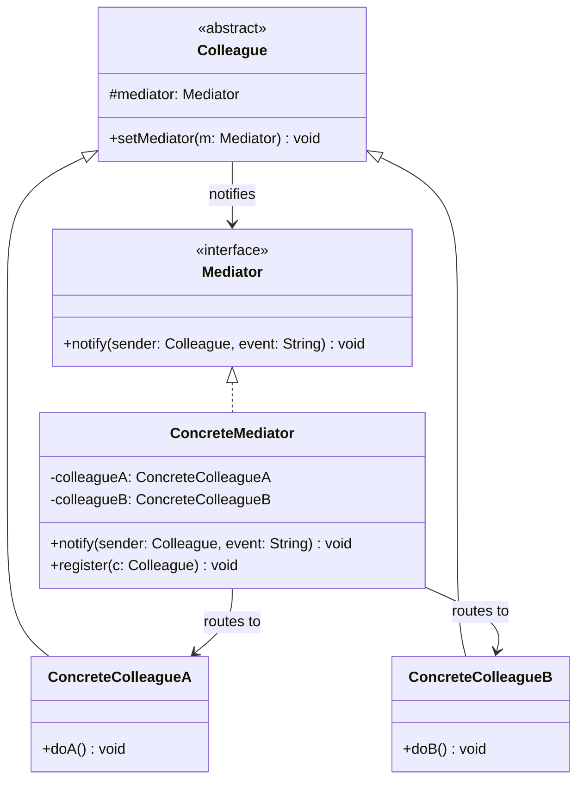

# 중재자(Mediator) 디자인 패턴 가이드

> 한 줄 요약: 서로 직접 참조하던 여러 객체 사이의 다대다(N:M) 통신을 중재자(Mediator) 한 곳으로 집중시켜, 객체 간 결합도를 낮추고 상호작용 로직을 캡슐화하는 패턴이다.
>
> 분류: 행위 패턴(Behavioral Pattern)
> 다른 이름(Aliases): Intermediary, Interaction Hub

---

## 상세 설명

중재자(Mediator) 패턴은 다수의 객체가 서로를 직접 참조하며 메시지를 주고받을 때 발생하는 강한 결합 문제를 해결하기 위해 등장한 GoF의 행위 패턴이다. 예를 들어 채팅방의 사용자(User) 객체들이 서로의 참조를 직접 들고 메시지를 전달한다면, 사용자 수가 늘어날수록 연결선은 N×(N-1)/2 개로 폭증하고, 한 사용자의 동작 방식이 바뀔 때마다 다른 사용자 코드까지 영향을 받는다.

이 패턴은 그러한 객체들(이를 동료(Colleague)라 부른다)이 서로 직접 통신하지 않도록 강제하고, 대신 중재자(Mediator) 라는 단일 객체를 통해 메시지를 주고받게 만든다. 동료 객체는 "누구에게" 메시지를 보내는지 알 필요가 없고, 단지 "중재자에게 사건이 발생했음"을 알리기만 한다. 중재자는 발생한 이벤트의 종류와 발신자에 따라 어떤 동료에게 어떤 작업을 시킬지 결정한다.

핵심 아이디어는 "다대다 관계를 다대일 + 일대다 관계로 분해" 하는 것이다. 즉, 동료 ↔ 동료의 직접 연결 그래프를 동료 → 중재자 → 동료 형태의 별(star) 구조로 단순화한다. 그 결과 동료 객체의 재사용성이 높아지고, 상호작용 규칙이 중재자 한 곳에 모이므로 변경 지점이 명확해진다.

GoF 원전에서는 GUI 위젯(Widget) 간의 상호작용 — 예를 들어 다이얼로그 박스(Dialog)에서 "리스트 박스에서 항목을 고르면 텍스트 필드에 채워지고, OK 버튼이 활성화된다" 와 같은 규칙 — 을 다이얼로그라는 중재자가 관리하는 사례로 소개된다. 현대적인 변형으로는 메시지 버스(Message Bus), 이벤트 버스(Event Bus), 그리고 분산 시스템에서의 메시지 브로커(Message Broker)도 같은 아이디어의 확장으로 볼 수 있다.

---

## 디자인 패턴을 충족하는 최소 조건

이 섹션에서는 "어떤 코드가 진짜로 중재자 패턴이라고 부를 수 있는가" 의 기준을 명확히 한다.

1. **동료 객체는 서로를 직접 참조하지 않는다** — 동료(Colleague)들은 다른 동료의 구체 타입이나 참조를 필드로 보유하지 않으며, 협력이 필요하면 반드시 중재자를 거쳐야 한다.
2. **중재자(Mediator)라는 별도의 객체가 존재하고, 동료 → 중재자 방향의 참조가 있다** — 각 동료는 자신을 등록하거나 알림을 보낼 중재자 인터페이스를 알고 있어야 한다.
3. **상호작용 로직(Interaction Logic)이 중재자 안에 캡슐화된다** — "이벤트 X가 발생하면 동료 A에게 a()를, 동료 B에게 b()를 호출한다" 와 같은 협력 규칙이 동료가 아닌 중재자 내부에 위치한다.
4. **동료는 사건의 발생만을 통지(notify)하고, 수신자를 지정하지 않는다** — 동료는 "누가 받을지" 가 아니라 "무슨 일이 일어났는지" 를 중재자에게 알리는 형태여야 한다.

> 위 조건 중 하나라도 빠지면 단순한 헬퍼 클래스이거나, Facade/Observer 의 변형으로 분류된다.

### 흔히 오해하는 지점

- **퍼사드(Facade)와의 혼동**: Facade 는 복잡한 서브시스템 위에 단방향(클라이언트 → 서브시스템) 단순화 창구를 제공할 뿐, 서브시스템 내부 객체들이 서로 통신하지 않는다. 반면 Mediator 는 동료들 사이의 양방향 협력을 조율한다. "서브시스템 객체들이 서로 대화하느냐" 가 결정적 차이다.
- **옵저버(Observer)와의 혼동**: Observer 는 주체(Subject)의 상태 변화를 다수의 관찰자(Observer)에게 일방적으로 브로드캐스트하는 일대다 통지 메커니즘이다. Mediator 는 임의의 동료가 발신자가 될 수 있고, 중재자가 발신자와 이벤트 종류에 따라 수신자를 선택해 라우팅한다. 실제로는 두 패턴을 결합해, 중재자가 내부적으로 Observer 메커니즘으로 동료의 변화를 구독하는 형태로 자주 구현된다.
- **싱글톤(Singleton) 인스턴스만 있으면 Mediator 라는 오해**: 전역에서 접근 가능한 정적 객체라고 해서 자동으로 Mediator 가 되는 것은 아니다. 동료가 서로 직접 참조하지 않는다는 구조적 조건이 반드시 충족되어야 한다.
- **유틸리티 클래스와의 혼동**: 단순히 두 객체 사이의 변환을 도와주는 정적 메서드 모음은 상호작용 로직을 캡슐화하지 않으므로 중재자가 아니다.

---

## 사례를 통한 예시

### 예시 1: 채팅방(ChatRoom) 직접 구현

**상황**: 여러 사용자(User)가 같은 채팅방에 입장해 메시지를 주고받는 시스템. 사용자가 서로의 참조를 직접 들고 있으면 사용자 추가/제거마다 모든 사용자 코드가 영향을 받는다. 중재자인 채팅방을 도입해 사용자는 채팅방에게만 메시지를 전달한다.

```java
import java.util.ArrayList;
import java.util.List;

// Mediator 인터페이스
interface ChatMediator {
    void register(User user);
    void send(String message, User sender);
}

// Concrete Mediator
class ChatRoom implements ChatMediator {
    private final List<User> users = new ArrayList<>();

    @Override
    public void register(User user) {
        users.add(user);
        user.setMediator(this);
    }

    @Override
    public void send(String message, User sender) {
        for (User u : users) {
            if (u != sender) {
                u.receive(message, sender.getName());
            }
        }
    }
}

// Colleague 추상 클래스
abstract class User {
    protected ChatMediator mediator;
    protected final String name;

    protected User(String name) {
        this.name = name;
    }

    public void setMediator(ChatMediator mediator) {
        this.mediator = mediator;
    }

    public String getName() {
        return name;
    }

    public abstract void send(String message);
    public abstract void receive(String message, String from);
}

// Concrete Colleague
class ChatUser extends User {
    public ChatUser(String name) {
        super(name);
    }

    @Override
    public void send(String message) {
        System.out.println("[" + name + " 전송] " + message);
        mediator.send(message, this);
    }

    @Override
    public void receive(String message, String from) {
        System.out.println("[" + name + " 수신] " + from + ": " + message);
    }
}

// 사용
public class MediatorDemo {
    public static void main(String[] args) {
        ChatMediator room = new ChatRoom();
        User alice = new ChatUser("Alice");
        User bob = new ChatUser("Bob");
        User carol = new ChatUser("Carol");

        room.register(alice);
        room.register(bob);
        room.register(carol);

        alice.send("안녕하세요");
        bob.send("반갑습니다");
    }
}
```

**해설**: `ChatMediator` 가 Mediator 역할, `ChatRoom` 이 Concrete Mediator, `User` 가 추상 Colleague, `ChatUser` 가 Concrete Colleague 에 대응된다. `ChatUser` 는 다른 `ChatUser` 의 참조를 들고 있지 않으며, 메시지를 보낼 때 `mediator.send(message, this)` 로 단지 "사건"만 통지한다. 누구에게 전달할지는 전적으로 `ChatRoom` 이 결정한다. 사용자가 100명이 되어도 `ChatUser` 클래스는 수정할 필요가 없다.

### 예시 2: Spring `ApplicationContext` — 빈(Bean) 간 협력의 중재자

**상황**: 스프링 프레임워크는 애플리케이션 컨텍스트(ApplicationContext) 가 사실상 거대한 중재자처럼 동작한다. 빈 객체들은 서로의 구체 구현을 `new` 로 직접 생성하지 않고, 컨테이너에게 의존성 주입(DI) 을 요청한다. 이벤트 발행/구독 역시 `ApplicationEventPublisher` 를 통해 컨테이너가 라우팅한다.

```java
import org.springframework.context.ApplicationEvent;
import org.springframework.context.ApplicationEventPublisher;
import org.springframework.context.event.EventListener;
import org.springframework.stereotype.Component;

// Colleague A: 주문 서비스
@Component
class OrderService {
    private final ApplicationEventPublisher publisher; // = Mediator

    public OrderService(ApplicationEventPublisher publisher) {
        this.publisher = publisher;
    }

    public void placeOrder(String orderId) {
        // ... 주문 처리 ...
        // 누가 받을지 모른 채 "사건"만 알린다
        publisher.publishEvent(new OrderPlacedEvent(this, orderId));
    }
}

// 이벤트(상호작용의 메시지)
class OrderPlacedEvent extends ApplicationEvent {
    private final String orderId;
    public OrderPlacedEvent(Object source, String orderId) {
        super(source);
        this.orderId = orderId;
    }
    public String getOrderId() { return orderId; }
}

// Colleague B: 이메일 발송 (OrderService 를 직접 모른다)
@Component
class EmailNotifier {
    @EventListener
    public void on(OrderPlacedEvent e) {
        System.out.println("주문 확인 메일 발송: " + e.getOrderId());
    }
}

// Colleague C: 재고 차감 (역시 OrderService 를 직접 모른다)
@Component
class InventoryUpdater {
    @EventListener
    public void on(OrderPlacedEvent e) {
        System.out.println("재고 차감: " + e.getOrderId());
    }
}
```

**해설**: `OrderService`, `EmailNotifier`, `InventoryUpdater` 는 모두 동료(Colleague) 이지만 서로의 참조를 일절 보유하지 않는다. 메시지는 `ApplicationEventPublisher`(중재자) 를 통해서만 흐른다. 이로써 새 동료(예: `AuditLogger`)를 추가해도 기존 동료 코드는 한 줄도 바뀌지 않는다. 비슷한 사상으로 `java.util.concurrent.Executor` 도 작업(Task) 제출자와 실행 스레드 사이의 중재자로 볼 수 있다 — 제출자는 어느 스레드가 실행할지 알지 못한 채 Executor 에게만 `execute(Runnable)` 로 통지한다.

---

## 어떨 때 사용하나

다음과 같은 신호(Symptom)가 보일 때 중재자 패턴 도입을 고려한다. 객체 간 직접 참조가 그래프 형태로 얽혀 있어 한 클래스를 수정하면 무관해 보이는 다른 클래스가 깨지는 상황, GUI 다이얼로그처럼 여러 컴포넌트의 상태가 서로의 변화에 따라 연동되어야 하는 상황, 새 협력 객체가 추가될 때마다 기존 객체들의 코드를 함께 고쳐야 하는 상황이 대표적이다. 또한 채팅·게임 로비·항공 관제와 같이 "참여자들 간의 메시지 라우팅 규칙" 자체가 도메인 로직의 중심을 차지하는 경우, 그 규칙을 한 객체에 모아두는 것이 자연스럽다. 마지막으로 동일한 협력에 참여하는 객체들을 다른 맥락에서 그대로 재사용하고 싶을 때(예: 같은 위젯을 다른 다이얼로그에 그대로 옮기고 싶을 때) 동료에서 상호작용 코드를 걷어내면 재사용성이 크게 높아진다.

- 객체 간 의존 그래프가 거미줄처럼 복잡해, 클래스 다이어그램이 "선만 그어도 검게 칠해지는" 수준에 도달한 경우
- 동료 객체의 재사용이 어렵고, 한 컨텍스트의 객체가 다른 컨텍스트의 객체를 너무 많이 알고 있는 경우
- 상호작용 규칙이 자주 바뀌고, 그 변경이 동료 클래스 곳곳에 흩어져 있는 경우
- 이벤트 기반의 느슨한 결합(Loose Coupling) 이 명시적 요구사항인 경우

### 사용하면 안 되는 경우 (Anti-patterns)

- **참여 객체가 2~3개로 매우 적고, 관계가 단순한 경우**: 중재자를 추가하면 오히려 호출 경로만 한 단계 늘어나고 추상화 비용이 이득보다 크다.
- **상호작용이 일방향 브로드캐스트일 뿐인 경우**: 단순 통지만 필요하다면 Observer 가 더 적합하다.
- **중재자가 모든 도메인 로직을 흡수해 God Object 가 되어가는 조짐이 있는 경우**: 이때는 중재자를 도메인 단위로 분할하거나 다른 패턴(예: Command, State)과 조합해야 한다.
- **성능이 매우 민감한 핫 패스(hot path)**: 모든 호출이 중재자를 거치면 간접 호출과 디스패치 비용이 누적될 수 있다.

---

## 장점과 단점, 한계점

### 장점
- **결합도 감소(Decoupling)**: 동료 객체는 서로를 알 필요가 없으므로, 한 클래스의 변경이 다른 클래스로 전파되지 않는다.
- **상호작용 로직의 일원화**: 협력 규칙이 중재자 한 곳에 모이므로 "어디서 무엇이 트리거되는가" 를 추적하기 쉽고, 규칙 변경 시 수정 지점이 명확하다.
- **동료의 재사용성 향상**: 동료 클래스에서 협력 코드가 사라지므로 다른 맥락에 그대로 이식하기 쉽다.
- **확장 용이성**: 새로운 동료를 추가할 때 기존 동료를 수정하지 않고 중재자에만 라우팅 규칙을 추가하면 된다(OCP 에 부합).
- **테스트 용이성**: 동료를 모킹(mock) 하기 쉬워지고, 중재자만 따로 단위 테스트할 수 있다.

### 단점
- **God Object(전능 객체) 위험**: 시스템이 커질수록 중재자에 모든 협력 규칙이 누적되어, 거대하고 변경 빈도가 매우 높은 "신(神) 객체" 가 되기 쉽다. 결합도가 동료들 사이에서 중재자 내부로 옮겨갈 뿐 사라지지 않는다는 비판이 있다.
- **간접 호출로 인한 가독성 저하**: 호출 흐름이 동료 → 중재자 → 동료 로 한 단계 우회하므로, 디버깅 시 누가 누구를 호출했는지 추적이 어렵다.
- **중재자 자체의 복잡성**: 동료가 늘어날수록 중재자 내부의 분기/조건이 빠르게 증가한다.

### 한계점
- 중재자가 상태를 들고 있다면 멀티스레드 환경에서 동기화 비용이 커진다(채팅방의 사용자 목록 갱신, 이벤트 버스의 구독자 관리 등).
- "동료 → 중재자" 의존만 끊으려고 중재자를 추상화하면, 이번에는 중재자 인터페이스가 비대해져 ISP(Interface Segregation) 를 위협한다.
- 분산 환경에서 중재자가 단일 실패 지점(SPOF) 이 될 수 있다 — 메시지 브로커류로 확장할 때는 가용성/장애 격리 설계가 별도로 필요하다.
- 정적 분석 도구로 호출 그래프를 그리기 어렵고, 이벤트 기반 구현일수록 IDE 의 "Find Usages" 가 무력해진다.

---

## 정보 표

| 항목 | 값 |
| --- | --- |
| 분류 | 행위 패턴(Behavioral) |
| 언어 의존성 | 언어 비의존적 — 인터페이스/추상 클래스만 표현할 수 있으면 어느 언어에서도 동일하게 구현 가능 |
| 활용성(1점~5점) | ★★★★☆ (4/5) — GUI, 채팅, 이벤트 버스, DI 컨테이너 등 산업 현장 어디서나 변형 형태로 자주 등장 |
| 학습 난이도 | 중 — 개념은 단순하나 Observer/Facade 와의 경계, God Object 회피 설계 감각이 필요 |
| 자주 함께 쓰이는 패턴 | Observer(중재자가 동료 변화를 구독), Command(중재자가 명령을 큐잉/디스패치), Facade(외부에 단순 창구 제공) |
| 대표 사용 사례 | GUI 다이얼로그의 위젯 협력, 채팅방/항공 관제탑, Spring `ApplicationContext` 의 이벤트 라우팅, `java.util.concurrent.Executor`, 메시지 브로커(Kafka/RabbitMQ) |

---

## Class Diagram



> 다이어그램에 등장하는 각 클래스가 패턴의 어떤 역할(Role)을 담당하는지 위 "상세 설명" 섹션과 1:1로 대응되어야 한다.

### 역할 설명
- **Mediator(중재자 인터페이스)**: 동료들이 사건을 알릴 수 있도록 `notify(sender, event)` 형태의 통지 창구를 정의한다. 동료는 이 인터페이스 타입에만 의존한다.
- **ConcreteMediator(구체 중재자)**: 실제 협력 규칙을 구현한다. 어떤 동료로부터 어떤 사건이 오면 어떤 동료의 어떤 메서드를 호출할지 결정한다. 종종 동료들의 참조 목록을 보유한다.
- **Colleague(동료 추상)**: 중재자 참조를 보유하며, 다른 동료의 구체 타입을 알지 못한다. 협력이 필요할 때는 오직 `mediator.notify(...)` 만 호출한다.
- **ConcreteColleagueA / ConcreteColleagueB(구체 동료)**: 자기 책임만을 수행하며, 사건이 발생하면 중재자에게 통지한다. 다른 동료의 존재를 가정하지 않는다.

---

## 참고 자료
- 원전: Erich Gamma, Richard Helm, Ralph Johnson, John Vlissides, "Design Patterns: Elements of Reusable Object-Oriented Software", Addison-Wesley, 1994 — Chapter 5 "Mediator"
- Refactoring.Guru, "Mediator Pattern": https://refactoring.guru/design-patterns/mediator
- Spring Framework Reference Documentation — `ApplicationContext`, `ApplicationEventPublisher` 절
- Joshua Bloch, "Effective Java" 3rd ed. — 의존성 주입과 느슨한 결합에 관한 논의
- `java.util.concurrent.Executor` Javadoc — 작업 제출과 실행을 분리하는 중재자적 사례
