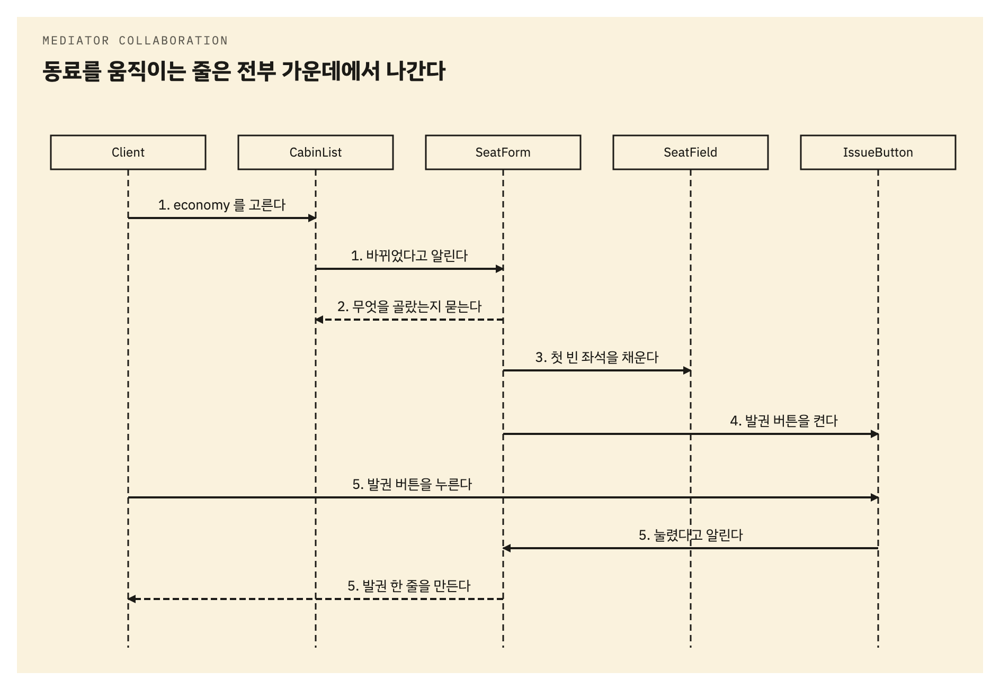
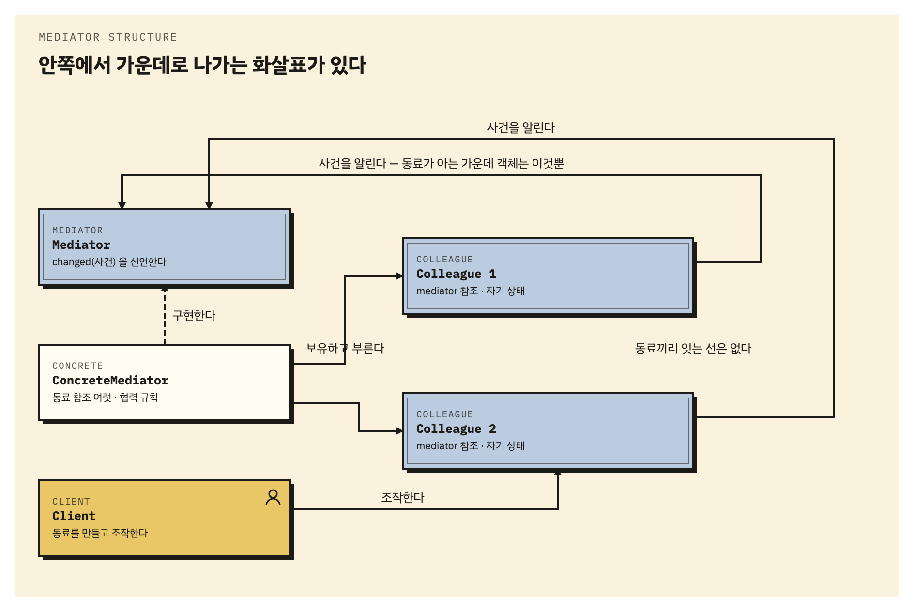

# Mediator — 동료끼리 주고받을 말을 가운데 한 곳에 모으기

## 한눈에 보는 개요

항공권 발권 창구의 좌석 지정 화면을 하나 떠올려 봅시다. 화면에는 좌석 등급 목록, 좌석 번호 입력란, 마일리지 사용 스위치, 발권 버튼 넷이 있어요. 넷은 따로 노는 것이 아니라 서로 얽혀 있습니다. 등급을 고르면 좌석 번호가 그 등급의 첫 빈 좌석으로 채워져야 하고, 좌석 번호가 채워지면 발권 버튼이 켜져야 하고, 비즈니스석을 고르면 마일리지 스위치가 꺼진 채 잠겨야 해요. 이 규칙들을 위젯 안에 넣으면 목록이 입력란을 알아야 하고, 입력란이 버튼을 알아야 하고, 목록이 스위치까지 알아야 합니다. 그리고 그 참조들은 위젯을 다른 화면으로 옮길 때 통째로 따라와요.

Mediator 가 두는 한 수는 **동료끼리 주고받을 말을 가운데 객체 하나에 모으는 것**입니다. 각 위젯은 다른 위젯을 모른 채 자기에게 무슨 일이 일어났는지만 그 객체에 알리고, 어느 사건이면 어느 위젯을 어떻게 움직일지는 그 한 곳이 정해요.

```text
Before : 위젯이 서로를 직접 안다

  CabinList ──▶ SeatField ──▶ IssueButton
      │              ▲             ▲
      └──────────────┼─────────────┘
                MileageToggle
  위젯 하나가 드는 참조     최대 3개 (자기 말고 나머지 전부)
  "등급이 바뀌면 무엇을 한다" 규칙이 사는 곳   CabinList 안

After : 위젯은 가운데 객체만 알고, 가운데 객체가 나머지를 움직인다

  CabinList ─┐                      ┌─▶ SeatField
  SeatField ─┼─▶ SeatForm ──────────┼─▶ MileageToggle
  Mileage…  ─┤   (사건 → 누구에게    └─▶ IssueButton
  IssueBtn  ─┘     무엇을 시킬지)
  위젯 하나가 드는 참조     1개 (가운데 객체)
  "등급이 바뀌면 무엇을 한다" 규칙이 사는 곳   SeatForm 안 한 곳
```

이 패턴의 이름은 GoF(Gang of Four, 1994년에 나온 *Design Patterns* 의 저자 네 명을 함께 부르는 이름)가 붙인 것이고, 가운데 객체를 Mediator(중재자), 그 객체를 거쳐 통신하는 바깥 객체들을 Colleague(동료)라고 부릅니다. 분류는 행위 패턴이고 함께 쓰는 패턴은 Observer 입니다. 동료가 중재자에게 사건을 알리는 길을 Observer 의 발행·구독 장치로 깔 수 있거든요(근거: GoF 원서 Mediator 절 Related Patterns — 동료는 Observer 패턴을 써서 중재자와 통신할 수 있다). 이 글은 시나리오 셋을 따라갑니다. 등급 하나를 고른 것이 화면 전체로 번지는 길, 새 위젯이 더해질 때 무엇이 안 바뀌는가, 규칙이 가운데를 벗어나면 어느 단계에서 무엇이 깨지는가. 끝까지 읽으면 어떤 코드를 Mediator 라고 불러도 되는지 필수 조건 넷으로 판정할 수 있고, 그림만으로는 갈라지지 않는 Facade 와도 구분할 수 있게 됩니다.

## 패턴 자세히 들여다보기

### 시나리오 1 — 등급 하나를 골랐을 뿐인데 화면 셋이 따라 움직이는 길

예약번호 QR4821 의 좌석을 잡습니다. 이 항공편의 좌석표는 비즈니스석 `1A`·`1B`·`2A`·`2B` 와 이코노미석 `10A`·`10B`·`11A`·`11B` 이고, `1A` 와 `10A` 는 이미 팔렸어요. 요금은 비즈니스석 480,000원, 이코노미석 180,000원입니다. 이 장면에는 여섯이 등장해요. 좌석 등급 목록 `CabinList`, 좌석 번호 입력란 `SeatField`, 발권 버튼 `IssueButton` 셋은 서로 직접 말을 걸지 않고 가운데를 거쳐 통신하는 객체(패턴에서는 Colleague 라고 부르는 역할)이고, 그 셋 사이에 낀 `SeatForm` 이 협력 규칙을 들고 있는 객체(ConcreteMediator), `SeatFormMediator` 는 그 셋이 알고 있는 연산 모양 하나(`changed(사건)`)를 선언한 타입(Mediator), 그리고 화면을 세우고 손님 대신 위젯을 조작하는 진입점이 Client 입니다. 이름은 여기서 한 번씩만 소개하고 정식 정의는 개념 정리에서 해요. 손님이 이코노미를 고르면 좌석 `10B` 가 채워지고 발권 버튼이 켜진 화면이 나와야 하고, 이어서 버튼을 누르면 발권 한 줄이 나와야 합니다.



1. Client 가 등급 목록에서 `economy` 를 고릅니다. `CabinList` 는 자기 선택값만 바꾸고 "내가 바뀌었다"를 `SeatForm` 에 알려요. 목록이 입력란을 직접 고치지 않는 이유는 **누가 영향을 받는지를 목록이 모르기 때문**입니다. 화면마다 딸린 위젯이 다른데 목록이 그것을 알면, 같은 목록 클래스를 다른 화면에서 쓸 수 없어요.
   - 갈래 1-a. 여기서 조립 순서 문제가 먼저 걸립니다. `CabinList` 는 `SeatForm` 을 들고 있어야 알릴 수 있고 `SeatForm` 은 `CabinList` 를 들고 있어야 물어볼 수 있으니, 둘 다 생성자로 상대를 받으면 어느 쪽도 먼저 설 수 없어요. 정본이 고른 길은 **중재자가 동료를 만들어 자기 필드에 넣는 것**입니다. `SeatForm` 의 생성자가 `new CabinList(this)` 처럼 자기 자신을 넘기면 순환이 한 생성자 안에서 닫혀요.
   - 갈래 1-b. 다른 길은 동료를 먼저 세워 두고 나중에 중재자를 꽂아 넣는 것입니다. 동료에 `setMediator` 같은 연산을 두고 조립 코드가 양쪽을 만든 뒤 이어 주면 되는데, 그 대신 동료가 중재자 없이 존재하는 시간이 생겨 그때 사용자가 조작하면 알릴 곳이 없어요.
   - 갈래 1-c. 둘 다 안 쓰고 생성자로 양방향을 받으면 컴파일이 막습니다. 구현 절 Java 코드의 122~128행(`SeatForm` 의 생성자)을 네 동료를 인자로 받는 생성자로 바꾸고, 진입점 202~206행에서 동료 넷을 먼저 만들게 고치면 javac 이 **`error:` 를 단 진단 4건**으로 멈춰요. 아래가 그중 첫 건이고, 절대 경로 앞머리와 캐럿(`^`) 줄만 지웠습니다. 기준은 Java 21.0.11 이에요.

     ```text
     SeatFormApp.java:203: error: cannot find symbol
             CabinList cabin = new CabinList(form);
       symbol:   variable form
       location: class SeatFormApp
     ```

     나머지 셋도 `SeatField`·`MileageToggle`·`IssueButton` 을 만드는 줄에서 같은 `variable form` 을 못 찾아 나는 진단입니다. 진단이 가리키는 203행은 생성자 선언이 두 줄이 되어 한 줄 늘어난 사본 기준이고, 정본에서 같은 자리는 202행이에요. 순서를 뒤집어도 마찬가지입니다. 같은 사본에서 진입점의 다섯 줄만 중재자를 먼저 세우는 순서로 바꿔 컴파일하면 이번에는 203행 한 줄에서 `cabin`·`seat`·`mileage`·`issue` 넷을 못 찾아 진단이 또 4건 나요. 어느 쪽을 먼저 세워도 안 선다는 것이 순환이라는 뜻입니다.
2. `SeatForm` 이 `CabinList` 에게 무엇을 골랐는지 되묻습니다. 통지가 값을 들고 오지 않는 이유는 **동료가 "무슨 일이 일어났는지"만 말하고 "그래서 무엇이 필요한지"는 말하지 않기 때문**이에요. 값을 통지에 실으면 동료가 "중재자가 이 값을 쓸 것"이라고 가정하는 셈이고, 규칙이 바뀌어 다른 값이 필요해지면 동료의 통지 모양까지 따라 바뀝니다.
3. `SeatForm` 이 이코노미석의 첫 빈 좌석 `10B` 를 `SeatField` 에 채웁니다. 이 일을 중재자가 맡는 이유는 "등급이 바뀌면 좌석을 다시 잡는다"가 **목록의 일도 입력란의 일도 아니기 때문**이에요. 목록은 어느 좌석이 비었는지 모르고, 입력란은 등급이 바뀐 줄 모릅니다. 두 동료 어느 쪽에도 속하지 않는 규칙이라 가운데에 남아요.
4. 입력란에 글자가 생겼으므로 `SeatForm` 이 `IssueButton` 을 켭니다. 3단계와 4단계의 순서를 바꾸면 버튼이 **아직 비어 있는 입력란**을 보고 판정하게 돼요. 실제로 그 순서로 돌린 결과가 시나리오 3 의 2단계에 있고, 첫 줄의 발권 버튼이 `issue=on` 이 아니라 `issue=off` 로 나옵니다.
5. Client 가 발권 버튼을 누르고, `IssueButton` 은 "눌렸다"만 알립니다. `SeatForm` 이 세 동료에게서 등급·좌석·마일리지를 모아 발권 한 줄을 만들어요. 버튼이 발권 문장을 직접 만들지 않는 이유는 **그러려면 버튼이 나머지 동료를 전부 알아야 하기 때문**입니다. 그 순간 버튼은 이 화면 전용 클래스가 돼요.

```text
단계   부르는 쪽 → 받는 쪽            넘기는 것              돌아오는 것
 1     Client → CabinList           "economy"              —
 1     CabinList → SeatForm         CABIN_SELECTED 사건     —
 2     SeatForm → CabinList         —                      "economy"
 3     SeatForm → SeatField         "10B"                  —
 4     SeatForm → IssueButton       켜짐                    —
 5     Client → IssueButton         —                      —
 5     IssueButton → SeatForm       ISSUE_CLICKED 사건      —
 5     SeatForm → (세 동료)          —                      economy · 11A · 마일리지 안 씀
```

잠깐, 확인 하나만 해 볼까요? 1단계에서 `CabinList` 가 `SeatForm` 에 알리지 않고 그냥 자기 선택값만 바꿔 두면 화면은 어떻게 될까요?

좌석 입력란은 빈 채로 남고 발권 버튼도 꺼진 채로 남습니다. 등급만 `economy` 로 바뀐 화면이 되는 것이죠. 방아쇠가 그 한 줄이에요. 아래는 구현 절 Java 코드의 23행(`mediator.changed(FormEvent.CABIN_SELECTED);`)만 지우고 다시 돌린 결과입니다.

```text
정본                      1) select economy | cabin=economy seat=10B mileage=off/free   issue=on
통지 한 줄을 지운 사본      1) select economy | cabin=economy seat=-   mileage=off/locked issue=off
```

좌석도 안 채워지고 버튼도 안 켜지며, 마일리지 스위치까지 잠긴 채로 남았어요. 통지가 빠지면 2~4단계가 아예 일어나지 않기 때문입니다. 동료가 중재자를 아예 모르게 만든 모양은 시나리오 3 의 3단계에서 따로 봅니다.

이 시나리오가 보여 준 것은 역할 넷과 그 사이의 호출 방향입니다. 사용자 조작을 받아 사건으로 바꿔 알리는 일(1·5단계)은 동료가 합니다. 그런데 **다른 동료를 움직이는 일(2·3·4·5단계)은 전부 중재자에서 나가요.** 동료 셋은 서로의 이름을 한 번도 부르지 않았고, 각자 아는 바깥 객체는 `SeatFormMediator` 하나뿐입니다. 조립 순환(갈래 1-a·1-b)은 이 구조를 세울 때 반드시 한 번 만나는 문제이고, 푸는 길은 둘 중 하나예요.

### 시나리오 2 — 마일리지 스위치가 더해질 때

항공사가 이코노미석에 한해 마일리지 30,000원을 쓸 수 있게 했습니다. 비즈니스석에서는 못 써요. 화면에 마일리지 사용 스위치 `MileageToggle` 하나가 새로 붙습니다. 시험할 값은 QR4821 의 이코노미석 `11A` 이고, 마일리지를 켜면 180,000 − 30,000 = 150,000원이 나와야 해요. 그다음 같은 화면에서 비즈니스석으로 옮기면 스위치가 꺼진 채 잠기고 좌석은 `1B`, 요금은 480,000원이 나와야 합니다.

1. 개발자가 `MileageToggle` 클래스를 새로 씁니다. 가진 것은 켜짐 여부와 잠김 여부, 그리고 `SeatFormMediator` 참조 하나예요. 이 클래스가 등급을 모르는 이유는 **"이코노미석에서만 쓸 수 있다"가 스위치의 성질이 아니라 이 화면의 규칙이기 때문**입니다. 다른 화면에서 같은 스위치를 다른 조건으로 쓰고 싶어질 수 있으니까요.
2. `SeatForm` 의 등급 선택 갈래에 한 줄이 늘어납니다 — 이코노미면 풀고 아니면 잠근다. 이 줄이 중재자에 사는 이유는 시나리오 1 의 3단계와 같아요. `CabinList` 는 스위치를 모르고 `MileageToggle` 은 등급을 모르니, **두 동료 어느 쪽에도 속하지 않는 규칙**입니다.
3. 기존 동료 셋은 한 줄도 바뀌지 않습니다. `CabinList`·`SeatField`·`IssueButton` 의 코드에 다른 동료 이름이 하나도 없어서 **새 이름이 들어갈 자리 자체가 없기 때문**이에요. 서로를 직접 알았다면 적어도 `CabinList` 는 스위치를 잠그는 줄을 받았을 겁니다.
4. 조립에 한 줄이 늘어납니다 — 중재자의 생성자가 새 동료를 만들어 필드에 넣는 줄이에요. 갈래 1-a 를 골랐기 때문에 새 동료가 설 자리도 중재자 안 한 곳입니다.
5. 대신 중재자가 커집니다. 규칙이 하나 늘 때마다 통지를 받는 연산이 길어져요. 흩어져 있을 복잡성을 한 객체의 복잡성으로 맞바꾸는 것이 이 패턴이 치르는 값이고, 그래서 중재자는 어느 동료보다도 복잡해지기 쉽습니다(근거: GoF 원서 Mediator 절 Consequences — 제어가 한곳에 모이면서 상호작용의 복잡성이 중재자의 복잡성으로 바뀌고, 유지보수하기 어려운 단일체가 될 수 있다).

```text
변화                 바뀐 곳                                     안 바뀐 곳
MileageToggle 추가   MileageToggle 클래스 (새로 씀)               CabinList 전체
                     SeatForm 의 등급 갈래 한 줄 (잠금 규칙)       SeatField 전체
                     SeatForm 의 필드·생성자 각 한 줄              IssueButton 전체
                     SeatForm 의 요금 계산 한 줄 (할인)            SeatFormMediator 의 연산 모양
```

이 변화를 진입점에서 그대로 돌린 것이 구현 예시의 실행 출력 4~7번 줄이에요. 4번 줄이 스위치를 켠 직후이고 5번 줄이 그 상태로 발권한 줄, 6번 줄이 비즈니스석으로 옮겨 스위치가 잠긴 줄, 7번 줄이 그 상태로 발권한 줄입니다.

| 줄 | 조작 | 마일리지 | 발권 결과 |
| --- | --- | --- | --- |
| 4 | 마일리지 스위치를 켠다 | `on/free` | — |
| 5 | 발권 버튼을 누른다 | `on/free` | 180,000 − 30,000 = 150,000 |
| 6 | 비즈니스석을 고른다 | `off/locked` — 켜져 있던 것이 꺼졌다 | — |
| 7 | 발권 버튼을 누른다 | `off/locked` | 480,000 − 0 = 480,000 |

여기서 헷갈리기 쉬운 포인트는 6번 줄의 `off` 가 손님이 스위치를 끈 결과라고 읽는 것입니다. 손님은 스위치를 건드리지 않았어요. 등급을 바꾼 것뿐인데 중재자가 잠그면서 켜짐까지 내린 것입니다. 이 한 칸이 **중재자가 가진 것이 호출 순서가 아니라 규칙이라는 증거**예요 — 순서만 아는 객체라면 손님이 부르지 않은 동작을 자기 판단으로 일으킬 수 없습니다.

이 시나리오가 보여 준 것은 변화의 범위입니다. 동료가 하나 늘 때 바뀌는 곳은 새 동료 클래스 하나와 중재자의 규칙 몇 줄이고, 기존 동료는 그대로예요(1~3단계). 그 대가로 중재자만 계속 자라고(5단계), 자라는 방향이 한 협력 묶음 밖으로 나가면 비교 절에서 볼 God Object 가 됩니다.

### 시나리오 3 — 규칙이 가운데를 벗어나면 어느 단계에서 무엇이 깨지는가

같은 화면을 조금씩 다르게 짠 코드베이스 셋을 차례로 따라갑니다. 아래 결과는 모두 정본 코드의 해당 부분만 바꿔 **직접 컴파일하고 실행한 것**이고, 기준은 Java 21.0.11 이에요. 비교 대상인 정본의 출력은 구현 예시 절에 있는 아홉 줄입니다.

1. 동료가 다른 동료를 직접 드는 갈래부터 봅니다. "입력란에 글자가 생기면 버튼을 켜는 것이니 `SeatField` 가 버튼을 직접 들면 되지 않느냐"는 생각으로, `SeatField` 에 `IssueButton` 필드를 더하고 `typeIn` 이 중재자에 알리는 대신 버튼을 직접 켜게 고쳤어요. 정본 Java 코드에서 고친 곳은 셋입니다 — `SeatField` 의 필드와 생성자(32~37행), `typeIn` 의 본문(43~46행), 그리고 생성 순서를 맞추려고 `SeatForm` 생성자의 네 줄(124~127행)이에요. 컴파일은 지나가고 실행 결과의 8·9번 줄이 갈립니다.

   ```text
   정본                8) type 1A      | cabin=business seat=1A mileage=off/locked issue=off
                       9) click issue  | cabin=business seat=1A mileage=off/locked issue=off
   동료를 직접 든 사본   8) type 1A      | cabin=business seat=1A mileage=off/locked issue=on
                       9) click issue  | ... issue=on | ticket QR4821 business 1A fare=480000 discount=0 pay=480000
   ```

   이미 팔린 좌석 `1A` 로 발권이 됐어요. `SeatField` 가 켤지 말지를 판정할 때 쓸 수 있는 정보가 **자기 글자가 비었는지 여부뿐**이기 때문입니다. "그 좌석이 지금 등급에서 살 수 있는 좌석인가"는 `CabinList` 와 좌석표를 함께 봐야 알 수 있는데, 입력란은 둘 다 모르거든요. 규칙을 동료로 내리면 그 동료가 아는 만큼으로 규칙이 줄어듭니다.
2. 다음은 규칙을 동료들에게 흩고 가운데를 통지 배달로만 쓰는 갈래예요. `SeatForm` 자리에 사건을 구독자 전원에게 뿌리는 버스를 두고, "무엇을 할지"는 동료마다 자기 안에 갖게 했습니다. 그러면 입력란은 첫 빈 좌석을 알려고 `CabinList` 를, 버튼은 판정하려고 `CabinList` 와 `SeatField` 와 `MileageToggle` 을 들어야 해요 — 동료 참조가 되살아납니다. 그리고 답이 **구독 순서에 좌우됩니다.**

   ```text
   구독 순서 A (버튼 → 입력란 → 토글)
     1) select economy  | cabin=economy seat=10B mileage=off/free issue=off
     6) select business | cabin=business seat=1B mileage=off/locked issue=off
     7) click issue     | cabin=business seat=1B mileage=off/locked issue=off

   구독 순서 B (입력란 → 토글 → 버튼)
     1) select economy  | cabin=economy seat=10B mileage=off/free issue=on
     6) select business | cabin=business seat=1B mileage=off/locked issue=on
     7) click issue     | ... | ticket QR4821 business 1B fare=480000 discount=0 pay=480000
   ```

   순서 B 는 정본과 아홉 줄이 모두 같고 순서 A 만 세 줄이 다릅니다. 버튼이 입력란보다 먼저 반응하면 **아직 채워지지 않은 좌석**을 보고 판정하기 때문이에요. 시나리오 1 의 4단계에서 3단계보다 먼저 하면 안 된다고 한 자리가 이것이고, 중재자에 규칙을 두면 그 순서가 한 연산 안에 글로 적혀 있지만 흩어 두면 구독 등록 순서라는 **코드 어디에도 규칙으로 적혀 있지 않은 것**이 순서를 정합니다.
3. 마지막은 동료가 가운데 객체를 아예 모르는 갈래입니다. `CabinList` 에서 중재자 참조와 통지 호출을 지우고, 대신 `SeatForm` 에 `selectCabin(등급)` 이라는 공개 연산을 두어 그것이 목록을 고친 다음 규칙을 돌리게 했어요. 창구를 통해 부르면 정본과 같이 움직입니다. 그런데 `SeatForm` 을 건너뛰고 `cabinList.select("business")` 를 직접 부르면 6·7번 줄이 이렇게 갈려요.

   ```text
   정본               6) select business | cabin=business seat=1B  mileage=off/locked issue=on
                      7) click issue     | ... | ticket QR4821 business 1B  fare=480000 discount=0 pay=480000
   창구 모양의 사본     6) select business | cabin=business seat=11A mileage=on/free   issue=on
                      7) click issue     | ... | ticket QR4821 business 11A fare=480000 discount=30000 pay=450000
   ```

   등급만 비즈니스석으로 바뀌고 좌석은 이코노미석 `11A` 가 그대로 남았으며, 잠겼어야 할 마일리지가 켜진 채로 30,000원 할인까지 먹었습니다. **규칙이 창구를 지나는 경로에만 걸린 것**이죠. 동료가 중재자를 모르면 중재자를 거치지 않는 길이 언제나 하나 더 있고, 그 길로 간 코드는 규칙 전체를 건너뜁니다.
4. 세 갈래를 되돌리는 길은 서로 다릅니다. 1번은 동료에서 다른 동료 참조를 걷어내 규칙을 중재자로 올리는 일, 2번은 흩어진 반응 규칙을 한 연산으로 모으는 일, 3번은 동료에게 중재자 참조를 돌려주어 우회로를 없애는 일이에요. 셋이 각각 최소 조건 1번·4번·2번에 대응하고, 그래서 그 셋을 따로 센 것입니다.

이 시나리오가 보여 준 것은 이 패턴이 지키는 것이 무엇인지입니다. 규칙을 동료로 내리면 그 동료가 아는 만큼으로 규칙이 잘리고(1단계), 규칙을 여럿에게 흩으면 코드에 안 적힌 순서가 답을 정하며(2단계), 동료에게서 중재자 참조를 걷어내면 규칙을 건너뛰는 길이 열립니다(3단계). 셋 다 컴파일은 통과하고 값만 조용히 갈려요.

### 개념 정리

시나리오에 나온 역할 넷을 정식으로 정의합니다. 셋은 이 패턴의 참여자이고, Client 는 참여자 목록 밖이지만 동료를 세우고 조작하는 쪽으로 시나리오와 구현에 늘 나오므로 함께 정의해요.

- **Mediator** — 동료들과 통신하는 연산을 선언합니다. 동료는 이 선언만 보고 "무슨 일이 일어났다"를 알리고(시나리오 1 의 1·5단계), ConcreteMediator 가 이 선언을 구현해요. 좌석 화면 예에서는 사건 하나를 받는 연산 `changed(사건)` 을 선언한 `SeatFormMediator` 가 Mediator 입니다. 동료가 상대할 중재자가 한 종류뿐이면 이 타입을 따로 두지 않아도 되고, 그때는 동료가 ConcreteMediator 를 직접 참조합니다.
- **ConcreteMediator** — 동료들을 참조로 보유하고, 통지를 받으면 어느 동료의 어떤 연산을 부를지 정해 실제로 부릅니다(시나리오 1 의 2~4단계). 여기에 사는 규칙은 어느 동료에게도 속하지 않는 것들이에요 — "등급이 바뀌면 첫 빈 좌석을 채운다", "비즈니스석이면 마일리지를 잠근다" 같은 것이죠. 좌석 화면 예에서는 `SeatForm` 이 ConcreteMediator 입니다.
- **Colleague** — 서로 직접 말을 걸지 않고 중재자를 거쳐 통신하는 객체입니다. 자기 상태와 자기 조작만 가지고 있고, 다른 동료와 통신했을 상황에서는 대신 중재자에게 알려요(시나리오 1 의 1단계). 그래서 Colleague 의 코드에는 다른 Colleague 의 타입 이름이 나오지 않고 중재자 참조 하나만 있습니다. 좌석 화면 예에서는 `CabinList`·`SeatField`·`MileageToggle`·`IssueButton` 넷이 각각 Colleague 예요.
- **Client** — 중재자와 동료들을 세워 이어 주고(시나리오 1 의 갈래 1-a·1-b), 그 뒤에는 동료를 조작하는 쪽입니다. 사용자 인터페이스에서는 사람의 손이 하는 일을 코드로 세운 자리예요. 좌석 화면 예에서는 진입점이 Client 이고, `SeatForm` 에서 받아 온 동료들에게 조작을 넣습니다.



그림에서 봐 둘 것은 **동료 칸에서 나가는 화살표**입니다. 동료는 Mediator 를 알고 그쪽으로 말을 걸어요. 이 화살표가 있는지 없는지가 뒤에서 볼 Facade 와 이 패턴을 가르는 유일한 자리이고, 최소 조건 2번이 코드에서 확인하는 것이 바로 그것입니다. 동료 칸끼리 잇는 선이 하나도 없다는 것은 최소 조건 1번이 보고요.

> 동료는 무슨 일이 일어났는지만 말하고, 누가 무엇을 할지는 가운데가 정한다.

## 사용 목적

Mediator 를 꺼낼 때는 코드나 요구에서 보이는 단서가 있습니다. 셋을 차례로 봅시다.

**단서 1. 클래스 하나를 고치면 얽힌 클래스들이 줄줄이 수정 목록에 오릅니다.** 잘 정의됐지만 복잡하게 통신하는 객체 무리가 첫 번째 대상이에요(근거: GoF 원서 Mediator 절 Applicability). 코드에서는 한 커밋이 건드린 파일 목록으로 보입니다. 아래는 마일리지 규칙이 위젯마다 흩어져 있을 때의 모양이에요.

```text
변경 요청                         수정된 파일
────────────────────────────────  ──────────────────────────────────────────
비즈니스석은 마일리지 불가         CabinList · MileageToggle · IssueButton
마일리지 할인액을 30,000 으로       MileageToggle · IssueButton
좌석 매진 시 다음 등급 안내         CabinList · SeatField · IssueButton
```

**단서 2. 컴포넌트를 다른 화면으로 옮기려는데 참조가 통째로 따라옵니다.** 한 객체가 다른 객체 여럿을 참조하고 그들과 통신해서 재사용이 어려운 상황이 두 번째 대상입니다(근거: GoF 원서 Mediator 절 Applicability). 코드에서는 클래스 머리의 필드 목록으로 바로 보여요. `IssueButton` 을 예약 변경 화면에 가져다 쓰려는데 그 클래스의 필드가 아래와 같다면, 예약 변경 화면에도 같은 이름의 위젯 셋을 만들어 줘야 합니다.

```text
final class IssueButton {
    private final CabinList cabinList;         // 이 셋이 없으면 컴파일이 안 된다
    private final SeatField seatField;
    private final MileageToggle mileageToggle;
```

**단서 3. 같은 사건에 대한 반응이 여러 파일에 흩어져 추적이 안 됩니다.** "등급을 바꿨는데 왜 마일리지가 꺼졌지"를 알아보려면 위젯 파일을 전부 열어 `CABIN_SELECTED` 를 검색해야 하는 상태예요. 시나리오 3 의 2단계가 그 모양이었고, 거기서는 그 흩어짐이 구독 순서 의존까지 데려왔습니다. 여러 클래스에 분산된 행위를 서브클래스를 많이 만들지 않고 바꾸고 싶은 경우가 세 번째 대상이에요(근거: GoF 원서 Mediator 절 Applicability).

비슷한 단서에서 다른 패턴을 골라야 하는 경우가 둘 있습니다. 바깥에서 안쪽을 편하게 쓰게 해 주는 것이 목적이면 Facade 를, 한 객체의 상태 변화를 여럿에게 알리기만 하면 되면 Observer 를 먼저 검토하세요. 둘과의 차이는 다음 절에서 풉니다. 그리고 아래 상황에서는 Mediator 를 쓰면 얻는 것보다 잃는 것이 커요.

| 쓰지 말아야 할 상황 | 쓰면 잃는 것 |
| --- | --- |
| 동료가 둘뿐이고 규칙이 한 방향으로만 흐름 | 클래스 하나와 간접 호출 한 겹이 늘 뿐, 줄일 다대다 관계가 없음. 동료 둘이면 직접 참조도 간선이 하나라 시나리오 1 의 1단계가 막는 재사용 문제가 생기지 않음 |
| 서로 무관한 규칙 묶음까지 한 중재자에 모음 | 중재자가 앱의 거의 모든 클래스와 얽힌 객체 하나가 됨. 시나리오 2 의 5단계가 그 방향이고, 비교 절의 마지막 줄이 그 끝 |
| 동료마다 반응 규칙이 달라야 하고 그 규칙이 동료 고유의 성질일 때 | 동료의 성질을 중재자가 대신 들게 되어, 동료를 바꾸려면 중재자를 열어야 함. 시나리오 2 의 1단계에서 잠금 규칙을 중재자에 둔 근거가 "스위치의 성질이 아니다"였으니, 성질인 것은 반대로 동료에 남겨야 함 |

## 패턴의 경계

### 디자인 패턴을 충족하는 최소 조건

어떤 코드를 Mediator 라고 불러도 되는지 가르는 기준입니다. `[필수]` 가 하나라도 빠지면 Mediator 가 아니고, `[선택]` 은 갖추면 좋거나 상황에 따라 고르는 구조예요. 조건은 언어와 상관없이 코드에서 확인할 수 있는 모양(타입 선언·참조 보유·호출 방향·생성 위치)으로 적었고, 조건마다 그것을 보여 준 시나리오의 단계를 가리킵니다.

1. [필수] 동료 클래스가 다른 동료 타입을 **참조하지 않습니다** — 동료 클래스의 필드·생성자 인자·메서드 인자·반환 타입 어디에도 다른 동료 클래스의 타입이 없고, 동료 코드가 다른 동료의 연산을 부르지 않습니다. 동료 사이 의존 그래프에 동료→동료 간선이 하나도 없다는 뜻이에요. 시나리오 1 의 1단계에서 `CabinList` 가 입력란도 버튼도 모른 채 움직인 것이 이 자리입니다 (근거: GoF 원서 Mediator 절 Intent — 객체들이 서로를 명시적으로 참조하지 않게 해 느슨한 결합을 촉진하는 것이 이 패턴의 의도다).
   - 빠지면: 시나리오 3 의 1단계입니다. `SeatField` 가 `IssueButton` 을 직접 들자 판정에 쓸 수 있는 정보가 자기 글자뿐으로 줄어 이미 팔린 좌석으로 발권됐어요. 가운데 객체가 남아 있어도 규칙이 두 곳으로 갈라지므로, 이것은 중재자가 있는 코드가 아니라 **중재자와 직접 참조가 섞인 코드**입니다.
2. [필수] 동료가 중재자를 **알고, 다른 동료를 부를 자리에서 중재자에게 알립니다** — 동료 클래스의 필드나 연산 인자에 중재자 타입이 적혀 있고, 동료의 연산 본문에 그 참조로 나가는 호출이 하나 이상 있습니다. 시나리오 1 의 1단계와 5단계가 그 호출 두 개예요 (근거: GoF 원서 Mediator 절 Participants — 각 Colleague 클래스는 자기 Mediator 객체를 알고, 다른 동료와 통신했을 상황마다 대신 중재자와 통신한다).
   - 빠지면: 가운데 객체를 바깥에서만 알고 안쪽은 모르는 구조가 되어 Facade 쪽입니다. 시나리오 3 의 3단계가 그 모양이고, 중재자를 건너뛰는 길이 열려 좌석과 마일리지가 규칙을 통째로 비껴갔어요.
3. [필수] 중재자가 **서로 다른 동료 타입 둘 이상을 참조로 보유하고 그들의 연산을 부릅니다** — 중재자 클래스의 필드나 생성자 인자에 적힌 동료 타입이 둘 이상이고, 통지를 받는 연산의 본문이 그 참조들의 연산을 부릅니다. 시나리오 1 의 2~4단계가 한 통지 안에서 동료 셋을 차례로 다룬 자리입니다 (근거: GoF 원서 Mediator 절 Participants — ConcreteMediator 는 자기 동료들을 알고 유지하며, Colleague 객체들을 조율해 협력 행위를 구현한다).
   - 빠지면: 동료를 모른 채 통지만 받아 되뿌리면 라우팅할 대상이 없어 그냥 이벤트 버스입니다. 시나리오 3 의 2단계에서 가운데를 그렇게 바꿨더니, 동료들이 서로를 다시 참조하기 시작해 1번까지 함께 깨졌어요. 참조 대상이 동료 하나뿐이면 조율할 협력이 없어 한 겹 감싼 서비스 클래스고요.
4. [필수] 어느 사건에 어느 동료를 어떻게 움직일지 정하는 **규칙이 중재자 안에 있습니다** — 통지를 받는 연산의 본문이 사건마다 어느 동료의 어떤 연산을 부를지 정하고, 동료 쪽 코드에는 "다른 동료가 무엇을 해야 하는가"에 해당하는 판단이 없습니다. 시나리오 2 의 2단계에서 잠금 규칙이 중재자의 한 줄로 들어간 것이 이 자리예요 (근거: GoF 원서 Mediator 절 Collaborations — 동료들은 중재자와 요청을 주고받고, 중재자는 적절한 동료들 사이로 요청을 라우팅해 협력 행위를 구현한다).
   - 빠지면: 시나리오 3 의 2단계입니다. 규칙을 동료마다 들려 두니 같은 코드가 구독 등록 순서에 따라 다른 답을 냈어요. 통신을 한곳에 캡슐화한 것이 아니라 분산한 것이라 Observer 쪽이고, 그 차이는 다음 절에서 봅니다.
5. [선택] 추상 Mediator 타입을 따로 둡니다 — 동료가 든 중재자 참조의 타입이 구체 중재자가 아니라 연산만 선언한 인터페이스·추상 클래스·trait(Rust 에서 타입이 구현할 연산을 선언하는 문법) 입니다. 구현 절의 `SeatFormMediator` 가 그 자리이고, 시나리오 2 의 1단계에서 새 동료도 같은 타입을 들었어요 (근거: GoF 원서 Mediator 절 Implementation — 동료가 한 중재자하고만 일한다면 추상 Mediator 클래스를 정의할 필요가 없다고 적은 자리라, 있으면 결합이 더 느슨해지는 선택이지 성립 요건이 아니다).
6. [선택] 동료가 통지할 때 자기 자신을 인자로 넘깁니다 — 중재자가 발신자를 객체로 식별하는 방식이에요. 구현 절은 대신 사건 이름을 넘기고, 시나리오 1 의 1단계에서 `CABIN_SELECTED` 가 그 값입니다 (근거: GoF 원서 Mediator 절 Implementation — 특화된 통지 인터페이스를 두고 동료가 자신을 인자로 넘겨 중재자가 발신자를 알아보게 하는 접근).
7. [선택] 동료에서 중재자로 가는 통지를 Observer 장치로 구현합니다 — 동료를 발행자로 두고 중재자가 구독해 상태 변경 통지를 받는 모양이에요. 시나리오 3 의 2단계가 이 모양을 쓰되 규칙까지 동료로 내려 4번을 깬 경우라, 통지 장치만 Observer 로 바꾸는 것과는 다릅니다 (근거: GoF 원서 Mediator 절 Implementation — Mediator 를 Observer 로 구현해 동료를 Subject 로 두고, 중재자가 변경의 영향을 다른 동료에게 퍼뜨리게 하는 접근).
8. [선택] 중재자가 동료를 직접 만들어 세웁니다 — 중재자의 생성자나 초기화 연산이 동료들을 만들면서 자기 자신을 넘겨, 서로를 참조하는 순환이 한 자리에서 닫힙니다. 시나리오 1 의 1단계 갈래 1-a 가 이 길이고, 같은 단계의 갈래 1-c 에서 본 컴파일 진단이 이 길을 안 골랐을 때 만나는 것이에요 (근거: GoF 원서 Mediator 절 Motivation — 대화상자 director 에 위젯을 만드는 연산을 두고 하위 클래스가 그것을 재정의해 제 위젯을 만들게 한다).

1번과 2번이 맨 앞인 데는 이유가 있습니다. 3·4번은 가운데에 규칙이 모여 있기만 하면 만족하는데, 그것만으로는 Facade 와 갈라지지 않아요. 아래 표로 판정 순서를 봅시다.

| 코드 | 1번 | 2번 | 3번 | 4번 | 판정 |
| --- | --- | --- | --- | --- | --- |
| 구현 절의 `SeatForm` 과 동료 넷 | 만족 | 만족 | 만족 | 만족 | Mediator |
| `SeatField` 가 `IssueButton` 을 필드로 든 코드 (시나리오 3 의 1단계) | 빠짐 | 만족 | 만족 | 빠짐 (규칙이 둘로 갈림) | Mediator 아님 |
| 동료가 중재자를 모르고 창구만 공개한 코드 (시나리오 3 의 3단계) | 만족 | 빠짐 | 만족 | 만족 | Mediator 아님 — Facade |
| 사건을 뿌리기만 하고 반응은 동료가 가진 코드 (시나리오 3 의 2단계) | 빠짐 (동료 참조가 되살아남) | 만족 | 빠짐 | 빠짐 | Mediator 아님 — Observer 쪽 |
| 동료가 하나뿐이고 그 하나만 부르는 가운데 객체 | 만족 (비교할 동료가 없음) | 만족 | 빠짐 (대상이 하나) | 만족 | Mediator 아님 — 한 겹 감싼 서비스 클래스 |

표의 마지막 줄이 3번을 `[필수]` 로 둔 이유입니다. 동료가 하나면 1·2·4번은 전부 만족하는데, 조율할 협력 자체가 없어요. 세 번째 줄과 네 번째 줄은 각각 2번과 4번 하나만 보면 판정이 끝나므로, 1번부터 차례로 보다가 걸리는 자리에서 멈추면 됩니다.

여기서 헷갈리기 쉬운 포인트는 5번 추상 Mediator 를 `[필수]` 로 올리고 싶어지는 것입니다. 동료가 구체 중재자 타입을 직접 들면 그 화면 전용이 되니 나쁘지 않느냐는 생각이 자연스럽게 따라오니까요. 그런데 원전은 다릅니다. 동료가 상대할 중재자가 한 종류뿐이면 추상 타입을 두지 않아도 된다고 적은 자리라, 그것을 `[필수]` 로 올리면 원전이 인정하는 구성 절반이 이 패턴이 아닌 것으로 판정돼요. 6·7·8번도 같은 이유로 `[선택]` 이에요 — 셋 다 "어떻게 알릴 것인가"와 "어떻게 세울 것인가"를 고르는 자리이지, 그것을 다르게 골랐다고 동료가 서로를 직접 참조하기 시작하지는 않습니다.

| 조건 | 무엇에 대한 것인가 | 다르게 고르면 |
| --- | --- | --- |
| 1 · 2 · 3 · 4 | 참조가 어느 방향으로 나 있고 규칙이 어디 사는가 | 패턴이 아니게 됨 |
| 5 | 동료가 드는 참조의 타입을 무엇으로 선언하는가 | 중재자를 갈아 끼우기 어려워질 뿐 |
| 6 | 통지에 무엇을 실어 보내는가 | 중재자 안 분기가 발신자 기준이냐 사건 기준이냐가 갈릴 뿐 |
| 7 | 통지를 무슨 장치로 나르는가 | 직접 호출이냐 구독이냐가 갈릴 뿐 |
| 8 | 서로 참조하는 순환을 어디서 닫는가 | 생성자냐 setter 냐가 갈릴 뿐 |

### 비슷한 패턴·안티패턴과의 차이

Mediator 와 구조가 닮았거나 같은 단서에서 떠오르는 대상 넷을 비교합니다. Facade 는 "여러 객체 사이에 하나가 끼어든다"는 모양이 거의 같아 먼저 보고, Observer 는 "여럿이 서로를 직접 모르게 한다"는 결과가 같아 그다음에 보며, Command 와 Chain of Responsibility 는 발신자와 수신자를 떼어 놓는 다른 방식이라 한 물음으로 묶고, 마지막으로 중재자가 자라서 되는 안티패턴을 봅니다.

| 비교 대상 | 구분 기준 (코드에서 보는 것) | Mediator 를 고르면 얻는 것 | 포기하는 것 |
| --- | --- | --- | --- |
| Facade | 가운데 객체를 아는 쪽이 바깥 Client 뿐인가, **안쪽 객체들도 아는가** — 안쪽 클래스의 필드·생성자 인자에 가운데 객체 타입이 있으면 Mediator | 안쪽 객체끼리 주고받아야 할 규칙을 한곳에 모을 수 있고, 그 규칙을 건너뛰는 길이 없음(시나리오 3 의 3단계) | 안쪽 객체를 가운데 없이 그대로 떼어 쓰는 것. 동료는 중재자 없이는 협력하지 못함 |
| Observer | 통지를 받은 쪽이 **자기 상태만 맞추는가**, 다른 동료를 움직이는가 — 갱신 연산의 본문이 자기 필드만 건드리면 Observer, 다른 참여자의 연산을 부르면 Mediator | 협력 흐름이 한 연산 안에 글로 적혀 있어 읽을 수 있고, 답이 등록 순서에 좌우되지 않음(시나리오 3 의 2단계) | 동료 클래스의 재사용성. 중재자는 그 화면 전용이라 다른 화면으로 옮길 수 없음 |
| Command · Chain of Responsibility | 발신자와 수신자를 **무엇으로** 떼어 놓는가 — 중재자라는 제삼자인가, 요청을 담은 객체인가, 후보들의 사슬인가 | 사건 하나에 여러 수신자를 각기 다르게 움직이는 조율 | 요청을 객체로 남겨 큐·이력에 쌓는 일과, 처리자를 실행 중에 이어 붙이는 일 |
| God Object (안티패턴) | 중재자 안의 규칙들이 **한 협력 묶음에 속하는가**, 서로 무관한 규칙까지 들어와 있는가 | 규칙이 한곳에 있어 협력을 바꿀 때 한 클래스만 고침 | 없음 — 무관한 규칙까지 받기 시작하면 그 이득이 그대로 부채가 됨 |

**Facade 와의 차이.** 구분 기준은 가운데 객체를 아는 쪽이 바깥 Client 뿐인지, 안쪽 객체들도 아는지입니다. 두 패턴은 "여러 객체 사이에 하나가 끼어들어 직접 얽히는 것을 줄인다"는 모양이 같아서 그림만으로는 갈라지지 않아요. 갈라지는 것은 **방향**입니다. 아래 표는 [Facade 가이드](../facade/facade-guide_v1.0.0.md)가 세운 것이고, 이 글은 같은 표를 Mediator 열에서 읽어요.

```text
                                    Facade                        Mediator
가운데 객체를 아는 쪽               바깥 Client 뿐                 바깥 Client + 안쪽 동료들
안쪽에서 가운데로 나가는 호출        없음                           있음 — 동료가 사건을 알린다 (최소 조건 2번)
가운데 객체가 가진 것               호출 순서                      동료 어느 쪽에도 속하지 않는 협력 규칙 (최소 조건 4번)
안쪽만 떼어 쓰기                    된다                           안 된다
```

네 줄이 각각 이 글의 어디에 있는지 짚어 볼게요. 위 두 줄은 최소 조건 2번이 코드에서 확인하는 것이고, 개념 정리의 구조 도식에서 동료 칸을 나가는 화살표로 보입니다. 세 번째 줄은 최소 조건 4번이고, 시나리오 2 의 2단계에서 잠금 규칙이 중재자의 한 줄로 들어간 자리예요. 마지막 줄은 시나리오 3 의 3단계가 실행으로 보입니다 — 동료에게서 중재자 참조를 걷어내면 그 동료를 따로 쓸 수 있게 되는 대신 규칙이 통째로 비껴가요. 아래 두 코드를 견줘 봅시다.

```java no-compile
// Facade — 안쪽 객체는 가운데를 모르고, 가운데는 호출 순서만 안다
final class SeatField {
    private String text = "";                       // 가운데 객체 타입의 필드가 없다

    void typeIn(String value) {
        this.text = value;                          // 알릴 곳이 없으니 자기 일만 하고 끝난다
    }
}

// Mediator — 안쪽 객체가 가운데를 알고, 자기에게 일이 생기면 그쪽에 알린다
final class SeatField {
    private final SeatFormMediator mediator;        // 가운데 객체를 필드로 든다
    private String text = "";

    SeatField(SeatFormMediator mediator) {
        this.mediator = mediator;
    }

    void typeIn(String value) {
        this.text = value;
        mediator.changed(FormEvent.SEAT_TYPED);     // 안쪽에서 가운데로 나가는 호출
    }
}
```

**새 기능을 정의해도 되는가.** Facade 가이드는 창구가 서브시스템에 없는 업무 규칙을 새로 정의하지 않는 것을 필수 조건으로 둡니다. 창구를 지나지 않고 서브시스템으로 가는 길이 열려 있어서, 규칙을 창구에 넣으면 그 규칙이 **창구를 지나는 경로에만 걸리기** 때문이에요. Mediator 에서는 같은 일이 결함이 아닙니다. 동료가 중재자를 알고 협력은 반드시 중재자를 거치므로 우회로 자체가 없거든요(근거: GoF 원서 Facade 절 Related Patterns — Mediator 의 목적은 동료 객체 사이의 임의의 통신을 추상화하는 것이고 흔히 어느 한 동료에도 속하지 않는 기능을 한곳에 모으는 반면, Facade 는 서브시스템 인터페이스를 쓰기 편하게 추상화할 뿐 새 기능을 정의하지 않으며 서브시스템 클래스는 Facade 를 알지 못한다). 한 논점의 양면이라 실행 결과도 거울처럼 맞물려요.

| | Facade 가 보인 것 | 이 글이 보인 것 |
| --- | --- | --- |
| 무엇을 했나 | 창구에 업무 규칙을 넣었다 | 동료에게서 중재자 참조를 걷어냈다 |
| 무슨 일이 생겼나 | 창구를 안 지난 호출이 규칙을 비껴갔다 | 중재자를 안 지난 호출이 규칙을 비껴갔다 |
| 어느 자리 | 그 글의 시나리오 3 의 3단계 | 이 글의 시나리오 3 의 3단계 |
| 결론 | 규칙을 창구에 두면 안 된다 | 규칙을 중재자에 두어도 된다 — 우회로가 없으니까 |

**포개지는 관계.** 둘은 같은 자리를 두고 다투지 않습니다. Facade 가이드가 적은 방향은 "서브시스템 안쪽 객체들끼리 사건을 주고받아야 하면 그 안에 중재자를 두면 되고, 창구는 그것을 모른 채 공개 연산만 부른다"예요. 반대 방향도 성립합니다 — 동료 하나가 속으로 서브시스템 여럿을 쓰고 있고 그 호출 순서를 감추고 싶으면, **그 동료 안에 창구를 두면 돼요.** 중재자는 그 사실을 모른 채 동료의 연산만 부르고, 창구는 중재자를 모릅니다. 최소 조건 1번과 2번은 그대로 지켜져요. 동료가 아는 바깥 객체는 여전히 중재자 하나이고, 창구는 그 동료 안쪽의 구현일 뿐이니까요. 층이 하나 더 생겼을 뿐입니다.

```text
       중재자 층                동료 층                 동료 안쪽

  SeatForm  ◀──── 알린다 ──── SeatField
      │                          │
      └──── 부른다 ────────────▶ └──▶ 좌석 조회 창구(Facade) ──▶ 재고 · 요금표 · 좌석도
                                      창구는 SeatForm 을 모른다
```

**Observer 와의 차이.** 구분 기준은 통지를 받은 쪽이 무엇을 하느냐입니다. 자기 상태만 맞추면 Observer 이고, 다른 동료를 움직이면 Mediator 예요. 원전이 두 패턴의 협력 절에 각각 적어 둔 문장이 그대로 이 기준입니다(근거: GoF 원서 Observer 절 Collaborations — 변경을 통지받은 ConcreteObserver 는 주체에 질의해 자기 상태를 주체의 것과 맞춘다).

반대편 문장은 이 패턴 쪽에 있어요(근거: GoF 원서 Mediator 절 Collaborations — 중재자는 적절한 동료들 사이로 요청을 라우팅해 협력 행위를 구현한다). 코드에서 볼 곳은 갱신 연산의 본문 하나입니다. 자기 필드만 건드리는지, 다른 참여자의 연산을 부르는지를 보면 돼요.

| | 통지를 받은 쪽이 하는 일 | 판정 |
| --- | --- | --- |
| 구현 절의 `SeatForm.changed` | `seatField.fill(...)` · `mileageToggle.enable(...)` · `issueButton.enable(...)`(`refreshIssue` 를 거쳐) — 다른 동료를 움직인다 | Mediator |
| 시나리오 3 의 2단계 `IssueButton.onEvent` | 자기 `enabled` 필드만 바꾼다(값은 다른 동료에게 물어서 얻는다) | Observer |

둘은 "여럿이 서로를 직접 모르게 한다"는 결과가 같아서 자주 헷갈려요. 방법이 다릅니다. Observer 는 상태를 가진 객체(발행자)와 그것을 지켜보는 객체(구독자)를 도입해 통신을 나눠 놓고, Mediator 는 통신을 한 객체 안에 **가둡니다**. 그래서 Observer 에는 제약을 혼자 책임지는 객체가 없고 발행자와 구독자가 함께 그것을 유지하는 반면, Mediator 는 제약을 지키는 책임을 중재자 하나에 몰아 둬요(근거: GoF 원서 행위 패턴 토론 「Should Communication be Encapsulated or Distributed?」 — Observer 는 Observer·Subject 객체를 도입해 통신을 분산하고 Mediator 는 다른 객체들 사이의 통신을 캡슐화하며, 제약을 유지할 책임이 중재자에 놓인다). 여기서 따라오는 보조 기준이 **「사건 X 면 무엇을 한다」 규칙이 받는 쪽마다 흩어져 있으면 Observer, 가운데 한 클래스에 모여 있으면 Mediator** 입니다.

| | Observer | Mediator |
| --- | --- | --- |
| 통지를 받는 쪽 | 그 사건을 구독한 객체 전부 | 중재자 하나 |
| "그래서 무엇을 한다"가 사는 곳 | 구독자마다 자기 안에 | 중재자의 통지 연산 안에 한 곳 |
| 구독자가 반응하려고 다른 객체를 읽어야 하면 | 그 객체 참조를 자기가 들어야 함 | 중재자가 이미 다 들고 있음 |
| 실행 순서를 정하는 것 | 구독 등록 순서 | 중재자 연산 안의 문장 순서 |

시나리오 3 의 2단계가 이 표를 실행으로 만든 자리예요. 규칙을 구독자마다 들리자 세 동료 참조가 되살아났고(표의 세 번째 줄), 구독 순서 A 와 B 가 세 줄에서 다른 답을 냈습니다(표의 마지막 줄). 그 대신 Observer 쪽이 얻는 것도 분명해요 — 구독자는 자기 반응만 알면 되니 더 잘게 쪼개지고 재사용하기 쉽습니다. 반대로 중재자는 이 화면의 규칙 전체를 들고 있어서 다른 화면으로 옮길 수 없어요. 재사용 가능한 관찰자·발행자를 만들기가 재사용 가능한 중재자를 만들기보다 쉽고, 대신 통신 흐름을 눈으로 따라가기는 중재자 쪽이 쉽다는 맞바꿈입니다(근거: GoF 원서 행위 패턴 토론 「Should Communication be Encapsulated or Distributed?」).

```java no-compile
// Observer — 반응 규칙이 구독자 안에 있고, 그래서 구독자가 다른 객체를 든다
final class IssueButton implements Subscriber {
    private final CabinList cabinList;              // 반응하려고 읽어야 해서 든 참조
    private final SeatField seatField;

    public void onEvent(FormEvent event) {
        enabled = Seats.free(cabinList.selected()).contains(seatField.text());
    }                                               // 이 판단이 버튼 안에 산다
}

// Mediator — 반응 규칙이 중재자 안에 있고, 동료는 시키는 대로 켜지고 꺼진다
final class SeatForm implements SeatFormMediator {
    public void changed(FormEvent event) {
        issueButton.enable(free(cabinList.selected()).contains(seatField.text()));
    }                                               // 같은 판단이 가운데에 산다
}
```

둘이 배타적이지도 않아요. 동료에서 중재자로 가는 통지를 Observer 장치로 까는 것은 원전이 든 구현 방식이고 최소 조건 7번이 그것입니다. 그때도 반응 규칙은 중재자에 남아 있어야 하고, 규칙까지 구독자로 내려가는 순간 4번이 깨져요. 거꾸로 Observer 쪽에서도 갱신이 중복되지 않게 발행자와 구독자 사이를 조정하는 객체를 따로 두는 구성이 있는데, 그 객체가 바로 이 패턴의 사례입니다(근거: GoF 원서 Observer 절 Implementation — 주체와 관찰자 사이의 복잡한 갱신 의미를 캡슐화하는 ChangeManager 를 두며, 그것은 Mediator 의 사례다). 그래서 겉모양으로 가르려는 두 가지는 둘 다 틀립니다.

| 가르려고 흔히 드는 것 | 왜 못 가르나 |
| --- | --- |
| 구독자 목록이 있으면 Observer | 중재자를 Observer 장치 위에 얹는 길이 원전에 있음(최소 조건 7번) |
| 가운데 객체가 있으면 Mediator | Observer 쪽 구성인 ChangeManager 도 가운데 객체임 |

겉모양이 겹치면 맨 앞의 기준 하나로 돌아가세요. 통지를 받은 쪽이 자기 상태만 맞추는지, 다른 동료를 움직이는지입니다. 이 기준이 가르는 것은 **어느 갈래의 협력인가**이고, 그 코드가 **유효한 Mediator 인가**는 최소 조건이 따로 봅니다. 둘은 답하는 물음이 다르니 한 물음에 섞어 쓰지 마세요 — 다른 동료를 움직이는 구독자가 보이면 이 기준으로는 Mediator 쪽 협력이지만, 최소 조건으로 재면 규칙이 구독자에 남아 있어 4번이 빠집니다.

> 여럿이 서로를 모르게 하는 것은 같고, 규칙을 한곳에 가두느냐 여럿에 나누느냐가 다르다.

**Command·Chain of Responsibility 와의 차이.** 셋은 모두 부른 쪽과 실제로 일하는 쪽을 떼어 놓습니다. 가르는 물음은 하나예요 — **무엇을 끼워 넣어 떼어 놓는가.**

```text
부른 쪽 ──▶ [ 무엇을 끼웠나 ] ──▶ 일하는 쪽

  Mediator                  중재자라는 제삼의 객체     사건 하나에 여러 수신자를 각기 다르게 움직인다
  Command                   수행할 요청을 담은 객체     요청 하나를 담아 두었다가 실행하거나 되돌린다
  Chain of Responsibility   처리 후보들을 이은 줄       요청 하나를 처리할 수 있는 첫 후보가 받는다
```

시나리오 1 의 5단계로 보면 차이가 또렷해요. 버튼은 `changed(ISSUE_CLICKED)` 한 번만 부르고 그 뒤에 무엇이 일어날지 모르는데, 이때 중재자는 사건 하나에 대해 여러 동료를 각기 다르게 움직이는 조율을 합니다. 요청을 객체에 담아 나중에 실행하거나 되돌리는 일, 후보를 하나씩 물어 가며 처리자를 찾는 일은 Mediator 가 해 주지 않으니 필요하면 그 둘을 따로 둬야 해요.

**God Object 가 된 중재자와의 차이.** 구분 기준은 중재자 안의 규칙들이 한 협력 묶음에 속하는지입니다. 시나리오 2 의 5단계에서 본 대로 중재자는 규칙이 늘 때마다 자라는데, 자라는 방향이 문제예요. 좌석 화면의 규칙만 늘어나면 그 클래스는 여전히 이 화면의 협력이라는 한 가지 일을 합니다. 그런데 여기에 결제 재시도 규칙과 마일리지 적립 정책과 공항 라운지 안내까지 들어오면, 그 클래스를 고치는 이유가 여럿이 되고 고칠 때마다 무관한 규칙이 함께 흔들려요. 아래가 갈리는 자리입니다.

| 중재자에 들어온 규칙 | 한 협력 묶음인가 | 판정 |
| --- | --- | --- |
| 등급을 고르면 좌석을 채운다 · 좌석이 차면 버튼을 켠다 · 비즈니스석이면 마일리지를 잠근다 | 예 — 전부 이 화면 위젯 사이의 협력 | Mediator |
| 위의 셋 + 결제 실패 시 재시도 · 탑승 후 마일리지 적립 | 아니오 — 화면 위젯과 무관한 규칙이 섞임 | God Object 로 가는 중 |

되돌리는 길은 중재자를 없애는 것이 아니라 **협력 묶음마다 중재자를 따로 두는 것**이에요. 좌석 화면의 중재자는 좌석 화면 위젯만 알고, 결제 흐름의 중재자는 결제 쪽만 압니다. 최소 조건 3번이 "중재자가 동료들을 보유한다"라고만 적고 몇이라고 적지 않는 이유가 여기 있어요 — 수가 문제가 아니라 **그 동료들이 한 협력에 속하는가**가 문제입니다.

## 구현 예시

### 상황 설정

시나리오 절이 쓴 좌석 지정 화면을 그대로 코드로 고정합니다. 도메인은 예약번호 QR4821 한 건이고, 외부 시스템 없이 좌석표와 요금을 메모리 안 상수로 둬요.

| 무엇 | 값 |
| --- | --- |
| 비즈니스석 | `1A` · `1B` · `2A` · `2B` (요금 480,000원) |
| 이코노미석 | `10A` · `10B` · `11A` · `11B` (요금 180,000원) |
| 이미 팔린 좌석 | `1A` · `10A` |
| 마일리지 | 이코노미석에서만 사용 가능, 30,000원 할인 |

변하는 것은 **화면에 붙는 동료의 수와 그들 사이의 협력 규칙**이고, 고정된 것은 동료가 서로를 모른다는 것과 규칙이 중재자 한 곳에 산다는 것입니다. 진입점은 손님의 조작 아홉 번을 차례로 넣고, 조작마다 화면 상태 한 줄을 찍어요. 예시 타입이 어느 역할인지는 아래와 같습니다.

| 예시 타입 | 역할 |
| --- | --- |
| `SeatFormMediator` | Mediator |
| `SeatForm` | ConcreteMediator |
| `CabinList` · `SeatField` · `MileageToggle` · `IssueButton` | Colleague |
| 진입점(`main` · 최상위 호출) | Client |

세 언어를 돌리면 아래 아홉 줄이 글자까지 같게 나옵니다. `cabin` 은 고른 등급, `seat` 는 입력란의 글자, `mileage` 는 켜짐 여부와 잠김 여부, `issue` 는 발권 버튼의 켜짐 여부예요.

```text
1) select economy  | cabin=economy seat=10B mileage=off/free issue=on
2) type 11A        | cabin=economy seat=11A mileage=off/free issue=on
3) click issue     | cabin=economy seat=11A mileage=off/free issue=on | ticket QR4821 economy 11A fare=180000 discount=0 pay=180000
4) toggle mileage  | cabin=economy seat=11A mileage=on/free issue=on
5) click issue     | cabin=economy seat=11A mileage=on/free issue=on | ticket QR4821 economy 11A fare=180000 discount=30000 pay=150000
6) select business | cabin=business seat=1B mileage=off/locked issue=on
7) click issue     | cabin=business seat=1B mileage=off/locked issue=on | ticket QR4821 business 1B fare=480000 discount=0 pay=480000
8) type 1A         | cabin=business seat=1A mileage=off/locked issue=off
9) click issue     | cabin=business seat=1A mileage=off/locked issue=off
```

### 구현

```java
import java.util.List;

enum FormEvent { CABIN_SELECTED, SEAT_TYPED, MILEAGE_TOGGLED, ISSUE_CLICKED }

interface SeatFormMediator {
    void changed(FormEvent event);
}

final class CabinList {
    private final SeatFormMediator mediator;
    private final List<String> options = List.of("business", "economy");
    private String selected = "";

    CabinList(SeatFormMediator mediator) {
        this.mediator = mediator;
    }

    void select(String cabin) {
        if (!options.contains(cabin) || cabin.equals(selected)) {
            return;
        }
        selected = cabin;
        mediator.changed(FormEvent.CABIN_SELECTED);
    }

    String selected() {
        return selected;
    }
}

final class SeatField {
    private final SeatFormMediator mediator;
    private String text = "";

    SeatField(SeatFormMediator mediator) {
        this.mediator = mediator;
    }

    void fill(String value) {
        text = value;
    }

    void typeIn(String value) {
        text = value;
        mediator.changed(FormEvent.SEAT_TYPED);
    }

    String text() {
        return text;
    }
}

final class MileageToggle {
    private final SeatFormMediator mediator;
    private boolean enabled = false;
    private boolean on = false;

    MileageToggle(SeatFormMediator mediator) {
        this.mediator = mediator;
    }

    void enable(boolean value) {
        enabled = value;
        if (!value) {
            on = false;
        }
    }

    void toggle() {
        if (!enabled) {
            return;
        }
        on = !on;
        mediator.changed(FormEvent.MILEAGE_TOGGLED);
    }

    boolean on() {
        return on;
    }

    boolean enabled() {
        return enabled;
    }
}

final class IssueButton {
    private final SeatFormMediator mediator;
    private boolean enabled = false;

    IssueButton(SeatFormMediator mediator) {
        this.mediator = mediator;
    }

    void enable(boolean value) {
        enabled = value;
    }

    void click() {
        if (!enabled) {
            return;
        }
        mediator.changed(FormEvent.ISSUE_CLICKED);
    }

    boolean enabled() {
        return enabled;
    }
}

final class SeatForm implements SeatFormMediator {
    private static final List<String> BUSINESS = List.of("1A", "1B", "2A", "2B");
    private static final List<String> ECONOMY = List.of("10A", "10B", "11A", "11B");
    private static final List<String> SOLD = List.of("1A", "10A");

    private final String record;
    private final CabinList cabinList;
    private final SeatField seatField;
    private final MileageToggle mileageToggle;
    private final IssueButton issueButton;
    private String result = "";

    SeatForm(String record) {
        this.record = record;
        this.cabinList = new CabinList(this);
        this.seatField = new SeatField(this);
        this.mileageToggle = new MileageToggle(this);
        this.issueButton = new IssueButton(this);
    }

    @Override
    public void changed(FormEvent event) {
        switch (event) {
            case CABIN_SELECTED -> {
                String cabin = cabinList.selected();
                seatField.fill(firstFree(cabin));
                mileageToggle.enable(cabin.equals("economy"));
                refreshIssue();
            }
            case SEAT_TYPED, MILEAGE_TOGGLED -> refreshIssue();
            case ISSUE_CLICKED -> result = ticket();
        }
    }

    private void refreshIssue() {
        issueButton.enable(free(cabinList.selected()).contains(seatField.text()));
    }

    private String ticket() {
        String cabin = cabinList.selected();
        long fare = cabin.equals("business") ? 480_000 : 180_000;
        long discount = mileageToggle.on() ? 30_000 : 0;
        return "ticket " + record + " " + cabin + " " + seatField.text()
                + " fare=" + fare + " discount=" + discount + " pay=" + (fare - discount);
    }

    private static List<String> free(String cabin) {
        List<String> all = cabin.equals("business") ? BUSINESS : cabin.equals("economy") ? ECONOMY : List.of();
        return all.stream().filter(seat -> !SOLD.contains(seat)).toList();
    }

    private static String firstFree(String cabin) {
        List<String> open = free(cabin);
        return open.isEmpty() ? "" : open.get(0);
    }

    CabinList cabinList() {
        return cabinList;
    }

    SeatField seatField() {
        return seatField;
    }

    MileageToggle mileageToggle() {
        return mileageToggle;
    }

    IssueButton issueButton() {
        return issueButton;
    }

    String state() {
        return "cabin=" + blank(cabinList.selected()) + " seat=" + blank(seatField.text())
                + " mileage=" + (mileageToggle.on() ? "on" : "off")
                + "/" + (mileageToggle.enabled() ? "free" : "locked")
                + " issue=" + (issueButton.enabled() ? "on" : "off");
    }

    String takeResult() {
        String taken = result;
        result = "";
        return taken;
    }

    private static String blank(String value) {
        return value.isEmpty() ? "-" : value;
    }
}

public class SeatFormApp {
    public static void main(String[] args) {
        SeatForm form = new SeatForm("QR4821");
        CabinList cabin = form.cabinList();
        SeatField seat = form.seatField();
        MileageToggle mileage = form.mileageToggle();
        IssueButton issue = form.issueButton();

        cabin.select("economy");
        print(1, "select economy", form);
        seat.typeIn("11A");
        print(2, "type 11A", form);
        issue.click();
        print(3, "click issue", form);
        mileage.toggle();
        print(4, "toggle mileage", form);
        issue.click();
        print(5, "click issue", form);
        cabin.select("business");
        print(6, "select business", form);
        issue.click();
        print(7, "click issue", form);
        seat.typeIn("1A");
        print(8, "type 1A", form);
        issue.click();
        print(9, "click issue", form);
    }

    private static void print(int step, String action, SeatForm form) {
        String result = form.takeResult();
        System.out.println(step + ") " + pad(action) + " | " + form.state()
                + (result.isEmpty() ? "" : " | " + result));
    }

    private static String pad(String action) {
        StringBuilder padded = new StringBuilder(action);
        while (padded.length() < 15) {
            padded.append(' ');
        }
        return padded.toString();
    }
}
```

```typescript
type FormEvent = 'CABIN_SELECTED' | 'SEAT_TYPED' | 'MILEAGE_TOGGLED' | 'ISSUE_CLICKED';

interface SeatFormMediator {
  changed(event: FormEvent): void;
}

class CabinList {
  private readonly options = ['business', 'economy'];
  private selectedCabin = '';

  constructor(private readonly mediator: SeatFormMediator) {}

  select(cabin: string): void {
    if (!this.options.includes(cabin) || cabin === this.selectedCabin) {
      return;
    }
    this.selectedCabin = cabin;
    this.mediator.changed('CABIN_SELECTED');
  }

  selected(): string {
    return this.selectedCabin;
  }
}

class SeatField {
  private value = '';

  constructor(private readonly mediator: SeatFormMediator) {}

  fill(seat: string): void {
    this.value = seat;
  }

  typeIn(seat: string): void {
    this.value = seat;
    this.mediator.changed('SEAT_TYPED');
  }

  text(): string {
    return this.value;
  }
}

class MileageToggle {
  private isEnabled = false;
  private isOn = false;

  constructor(private readonly mediator: SeatFormMediator) {}

  enable(value: boolean): void {
    this.isEnabled = value;
    if (!value) {
      this.isOn = false;
    }
  }

  toggle(): void {
    if (!this.isEnabled) {
      return;
    }
    this.isOn = !this.isOn;
    this.mediator.changed('MILEAGE_TOGGLED');
  }

  on(): boolean {
    return this.isOn;
  }

  enabled(): boolean {
    return this.isEnabled;
  }
}

class IssueButton {
  private isEnabled = false;

  constructor(private readonly mediator: SeatFormMediator) {}

  enable(value: boolean): void {
    this.isEnabled = value;
  }

  click(): void {
    if (!this.isEnabled) {
      return;
    }
    this.mediator.changed('ISSUE_CLICKED');
  }

  enabled(): boolean {
    return this.isEnabled;
  }
}

const BUSINESS = ['1A', '1B', '2A', '2B'];
const ECONOMY = ['10A', '10B', '11A', '11B'];
const SOLD = ['1A', '10A'];

function free(cabin: string): string[] {
  const all = cabin === 'business' ? BUSINESS : cabin === 'economy' ? ECONOMY : [];
  return all.filter((seat) => !SOLD.includes(seat));
}

function firstFree(cabin: string): string {
  const open = free(cabin);
  return open[0] ?? '';
}

function blank(value: string): string {
  return value === '' ? '-' : value;
}

class SeatForm implements SeatFormMediator {
  private readonly cabin: CabinList;
  private readonly seat: SeatField;
  private readonly mileage: MileageToggle;
  private readonly issue: IssueButton;
  private result = '';

  constructor(private readonly record: string) {
    this.cabin = new CabinList(this);
    this.seat = new SeatField(this);
    this.mileage = new MileageToggle(this);
    this.issue = new IssueButton(this);
  }

  changed(event: FormEvent): void {
    if (event === 'CABIN_SELECTED') {
      const cabin = this.cabin.selected();
      this.seat.fill(firstFree(cabin));
      this.mileage.enable(cabin === 'economy');
      this.refreshIssue();
    } else if (event === 'SEAT_TYPED' || event === 'MILEAGE_TOGGLED') {
      this.refreshIssue();
    } else {
      this.result = this.ticket();
    }
  }

  private refreshIssue(): void {
    this.issue.enable(free(this.cabin.selected()).includes(this.seat.text()));
  }

  private ticket(): string {
    const cabin = this.cabin.selected();
    const fare = cabin === 'business' ? 480000 : 180000;
    const discount = this.mileage.on() ? 30000 : 0;
    return `ticket ${this.record} ${cabin} ${this.seat.text()}`
      + ` fare=${fare} discount=${discount} pay=${fare - discount}`;
  }

  cabinList(): CabinList {
    return this.cabin;
  }

  seatField(): SeatField {
    return this.seat;
  }

  mileageToggle(): MileageToggle {
    return this.mileage;
  }

  issueButton(): IssueButton {
    return this.issue;
  }

  state(): string {
    return `cabin=${blank(this.cabin.selected())} seat=${blank(this.seat.text())}`
      + ` mileage=${this.mileage.on() ? 'on' : 'off'}/${this.mileage.enabled() ? 'free' : 'locked'}`
      + ` issue=${this.issue.enabled() ? 'on' : 'off'}`;
  }

  takeResult(): string {
    const taken = this.result;
    this.result = '';
    return taken;
  }
}

function print(step: number, action: string, form: SeatForm): void {
  const result = form.takeResult();
  console.log(`${step}) ${action.padEnd(15)} | ${form.state()}${result === '' ? '' : ` | ${result}`}`);
}

const form = new SeatForm('QR4821');
const cabin = form.cabinList();
const seat = form.seatField();
const mileage = form.mileageToggle();
const issue = form.issueButton();

cabin.select('economy');
print(1, 'select economy', form);
seat.typeIn('11A');
print(2, 'type 11A', form);
issue.click();
print(3, 'click issue', form);
mileage.toggle();
print(4, 'toggle mileage', form);
issue.click();
print(5, 'click issue', form);
cabin.select('business');
print(6, 'select business', form);
issue.click();
print(7, 'click issue', form);
seat.typeIn('1A');
print(8, 'type 1A', form);
issue.click();
print(9, 'click issue', form);
```

```rust
use std::cell::RefCell;
use std::rc::{Rc, Weak};

#[derive(Clone, Copy, PartialEq)]
enum FormEvent { CabinSelected, SeatTyped, MileageToggled, IssueClicked }

trait SeatFormMediator {
    fn changed(&self, event: FormEvent);
}

type MediatorRef = Weak<dyn SeatFormMediator>;

struct CabinList {
    mediator: MediatorRef,
    selected: String,
}

impl CabinList {
    fn new(mediator: MediatorRef) -> CabinList {
        CabinList { mediator, selected: String::new() }
    }

    fn select(cell: &Rc<RefCell<CabinList>>, cabin: &str) {
        let mediator = {
            let mut me = cell.borrow_mut();
            if !["business", "economy"].contains(&cabin) || me.selected == cabin {
                return;
            }
            me.selected = cabin.to_string();
            me.mediator.upgrade()
        };
        if let Some(form) = mediator {
            form.changed(FormEvent::CabinSelected);
        }
    }
}

struct SeatField {
    mediator: MediatorRef,
    text: String,
}

impl SeatField {
    fn new(mediator: MediatorRef) -> SeatField {
        SeatField { mediator, text: String::new() }
    }

    fn fill(&mut self, seat: &str) {
        self.text = seat.to_string();
    }

    fn type_in(cell: &Rc<RefCell<SeatField>>, seat: &str) {
        let mediator = {
            let mut me = cell.borrow_mut();
            me.text = seat.to_string();
            me.mediator.upgrade()
        };
        if let Some(form) = mediator {
            form.changed(FormEvent::SeatTyped);
        }
    }
}

struct MileageToggle {
    mediator: MediatorRef,
    enabled: bool,
    on: bool,
}

impl MileageToggle {
    fn new(mediator: MediatorRef) -> MileageToggle {
        MileageToggle { mediator, enabled: false, on: false }
    }

    fn enable(&mut self, value: bool) {
        self.enabled = value;
        if !value {
            self.on = false;
        }
    }

    fn toggle(cell: &Rc<RefCell<MileageToggle>>) {
        let mediator = {
            let mut me = cell.borrow_mut();
            if !me.enabled {
                return;
            }
            me.on = !me.on;
            me.mediator.upgrade()
        };
        if let Some(form) = mediator {
            form.changed(FormEvent::MileageToggled);
        }
    }
}

struct IssueButton {
    mediator: MediatorRef,
    enabled: bool,
}

impl IssueButton {
    fn new(mediator: MediatorRef) -> IssueButton {
        IssueButton { mediator, enabled: false }
    }

    fn enable(&mut self, value: bool) {
        self.enabled = value;
    }

    fn click(cell: &Rc<RefCell<IssueButton>>) {
        let mediator = {
            let me = cell.borrow();
            if !me.enabled {
                return;
            }
            me.mediator.upgrade()
        };
        if let Some(form) = mediator {
            form.changed(FormEvent::IssueClicked);
        }
    }
}

const BUSINESS: [&str; 4] = ["1A", "1B", "2A", "2B"];
const ECONOMY: [&str; 4] = ["10A", "10B", "11A", "11B"];
const SOLD: [&str; 2] = ["1A", "10A"];

fn free(cabin: &str) -> Vec<&'static str> {
    let all: &[&'static str] = match cabin {
        "business" => &BUSINESS,
        "economy" => &ECONOMY,
        _ => &[],
    };
    all.iter().copied().filter(|seat| !SOLD.contains(seat)).collect()
}

fn first_free(cabin: &str) -> String {
    free(cabin).first().map(|seat| seat.to_string()).unwrap_or_default()
}

fn blank(value: &str) -> String {
    if value.is_empty() { "-".to_string() } else { value.to_string() }
}

struct SeatForm {
    record: String,
    cabin_list: Rc<RefCell<CabinList>>,
    seat_field: Rc<RefCell<SeatField>>,
    mileage_toggle: Rc<RefCell<MileageToggle>>,
    issue_button: Rc<RefCell<IssueButton>>,
    result: RefCell<String>,
}

impl SeatFormMediator for SeatForm {
    fn changed(&self, event: FormEvent) {
        match event {
            FormEvent::CabinSelected => {
                let cabin = self.cabin_list.borrow().selected.clone();
                self.seat_field.borrow_mut().fill(&first_free(&cabin));
                self.mileage_toggle.borrow_mut().enable(cabin == "economy");
                self.refresh_issue();
            }
            FormEvent::SeatTyped | FormEvent::MileageToggled => self.refresh_issue(),
            FormEvent::IssueClicked => *self.result.borrow_mut() = self.ticket(),
        }
    }
}

impl SeatForm {
    fn new(record: &str) -> Rc<SeatForm> {
        Rc::new_cyclic(|weak: &Weak<SeatForm>| {
            let mediator: MediatorRef = weak.clone();
            SeatForm {
                record: record.to_string(),
                cabin_list: Rc::new(RefCell::new(CabinList::new(mediator.clone()))),
                seat_field: Rc::new(RefCell::new(SeatField::new(mediator.clone()))),
                mileage_toggle: Rc::new(RefCell::new(MileageToggle::new(mediator.clone()))),
                issue_button: Rc::new(RefCell::new(IssueButton::new(mediator))),
                result: RefCell::new(String::new()),
            }
        })
    }

    fn refresh_issue(&self) {
        let cabin = self.cabin_list.borrow().selected.clone();
        let seat = self.seat_field.borrow().text.clone();
        let open = free(&cabin).contains(&seat.as_str());
        self.issue_button.borrow_mut().enable(open);
    }

    fn ticket(&self) -> String {
        let cabin = self.cabin_list.borrow().selected.clone();
        let fare: u64 = if cabin == "business" { 480_000 } else { 180_000 };
        let discount: u64 = if self.mileage_toggle.borrow().on { 30_000 } else { 0 };
        let seat = self.seat_field.borrow().text.clone();
        let pay = fare - discount;
        format!("ticket {} {cabin} {seat} fare={fare} discount={discount} pay={pay}", self.record)
    }

    fn state(&self) -> String {
        let mileage = self.mileage_toggle.borrow();
        let on = if mileage.on { "on" } else { "off" };
        let lock = if mileage.enabled { "free" } else { "locked" };
        let issue = if self.issue_button.borrow().enabled { "on" } else { "off" };
        let cabin = blank(&self.cabin_list.borrow().selected);
        let seat = blank(&self.seat_field.borrow().text);
        format!("cabin={cabin} seat={seat} mileage={on}/{lock} issue={issue}")
    }

    fn take_result(&self) -> String {
        self.result.replace(String::new())
    }
}

fn print(step: u32, action: &str, form: &Rc<SeatForm>) {
    let result = form.take_result();
    let tail = if result.is_empty() { String::new() } else { format!(" | {}", result) };
    println!("{}) {:<15} | {}{}", step, action, form.state(), tail);
}

fn main() {
    let form = SeatForm::new("QR4821");
    let cabin = form.cabin_list.clone();
    let seat = form.seat_field.clone();
    let mileage = form.mileage_toggle.clone();
    let issue = form.issue_button.clone();

    CabinList::select(&cabin, "economy");
    print(1, "select economy", &form);
    SeatField::type_in(&seat, "11A");
    print(2, "type 11A", &form);
    IssueButton::click(&issue);
    print(3, "click issue", &form);
    MileageToggle::toggle(&mileage);
    print(4, "toggle mileage", &form);
    IssueButton::click(&issue);
    print(5, "click issue", &form);
    CabinList::select(&cabin, "business");
    print(6, "select business", &form);
    IssueButton::click(&issue);
    print(7, "click issue", &form);
    SeatField::type_in(&seat, "1A");
    print(8, "type 1A", &form);
    IssueButton::click(&issue);
    print(9, "click issue", &form);
}
```

세 프로그램을 실제로 돌리면 상황 설정에 실은 그 아홉 줄이 나옵니다. Java 는 21.0.11 로, TypeScript 는 5.9.3 으로 컴파일해 Node.js 22.22.3 에서, Rust 는 1.95.0 으로 돌렸고 셋의 출력이 글자까지 같아요. 시나리오의 단계가 코드의 어느 줄인지부터 맞춰 봅시다. 줄 번호는 위 펜스의 첫 줄을 1 로 센 것입니다.

| 시나리오 단계 | Java | TypeScript | Rust |
| --- | --- | --- | --- |
| 시나리오 1 의 1단계 — 동료가 자기 상태만 바꾸고 중재자에 알린다 | 18~24행, 통지는 23행 | 13~19행, 통지는 18행 | 23~35행, 통지는 33행 |
| 시나리오 1 의 갈래 1-a — 중재자가 동료를 만들며 자기를 넘긴다 | 122~128행 | 121~126행 | 171~183행 |
| 시나리오 1 의 2단계 — 중재자가 발신 동료에게 되묻는다 | 134행 | 130행 | 159행 |
| 시나리오 1 의 3단계 — 중재자가 입력란을 채운다 | 135행 | 131행 | 160행 |
| 시나리오 1 의 4단계 — 중재자가 발권 버튼을 켠다 | 137·144~146행 | 133·141~143행 | 162·185~190행 |
| 시나리오 1 의 5단계 — 버튼이 눌렸다고만 알리고 중재자가 발권 줄을 만든다 | 98~103행 · 140행 · 148~154행 | 84~89행 · 137행 · 145~151행 | 111~122행 · 165행 · 192~199행 |
| 시나리오 2 의 1단계 — 새 동료 클래스 | 53~84행 | 45~73행 | 64~95행 |
| 시나리오 2 의 2단계 — 잠금 규칙 한 줄 | 136행 | 132행 | 161행 |
| 시나리오 2 의 3단계 — 기존 동료 무변경 | 9~51행과 86~108행에 `MileageToggle` 이 없음 | 7~43행과 75~94행 | 13~62행과 97~123행 |
| 시나리오 2 의 4단계 — 조립 한 줄 | 126행 | 124행 | 178행 |

여기서 가장 중요한 줄은 둘입니다. **동료가 중재자를 드는 필드 선언 줄**과 **동료가 그 참조로 나가는 호출 줄**이에요. 이 둘이 최소 조건 2번이고, 이 둘이 없으면 같은 그림이 Facade 가 됩니다.

| 언어 | 동료가 중재자를 드는 줄 (최소 조건 2번의 보유) | 동료에서 중재자로 나가는 호출 줄 (2번의 호출) | 중재자가 규칙을 실행하는 줄 (4번) |
| --- | --- | --- | --- |
| Java | 10행 `private final SeatFormMediator mediator;` | 23행 `mediator.changed(FormEvent.CABIN_SELECTED);` | 132~141행 `switch (event)` |
| TypeScript | 11행 `constructor(private readonly mediator: SeatFormMediator) {}` | 18행 `this.mediator.changed('CABIN_SELECTED');` | 129~138행 `if / else if / else` |
| Rust | 14행 `mediator: MediatorRef,` | 33행 `form.changed(FormEvent::CabinSelected);` | 157~166행 `match event` |

언어마다 이 구조를 세울 때 걸리는 것이 다릅니다. Java 와 TypeScript 는 생성자 안에서 `this` 를 동료에게 넘기기만 하면 순환이 닫히는데, Rust 는 `Rc`(참조 세기로 값을 공유하는 스마트 포인터)와 소유권 규칙 때문에 두 가지를 더 챙겨야 해요.

| Rust 에서 더 챙긴 것 | 왜 | 확인한 방법 |
| --- | --- | --- |
| 동료가 중재자를 `Weak` 로 든다(별칭 11행 · 필드 14행) | 양쪽이 `Rc` 로 서로를 들면 참조 세기가 서로를 붙잡아 0이 되지 않아 둘 다 해제되지 않음 | 양쪽 `Rc` 판과 한쪽 `Weak` 판을 따로 만들어 `Drop` 이 언제 불리는지 찍어 봄 — `Rc` 판은 범위를 벗어나도 `Drop` 이 한 번도 안 불렸고 `Weak` 판은 둘 다 불렸음 |
| 동료가 자기 빌림을 **놓은 뒤에** 통지한다(24~34행) | 중재자가 통지를 처리하며 그 동료를 다시 읽는데, 동료가 자기 `RefCell` 을 빌린 채로 알리면 같은 칸을 두 번 빌리게 됨 | 24~32행을 빌림을 든 채 통지하는 여섯 줄로 바꿔 실행하면 `RefCell already mutably borrowed` 로 패닉하고 종료 코드가 101. 사본은 세 줄이 줄어 `main.rs:156` 으로 찍히고, 정본에서 같은 자리는 중재자가 등급을 읽는 159행 |

`Rc::new_cyclic`(172행)이 갈래 1-a 를 언어 차원에서 지원하는 자리예요. 아직 만들어지지 않은 값에 대한 약한 참조를 먼저 받아 동료들에게 나눠 준 다음 중재자를 완성하므로, "둘 중 누가 먼저 서는가"가 한 호출 안에서 풀립니다. Java 와 TypeScript 는 이것을 생성자가 절반쯤 완성된 `this` 를 넘기는 것으로 하고 있어요 — 편하지만 그 사이에 동료가 중재자의 필드를 읽으면 아직 비어 있다는 위험이 딸려 옵니다. 정본은 동료 생성자가 참조를 저장만 하고 아무것도 읽지 않아 그 위험을 피했어요.

### 실제 라이브러리에서

Java 표준 라이브러리에 같은 구조가 하나 있습니다. 라디오 버튼처럼 **한 번에 하나만 켜지는 버튼 묶음**을 만드는 [`javax.swing.ButtonGroup`](https://docs.oracle.com/en/java/javase/21/docs/api/java.desktop/javax/swing/ButtonGroup.html) 이에요. 아래 표가 역할 대응입니다.

| 이 패턴의 역할 | Swing 의 무엇 |
| --- | --- |
| ConcreteMediator | `ButtonGroup` — `Vector<AbstractButton> buttons` 필드로 동료들을 보유하고, `setSelected(ButtonModel, boolean)` 가 협력 규칙을 실행 |
| Colleague | 각 버튼의 상태 모델 [`ButtonModel`](https://docs.oracle.com/en/java/javase/21/docs/api/java.desktop/javax/swing/ButtonModel.html) — `setGroup(ButtonGroup)` 과 `getGroup()` 으로 자기가 속한 그룹을 알고 있음 |
| Mediator | 없음 — `ButtonGroup` 이 구체 클래스 하나이고 그 위의 추상 타입이 없다. 최소 조건 5번을 안 갖춘 구성 |

최소 조건 2번이 문서에 그대로 적혀 있는 것이 이 사례의 값어치예요. `ButtonModel` 의 `setGroup` 설명은 그 버튼이 속한 그룹을 식별하는 연산이고 서로 배타적인 라디오 버튼에 필요하다고 적혀 있습니다 — 동료가 중재자를 안다는 조건이 공개 인터페이스에 선언으로 남아 있는 셈이죠. 그리고 `ButtonGroup` 클래스 설명은 같은 그룹 객체를 공유하는 버튼들 중 하나를 켜면 나머지가 꺼진다고 적어요. 어느 버튼 하나의 성질이 아니라 **버튼들 사이의 규칙**이고, 그것이 사는 곳이 그룹입니다. 아래는 토글 버튼 둘을 한 그룹에 넣고 Java 21.0.11 에서 직접 돌린 결과예요.

```text
group before add = null
group after add  = true
window on  -> window=true aisle=false
aisle on   -> window=false aisle=true
aisle off  -> window=false aisle=true
```

위 두 줄이 최소 조건 2번입니다. 그룹에 넣기 전에는 버튼 모델의 `getGroup()` 이 `null` 이고, `group.add(window)` 한 뒤에는 그 그룹 객체를 가리켜요. 동료가 중재자를 알게 되는 순간이 이 한 호출입니다. 세 번째와 네 번째 줄이 최소 조건 4번이고요. `aisle.setSelected(true)` 한 번에 `window` 가 꺼지는데, 두 버튼은 서로를 모르고 각자 `setSelected` 를 불렀을 뿐이에요. 마지막 줄은 조금 더 나아갑니다 — `aisle.setSelected(false)` 로 껐는데도 켜진 채로 남아요. 개별 버튼의 요청을 그룹이 받아 판단한 결과이고, "그룹 안에서는 한 번에 하나가 켜진다"는 규칙이 어느 버튼에도 속하지 않는다는 것을 이 한 줄이 보여 줍니다.

다만 Javadoc(Java 소스 주석에서 만들어 내는 라이브러리 설명 문서)이 이 클래스를 Mediator 라고 부르지는 않습니다. 이름을 대는 출처를 찾지 못했으므로, 여기서는 **문서와 실행으로 확인한 구조가 이 패턴의 조건을 만족한다**는 데까지만 적었어요.

## 스스로 점검하기

1. 아래 `FilterPanel` 이 Mediator 인지 최소 조건 1~4번을 하나씩 적용해 판정해 보세요. 빠진 조건이 있다면 몇 번이고, 시나리오 3 의 어느 단계와 같은 모양이며, 어느 줄을 어떻게 바꾸면 채워지나요?

   ```java
   final class FilterPanel {
       private final CategoryList categoryList;
       private final PriceRange priceRange;
       private final ResultCount resultCount;

       FilterPanel(CategoryList categoryList, PriceRange priceRange, ResultCount resultCount) {
           this.categoryList = categoryList;
           this.priceRange = priceRange;
           this.resultCount = resultCount;
       }

       void categoryChanged() {
           priceRange.resetTo(categoryList.defaultRange());
           resultCount.refresh(categoryList.selected(), priceRange.current());
       }
   }

   final class CategoryList {
       private String selected = "";

       void select(String category) {
           this.selected = category;
       }

       String selected() {
           return selected;
       }

       Range defaultRange() {
           return Range.of(selected);
       }
   }
   ```

2. 구현 절의 코드에서 `SeatForm.changed` 의 등급 선택 갈래 안 두 줄, 곧 입력란을 채우는 줄과 발권 버튼을 다시 판정하는 줄의 순서를 바꿨다고 해 봅시다. 세 언어 모두 컴파일은 통과합니다. 그러면 실행 출력의 1번 줄에서 `issue` 는 `on` 일까요 `off` 일까요? 그 답이 시나리오 3 의 2단계에서 구독 순서 A 가 낸 첫 줄과 같은지 다른지도 적어 보세요.

3. 아래 `RoomPanel` 은 어느 갈래의 협력이고, 최소 조건으로는 유효한 Mediator 인가요? 비교 절의 구분 기준과 최소 조건을 차례로 적용해 답해 보세요. 구독자 목록이 있다는 것만으로는 답이 안 나온다는 점에 주의하세요. 이어서 `LightSwitch.onEvent` 의 본문을 `RoomPanel` 안으로 옮기고 `LightSwitch` 가 `RoomPanel` 참조만 들게 고치면 판정이 바뀌는지, 그때 `LightSwitch` 가 들던 `Thermostat` 참조는 어떻게 되는지도 적어 보세요.

   ```java
   final class RoomPanel {
       private final List<Subscriber> subscribers = new ArrayList<>();

       void subscribe(Subscriber s) {
           subscribers.add(s);
       }

       void publish(String event) {
           for (Subscriber s : subscribers) {
               s.onEvent(event);
           }
       }
   }

   final class LightSwitch implements Subscriber {
       private final Thermostat thermostat;

       LightSwitch(Thermostat thermostat) {
           this.thermostat = thermostat;
       }

       public void onEvent(String event) {
           if (event.equals("AWAY")) {
               thermostat.setTarget(18);
           }
       }
   }
   ```

## 참고 자료

웹 자료는 모두 2026-09-28 에 확인했습니다.

- Erich Gamma · Richard Helm · Ralph Johnson · John Vlissides, *Design Patterns: Elements of Reusable Object-Oriented Software*, Addison-Wesley, 1994. 아래 항목의 장 배치와 쪽 번호는 원서 표 1.1(Design pattern space)의 교차참조 표기를 따랐고 종이책과 대조하지 않았습니다. 그 표에서 Facade 는 구조 패턴 열에, Mediator 와 Observer 는 행위 패턴 열에 있습니다.
  - 5장 Behavioral Patterns, Mediator(273쪽부터) — 의도(Intent)·동기(Motivation: 대화상자 director 와 위젯 사이의 사건 순서, 위젯을 만드는 연산)·적용 대상(Applicability)·참여자(Participants)·협력(Collaborations)·결과(Consequences: 서브클래싱 제한, 동료 간 결합 분리, 프로토콜 단순화, 제어 집중)·구현 쟁점(추상 Mediator 생략, 동료–중재자 통신 두 방식)·관련 패턴(Related Patterns: Facade·Observer). 개요·시나리오 1~3·개념 정리·사용 목적·최소 조건 1~8번의 근거
  - 4장 Structural Patterns, Facade(185쪽부터) — 관련 패턴(Related Patterns)에 적힌 Mediator 와의 대비: 프로토콜의 방향, 서브시스템 클래스가 Facade 를 모른다는 것, Facade 는 새 기능을 정의하지 않는다는 것. Facade 비교 절의 근거
  - 5장 Behavioral Patterns, Observer(293쪽부터) — 구현 쟁점의 ChangeManager 가 Mediator 의 사례라는 설명. Observer 비교 절 마지막 문단의 근거
  - 5장 Behavioral Patterns 의 토론 「Should Communication be Encapsulated or Distributed?」 — Mediator 와 Observer 를 경쟁 패턴으로 두고, 통신의 캡슐화와 분산, 재사용성과 이해 용이성의 맞바꿈을 적은 자리. Observer 비교 절의 근거
- [Facade 가이드](../facade/facade-guide_v1.0.0.md) — 가운데 객체를 아는 쪽이 어디인가로 두 패턴을 가르는 네 줄 표, 창구에 업무 규칙을 넣었을 때 규칙이 한 경로에만 걸린다는 실행 결과, 서브시스템 안에 중재자를 두는 포개짐. Facade 비교 절이 그 표를 Mediator 열에서 읽고 포개짐을 반대 방향에서 받음
- [Java SE(Standard Edition) 21 — ButtonGroup](https://docs.oracle.com/en/java/javase/21/docs/api/java.desktop/javax/swing/ButtonGroup.html) — 같은 그룹 객체를 공유하는 버튼들 중 하나를 켜면 나머지가 꺼진다는 클래스 설명, `buttons` 필드, `setSelected(ButtonModel, boolean)`. 실제 라이브러리 절의 ConcreteMediator 대응
- [Java SE 21 — ButtonModel](https://docs.oracle.com/en/java/javase/21/docs/api/java.desktop/javax/swing/ButtonModel.html) — `setGroup(ButtonGroup)` 이 버튼이 속한 그룹을 식별하는 연산이고 서로 배타적인 라디오 버튼에 필요하다는 설명. 실제 라이브러리 절의 Colleague 대응
- [refactoring.guru — Mediator](https://refactoring.guru/design-patterns/mediator) — 중재자가 시간이 지나며 God Object 로 진화할 수 있다는 단점, Facade 아래 서브시스템 객체는 서로 직접 통신할 수 있지만 Mediator 의 컴포넌트는 중재자만 안다는 구분. 비교 절의 God Object 줄과 Facade 줄
- [Rust std — RefCell](https://doc.rust-lang.org/std/cell/struct.RefCell.html) — 이미 빌린 값을 다시 가변으로 빌리면 실행 중에 패닉한다는 규칙. 구현 해설의 Rust 표 두 번째 줄
- [The Rust Programming Language — 15.6 Reference Cycles Can Leak Memory](https://doc.rust-lang.org/book/ch15-06-reference-cycles.html) — `Rc` 로 서로를 참조하면 참조 세기가 0이 되지 않아 메모리가 해제되지 않고, 한쪽을 `Weak` 로 두면 끊어진다는 설명. 구현 해설의 Rust 표 첫 번째 줄
- [Rust std — Rc::new_cyclic](https://doc.rust-lang.org/std/rc/struct.Rc.html#method.new_cyclic) — 아직 완성되지 않은 값에 대한 약한 참조를 초기화 도중에 받는 생성자. 구현 해설에서 조립 순환을 푸는 자리
