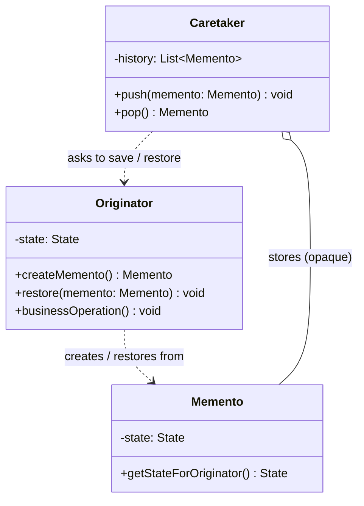

# 메멘토(Memento) 디자인 패턴 가이드

> 한 줄 요약: 객체의 내부 상태를 외부에 노출하지 않으면서 그 상태를 캡처(capture)하고 이후에 원래 상태로 복원(restore)할 수 있게 하는 패턴이다.
>
> 분류: 행위 패턴(Behavioral Pattern)
> 다른 이름(Aliases): Token, Snapshot

---

## 상세 설명

메멘토(Memento) 패턴은 GoF가 정의한 행위 패턴 중 하나로, 객체의 내부 상태(Internal State)를 캡슐화(Encapsulation)를 깨뜨리지 않고 외부에 저장한 뒤 필요할 때 그 상태로 되돌릴 수 있게 한다. 흔히 텍스트 에디터의 실행 취소(Undo), 게임의 세이브/로드(Save/Load), 트랜잭션(Transaction)의 롤백(Rollback)처럼 "어떤 시점의 상태"를 보존하고 싶은 상황에서 사용된다.

해결하고자 하는 문제(Problem)는 다음과 같다. 어떤 객체의 상태를 되돌리려면 그 객체의 내부 필드(field)를 외부에서 읽어 두었다가 다시 써 넣어야 하는데, 이 과정에서 객체가 가진 캡슐화가 깨진다. 즉, 원래는 private이어야 할 필드를 setter로 모두 열어 두거나, 외부 객체가 내부 구조를 알게 되어 결합도(Coupling)가 높아진다. 단순히 깊은 복사(Deep Copy)나 직렬화(Serialization)만으로 해결하면 상태 객체가 만들어지긴 하지만, 그 상태를 누가 보관하고 누가 복원할 책임을 가지는지에 대한 역할 분리가 사라진다.

메멘토가 제안하는 해결책(Solution)은 세 가지 역할을 분리하는 것이다. 상태의 원본을 가진 원본자(Originator), 그 상태의 스냅샷(Snapshot)을 담는 메멘토(Memento), 그리고 메멘토를 보관하지만 그 내부는 들여다보지 않는 관리자(Caretaker)이다. Originator만이 자신의 Memento를 만들고 그것으로부터 자신을 복원할 수 있으며, Caretaker는 Memento를 "불투명한 토큰(Opaque Token)"으로 취급해 단순히 저장·전달·재공급만 한다. 이 구조 덕분에 상태를 보존하면서도 Originator의 내부 표현(Internal Representation)을 외부에 노출하지 않는다.

핵심 개념과 용어를 정리하면 다음과 같다. **Originator**는 상태를 가진 본체이며 `createMemento()`와 `restore(memento)` 두 연산을 제공한다. **Memento**는 Originator의 내부 상태 사본을 담는 값 객체(Value Object)로, 외부에는 좁은 인터페이스(narrow interface)만 노출하고 Originator에게만 넓은 인터페이스(wide interface)를 노출하는 "이중 인터페이스(Dual Interface)" 구조를 흔히 갖는다. **Caretaker**는 Memento의 생명주기(추가/삭제/순서)만 관리하며 그 내용은 해석하지 않는다.

역사적으로 메멘토는 GoF 책에서 명시적으로 정의되었지만, 그 아이디어 자체는 트랜잭션 시스템과 데이터베이스의 체크포인트(Checkpoint), 함수형 프로그래밍의 영속적 자료구조(Persistent Data Structure)와도 맞닿아 있다. 최근에는 Redux의 "이전 상태 보존", JPA의 더티 체킹(Dirty Checking)을 위한 스냅샷 등에서도 같은 원리를 발견할 수 있다.

---

## 디자인 패턴을 충족하는 최소 조건

이 섹션에서는 "어떤 코드가 진짜로 메멘토 패턴이라고 부를 수 있는가"의 기준을 명확히 한다.

1. **세 역할의 분리(Originator / Memento / Caretaker)** — 상태를 가진 객체, 그 상태를 담은 값 객체, 그리고 그것을 보관만 하는 객체가 별도로 존재해야 한다. 한 클래스가 세 역할을 모두 수행하면 그것은 단순한 자체 백업(self-backup)이지 메멘토가 아니다.
2. **캡슐화 보존(Encapsulation Preservation)** — Caretaker는 Memento의 내부 데이터를 읽거나 수정할 수 없어야 한다. Memento는 Originator 외에는 그 내부 상태를 의미 있게 해석하지 못하도록 좁은 인터페이스만을 외부에 노출해야 한다.
3. **상태 복원 책임은 Originator에게 있음** — Memento로부터 상태를 적용하는 로직은 Originator 자신이 수행해야 한다. 외부에서 Memento를 분해해 Originator의 setter를 호출하는 방식은 캡슐화를 깨므로 패턴 위반이다.
4. **시점 스냅샷 의미(Point-in-time Snapshot)** — Memento는 "특정 시점"의 상태를 가리키며, 이후 Originator가 변해도 Memento의 내용은 변하지 않아야 한다(불변성, Immutability 또는 방어적 복사, Defensive Copy).

> 위 조건 중 하나라도 빠지면 본 패턴이라고 보기 어렵다 / 변형 패턴으로 분류된다.

### 흔히 오해하는 지점

- **단순 직렬화/역직렬화와의 혼동**: 객체를 `Serializable`로 만들어 파일에 저장했다가 다시 읽어오는 코드만으로는 메멘토가 성립하지 않는다. 메멘토는 "누가 보관하고(Caretaker), 누가 복원하는가(Originator)"의 역할 분리가 핵심이다. 직렬화는 메멘토를 구현하기 위한 수단 중 하나일 뿐이다.
- **깊은 복사(Deep Copy)와의 혼동**: `clone()`을 호출해 객체를 통째로 복사한 뒤 그 복사본을 외부에 두는 것은 메멘토와 비슷해 보이지만, 복사본이 Originator와 동일한 공개 인터페이스를 모두 노출한다면 캡슐화가 보존되지 않는다. 메멘토는 의도적으로 "외부에서는 아무것도 할 수 없는" 토큰 형태여야 한다.
- **Command 패턴과의 혼동**: Undo를 구현할 때 Command 패턴은 "수행한 동작의 역연산(inverse operation)"을 기록하고, 메멘토는 "동작 직전의 상태 자체"를 기록한다. 두 패턴은 함께 쓰일 수 있지만 동일하지 않다.
- **Prototype 패턴과의 혼동**: Prototype은 새로운 객체를 만들기 위해 기존 객체를 복제하지만, 메멘토는 동일 객체를 과거 상태로 되돌리기 위한 것이다. 목적이 다르다.

---

## 사례를 통한 예시

### 예시 1: 텍스트 에디터의 실행 취소(Undo) 직접 구현

**상황**: 사용자가 입력한 텍스트와 커서 위치(caret position)를 가진 단순한 에디터에서, `Ctrl+Z`로 직전 상태로 되돌리는 기능을 제공해야 한다. 텍스트와 커서 위치는 에디터 내부의 private 필드이며 외부에 노출하고 싶지 않다.

```java
import java.util.ArrayDeque;
import java.util.Deque;

// Originator
public class TextEditor {
    private StringBuilder buffer = new StringBuilder();
    private int caret = 0;

    public void type(String text) {
        buffer.insert(caret, text);
        caret += text.length();
    }

    public void moveCaret(int position) {
        if (position < 0 || position > buffer.length()) {
            throw new IllegalArgumentException("invalid caret");
        }
        this.caret = position;
    }

    public String render() {
        return buffer.toString() + " [caret=" + caret + "]";
    }

    // 메멘토 생성: Originator만이 자신의 내부 상태를 메멘토로 포장한다.
    public EditorMemento save() {
        return new EditorMemento(buffer.toString(), caret);
    }

    // 메멘토로부터 복원: 복원 로직 역시 Originator 내부에 위치한다.
    public void restore(EditorMemento memento) {
        this.buffer = new StringBuilder(memento.getStateForOriginator());
        this.caret = memento.getCaretForOriginator();
    }

    // Memento (정적 중첩 클래스 형태로 캡슐화 강화)
    public static final class EditorMemento {
        private final String snapshot;
        private final int caret;

        private EditorMemento(String snapshot, int caret) {
            this.snapshot = snapshot;
            this.caret = caret;
        }

        // Originator만 의미 있게 호출하도록 패키지-사적(package-private)으로 제한.
        String getStateForOriginator() { return snapshot; }
        int getCaretForOriginator() { return caret; }
    }
}

// Caretaker: 메멘토의 내용은 들여다보지 않고 스택으로만 관리한다.
class History {
    private final Deque<TextEditor.EditorMemento> stack = new ArrayDeque<>();

    public void push(TextEditor.EditorMemento m) { stack.push(m); }
    public TextEditor.EditorMemento pop() { return stack.pop(); }
    public boolean isEmpty() { return stack.isEmpty(); }
}

// 사용 예
class Demo {
    public static void main(String[] args) {
        TextEditor editor = new TextEditor();
        History history = new History();

        history.push(editor.save());
        editor.type("Hello");
        history.push(editor.save());
        editor.type(", world!");
        System.out.println(editor.render()); // Hello, world! [caret=13]

        editor.restore(history.pop()); // 직전 상태로 되돌림은 Caretaker가 아닌 Originator가 수행
        System.out.println(editor.render()); // Hello, world! 가 아니라 Hello로 복귀? 주의: pop이 현재상태를 꺼내므로
        editor.restore(history.pop());
        System.out.println(editor.render()); // Hello [caret=5]
    }
}
```

**해설**: `TextEditor`가 Originator, `EditorMemento`가 Memento, `History`가 Caretaker 역할이다. `EditorMemento`의 접근자는 패키지-사적으로 제한되어 같은 패키지(여기서는 `TextEditor`)에서만 의미 있게 사용된다. 외부 클래스인 `History`는 `EditorMemento`를 단순한 토큰으로만 다루며 그 내부에 무엇이 들었는지 알 필요가 없다. 복원 로직(`restore`)이 Originator 안에 있다는 점이 핵심이며, 만약 `History`가 직접 `editor.setBuffer(...)`를 호출해야 했다면 캡슐화가 깨져 메멘토가 아닌 단순 백업 코드가 된다.

### 예시 2: `java.io.Serializable` 기반의 상태 스냅샷

**상황**: 게임의 캐릭터 상태(레벨, 체력, 인벤토리)를 세이브 슬롯에 저장하고 로드한다. 상태를 바이트 배열(byte array) 형태의 불투명 메멘토로 직렬화하여 Caretaker(세이브 매니저)에 보관한다.

```java
import java.io.*;
import java.util.*;

// Originator
public class GameCharacter {
    private int level = 1;
    private int hp = 100;
    private List<String> inventory = new ArrayList<>();

    public void levelUp() { level++; hp += 20; }
    public void takeDamage(int d) { hp -= d; }
    public void pickUp(String item) { inventory.add(item); }

    @Override
    public String toString() {
        return "Lv." + level + " HP=" + hp + " items=" + inventory;
    }

    // Memento는 Originator의 내부 표현을 직렬화한 불투명 바이트 토큰이다.
    public CharacterMemento save() {
        try (ByteArrayOutputStream baos = new ByteArrayOutputStream();
             ObjectOutputStream oos = new ObjectOutputStream(baos)) {
            oos.writeObject(new CharacterState(level, hp, new ArrayList<>(inventory)));
            return new CharacterMemento(baos.toByteArray());
        } catch (IOException e) {
            throw new IllegalStateException(e);
        }
    }

    public void restore(CharacterMemento memento) {
        try (ByteArrayInputStream bais = new ByteArrayInputStream(memento.payload());
             ObjectInputStream ois = new ObjectInputStream(bais)) {
            CharacterState s = (CharacterState) ois.readObject();
            this.level = s.level;
            this.hp = s.hp;
            this.inventory = s.inventory;
        } catch (IOException | ClassNotFoundException e) {
            throw new IllegalStateException(e);
        }
    }

    // 직렬화 대상 (Memento 내부에서만 의미 있음)
    private static final class CharacterState implements Serializable {
        private static final long serialVersionUID = 1L;
        final int level; final int hp; final ArrayList<String> inventory;
        CharacterState(int level, int hp, ArrayList<String> inventory) {
            this.level = level; this.hp = hp; this.inventory = inventory;
        }
    }
}

// Memento: 외부에는 아무 의미 없는 바이트 토큰만 노출한다.
final class CharacterMemento {
    private final byte[] payload;
    CharacterMemento(byte[] payload) { this.payload = payload; }
    byte[] payload() { return payload; } // package-private
}

// Caretaker: 세이브 슬롯 관리
class SaveManager {
    private final Map<String, CharacterMemento> slots = new HashMap<>();
    public void save(String slot, CharacterMemento m) { slots.put(slot, m); }
    public CharacterMemento load(String slot) { return slots.get(slot); }
}
```

**해설**: 이 사례는 `java.io.Serializable`을 단순한 영속화(Persistence) 도구로 쓰는 것이 아니라, 메멘토 패턴의 "불투명 토큰(Opaque Token)" 요건을 충족시키는 데에 활용한 것이 핵심이다. `CharacterMemento`는 외부에 `byte[]`만을 보여 주고, 그 바이트가 어떤 의미를 갖는지는 Originator인 `GameCharacter`만이 안다. `SaveManager`(Caretaker)는 슬롯 키만 보고 메멘토를 저장/조회할 뿐 내부 데이터의 구조를 알지 못한다. 실제 프레임워크에서도 비슷한 구조가 발견되는데, 예를 들어 Hibernate/JPA의 `PersistenceContext`는 엔티티의 로딩 시점 스냅샷을 보관해 두었다가 더티 체킹(Dirty Checking)을 수행하며, Spring의 `TransactionStatus`가 만들어 내는 세이브포인트(Savepoint)도 메멘토의 한 형태로 볼 수 있다.

---

## 어떨 때 사용하나

다음과 같은 신호(Symptom)가 보일 때 메멘토 패턴 도입을 고려한다.

- 객체의 과거 상태로 되돌리는 기능(Undo/Redo, Rollback)이 필요하지만, 그 객체의 내부 필드를 외부에 공개하고 싶지 않을 때.
- 트랜잭션 경계처럼 "특정 시점의 상태"를 기준으로 동작이 성공/실패에 따라 분기되어야 할 때(예: 결제 처리 중 예외 발생 시 직전 상태로 복원).
- 게임 세이브, IDE의 작업 이력, 그래픽 편집기의 히스토리 패널처럼 사용자에게 시간 축(time axis) 위의 여러 상태를 보여 줘야 할 때.
- 분산 시스템에서 체크포인트를 만들고 장애 시 그 지점부터 복구해야 할 때.

### 사용하면 안 되는 경우 (Anti-patterns)

- **상태가 매우 크고 빈번하게 변하는 경우**: 매 변경마다 전체 스냅샷을 만들면 메모리 사용량이 폭발적으로 증가한다. 이때는 차분(diff) 기반 기록(Command 패턴의 역연산) 쪽이 더 적합하다.
- **상태가 외부 자원(파일 핸들, 네트워크 소켓 등)에 의존하는 경우**: 메멘토는 값 스냅샷을 가정하므로, 직렬화할 수 없는 외부 자원을 가진 객체에는 부적합하다.
- **단순한 setter/getter로 충분한 경우**: 상태가 두세 개의 원시 필드뿐이고 외부 노출이 문제되지 않는다면, 별도 Memento 클래스를 만드는 것은 과설계(over-engineering)이다.
- **불변(Immutable) 객체**: 객체 자체가 불변이라면 "이전 객체 참조"를 들고 있는 것만으로 복원이 끝나므로 별도의 메멘토 구조가 필요 없다.

---

## 장점과 단점, 한계점

### 장점

- **캡슐화 보존(Encapsulation Preservation)**: Originator의 private 필드를 외부에 노출하지 않고도 상태를 보존·복원할 수 있다.
- **명확한 역할 분리(Separation of Concerns)**: 상태 보유(Originator), 상태 보관(Caretaker), 상태 표현(Memento)이 분리되어 각자의 변경 이유가 독립적이다.
- **Undo/Redo, 트랜잭션, 체크포인트의 표준화**: 다양한 도메인의 "되돌리기" 요구사항을 같은 구조로 처리할 수 있어 코드 일관성이 높아진다.
- **시간축에 따른 상태 관리 용이**: Caretaker가 메멘토들을 스택/리스트로 관리하므로 다단계 Undo, 분기형 히스토리(branching history) 같은 기능을 자연스럽게 확장할 수 있다.

### 단점

- **메모리 비용(Memory Cost)**: 매 시점마다 상태 사본을 보관하므로 메멘토가 누적되면 메모리 사용량이 크게 늘어난다. 특히 큰 컬렉션이나 이미지 버퍼를 가진 객체에서 문제가 된다.
- **성능 비용(Performance Cost)**: 깊은 복사나 직렬화는 비용이 큰 연산이며, 변경마다 메멘토를 만들면 일반적 동작 자체가 느려질 수 있다.
- **언어/가시성 제약**: 메멘토의 "넓은 인터페이스는 Originator에게만, 좁은 인터페이스는 외부에"라는 이중 인터페이스를 깔끔히 표현하기 어렵다. Java에서는 정적 중첩 클래스(static nested class)나 패키지-사적(package-private) 접근 제어로 우회하지만, 완벽한 격리는 불가능하다.

### 한계점

- **외부 참조나 가변 객체(mutable object)에 대한 얕은 복사(Shallow Copy) 위험**: 메멘토가 Originator와 동일한 가변 객체를 가리키면, 시간이 지나며 메멘토의 내용이 바뀌어 스냅샷의 의미가 깨진다. 방어적 복사가 필수다.
- **직렬화 기반 메멘토는 클래스 진화에 취약**: `Serializable`로 만든 메멘토는 `serialVersionUID`나 필드 추가/삭제 시 호환성이 깨질 수 있다.
- **동시성(Concurrency) 환경**: Originator가 여러 스레드에서 변경되는 동안 메멘토를 만들면, 일관성 없는 중간 상태가 캡처될 수 있다. 메멘토 생성은 보통 명시적 락(lock) 또는 동기화 블록 안에서 이루어져야 한다.
- **테스트의 어려움**: 메멘토 내부를 검사하기 어렵게 설계하는 것이 패턴의 의도이므로, 단위 테스트(unit test)에서 "올바르게 저장되었는가"를 직접 검증하기보다는 "저장 후 복원 결과가 원래와 같은가"라는 라운드트립(round-trip) 방식으로 검증해야 한다.

---

## 정보 표

| 항목 | 값 |
| --- | --- |
| 분류 | 행위 패턴(Behavioral Pattern) |
| 언어 의존성 | 언어 비의존적. 다만 이중 인터페이스(좁은/넓은) 구현을 위해 Java의 정적 중첩 클래스·패키지-사적 접근, C++의 friend, C#의 internal 같은 가시성 제어 기능을 활용하면 캡슐화가 더 엄격해진다. |
| 활용성(1점~5점) | ★★★★☆ (4/5) — Undo/Redo, 트랜잭션 롤백, 게임 세이브 등 실무에서 매우 자주 등장하는 요구사항을 표준화된 구조로 풀어낸다. |
| 학습 난이도 | 중. 세 역할의 책임 분리와 이중 인터페이스 개념을 이해하면 어렵지 않지만, "왜 Caretaker가 Memento 내부를 보면 안 되는가"의 의미를 체득하는 데 시간이 걸린다. |
| 자주 함께 쓰이는 패턴 | Command(역연산 기록과의 결합), Iterator(히스토리 순회), Prototype(메멘토 생성 시 복제), State(상태 머신 스냅샷) |
| 대표 사용 사례 | 텍스트/이미지 에디터의 Undo·Redo, 데이터베이스/JPA의 더티 체킹과 트랜잭션 세이브포인트, 게임 세이브/로드, IDE의 작업 히스토리 |

---

## Class Diagram



> 다이어그램에 등장하는 각 클래스가 패턴의 어떤 역할(Role)을 담당하는지 위 "상세 설명" 섹션과 1:1로 대응되어야 한다.

### 역할 설명

- **Originator(원본자)**: 보존하고 싶은 내부 상태를 가진 본체. `createMemento()`로 자신의 상태를 Memento에 봉인하고, `restore(memento)`로 그 봉인을 풀어 자신을 과거 상태로 되돌린다. 상태 해석의 유일한 권한자이다.
- **Memento(메멘토)**: Originator의 특정 시점 상태를 담는 값 객체. 외부(Caretaker)에는 "이게 어떤 메멘토인지"만 식별 가능한 좁은 인터페이스(narrow interface)를 노출하고, Originator에게는 내부 데이터에 접근 가능한 넓은 인터페이스(wide interface)를 노출한다. 만들어진 뒤에는 불변이어야 한다.
- **Caretaker(관리자)**: 메멘토들의 생명주기(생성 시점, 보관, 폐기, 순서)를 관리한다. 메멘토를 스택/리스트/맵으로 보관할 뿐, 그 내용을 읽거나 수정하지 않는다. Undo 스택, 세이브 슬롯 매니저, 트랜잭션 매니저 등이 이 역할을 맡는다.

---

## 참고 자료

- 원전: Erich Gamma, Richard Helm, Ralph Johnson, John Vlissides (GoF), "Design Patterns: Elements of Reusable Object-Oriented Software", Addison-Wesley, 1994 — "Memento" 항목.
- Refactoring.Guru, "Memento" — https://refactoring.guru/design-patterns/memento
- Wikipedia, "Memento pattern" — https://en.wikipedia.org/wiki/Memento_pattern
- Joshua Bloch, "Effective Java" 3rd Edition — 직렬화(Serialization) 관련 장(아이템 85~90)에서 불투명 토큰으로서의 직렬 형식 다루기.
- Spring Framework Reference Documentation — `TransactionStatus`와 Savepoint API의 사용 (트랜잭션 메멘토의 실제 사례).
- Hibernate ORM Documentation — `PersistenceContext`의 엔티티 스냅샷과 더티 체킹 메커니즘.
