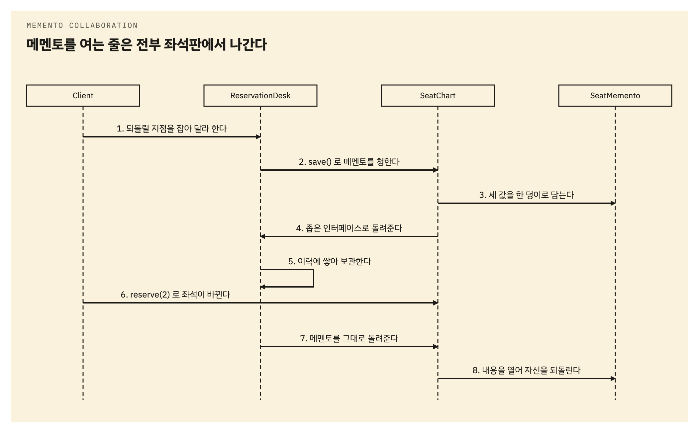
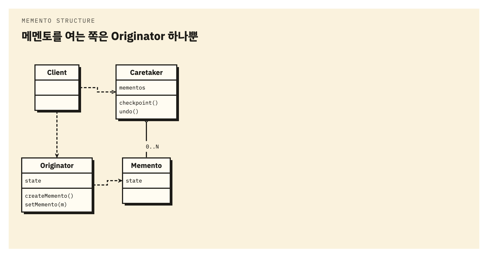

# Memento — 되돌릴 상태를 통째로 떠서, 아무도 못 여는 값으로 맡기기

## 한눈에 보는 개요

소극장 좌석 예약판을 하나 떠올려 봅시다. 여덟 자리 중 하나는 기둥 뒤라 팔 수 없고, 창구가 몇 석을 달라고 하면 판이 알아서 자리를 골라 예약 코드를 찍어요. 이 판 안에는 서로 맞아야 하는 값이 셋 있습니다. 좌석 한 줄, 남은 자리 수, 다음에 쓸 예약 코드. 여기에 되돌리기를 붙이려고 `seats` · `remaining` · `nextCode` 를 꺼내고 넣는 연산을 밖에 열면, 되돌리는 코드가 판 바깥에 흩어지고 셋 중 하나만 되돌려도 아무도 막지 못합니다. 실제로 남은 자리 수만 안 되돌리면 다섯 자리가 비어 있는데 다섯 석 예약이 거절돼요.

Memento 의 해법은 **판이 자기 값 셋을 한 덩이로 떠서, 아무 연산도 없는 값으로 내놓는 것**입니다. 창구는 그것을 받아 쌓아 두기만 하고 열어 보지 않아요. 되돌릴 때는 그 값을 판에게 그대로 돌려주고, 여는 일은 판이 합니다. 셋이 한 덩이라서 하나만 되돌아가는 일이 생기지 않습니다.

```text
Before : 되돌리려고 판의 값 셋을 꺼내고 넣는 연산을 밖에 열었음

  창구 ── seatsView() · remainingView() · nextCodeView() ──▶ 좌석판
       ── setSeats(...) · setRemaining(...) · setNextCode(...) ──▶
    되돌리기 = 창구가 세 연산을 순서대로 부르는 일
    setRemaining 한 줄을 빠뜨림 → 좌석은 AA.#.... (다섯 자리 빔) 인데 rem=2
    그다음 reserve(5) 가 거절됨

After : 판이 값 셋을 한 덩이로 떠서 연산 없는 값으로 내놓음

  창구 ── save() ──▶ 좌석판
       ◀── SeatMemento ──   연산이 하나도 없는 값 (열 수 없음)
       ── 이력에 쌓아 둠
       ── restore(메멘토) ──▶ 좌석판
                                여는 일은 판이 한다
                                seats · remaining · nextCode 가 함께 돌아감
```

이 패턴의 이름은 GoF(Gang of Four, 1994년에 나온 *Design Patterns* 의 저자 네 명을 함께 부르는 이름)가 붙인 것이고 다른 이름은 Token 이에요(근거: GoF Memento 절 Also Known As). 분류는 행위 패턴이고, 함께 쓰는 패턴은 [Command](../command/command-guide_v1.0.1.md)(되돌리기에 필요한 상태를 커맨드 대신 맡아 둘 때)와 [Iterator](../iterator/iterator-guide_v1.0.1.md)(반복자가 순회하던 자리를 메멘토로 떠 둘 때)입니다(근거: GoF Memento 절 Related Patterns). 이 글은 시나리오 셋을 따라갑니다. 예약 둘이 이력에 쌓이고 한 걸음 되돌아가는 길, 자리가 흩어져 배정되고 판에 값이 하나 더 늘 때 무엇이 안 바뀌는가, 되돌리기를 바깥에 맡기면 어느 단계에서 무엇이 어긋나는가. 끝까지 읽으면 어떤 코드를 Memento 라고 불러도 되는지 필수 조건 넷으로 판정할 수 있고, 구조가 닮은 Command·Prototype 코드와도 구분할 수 있게 됩니다.

## 패턴 자세히 들여다보기

### 시나리오 1 — 예약 둘이 이력에 쌓이고 한 걸음 되돌아가는 길

좌석판이 `...#....` 여덟 자리로 열렸습니다. 왼쪽부터 0번이고 3번은 기둥 뒤라 팔 수 없어요(`#`). 팔 수 있는 자리는 일곱이고, 다음 예약에 찍을 코드는 `A` 입니다. 여기에 2석 예약과 3석 예약이 차례로 들어오고, 그다음 한 걸음 되돌리기를 누릅니다. 나와야 하는 것은 `AA.#....` 에 남은 자리 5, 다음 코드 `B` 예요. 이 장면에는 넷이 등장합니다. 예약과 되돌리기를 시키는 진입점(패턴에서는 Client 라고 부르는 역할), 되돌릴 지점을 잡아 쌓아 두는 `ReservationDesk`(Caretaker), 좌석을 실제로 배정하고 자기 상태를 되돌릴 줄 아는 `SeatChart`(Originator), 그리고 판이 떠낸 값 한 덩이 `SeatMemento`(Memento)입니다. 이름은 여기서 한 번씩만 소개하고 정식 정의는 개념 정리에서 해요.



1. Client 가 창구에게 되돌릴 지점을 잡아 달라고 합니다. 이 일을 Client 가 시키는 이유는 언제가 되돌아갈 만한 지점인지 아는 쪽이 업무를 아는 쪽이기 때문이에요. 좌석판이 스스로 정하면 판이 「몇 걸음까지 되돌릴 수 있게 둘지」라는 정책까지 떠안습니다(시나리오 3 이 그 모양을 따라갑니다).
2. 창구가 좌석판에게 `save()` 로 메멘토를 청합니다. 창구가 판의 값을 직접 읽지 않고 청하는 이유는, 무엇을 담아야 되돌릴 수 있는지 아는 쪽이 판뿐이기 때문이에요. 창구가 읽어서 담으면 판이 값을 하나 더 갖게 될 때 창구도 함께 고쳐야 합니다.
3. 좌석판이 지금의 좌석 한 줄 `...#....` 과 남은 자리 7 과 다음 코드 `A` 를 한 덩이로 담아 메멘토를 만듭니다. 셋을 따로 내주지 않고 한 덩이로 묶는 이유는 셋이 서로 맞아야 하는 값이어서예요. 따로 내주면 되돌릴 때 하나만 빠뜨릴 수 있고, 그 어긋남은 시나리오 3 의 3단계에서 실제로 봅니다.
4. 좌석판이 그 메멘토를 창구에게 돌려줍니다. 돌려주는 것은 값 자체가 아니라 **연산이 하나도 없는 겉모습**이에요. 창구가 받아 두는 자리의 타입에는 좌석을 읽는 연산도 남은 수를 바꾸는 연산도 없습니다. 이것을 좁은 인터페이스라고 부르고, 판만 보는 안쪽 모습을 넓은 인터페이스라고 불러요.
5. 창구가 그 메멘토를 이력 맨 뒤에 쌓습니다. 보관을 창구가 맡는 이유는 언제까지 가지고 있을지 아는 쪽이 창구이기 때문이에요. 좌석판이 이력을 맡으면 판이 지우는 시점까지 정해야 하고, 그 부담이 실제로 어떤 문제로 나타나는지는 최소 조건 2번의 반례에 있습니다.
6. Client 가 좌석판에 2석 예약을 넣습니다. 판은 이어진 두 자리 0·1 을 찾아 `A` 를 찍고, 남은 자리를 5 로 줄이고, 다음 코드를 `B` 로 올려요. 세 값이 한 번에 움직인다는 점을 봐 두세요 — 되돌릴 때도 셋이 한 번에 움직여야 합니다.
7. 3석 예약까지 받은 뒤 되돌리기가 눌리면, 창구가 이력 맨 뒤의 메멘토를 꺼내 좌석판에게 **그대로** 건넵니다. 창구는 그 안에 무엇이 들었는지 모른 채 건네요. 열어 보고 건넸다면 4단계의 좁은 인터페이스가 성립하지 않고, 창구가 판의 내부 표현을 아는 코드가 됩니다.
8. 좌석판이 그 메멘토를 열어 좌석 한 줄과 남은 자리 수와 다음 코드를 한꺼번에 자기 값으로 되돌립니다. 여는 일을 판이 맡는 이유는 그 덩이를 만든 쪽이 판이어서예요. 메멘토 자신은 아무 일도 하지 않고 담긴 채로 있습니다. 판은 `AA.#....` · 남은 자리 5 · 다음 코드 `B` 가 됐어요.

```text
단계   부르는 쪽 → 받는 쪽              넘기는 것                    돌아오는 것
 1     Client → ReservationDesk       "지점을 잡아 달라"            —
 2     ReservationDesk → SeatChart    save()                        (4단계에서 메멘토)
 3     SeatChart → SeatMemento        ...#.... · 7 · A              메멘토 한 덩이
 4     SeatChart → ReservationDesk    —                             좁은 인터페이스의 값
 5     ReservationDesk → 이력         메멘토                         —
 6     Client → SeatChart             reserve(2)                    AA.#.... · 5 · B
 7     ReservationDesk → SeatChart    이력 맨 뒤의 메멘토             —
 8     SeatChart → SeatMemento        —                             ...#.... · 7 · A
```

잠깐, 확인 하나만 해 볼까요? 7단계에서 창구가 건넨 메멘토는 **몇 단계에서 만들어진 것**이고, 그때 판의 좌석 줄은 무엇이었을까요?

3석 예약 직전에 잡아 둔 것이라 좌석 줄은 `AA.#....` 이고 남은 자리는 5, 다음 코드는 `B` 입니다. 1~5단계가 예약마다 한 번씩 실행돼 이력이 둘이 되었고, 되돌리기는 그 맨 뒤 하나를 꺼내 쓴 것이죠. 진입점을 그대로 실행하면 아래 일곱 줄이 나오고, 이 글의 수치는 전부 이 출력에서 왔습니다.

```text
0 init       ...#.... rem=7 next=A history=0
1 reserve(2) AA.#.... rem=5 next=B history=1
2 reserve(3) AA.#BBB. rem=2 next=C history=2
3 undo       AA.#.... rem=5 next=B history=1
4 reserve(5) AAB#BBBB rem=0 next=C history=2
5 undo       AA.#.... rem=5 next=B history=1
6 undo       ...#.... rem=7 next=A history=0
```

이 시나리오가 보여 준 것은 역할 넷과 그 사이의 방향입니다. 떠내는 일(3단계)과 여는 일(8단계)은 좌석판이, 청하고 쌓고 그대로 돌려주는 일(2·5·7단계)은 창구가, 언제 지점을 잡고 언제 되돌릴지는 Client 가 맡아요. 메멘토로 들어가는 줄은 둘인데 **둘 다 좌석판에서 나갑니다** — 창구에서 메멘토 안으로 들어가는 줄은 하나도 없습니다.

### 시나리오 2 — 자리가 흩어져 배정되고, 좌석판에 값이 하나 더 늘 때

같은 좌석판에 새 요구가 둘 들어옵니다. 하나는 **다섯 석 단체 예약**이에요. 되돌리기로 `AA.#....` 까지 돌아온 상태에서 다섯 석을 달라고 하면 이어진 다섯 자리가 없습니다 — 기둥이 3번에 있어서 가장 긴 연속 빈자리는 4~7번 넉 자리뿐이거든요. 그래서 판은 남은 자리를 왼쪽부터 골라 2·4·5·6·7번에 `B` 를 찍고, 결과는 `AAB#BBBB` 에 남은 자리 0 이 됩니다. 다른 하나는 **거절된 요청 수를 세어 두라**는 요구이고, 그러면 판에 네 번째 값이 생겨요.

1. 개발자가 예약 규칙에 「이어진 자리가 없으면 왼쪽부터 흩어 배정한다」를 더합니다. 이 규칙이 들어오는 순간 **되돌리기를 역연산으로 짜는 길이 막혀요.** `reserve(5)` 의 역연산은 「방금 준 다섯 자리를 비운다」인데, 그 다섯이 어디였는지는 호출 인자 `5` 에 없고 결과를 봐야 압니다.
2. 그런데 메멘토 쪽은 한 줄도 바뀌지 않습니다. 실행 직전의 좌석 줄과 남은 수와 다음 코드를 통째로 가지고 있으니, 자리를 어떤 규칙으로 골랐든 되돌아가는 방법은 같아요. 위 출력의 4번 줄에서 5번 줄로 가는 걸음이 그것이고, 흩어져 앉은 `AAB#BBBB` 가 `AA.#....` 로 한 번에 돌아옵니다.
3. 이제 네 번째 값을 더해 봅니다. 좌석판에 `waitlist`(거절된 요청 수) 필드를 두고, 예약이 거절될 때 하나 올리고, 메멘토도 그 값을 함께 담고 되돌리게 고쳤어요. 이 편의 코드로 실제로 고쳐 컴파일해 보니 손댄 자리는 여덟(새로 넣은 줄 여섯 · 고친 줄 둘)이었고, **여덟 자리가 전부 `SeatChart` 안**이었습니다(직접 컴파일·실행해 확인. 출력 일곱 줄은 글자까지 그대로였습니다).
4. `ReservationDesk` 는 한 줄도 바뀌지 않았습니다. 창구가 아는 이름이 `save` · `restore` · 메멘토 타입 셋뿐이라서, 판 안에 값이 몇이든 창구 코드에 그 이름이 들어갈 자리가 없어요. 시나리오 1 의 4단계에서 좁은 인터페이스로 돌려준 것이 여기서 값을 합니다.
5. 진입점도 한 줄도 바뀌지 않았습니다. 만약 시나리오 3 처럼 창구가 `seatsView()` · `remainingView()` · `nextCodeView()` 를 읽어 담는 코드였다면, 값이 하나 늘 때마다 읽는 줄 하나와 되돌리는 줄 하나가 창구에 함께 늘었을 겁니다.

| 변화 | 바뀐 곳 | 안 바뀐 곳 |
| --- | --- | --- |
| 흩어 배정 규칙 추가 | `SeatChart` 의 자리 고르기 | 메멘토가 담는 것 · `ReservationDesk` 전체 · 진입점 |
| `waitlist` 값 추가 | `SeatChart` 안 여덟 자리 (필드 선언 · 생성자 · 메멘토 필드 · 메멘토 생성자 시그니처 · 메멘토 대입 · 떠내는 줄 · 되돌리는 줄 · 거절 지점) | `ReservationDesk` 0줄 · 진입점 0줄 · 출력 일곱 줄 |

여기서 헷갈리기 쉬운 포인트는 메멘토가 **꼭 전체 상태**여야 한다고 믿는 것입니다. 이 편의 메멘토는 값 셋을 통째로 담지만, 메멘토가 만들어지고 원본에 되돌아가는 순서를 미리 알 수 있다면 직전 메멘토 이후의 변경분만 담는 길도 있어요(근거: GoF Memento 절 Implementation — 메멘토가 예측 가능한 순서로 만들어지고 반환된다면 변경분만 저장할 수 있다고 적는다). 그때는 되돌리기가 쌓인 순서대로만 가능해지는 대신 메모리가 줄어듭니다. 이 가이드는 통째로 담는 쪽을 씁니다. 여덟 자리짜리 판에서는 변경분을 계산하는 코드가 판 자체보다 커지거든요.

```text
통째로 담기 (이 편)                     변경분만 담기
  메멘토 하나 = 좌석 줄 + 남은 수 + 코드    메멘토 하나 = 직전 메멘토와의 차이
  아무 지점으로나 바로 되돌아감            쌓인 순서를 거꾸로만 되돌아감
  자리 수에 비례하는 메모리                바뀐 만큼만 메모리
```

이 시나리오가 보여 준 것은 변화의 범위입니다. 되돌리기를 역연산으로 짜려던 길이 배정 규칙 하나로 막혀도 메멘토 쪽은 그대로이고(1·2단계), 판 안에 값이 늘어도 창구와 진입점은 한 줄도 바뀌지 않았어요(3~5단계). 바뀌는 곳이 판 하나로 모이는 것이 좁은 인터페이스로 얻는 것입니다.

### 시나리오 3 — 되돌리기를 바깥에 맡기면 어디서 어긋나는가

같은 좌석판을 다른 코드베이스는 이렇게 짰습니다. 판이 `seatsView()` · `remainingView()` · `nextCodeView()` 로 세 값을 읽게 해 주고 `setSeats` · `setRemaining` · `setNextCode` 로 되돌릴 수 있게 열어 뒀어요. 창구는 세 값을 자기 필드에 담아 두었다가 되돌릴 때 세 연산을 차례로 부릅니다. 겉보기에는 시나리오 1 과 같은 일을 하고, 실제로 2석·3석 예약까지는 출력이 같아요. 아래 결과는 Java 21 로 실제로 컴파일해 실행한 것입니다.

1. 창구가 되돌릴 지점에서 세 값을 따로 읽어 자기 필드에 담습니다. 이 모양이 편해 보이는 이유는 판을 고치지 않아도 되기 때문이에요. 그 대가로 **무엇을 담아야 되돌릴 수 있는가**를 창구가 알게 됩니다.
2. 되돌릴 때 창구가 `setSeats` 와 `setNextCode` 는 불렀는데 `setRemaining` 한 줄을 빠뜨렸습니다. 세 연산이 따로 있으니 둘만 부르는 코드가 문법적으로 멀쩡해요. 컴파일러도 검사도 막지 않습니다.
3. 결과는 `AA.#.... rem=2 next=B` 입니다. 좌석 줄에는 빈자리가 다섯인데 남은 자리 수는 2 로 남았어요. 시나리오 1 의 3단계에서 셋을 한 덩이로 묶은 이유가 이것입니다.
4. 그 상태에서 5석 예약이 들어오면 판이 거절합니다. 실제로 자리는 다섯 비어 있는데 남은 수가 2 라서, 판은 자기가 가지고 있는 값을 믿고 `accepted=false` 를 돌려줘요. 잘못은 2단계에서 났는데 증상은 두 걸음 뒤에 나타납니다.
5. 갈래 하나를 더 봅니다. 되돌리는 코드를 판 안으로 되돌려 놓되, 메멘토가 좌석 배열을 복사하지 않고 판이 쓰는 **바로 그 배열**을 가리키게 두면 어떻게 될까요. 남은 수와 다음 코드는 값이라 복사되지만 좌석 줄은 같은 배열이라, 예약이 일어날 때마다 메멘토 안의 줄도 함께 바뀝니다.

```text
2단계에서 setRemaining 한 줄을 빠뜨린 판 (직접 컴파일·실행)

  0 init       ...#.... rem=7 next=A
  1 reserve(2) AA.#.... rem=5 next=B
  2 reserve(3) AA.#BBB. rem=2 next=C
  3 undo       AA.#.... rem=2 next=B      ← 빈자리 다섯인데 rem=2
  4 reserve(5) AA.#.... rem=2 next=B accepted=false
```

5단계의 갈래도 실행해 봤습니다. 메멘토의 `String seats` 를 `char[] seats` 로 바꿔 판의 배열을 그대로 담게 하고, 떠내는 줄에서 복사를 빼고, 되돌리는 줄을 그 배열에서 베껴 오게 고친 것이에요. `SeatChart` 안 네 자리(메멘토의 필드 선언 · 메멘토 생성자의 시그니처 · 떠내는 줄 · 되돌리는 줄)를 고치면 됩니다.

```text
메멘토가 판의 좌석 배열을 그대로 가리키는 판 (직접 컴파일·실행)

  0 init       ...#.... rem=7 next=A history=0
  1 reserve(2) AA.#.... rem=5 next=B history=1
  2 reserve(3) AA.#BBB. rem=2 next=C history=2
  3 undo       AA.#BBB. rem=5 next=B history=1   ← 좌석은 그대로, 남은 수만 돌아감
  4 reserve(5) BAB#BBBB rem=0 next=C history=2
  5 undo       BAB#BBBB rem=5 next=B history=1
  6 undo       BAB#BBBB rem=7 next=A history=0   ← 빈자리 0인데 rem=7
```

두 갈래를 되돌리는 길은 서로 다릅니다. 앞은 여는 코드를 판 안으로 들여 세 값을 한 덩이로 묶는 일이고, 뒤는 판 안에 있더라도 **떠낼 때 값을 복사해 끊어 두는** 일이에요. 앞은 누가 되돌리는가의 문제이고 뒤는 무엇을 담는가의 문제라서, 최소 조건에서도 둘은 다른 번호(1번과 4번)로 나뉩니다.

이 시나리오가 보여 준 것은 두 규칙이 어디서 어긋나는지입니다. 되돌리는 코드가 판 밖에 있으면 값 하나를 빠뜨려도 막을 곳이 없고(2·3단계), 증상은 그다음 요청에서 나타납니다(4단계). 떠낸 값이 판과 끊겨 있지 않으면 되돌리기가 아무 일도 하지 못하고, 남은 수만 돌아가 오히려 더 어긋나요(5단계).

### 개념 정리

시나리오에 나온 역할 넷을 정식으로 정의합니다. 셋은 이 패턴의 참여자이고 Client 는 참여자 목록 밖에서 지점을 잡고 되돌리기를 시키는 쪽인데, 시나리오와 구현에 늘 나오므로 함께 정의해요(근거: GoF Memento 절 Participants·Collaborations).

- **Originator** — 되돌릴 상태를 가진 객체입니다. 자기 내부 상태의 스냅샷을 담은 메멘토를 만들고(시나리오 1 의 3단계), 메멘토를 다시 받아 자기 상태를 되돌려요(8단계). 메멘토의 안쪽 인터페이스, 곧 되돌리는 데 필요한 모든 값에 접근하는 넓은 인터페이스를 보는 쪽은 이 역할뿐입니다. 좌석 예에서는 `SeatChart` 가 Originator 예요.
- **Memento** — Originator 가 떠낸 상태를 담아 두는 값입니다. 인터페이스가 둘이에요. Caretaker 가 보는 **좁은 인터페이스**는 다른 객체에 넘기는 일 말고는 아무것도 해 주지 않고, Originator 가 보는 **넓은 인터페이스**는 담긴 값 전부에 접근합니다. 스스로는 아무 일도 하지 않는 수동적인 값이고, 자기를 만든 Originator 만 그 안에 값을 넣고 꺼내요. 좌석 예에서는 `SeatMemento` 가 Memento 입니다.
- **Caretaker** — 메멘토를 맡아 두는 쪽입니다. Originator 에게 메멘토를 청하고(시나리오 1 의 2단계), 한동안 가지고 있다가(5단계), 되돌릴 때 Originator 에게 그대로 돌려줘요(7단계). 안을 들여다보거나 손대지 않습니다. 좌석 예에서는 되돌리기 이력을 가진 `ReservationDesk` 가 Caretaker 예요.
- **Client** — 언제 되돌릴 지점을 잡고 언제 되돌릴지 정하는 쪽입니다(시나리오 1 의 1단계). Originator 에게 업무 요청을 넣는 쪽도 이쪽이에요(6단계). 좌석 예에서는 예약과 되돌리기를 차례로 시키는 진입점(Java `SeatDeskApp.main` · TypeScript 최상위 코드 · Rust `main`)이 Client 입니다.



그림에서 Memento 칸에 공개 연산 자리가 비어 있다는 점, 그리고 그 칸으로 들어가는 화살표가 둘이라는 점을 봐 두세요. 하나는 Caretaker 에서 온 보관 관계이고 다른 하나는 Originator 에서 온 것인데, **안을 여는 쪽은 뒤의 하나뿐**입니다. Caretaker 에서 Originator 의 상태로 바로 가는 선은 그림에 없어요. 그 선이 생기면 시나리오 3 의 모양이 됩니다. Memento 칸의 빈 연산 자리는 최소 조건 3번이, Caretaker 에서 Memento 로 가는 화살표는 2번이 코드에서 확인해요.

> 떠내는 쪽도 여는 쪽도 원본이고, 맡는 쪽은 열지 않는다.

## 사용 목적

Memento 가 필요할 때는 코드나 요구에서 보이는 단서가 있습니다. 셋을 차례로 봅시다.

**단서 1. 되돌리기를 붙이려고 객체에 공개 조회·변경 연산을 줄줄이 더하고 있습니다.** 어제까지 아무도 읽지 않던 내부 값에 오늘 `getXxx` 와 `setXxx` 가 생기고, 그 연산을 부르는 곳이 되돌리기 코드 하나뿐이면 신호예요. 상태를 얻는 직접 인터페이스가 구현 세부를 드러내 캡슐화를 깨는 상황이 이 패턴이 겨냥하는 자리입니다(근거: GoF Memento 절 Applicability — 상태를 얻는 직접 인터페이스가 구현 세부를 드러내 캡슐화를 깨뜨리게 되는 경우를 적용 대상으로 둔다).

```text
커밋 이력                          새로 생긴 공개 연산            부르는 곳
────────────────────────────      ──────────────────────        ─────────────
되돌리기 붙이기 (1/3)              seatsView · setSeats           창구 1곳
되돌리기 붙이기 (2/3)              remainingView · setRemaining   창구 1곳
되돌리기 붙이기 (3/3)              nextCodeView · setNextCode     창구 1곳
```

**단서 2. 되돌리기를 역연산으로 짜려는데, 그 연산의 인자만으로는 무엇을 되돌려야 할지 알 수 없습니다.** 시나리오 2 의 1단계가 그 모양이었어요. `reserve(5)` 를 되돌리려면 그 다섯이 어느 자리였는지 알아야 하는데 인자에는 `5` 밖에 없습니다. [Command 가이드](../command/command-guide_v1.0.1.md)도 같은 자리를 반대 방향에서 적어요 — 되돌리기를 역연산으로 짜기 어렵거나 불가능하면, 실행 직전 상태를 통째로 떠 두는 쪽이 맞는지 먼저 확인하라고요.

**단서 3. 한 연산이 서로 맞아야 하는 값 여럿을 함께 바꿉니다.** 좌석 줄과 남은 자리 수와 다음 코드가 그런 값 셋이에요. 이런 값들은 되돌릴 때도 함께 움직여야 하는데, 밖에서 하나씩 되돌리면 어긋난 채로도 코드가 동작합니다. 시나리오 3 의 3·4단계가 어긋난 뒤 두 걸음 만에 증상이 나온 자리예요(근거: GoF Memento 절 Applicability — 객체 상태의 스냅샷을 저장해 두었다가 나중에 그 상태로 되돌려야 하는 경우를 적용 대상으로 둔다).

| 쓰지 말아야 할 상황 | 쓰면 잃는 것 |
| --- | --- |
| 상태를 그대로 공개해도 아무 문제가 없는 값 객체 | 감출 것이 없는데 감추는 층이 생김. 타입 하나와 떠내기·되돌리기 연산 둘이 늘고, 읽는 쪽은 그 타입을 지나 값을 다시 꺼내게 됨 |
| 떠내는 상태가 크거나 메멘토가 아주 자주 생김 | 메멘토를 쓰는 비용이 커짐(근거: GoF Memento 절 Consequences — 메멘토를 쓰는 비용이 클 수 있다고 적는다). 표 아래에서 수로 비교함 |
| 되돌리기를 역연산으로 짤 수 있고 그 연산의 비용이 작다 | 상태 전체를 뜨지 않아도 될 것을 뜸. 그때는 Command 쪽을 먼저 봄 — 다만 역연산에는 오차가 쌓이는 대가가 따르고, 그 차이는 경계 절에서 다룸 |
| 메멘토를 언제 버릴지 아무도 정하지 않음 | 맡는 쪽은 지우는 책임을 지면서도 안에 상태가 얼마나 들었는지 모르므로 메모리가 조용히 늘어남(근거: GoF Memento 절 Consequences — Caretaker 는 메멘토를 지우는 책임을 지지만 그 안에 얼마나 많은 상태가 들었는지 모른다고 적는다) |

표의 두 번째 줄을 수로 봅시다. 이 편의 좌석판은 값이 셋이고 좌석 줄이 여덟 글자라 메멘토 하나가 열 몇 바이트입니다. 예약마다 하나씩 쌓아도 부담이 없어요. 그런데 같은 구조를 만 석짜리 공연장에 그대로 옮기면 메멘토 하나가 만 바이트가 되고, 예약 천 건이면 천만 바이트가 됩니다.

| 좌석 수 | 메멘토 하나가 담는 좌석 줄 | 예약 1,000건을 다 쌓으면 |
| --- | --- | --- |
| 8 | 8바이트 | 8,000바이트 |
| 10,000 | 10,000바이트 | 10,000,000바이트 |

그 크기에서는 세 길 중에 골라야 해요. 이력 길이에 상한을 두거나, 시나리오 2 에서 본 변경분만 담는 메멘토로 바꾸거나, 되돌리기를 역연산으로 짤 수 있는 연산만 되돌리게 범위를 줄이는 것입니다. 비슷한 단서에서 다른 패턴을 골라야 하는 경우도 있습니다. 되돌리기에 필요한 것이 실행 직전 상태 전체가 아니라 역연산이면 Command 를, 되돌릴 것이 아니라 같은 공개 인터페이스를 가진 새 객체가 필요하면 Prototype 을 먼저 검토하세요. 둘과의 차이는 「비슷한 패턴·안티패턴과의 차이」에서 풉니다.

## 패턴의 경계

### 디자인 패턴을 충족하는 최소 조건

어떤 코드를 Memento 라고 불러도 되는지 가르는 기준입니다. `[필수]` 가 하나라도 빠지면 Memento 가 아니고, `[선택]` 은 갖추면 좋은 구조예요. 조건은 언어와 상관없이 코드에서 확인할 수 있는 모양(타입 선언·참조 보유·호출 방향·생성 위치)으로 적었고, 조건마다 그것을 보여 준 시나리오의 단계를 가리킵니다.

1. [필수] 상태를 떠내는 연산과 그 떠낸 것으로 되돌리는 연산이 **둘 다 원본 객체의 타입에 선언**돼 있고, 되돌리는 코드가 그 타입 안에 있습니다 — 떠낸 값을 돌려주는 연산과 그 값을 인자로 받는 연산이 같은 타입에 있고, 받은 값에서 원본의 필드로 값을 옮기는 문장이 그 타입 본문 안에 있습니다. 시나리오 1 의 2단계와 8단계가 이 조건의 두 면이에요 (근거: GoF Memento 절 Participants — Originator 는 자기 내부 상태의 스냅샷을 담은 메멘토를 만들고, 메멘토를 써서 자기 내부 상태를 되돌린다 · Intent — 캡슐화를 깨지 않고 객체의 내부 상태를 붙잡아 밖으로 내보내, 나중에 그 객체를 그 상태로 되돌릴 수 있게 한다).
   - 빠지면: 시나리오 3 의 1~4단계가 이 자리입니다. 원본이 조회·변경 연산만 열어 주고 되돌리는 코드가 밖에 있으면, 값 하나를 빠뜨려도 막을 곳이 없어요. 실제로 세 연산 중 하나를 빼고 실행하니 빈자리가 다섯인데 남은 수가 2 로 남았고, 그다음 5석 예약이 `accepted=false` 로 거절됐습니다(직접 컴파일해 실행). 위 근거 괄호가 받쳐 주는 것은 「떠내는 쪽과 되돌리는 쪽이 원본이다」까지입니다 — 「어떤 문법으로 감추는가」는 받쳐 주지 않으므로 조건 문구에 넣지 않았어요.
2. [필수] 떠낸 값을 **원본 밖의 쪽이 가지고 있다가, 그 값을 내준 바로 그 원본에게** 돌려줍니다 — 떠낸 값을 담는 필드나 컬렉션이 원본 타입이 아닌 다른 타입에 있고, 되돌리기가 그 자리에서 값을 꺼내 **그 값을 내준 그 객체**의 되돌리는 연산에 넘깁니다. 시나리오 1 의 1·5·7단계가 이 모양이에요 (근거: GoF Memento 절 Collaborations — Caretaker 가 Originator 에게 메멘토를 청해 한동안 가지고 있다가 나중에 그 Originator 에게 돌려준다 · Participants — Caretaker 는 메멘토를 맡아 두는 일을 책임지고, 이상적으로는 그 메멘토를 만든 Originator 만 그 안의 상태에 접근한다).
   - 빠지면: 원본이 자기 안에 이력을 가지면 되돌릴 지점이 원본 하나에 뒤섞입니다. 창구 둘이 같은 좌석판을 쓰는 코드로 확인했어요. 창구 A 가 지점을 잡고 2석을 예약하고, 창구 B 가 지점을 잡고 3석을 예약한 뒤, 창구 A 가 되돌리기를 누르면 `AA.#.... rem=5 next=B` 가 나옵니다 — A 가 가려던 `...#.... rem=7 next=A` 가 아니라 B 의 지점이에요(직접 컴파일해 실행). 이 편의 구조로 창구를 둘 두면 같은 순서에서 A 의 되돌리기가 `...#.... rem=7 next=A` 를 냅니다. 돌려주는 상대가 어긋나도 같은 조건이 걸려요 — 같은 종류의 **다른** 객체에게 넘기면 그것은 되돌리기가 아니라 설정 전파이고, 아래 표의 마지막 줄이 그 자리입니다.
3. [필수] 맡는 쪽이 그 값을 받아 두는 **자리의 타입이, 그 값을 다른 객체에 넘기는 일 말고는 아무 연산도 주지 않습니다** — **판정은 아래 셋이 전부입니다.** 그 값을 담는 필드·컬렉션·매개변수의 정적 타입에 ① 담긴 값을 꺼내거나 바꾸는 연산(메서드·공개 필드·색인 접근)이 선언돼 있지 않고, ② 원본에 무슨 일을 시키는 연산도 선언돼 있지 않으며, ③ 맡는 쪽 코드도 그 값을 보관하고 넘기는 일 말고는 하지 않습니다. 시나리오 1 의 4·7단계가 이 조건의 두 면이에요 (근거: GoF Memento 절 Participants — Caretaker 는 메멘토에 대해 좁은 인터페이스를 보아 메멘토를 다른 객체에 넘기는 일만 할 수 있고, Originator 는 되돌리는 데 필요한 모든 데이터에 접근하는 넓은 인터페이스를 본다 · Collaborations — 메멘토는 수동적이라 그것을 만든 Originator 만 그 상태를 넣고 꺼낸다).
   - 빠지면: 맡는 쪽이 `memento.remaining` 을 읽어 분기하는 순간 원본의 내부 표현을 아는 코드가 하나 더 생깁니다. 맡는 쪽에 「이력 맨 앞 메멘토의 남은 자리 수를 돌려주는」 메서드 하나를 더해 보면 세 언어가 모두 막아요 — Java 는 `error: Snapshot has private access in SeatChart` 2건, TypeScript 는 `error TS2339: Property 'remaining' does not exist on type 'SeatMemento'.` 1건, Rust 는 `error[E0616]: field 'remaining' of struct 'SeatMemento' is private` 1건입니다(직접 컴파일해 확인). 위 근거 괄호가 받쳐 주는 것은 **「받아 두는 자리가 넘기는 일 말고는 아무것도 해 주지 않는다」까지**입니다 — 「언어가 그것을 강제로 막는다」는 받쳐 주지 않으므로 조건 5번으로 내렸어요.
   - 어디까지가 연산인가: 값에 붙어 있어도 담긴 상태도 아니고 원본에 시키는 일도 아닌 **표식**은 이 조건을 어기지 않습니다. 구현 예시의 TypeScript 판이 메멘토 타입에 심볼 프로퍼티를 하나 두는데, 그것은 「이 좌석판이 만든 값」이라는 표시라서 창구가 읽어도 좌석 줄에도 남은 수에도 접근하지 못해요.
4. [필수] 떠낸 값으로 되돌리면 **떠낸 그 시점의 상태**가 나옵니다 — 떠낸 뒤 원본을 바꾸고 그 값으로 되돌렸을 때 원본의 관찰 가능한 상태가 떠낸 시점과 같습니다. 시나리오 3 의 5단계가 이 조건이 빠진 자리예요 (근거: GoF Memento 절 Intent — 나중에 그 객체를 그 상태로 되돌릴 수 있게 한다 · Applicability — 객체 상태의 스냅샷을 저장해 두었다가 나중에 그 상태로 되돌려야 하는 경우를 적용 대상으로 둔다).
   - 빠지면: 떠낸 값이 원본의 가변 내부를 그대로 가리키면 이 조건이 성립하지 않습니다. 메멘토가 원본의 좌석 배열을 그대로 가리키게 `SeatChart` 안 네 자리를 고쳐 실행하니, 되돌리기가 좌석 줄을 하나도 되돌리지 못하고 남은 수만 돌아갔습니다. 마지막 줄에서 빈자리가 0인데 남은 수가 7 로 나와요(직접 컴파일해 실행). 위 근거 괄호가 받쳐 주는 것은 「그 시점의 상태로 되돌아간다」까지입니다 — 「불변 타입을 쓴다」·「깊은 복사를 한다」·「원본의 가변 내부를 가리키지 않는다」 같은 **수단**은 받쳐 주지 않으므로 조건 문면에 넣지 않고, 어겼을 때 무엇이 어긋나는지를 이 줄에서 보였어요.
5. [선택] 넓은 인터페이스에 원본 밖에서 접근하지 못하도록 **언어가 막습니다** — 중첩 비공개 클래스, 모듈 가시성, 비공개 필드에 갇힌 곁 테이블 같은 수단으로 원본 밖 코드가 담긴 값에 아예 접근하지 못합니다. 시나리오 1 의 4단계를 세 언어가 각각 어떻게 막는지는 구현 해설에 있어요 (근거: GoF Memento 절 Implementation — 두 단계 인터페이스를 정적으로 강제하는 것이 이상적이며, C++ 에서는 Originator 를 Memento 의 friend 로 두고 넓은 인터페이스를 private 으로 둔다). 원전이 언어에 따라 어렵다고 인정하는 자리라 필수로 올리지 않았습니다. 3번을 만족하면서 5번이 없는 코드가 실제로 흔해요 — 「실제 라이브러리에서」의 `StateHolder` 가 그 모양입니다.
6. [선택] 메멘토를 **여럿 쌓아** 여러 걸음 되돌립니다 — 맡는 쪽이 메멘토 하나가 아니라 컬렉션을 가지고, 되돌리기가 맨 뒤부터 꺼내 씁니다. 시나리오 1 의 5단계와 출력의 `history=` 가 그 모양이에요. 메멘토 하나만 가져도 1~4번은 그대로 만족하므로 필수가 아닙니다.
7. [선택] 전체 상태 대신 **직전 메멘토 이후의 변경분만** 담습니다 — 메멘토가 만들어지고 원본에 되돌아가는 순서를 미리 알 수 있을 때 쓰는 변형입니다. 시나리오 2 의 끝에서 두 방식을 견준 자리예요 (근거: GoF Memento 절 Implementation — 메멘토가 예측 가능한 순서로 만들어지고 반환된다면 변경분만 저장할 수 있다고 적는다).

3번이 이 패턴을 가르는 핵심 조건입니다. 1·2·4번을 다 갖추고도 3번에서 걸리는 코드가 많아서, 3번을 보지 않으면 그런 코드가 전부 Memento 로 통과해요. **1~4번을 전부 만족하는데 Memento 가 아닌 코드**를 일부러 여섯 가지 만들어 컴파일하고 실행해 봤습니다. 넷은 그대로 걸렸고, 둘은 조건을 고친 뒤에야 걸렸어요.

| 일부러 만든 코드 | 1번 | 2번 | 3번 | 4번 | 판정 |
| --- | --- | --- | --- | --- | --- |
| 구현 절의 `SeatChart` · `SeatMemento` · `ReservationDesk` | 만족 | 만족 | 만족 | 만족 | Memento |
| 좌석판을 통째로 복제해 창구가 가지고 있는 코드 | 만족 | 만족 | **빠짐** (`SeatChart` 타입이 `reserve` 를 줌) | 만족 | Memento 아님 |
| 상태를 직렬화한 `byte[]` 를 창구가 가지고 있는 코드 | 만족 | 만족 | **빠짐** (색인으로 읽고 쓸 수 있음) | 만족 | Memento 아님 |
| 공개 접근자가 자동으로 생기는 불변 값 객체를 그대로 돌려주는 코드 | 만족 | 만족 | **빠짐** (접근자가 상태를 줌) | 만족 | Memento 아님 |
| 상태는 판 안에 두고 식별자만 창구에 주는 코드 | 만족 | **빠짐** (맡는 쪽이 가진 것은 식별자뿐) | 만족 | 만족 | Memento 아님 |
| 실행 연산 하나를 가진 토큰을 창구가 쌓아 두는 코드 | 만족 | 만족 | **빠짐** (토큰이 원본에 일을 시키는 연산을 줌) | 만족 | Memento 아님 — 커맨드 |
| 떠낸 값을 **같은 종류의 다른 객체**에 심는 코드 | 만족 | **빠짐** (돌려주는 상대가 값을 내준 그 객체가 아님) | 만족 | 만족 | Memento 아님 — 설정 전파 |
| 직렬화한 값을 불투명한 타입으로 감싸 돌려주는 코드 | 만족 | 만족 | 만족 | 만족 | Memento |

조건을 고치게 만든 자리는 커맨드 토큰 줄과 다른 객체에 심는 줄이에요. 실행 연산 하나를 가진 토큰은 조건 3번을 「담긴 상태를 읽거나 바꾸는 연산이 없다」로만 읽으면 그대로 통과합니다. 그 연산은 담긴 값을 꺼내지도 바꾸지도 않으니까요. 그래서 3번을 원전 문장대로 「넘기는 일 말고는 아무 연산도 주지 않는다」까지 넓혔고, 그러자 비교 절이 Command 를 가르는 기준과 같은 답이 나왔습니다. 다른 객체에 심는 줄은 프린터 설정을 다른 프린터에 심는 코드로 만들어 실행해 봤는데, 떠낸 적 없는 상태가 그 객체에 들어오는데도 걸리지 않았어요(직접 컴파일해 실행 — `back dpi=300 paper=Letter` 가 `back dpi=600 paper=A4` 가 됐습니다). 조건 2번이 돌려주는 **상대**를 묻지 않았기 때문이라, 「값을 내준 바로 그 원본에게」를 조건 문면에 넣었습니다.

마지막 줄도 눈여겨봐 주세요. 직렬화 자체는 이 패턴의 반대말이 아니라 **떠내는 수단 중 하나**입니다. 구분 기준은 직렬화를 썼는지가 아니라 맡는 쪽이 받아 두는 자리의 타입이 그 값을 여는지예요. 같은 직렬화라도 `byte[]` 로 주면 3번에서 걸리고, 여는 연산이 없는 타입으로 감싸 주면 통과합니다. 공개 접근자가 자동으로 생기는 불변 값 객체도 같아요 — Java `record` 는 컴포넌트마다 공개 접근자를 자동으로 만들어 주므로([JEP 395: Records](https://openjdk.org/jeps/395)), 그대로 돌려주면 3번이 빠지고 비공개 중첩으로 두고 좁은 타입으로만 내보내면 통과합니다.

> 무엇으로 떠냈는가는 기준이 아니다. 맡는 쪽이 그것을 열 수 있는가가 기준이다.

### 비슷한 패턴·안티패턴과의 차이

Memento 와 구조가 닮았거나 같은 단서에서 떠오르는 대상 다섯을 비교합니다. 가장 헷갈리는 상대는 Command 예요 — 둘 다 「나중에 쓰려고 지금 만들어 두는 객체」라서 이력에 쌓인 모습만으로는 구분되지 않습니다. 표에 기준을 먼저 모으고, 대상마다 코드와 시나리오로 풀어 볼게요.

| 비교 대상 | 구분 기준 | Memento 를 고르면 얻는 것 | 포기하는 것 |
| --- | --- | --- | --- |
| Command | 나중에 쓰려고 건네는 토큰이 다형적 실행 연산을 갖는가, 값으로만 전달되는 좁은 인터페이스인가 | 역연산을 짤 수 없는 연산도 되돌릴 수 있고, 되돌리기·다시 하기를 되풀이해도 오차가 쌓이지 않음 | 상태 전체를 뜨는 메모리. 요청을 큐에 넣거나 다른 곳에서 실행하는 일은 해 주지 않음 |
| Prototype | 받은 것이 원본과 같은 공개 인터페이스를 가진 온전한 객체인가, 되돌리기에만 쓰는 불투명한 값인가 | 맡아 둔 과거를 아무도 고칠 수 없음 | 떠낸 것으로 다른 일을 할 자유. 메멘토는 원본에게 돌려주는 것 말고는 쓸 데가 없음 |
| Iterator | 떠 두는 것이 원본의 업무 상태인가, 원본을 순회하던 자리인가 — 둘은 배타적이지 않고 어느 쪽이든 최소 조건 1~4번을 그대로 적용한다 | 원본의 내부 표현을 감춘 채 되돌리기를 붙임 | 순회 자체는 해 주지 않음. 둘은 포개져서, 반복자가 자기 자리를 메멘토로 떠 두기도 함 |
| 바깥이 상태를 꺼내 옮겨 심는 코드 (Memento 로 오해받는 코드) | 맡는 쪽이 받아 두는 자리의 타입이 그 값을 여는가 — 열어서 바깥이 원본에 옮겨 심는가, 원본만 열 수 있고 원본이 그대로 받아 스스로 되돌리는가 | 되돌리는 코드가 한 곳에 있어 값 하나를 빠뜨릴 수 없음 | 떠낸 값을 로그에 찍거나 다른 저장소에 넣는 손쉬움 |
| 되돌리기를 흉내 낸 백업 코드 (Memento 로 오해받는 코드) | 떠 둔 것이 원본에서 떨어져 나왔는가(맡는 쪽에서도, 값에서도), 그리고 돌아가는 곳이 그 값을 내준 그 원본인가 | 되돌릴 지점이 맡는 쪽마다 따로 만들어지고, 떠낸 뒤 원본이 바뀌어도 과거가 흔들리지 않음 | 떠내는 값만큼의 복사 비용 |

**Command 와의 차이.** 구분 기준은 나중에 쓰려고 건네는 토큰이 다형적 실행 연산을 갖는지, 값으로만 전달되는 좁은 인터페이스인지입니다(근거: GoF 5장 행위 패턴 토론 — 인자로 건네는 토큰을 두고 Command 에서는 다형적 실행 연산이 중요하고, Memento 의 인터페이스는 좁아서 값으로만 전달된다고 적는다). 코드에서는 이력에 쌓인 것을 꺼낸 쪽이 무엇을 하는지를 봐요. 부른다면 커맨드이고, 되돌릴 대상에게 그대로 건네 상태를 되돌리게 한다면 메멘토입니다. [Command 가이드](../command/command-guide_v1.0.1.md)가 이 한 쌍을 같은 기준으로 고정해 두었고, 이 편은 그 기준을 Memento 쪽에서 다시 확인한 것이에요.

```text
Command : 이력에 쌓인 것을 부른다
  history.removeLast().undo()        ← 무엇을 되돌릴지는 그 객체가 안다

Memento : 이력에 쌓인 것을 건넨다
  document.restore(history.removeLast())   ← 무엇을 되돌릴지는 문서가 안다
```

**두 패턴은 배타적 선택지가 아니라 되돌리기에서 포개집니다.** 커맨드가 대상에 연산을 수행하고, 메멘토는 그 커맨드가 실행되기 직전의 대상 상태를 보관해요(근거: GoF Command 절 Related Patterns — 되돌리기에 필요한 상태를 Memento 가 보관할 수 있다고 적는다). 시나리오 2 의 1단계가 그 포개짐이 필요해지는 자리입니다. 예약을 커맨드로 만들어 이력에 쌓아 두더라도 그 커맨드의 되돌리기 안에서 할 일은 여전히 「실행 직전의 좌석판으로 되돌려 놓기」이고, 그 상태를 담아 주는 것이 메멘토예요. 그때 판정은 두 번 일어납니다. 이력에 쌓인 바깥 객체는 Command 의 조건으로 보고, 그 안에 든 스냅샷은 이 편의 조건 1~4번으로 봅니다.

```text
되돌리기를 무엇으로 하는가

  역연산        ReserveSeats.undo()  →  chart.release(2, 4, 5, 6, 7)   준 만큼 비운다
                커맨드가 담는 것: 실제로 배정된 자리 번호 다섯

  실행 전 상태   ReserveSeats.undo()  →  chart.restore(메멘토)           통째로 되돌려 놓는다
                커맨드가 담는 것: 실행 직전의 좌석 줄 · 남은 수 · 다음 코드
```

역연산을 쓰면 상태 전체를 뜨지 않아 메모리가 적게 듭니다. 대신 되돌리기와 다시 하기를 번갈아 되풀이하면 계산 오차가 쌓여 원래 값에서 멀어질 수 있어요(근거: GoF Command 절 Implementation — 되돌리기·다시 하기 반복에서 오차가 누적되는 문제를 다루며 Memento 로 복원 정보를 확보하는 길을 든다). 이 편의 좌석판에서는 그 대가가 다른 형태로 나타납니다. 자리를 계산으로 고르기 때문에 **역연산이 아예 정의되지 않아요.** 시나리오 2 의 1단계에서 본 대로 `reserve(5)` 의 인자만으로는 어느 다섯 자리를 비워야 할지 알 수 없습니다. 오차가 쌓이든 역연산을 못 쓰든, 답은 같은 쪽입니다.

**Prototype 과의 차이.** 구분 기준은 받은 것이 원본과 같은 공개 인터페이스를 가진 온전한 객체인지, 되돌리기에만 쓰는 불투명한 값인지입니다. 복제본은 원본이 할 수 있는 일을 다 할 수 있고, 그래서 맡아 둔 쪽이 과거를 고칠 수 있어요. 좌석판을 통째로 복제해 창구가 가지고 있게 짜고, 창구가 보관 중인 복제본에 4석을 예약한 다음 되돌리기를 눌러 봤습니다.

```text
좌석판을 복제해 창구가 가지고 있는 코드 (직접 컴파일·실행)

  0 init       ...#.... rem=7 next=A
  1 reserve(2) AA.#.... rem=5 next=B
  2 tamper     AA.#.... rem=5 next=B      ← 창구가 보관 중인 과거에 4석을 예약함
  3 undo       ...#AAAA rem=3 next=B      ← 있지도 않았던 과거로 되돌아감
```

되돌아간 자리는 한 번도 존재한 적이 없는 상태입니다. 최소 조건으로 보면 3번이 빠진 것이고, 빠진 이유는 창구가 받아 두는 자리의 타입이 `SeatChart` 라 예약 연산까지 딸려 왔기 때문이에요. Memento 를 고르면 맡아 둔 과거를 아무도 고칠 수 없는 대신, 떠낸 것으로 다른 일을 할 자유는 포기합니다. 두 패턴은 목적도 달라요 — Prototype 은 견본을 복제해 **새 객체를 얻는** 쪽이고, Memento 는 같은 객체를 **과거 상태로 되돌리는** 쪽입니다. 자세한 것은 [Prototype 가이드](../prototype/prototype-guide_v1.0.1.md)에 있어요.

**Iterator 와의 차이.** 구분 기준은 떠 두는 것이 원본의 업무 상태인지, 원본을 순회하던 자리인지입니다. 다만 이 기준은 둘 중 하나를 고르라는 물음이 아니에요. 둘은 서로 배타적인 사이가 아니라 포개지는 사이라, 순회하던 자리를 떠 둔 값도 조건 1~4번을 만족하면 메멘토입니다. 반복자가 자기가 어디까지 순회했는지를 메멘토로 떠서 안에 가지고 있으면, 순회하는 대상의 내부 표현을 드러내지 않고도 자리를 기억할 수 있습니다(근거: GoF Memento 절 Related Patterns — 메멘토가 반복에 쓰일 수 있다고 적고, Iterator 절은 반복자가 반복 상태를 메멘토로 붙잡아 안에 저장한다고 적는다). [Iterator 편](../iterator/iterator-guide_v1.0.1.md)도 같은 자리를 자기 쪽에서 적었어요. 이 편의 좌석판에는 순회가 없어서 포개지는 자리가 나오지 않지만, 판정은 같은 조건으로 합니다. 반복자가 맡는 쪽이고 집합이 원본이면 조건 1~4번을 그대로 적용해요.

```text
반복자가 순회하던 자리를 메멘토로 떠 두면 역할이 이렇게 나뉜다

  Originator   집합        순회 방법이 배열인지 연결 목록인지는 집합만 안다
  Memento      순회 위치    그 표현을 담고 있고, 집합만 열 수 있다
  Caretaker    반복자       받아 두었다가 되감을 때 집합에 그대로 돌려준다
```

**바깥이 상태를 꺼내 옮겨 심는 코드와의 차이.** 구분 기준은 맡는 쪽이 받아 두는 자리의 타입이 그 값을 여는지입니다. 열려서 바깥이 원본에 옮겨 심으면 이 패턴이 아니고, 원본만 열 수 있어서 원본이 그대로 받아 스스로 되돌리면 이 패턴이에요. 최소 조건 3번을 비교 쪽에서 다시 확인한 기준이라, `byte[]` 처럼 색인으로 열리는 값도 공개 접근자가 붙는 값 객체도 `Hashtable` 도 이 기준에서 함께 걸립니다. 직렬화를 썼는지 DTO 를 썼는지는 기준이 아니에요. 아래 둘은 같은 직렬화를 쓰지만 판정이 달라집니다.

```java no-compile
// 바깥이 연다 — 되돌리는 코드가 창구에 있다 (Memento 아님)
byte[] blob = serialize(chart.seatsView(), chart.remainingView(), chart.nextCodeView());
// ... 나중에
Fields f = deserialize(blob);
chart.setSeats(f.seats);
chart.setRemaining(f.remaining);      // 이 줄을 빠뜨려도 아무도 막지 않는다
chart.setNextCode(f.nextCode);

// 원본이 연다 — 창구는 불투명한 값을 들고 있을 뿐 (Memento)
SeatMemento saved = chart.save();      // 안에서 직렬화하든 필드를 복사하든 창구는 모른다
// ... 나중에
chart.restore(saved);
```

앞쪽은 시나리오 3 의 1~4단계와 같은 모양이라 최소 조건 1번이 빠집니다. 뒤쪽은 창구가 받아 두는 타입에 여는 연산이 없어 3번까지 만족해요. Memento 를 고르면 되돌리는 코드가 한 곳에 모여 값 하나를 빠뜨릴 수 없는 대신, 떠낸 값을 로그에 찍거나 다른 저장소에 넣는 손쉬움은 포기합니다. 그런 일이 정말 필요하면 원본에 그 용도의 연산을 따로 두고, 되돌리기용 값과 섞지 않는 편이 나아요.

**되돌리기를 흉내 낸 백업 코드와의 차이.** 구분 기준은 떠 둔 것이 원본에서 떨어져 나왔는지, 그리고 돌아가는 곳이 그 값을 내준 그 원본인지입니다. 원본이 자기 안에 이력을 가지면 최소 조건 2번이 빠지고, 떠낸 값이 원본의 가변 내부를 가리키면 4번이 빠지며, 떠낸 값을 같은 종류의 다른 객체에 심으면 2번의 뒤쪽이 빠져요. 앞은 창구 둘이 같은 이력을 나눠 쓰다 서로의 지점으로 되돌아가는 모양으로, 뒤는 되돌리기가 좌석 줄을 하나도 되돌리지 못하는 모양으로 시나리오 3 에서 봤어요. 둘 다 컴파일러가 막아 주지 않는 종류라, 판정은 최소 조건으로 합니다.

| 흉내 낸 모양 | 빠지는 조건 | 겉으로 나타나는 증상 |
| --- | --- | --- |
| 원본이 자기 이력을 가지고 있음 | 2번 | 맡는 쪽이 둘 이상일 때 되돌리기 지점이 뒤섞임 |
| 떠낸 값이 원본의 가변 내부를 가리킴 | 4번 | 되돌려도 그 부분이 안 돌아오고 나머지 값과 어긋남 |
| 상태는 원본 안에 두고 식별자만 밖에 줌 | 2번 | 맡는 쪽은 지울 것이 없고, 지우는 부담이 원본에 남음 |
| 떠낸 값을 같은 종류의 **다른** 객체에 심음 | 2번 | 되돌리기가 아니라 설정 전파가 됨. 받는 객체는 한 번도 가진 적 없는 상태가 됨 |

## 구현 예시

### 상황 설정

시나리오 1·2 의 좌석판 장면을 세 언어로 똑같이 구현합니다. 좌석판은 서로 맞아야 하는 값 셋을 가지고, 예약이 일어날 때마다 셋이 함께 움직여요. 되돌리기는 그 셋을 한 덩이로 떠 두었다가 통째로 되돌려 놓습니다.

- 고정되는 것: 좌석판의 배치 `...#....`(여덟 자리 중 3번은 팔 수 없음), 값 셋의 구성(좌석 한 줄 · 남은 자리 수 · 다음 예약 코드), 되돌리기가 이력 맨 뒤부터 한 걸음씩 간다는 규칙
- 바뀌는 것: 예약 요청의 좌석 수와 그에 따라 배정되는 자리. 이어진 자리가 있으면 그 블록을, 없으면 왼쪽부터 흩어 배정
- 입력 범위: 좌석 문자는 ASCII 셋뿐입니다 — 빈자리 `.` · 팔 수 없는 자리 `#` · 예약 코드 `A` 부터. 세 언어의 문자열 색인 단위가 다르므로(Java 와 TypeScript 는 UTF-16 코드 단위, Rust 는 UTF-8 바이트) 한글을 섞지 않고 ASCII 로 고정했어요. 예약 코드는 `A` 에서 시작해 예약마다 하나씩 올라갑니다
- 진입점의 실행 순서: 2석 예약 → 3석 예약 → 되돌리기 → 5석 예약 → 되돌리기 → 되돌리기. 걸음마다 좌석 줄·남은 수·다음 코드·이력 깊이를 한 줄로 출력
- 되돌리기 지점은 예약 **직전**에만 잡습니다. 되돌리기 자체는 지점을 잡지 않아요 — 그래서 되돌리기를 연달아 누르면 이력이 하나씩 줄어듭니다

```text
2석 예약  이어진 두 자리 0·1 → AA.#.... 남은 자리 5, 다음 코드 B
3석 예약  이어진 세 자리 4·5·6 → AA.#BBB. 남은 자리 2, 다음 코드 C
되돌리기  3석 예약 직전으로 → AA.#.... 남은 자리 5, 다음 코드 B
5석 예약  이어진 다섯 자리 없음 → 왼쪽부터 2·4·5·6·7 → AAB#BBBB 남은 자리 0
```

손으로 낸 이 값을 세 언어 구현이 실제로 내는지는 실행해 보면 압니다. 아래가 그 실행 출력이고, 가이드 폴더의 `code/expected-output.txt` 에 그대로 담긴 일곱 줄이에요.

```text
0 init       ...#.... rem=7 next=A history=0
1 reserve(2) AA.#.... rem=5 next=B history=1
2 reserve(3) AA.#BBB. rem=2 next=C history=2
3 undo       AA.#.... rem=5 next=B history=1
4 reserve(5) AAB#BBBB rem=0 next=C history=2
5 undo       AA.#.... rem=5 next=B history=1
6 undo       ...#.... rem=7 next=A history=0
```

예시 타입이 맡는 역할은 다음과 같습니다. Rust 판은 함수 이름만 snake_case(소문자 단어를 밑줄로 잇는 이름 규칙)로 바뀌어 `next_code` · `fn main` 이 돼요.

| 예시 타입·함수 | 역할 |
| --- | --- |
| `SeatChart` (`save` · `restore` · `reserve` · `describe`) | Originator |
| `SeatMemento` 와 그 안쪽 인터페이스(Java `SeatChart.Snapshot` · TypeScript `Snapshot` · Rust `SeatMemento` 의 비공개 필드) | Memento. 바깥 이름이 좁은 인터페이스, 안쪽이 넓은 인터페이스 |
| `ReservationDesk` (`checkpoint` · `undo` · `depth`) | Caretaker |
| 진입점(Java `SeatDeskApp.main` · TypeScript 최상위 코드 · Rust `main`)과 출력 함수 `line` | Client |

### 구현

```java
import java.util.ArrayList;
import java.util.List;

/** 좁은 인터페이스 — 메멘토를 받아 드는 쪽에는 연산이 하나도 없다. */
interface SeatMemento {
}

final class SeatChart {
    private static final char OPEN = '.';

    private final char[] seats;
    private int remaining;
    private char nextCode;

    SeatChart(String layout) {
        this.seats = layout.toCharArray();
        this.remaining = countOpen(this.seats);
        this.nextCode = 'A';
    }

    /** 넓은 인터페이스 — 필드가 SeatChart 본문 안에서만 보인다. */
    private static final class Snapshot implements SeatMemento {
        private final String seats;
        private final int remaining;
        private final char nextCode;

        private Snapshot(String seats, int remaining, char nextCode) {
            this.seats = seats;
            this.remaining = remaining;
            this.nextCode = nextCode;
        }
    }

    SeatMemento save() {
        return new Snapshot(new String(seats), remaining, nextCode);
    }

    void restore(SeatMemento memento) {
        Snapshot snapshot = (Snapshot) memento;
        char[] saved = snapshot.seats.toCharArray();
        System.arraycopy(saved, 0, seats, 0, seats.length);
        remaining = snapshot.remaining;
        nextCode = snapshot.nextCode;
    }

    boolean reserve(int count) {
        if (count <= 0 || count > remaining) {
            return false;
        }
        for (int index : pick(count)) {
            seats[index] = nextCode;
        }
        remaining -= count;
        nextCode++;
        return true;
    }

    String describe() {
        return new String(seats) + " rem=" + remaining + " next=" + nextCode;
    }

    private int[] pick(int count) {
        int run = 0;
        for (int i = 0; i < seats.length; i++) {
            run = seats[i] == OPEN ? run + 1 : 0;
            if (run == count) {
                int[] block = new int[count];
                for (int k = 0; k < count; k++) {
                    block[k] = i - count + 1 + k;
                }
                return block;
            }
        }
        int[] scattered = new int[count];
        int filled = 0;
        for (int i = 0; i < seats.length && filled < count; i++) {
            if (seats[i] == OPEN) {
                scattered[filled++] = i;
            }
        }
        return scattered;
    }

    private static int countOpen(char[] row) {
        int open = 0;
        for (char seat : row) {
            if (seat == OPEN) {
                open++;
            }
        }
        return open;
    }
}

final class ReservationDesk {
    private final List<SeatMemento> history = new ArrayList<>();

    void checkpoint(SeatChart chart) {
        history.add(chart.save());
    }

    boolean undo(SeatChart chart) {
        if (history.isEmpty()) {
            return false;
        }
        chart.restore(history.remove(history.size() - 1));
        return true;
    }

    int depth() {
        return history.size();
    }
}

public final class SeatDeskApp {
    public static void main(String[] args) {
        SeatChart chart = new SeatChart("...#....");
        ReservationDesk desk = new ReservationDesk();
        line(0, "init", chart, desk);

        desk.checkpoint(chart);
        chart.reserve(2);
        line(1, "reserve(2)", chart, desk);

        desk.checkpoint(chart);
        chart.reserve(3);
        line(2, "reserve(3)", chart, desk);

        desk.undo(chart);
        line(3, "undo", chart, desk);

        desk.checkpoint(chart);
        chart.reserve(5);
        line(4, "reserve(5)", chart, desk);

        desk.undo(chart);
        line(5, "undo", chart, desk);

        desk.undo(chart);
        line(6, "undo", chart, desk);
    }

    private static void line(int step, String action, SeatChart chart, ReservationDesk desk) {
        System.out.printf("%d %-10s %s history=%d%n", step, action, chart.describe(), desk.depth());
    }
}
```

```typescript
const SEAT_MEMENTO = Symbol('seat-memento');

/** 좁은 인터페이스 — 메멘토를 받아 드는 쪽에는 상태를 여는 연산이 없다. */
interface SeatMemento {
  readonly [SEAT_MEMENTO]: true;
}

/** 넓은 인터페이스 — SeatChart 의 비공개 금고 안에서만 보인다. */
interface Snapshot {
  readonly seats: string;
  readonly remaining: number;
  readonly nextCode: string;
}

const OPEN = '.';

class SeatChart {
  static #vault = new WeakMap<SeatMemento, Snapshot>();

  #seats: string[];
  #remaining: number;
  #nextCode: string;

  constructor(layout: string) {
    this.#seats = [...layout];
    this.#remaining = this.#seats.filter((seat) => seat === OPEN).length;
    this.#nextCode = 'A';
  }

  save(): SeatMemento {
    const token: SeatMemento = { [SEAT_MEMENTO]: true };
    SeatChart.#vault.set(token, {
      seats: this.#seats.join(''),
      remaining: this.#remaining,
      nextCode: this.#nextCode,
    });
    return token;
  }

  restore(memento: SeatMemento): void {
    const snapshot = SeatChart.#vault.get(memento);
    if (snapshot === undefined) {
      throw new Error('SeatChart 가 만든 메멘토가 아닙니다');
    }
    this.#seats = [...snapshot.seats];
    this.#remaining = snapshot.remaining;
    this.#nextCode = snapshot.nextCode;
  }

  reserve(count: number): boolean {
    if (count <= 0 || count > this.#remaining) {
      return false;
    }
    for (const index of this.#pick(count)) {
      this.#seats[index] = this.#nextCode;
    }
    this.#remaining -= count;
    this.#nextCode = String.fromCharCode(this.#nextCode.charCodeAt(0) + 1);
    return true;
  }

  describe(): string {
    return `${this.#seats.join('')} rem=${this.#remaining} next=${this.#nextCode}`;
  }

  #pick(count: number): number[] {
    let run = 0;
    for (let i = 0; i < this.#seats.length; i++) {
      run = this.#seats[i] === OPEN ? run + 1 : 0;
      if (run === count) {
        return Array.from({ length: count }, (_unused, k) => i - count + 1 + k);
      }
    }
    const scattered: number[] = [];
    for (let i = 0; i < this.#seats.length && scattered.length < count; i++) {
      if (this.#seats[i] === OPEN) {
        scattered.push(i);
      }
    }
    return scattered;
  }
}

class ReservationDesk {
  readonly #history: SeatMemento[] = [];

  checkpoint(chart: SeatChart): void {
    this.#history.push(chart.save());
  }

  undo(chart: SeatChart): boolean {
    const memento = this.#history.pop();
    if (memento === undefined) {
      return false;
    }
    chart.restore(memento);
    return true;
  }

  depth(): number {
    return this.#history.length;
  }
}

function line(step: number, action: string, chart: SeatChart, desk: ReservationDesk): void {
  console.log(`${step} ${action.padEnd(10)} ${chart.describe()} history=${desk.depth()}`);
}

const chart = new SeatChart('...#....');
const desk = new ReservationDesk();
line(0, 'init', chart, desk);

desk.checkpoint(chart);
chart.reserve(2);
line(1, 'reserve(2)', chart, desk);

desk.checkpoint(chart);
chart.reserve(3);
line(2, 'reserve(3)', chart, desk);

desk.undo(chart);
line(3, 'undo', chart, desk);

desk.checkpoint(chart);
chart.reserve(5);
line(4, 'reserve(5)', chart, desk);

desk.undo(chart);
line(5, 'undo', chart, desk);

desk.undo(chart);
line(6, 'undo', chart, desk);
```

```rust
mod seating {
    const OPEN: u8 = b'.';

    /// 좁은 인터페이스 — 이 모듈 밖에서는 필드가 보이지 않는다.
    pub struct SeatMemento {
        seats: Vec<u8>,
        remaining: usize,
        next_code: u8,
    }

    pub struct SeatChart {
        seats: Vec<u8>,
        remaining: usize,
        next_code: u8,
    }

    impl SeatChart {
        pub fn new(layout: &str) -> SeatChart {
            let seats = layout.as_bytes().to_vec();
            let remaining = seats.iter().filter(|&&seat| seat == OPEN).count();
            SeatChart { seats, remaining, next_code: b'A' }
        }

        pub fn save(&self) -> SeatMemento {
            SeatMemento {
                seats: self.seats.clone(),
                remaining: self.remaining,
                next_code: self.next_code,
            }
        }

        pub fn restore(&mut self, memento: SeatMemento) {
            self.seats = memento.seats;
            self.remaining = memento.remaining;
            self.next_code = memento.next_code;
        }

        pub fn reserve(&mut self, count: usize) -> bool {
            if count == 0 || count > self.remaining {
                return false;
            }
            for index in self.pick(count) {
                self.seats[index] = self.next_code;
            }
            self.remaining -= count;
            self.next_code += 1;
            true
        }

        pub fn describe(&self) -> String {
            format!(
                "{} rem={} next={}",
                String::from_utf8_lossy(&self.seats),
                self.remaining,
                self.next_code as char
            )
        }

        fn pick(&self, count: usize) -> Vec<usize> {
            let mut run = 0;
            for i in 0..self.seats.len() {
                run = if self.seats[i] == OPEN { run + 1 } else { 0 };
                if run == count {
                    return (i + 1 - count..=i).collect();
                }
            }
            self.seats
                .iter()
                .enumerate()
                .filter(|(_, &seat)| seat == OPEN)
                .map(|(i, _)| i)
                .take(count)
                .collect()
        }
    }
}

use seating::{SeatChart, SeatMemento};

struct ReservationDesk {
    history: Vec<SeatMemento>,
}

impl ReservationDesk {
    fn new() -> ReservationDesk {
        ReservationDesk { history: Vec::new() }
    }

    fn checkpoint(&mut self, chart: &SeatChart) {
        self.history.push(chart.save());
    }

    fn undo(&mut self, chart: &mut SeatChart) -> bool {
        match self.history.pop() {
            Some(memento) => {
                chart.restore(memento);
                true
            }
            None => false,
        }
    }

    fn depth(&self) -> usize {
        self.history.len()
    }
}

fn line(step: usize, action: &str, chart: &SeatChart, desk: &ReservationDesk) {
    println!("{} {:<10} {} history={}", step, action, chart.describe(), desk.depth());
}

fn main() {
    let mut chart = SeatChart::new("...#....");
    let mut desk = ReservationDesk::new();
    line(0, "init", &chart, &desk);

    desk.checkpoint(&chart);
    chart.reserve(2);
    line(1, "reserve(2)", &chart, &desk);

    desk.checkpoint(&chart);
    chart.reserve(3);
    line(2, "reserve(3)", &chart, &desk);

    desk.undo(&mut chart);
    line(3, "undo", &chart, &desk);

    desk.checkpoint(&chart);
    chart.reserve(5);
    line(4, "reserve(5)", &chart, &desk);

    desk.undo(&mut chart);
    line(5, "undo", &chart, &desk);

    desk.undo(&mut chart);
    line(6, "undo", &chart, &desk);
}
```

세 프로그램을 실제로 실행하면 상황 설정에 실은 그 일곱 줄이 나옵니다. Java 는 21.0.11 로, TypeScript 는 5.9.3 으로 컴파일해 Node.js 22.22.3 에서, Rust 는 1.95.0 으로 실행했고 세 언어의 출력이 글자까지 같아요. 시나리오의 단계가 코드의 어느 줄인지부터 맞춰 봅시다. 줄 번호는 위 펜스의 첫 줄을 1 로 센 것입니다.

| 시나리오 단계 | Java | TypeScript | Rust |
| --- | --- | --- | --- |
| 시나리오 1 의 1단계 — Client 가 되돌릴 지점을 잡아 달라고 한다 | 121·125·132행 | 113·117·124행 | 117·121·128행 |
| 시나리오 1 의 2단계 — 창구가 판에게 메멘토를 청한다 | 98~100행 `checkpoint` | 87~89행 | 89~91행 |
| 시나리오 1 의 3단계 — 판이 값 셋을 한 덩이로 담는다 | 34~36행 `save`, 담기는 값은 35행 | 30~38행, 담기는 값은 32~36행 | 24~30행, 담기는 값은 25~29행 |
| 시나리오 1 의 4단계 — 좁은 인터페이스로 돌려준다 | 34행의 반환 타입 `SeatMemento` (안쪽은 22~32행) | 30행의 반환 타입, 안쪽은 18행의 금고와 9~13행 | 24행의 반환 타입, 안쪽은 5~9행의 비공개 필드 |
| 시나리오 1 의 5단계 — 창구가 이력에 쌓는다 | 96행 `List<SeatMemento> history`, 쌓는 줄은 99행 | 85행, 쌓는 줄은 88행 | 81행, 쌓는 줄은 90행 |
| 시나리오 1 의 6단계 — 판이 예약을 받아 값 셋을 움직인다 | 46~56행, 셋이 움직이는 줄은 51·53·54행 | 50~60행, 55·57·58행 | 38~48행, 43·45·46행 |
| 시나리오 1 의 7단계 — 창구가 메멘토를 그대로 돌려준다 | 106행 | 96행 | 96행 |
| 시나리오 1 의 8단계 — 판이 열어 자신을 되돌린다 | 38~44행 `restore`, 되돌리는 줄은 41·42·43행 | 40~48행, 45·46·47행 | 32~36행, 33·34·35행 |
| 시나리오 2 의 1단계 — 이어진 자리가 없으면 흩어 배정한다 | 62~82행 `pick`, 흩어 배정은 74~81행 | 66~81행, 흩어 배정은 74~80행 | 59~74행, 흩어 배정은 67~73행 |
| 시나리오 2 의 4단계 — 창구가 판의 값 이름을 하나도 모른다 | 95~113행에 `seats`·`remaining`·`nextCode` 가 없음 | 84~103행 | 80~106행 |

여기서 가장 중요한 줄은 셋입니다. 판이 값 셋을 담는 줄, 창구가 그것을 받아 두는 자리의 타입을 적은 줄, 판이 열어 되돌리는 줄이에요.

| 언어 | 담는 줄 (최소 조건 1·4번) | 창구가 받아 두는 자리 (3번) | 여는 줄 (1번의 뒤쪽) |
| --- | --- | --- | --- |
| Java | 35행 `return new Snapshot(new String(seats), remaining, nextCode);` | 96행 `private final List<SeatMemento> history = new ArrayList<>();` | 39행 `Snapshot snapshot = (Snapshot) memento;` |
| TypeScript | 32~36행 `SeatChart.#vault.set(token, { ... })` | 85행 `readonly #history: SeatMemento[] = [];` | 41행 `const snapshot = SeatChart.#vault.get(memento);` |
| Rust | 25~29행 `SeatMemento { seats: self.seats.clone(), ... }` | 81행 `history: Vec<SeatMemento>,` | 33~35행 `self.seats = memento.seats;` 외 두 줄 |

35행이 `new String(seats)` 로 좌석 배열을 베껴 담는 것이 최소 조건 4번입니다. 이 줄에서 복사를 빼려면 메멘토의 필드 선언·생성자 시그니처·되돌리는 줄까지 시나리오 3 이 적은 네 자리를 함께 고쳐야 하고, 그러면 그 시나리오의 5단계가 돼요. 35행만 `seats` 로 바꾸면 `error: incompatible types: char[] cannot be converted to String` 로 컴파일이 멈춥니다(직접 컴파일해 확인). 언어마다 끊는 방법이 다른데, Java 는 `char[]` 를 새 `String` 으로 베끼고, TypeScript 는 `join('')` 으로 새 문자열을 만들고, Rust 는 `clone()` 으로 소유한 `Vec` 를 새로 만듭니다. Rust 는 한 걸음 더 나아갑니다. 베끼지 않고 `&self.seats` 를 담도록 메멘토와 창구에 수명을 붙여 고쳐 보니, 빌림이 살아 있는 동안 판을 바꿀 수 없어 진입점에서 `error[E0502]: cannot borrow chart as mutable because it is also borrowed as immutable` 가 6건 났어요(직접 컴파일해 확인).

이제 좁은 인터페이스를 언어가 실제로 막는지 봅시다. 셋 다 막지만 **막는 지점과 막는 힘이 다릅니다.** 세 언어의 `ReservationDesk` 에 아래 메서드 하나씩만 더하고 다시 컴파일했어요 — 다른 줄은 손대지 않았습니다.

| 언어 | 창구에 더한 메서드 |
| --- | --- |
| Java | `int peek() { SeatChart.Snapshot s = (SeatChart.Snapshot) history.get(0); return s.remaining; }` |
| TypeScript | `peek(): number { const m = this.#history[0]; if (m === undefined) { return -1; } return m.remaining; }` |
| Rust | `fn peek(&self) -> usize { match self.history.first() { Some(m) => m.remaining, None => 0 } }` |

| 언어 | 무엇을 막는가 | 진단 |
| --- | --- | --- |
| Java | 중첩 비공개 클래스 이름 자체 | `error: Snapshot has private access in SeatChart` 2건. 같은 줄의 두 자리(지역 변수의 타입과 캐스트)에서 각각 납니다 |
| TypeScript | 좁은 타입에 그 멤버가 없다는 사실 | `error TS2339: Property 'remaining' does not exist on type 'SeatMemento'.` 1건 |
| Rust | 모듈 밖에서 비공개 필드에 접근하는 것 | `error[E0616]: field 'remaining' of struct 'SeatMemento' is private` 1건. 요약 줄 `error: aborting due to 1 previous error` 는 세지 않았습니다 |

진단이 났다고 원인을 단정하면 안 되니, 원인을 바꿔 가며 다시 컴파일해 봤습니다. Java 는 두 가지 잠금이 겹쳐 있어요 — 중첩 클래스가 비공개인 것과 그 안의 필드가 비공개인 것입니다.

| Java 에서 바꾼 곳 | 직접 컴파일한 결과 |
| --- | --- |
| 정본 — 중첩 클래스 `private`, 필드 `private` | `Snapshot has private access in SeatChart` 2건. 창구는 타입 이름조차 못 씀 |
| 22행의 `private` 만 떼어 패키지 전용으로 | `error: remaining has private access in Snapshot` 1건. 타입 이름은 쓸 수 있고 필드에서 막힘 |
| 22행의 `private` 과 23~25행 세 필드의 `private` 을 떼어(생성자의 `private` 은 그대로) | 오류 0건. 창구가 남은 자리 수를 그대로 읽습니다 |

TypeScript 는 같은 자리를 세 가지로 만들 수 있고, 셋의 결과가 모두 다릅니다. 이 편이 고른 것은 표의 마지막 방법이에요.

| TypeScript 에서 메멘토를 만드는 방법 | 직접 컴파일·실행한 결과 |
| --- | --- |
| 공개 필드를 가진 클래스 | 오류 0건. 창구가 남은 자리 수 `7` 을 읽고, 게다가 아무 객체 리터럴이나 `restore` 에 들어갑니다 — `{ seats: 'ZZZ#ZZZZ', remaining: 0, nextCode: 'Z' }` 를 넘기니 판이 `ZZZ#ZZZZ rem=0 next=Z` 가 됐어요 |
| `private` 필드를 가진 클래스 | 오류 5건. 창구 한 줄(`TS2341`)뿐 아니라 **판이 되돌리는 세 줄도 함께 막힙니다**(`TS2341`) — TypeScript 의 `private` 은 그 멤버를 선언한 클래스 본문 안에서만 열리니까요. 나머지 한 건은 리터럴이 막힌 것으로, `TS2345` 와 함께 `Property 'seats' is private in type 'SeatMemento' but not in type '{ ... }'` 가 붙습니다 |
| 심볼로 표시한 좁은 타입 + 비공개 정적 곁 테이블 (정본) | 창구만 막힘(`TS2339` 1건). 판은 18행의 금고로 열고, 리터럴은 심볼 표시가 없어 들어오지 못합니다 |

정본의 `TS2339` 가 **무엇 때문에 나는지**도 확인했어요. 4~6행의 `SeatMemento` 에 `readonly remaining: number;` 한 줄을 더하니 그 진단이 사라지고, 대신 정본 기준 31행(그 한 줄을 더한 판에서는 32행)에서 `error TS2741: Property 'remaining' is missing in type '{ [SEAT_MEMENTO]: true; }' but required in type 'SeatMemento'.` 가 납니다. 즉 막는 것은 `#` 비공개 필드가 아니라 **좁은 타입의 멤버 목록**이에요. `#` 이 하는 일은 따로 있습니다. 18행을 `private static vault` 로 바꿔도 타입 검사는 똑같이 창구를 막지만, 컴파일된 JavaScript 를 실행해 보면 금고가 밖에서 그대로 보여요.

| 컴파일된 JavaScript 에서 확인한 것 | 정본 (`static #vault`) | `private static vault` 로 바꾼 판 |
| --- | --- | --- |
| 밖에서 금고에 접근할 수 있는가 | `false` | `true` |
| `SeatChart` 가 가진 정적 이름 | `length,name,prototype` | `length,name,prototype,vault` |

Rust 도 원인을 바꿔 봤습니다. 창구가 `SeatMemento` 를 직접 만들어 이력에 넣으려 하면 읽을 때와 다른 진단이 나고, 필드를 공개로 열면 둘 다 사라져요.

| Rust 에서 한 일 | 직접 컴파일한 결과 |
| --- | --- |
| 창구가 `memento.remaining` 을 읽음 | `error[E0616]: field 'remaining' of struct 'SeatMemento' is private` — `^error[` 로 센 오류 1건 |
| 창구가 `SeatMemento { seats: ..., remaining: 0, next_code: b'Z' }` 를 만듦 | `error[E0451]: fields 'seats', 'remaining' and 'next_code' of struct 'SeatMemento' are private` — 세 필드를 한 진단으로 묶어 1건 |
| 6~8행의 세 필드를 `pub` 으로 | 오류 0건(쓰이지 않은 메서드 경고만). 창구가 읽는 것도 만드는 것도 됩니다 |

세 언어를 나란히 놓으면 원전이 「언어에 따라 어렵다」고 적은 자리가 보입니다. 감쌀 단위가 있느냐 없느냐입니다. Java 와 Rust 는 **감쌀 단위**(중첩 클래스 · 모듈)가 있어서 「밖에서는 안 보이고 원본에서는 보인다」를 한 번에 말할 수 있어요. TypeScript 에는 그 단위가 없어서, `private` 은 너무 세고(판까지 막음) 공개는 너무 약합니다(아무나 들어옴). 그래서 정본은 타입으로는 심볼 표시 하나만 내보이고 실제 값은 클래스의 비공개 정적 자리에 두는 길을 썼어요. 셋 다 같은 판정을 받지만, 최소 조건 5번을 **언어가 강제로 막는 힘**은 이렇게 다릅니다.

### 실제 라이브러리에서

표준 라이브러리와 명세에서 같은 구조를 찾아 역할을 대응시켜 봅니다. 둘 다 떠내기와 되돌리기를 원본이 맡는 계약인데, 맡는 쪽이 받아 두는 자리의 타입이 달라요.

| 사용처 | Originator | Memento | Caretaker |
| --- | --- | --- | --- |
| Jakarta Faces 4.0 [`StateHolder`](https://jakarta.ee/specifications/faces/4.0/apidocs/jakarta/faces/component/stateholder) | `StateHolder` 를 구현한 컴포넌트. `Object saveState(FacesContext)` 로 떠내고 `void restoreState(FacesContext, Object)` 로 되돌림 | `saveState` 가 돌려주는 `Object`. 여는 연산이 없는 타입이라 좁음 | 상태를 저장하고 복원하는 Faces 의 상태 관리 기구 |
| Java SE 21 [`StateEditable`](https://docs.oracle.com/en/java/javase/21/docs/api/java.desktop/javax/swing/undo/StateEditable.html) · [`StateEdit`](https://docs.oracle.com/en/java/javase/21/docs/api/java.desktop/javax/swing/undo/StateEdit.html) | `StateEditable` 구현 객체. `void storeState(Hashtable<Object,Object>)` 로 담고 `void restoreState(Hashtable<?,?>)` 로 되돌림 | 그 `Hashtable`. **여는 연산이 있어 좁지 않음** | `StateEdit`. `preState` · `postState` 두 `Hashtable` 을 가지고 `undo()` · `redo()` 에서 원본에 넘김 |

`StateHolder` 쪽이 최소 조건에 더 가깝습니다. 떠내는 연산과 되돌리는 연산이 같은 인터페이스에 있고(1번), 상태 관리 기구가 그것을 가지고 있다가 돌려주며(2번), 맡는 쪽이 받아 두는 타입이 `Object` 라 여는 연산이 없어요(3번). 다만 5번은 못 채웁니다 — `Object` 를 캐스트하면 안이 열리니 언어가 막아 주는 것은 아니거든요. 명세는 두 메서드가 강하게 묶인 계약이라 상속 계층의 서로 다른 수준에 나눠 둘 수 없다고 정하고, 돌려주는 값은 직렬화할 수 있어야 하며 `saveState` 가 구현 객체의 상태를 바꿔서는 안 된다고 적습니다. 앞은 최소 조건 1번을, 뒤는 4번을 API 쪽에서 말한 것이에요.

`StateEdit` 쪽은 3번에서 걸립니다. 맡는 쪽이 받아 두는 자리의 타입이 `Hashtable` 이라 `get` 과 `put` 이 딸려 오고, 실제로 맡는 쪽이 안을 들여다봐요 — Javadoc 은 편집이 끝날 때 중복된 상태를 없애므로 담을 때 넣은 키와 값이 전부 남아 있다고 보장하지 않는다고 적습니다. 상태를 골라 지우려면 내용을 읽어야 하죠. 그래서 이 API 는 되돌리기 이력의 구조는 이 패턴과 같지만, 이 가이드의 조건으로는 좁은 인터페이스가 없는 쪽입니다.

```text
받아 두는 자리의 타입이 무엇을 주는가

  StateHolder    Object                 → 여는 연산 없음        조건 3 만족 · 조건 5 미충족
  StateEdit      Hashtable<Object,Object> → get · put 이 딸려 옴   조건 3 빠짐
  이 편의 구현    SeatMemento            → 연산 0개              조건 3 만족 · 조건 5 충족
```

## 스스로 점검하기

1. 아래 `Editor` 가 Memento 인지 최소 조건 1~4번을 하나씩 적용해 판정해 보세요. 빠진 조건이 있다면 몇 번이고, 시나리오 3 의 어느 단계와 같은 모양이며, 어느 줄을 어떻게 바꾸면 채워지나요? (`Doc` 은 글자 버퍼를 가진 가변 객체이고 `copy()` 는 새 `Doc` 을 만들어 돌려줍니다.)

   ```java
   final class Editor {
       private Doc doc;
       private int caret;

       Snapshot save() {
           return new Snapshot(doc, caret);
       }

       void restore(Snapshot s) {
           this.doc = s.doc;
           this.caret = s.caret;
       }
   }

   record Snapshot(Doc doc, int caret) {
   }

   final class History {
       private final Deque<Snapshot> stack = new ArrayDeque<>();

       void push(Editor editor) {
           stack.push(editor.save());
       }

       void undoTo(Editor editor, int caret) {
           while (!stack.isEmpty() && stack.peek().caret() > caret) {
               stack.pop();
           }
           editor.restore(stack.pop());
       }
   }
   ```

2. 아래 `History` 가 쌓아 두는 `Token` 은 Memento 와 Command 중 어느 쪽인가요? 최소 조건 1~4번을 하나씩 적용해 보고, 비교 절의 구분 기준으로도 같은 답이 나오는지 확인해 보세요. 이어서 `Token` 에서 `apply` 를 빼고 아무 연산도 없는 타입으로 만든 뒤 `Counter.back` 이 그 값을 열어 되돌리게 고치면 판정이 바뀌는지도 적어 보세요.

   ```java
   interface Token {
       void apply(Counter counter);
   }

   final class SetTo implements Token {
       private final int value;

       SetTo(int value) {
           this.value = value;
       }

       public void apply(Counter counter) {
           counter.set(value);
       }
   }

   final class Counter {
       private int value;

       Token mark() {
           return new SetTo(value);
       }

       void back(Token token) {
           token.apply(this);
       }

       void set(int next) {
           this.value = next;
       }
   }

   final class History {
       private final Deque<Token> marks = new ArrayDeque<>();

       void mark(Counter counter) {
           marks.push(counter.mark());
       }

       void back(Counter counter) {
           counter.back(marks.pop());
       }
   }
   ```

3. 구현 절의 코드에서 되돌리기가 지점을 잡도록 바꿨다고 해 봅시다. 곧 `ReservationDesk.undo` 가 이력에서 꺼내기 **전에** `checkpoint(chart)` 를 한 번 부르게 한 것이에요. 진입점을 그대로 실행하면 3번 줄의 좌석 줄과 `history` 값은 각각 무엇이 될까요? 시나리오 1 의 1단계가 「지점을 잡는 일은 Client 가 시킨다」고 한 이유 중 무엇을 어긴 결과인지도 짚어 보세요.

## 참고 자료

웹 자료는 모두 2026-09-28 에 확인했습니다.

- Erich Gamma · Richard Helm · Ralph Johnson · John Vlissides, *Design Patterns: Elements of Reusable Object-Oriented Software*, Addison-Wesley, 1994. 5장 행위 패턴의 쪽 번호는 원서가 서로를 가리킬 때 쓰는 교차참조 표기를 따랐고 종이책과 대조하지 않았습니다.
  - 5장 Behavioral Patterns, Memento(283쪽부터) — 의도(Intent)·다른 이름(Token)·적용 대상(Applicability 두 조건)·참여자(Participants 의 좁은 인터페이스와 넓은 인터페이스)·협력(Collaborations 두 항목)·결과(Consequences 다섯 항목)·구현 쟁점(언어 지원과 증분 메멘토)·관련 패턴(Command·Iterator). 개요·시나리오 1~3·개념 정리·사용 목적·최소 조건의 근거
  - 5장 Behavioral Patterns, Command(233쪽부터) — 되돌리기에 필요한 상태를 Memento 가 보관할 수 있다는 관련 패턴(Related Patterns) 설명과, 되돌리기·다시 하기를 되풀이할 때 오차가 쌓이는 문제를 다루는 구현 쟁점. Command 비교의 포개짐과 대가의 근거
  - 5장 Behavioral Patterns, Iterator(257쪽부터) — 반복자가 반복 상태를 메멘토로 붙잡아 안에 저장한다는 관련 패턴 설명과, 커서를 이 패턴의 단순한 예로 드는 각주. Iterator 비교의 근거
  - 5장 Behavioral Patterns 의 패턴 토론(Objects as Arguments) — 인자로 건네는 토큰을 두고 Command 에서는 다형적 실행 연산이 중요하고 Memento 의 인터페이스는 좁아서 값으로만 전달된다는 대비. Command 비교의 구분 기준의 근거
- [Command 가이드](../command/command-guide_v1.0.1.md) — 「비슷한 패턴·안티패턴과의 차이」가 같은 구분을 Command 쪽에서 적고, 「사용 목적」이 역연산으로 짜기 어려우면 이 패턴을 먼저 보라고 적은 자리. Command 비교의 기준과 사용 목적 단서 2 를 맞춘 근거
- [Prototype 가이드](../prototype/prototype-guide_v1.0.1.md) — 견본을 복제해 새 객체를 얻는 쪽을 다루는 자리. Prototype 비교에서 목적의 차이를 맡긴 곳
- [Iterator 가이드](../iterator/iterator-guide_v1.0.1.md) — 「한눈에 보는 개요」가 순회 상태를 밖에 담아 두었다 이어 가는 자리로 이 패턴을 드는 곳. Iterator 비교의 포개짐을 맞춘 근거
- [JEP 395: Records](https://openjdk.org/jeps/395) — `record` 는 컴포넌트마다 공개 접근자를 자동으로 만든다는 사실. 최소 조건 절에서 불변 값 객체가 3번에 걸리는 이유
- [Jakarta Faces 4.0 — StateHolder](https://jakarta.ee/specifications/faces/4.0/apidocs/jakarta/faces/component/stateholder) — `Object saveState(FacesContext)` · `void restoreState(FacesContext, Object)` 의 시그니처, 두 메서드를 상속 계층의 다른 수준에 나눠 둘 수 없다는 계약, 돌려주는 값이 직렬화 가능해야 하고 `saveState` 가 상태를 바꾸면 안 된다는 요구
- [Java SE 21 — javax.swing.undo.StateEditable](https://docs.oracle.com/en/java/javase/21/docs/api/java.desktop/javax/swing/undo/StateEditable.html) — `storeState(Hashtable<Object,Object>)` · `restoreState(Hashtable<?,?>)` 의 시그니처
- [Java SE 21 — javax.swing.undo.StateEdit](https://docs.oracle.com/en/java/javase/21/docs/api/java.desktop/javax/swing/undo/StateEdit.html) — `preState` · `postState` 두 `Hashtable` 을 가지는 구조와, 편집이 끝날 때 중복 상태를 없애므로 담은 키·값이 전부 남아 있다고 보장하지 않는다는 설명
