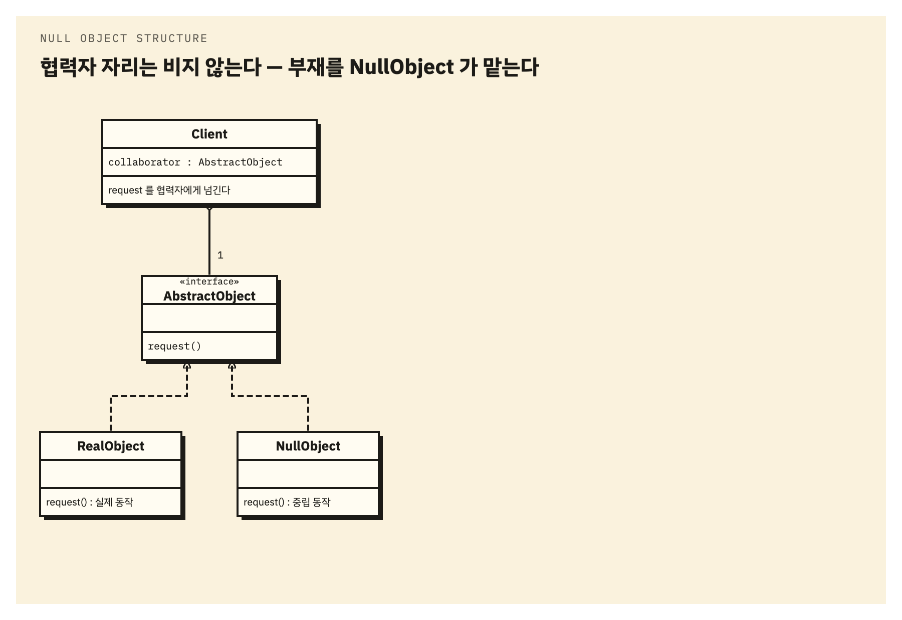

# Null Object — 없음을 객체 하나로 만들어, 부르는 쪽에서 검사를 걷어내기

## 한눈에 보는 개요

동네 도서관의 대출 창구 코드를 떠올려 봅시다. 회원이 책을 빌리면 창구는 대출을 기록하고 반납 기한 알림을 보냅니다. 그런데 알림을 꺼 둔 회원이 있어요. 그래서 회원 객체의 알림 채널 자리가 비어 있을 수 있고, 창구 코드는 `if (member.notifier() != null) member.notifier().send(loan);` 이 됩니다. 알림을 쓰는 자리가 늘 때마다 이 검사가 따라 늘고, 한 자리에서 빠뜨리면 그 줄에서 프로그램이 예외로 중단돼요.

Null Object 의 해법은 **「알림을 보내지 않는다」를 객체 하나로 만드는 것**입니다. 그 객체는 진짜 채널과 똑같은 연산을 갖고, 부르면 아무 일도 하지 않아요. 알림을 끈 회원은 빈 참조 대신 그 객체를 가지고, 창구는 자기 코드에서 검사를 지웁니다.

```text
Before : 협력자 자리가 비어 있을 수 있다 — 검사가 부르는 자리마다 따라 붙는다

  회원 M-01 ── notifier ──▶ EmailNotifier      창구  if (n != null) n.send(loan);
  회원 M-02 ── notifier ──▶ (빈 참조)                 ↑ 한 자리에서 빠뜨리면 그 줄에서 예외가 난다
  회원 M-03 ── notifier ──▶ SmsNotifier

After : 「보내지 않는다」가 객체 하나로 만들어진다 — 자리가 비지 않으니 검사가 없다

  회원 M-01 ── notifier ──▶ EmailNotifier      창구  n.send(loan);
  회원 M-02 ─┐                                        ↑ 갈래 없이 한 줄
  회원 M-04 ─┴ notifier ──▶ SilentNotifier     (인스턴스 하나를 나눠 쓴다)
  회원 M-03 ── notifier ──▶ SmsNotifier
```

분류는 객체 수준의 구조 패턴이에요. 이름을 붙인 Bobby Woolf 의 원전이 그렇게 적고([The Null Object Pattern](http://www.cs.uni.edu/~wallingf/patterns/elementary/papers/null-object.pdf)), GoF(Gang of Four, 1994년에 나온 *Design Patterns* 의 저자 네 명을 함께 부르는 이름) 23편에는 없어서 그 책의 생성·구조·행위 어느 칸에도 들어가지 않습니다. 자주 함께 쓰는 패턴은 [Strategy](../strategy/strategy-guide_v1.2.0.md) · [State](../state/state-guide_v1.1.0.md) · [Singleton](../singleton/singleton-guide_v1.1.0.md) 입니다.

이 글은 도서관 대출 창구의 시나리오 셋을 따라갑니다. 대출 한 건이 알림까지 끝나는 길, 채널과 회원이 늘 때 무엇이 안 바뀌는가, 채널 자리를 비우거나 조용한 채널이 상태를 갖거나 한도 검사가 늘 통과하면 어디서 틀리는가. 끝까지 읽으면 어떤 코드를 Null Object 라고 불러도 되는지 필수 조건 넷으로 판정할 수 있고, **부재를 타입으로 막아 주는 Rust 에서도 이 패턴이 쓸모 있는 자리가 어디인지**, 그리고 **중립 동작이 삼켜도 되는 것과 삼키면 안 되는 것을 무엇으로 구분하는지**까지 말할 수 있게 됩니다.

## 패턴 자세히 들여다보기

### 시나리오 1 — 대출 한 건이 접수돼 알림까지 끝나는 길

도서관 운영 100일째입니다. 회원 M-01 은 메일 알림을 켜 두었고, M-02 는 알림을 꺼 두었어요. 대출 기간은 14일이라 반납 기한은 114일차입니다. 창구에 M-01 의 『Cosmos』와 M-02 의 『The Selfish Gene』이 차례로 들어옵니다. 나와야 하는 것은 대출마다 한 줄, 그리고 알림을 켠 회원에게만 붙는 알림 한 줄이에요. 이 장면을 실행하면 출력의 첫 세 줄이 아래처럼 나옵니다(세 언어 모두 같아요).

```text
출력 줄   내용
1         loan L-1001 M-01 "Cosmos" due day 114
2         mail -> M-01 : "Cosmos" due day 114
3         loan L-1002 M-02 "The Selfish Gene" due day 114
```

1. **조립 코드가 채널 객체 둘을 만듭니다.** 메일 채널(`EmailNotifier`)·조용한 채널(`SilentNotifier`)입니다. 여기서 **조용한 채널**은 알림 연산을 아무 일도 하지 않게 구현한 객체이고, **채널 공통 타입**(`BorrowNotifier`)은 채널들이 함께 구현하는 선언이에요. 공통 타입의 연산은 둘, 알림을 보내는 `send` 와 보낸 건수를 묻는 `sentCount` 입니다. 왜 조립 코드가 맡는가 — 어느 회원이 알림을 받는지는 업무가 정하는 일이라 창구가 결정할 일이 아닙니다. 창구가 정하면 회원 설정이 바뀔 때마다 창구를 열게 돼요.
2. **회원 객체(`Member`)가 자기 채널을 공통 타입 자리로 받아 둡니다.** M-01 은 메일 채널을, M-02 는 조용한 채널을 받습니다. 이 자리는 비지 않아요 — 알림을 끈 회원도 객체 하나를 가집니다. 왜 비우지 않는가 — 비워 두면 그 자리를 쓰는 코드마다 "비었는가"를 물어야 하고, 묻는 자리를 하나라도 빠뜨리면 시나리오 3 의 1단계가 보여 주는 일이 납니다.
3. **창구(`LoanDesk`)가 M-01 의 대출을 기록하고 채널에 요청을 넘깁니다.** 대출 번호 L-1001 과 반납 기한 114일차를 찍은 뒤 알림 연산을 부릅니다. 창구는 그 채널이 무엇인지 확인하지 않아요. 왜 확인하지 않는가 — 창구가 아는 것은 "대출이 생겼다" 까지이고, 그것을 어떻게 알릴지는 채널이 압니다. 창구가 확인하기 시작하면 채널 종류가 늘 때마다 창구를 고치게 돼요.
4. **메일 채널이 실제 동작을 합니다.** 위 출력의 2번 줄 `mail -> M-01 ...` 이 그 자리이고, 채널이 자기 발송 건수를 하나 올립니다. 왜 채널이 세는가 — 무엇을 몇 건 보냈는지는 보낸 쪽만 알 수 있고, 창구가 세면 보내지 않은 것까지 세게 됩니다.
5. **창구가 M-02 의 대출을 같은 코드로 처리합니다.** 위 출력의 3번 줄에 대출만 찍히고 알림 줄이 없습니다. 창구 코드는 3단계와 글자 하나 다르지 않아요. 왜 같은 코드가 다른 결과를 내는가 — 다름이 창구의 분기가 아니라 **회원이 가진 객체**에 담겨 있기 때문입니다.
6. **조용한 채널이 요청을 받아 아무 일도 하지 않습니다.** 메일도 문자도 나가지 않고, 예외도 나지 않고, 발송 건수도 오르지 않아요. 왜 요청을 받기는 하는가 — 받지 않으면 창구가 "보낼 수 있는 상대인가"를 물어야 하고, 그 물음이 곧 2단계에서 지운 검사입니다.
7. **마감 보고가 채널마다 보낸 건수를 묻습니다.** 이 시점이라면 메일 1건, 조용한 채널 0건입니다(실행 출력에서는 마감 보고가 시나리오 2 까지 마친 뒤 한 번 찍혀요). 조용한 채널이 돌려준 0 은 **널 결과**예요 — 자리를 메우려고 고른 값이 아니라, 한 건도 보내지 않았으니 참인 값입니다. 왜 이 구분이 중요한가 — 중립값이 참값이 아닌 자리에 같은 모양을 쓰면 시나리오 3 의 3단계가 됩니다.

```text
창구 LoanDesk      회원 M-01        메일 채널           회원 M-02        조용한 채널
   │ borrow(M-01)     │                │                   │                │
   ├─ loan L-1001 기록 (출력 1번 줄)    │                   │                │
   ├─ notifier ──────▶│                │                   │                │
   ├─ send(loan) ─────┼───────────────▶│ 메일 발송 (출력 2번 줄) · 건수 +1    │
   │                  │                │                   │                │
   │ borrow(M-02)     │                │                   │                │
   ├─ loan L-1002 기록 (출력 3번 줄)    │                   │                │
   ├─ notifier ───────┼────────────────┼──────────────────▶│                │
   ├─ send(loan) ─────┼────────────────┼───────────────────┼───────────────▶│ 아무 일도 하지 않음
   │                                                                          (출력에 줄이 없다)
   └─ 창구 코드는 두 번 다 같은 한 줄이다
```

이 시나리오가 드러낸 것은 넷입니다. 쓰는 쪽이 협력자를 공통 타입으로만 다룬다는 것, 그 자리에 부재를 나타내는 값이 들어가지 않는다는 것, 실제 동작을 하는 구현과 아무 일도 하지 않는 구현이 나란히 그 타입을 구현한다는 것, 그리고 값을 돌려주는 연산에서는 아무 일도 하지 않음이 **널 결과**로 나타난다는 것. 이 이름들의 정식 정의는 아래 「개념 정리」에 모았습니다.

### 시나리오 2 — 알림 수단이 늘고, 알림을 끈 회원이 늘 때

도서관이 문자 알림을 새로 엽니다. M-03 이 문자 알림을 골랐고, 새로 가입한 M-04 는 알림을 껐어요. 두 사람이 『Guns, Germs, and Steel』과 『Sapiens』를 차례로 빌립니다. 나와야 하는 것은 대출 두 줄과 문자 알림 한 줄, 그리고 채널 셋의 마감 보고 세 줄입니다. 시나리오 1 에 이어 실행하면 출력의 4번 줄부터 끝까지가 이렇게 나와요.

```text
출력 줄   내용
4         loan L-1003 M-03 "Guns, Germs, and Steel" due day 114
5         sms -> M-03 : "Guns, Germs, and Steel" due day 114
6         loan L-1004 M-04 "Sapiens" due day 114
7         -- closing --
8         mail sent 1
9         sms sent 1
10        silent sent 0
```

1. **조립 코드가 문자 채널(`SmsNotifier`) 객체를 하나 더 만들어 M-03 에게 줍니다.** 이때 메일 채널도, 조용한 채널도, 창구도, 회원 타입도 한 줄이 안 바뀝니다. 왜 안 바뀌는가 — 채널은 자기가 어떻게 보내는지만 알고 다른 채널이 몇 개 있는지 모릅니다. 서로를 모르니 하나 더 놓는 일이 기존 것에 영향을 주지 않아요.
2. **M-04 에게는 새 객체를 만들지 않고 이미 있는 조용한 채널을 그대로 줍니다.** M-02 와 M-04 가 인스턴스 하나를 나눠 씁니다. 왜 나눠 쓸 수 있는가 — 그 객체는 요청을 받아도 자기 필드에 남기는 것이 없어서, 누가 언제 불러도 같은 답을 냅니다. 남기기 시작하면 시나리오 3 의 2단계가 됩니다.
3. **창구가 두 대출을 시나리오 1 과 같은 코드로 처리합니다.** 위 출력의 4·5·6번 줄이 그 자리예요. M-03 에게는 문자 줄이 붙고 M-04 에게는 아무 줄도 붙지 않습니다. 왜 창구를 안 고쳐도 되는가 — 창구가 부르는 연산의 모양이 채널이 늘어도 그대로이기 때문입니다.
4. **마감 보고가 채널 셋에 각각 묻습니다.** 메일 1건, 문자 1건, 조용한 채널 0건이 위 출력의 마지막 세 줄입니다. 왜 조용한 채널에도 묻는가 — 묻지 않으려면 "이 채널은 물어볼 필요가 없다"를 아는 코드가 있어야 하고, 그 코드가 바로 지운 검사입니다.

```text
문자 알림을 열기 전                       문자 알림을 연 뒤

  채널 클래스  Email · Silent              채널 클래스  Email · Sms · Silent   ← 새 클래스 하나
  회원         M-01 M-02                   회원         M-01 M-02 M-03 M-04
  창구 코드    borrow 한 벌                창구 코드    borrow 한 벌           ← 그대로
  고친 파일    —                           고친 파일    조립 코드 한 곳

  M-02 ─┐
  M-04 ─┴─▶ SilentNotifier  ← 인스턴스 하나. 상태가 없어서 나눠 써도 답이 달라지지 않는다
```

이 시나리오가 드러낸 것은 둘입니다. 하나는 실제 동작 구현이 늘어도 아무 일도 하지 않는 구현과 쓰는 쪽이 그대로라는 것이고, 다른 하나는 아무 일도 하지 않는 구현이 상태를 갖지 않아 인스턴스 하나를 여러 자리가 나눠 쓸 수 있다는 것입니다. 앞의 것이 최소 조건 1·2번이 되고, 뒤의 것이 4번과 `[선택]` 5번이 됩니다.

### 시나리오 3 — 채널 자리를 비우거나, 조용한 채널이 상태를 갖거나, 한도 검사가 늘 통과하면 어디서 틀리는가

아래 셋은 시나리오 1·2 를 실행한 대출 창구 코드를 한 군데씩 바꿔 실제로 컴파일하고 실행해 본 것입니다. 도구는 `javac 21.0.11` · `tsc 5.9.3`(Node v22.22.3) · `rustc 1.95.0` 이고, 바꾼 자리 말고는 시나리오 1·2 의 코드와 같아요.

1. **조용한 채널을 지우고 그 자리를 비웠습니다.** 회원의 채널 자리가 빌 수 있게 타입을 열고 그 자리에 부재 값을 넣었어요. 세 언어가 **막아 준 시점이 서로 달랐습니다.** Java 는 그대로 컴파일됐고 두 번째 대출에서 `NullPointerException` 으로 중단됐습니다 — 메시지가 `Cannot invoke "…BorrowNotifier.send(…)" because the return value of "…Member.notifier()" is null` 이었어요. TypeScript 는 `strict` 에서 컴파일이 멈췄고 오류가 1건, `error TS18047: 'member.notifier' is possibly 'null'` 이었습니다. Rust 는 ``error[E0599]: no method named `send` found for enum `Option<T>` in the current scope`` 1건으로 멈췄고요(셋 다 직접 컴파일·실행해 확인). 왜 이 자리에서 실패하는가 — 협력자 자리가 빌 수 있게 열리는 순간, 그 자리를 쓰는 모든 코드가 "비었는가"에 답할 의무를 지기 때문입니다.
2. **조용한 채널이 실제 채널로 바뀌게 했습니다.** 그 클래스에 상태 하나를 두고, 두 번째 요청부터는 진짜로 메일을 보내게 고쳤어요. 컴파일도 실행도 통과했지만 출력이 달라졌습니다 — 같은 인스턴스를 나눠 쓴 M-02 는 알림을 못 받고 M-04 는 `mail -> M-04 : "Sapiens" due day 114` 를 받았어요(직접 실행해 확인). 마감 보고도 `silent sent 1` 로 바뀝니다. 왜 이렇게 되는가 — 시나리오 2 의 2단계가 기댄 성질이 사라져서입니다. 상태를 갖는 순간 그 객체는 "아무 일도 하지 않는 자리" 가 아니라 "지금은 안 하는 중인 자리" 가 됩니다.
3. **삼키면 안 되는 자리에 아무 일도 하지 않는 구현을 끼웠습니다.** 창구에 대출 한도 검사를 하나 더해 창구에 열린 대출이 2건에 이르면 다음 대출을 거절하게 하고, 그 자리에 늘 통과를 돌려주는 구현을 끼웠어요. 한도를 2권으로 둔 판은 세 번째 대출에서 `denied M-03 "Guns, Germs, and Steel" (open 2)` 를 찍었는데, 늘 통과를 돌려주는 판은 그 줄 없이 `loan L-1003` 을 찍고 알림까지 보냈습니다(직접 실행해 확인). 왜 이것이 다른 둘과 종류가 다른가 — 1·2번은 코드가 조건을 어긴 것이고, 이것은 **조건을 다 지키면서 틀린 자리에 놓인 것**입니다. 한도 검사의 중립값 "통과" 는 부재 상태의 참값이 아니라 "모름" 이에요.

| 바꾼 자리 | 어긋난 자리 | 나타나는 때 |
| --- | --- | --- |
| 협력자 자리를 비울 수 있게 열었다 | 쓰는 자리마다 부재 검사가 되돌아온다 | Java 는 실행(NPE, `NullPointerException`) · TypeScript 와 Rust 는 컴파일 |
| 아무 일도 하지 않는 구현이 상태를 갖는다 | 같은 인스턴스를 나눠 쓴 둘의 동작이 달라진다 | 실행 (출력이 어긋난다) |
| 답이 업무 판단을 가르는 자리에 중립값을 두었다 | 한도 초과 대출이 거절 없이 성립한다 | 실행 (오류가 정상 실행처럼 보인다) |

1번의 세 언어 차이는 이 편에서 가장 중요한 자리라 한 번 더 살펴봅시다. Rust 에는 널 참조가 없고 `Option` 이 부재를 타입으로 강제하니, "널 검사를 없앤다"는 이 패턴의 동기가 Rust 에서는 이미 해결된 것처럼 보이죠. 그래서 같은 프로그램을 `Option<Rc<dyn BorrowNotifier>>` 로 다시 써서 실행해 봤습니다. 출력은 같게 나왔지만 **부재를 처리하는 코드가 두 자리에 생겼어요** — 창구의 호출 자리가 `if let Some(n) = &member.notifier { n.send(&loan); }` 가 됐고, 마감 보고 자리가 `silent.map_or(0, |n| n.sent_count())` 가 됐습니다. 자리 수는 회원 수가 아니라 **협력자를 쓰는 코드 자리 수**를 따라 늘어납니다.

그다음이 진짜 문제입니다. 마감 보고의 `0` 을 `99` 로 바꿔 보았더니 **그대로 컴파일되고 `silent sent 99` 를 찍었어요**(직접 컴파일·실행해 확인). 컴파일러는 부재 갈래를 쓰게 만들지만 그 갈래에 **무엇을 적을지**는 묻지 않습니다. 부재일 때의 답이 0 인지 99 인지는 업무가 정하는 일이고, `Option` 은 그 답을 담아 둘 자리를 주지 않아요.

```text
                  Option<Rc<dyn T>>                       Rc<dyn T> + 널 객체

  안전성          컴파일러가 부재 갈래를 강제한다          자리가 비지 않아 부재 갈래가 없다
  부재일 때의 답   호출 자리마다 그때그때 적는다            구현 하나에 이름 붙여 한 번 적는다
  자리 수         협력자를 쓰는 코드 자리 수만큼            협력자를 만드는 자리 하나
  틀린 답         `map_or(99, …)` 도 컴파일된다            `sent_count()` 를 고치면 전부 따라간다
```

여기서 헷갈리기 쉬운 포인트는 "Rust 에서는 이 패턴이 필요 없다"고 결론 내리는 것입니다. 실측이 말하는 것은 그게 아니에요. **Rust 에서 사라지는 것은 이 패턴의 안전 효과이고, 남는 것은 설계 효과입니다.** Java 는 검사를 빠뜨린 채 컴파일돼 실행 중에 중단됐지만 Rust 는 애초에 컴파일이 안 되니, "검사를 빠뜨릴 수 있다"는 위험은 Rust 에 없습니다. 그 대신 `Option` 은 부재일 때 무엇이 옳은지를 정해 주지 않아서, 그 답이 호출 자리마다 흩어지고 자리마다 달라질 수 있어요. 널 객체는 그 답에 **이름과 자리**를 줍니다.

이 시나리오가 드러낸 것은 셋입니다. 협력자 자리를 비울 수 있게 열면 부재 검사가 그 자리를 쓰는 코드마다 되돌아온다는 것, 아무 일도 하지 않는 구현이 상태를 갖는 순간 그 인스턴스를 나눠 쓴 자리들의 동작이 달라진다는 것, 그리고 조건을 다 지킨 코드도 답이 업무 판단을 가르는 자리에 놓이면 오류를 정상 실행처럼 보이게 한다는 것. 앞의 둘이 최소 조건 3번과 4번이 되고, 마지막 것은 조건이 아니라 비교 절의 기준이 됩니다.

### 개념 정리

시나리오에 나온 이름 넷을 역할 이름으로 정의합니다. 예시 코드의 타입 이름(`BorrowNotifier`·`SilentNotifier`)은 정의 대상이 아니라 「상황 설정」에서 이 역할들에 매핑하는 쪽이에요.

- **Client** — 협력자를 요구하는 쪽입니다. 협력자를 AbstractObject 타입 자리로 가지고, 요청이 오면 그 협력자에게 넘깁니다. 어떤 구현을 가지고 있는지 알지 못하고 알 필요도 없어요 — 구체 타입을 확인하는 코드를 두는 순간 이 패턴이 지우려던 분기가 되돌아옵니다. 이 예시에서는 Client 자리가 두 타입으로 나뉘어 있습니다. 회원 객체가 채널을 필드로 가지고, 창구가 그 채널에 요청을 보내요.
- **AbstractObject** — Client 가 쓸 협력자의 연산을 선언하는 공통 타입입니다. RealObject 와 NullObject 가 이 타입을 구현하고, Client 는 이 타입으로만 협력자를 다룹니다. 모든 구현에 공통인 기본 동작을 여기서 구현해 둘 수도 있어요(최소 조건 `[선택]` 8번). 이 타입이 선언 하나로 정의돼 있어야 두 구현이 서로 갈아 끼워집니다 — 그 까닭은 [참고 문서 「GoF 공통 어휘」의 「인터페이스에 프로그래밍한다」](../../reference/gof-vocabulary/gof-vocabulary-ref_v1.0.2.md)에 있습니다.
- **RealObject** — Client 가 기대하는 실제 동작을 하는 구현입니다. 메일 채널과 문자 채널이 이 자리예요. 자기가 하는 일만 알고, 아무 일도 하지 않는 구현이 있는지는 모릅니다.
- **NullObject** — AbstractObject 와 똑같은 연산을 갖되 그 연산을 중립 동작으로 채운 구현입니다. 실제 객체 자리에 그대로 갈아 끼워지는 것이 이 역할의 전부예요. 무엇을 "아무 일도 하지 않음" 으로 볼지는 Client 가 무엇을 기대하느냐에 달려 있어서, 값을 돌려주는 연산은 **널 결과**를 돌려주는 것으로 채웁니다 — 널 결과는 자리를 메우려고 고른 값이 아니라 협력자가 없는 상태에서 참인 값이에요. 발송 건수 0 이 그것입니다. 아무 일도 하지 않는 방법이 둘 이상이면 이 역할을 맡는 타입이 둘 이상 필요할 수도 있어요.



그림에서 눈여겨볼 선은 둘입니다. Client 에서 AbstractObject 로 가는 선의 카디널리티가 `1` 이에요 — `0..1` 이 아닙니다. 이 하나가 이 패턴의 전부라고 해도 좋습니다. 협력자가 "있거나 없거나" 가 아니라 "늘 하나 있다" 이고, 없는 경우는 아래쪽 NullObject 가 맡아요. 그리고 RealObject 와 NullObject 에서 AbstractObject 로 가는 선은 **모양이 같은 구현 선 둘**입니다. 둘 사이에는 아무 선도 없어요. 서로를 모르기 때문이고, 그래서 시나리오 2 의 1단계에서 실제 채널을 하나 더 놓는 일이 조용한 채널에 영향을 주지 않습니다.

## 사용 목적

어떤 단서가 보일 때 이 패턴이 필요한지부터 봅시다. 셋 다 코드나 요구사항에서 눈으로 확인되는 것들이에요.

#### 단서 1 — 같은 참조에 대한 부재 검사가 여러 자리에 복제돼 있습니다

`if (x != null)` 이나 `x?.f()` 가 같은 필드를 두고 세 곳에 적혀 있고, 그 협력자를 쓰는 자리가 늘 때마다 검사가 하나씩 따라 붙는 상태예요. 시나리오 3 의 1단계가 이 상태에서 검사를 하나 빠뜨렸을 때 무엇이 나오는지 보여 줍니다.

#### 단서 2 — 그 협력자를 갖지 않는 대상이 업무에 실제로 있습니다

알림을 끈 회원, 이력이 없는 신규 계정, 로그를 남기지 않는 배치 작업처럼 "그것이 없는 것이 정상인 경우" 가 도메인에 있는 상태입니다. 없는 것이 오류가 아니라 하나의 정상 상태라는 점이 중요해요 — 이 구분이 아래 「쓰지 말아야 할 경우」의 첫 항목의 기준이 됩니다.

#### 단서 3 — 부재일 때 할 일이 「건너뛴다」보다 큽니다

협력자가 없을 때 돌려줄 값이 정해져 있거나(발송 건수 0), 건너뛰는 대신 기록을 남겨야 하거나, 그 처리가 여러 자리에서 똑같아야 하는 경우입니다. 시나리오 1 의 7단계가 그 값이 어디에 있는지 보여 줘요.

#### 쓰지 말아야 할 경우

이 패턴은 구조가 Strategy · State 와 겹칩니다. 겹치는 정도가 닮았다는 수준이 아니라 **같은 코드가 둘 다인 수준**이어서, 그 이야기는 아래 비교 절에서 따로 풉니다. 단서를 만났을 때는 아래 순서로 물어보고, 그다음 두 자리에서는 이 패턴을 쓰지 않습니다.

```text
단서를 만났을 때 물어볼 것

  이 협력자가 없는 것이 정상인 대상이 있는가?  ──아니오──▶ 없으면 오류다. 널 객체를 두지 않는다
          │ 예
  없을 때 할 일이 모든 호출 자리에서 같은가?    ──아니오──▶ 자리마다 다르면 호출 자리에서 정한다
          │ 예
  그 처리의 결과가 업무 판단을 가르는가?
          │ 아니오                              │ 예
     Null Object                            답이 없다는 사실을 그대로 올린다
```

- **부재가 「없음」이 아니라 「모름」일 때** 는 쓰지 않습니다. 잃는 것은 오류를 알아챌 기회예요. 한도 검사기를 아직 못 붙였다는 사실은 "한도가 없다" 가 아니라 "한도를 모른다" 인데, 늘 통과를 돌려주는 객체를 끼우면 그 모름이 통과로 바뀝니다. 시나리오 3 의 3단계가 그 결과이고, 한도 초과 대출이 거절 줄 하나 없이 성립했어요.
- **협력자를 쓰는 자리가 하나뿐이고 앞으로도 늘지 않을 때** 도 쓰지 않습니다. 잃는 것은 읽기 쉬움입니다. `if (n != null)` 한 줄이면 끝날 일에 구현 클래스 하나와 그것을 꽂는 조립 코드가 붙으면, 읽는 사람이 파일 둘을 오가고도 "여기서 무슨 일이 일어나는가" 에 답하지 못해요. 시나리오 2 처럼 쓰는 자리나 대상이 늘 때 쓸모가 생깁니다.

## 패턴의 경계

### 디자인 패턴을 충족하는 최소 조건

어떤 코드를 Null Object 라고 불러도 되는지 가르는 기준입니다. `[필수]` 가 하나라도 빠지면 Null Object 가 아니고, `[선택]` 은 갖추면 좋거나 상황에 따라 고르는 구조예요. 조건은 언어와 상관없이 코드에서 확인할 수 있는 모양(타입 선언 · 참조 보유 · 호출 방향 · 반환값)으로 적었고, 조건마다 그것을 보여 준 시나리오의 단계를 가리킵니다. **여기서 "협력자 자리" 는 1번이 정합니다** — Client 가 협력자를 담는 필드·인자·반환 자리가 그것이고, 다른 조건들은 그 자리를 가리켜요.

1. [필수] 협력자는 공통 타입, 쓰는 쪽은 그 타입으로만 다룸 — 협력자를 담는 자리의 타입이 둘 이상의 구현이 함께 구현하는 공통 타입이고, 그 자리를 쓰는 코드에 구체 타입 검사나 다운캐스트(상위 타입으로 받은 값을 하위 타입으로 바꾸는 변환)가 없습니다. 시나리오 1 의 2단계(보유)와 3단계(호출) (근거: Woolf 「The Null Object Pattern」(『Pattern Languages of Program Design 3』, 줄여서 PLoPD3) Intent 절 — 같은 인터페이스를 나눠 갖는 대역을 다른 객체 자리에 놓는 것이 이 패턴이다 · Participants 절 NullObject — AbstractObject 와 똑같은 인터페이스를 제공해 실제 객체 자리에 널 객체를 갈아 끼울 수 있게 한다)
   - 빠지면: 협력자 자리가 구체 타입이면 아무 일도 하지 않는 구현을 그 자리에 넣을 수 없어서, 쓰는 쪽은 부재를 다른 방법으로 표현하게 됩니다. 회원 객체의 채널 자리 타입을 `EmailNotifier` 로 좁혀 컴파일하면 Java 가 `incompatible types` 3건으로 멈춥니다 — 조용한 채널을 가진 회원 둘과 문자 채널을 가진 회원 하나가 그 자리에 들어가지 못해요(직접 컴파일해 확인).
   - 경계 사례: 위 근거 괄호가 뒷받침하는 것은 **두 구현이 같은 인터페이스를 나눠 갖고 서로 갈아 끼워진다는 것까지**입니다. 그 공통 타입이 인터페이스인지 추상 클래스인지 trait(Rust 에서 타입이 구현할 연산을 선언하는 문법)인지는 묻지 않아요.
2. [필수] 연산 전부를 중립 동작으로 채운 구현이 하나 이상 — 그 공통 타입의 구현 가운데, **모든** 연산이 ① 자기 바깥의 상태를 바꾸지 않고 ② 다른 협력자를 부르지 않으며 ③ 값을 돌려주는 연산이면 받은 인자와 상관없이 늘 같은 중립값을 돌려주는 것이 하나 이상 있습니다. 시나리오 1 의 6단계(값을 돌려주지 않는 쪽)와 7단계(널 결과를 돌려주는 쪽) (근거: Woolf 「The Null Object Pattern」(PLoPD3) Intent 절 — 같은 인터페이스를 나눠 갖되 아무 일도 하지 않는 대역을 둔다 · Participants 절 NullObject — 자기 인터페이스를 아무 일도 하지 않게 구현하고, 어떤 요청은 널 결과를 주는 것으로 채워질 수 있다)
   - 빠지면: [Strategy 편](../strategy/strategy-guide_v1.2.0.md)의 배송비 예제가 그 자리입니다. 요금제 셋이 공통 타입을 나눠 갖고 바깥에서 설치되지만 셋 다 금액을 계산해요. 그중 `FreeOverThreshold` 가 0 을 돌려주는 분기를 갖지만 주문 금액에 따라 3,000 도 돌려주므로 "늘 같은 중립값" 이 아닙니다.
   - 경계 사례: 위 근거 괄호가 뒷받침하는 것은 **그 구현의 연산이 아무 일도 하지 않거나 널 결과를 돌려준다는 것까지**입니다. 연산 대부분만 중립 동작인 구현은 이 조건을 만족하지 않아요 — 「State 와의 차이」가 그 자리입니다.
3. [필수] 협력자 자리는 비어 있을 수 없음 — 협력자 자리에 부재를 나타내는 값(`null` · `undefined` · 미설정 · `Option` 의 빈 값)을 넣는 코드가 없고, 그 자리를 쓰는 코드에 부재 검사 분기가 없습니다. 시나리오 1 의 2단계 (근거: Woolf 「The Null Object Pattern」(PLoPD3) Applicability 절 — 실제 동작을 하는 협력자와 아무 일도 하지 않는 협력자의 차이를 클라이언트가 무시할 수 있기를 바랄 때 이 패턴을 쓰고, 그래야 클라이언트가 `nil` 이나 다른 특별한 값을 따로 확인하지 않는다)
   - 빠지면: 시나리오 3 의 1단계가 그 자리입니다. 자리를 비울 수 있게 열었더니 Java 는 그대로 컴파일돼 실행 중 `NullPointerException` 으로 중단됐고, TypeScript 는 `TS18047` 1건, Rust 는 `E0599` 1건으로 컴파일에서 멈췄어요(직접 컴파일·실행해 확인).
   - 경계 사례: 위 근거 괄호가 뒷받침하는 것은 **클라이언트가 부재를 나타내는 특별한 값을 확인하지 않게 된다는 것까지**입니다. 부재를 타입으로 강제하는 `Option` 을 그 자리에 써도 이 조건은 빠집니다 — 컴파일러가 검사를 강제할 뿐 검사가 사라지지는 않아요(시나리오 3 의 1번 뒤 Rust 실험).
4. [필수] 실제 동작 구현 대신 놓이는 구현은 실제 동작으로 바뀌지 않음 — 그 구현의 연산 안에 동작을 가르는 분기가 없고, 그 구현이 자기 필드나 필드가 가리키는 객체의 값을 바꾸는 코드가 없습니다. 시나리오 2 의 2단계 (근거: Woolf 「The Null Object Pattern」(PLoPD3) Implementation 절 Transformation to Real Object — 아무 일도 하지 않다가 실제 동작을 시작하기로 정할 수 있는 객체라면 그것은 널 객체가 아니라고, 성립 요건으로 적는다 · Consequences 절 — 널 객체는 늘 아무 일도 하지 않는 객체로 있고 실제 객체로 바뀌지 않는다)
   - 빠지면: 시나리오 3 의 2단계가 그 자리입니다. 조용한 채널에 상태를 하나 두었더니 같은 인스턴스를 나눠 쓴 M-02 는 알림을 못 받고 M-04 는 받았어요(직접 실행해 확인).
   - 경계 사례: 위 근거 괄호가 뒷받침하는 것은 **그 객체가 실제 동작으로 옮겨 가지 않는다는 것까지**입니다. 만들 때 정한 뒤 바뀌지 않는 필드를 두어도 되는지는 여기서 오지 않아요 — 두어도 되는 값과 안 되는 값을 구분하는 어휘가 [참고 문서 「GoF 공통 어휘」의 「내재 상태와 외재 상태」](../../reference/gof-vocabulary/gof-vocabulary-ref_v1.0.2.md)에 있습니다.
5. [선택] 중립 동작 구현의 인스턴스 하나를 여러 자리가 나눠 씀 — 대상마다 새로 만들지 않고 이미 만든 인스턴스를 넘깁니다. 시나리오 2 의 2단계 (근거: Woolf 「The Null Object Pattern」(PLoPD3) Implementation 절 Null Object as Singleton — 널 객체는 대개 상태가 없어 인스턴스 여럿이 똑같으므로 하나를 되풀이해 쓰면 된다고, 구현 선택지로 든다)
   - 경계 사례: 대상마다 새 인스턴스를 만들어도 1~4번은 그대로 만족합니다.
6. [선택] 아무 일도 하지 않는 방법이 여럿이면 중립 동작 구현도 여럿 — 같은 공통 타입에 대해 중립 동작 구현이 둘 이상 있고, 쓰는 쪽이 자기에게 맞는 것을 받습니다. 시나리오 1 의 1단계 (근거: Woolf 「The Null Object Pattern」(PLoPD3) Participants 절 NullObject — 아무 일도 하지 않는 방법이 둘 이상이면 널 객체 클래스가 둘 이상 필요할 수도 있다고, 허용으로 적는다)
   - 경계 사례: 시나리오 1 의 1단계가 만든 중립 동작 구현이 조용한 채널 하나뿐이라, 이 예제에는 그 모양이 없습니다.
7. [선택] 중립 동작을 별도 타입 대신 실제 구현의 특수 인스턴스로 둠 — 새 클래스를 만들지 않고, 실제 구현의 필드를 중립값으로 채운 인스턴스 하나가 그 몫을 합니다. 시나리오 1 의 1단계 (근거: Woolf 「The Null Object Pattern」(PLoPD3) Implementation 절 Special null instance of Real Object — 타입이 셋으로 늘어나는 것을 피하는 방법으로 든다. 구현 선택지라 필수로 올리지 않았습니다)
   - 경계 사례: 시나리오 1 의 1단계는 반대쪽을 골라 조용한 채널을 별도 타입으로 두었어요.
8. [선택] 공통 타입이 모든 구현에 공통인 기본 동작을 구현 — 구현마다 되풀이될 코드를 공통 타입에 두고, 중립 동작 구현은 달라지는 것만 덮어씁니다. 시나리오 1 의 1단계 (근거: Woolf 「The Null Object Pattern」(PLoPD3) Participants 절 AbstractObject — 모든 클래스에 공통인 인터페이스의 기본 동작을 적절한 만큼 구현한다고 적는다. "적절한 만큼" 인 자리라 필수로 올리지 않았습니다)
   - 경계 사례: 시나리오 1 의 1단계가 선언한 채널 공통 타입은 연산 둘을 선언만 하고 기본 동작을 두지 않았어요. 기본 동작이 없어도 1~4번은 그대로 만족합니다.

판정 순서를 정리해 둡시다. 1번은 **협력자 자리의 타입 선언과 그 자리를 쓰는 줄만** 보면 판정되고, 2번은 그 타입을 구현한 것들의 연산 본문을, 3번은 그 자리에 무엇이 들어가는지를, 4번은 그 자리에 실제 동작 구현 대신 놓인 구현의 필드와 분기를 봅니다. 보는 품이 적은 1번부터 적용하면 대부분 거기서 끝나요.

| 코드 | 1번 | 2번 | 3번 | 4번 | 판정 |
| --- | --- | --- | --- | --- | --- |
| 시나리오 1·2 의 대출 창구 코드 | 만족 | 만족 | 만족 | 만족 | Null Object |
| 자리를 비울 수 있게 연 판 (시나리오 3 의 1단계) | 만족 | **빠짐** | **빠짐** | — | 아님 — 검사가 되돌아온다 |
| 조용한 채널이 상태를 갖는 판 (시나리오 3 의 2단계) | 만족 | **빠짐** | 만족 | **빠짐** | 아님 — 실제 객체로 옮겨 간다 |
| 회원 필드가 `EmailNotifier` 인 판 (조건 1 의 반례) | **빠짐** | 만족 | 만족 | — | 아님 — 갈아 끼울 자리가 없다 |
| Strategy 편의 배송비 예제 | 만족 | **빠짐** | 만족 | — | 아님 — 중립 동작 구현이 없다 |
| 늘 통과를 돌려주는 한도 검사기 (시나리오 3 의 3단계) | 만족 | 만족 | 만족 | 만족 | **조건으로는 Null Object** — 아래 비교 절을 본다 |
| State 편의 주문 상태 예제 | 만족 | **빠짐** | 만족 | — | 아님 — 상태마다 주문에 기록을 남긴다 |

`—` 칸은 그 조건을 적용할 대상이 그 코드에 없다는 뜻이에요. 4번의 `—` 는 실제 동작 구현 대신 놓인 구현이 그 코드에 아예 없어서 "그것이 바뀌는가" 를 물을 대상 자체가 없는 자리입니다. 여기서 4번을 2번이 가리킨 구현으로 적지 않은 데는 까닭이 있어요 — 그렇게 적으면 2번이 빠진 코드에서 4번이 잴 것 없이 참이 되어 버리고, 위 표의 「조용한 채널이 상태를 갖는 판」 줄처럼 **두 조건을 함께 잃은 코드**를 4번이 통과시키게 됩니다.

마지막에서 두 번째 줄이 이 편에서 가장 중요한 자리입니다. **필수 조건 넷을 전부 만족하면서도 그 자리에 두면 안 되는 코드가 있고, 그것은 이 조건들의 결함이 아닙니다.** 조건은 "이 코드가 널 객체의 모양인가" 에 답하지, "그 자리에 널 객체를 두어도 되는가" 에는 답하지 않아요. 뒤의 물음은 다음 절이 맡습니다.

> 협력자 자리는 비지 않는다. 없음은 참조가 맡는 것이 아니라 객체가 맡는다.

### 비슷한 패턴·안티패턴과의 차이

Null Object 와 겹치는 대상 다섯을 비교합니다. 앞의 둘은 **구조가 닮은 정도가 아니라 같은 코드가 둘 다인 관계**라서 먼저 그 사실을 분명히 하고 시작할게요. 그다음은 방향이 반대인 이웃이고, 그 뒤는 이 패턴을 포함하는 더 넓은 패턴이며, 마지막 하나는 이 패턴으로 오해받는 코드입니다.

| 비교 대상 | 구분 기준 (코드에서 보는 것) | Null Object 라고 부르면 얻는 것 | 포기하는 것 |
| --- | --- | --- | --- |
| Strategy | 갈아 끼우는 구현 가운데 **연산 전부가 중립 동작인 것**이 있는가 | 협력자 자리가 비지 않게 되고, 부재일 때의 답이 이름 붙은 한 곳에 모임 | 계산을 갈아 끼우는 넓은 쓰임. 값을 계산하는 구현은 이 이름으로 부르지 않음 |
| State | 그 구현의 연산이 **하나도 빠짐없이** 중립 동작인가, 일부만 그런가 | 이 객체는 끝까지 이 객체다. 나눠 써도 답이 달라지지 않음(최소 조건 4번) | 아무것도 하지 않는 상태에서 다른 상태로 넘어가는 길. 전이가 필요하면 별도 상태 모델을 둬야 함 |
| Proxy | 가진 참조가 **실제 객체를 감싸는가**, 실제 객체를 **대신하는가** | 협력자가 없다는 사실이 구조에 그대로 나타남. 뒤에 숨은 실제 객체가 없음 | 나중에 실제 객체로 옮겨 가는 길. 접근을 가로채 제어하는 쓰임 |
| Special Case (PoEAA — Fowler 의 엔터프라이즈 애플리케이션 패턴 카탈로그) | 그 특수 인스턴스가 **아무 일도 하지 않는가**, 특별한 규칙을 수행하는가 | 중립 동작이라는 좁은 쓰임이 이름에 실림 | 특수 경우마다 다른 규칙을 담는 넓은 쓰임 |
| 모름을 참으로 답하는 객체 (오해받는 코드) | 중립값이 **부재 상태의 참값인가**, 답을 아직 모른다는 뜻인가 | 한도 검사 자리에서 부재 분기가 사라지는 것뿐 | 한도를 모른다는 사실. 한도 초과 대출이 거절 없이 성립해 오류가 정상 실행처럼 보임(시나리오 3 의 3단계) |

#### Strategy 와의 차이

먼저 사실부터 적습니다. **이 가이드의 예시 코드는 Strategy 편의 필수 조건 셋을 전부 만족합니다.** 직접 대조해 봤어요. 그 편의 1번은 "같은 연산 모양을 따르는 계산 방법별 구현" 을 요구하는데, `BorrowNotifier` 가 연산 모양을 선언하고 채널 셋이 각각 별도 클래스로 구현하며 어느 구현에도 방법을 고르는 분기가 없습니다. 2번은 "Context 는 전략을 그 연산 모양으로만 보유하고 호출" 인데, 여기서 Context 자리는 회원 객체와 창구 둘로 나뉘어 있어요 — 회원의 필드 타입이 `BorrowNotifier` 이고 창구의 `borrow` 가 그 연산만 부르며 타입 검사도 다운캐스트도 하지 않아요. 3번은 "고르는 분기는 Context 밖, Context 는 전략을 받는 경로를 가짐" 이에요. 회원은 생성자로 채널을 받고 고르는 분기는 회원에도 창구에도 없어요. 셋 다 통과예요.

반대 방향은 다릅니다. Strategy 편의 배송비 예제를 이 편의 필수 조건으로 채점하면 2번에서 떨어져요. 요금제 셋이 전부 금액을 계산하고, 중립 동작만 하는 구현이 하나도 없으니까요. 그러니 두 패턴의 관계는 대등한 두 갈래가 아니라 **포함**입니다 — 널 객체는 아무 일도 하지 않는 전략이지만, 전략이 모두 널 객체인 것은 아니에요. 원전도 여러 접근 가운데 하나가 한결같이 아무 일도 하지 않는 것이라면 그 구체 전략이 곧 널 객체라고 적습니다(근거: Woolf 「The Null Object Pattern」(PLoPD3) Implementation 절 Null Object as special Strategy).

```text
              같은 연산 모양 · 바깥에서 설치 · 쓰는 쪽은 구체 타입을 모름   ← 여기까지는 둘이 같다
                                    │
                  그 구현 가운데 연산 전부가 중립 동작인 것이 있는가?
                                    │
        ┌───────────────────────────┴───────────────────────────┐
       있다                                                    없다
        │                                                       │
   Null Object 라고도 부른다                                Strategy 라고만 부른다
   (그 구현 하나가 협력자의 부재를 맡는다)                   예: 배송비 정책 fee(subtotal, weight)
```

그럼 이름은 무엇으로 고를까요. **판정은 조건으로 하고, 이름은 그 객체가 도메인에서 무엇으로 불리는가로 고릅니다.** 조용한 채널을 담당자가 알림을 끈 회원의 채널이라고 부른다면, 그 객체가 말하는 것은 알림 방식의 한 대안이 아니라 **알림이 없다는 사실**이에요. 그럴 때 Null Object 라고 부르면 읽는 사람이 더 알게 됩니다. 시나리오 2 의 2단계에서 두 회원이 같은 인스턴스를 나눠 쓴 것이 그 이름값이 실제로 나오는 자리예요 — 대안이라면 회원마다 따로 두는 것이 자연스럽지만, 부재라면 나눠 쓰는 것이 자연스럽습니다. 반대로 Strategy 를 고르면 계산을 갈아 끼우는 넓은 쓰임을 얻는 대신, 그 객체가 부재를 뜻한다는 정보는 이름에서 사라집니다.

#### State 와의 차이

여기도 겹칩니다. 원전이 대부분의 연산을 아무 일도 하지 않게 구현한 구체 상태를 널 객체의 한 모양으로 적거든요(근거: Woolf 「The Null Object Pattern」(PLoPD3) Implementation 절 Null Object as special State). 그래서 둘을 구분하는 일은 최소 조건 2번이 맡습니다 — 이 가이드는 연산이 **하나도 빠짐없이** 중립 동작일 때만 널 객체로 봅니다. [State 편](../state/state-guide_v1.1.0.md)의 주문 상태 예제를 그 조건으로 채점하면 2번에서 떨어져요. 상태 객체 다섯이 저마다 주문에 기록을 남기고, 취소된 주문의 상태 객체마저 거절 사유를 적습니다.

```java no-compile
// 연산 둘 가운데 하나만 중립 동작이다 — 원전은 널 객체로 보고, 이 가이드의 조건 2번은 떨어뜨린다
final class NotLoggedIn implements SessionState {
    public SessionState open(Session session, String docId) {
        return this;                    // 아무 일도 하지 않는다
    }

    public SessionState logIn(Session session, String user) {
        session.bind(user);             // 이 연산은 실제 동작이다
        return new LoggedIn(user);
    }
}
```

여기서 헷갈리기 쉬운 포인트는 이 객체를 널 객체로 부를 수 있느냐입니다. 원전의 기준으로는 부를 수 있고, 이 가이드의 조건으로는 못 부릅니다. **이 가이드가 원전보다 좁게 잡은 자리라 그대로 적어 둡니다.** 좁게 잡은 까닭은 판정에 있어요 — "연산 대부분이 중립 동작" 을 조건으로 쓰면 어디까지가 대부분인지를 코드에서 판별할 수 없고, 판별할 수 없는 `[필수]` 는 판정 도구가 읽을 수 없습니다. Null Object 를 고르면 그 객체가 끝까지 그 객체라는 것을 얻고, 나눠 써도 답이 달라지지 않아요. 대신 아무것도 하지 않는 상태에서 실제로 일하는 상태로 넘어가는 길을 포기합니다. 그런 전이가 도메인에 있으면 State 로 가거나, 널 객체를 실제 객체로 바꿔 끼우는 일을 시나리오 1 의 1단계처럼 바깥 조립 코드가 맡아야 해요.

#### Proxy 와의 차이

구분 기준은 가진 참조가 실제 객체를 감싸는지, 실제 객체를 대신하는지입니다. [Proxy 편](../proxy/proxy-guide_v1.1.0.md)의 대리 객체는 뒤에 실제 객체를 두고 그리로 가는 접근을 가로채요. 널 객체 뒤에는 아무것도 없습니다. 코드에서는 그 구현이 같은 공통 타입의 다른 인스턴스를 필드로 가지는지만 보면 구분됩니다. 조용한 채널은 필드가 없죠. Null Object 를 고르면 협력자가 없다는 사실이 구조에 그대로 나타나는 것을 얻고, 나중에 실제 객체로 옮겨 가는 길을 포기합니다 — 그 길이 필요하면 원전도 Proxy 쪽을 가리킵니다(근거: Woolf 「The Null Object Pattern」(PLoPD3) Implementation 절 Null Object is not Proxy).

```text
셋을 구분하는 것은 가운데 객체가 무엇을 가지고 있는가

  Null Object   Client ──▶ [ NullObject ]                  뒤에 아무것도 없다
  Proxy         Client ──▶ [ Proxy ] ──▶ [ RealObject ]    뒤에 실제 객체가 있다
  Special Case  Client ──▶ [ 특수 인스턴스 ]               뒤에 없지만 자기 규칙을 수행한다
                                 └ 그 규칙이 중립 동작이면 곧 Null Object 다
```

#### Special Case 와의 차이

이쪽은 경쟁이 아니라 **일반화-특수화**입니다. Special Case 는 특정한 경우에 대해 특별한 동작을 주는 하위 타입을 두라는 패턴이고([Special Case](https://martinfowler.com/eaaCatalog/specialCase.html)), 그 특별한 동작이 "아무 일도 하지 않음" 인 경우가 Null Object 예요. 그래서 코드에서 둘을 구분하는 것은 그 특수 인스턴스의 연산이 최소 조건 2번을 만족하는지 하나입니다. 이름을 모르는 고객을 거주자라는 이름의 특수 인스턴스로 두고 그 인스턴스가 실제 청구 규칙을 수행한다면 Special Case 이고 Null Object 는 아니에요. Null Object 라고 부르면 중립 동작이라는 좁은 쓰임이 이름에 실리고, 특수 경우마다 다른 규칙을 담는 넓은 쓰임은 포기합니다.

#### 모름을 참으로 답하는 객체와의 차이

이 모양이 가장 위험하게 오해받습니다. 구분 기준은 중립값이 부재 상태의 참값인지, 답을 아직 모른다는 뜻인지예요.

```java no-compile
// 최소 조건 넷을 전부 만족한다 — 그런데 이 자리에 두면 안 된다
final class NoLimitCheck implements LoanLimit {
    public boolean allows(String memberId, int alreadyBorrowed) {
        return true;                // 인자와 상관없이 늘 같은 값 — 조건 2번을 만족한다
    }
}
```

이 코드는 한도를 2권으로 둔 구현과 함께 같은 공통 타입을 구현하고 창구가 그 타입으로만 한도 검사기를 다루며(1번), 연산 전부가 인자와 무관한 상수를 돌려주고(2번), 창구는 한도 검사 자리를 비우지 않으며(3번), 상태를 갖지 않습니다(4번). 조건으로는 널 객체예요. 그런데 시나리오 3 의 3단계에서 본 대로, 한도를 2권으로 둔 판이 거절하던 세 번째 대출이 이 판에서는 거절 줄 없이 성립했습니다. 구분 기준은 하나입니다 — **중립값이 협력자가 없는 상태의 참값인가.** 조용한 채널의 발송 건수 0 은 참값이에요. 한 건도 보내지 않았으니까요. 한도 검사기의 "통과" 는 참값이 아닙니다. 한도를 모른다는 것이 한도가 없다는 뜻은 아니니까요.

```text
연산의 답이 업무 판단을 가르는가?

  가르지 않는다 (알림 발송 · 로그 기록 · 통계 수집)
      → 협력자가 없으면 그 일이 일어나지 않는 것이 참이다.    → 널 객체를 두어도 된다
        발송 건수 0 · 기록 줄 0 은 실제로 일어난 일의 수다

  가른다 (한도 검사 · 권한 확인 · 잔액 조회)
      → 협력자가 없으면 답이 없는 것이지 답이 중립값인 것이 아니다.
        "모름" 을 "통과" 로 바꾸면 오류가 정상 실행처럼 보인다  → 널 객체를 두지 않는다
```

이 기준이 원전 밖의 이야기는 아닙니다. 원전도 무엇을 아무 일도 하지 않음으로 볼지는 클라이언트가 무엇을 기대하느냐에 달린 주관적인 문제라고 적고, 클라이언트들이 그 답에 동의하지 않으면 구현이 어려워진다고 대가로 듭니다(근거: Woolf 「The Null Object Pattern」(PLoPD3) Participants 절 NullObject · Consequences 절). 위험하다는 지적도 그 뒤에 이어졌어요 — 이 패턴을 조심해서 써야 하고 오류나 버그를 정상 실행처럼 보이게 만들 수 있다는 것입니다([Null object pattern](https://en.wikipedia.org/wiki/Null_object_pattern)). 그 지적이 가리키는 자리가 바로 위 코드예요.

두 경로로 판정했을 때 답이 달라지는지도 확인해 뒀습니다. 경로 A 는 최소 조건의 `[필수]` 넷만 적용한 것이고, 경로 B 는 이 절의 구분 기준만 적용한 것이에요.

| 코드 | 경로 A (필수 조건 넷) | 경로 B (이 절의 구분 기준) | 달라지는가 |
| --- | --- | --- | --- |
| 이 글의 대출 창구 코드 | Null Object | Null Object — 중립값 0 이 참값이다 | 같음 |
| Strategy 편의 배송비 예제 | 아님 (2번) | Strategy — 중립 동작 구현이 없다 | 같음 |
| State 편의 주문 상태 예제 | 아님 (2번) | State — 상태마다 주문에 기록을 남긴다 | 같음 |
| 조용한 채널이 상태를 갖는 판 | 아님 (2·4번) | 아님 — 실제 객체로 옮겨 간다 | 같음 |
| 늘 통과를 돌려주는 한도 검사기 | Null Object | **두면 안 된다** — 중립값이 참값이 아니다 | **달라진다** |

마지막 줄의 답이 다른 것은 실수가 아니라 이 편이 밝혀 두는 사실입니다. 두 경로가 묻는 것이 다르기 때문이에요 — 경로 A 는 "이 코드가 널 객체의 모양인가" 를 묻고, 경로 B 는 "이 자리에 널 객체를 두어도 되는가" 를 묻습니다. 앞의 물음은 코드만 보고 답할 수 있지만 뒤의 물음은 **그 연산의 답이 업무에서 무엇을 가르는지**를 알아야 답할 수 있어요. 그래서 뒤의 물음을 최소 조건으로 올리지 않았습니다. 올리면 코드만 보고 판정할 수 없는 `[필수]` 가 생기고, 그것은 이 절의 기준을 쓸 수 없게 만듭니다.

## 구현 예시

### 상황 설정

시나리오가 쓴 도메인을 그대로 코드 크기로 고정합니다. 도서관 대출 창구가 회원의 대출을 기록하고 반납 기한 알림을 보내는 일이에요. 연체료·예약·서가 관리는 이 예시의 관심 밖이라 두지 않고, 메일과 문자는 실제로 보내는 대신 표준 출력에 한 줄씩 찍습니다. 날짜는 도서관이 운영일을 센 정수로 두었어요 — 세 언어 표준 라이브러리에 공통으로 있는 날짜 타입이 없기 때문입니다.

**변하는 것**은 알림 채널입니다. 실제 채널이 늘고, 회원마다 어느 채널을 가지는지가 다릅니다. **고정된 것**은 채널 공통 타입의 연산 둘(알림 보내기 · 보낸 건수 묻기)과 창구가 대출을 처리하는 순서예요. 입력은 회원 넷과 그들이 빌리는 책 넷이고, 출력은 대출 네 줄과 알림 두 줄, 마감 보고 네 줄입니다.

| 예시 타입 | 역할 |
| --- | --- |
| `BorrowNotifier` | AbstractObject |
| `EmailNotifier` · `SmsNotifier` | RealObject |
| `SilentNotifier` | NullObject |
| `Member` 와 `LoanDesk` | Client — 회원이 채널을 가지고, 창구가 그 채널에 요청을 보냅니다 |
| `Loan` | 요청에 실려 가는 값. 패턴의 역할이 아닙니다 |

세 언어를 실행해 나온 출력입니다. 셋이 글자 단위로 같아요.

```text
loan L-1001 M-01 "Cosmos" due day 114
mail -> M-01 : "Cosmos" due day 114
loan L-1002 M-02 "The Selfish Gene" due day 114
loan L-1003 M-03 "Guns, Germs, and Steel" due day 114
sms -> M-03 : "Guns, Germs, and Steel" due day 114
loan L-1004 M-04 "Sapiens" due day 114
-- closing --
mail sent 1
sms sent 1
silent sent 0
```

### 구현

```java
public final class LibraryLoanDesk {

    // ── 대출 기록 ────────────────────────────────────────────────────────────
    record Loan(String id, String memberId, String title, int dueDay) {
    }

    // ── 협력자 공통 타입 ─────────────────────────────────────────────────────
    interface BorrowNotifier {
        void send(Loan loan);

        int sentCount();
    }

    // ── 실제 동작을 하는 협력자 ──────────────────────────────────────────────
    static final class EmailNotifier implements BorrowNotifier {
        private int sent = 0;

        @Override
        public void send(Loan loan) {
            System.out.println("mail -> " + loan.memberId() + " : \"" + loan.title()
                    + "\" due day " + loan.dueDay());
            sent++;
        }

        @Override
        public int sentCount() {
            return sent;
        }
    }

    static final class SmsNotifier implements BorrowNotifier {
        private int sent = 0;

        @Override
        public void send(Loan loan) {
            System.out.println("sms -> " + loan.memberId() + " : \"" + loan.title()
                    + "\" due day " + loan.dueDay());
            sent++;
        }

        @Override
        public int sentCount() {
            return sent;
        }
    }

    // ── 아무 일도 하지 않는 협력자 ───────────────────────────────────────────
    static final class SilentNotifier implements BorrowNotifier {
        @Override
        public void send(Loan loan) {
            // 알림을 끈 회원이다. 보낼 곳이 없으므로 아무 일도 하지 않는다.
        }

        @Override
        public int sentCount() {
            return 0;   // 한 건도 보내지 않았으니 0 이 참값이다
        }
    }

    // ── 협력자를 들고 다니는 도메인 객체 ─────────────────────────────────────
    record Member(String id, BorrowNotifier notifier) {
    }

    // ── Client ───────────────────────────────────────────────────────────────
    static final class LoanDesk {
        private final int today;
        private final int period;
        private int nextNo;

        LoanDesk(int today, int period, int firstNo) {
            this.today = today;
            this.period = period;
            this.nextNo = firstNo;
        }

        Loan borrow(Member member, String title) {
            Loan loan = new Loan("L-" + nextNo++, member.id(), title, today + period);
            System.out.println("loan " + loan.id() + " " + loan.memberId() + " \"" + loan.title()
                    + "\" due day " + loan.dueDay());
            member.notifier().send(loan);
            return loan;
        }
    }

    public static void main(String[] args) {
        EmailNotifier mail = new EmailNotifier();
        SmsNotifier sms = new SmsNotifier();
        BorrowNotifier silent = new SilentNotifier();   // 인스턴스 하나를 나눠 쓴다

        Member m01 = new Member("M-01", mail);
        Member m02 = new Member("M-02", silent);
        Member m03 = new Member("M-03", sms);
        Member m04 = new Member("M-04", silent);

        LoanDesk desk = new LoanDesk(100, 14, 1001);
        desk.borrow(m01, "Cosmos");
        desk.borrow(m02, "The Selfish Gene");
        desk.borrow(m03, "Guns, Germs, and Steel");
        desk.borrow(m04, "Sapiens");

        System.out.println("-- closing --");
        System.out.println("mail sent " + mail.sentCount());
        System.out.println("sms sent " + sms.sentCount());
        System.out.println("silent sent " + silent.sentCount());
    }
}
```

```typescript
// ── 대출 기록 ────────────────────────────────────────────────────────────────
interface Loan {
  readonly id: string;
  readonly memberId: string;
  readonly title: string;
  readonly dueDay: number;
}

// ── 협력자 공통 타입 ─────────────────────────────────────────────────────────
interface BorrowNotifier {
  send(loan: Loan): void;
  sentCount(): number;
}

// ── 실제 동작을 하는 협력자 ──────────────────────────────────────────────────
class EmailNotifier implements BorrowNotifier {
  private sent = 0;

  send(loan: Loan): void {
    console.log(`mail -> ${loan.memberId} : "${loan.title}" due day ${loan.dueDay}`);
    this.sent++;
  }

  sentCount(): number {
    return this.sent;
  }
}

class SmsNotifier implements BorrowNotifier {
  private sent = 0;

  send(loan: Loan): void {
    console.log(`sms -> ${loan.memberId} : "${loan.title}" due day ${loan.dueDay}`);
    this.sent++;
  }

  sentCount(): number {
    return this.sent;
  }
}

// ── 아무 일도 하지 않는 협력자 ───────────────────────────────────────────────
class SilentNotifier implements BorrowNotifier {
  send(loan: Loan): void {
    // 알림을 끈 회원이다. 보낼 곳이 없으므로 아무 일도 하지 않는다.
  }

  sentCount(): number {
    return 0; // 한 건도 보내지 않았으니 0 이 참값이다
  }
}

// ── 협력자를 들고 다니는 도메인 객체 ─────────────────────────────────────────
class Member {
  constructor(
    readonly id: string,
    readonly notifier: BorrowNotifier,
  ) {}
}

// ── Client ───────────────────────────────────────────────────────────────────
class LoanDesk {
  private nextNo: number;

  constructor(
    private readonly today: number,
    private readonly period: number,
    firstNo: number,
  ) {
    this.nextNo = firstNo;
  }

  borrow(member: Member, title: string): Loan {
    const loan: Loan = {
      id: `L-${this.nextNo++}`,
      memberId: member.id,
      title,
      dueDay: this.today + this.period,
    };
    console.log(`loan ${loan.id} ${loan.memberId} "${loan.title}" due day ${loan.dueDay}`);
    member.notifier.send(loan);
    return loan;
  }
}

const mail = new EmailNotifier();
const sms = new SmsNotifier();
const silent: BorrowNotifier = new SilentNotifier(); // 인스턴스 하나를 나눠 쓴다

const m01 = new Member("M-01", mail);
const m02 = new Member("M-02", silent);
const m03 = new Member("M-03", sms);
const m04 = new Member("M-04", silent);

const desk = new LoanDesk(100, 14, 1001);
desk.borrow(m01, "Cosmos");
desk.borrow(m02, "The Selfish Gene");
desk.borrow(m03, "Guns, Germs, and Steel");
desk.borrow(m04, "Sapiens");

console.log("-- closing --");
console.log(`mail sent ${mail.sentCount()}`);
console.log(`sms sent ${sms.sentCount()}`);
console.log(`silent sent ${silent.sentCount()}`);
```

```rust
use std::cell::Cell;
use std::rc::Rc;

// ── 대출 기록 ────────────────────────────────────────────────────────────────
struct Loan {
    id: String,
    member_id: String,
    title: String,
    due_day: u32,
}

// ── 협력자 공통 타입 ─────────────────────────────────────────────────────────
trait BorrowNotifier {
    fn send(&self, loan: &Loan);
    fn sent_count(&self) -> u32;
}

// ── 실제 동작을 하는 협력자 ──────────────────────────────────────────────────
struct EmailNotifier {
    sent: Cell<u32>,
}

impl BorrowNotifier for EmailNotifier {
    fn send(&self, loan: &Loan) {
        println!(
            "mail -> {} : \"{}\" due day {}",
            loan.member_id, loan.title, loan.due_day
        );
        self.sent.set(self.sent.get() + 1);
    }

    fn sent_count(&self) -> u32 {
        self.sent.get()
    }
}

struct SmsNotifier {
    sent: Cell<u32>,
}

impl BorrowNotifier for SmsNotifier {
    fn send(&self, loan: &Loan) {
        println!(
            "sms -> {} : \"{}\" due day {}",
            loan.member_id, loan.title, loan.due_day
        );
        self.sent.set(self.sent.get() + 1);
    }

    fn sent_count(&self) -> u32 {
        self.sent.get()
    }
}

// ── 아무 일도 하지 않는 협력자 ───────────────────────────────────────────────
struct SilentNotifier;

impl BorrowNotifier for SilentNotifier {
    fn send(&self, _loan: &Loan) {
        // 알림을 끈 회원이다. 보낼 곳이 없으므로 아무 일도 하지 않는다.
    }

    fn sent_count(&self) -> u32 {
        0 // 한 건도 보내지 않았으니 0 이 참값이다
    }
}

// ── 협력자를 들고 다니는 도메인 객체 ─────────────────────────────────────────
struct Member {
    id: String,
    notifier: Rc<dyn BorrowNotifier>,
}

impl Member {
    fn new(id: &str, notifier: Rc<dyn BorrowNotifier>) -> Member {
        Member {
            id: id.to_string(),
            notifier,
        }
    }
}

// ── Client ───────────────────────────────────────────────────────────────────
struct LoanDesk {
    today: u32,
    period: u32,
    next_no: Cell<u32>,
}

impl LoanDesk {
    fn new(today: u32, period: u32, first_no: u32) -> LoanDesk {
        LoanDesk {
            today,
            period,
            next_no: Cell::new(first_no),
        }
    }

    fn borrow(&self, member: &Member, title: &str) -> Loan {
        let loan = Loan {
            id: format!("L-{}", self.next_no.get()),
            member_id: member.id.clone(),
            title: title.to_string(),
            due_day: self.today + self.period,
        };
        self.next_no.set(self.next_no.get() + 1);
        println!(
            "loan {} {} \"{}\" due day {}",
            loan.id, loan.member_id, loan.title, loan.due_day
        );
        member.notifier.send(&loan);
        loan
    }
}

fn main() {
    let mail: Rc<dyn BorrowNotifier> = Rc::new(EmailNotifier { sent: Cell::new(0) });
    let sms: Rc<dyn BorrowNotifier> = Rc::new(SmsNotifier { sent: Cell::new(0) });
    let silent: Rc<dyn BorrowNotifier> = Rc::new(SilentNotifier); // 인스턴스 하나를 나눠 쓴다

    let m01 = Member::new("M-01", Rc::clone(&mail));
    let m02 = Member::new("M-02", Rc::clone(&silent));
    let m03 = Member::new("M-03", Rc::clone(&sms));
    let m04 = Member::new("M-04", Rc::clone(&silent));

    let desk = LoanDesk::new(100, 14, 1001);
    desk.borrow(&m01, "Cosmos");
    desk.borrow(&m02, "The Selfish Gene");
    desk.borrow(&m03, "Guns, Germs, and Steel");
    desk.borrow(&m04, "Sapiens");

    println!("-- closing --");
    println!("mail sent {}", mail.sent_count());
    println!("sms sent {}", sms.sent_count());
    println!("silent sent {}", silent.sent_count());
}
```

시나리오의 단계를 코드 줄로 짚어 봅시다.

| 시나리오 단계 | Java | TypeScript | Rust |
| --- | --- | --- | --- |
| 1 의 1단계 — 조립 코드가 메일 채널과 조용한 채널을 만든다 | 86·88행 | 86·88행 | 117·119행 |
| 1 의 2단계 — 회원이 채널을 공통 타입 자리로 받는다 | 61행 · 90~93행 | 54~59행 · 90~93행 | 69~72행 · 121~124행 |
| 1 의 3단계 — 창구가 채널에 요청을 넘긴다 | 80행 | 81행 | 111행 |
| 1 의 4단계 — 실제 채널이 보내고 건수를 올린다 | 19~23행 | 19~22행 | 24~30행 |
| 1 의 6단계 — 조용한 채널이 아무 일도 하지 않는다 | 49~52행 | 44~46행 | 59~61행 |
| 1 의 7단계 — 널 결과 0 을 돌려준다 | 54~57행 | 48~50행 | 63~65행 |
| 2 의 1단계 — 문자 채널을 하나 더 만들어 M-03 에게 준다 | 87행 · 92행 | 87행 · 92행 | 118행 · 123행 |
| 2 의 2단계 — 인스턴스 하나를 둘이 나눠 쓴다 | 88행 · 91행 · 93행 | 88행 · 91행 · 93행 | 119행 · 122행 · 124행 |

여기서 가장 중요한 줄은 3단계입니다. 세 언어 모두 한 줄이고, Java 는 `member.notifier().send(loan);`, TypeScript 는 `member.notifier.send(loan);`, Rust 는 `member.notifier.send(&loan);` 이에요. 이 한 줄이 최소 조건 1번과 3번을 동시에 만족시킵니다. 창구는 그 채널이 무엇인지 묻지 않고 비었는지도 묻지 않죠. 이 줄을 `if (member.notifier() != null) member.notifier().send(loan);` 으로 바꾸는 순간 시나리오 3 의 1단계가 되고, 회원의 필드 타입도 비울 수 있게 열어야 합니다.

언어 차이는 셋만 짚습니다. 조용한 채널 하나를 회원 둘이 나눠 쓰는 일은 세 언어가 다 하지만, Java 와 TypeScript 는 참조를 그대로 넘기면 끝이고 Rust 만 `Rc` 로 소유권을 나눠 가져요(119행의 `Rc::new` 와 122·124행의 `Rc::clone`). 실제 채널이 발송 건수를 올리는 자리에서도 Rust 는 창구가 채널을 공유 참조로 가지고 있어서 `Cell` 을 씁니다(20·38행). 조용한 채널에는 그 필드가 없는데, 셀 것이 없어서예요. 값이 없는 구현을 Java 와 TypeScript 는 필드 없는 클래스로, Rust 는 유닛 구조체(필드가 하나도 없는 구조체)로 적습니다(56행).

### 실제 라이브러리에서

표준 라이브러리에 이 모양이 그대로 있습니다. 둘 다 링크로 확인한 것만 적었어요.

- **`java.io.OutputStream.nullOutputStream()`** — 돌려주는 것이 모든 바이트를 버리는 `OutputStream` 입니다. 여기서 `OutputStream` 이 AbstractObject 이고, 파일이나 소켓으로 쓰는 구현들이 RealObject, 이 메서드가 돌려주는 인스턴스가 NullObject 예요. 스트림이 열려 있는 동안 세 가지 `write` 와 `flush` 가 아무 일도 하지 않는다고 문서가 적고, 이것이 최소 조건 2번의 모양 그대로입니다([OutputStream (Java SE 21)](https://docs.oracle.com/en/java/javase/21/docs/api/java.base/java/io/OutputStream.html#nullOutputStream())). 눈여겨볼 것은 그다음이에요 — **닫은 뒤에 `write` 를 부르면 `IOException` 을 던집니다.** 삼켜도 되는 것(열려 있는 동안의 쓰기)과 삼키면 안 되는 것(닫힌 스트림에 쓰기)을 표준 라이브러리가 구분해 둔 자리라, 비교 절에서 세운 기준이 실제 API(Application Programming Interface) 에 그대로 있습니다.
- **`std::io::sink()`** — 돌려주는 `Sink` 가 `Write` 를 구현하고, 쓰기 요청을 전부 성공으로 받아들이면서 버퍼의 내용을 들여다보지 않는다고 문서가 적습니다([std::io::sink](https://doc.rust-lang.org/std/io/fn.sink.html)). `Write` 가 AbstractObject, `File` 같은 구현이 RealObject, `Sink` 가 NullObject 자리예요. 널 참조가 없는 언어의 표준 라이브러리가 `Option<W>` 를 쓰지 않고 이 타입을 둔 것이, 시나리오 3 에서 본 결론과 같은 자리입니다 — 부재일 때의 답을 호출 자리마다 적는 대신 이름 붙은 타입 하나에 담아 둔 것이죠.

## 스스로 점검하기

1. **경계 판정.** 아래 코드를 최소 조건 1~4번으로 판정해 보세요. Null Object 입니까? 아니라면 몇 번에서 걸리고, 그 자리를 어떻게 고치면 통과합니까?

   ```java
   interface AuditTrail {
       void record(String event);
       int lineCount();
   }

   final class BufferedAudit implements AuditTrail {
       private final List<String> lines = new ArrayList<>();

       public void record(String event) { lines.add(event); }

       public int lineCount() { return lines.size(); }
   }

   final class QuietAudit implements AuditTrail {
       private int seen = 0;

       public void record(String event) { seen++; }

       public int lineCount() { return seen; }
   }
   ```

   > 풀이 — Null Object 가 아닙니다. 이 조각에는 협력자를 쓰는 Client 가 없어 1·3번은 판정할 자리가 없고, 걸리는 것은 2번과 4번이에요. `QuietAudit` 의 `lineCount` 는 `record` 가 불린 횟수를 돌려주니 "받은 인자와 상관없이 늘 같은 중립값" 이 아니라서 2번의 ③ 에서 걸리고, `record` 가 자기 필드 `seen` 을 바꾸니 4번에서도 걸립니다. 조용한 채널에 상태를 둔 시나리오 3 의 2단계와 같은 모양이에요. `seen` 필드를 지우고 `record` 는 아무 일도 하지 않게, `lineCount` 는 늘 `0` 을 돌려주게 고치면 통과합니다. 한 줄도 기록하지 않았으니 0 이 참값인 널 결과이고, 시나리오 1 의 7단계에서 발송 건수 0 이 그랬던 것과 같아요.

2. **비교 판별.** 어떤 팀이 `interface Compressor { byte[] pack(byte[] raw); }` 를 만들고, 그 구현 가운데 하나인 `NoCompression` 이 받은 바이트를 그대로 돌려줍니다. 다른 팀은 `interface ChangeLog { void record(String event); }` 를 만들고 `SilentLog` 이 그 연산을 아무 일도 하지 않게 구현했어요. 둘 중 어느 쪽을 Null Object 라고 부를 수 있고, 어느 쪽은 Strategy 라고만 부르는 편이 나을까요? 최소 조건 2번을 근거로 판단하고, **두 이름이 동시에 맞는 경우가 있다면** 그것이 어느 쪽인지도 적으세요.

   > 풀이 — Null Object 라고 부를 수 있는 쪽은 `SilentLog` 입니다. 하나뿐인 연산 `record` 가 바깥 상태를 바꾸지 않고 다른 협력자를 부르지 않으며 돌려주는 값도 없으니 최소 조건 2번을 만족해요. `NoCompression` 은 받은 바이트를 그대로 돌려주므로 돌려주는 값이 인자에 따라 달라집니다. 2번의 ③(받은 인자와 상관없이 늘 같은 중립값)에서 걸리니 압축 방법의 한 대안, 곧 Strategy 라고만 부르는 편이 나아요. 두 이름이 동시에 맞는 쪽은 `SilentLog` 입니다. 「Strategy 와의 차이」에서 본 대로 두 패턴은 포함 관계라서, 기록 방법을 바깥에서 갈아 끼우는 구조라면 아무 일도 하지 않는 `SilentLog` 는 Strategy 의 한 구현이면서 Null Object 이기도 해요.

3. **책임·순서.** 시나리오 1 의 3단계에서 창구가 하는 일을 회원 객체로 옮긴다고 해 봅시다. 창구는 대출만 기록하고, 회원이 `notifyBorrow(loan)` 같은 메서드로 자기 채널에 넘기는 식입니다. 이때 최소 조건 1~4번 가운데 성립하지 않게 되는 것이 있습니까? 없다면, 그래도 이 변경으로 무엇이 달라지는지 시나리오 2 의 3단계와 비교해 한 문장으로 적으세요.

   > 풀이 — 성립하지 않게 되는 조건은 없습니다. Client 자리가 회원과 창구 둘에서 회원 하나로 모일 뿐이에요. 회원이 채널을 공통 타입 자리로 가지고 그 타입의 연산만 부르니 1번, 그 자리가 비지 않으니 3번이 그대로이고, 조용한 채널은 손대지 않았으니 2·4번도 그대로입니다. 달라지는 것은 시나리오 2 의 3단계에서 창구를 안 고쳐도 된 이유예요. 그때는 창구가 부르는 연산의 모양이 그대로여서였는데, 옮긴 뒤에는 창구가 채널을 아예 모르므로 그 연산의 모양이 바뀌어도 고칠 곳이 창구가 아니라 회원 타입 하나가 됩니다.

## 참고 자료

- Bobby Woolf, [「The Null Object Pattern」](http://www.cs.uni.edu/~wallingf/patterns/elementary/papers/null-object.pdf) — 이 패턴의 원전입니다. 『Pattern Languages of Program Design 3』(PLoPD3)의 「General Purpose Design Patterns」 부 1장에 실렸어요. 최소 조건 1번의 근거가 Intent 절과 Participants 절 NullObject, 2번이 같은 두 자리, 3번이 Applicability 절, 4번이 Implementation 절 Transformation to Real Object 와 Consequences 절입니다. `[선택]` 5~8번의 근거는 차례로 Implementation 절 Null Object as Singleton · Participants 절 NullObject · Implementation 절 Special null instance of Real Object · Participants 절 AbstractObject 예요. 비교 절이 인용한 "한결같이 아무 일도 하지 않는 구체 전략이 곧 널 객체" 는 Implementation 절 Null Object as special Strategy 에, Proxy 와 구분되는 자리는 Implementation 절 Null Object is not Proxy 에 있습니다. 이 패턴의 선행 발표는 Thomas Kühne 의 「Void Value」(1996)입니다.
- [Special Case (PoEAA 카탈로그)](https://martinfowler.com/eaaCatalog/specialCase.html) — 비교 절의 「일반화-특수화」 항목이 이 문서를 근거로 씁니다. 특정한 경우에 특별한 동작을 주는 하위 타입을 두라는 패턴이고, 그 특별한 동작이 중립 동작인 경우가 이 편의 주제예요. 『Patterns of Enterprise Application Architecture』 18장에 실려 있습니다.
- [Null object pattern (Wikipedia)](https://en.wikipedia.org/wiki/Null_object_pattern) — 비교 절이 인용한 "오류나 버그를 정상 실행처럼 보이게 만들 수 있다" 는 지적의 출처입니다.
- [참고 문서 「GoF 공통 어휘」](../../reference/gof-vocabulary/gof-vocabulary-ref_v1.0.2.md) — 「개념 정리」의 AbstractObject 항목이 「인터페이스에 프로그래밍한다」를, 최소 조건 4번이 「내재 상태와 외재 상태」를 가리킵니다. 두어도 되는 필드와 안 되는 필드를 구분하는 어휘가 거기 있어요.
- [Strategy 가이드](../strategy/strategy-guide_v1.2.0.md) — 비교 절이 그 편의 필수 조건 셋으로 이 가이드의 예시 코드를 채점하고, 반대로 그 편의 배송비 예제를 이 편의 조건으로 채점합니다. 최소 조건 2번의 반례도 그 예제예요.
- [State 가이드](../state/state-guide_v1.1.0.md) — 비교 절이 그 편의 주문 상태 예제를 이 편의 조건으로 채점하는 자리에서 씁니다.
- [Proxy 가이드](../proxy/proxy-guide_v1.1.0.md) — 비교 절이 대리 객체와 널 객체의 차이를 구분하는 자리에서 씁니다.
- [Singleton 가이드](../singleton/singleton-guide_v1.1.0.md) — 개요가 함께 쓰는 패턴으로 들고, `[선택]` 5번이 가리키는 공유 방식의 배경입니다.
- [OutputStream (Java SE 21 API 문서)](https://docs.oracle.com/en/java/javase/21/docs/api/java.base/java/io/OutputStream.html#nullOutputStream()) — 「실제 라이브러리에서」의 `nullOutputStream()` 동작과 닫힌 뒤의 `IOException` 근거입니다.
- [std::io::sink (Rust 표준 라이브러리 문서)](https://doc.rust-lang.org/std/io/fn.sink.html) — 「실제 라이브러리에서」의 `Sink` 가 쓰기를 전부 받아들이고 내용을 보지 않는다는 근거입니다.
- [std::option (Rust 표준 라이브러리 문서)](https://doc.rust-lang.org/std/option/index.html) — 시나리오 3 이 기대는 사실, 곧 Rust 의 참조가 늘 유효한 자리를 가리켜야 하고 널 참조가 없다는 것의 근거입니다.
