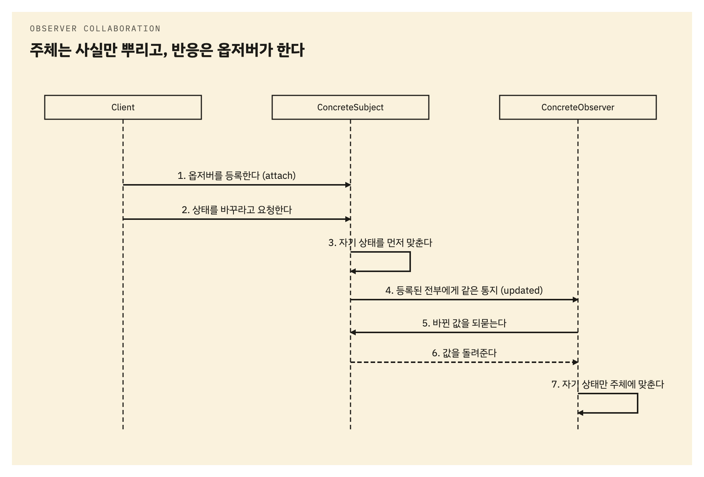
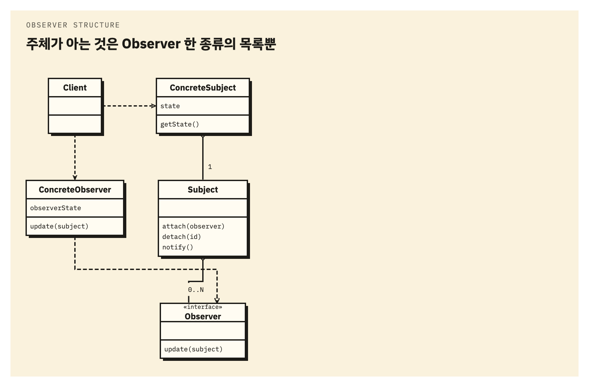

# Observer — 바뀌었다는 사실만 뿌리고, 무엇을 할지는 받는 쪽이 정하기

## 한눈에 보는 개요

창고 재고를 다루는 코드를 하나 떠올려 봅시다. `StockItem.ship()` 은 품목의 수량을 깎는 일만 하면 되는데, 수량이 바뀌면 따라 움직여야 하는 것이 셋이에요. 창고 현황판이 새 수량을 보여야 하고, 재고가 임계값 밑으로 내려가면 저재고 경보가 울려야 하고, 감사 로그에 변경 한 줄이 남아야 합니다. 이 셋을 `ship()` 안에서 직접 부르면 수량을 깎는 메서드가 현황판·경보·로그의 이름을 전부 알게 돼요. 자동 발주를 하나 더하려면 재고 클래스를 열어야 하고, 야간에 경보만 잠시 끄려고 해도 재고 클래스를 열어야 합니다.

Observer 의 해법은 **바뀌었다는 사실만 목록에 뿌리는 것**입니다. 재고 품목은 자기를 보고 있는 것들의 목록 하나만 들고, 수량이 바뀌면 그 목록을 끝까지 순회하며 같은 통지를 보내요. 통지에는 "무엇을 하라"가 없습니다. 무엇을 할지는 받은 쪽이 각자 정하고, 목록에 무엇이 들어 있는지는 재고 품목이 알 필요가 없어요.

```text
Before : 재고 클래스 안에 반응할 대상이 전부 있음

  StockItem.ship(9)
    quantity 12 → 3
    dashboard.refresh()      ← 현황판 이름이 재고 클래스 안에
    alert.check()            ← 경보 이름이 재고 클래스 안에
    audit.write()            ← 감사 로그 이름이 재고 클래스 안에
    자동 발주를 더하려면  → 이 줄을 늘리려고 StockItem 을 연다
    야간에 경보를 끄려면  → 이 줄을 지우려고 StockItem 을 연다

After : 바뀌었다는 사실만 목록에 뿌림

  StockItem.ship(9)
    quantity 12 → 3
    목록을 순회하며 같은 통지 하나    ──┬─▶ [ 현황판 ]  주체에 물어 표시 값을 3으로
                                      ├─▶ [ 경보  ]  3 < 5 이니 켬
                                      ├─▶ [ 로그  ]  한 줄 적음
                                      └─▶ 붙이고 떼는 일은 목록에서 (StockItem 은 그대로)
```

분류는 행위 패턴이고 다른 이름은 Dependents 와 Publish-Subscribe 예요(근거: GoF Observer 절 Also Known As — GoF 는 Gang of Four 의 줄임말로, 1994년에 나온 *Design Patterns* 의 저자 네 명을 함께 부르는 이름). 함께 쓰는 패턴은 [Mediator](../mediator/mediator-guide_v1.1.0.md) 입니다(근거: GoF Observer 절 Related Patterns).

이 글은 시나리오 셋을 따라갑니다. 출고 한 건이 세 곳에 알려지는 길, 자동 발주가 붙고 경보를 뗄 때 무엇이 안 바뀌는가, 통지를 상태보다 먼저 보내면 어디서 조용히 틀리는가. 끝까지 읽으면 어떤 코드를 Observer 라고 불러도 되는지 필수 조건 셋으로 판정할 수 있고, 가장 헷갈리는 이웃인 Mediator 와도 코드 한 곳을 보고 가를 수 있게 됩니다.

## 패턴 자세히 들여다보기

### 시나리오 1 — 출고 9개가 세 곳에 알려지는 길

창고에 품목 `SKU-100` 이 12개 있습니다. 이 품목을 보고 있는 것이 셋이에요. 수량을 화면에 띄우는 현황판, 수량이 5 밑으로 내려가면 울리는 저재고 경보, 변경마다 한 줄을 남기는 감사 로그입니다. 지금 출고 9개가 들어왔어요. 나와야 하는 것은 재고 3, 현황판 표시 3, 경보 켜짐, 로그 한 줄입니다. 이 장면에는 다섯이 등장해요. 재고를 가지고 있는 `StockItem`(패턴에서는 ConcreteSubject 라고 부르는 역할), 옵저버 목록을 관리하고 통지를 뿌리는 `Subject`, 통지를 받는 쪽이 모두 따르는 연산 모양 `updated(주체)` 를 선언한 `StockObserver`(Observer), 그 연산을 구현한 `Dashboard`·`LowStockAlert`·`AuditLog`(ConcreteObserver), 그리고 무엇이 이 품목을 볼지 정해 붙이는 조립 코드(Client)입니다. 이름은 여기서 한 번씩만 소개하고 정식 정의는 개념 정리에서 해요.



1. Client 가 현황판·경보·로그를 차례로 `StockItem` 에 등록합니다. 이 일을 Client 가 맡는 이유는 "무엇이 이 품목을 봐야 하는가" 가 업무 요구이지 재고의 성질이 아니어서예요. 이 판단을 `StockItem` 이 하면 볼 대상의 이름이 재고 클래스 안에 남고, 대상이 늘 때마다 재고 클래스를 고치게 됩니다. 등록한 순서가 뒤에 통지하는 순서가 되고, 등록마다 뗄 때 쓸 번호가 하나씩 돌아와요.
2. Client 가 `StockItem` 에 출고 9개를 요청합니다. Client 가 옵저버를 직접 건드리지 않는 이유는 옵저버가 반응해야 할 사건이 "재고가 바뀌었다" 이지 "누가 출고를 불렀다" 가 아니기 때문이에요. 재고를 바꾸는 길이 여럿이어도 통지가 나가는 자리는 한 곳입니다.
3. `StockItem` 이 수량을 12에서 3으로 **먼저** 바꿉니다. 통지보다 이 일이 앞서는 이유는 통지를 받은 쪽이 곧바로 주체에게 값을 물을 것이기 때문이에요. 두 줄의 순서를 바꾸면 물어본 값이 옛 값이 되고, 그때 무엇이 어떻게 틀리는지는 시나리오 3 에서 실제로 실행해 봅니다.
4. `StockItem` 이 통지를 `Subject` 에 맡기고, `Subject` 는 등록된 것 전부를 차례로 순회하며 같은 연산 `updated(주체)` 를 부릅니다. 목록을 재고 품목이 아니라 `Subject` 가 가지고 있는 이유는 붙이고 떼고 순회하는 일이 품목마다 똑같아서예요. 여기서 중요한 것은 부르는 쪽이 받는 쪽을 **고르지 않는다**는 점입니다. 사건 종류를 보고 누구를 부를지 정하는 코드가 있으면 그것은 뒤에 볼 Mediator 쪽이에요.
5. 통지를 받은 현황판이 `StockItem` 에게 수량을 되묻고 3을 받습니다. 통지에 값을 실어 보내지 않고 되묻게 한 이유는 옵저버마다 필요한 값이 다르기 때문이에요. 감사 로그는 품목 코드와 수량이 둘 다 필요하고 경보는 수량만 필요한데, 통지 연산 하나에 모든 옵저버의 입력을 담으면 대부분이 대부분을 버리게 됩니다.
6. 현황판이 받은 3으로 자기 표시 값을 12에서 3으로 바꿉니다. 여기서 현황판이 하는 일은 **자기 상태를 주체에 맞추는 것뿐**이에요. 경보를 대신 울려 주거나 로그에 적어 주지 않습니다. 옵저버들이 서로를 모르기 때문에 하나를 지워도 다른 옵저버의 코드를 볼 일이 없고, 이것이 뒤에서 Mediator 와 구분되는 바로 그 자리예요.
7. 같은 통지를 받은 경보가 3과 임계값 5를 비교해 경보를 켜고, 감사 로그가 첫 줄을 남깁니다. 셋이 같은 연산 모양 하나를 나눠 쓰는데도 반응이 다른 이유는 "무엇을 할지" 가 통지가 아니라 각 옵저버 안에 있어서예요. 통지를 무시하는 옵저버가 있어도 주체는 그것을 알지 못합니다.

```text
단계   부르는 쪽 → 받는 쪽             넘기는 것          돌아오는 것
 1     Client → StockItem             옵저버 객체 셋      등록 번호 1 · 2 · 3
 2     Client → StockItem             출고 9             —
 3     StockItem → 자기 자신           —                  quantity 12 → 3
 4     StockItem → 등록된 전부          자기 자신           —
 5     Dashboard → StockItem          —                  3
 6     Dashboard → 자기 자신           —                  표시 값 12 → 3
 7     LowStockAlert · AuditLog       —                  경보 ON · 로그 1줄
```

잠깐, 확인 하나만 해 볼까요? 4단계에서 목록이 비어 있다면, 그러니까 이 품목을 보는 것이 하나도 없다면 `ship(9)` 은 어떻게 될까요?

수량은 3이 되고 통지 루프는 한 번도 반복하지 않은 채 끝납니다. 오류도 아니고 특별한 처리도 없어요. 주체가 옵저버의 수를 신경 쓰지 않는다는 말이 코드에서는 이 뜻입니다. 목록이 0개든 1개든 3개든 `ship` 의 코드는 한 글자도 다르지 않아요.

```text
등록된 옵저버 수     ship(9) 이 하는 일                      StockItem 코드
 0개                 수량만 3으로 바꾸고 루프 0회              그대로
 1개                 수량을 바꾸고 루프 1회                    그대로
 3개                 수량을 바꾸고 루프 3회                    그대로
```

이 시나리오가 보여 준 것은 역할 다섯과 통지가 전달되는 방향입니다. 붙이고 떼는 일(1단계)은 Client 가, 상태를 바꾸고 통지 시점을 정하는 일(2·3·4단계)은 ConcreteSubject 가, 목록 관리와 순회(4단계)는 Subject 가, 반응(5·6·7단계)은 각 ConcreteObserver 가 맡아요. 통지는 주체에서 옵저버로 한 방향이고, 옵저버가 주체를 다시 부르는 5단계는 값을 **묻는** 호출이지 무엇을 하라고 시키는 호출이 아닙니다.

같은 뼈대 위에서 다르게 짤 수 있는 자리가 둘 있어요. 아래 표의 가운데 칸이 이 글의 코드가 고른 쪽입니다. 하나는 통지에 싣는 정보의 양이에요. 이 글처럼 주체가 "바뀌었다" 와 "나는 누구다" 만 보내고 나머지를 옵저버가 묻게 하면(5단계) 필요 없는 값을 나르지 않는 대신, 아무것도 달라지지 않은 옵저버도 일단 물어보는 왕복이 생깁니다. `updated(sku, quantity)` 처럼 바뀐 값을 실어 보내면 옵저버가 주체를 다시 부르지 않아도 되지만, 주체가 옵저버들이 무엇을 필요로 하는지 가정하게 되고 그 가정이 옵저버마다 다르면 연산 모양이 넓어져요. 앞을 **pull 방식**(옵저버가 끌어옴), 뒤를 **push 방식**(주체가 실어 보냄)이라고 부릅니다. 다른 하나는 목록을 관리하는 자리예요. 이 글은 `StockItem` 이 목록 관리를 `Subject` 객체에 맡기지만(4단계), 두 역할을 한 클래스로 합쳐 상속으로 물려받게 짜도 판정은 같습니다.

```text
자리                 이 글의 코드                          다른 선택지
통지에 싣는 정보       주체 자신만 — pull (5단계에서 되물음)    바뀐 값을 인자로 — push, updated(sku, quantity)
목록 관리             Subject 객체에 맡김 (4단계)             주체 클래스가 상속으로 물려받음
```

### 시나리오 2 — 자동 발주가 붙고 야간에 경보를 뗄 때

운영이 두 가지를 요구했습니다. 하나는 재고가 목표 10개 밑이면 모자란 만큼 자동으로 발주하는 기능이고, 다른 하나는 야간 점검 시간에 저재고 경보만 잠시 꺼 두는 것이에요. 시험할 흐름은 이렇습니다. 시나리오 1 이 끝난 상태(재고 3, 경보 켜짐)에서 입고 4개가 들어와 7이 되고, 그다음 자동 발주를 붙이고 저재고 경보를 뗀 뒤 출고 5개가 나가 2가 됩니다. 마지막 출고에서 나와야 하는 것은 현황판 2와 감사 로그 세 번째 줄, 그리고 자동 발주 8개입니다. 경보는 재고가 2인데도 울리지 않아야 해요.

1. 개발자가 `Reorder` 클래스를 새로 씁니다. 연산 모양은 시나리오 1 의 `updated(주체)` 그대로이고 본문만 "목표보다 적으면 모자란 만큼 발주" 예요. 모양을 바꾸지 않는 이유는 그 모양이 주체와 모든 옵저버 사이의 계약이라서, 모양이 바뀌면 통지를 뿌리는 줄과 기존 옵저버 셋이 전부 따라 바뀌기 때문입니다.
2. 입고 4개가 들어와 재고가 3에서 7이 됩니다. 현황판은 7로 맞추고, 경보는 7이 임계값 5 이상이라 꺼지고, 감사 로그가 두 번째 줄을 남겨요. `StockItem` 은 입고와 출고에서 똑같이 수량을 바꾼 뒤 같은 통지를 뿌립니다. 수량이 오른 것인지 내린 것인지도 통지에 담기지 않아요.
3. Client 가 `Reorder` 를 등록합니다. `StockItem` 은 한 줄도 바뀌지 않아요. `StockItem` 에 적힌 옵저버 관련 이름은 `StockObserver` 와 `updated` 뿐이라 새 클래스 이름이 들어갈 자리가 없기 때문입니다. 이것이 조건문을 없앤다는 이 패턴의 결과이고, 없어진 것이 아니라 Client 의 조립 코드 한 곳으로 모인 것이에요.
4. Client 가 시나리오 1 의 1단계에서 받아 둔 경보의 등록 번호로 경보를 뗍니다. 번호로 떼는 이유는 무엇을 뗄지 가리키는 방법이 필요한데 객체 자체를 다시 넘기는 방식은 같은 클래스의 인스턴스가 여럿일 때 어느 것인지 가릴 수 없어서예요. 뗀 뒤 목록에 남는 것은 현황판·로그·발주 셋이고, 등록 순서가 그대로 통지 순서입니다.
5. 출고 5개가 나가 재고가 2가 됩니다. 현황판은 2로 맞추고, 로그는 세 번째 줄을 남기고, 발주는 10에서 2를 뺀 8개를 냅니다. 경보는 재고 2가 임계값 5보다 작은데도 울리지 않아요. 목록에 없으니 통지가 가지 않기 때문입니다. 떼는 일이 실제로 통지를 끊는다는 것이 여기서 눈으로 확인되고, 이것이 시나리오 1 의 1단계에서 번호를 받아 둔 이유예요.

```text
변화                    바뀐 곳                                   안 바뀐 곳
자동 발주 추가           Reorder 클래스 (새로 씀)                   StockItem 전체
                        Client 의 등록 한 줄                       Subject · StockObserver 의 연산 모양
                                                                  Dashboard · LowStockAlert · AuditLog
경보 해제               Client 의 detach 한 줄                     위와 같음 (클래스는 지우지 않음)
```

시나리오 1 과 이 두 변화를 차례로 실행하면 아래 열네 줄이 나옵니다(세 언어 모두 같아요). 앞의 `ship 9` 가 시나리오 1, `receive 4` 가 2단계이고, `attach: reorder(10) / detach: alert` 줄이 3·4단계, 그 뒤가 5단계입니다.

```text
attach: dashboard, alert(5), audit
ship 9
  dashboard: 12 -> 3
  alert: ON (3 < 5)
  audit: line 1 (SKU-100 = 3)
receive 4
  dashboard: 3 -> 7
  alert: OFF (7 >= 5)
  audit: line 2 (SKU-100 = 7)
attach: reorder(10) / detach: alert
ship 5
  dashboard: 7 -> 2
  audit: line 3 (SKU-100 = 2)
  reorder: order 8 (2 -> 10)
```

사건마다 다섯 쪽의 값을 표로 옮기면 이렇습니다.

| 사건 | 재고 | 현황판 | 저재고 경보 (임계값 5) | 감사 로그 | 자동 발주 (목표 10) |
| --- | --- | --- | --- | --- | --- |
| 출고 9 | 12 → 3 | 12 → 3 | ON (3 < 5) | line 1 | 아직 안 붙음 |
| 입고 4 | 3 → 7 | 3 → 7 | OFF (7 ≥ 5) | line 2 | 아직 안 붙음 |
| 출고 5 | 7 → 2 | 7 → 2 | 떼었으므로 반응 없음 | line 3 | order 8 |

여기서 헷갈리기 쉬운 포인트는 옵저버가 늘면 주체가 느려지니 수를 관리해야 한다고 믿는 것입니다. 관리해야 하는 것은 수가 아니라 **연쇄**예요. 옵저버가 셋이든 서른이든 주체가 하는 일은 목록을 한 번 순회하는 것뿐이지만, 옵저버 하나가 자기 반응 중에 다른 주체의 상태를 바꾸면 그 주체의 통지가 또 나가고 그 끝이 처음 주체로 돌아올 수도 있습니다. 옵저버들이 서로를 모르기 때문에 주체를 한 번 바꾼 대가가 코드 어디에도 보이지 않는다는 것이 이 패턴이 치르는 대가예요(근거: GoF Observer 절 Consequences — 예상치 못한 갱신). 이 가이드의 예제는 옵저버가 주체를 바꾸지 않아 연쇄가 생기지 않습니다.

```text
연쇄가 없는 모양 (이 가이드 예제)        연쇄가 생기는 모양
  StockItem.ship                        StockItem.ship
    → Dashboard   자기 표시만               → Reorder     다른 품목 재고를 늘림
    → LowStockAlert 자기 경보만                 → OtherItem 통지 루프가 또 실행된다
    → AuditLog    자기 줄만                       → …      어디서 멈추는지 호출부에 안 보임
```

이 시나리오가 보여 준 것은 변화의 범위입니다. 새 반응이 들어올 때 바뀌는 곳은 새 ConcreteObserver 하나와 Client 의 등록 한 줄이고, ConcreteSubject 와 기존 옵저버는 그대로예요(1~3단계). 옵저버를 떼는 일도 Client 쪽 한 줄이고 클래스를 지우지 않아도 통지가 끊깁니다(4·5단계). 대가는 연쇄 갱신이 코드에 나타나지 않는다는 점이에요.

### 시나리오 3 — 통지를 상태보다 먼저 보내면 어디서 조용히 틀리는가

같은 창고의 다른 코드베이스는 `StockItem` 을 조금 다르게 짰습니다. `receive` 와 `ship` 안에서 통지를 먼저 보내고 그다음 수량을 바꿔요. 바뀐 것은 두 줄뿐입니다. 나머지는 시나리오 1·2 와 같아요. 그리고 같은 팀의 또 다른 코드는 목록을 아예 두지 않고 `StockItem` 이 현황판·경보·로그를 이름으로 직접 부릅니다. 두 코드에 시나리오 1·2 와 똑같은 흐름을 넣어 보고, 어느 단계에서 무엇이 달라지는지 봅시다. 아래 출력은 둘 다 Java 21 로 실제로 컴파일해 실행한 것이에요.

1. 첫 코드에서 출고 9개가 들어옵니다. `ship` 이 통지를 먼저 뿌리는데, 이때 수량은 아직 12예요. 현황판이 주체에게 물어 12를 받고 `dashboard: 12 -> 12` 를 찍습니다. 표시가 그대로인 이유는 물어본 값이 바뀌기 전 값이어서입니다. 그러고 나서야 수량이 3으로 바뀌어요.
2. 같은 통지를 받은 경보가 12와 임계값 5를 비교합니다. 12가 5 이상이니 경보를 켜지 않아요. 실제 재고는 3인데 경보 줄이 출력에 **아예 없습니다**. 시나리오 1 의 3단계가 수량을 먼저 바꾼 이유가 이것이에요. 통지를 받은 쪽은 주체가 이미 일관된 상태라고 믿고 묻습니다.
3. 이어지는 사건들이 한 칸씩 늦어집니다. 입고 4개에서 현황판은 이제야 3을 보고, 경보도 이제야 켜지고, 출고 5개에서 발주는 재고 2가 아니라 7을 기준으로 3개만 냅니다. 마지막 재고는 2인데 현황판은 7을 띄우고 있어요. 어느 줄도 예외를 던지지 않았고 세 옵저버 모두 자기 코드는 정확히 지켰습니다.
4. 두 번째 코드로 넘어갑니다. 여기서는 `StockItem` 이 목록 없이 `dashboard.updated(this); alert.updated(this); audit.updated(this);` 를 차례로 부릅니다. 시나리오 1·2 의 값은 모두 맞게 나와요. 통지 순서를 지켰으니 시나리오 1 의 출력과 같고, 겉보기에는 멀쩡합니다.
5. 시나리오 2 의 변화를 넣으면 거기서 막힙니다. 자동 발주를 붙일 자리가 없어요. 붙이려면 `StockItem` 에 필드와 호출 한 줄을 더해야 하고, 그것은 시나리오 2 의 3단계가 "StockItem 은 한 줄도 바뀌지 않는다" 고 한 자리가 성립하지 않게 되는 것입니다. 경보를 떼는 일은 더 어려워요. 호출 줄을 지우면 영영 지우는 것이고, 야간에만 끄려면 `StockItem` 안에 "지금 야간인가" 를 아는 조건문이 들어갑니다. 아래 출력의 마지막 세 줄에 발주가 없고 경보가 그대로 울리는 것이 그 결과예요.

아래가 두 코드를 실행한 출력입니다. 첫 코드는 시나리오 2 의 열네 줄을 낸 코드에서 `receive` 와 `ship` 두 메서드 안의 두 줄, 그러니까 수량을 바꾸는 줄과 통지를 맡기는 줄의 순서만 맞바꾼 것이고 다른 곳은 한 글자도 손대지 않았어요.

```text
attach: dashboard, alert(5), audit
ship 9
  dashboard: 12 -> 12
  audit: line 1 (SKU-100 = 12)
receive 4
  dashboard: 12 -> 3
  alert: ON (3 < 5)
  audit: line 2 (SKU-100 = 3)
attach: reorder(10) / detach: alert
ship 5
  dashboard: 3 -> 7
  audit: line 3 (SKU-100 = 7)
  reorder: order 3 (7 -> 10)
```

시나리오 2 의 출력이 열네 줄이었는데 열세 줄로 줄었습니다. 없어진 줄은 `ship 9` 아래의 `alert: ON (3 < 5)` 예요. 경보가 12를 보고 임계값 5 이상이라 판단했기 때문이고, 재고가 이미 5 밑으로 내려간 뒤인데도 `receive 4` 에서야 뒤늦게 켜집니다. 마지막 `reorder: order 3` 도 실제 재고 2가 아니라 7을 기준으로 낸 값이라 시나리오 2 의 `order 8` 과 다르고요. 값이 전부 한 사건씩 어긋났는데 예외는 하나도 나지 않았습니다.

두 번째 코드는 목록도 공통 연산 모양도 없어서 애초에 붙이고 뗄 길이 없습니다. 아래는 그 출력에서 **마지막 다섯 줄만 옮긴 것**이에요. 첫 줄은 Client 가 찍는 안내 문구인데, 붙이고 뗄 연산이 없으니 실제로는 아무 일도 하지 않습니다.

```text
attach: reorder(10) / detach: alert
ship 5
  dashboard: 7 -> 2
  alert: ON (2 < 5)
  audit: line 3 (SKU-100 = 2)
```

경보가 그대로 울리고 발주 줄이 없는 것이 그 결과입니다.

두 고장은 성격이 다릅니다. 첫 코드는 **모든 값이 한 사건씩 어긋나는데 아무도 오류를 내지 않는** 고장이고, 두 번째 코드는 **값은 맞지만 붙이고 떼는 일이 불가능한** 고장이에요. 앞은 통지 시점의 문제라 `ship` 과 `receive` 의 두 줄 순서를 되돌리면 끝나고, 뒤는 구조의 문제라 목록과 공통 연산 모양을 들여야 합니다. 그래서 최소 조건 절에서도 둘은 다른 자리로 나뉘어요. 앞은 통지가 언제 나가느냐를 다루는 선택 조건이고, 뒤는 주체가 무엇을 아느냐를 다루는 필수 조건 1·2번입니다.

```text
                      첫 코드                        두 번째 코드
증상                   값이 조용히 어긋남               값은 맞음
막히는 자리             없음 (끝까지 반복)               옵저버를 더하거나 뗄 때
고치는 법               ship·receive 의 두 줄 순서       목록과 공통 연산 모양을 들임
최소 조건에서의 자리      선택 조건 4번                   필수 조건 1번 · 2번
```

이 시나리오가 보여 준 것은 두 규칙이 어디서 어긋나는지입니다. 통지가 주체의 상태보다 앞서면 되묻는 옵저버가 옛 값을 읽어 전부가 한 칸씩 늦어지고(1~3단계), 주체가 구체 옵저버를 이름으로 부르면 값은 맞아도 실행 중에 붙이고 뗄 길이 사라집니다(4·5단계). 앞은 시나리오 1 의 3단계가 정한 순서이고, 뒤는 시나리오 1 의 4단계와 시나리오 2 의 3·4단계가 보여 준 구조예요.

### 개념 정리

시나리오에 나온 역할 다섯을 정식으로 정의합니다. 넷은 패턴의 참여자이고 Client 는 참여자 목록 밖에서 옵저버를 골라 붙이는 쪽인데, 시나리오와 구현에 늘 나오므로 함께 정의해요(근거: GoF Observer 절 Participants·Collaborations).

- **Subject** — 옵저버 목록을 가지고, 붙이는 연산과 떼는 연산, 그리고 등록된 전부에게 통지를 뿌리는 연산을 제공합니다. 목록의 원소 타입은 Observer 하나이고 구체 옵저버 타입은 등장하지 않아요(시나리오 1 의 4단계). 재고 예에서는 `attach`·`detach`·`notifyObservers` 를 가진 `Subject` 가 이 역할이고, 이 셋을 별도 클래스로 떼 두면 여러 주체가 같은 관리 코드를 나눠 쓸 수 있습니다.
- **Observer** — 통지를 받는 쪽이 모두 따르는 갱신 연산을 선언합니다. Subject 는 이 선언만 보고 부르고(시나리오 1 의 4단계), ConcreteObserver 는 이 선언을 구현해요. 재고 예에서는 주체를 인자로 받는 연산 `updated` 하나를 선언한 `StockObserver` 가 Observer 입니다. Subject 가 구체 타입을 모른 채 부를 수 있게 해 주는 장치가 이 선언이고, 이렇게 구현이 아니라 선언에 기대어 부르는 것을 [참고 문서 「GoF 공통 어휘」](../../reference/gof-vocabulary/gof-vocabulary-ref_v1.0.2.md)의 「인터페이스에 프로그래밍한다」가 정의합니다.
- **ConcreteSubject** — 옵저버들이 관심 있는 상태를 실제로 가지고 있고, 그 상태가 바뀌면 통지를 보냅니다. 통지를 언제 보낼지 정하는 쪽이 이 역할이에요(시나리오 1 의 3·4단계). 재고 예에서는 수량을 가지고 `receive`·`ship` 으로 그것을 바꾸는 `StockItem` 이 ConcreteSubject 이고, 목록 관리는 자기가 가지고 있는 `Subject` 에 넘깁니다. 이렇게 일을 자기 안의 다른 객체에 넘기는 것이 위임이고, 그 말의 정의도 [참고 문서 「GoF 공통 어휘」](../../reference/gof-vocabulary/gof-vocabulary-ref_v1.0.2.md)에 있어요.
- **ConcreteObserver** — Observer 가 선언한 갱신 연산을 구현하고, 주체와 맞춰 두어야 하는 자기 상태를 가집니다. 통지를 받으면 주체에게 필요한 값을 묻고 자기 상태만 주체에 맞춰요(시나리오 1 의 5·6단계). 다른 ConcreteObserver 를 부르지 않는다는 것이 이 역할의 경계입니다. 재고 예에서는 표시 값을 가진 `Dashboard`, 경보 상태를 가진 `LowStockAlert`, 줄 수를 가진 `AuditLog`, 목표 수량을 가진 `Reorder` 가 각각 ConcreteObserver 예요.
- **Client** — ConcreteObserver 를 만들어 주체에 붙이고, 필요 없어지면 뗍니다(시나리오 1 의 1단계, 시나리오 2 의 3·4단계). 재고 예에서는 어떤 화면과 기능이 이 품목을 볼지 정하는 진입점이 Client 입니다.



그림에서 Subject 의 화살표가 Observer 로만 향하고 ConcreteObserver 를 직접 가리키지 않는다는 점을 봐 두세요. 그 화살표 끝에 붙은 `0..N` 이 "몇 개인지 신경 쓰지 않는다" 를 그린 것입니다. ConcreteObserver 로 들어가는 화살표는 Client 에서 내려온 것 하나뿐이에요 — 그것을 만들어 붙이는 쪽이 Client 이기 때문입니다. ConcreteSubject 에서 Subject 로 가는 화살표는 이 가이드의 코드가 목록 관리를 위임하는 모양이고, 두 역할을 한 클래스로 합쳐 상속으로 그리는 구현도 같은 판정을 받아요. 다른 점은 두 역할이 한 클래스에 있느냐이지 역할이 있느냐가 아니니까요.

> 주체는 "바뀌었다" 만 말하고, "그래서 무엇을 할까" 는 받은 쪽이 혼자 정한다.

## 사용 목적

Observer 가 필요할 때는 코드나 요구에서 보이는 단서가 있습니다. 셋을 차례로 봅시다.

#### 단서 1 — 상태를 바꾸는 메서드 안에 그 상태와 무관한 호출이 쌓입니다

재고 수량만 다루면 되는 메서드가 화면 갱신·알림 발송·캐시 무효화·로그 기록을 차례로 부르고 있고, 요구가 하나 늘 때마다 그 메서드의 끝에 줄이 하나 붙는 경우예요. 변경 이력에서는 성질이 다른 요구들이 같은 메서드를 고친 자국으로 보입니다. 서로 의존하는 두 측면을 따로 떼어 각자 바꾸고 재사용하고 싶은 상황이 이 패턴이 겨냥하는 첫 대상이에요(근거: GoF Observer 절 Applicability).

```text
변경 이력                       수정된 곳
저재고 경보 추가                 StockItem.ship() 끝줄
감사 로그 추가                   StockItem.ship() 끝줄
자동 발주 추가                   StockItem.ship() 끝줄
야간 경보 해제 기능 추가          StockItem.ship() 안에 조건문
```

#### 단서 2 — 반응해야 하는 대상이 몇 개인지 코드를 쓰는 시점에 모릅니다

한 객체의 변경이 다른 객체들의 변경을 요구하는데 그 대상이 몇이고 누구인지 미리 가정할 수 없는 상황이 두 번째 대상입니다(근거: GoF Observer 절 Applicability). 창고 현황판을 연 사용자마다 화면이 하나씩 생기거나, 야간에만 켜지는 경보처럼 보는 기간이 제한된 대상이 있으면 이 단서예요. 코드에서는 "대상 목록" 을 만들려는 시도로 보입니다.

| 코드에서 보이는 모양 | 왜 이 단서인가 |
| --- | --- |
| `List<UiPanel> panels` 를 도메인 객체가 필드로 가지고 있음 | 대상이 실행 중에 늘고 주는데, 목록의 원소 타입이 구체 화면이라 화면 종류가 늘면 도메인이 바뀜 |
| `if (dashboardOpen) dashboard.refresh();` 가 여러 곳에 반복됨 | 대상이 살아 있는지를 도메인이 판단하고 있음. 붙이고 떼는 일을 조건문으로 흉내 낸 모양 |
| 화면·알림 객체를 만드는 코드가 도메인 객체 생성자 안에 있음 | 무엇이 볼지를 도메인이 정하고 있어서, 테스트에서 도메인만 떼어 낼 수 없음 |

#### 단서 3 — 같은 데이터를 보는 화면이나 기능을 데이터 쪽 코드 없이 따로 시험하고 싶습니다

재고 계산이 맞는지 보려고 현황판을 띄워야 하거나, 현황판 배치를 고치려고 재고 데이터를 준비해야 한다면 둘이 한 덩어리로 묶여 있는 것이에요. 추상화가 서로 의존하는 두 측면을 갖고 그 둘을 독립적으로 바꾸고 재사용하고 싶을 때가 여기에 해당합니다(근거: GoF Observer 절 Applicability). Observer 로 가르면 재고 쪽은 통지를 뿌렸는지만 보면 되고, 현황판 쪽은 통지를 손으로 한 번 넣어 주면 시험할 수 있어요.

#### 쓰지 말아야 할 경우

비슷한 단서에서 다른 패턴을 골라야 하는 경우가 있습니다. 여러 객체 사이의 협력 규칙 자체를 한 곳에 모아야 하면 Mediator 를, 요청 하나를 받아 줄 수 있는 후보가 여럿이고 그중 하나만 처리하면 되면 Chain of Responsibility 를 먼저 검토하세요. 둘과의 차이는 「비슷한 패턴·안티패턴과의 차이」에서 풉니다. 그리고 아래 상황에서는 Observer 를 쓰면 얻는 것보다 잃는 것이 커요.

| 쓰지 말아야 할 상황 | 쓰면 잃는 것 |
| --- | --- |
| 갱신의 순서나 비용이 업무 규칙인데 옵저버 구조가 그것을 가림 | 어느 옵저버가 먼저 실행되는지가 등록 순서에 달리고, 한 번의 변경이 얼마나 많은 일을 부르는지 호출부에 보이지 않음(근거: GoF Observer 절 Consequences — 예상치 못한 갱신). 시나리오 2 의 연쇄 그림이 그 모양 |
| 반응이 하나뿐이고 늘 계획도 없음 | 인터페이스와 목록과 등록 코드가 생기지만 목록은 늘 길이 1. 직접 호출 한 줄이 읽기 쉬움 |
| 여러 주체에 걸친 제약을 한꺼번에 맞춰야 함 | 각 옵저버가 자기 규칙만 알아서, "A 가 바뀌면 B 를 이렇게, 단 C 가 이미 저러면 말고" 같은 규칙을 쓸 자리가 없음. 중개 객체를 두거나 Mediator 로 감 |
| 스레드 사이에서 순서를 보장하거나 쌓인 통지를 조절해야 함 | 통지가 동기 호출이면 주체가 옵저버의 처리 시간만큼 기다리게 되고, 순서 보장과 흐름 제어는 이 패턴의 계약에 없음. 그런 계약을 가진 도구로 감 |

마지막 줄이 빈말이 아니라는 것은 표준 라이브러리가 증명합니다. Java 에는 이 패턴을 그대로 옮긴 `java.util.Observable` 과 `java.util.Observer` 가 있었는데 Java 9 에서 폐기됐어요. Javadoc 이 적은 폐기 사유가 셋인데 지원하는 이벤트 모델이 제한적이라는 것, 통지 순서가 명세되지 않았다는 것, 그리고 상태 변경과 통지가 일대일로 대응하지 않는다는 것입니다([Java SE 21 — java.util.Observable](https://docs.oracle.com/en/java/javase/21/docs/api/java.base/java/util/Observable.html)). 뒤의 둘이 방금 표의 첫 줄과 마지막 줄에서 말한 것과 같은 이야기예요. 같은 문서가 대안으로 더 풍부한 이벤트 모델에는 `java.beans` 를, 스레드 사이의 신뢰성 있는 순서 메시징에는 `java.util.concurrent` 의 자료구조를, 리액티브 스트림 방식에는 `Flow` 를 지목합니다.

## 패턴의 경계

### 디자인 패턴을 충족하는 최소 조건

어떤 코드를 Observer 라고 불러도 되는지 가르는 기준입니다. `[필수]` 가 하나라도 빠지면 Observer 가 아니고, `[선택]` 은 갖추면 좋은 구조예요. 조건은 언어와 상관없이 코드에서 확인할 수 있는 모양(타입 선언·참조 보유·호출 방향·생성 위치)으로 적었고, 조건마다 그것을 보여 준 시나리오의 단계를 가리킵니다.

1. [필수] 주체는 통지 대상을 공통 갱신 연산 하나로만 알고 구체 타입을 모름 — 주체가 보유한 통지 대상의 타입이 공통 선언(인터페이스·추상 타입·trait·함수 타입)이고, 통지하는 코드가 그 선언이 정한 연산만 부르며, 구체 대상 타입으로 분기하는 코드나 다운캐스트가 주체에 없습니다. 시나리오 1 의 4단계 (근거: GoF Observer 절 Participants — Observer 는 주체의 변경을 통지받아야 하는 객체들의 갱신 인터페이스를 정의하고 Subject 는 그 인터페이스를 따르는 옵저버들을 안다)
   - 빠지면: 시나리오 3 의 4단계가 이 자리입니다. 주체 안에 `dashboard.updated(this); alert.updated(this);` 처럼 구체 이름이 박히면 반응을 하나 더할 때마다 주체를 열게 되고, 그건 목록 없는 팬아웃 호출(한 자리에서 정해진 대상 여럿을 차례로 부르는 호출)이지 Observer 가 아니에요.
   - 빠지면: 목록은 있는데 원소 타입이 구체 옵저버 하나면 다른 종류를 담을 수 없습니다. `Subject` 의 목록 원소 타입과 `attach` 인자 타입을 `Dashboard` 로 좁혀 컴파일하면 세 언어 모두 Client 가 경보·로그·발주를 붙이는 세 줄에서 멈춰요 — Java 는 `incompatible types: LowStockAlert cannot be converted to Dashboard`, TypeScript 는 `TS2345`, Rust 는 `E0308 mismatched types` 가 세 건씩입니다(직접 컴파일해 확인).
2. [필수] 실행 중에 붙이고 뗄 수 있고, 뗀 대상은 다음 통지를 받지 않음 — 주체에 대상을 등록하는 연산과 해제하는 연산이 있고, 해제한 뒤의 통지 순회가 그 대상을 부르지 않습니다. 시나리오 2 의 3·4·5단계 (근거: GoF Observer 절 Participants — Subject 는 Observer 객체를 붙이고 떼는 인터페이스를 제공한다)
   - 빠지면: 생성자에서 받은 대상 하나를 평생 부르는 코드는 단순 콜백이나 위임입니다.
   - 경계 사례: 해제 연산은 있는데 목록에서 지우지 않아 다음 통지가 그대로 가면 조건을 만족하지 않아요. 시나리오 2 의 5단계에서 경보 줄이 사라지는 것이 실제로 지워졌다는 증거입니다.
3. [필수] 상태 변경은 그 시점 등록된 대상 전부에게 같은 통지로 — 통지 연산이 등록 목록을 끝까지 순회하며 같은 갱신 연산을 부르고, 중간에 멈추거나 수신자를 골라 내는 분기가 없으며, 목록 길이에 상한이 없습니다. 시나리오 1 의 4단계와 그 뒤 확인 표 (근거: GoF Observer 절 Collaborations — ConcreteSubject 는 옵저버의 상태가 자기와 어긋나게 만들 수 있는 변경이 일어날 때마다 옵저버들에게 통지한다)
   - 빠지면: 순회가 "처리했다" 는 답을 받고 멈추면 등록된 뒤쪽은 통지를 못 받습니다. 그건 Chain of Responsibility 예요. 사건 종류를 보고 누구를 부를지 고르면 Mediator 쪽이고, 둘 다 비교 절에서 코드로 가릅니다.
   - 경계 사례: 지금 등록된 것이 하나뿐이어도 목록이 0개부터 여러 개까지 담을 수 있으면 만족해요.
4. [선택] 통지는 주체의 상태가 일관된 시점 뒤에 — 상태를 바꾸는 코드가 전부 끝난 뒤에 통지 연산이 불리고, 여러 필드를 함께 바꾸는 연산이면 중간 상태에서 통지가 나가지 않습니다. 시나리오 1 의 3단계 (근거: GoF Observer 절 Implementation — 통지를 보내기 전에 주체 상태가 자기 일관적인지 확인하는 쟁점)
   - 어기면: 시나리오 3 의 1~3단계가 이 순서를 어겼을 때의 출력이에요.
5. [선택] 통지에 싣는 정보의 양을 정해 둠 — 바뀐 값을 통지 인자로 넘겨 주거나, 주체만 넘기고 옵저버가 필요한 값을 되묻게 하거나 둘 중 하나로 일관됩니다. 시나리오 1 의 5단계와 그 뒤 「다르게 짤 수 있는 자리」의 push·pull 두 방식 (근거: GoF Observer 절 Implementation — 옵저버 특화 갱신 프로토콜을 피하는 push 모델과 pull 모델)
6. [선택] 관심 있는 사건의 종류별로 따로 등록 — 등록 연산이 사건 이름이나 속성 이름을 함께 받아, 그 종류의 변경에만 통지가 갑니다. 시나리오 2 의 4단계 (근거: GoF Observer 절 Implementation — 관심 있는 변경을 명시적으로 지정하는 쟁점)
   - 경계 사례: 시나리오 2 의 4단계에서 경보를 통째로 떼는 대신 "임계값 관련 변경만 받지 않겠다" 고 할 수 있게 하는 확장이에요.
7. [선택] 주체와 옵저버의 수명이 서로를 붙들지 않음 — 주체가 사라질 때 옵저버가 주체를 가리키는 참조를 정리할 길이 있고, 옵저버가 필요 없어졌을 때 목록에서 빠져 주체가 그것을 붙들지 않습니다. 시나리오 2 의 4단계 (근거: GoF Observer 절 Implementation — 삭제된 주체에 대한 댕글링 참조 쟁점)
   - 경계 사례: 시나리오 2 의 4단계에서 번호로 떼는 길을 둔 것이 그 길이에요.
8. [선택] 통지를 조율하는 중개 객체 — 주체가 옵저버를 직접 순회하지 않고 중개 객체에 통지를 넘기면, 여러 주체가 함께 바뀔 때 중복 통지를 묶거나 순서를 정할 자리가 생깁니다. 시나리오 2 끝의 연쇄 그림 (근거: GoF Observer 절 Related Patterns — 복잡한 갱신 의미론을 캡슐화하는 ChangeManager 가 주체와 옵저버 사이의 중재자 역할을 한다)
   - 경계 사례: 연쇄 그림은 이 자리가 필요해지는 상황을 그린 것이고, 이 글의 코드는 중개 객체를 두지 않습니다.

4번이 `[선택]` 인 데는 이유가 있습니다. 통지 시점을 어긴 시나리오 3 의 첫 코드는 값이 전부 어긋나지만, 구조로 보면 공통 연산 모양도 있고 목록도 있고 전부에게 같은 통지를 보내요. 필수 1~3번을 모두 갖춘 **버그 있는 Observer** 이지 다른 패턴이 아닙니다. 원전도 이것을 어떻게 구현할 것인가의 쟁점으로 다루지 성립 요건으로 두지 않고요. 같은 이유로 5~8번도 전부 선택입니다.

| 코드 | 1번 | 2번 | 3번 | 판정 |
| --- | --- | --- | --- | --- |
| 시나리오 1·2 의 `StockItem`·`Subject`·네 옵저버 | 만족 | 만족 | 만족 | Observer |
| 시나리오 3 의 첫 코드 (통지를 먼저 보냄) | 만족 | 만족 | 만족 | Observer (선택 4번이 빠진 버그) |
| 시나리오 3 의 두 번째 코드 (이름으로 직접 호출) | 빠짐 | 빠짐 | 목록이 없어 확인 불가 | Observer 아님 |
| 목록 원소 타입이 `Dashboard` 인 `Subject` | 빠짐 | 만족 | 만족 | Observer 아님 |
| 생성자에서 받은 리스너 하나만 부름 | 만족할 수 있음 | 빠짐 | 목록이 없어 확인 불가 | Observer 아님 (단순 콜백) |
| 순회가 첫 처리자에서 멈춤 | 만족 | 만족 | 빠짐 | Observer 아님 (Chain of Responsibility) |

`[필수]` 는 하나만 빠져도 판정이 끝나므로 1번부터 차례로 봅니다. 1번은 주체가 보유한 타입만, 2번은 붙이고 떼는 연산이 있고 실제로 목록을 바꾸는지만, 3번은 순회에 조기 종료나 수신자 선택이 있는지만 보면 되어서 앞 조건에서 멈추면 뒤는 읽지 않아도 돼요. 다만 필수 셋을 다 갖췄다고 판정이 끝나는 것은 아닙니다. 통지를 받은 객체가 자기 상태를 맞추는 대신 다른 객체들을 움직인다면 비교 절의 기준으로 Mediator 쪽인지 함께 봐야 해요.

여기서 헷갈리기 쉬운 포인트는 등록된 옵저버가 실제로 둘 이상이어야 한다고 믿는 것입니다. 3번이 요구하는 것은 목록이 여럿을 담을 수 있는 **구조**이지 지금 몇 개가 들어 있느냐가 아니에요. 개수는 기준이 아닙니다. 원전도 주체가 몇 개든 옵저버를 가질 수 있다는 가능성을 말하지 실제 개수를 요구하지 않습니다. 시나리오 1 의 확인 표에서 본 대로 목록이 0개일 때도 `ship` 의 코드는 그대로였죠. 반대로 붙이고 뗄 길이 없이 대상 하나를 평생 부르는 코드는 목록에 우연히 하나만 든 것이 아니라 2번이 없는 것이라, 아래처럼 생겼어도 Observer 가 아닙니다.

```java no-compile
final class StockItem {
    private final StockObserver observer;          // 공통 타입이긴 하다

    StockItem(StockObserver observer) {            // 생성자에서 한 번 받고
        this.observer = observer;
    }

    void ship(long amount) {
        quantity = quantity - amount;
        observer.updated(this);                    // 평생 이 하나만 부른다
    }
}
// 붙이는 연산도 떼는 연산도 없다 — 2번이 빠져 단순 콜백이다
```

> 목록이 여럿을 담을 수 있으면 조건을 만족한다. 지금 하나만 들어 있어도 상관없다.

### 비슷한 패턴·안티패턴과의 차이

Observer 와 구조가 닮았거나 같은 단서에서 떠오르는 대상 다섯을 비교합니다. 가장 헷갈리는 상대는 Mediator 예요. 둘 다 "여럿이 서로를 직접 모르게 한다" 는 같은 결과를 내지만 방법이 반대여서, 원전 스스로 둘을 경쟁 패턴이라고 부릅니다(근거: GoF 5장 행위 패턴 토론 — Observer 는 통신을 분산하고 Mediator 는 통신을 캡슐화한다). 표에 기준을 먼저 모으고, 대상마다 코드로 풀어 볼게요.

| 비교 대상 | 구분 기준 | Observer 를 고르면 얻는 것 | 포기하는 것 |
| --- | --- | --- | --- |
| Mediator | 통지를 받은 쪽이 자기 상태만 맞추는가, 다른 동료를 움직이는가. 그리고 "이 사건이면 무엇을 한다" 는 규칙이 받는 쪽마다 흩어져 있는가, 가운데 한 클래스에 모여 있는가 | 반응을 하나 더하거나 뗄 때 다른 반응의 코드도 가운데 클래스도 볼 일이 없음. 주체와 옵저버를 따로 재사용하기 쉬움 | 사건 하나가 전체에 어떤 일을 일으키는지 한 곳에서 읽을 수 없음. 여러 대상에 걸친 조건부 규칙을 쓸 자리가 없음 |
| Chain of Responsibility | 목록을 끝까지 순회하는가, 하나가 처리하면 멈추는가 | 등록된 전부가 각자 반응하고, 하나가 무시해도 나머지에 영향이 없음 | "누군가 하나는 반드시 처리한다" 를 보장하지 못함. 처리 여부를 주체가 알 길이 없음 |
| Command | 보내는 쪽이 "무슨 일이 일어났다" 를 말하는가, "이 일을 하라" 를 담은 객체를 넘기는가 | 받는 쪽의 수가 실행 중에 변해도 보내는 쪽이 그대로임 | 요청을 큐에 넣거나 되돌리거나 이력으로 남기는 일은 해 주지 않음 |
| 단순 콜백 (1:1 위임) | 붙이고 떼는 연산이 있는가 | 대상이 늘고 줄어도 주체가 그대로임 | 목록·등록 번호·순회 코드가 생김. 대상이 늘 하나면 직접 호출이 읽기 쉬움 |
| Reactive Streams (`Flow`) | 받는 쪽이 받을 양을 요청하는 계약이 있는가 | 표준 라이브러리 없이도 성립하는 가장 작은 구조 | 흐름 제어·취소·완료·오류 전달 같은 계약이 없음 |

#### Mediator 와의 차이

이 한 쌍은 뒤에 올 편들이 그대로 받아 쓸 기준이라 자세히 다룹니다. 구분 기준은 **통지를 받은 쪽이 자기 상태만 맞추는지, 다른 동료를 움직이는지**예요. 원전을 보면 이 차이가 두 패턴의 정의에 이미 들어 있습니다. Observer 쪽에서는 통지를 받은 구체 옵저버가 주체에게 정보를 물어 자기 상태를 주체와 맞추고(근거: GoF Observer 절 Collaborations), Mediator 쪽에서는 동료에게서 요청을 받은 중재자가 적절한 동료들 사이로 요청을 라우팅해 협력 행위를 구현합니다(근거: GoF Mediator 절 Collaborations). 받은 쪽이 자기 안에서 끝내느냐, 남을 움직이느냐가 차이입니다.

```text
Observer : 받은 쪽이 자기 상태만 맞춘다 (시나리오 1 의 6단계)

  StockItem.ship(9) ──┬─▶ Dashboard      자기 표시 값을 3으로
                      ├─▶ LowStockAlert  자기 경보 상태를 ON 으로
                      └─▶ AuditLog       자기 줄 수를 1로
  주체는 목록을 순회할 뿐 누구를 부를지 고르지 않고, 옵저버는 서로를 모른다

Mediator : 받은 쪽이 다른 동료를 움직인다

  ListBox.changed() ──▶ Director         "선택이 바뀌었다"
                          Director 안에: 선택 항목을 읽어 EntryField 에 넣고
                                        텍스트가 생겼으니 Button 을 켠다
  동료는 중재자만 알고, 무엇을 할지는 중재자 한 곳에 모여 있다
```

두 번째 기준은 **반응 규칙이 어디 있는가**입니다. Observer 에서는 재고가 5 밑이면 경보를 켠다는 규칙이 경보 클래스 안에 있고, 목표보다 적으면 발주한다는 규칙이 발주 클래스 안에 있어요. 규칙이 반응하는 쪽마다 흩어져 있고, 그래서 시나리오 2 의 3단계처럼 하나를 더할 때 다른 어느 곳도 열지 않습니다. Mediator 에서는 그 규칙들이 중재자 한 클래스에 모이고, 그 덕에 사건 하나가 무엇을 일으키는지 한 곳에서 읽히는 대신 규칙을 하나 더할 때마다 중재자를 엽니다. 원전이 둘을 경쟁 패턴으로 놓고 "재사용 가능한 옵저버와 주체를 만들기가 중재자를 만들기보다 쉬웠고, 대신 통신의 흐름은 Mediator 쪽이 이해하기 쉽다" 고 정리한 것이 이 맞바꿈이에요(근거: GoF 5장 행위 패턴 토론).

| 코드에서 볼 곳 | Observer | Mediator |
| --- | --- | --- |
| 통지를 뿌리는 쪽의 순회 | 목록 전부를 같은 연산으로 부름 — 수신자를 고르지 않음 | 사건을 보고 어느 동료의 어느 연산을 부를지 고름 |
| 통지를 받은 쪽이 하는 일 | 주체에 묻고 자기 상태만 맞춤 | 다른 동료의 연산을 부름 |
| "사건 X 면 무엇을 한다" 규칙의 위치 | 받는 쪽 클래스마다 흩어짐 | 가운데 한 클래스에 모임 |
| 받는 쪽끼리의 관계 | 서로를 모름 | 중재자를 통해 이어짐 |
| 주체·동료가 아는 상대 타입 | 주체는 Observer 하나 | 동료는 Mediator 하나 |

이 표를 쓸 때 조심할 것이 하나 있습니다. **두 패턴은 겹쳐 쓸 수 있고, 겹쳤을 때는 받은 쪽이 무엇을 하는지로 가릅니다.** 원전은 중재자를 Observer 로 구현하는 길을 명시적으로 적어요 — 동료들이 Subject 가 되고 중재자가 그 옵저버가 되는 구현입니다(근거: GoF Mediator 절 Implementation — Mediator 를 Observer 로 구현해 동료가 Subject 가 되고 상태가 바뀔 때 중재자에게 통지하게 한다). 이때 코드에는 목록도 있고 통지도 있지만, 통지를 받은 중재자가 다른 동료를 움직이므로 그 협력은 Mediator 입니다. 반대 방향도 원전에 있어요. 통지가 얽힐 때 주체와 옵저버 사이에 두는 중개 객체가 중재자 역할을 한다고 적혀 있고(근거: GoF Observer 절 Related Patterns), 그것이 최소 조건 8번입니다. 그래서 "목록이 있으면 Observer" 나 "가운데 객체가 있으면 Mediator" 는 기준이 되지 못해요.

```java no-compile
// 같은 이벤트 버스 위에서 갈리는 두 코드

// (가) 받은 쪽이 자기 상태만 맞춘다 → Observer
final class LowStockAlert implements StockObserver {
    public void updated(StockItem item) {
        this.alerting = item.quantity() < threshold;   // 자기 필드만 건드린다
    }
}

// (나) 받은 쪽이 다른 동료를 움직인다 → Mediator
final class StockroomDirector implements StockObserver {
    public void updated(StockItem item) {
        if (item.quantity() < 5) {
            alertPanel.turnOn();                        // 다른 동료에게 시킨다
            reorderService.place(item.sku(), 10 - item.quantity());
            dashboard.highlight(item.sku());
        }
    }
}
```

`(가)` 에서 경보를 지우면 다른 클래스는 열지 않아도 되지만, 재고가 낮을 때 무슨 일이 벌어지는지 알려면 옵저버 네 클래스를 다 읽어야 합니다. `(나)` 에서는 그 답이 `StockroomDirector` 한 메서드에 있지만, 반응을 하나 더하려면 이 메서드를 열어야 하고 이 클래스가 계속 커져요. 시나리오 2 의 3단계에서 `StockItem` 도 기존 옵저버도 열지 않은 것이 `(가)` 를 고른 대가이자 이득입니다.

> 받은 쪽이 자기만 고치면 Observer, 남을 시키면 Mediator.

#### Chain of Responsibility 와의 차이

구분 기준은 목록을 끝까지 순회하는지, 하나가 처리하면 멈추는지입니다. 코드에서는 통지 루프에 조기 종료가 있는지, 갱신 연산이 "내가 처리했다" 는 답을 돌려주는지를 보면 돼요. 둘 다 보내는 쪽과 받는 쪽을 떼어 놓지만, 사슬은 후보들 사이로 요청을 넘기다 하나가 맡으면 끝냅니다(근거: GoF 5장 행위 패턴 토론 — 잠재적 수신자들의 사슬을 따라 요청을 넘겨 보내는 쪽과 받는 쪽을 분리한다).

```java no-compile
// Observer 의 순회 — 끝까지 돈다
void notifyObservers(StockItem item) {
    for (Entry entry : entries) {
        entry.observer().updated(item);          // 반환값이 없고 멈추지 않는다
    }
}

// Chain of Responsibility 의 순회 — 처리되면 멈춘다
void handle(Request request) {
    for (Handler handler : handlers) {
        if (handler.tryHandle(request)) {        // 처리 여부를 답으로 받고
            return;                              // 하나가 맡으면 끝낸다
        }
    }
}
```

시나리오 1 의 7단계에서 경보와 로그가 **둘 다** 반응한 것이 위쪽 모양입니다. 사슬이었다면 경보가 처리한 뒤 로그는 통지를 받지 못했을 거예요. Observer 를 고르면 옵저버 하나가 통지를 무시해도 나머지가 영향을 받지 않는 대신, "누군가 하나는 반드시 처리한다" 는 보장을 포기합니다. 재고 예에서는 그 보장이 필요 없어요. 통지는 알림이지 처리 요청이 아니니까요.

#### Command 와의 차이

구분 기준은 보내는 쪽이 "무슨 일이 일어났다" 를 말하는지, "이 일을 하라" 를 담은 객체를 넘기는지입니다. Observer 는 변경을 알리는 연산 모양으로 주체와 옵저버를 떼어 놓고, 주체가 옵저버를 여럿 가질 수 있으며 그 수가 실행 중에 변하기 때문에 보내는 쪽과 받는 쪽의 묶임이 Command 보다 느슨해요(근거: GoF 5장 행위 패턴 토론 — Observer 는 Command 보다 느슨한 보내는 쪽과 받는 쪽의 묶임을 정의한다). Command 는 수행할 요청 하나를 객체로 담아 넘기므로 그 객체 안에 받을 대상이 이미 묶여 있습니다. Command 의 세 역할과 그 관계는 [참고 문서 「GoF 공통 어휘」](../../reference/gof-vocabulary/gof-vocabulary-ref_v1.0.2.md)의 「Invoker · Receiver · Command 객체」에 있어요.

```text
Observer : 주체가 "바뀌었다" 를 등록된 전부에게 알린다
  item.ship(9)  →  updated(item)  →  받는 쪽 수는 실행 중에 0~N 으로 변함

Command : 호출하는 쪽이 "이 일을 하라" 를 담은 객체 하나를 넘긴다
  new ShipCommand(item, 9)  →  execute()  →  받을 대상이 객체 안에 묶여 있음
```

#### 단순 콜백과의 차이

구분 기준은 붙이고 떼는 연산이 있는지입니다. 같은 파일에 인터페이스가 있는지, 이름이 `Listener` 인지는 기준이 아니에요. 최소 조건 절 끝의 오인 코드가 이 모양이었습니다. 공통 타입으로 받아 두었지만 목록이 없고 붙이고 뗄 길이 없으니, 대상이 하나 늘면 필드와 호출 줄을 함께 늘려야 해요. Observer 를 고르면 목록·등록 번호·순회 코드가 생기는 대신 대상이 늘고 줄어도 주체가 그대로입니다. 대상이 늘 하나이고 늘 계획도 없다면 직접 호출 한 줄이 읽기 쉽고, 그 판단은 사용 목적 절의 마지막 표에 있어요.

#### Reactive Streams 와의 차이

구분 기준은 받는 쪽이 받을 양을 요청하는 계약이 있는지입니다. `java.util.concurrent.Flow` 의 `Publisher`·`Subscriber`·`Subscription` 은 구독자가 `Subscription.request(n)` 으로 받을 개수를 요청하고 발행자가 그만큼만 보내는 흐름 제어를 계약으로 갖습니다([Java SE 21 — java.util.concurrent.Flow](https://docs.oracle.com/en/java/javase/21/docs/api/java.base/java/util/concurrent/Flow.html)). 이 가이드의 통지에는 그런 계약이 없어요. 주체는 목록을 순회하며 부를 뿐이고 옵저버가 "천천히 보내 달라" 고 말할 자리가 없습니다. 이름이 비슷하다고 같은 판정 기준을 쓰면 안 되는 이유가 이것이고, 최소 조건 1~3번은 `Flow` 구현에도 걸리지만 `Flow` 의 핵심 계약은 이 조건들 밖에 있어요.

```text
이 가이드의 통지                        Flow 의 구독
  subject.notifyObservers(item)        subscriber.onSubscribe(subscription)
    → observer.updated(item)             subscription.request(3)  ← 받을 개수를 구독자가 요청
    → 목록을 순회하며 전부 부르고 끝       → onNext 가 최대 세 번, 다시 request 할 때까지 멈춤
    → 옵저버가 "그만" 이라 할 자리가 없음   → onComplete · onError 로 끝을 알리는 계약도 있음
```

이름에 관해 하나 덧붙입니다. GoF 는 Publish-Subscribe 를 이 패턴의 다른 이름으로 적어요(근거: GoF Observer 절 Also Known As). 그래서 메시지 브로커를 쓰는 시스템을 "발행-구독이니까 Observer 가 아니다" 라고 이름만으로 가를 수는 없습니다. 이 가이드의 최소 조건은 **한 프로세스 안의 코드 구조**를 봅니다. 발행 지점에 수신자 목록이 없고 주체가 목록을 순회하지도 않는 브로커 방식 코드에서는 1번과 3번을 확인할 자리 자체가 없어서 판정 대상 밖이에요. 둘을 가르는 기준을 원전이 직접 적어 두지는 않았으니, 이 문단은 이 가이드가 무엇을 판정하는지를 밝힌 것이지 원전의 구분을 옮긴 것이 아닙니다.

## 구현 예시

### 상황 설정

시나리오 1·2 의 창고 장면을 세 언어로 똑같이 구현합니다. 재고 수량이 바뀌는 것이 사건이고, 그 사건에 반응하는 것들이 붙었다 떨어지는 부분이에요.

- 고정되는 것: 품목이 코드와 수량을 갖는다는 것, 통지 연산의 모양(주체를 인자로 받고 아무것도 돌려주지 않음), 통지가 등록 순서대로 하나도 빠짐없이 간다는 것
- 바뀌는 것: 통지를 받는 것들의 구성. 현황판·저재고 경보(임계값 5)·감사 로그로 시작해서, 자동 발주(목표 10)가 붙고 저재고 경보가 떨어집니다
- 입력 범위: 수량과 임계값은 0 이상의 정수이고, 중간값과 결과까지 세 언어의 수 타입(Java `long` · TypeScript `number` · Rust `i64`)이 모두 정확히 담는 크기만 씀. 세 언어의 결과가 같다는 말은 이 범위에서 한 말
- 옵저버가 붙는 시점의 상태: 현황판은 주체의 현재 수량 12와 맞은 채로 붙고, 경보는 꺼진 채로, 로그는 0줄로 붙습니다. 붙는 순간의 값을 맞춰 주는 일은 Client 가 합니다
- 진입점의 실행 순서: 세 옵저버를 붙이고 → 출고 9 → 입고 4 → 자동 발주를 붙이고 저재고 경보를 뗀 뒤 → 출고 5. 시나리오 3 의 두 반례는 정본 코드에 넣지 않고, 따로 컴파일·실행한 결과를 시나리오 3 에서 보임

```text
SKU-100 · 시작 재고 12
  출고 9   12 → 3    현황판 3 · 경보 ON(3 < 5) · 로그 1줄
  입고 4    3 → 7    현황판 7 · 경보 OFF(7 ≥ 5) · 로그 2줄
  발주 붙이고 경보 뗌
  출고 5    7 → 2    현황판 2 · 로그 3줄 · 발주 8개(10 − 2) · 경보는 목록에 없음
```

손으로 계산한 이 값을 세 언어 구현이 실제로 내는지는 실행해 보면 압니다. 아래가 그 실행 출력이고, 가이드 폴더의 `code/expected-output.txt` 에 그대로 담긴 열네 줄이에요. 이 글의 수치는 전부 이 출력에서 왔습니다.

```text
attach: dashboard, alert(5), audit
ship 9
  dashboard: 12 -> 3
  alert: ON (3 < 5)
  audit: line 1 (SKU-100 = 3)
receive 4
  dashboard: 3 -> 7
  alert: OFF (7 >= 5)
  audit: line 2 (SKU-100 = 7)
attach: reorder(10) / detach: alert
ship 5
  dashboard: 7 -> 2
  audit: line 3 (SKU-100 = 2)
  reorder: order 8 (2 -> 10)
```

예시 타입이 맡는 역할은 다음과 같습니다. Rust 판은 함수 이름만 snake_case(소문자 단어를 밑줄로 잇는 이름 규칙)로 바뀌어 `notify_observers` 가 돼요.

| 예시 타입·함수 | 역할 |
| --- | --- |
| `StockObserver` (`updated`) | Observer |
| `Subject` (`attach` · `detach` · `notifyObservers`) | Subject |
| `StockItem` (`sku` · `quantity` · `receive` · `ship`) | ConcreteSubject |
| `Dashboard` · `LowStockAlert` · `AuditLog` · `Reorder` | ConcreteObserver |
| 진입점(Java `StockroomApp.main` · TypeScript 최상위 코드 · Rust `main`) | Client. 옵저버를 만들어 붙이고 떼며, 재고를 바꾸라고 요청함 |
| `Entry` | 역할 없음. 등록 번호와 옵저버를 한 쌍으로 묶어 두는 자료 |

### 구현

```java
import java.util.ArrayList;
import java.util.List;

interface StockObserver {
    void updated(StockItem item);
}

final class Subject {
    private record Entry(int id, StockObserver observer) {
    }

    private final List<Entry> entries = new ArrayList<>();
    private int nextId = 1;

    int attach(StockObserver observer) {
        int id = nextId;
        nextId = nextId + 1;
        entries.add(new Entry(id, observer));
        return id;
    }

    boolean detach(int id) {
        return entries.removeIf(entry -> entry.id() == id);
    }

    void notifyObservers(StockItem item) {
        for (Entry entry : List.copyOf(entries)) {
            entry.observer().updated(item);
        }
    }
}

final class StockItem {
    private final String sku;
    private final Subject subject = new Subject();
    private long quantity;

    StockItem(String sku, long quantity) {
        this.sku = sku;
        this.quantity = quantity;
    }

    String sku() {
        return sku;
    }

    long quantity() {
        return quantity;
    }

    int attach(StockObserver observer) {
        return subject.attach(observer);
    }

    boolean detach(int id) {
        return subject.detach(id);
    }

    void receive(long amount) {
        quantity = quantity + amount;
        subject.notifyObservers(this);
    }

    void ship(long amount) {
        quantity = quantity - amount;
        subject.notifyObservers(this);
    }
}

final class Dashboard implements StockObserver {
    private long shown;

    Dashboard(long shown) {
        this.shown = shown;
    }

    @Override
    public void updated(StockItem item) {
        long now = item.quantity();
        System.out.println("  dashboard: " + shown + " -> " + now);
        shown = now;
    }
}

final class LowStockAlert implements StockObserver {
    private final long threshold;
    private boolean alerting;

    LowStockAlert(long threshold) {
        this.threshold = threshold;
        this.alerting = false;
    }

    @Override
    public void updated(StockItem item) {
        long now = item.quantity();
        if (now < threshold && !alerting) {
            alerting = true;
            System.out.println("  alert: ON (" + now + " < " + threshold + ")");
        } else if (now >= threshold && alerting) {
            alerting = false;
            System.out.println("  alert: OFF (" + now + " >= " + threshold + ")");
        }
    }
}

final class AuditLog implements StockObserver {
    private int lines;

    @Override
    public void updated(StockItem item) {
        lines = lines + 1;
        System.out.println("  audit: line " + lines + " (" + item.sku() + " = " + item.quantity() + ")");
    }
}

final class Reorder implements StockObserver {
    private final long target;

    Reorder(long target) {
        this.target = target;
    }

    @Override
    public void updated(StockItem item) {
        long now = item.quantity();
        if (now < target) {
            System.out.println("  reorder: order " + (target - now) + " (" + now + " -> " + target + ")");
        }
    }
}

public final class StockroomApp {
    public static void main(String[] args) {
        StockItem item = new StockItem("SKU-100", 12);
        item.attach(new Dashboard(12));
        int alertId = item.attach(new LowStockAlert(5));
        item.attach(new AuditLog());
        System.out.println("attach: dashboard, alert(5), audit");

        System.out.println("ship 9");
        item.ship(9);

        System.out.println("receive 4");
        item.receive(4);

        item.attach(new Reorder(10));
        item.detach(alertId);
        System.out.println("attach: reorder(10) / detach: alert");

        System.out.println("ship 5");
        item.ship(5);
    }
}
```

```typescript
interface StockObserver {
    updated(item: StockItem): void;
}

interface Entry {
    id: number;
    observer: StockObserver;
}

class Subject {
    private entries: Entry[] = [];
    private nextId = 1;

    attach(observer: StockObserver): number {
        const id = this.nextId;
        this.nextId = this.nextId + 1;
        this.entries.push({ id, observer });
        return id;
    }

    detach(id: number): boolean {
        const before = this.entries.length;
        this.entries = this.entries.filter((entry) => entry.id !== id);
        return this.entries.length !== before;
    }

    notifyObservers(item: StockItem): void {
        for (const entry of [...this.entries]) {
            entry.observer.updated(item);
        }
    }
}

class StockItem {
    private readonly subject = new Subject();

    constructor(
        private readonly skuValue: string,
        private quantityValue: number,
    ) {}

    sku(): string {
        return this.skuValue;
    }

    quantity(): number {
        return this.quantityValue;
    }

    attach(observer: StockObserver): number {
        return this.subject.attach(observer);
    }

    detach(id: number): boolean {
        return this.subject.detach(id);
    }

    receive(amount: number): void {
        this.quantityValue = this.quantityValue + amount;
        this.subject.notifyObservers(this);
    }

    ship(amount: number): void {
        this.quantityValue = this.quantityValue - amount;
        this.subject.notifyObservers(this);
    }
}

class Dashboard implements StockObserver {
    constructor(private shown: number) {}

    updated(item: StockItem): void {
        const now = item.quantity();
        console.log("  dashboard: " + this.shown + " -> " + now);
        this.shown = now;
    }
}

class LowStockAlert implements StockObserver {
    private alerting = false;

    constructor(private readonly threshold: number) {}

    updated(item: StockItem): void {
        const now = item.quantity();
        if (now < this.threshold && !this.alerting) {
            this.alerting = true;
            console.log("  alert: ON (" + now + " < " + this.threshold + ")");
        } else if (now >= this.threshold && this.alerting) {
            this.alerting = false;
            console.log("  alert: OFF (" + now + " >= " + this.threshold + ")");
        }
    }
}

class AuditLog implements StockObserver {
    private lines = 0;

    updated(item: StockItem): void {
        this.lines = this.lines + 1;
        console.log("  audit: line " + this.lines + " (" + item.sku() + " = " + item.quantity() + ")");
    }
}

class Reorder implements StockObserver {
    constructor(private readonly target: number) {}

    updated(item: StockItem): void {
        const now = item.quantity();
        if (now < this.target) {
            console.log("  reorder: order " + (this.target - now) + " (" + now + " -> " + this.target + ")");
        }
    }
}

const item = new StockItem("SKU-100", 12);
item.attach(new Dashboard(12));
const alertId = item.attach(new LowStockAlert(5));
item.attach(new AuditLog());
console.log("attach: dashboard, alert(5), audit");

console.log("ship 9");
item.ship(9);

console.log("receive 4");
item.receive(4);

item.attach(new Reorder(10));
item.detach(alertId);
console.log("attach: reorder(10) / detach: alert");

console.log("ship 5");
item.ship(5);
```

```rust
use std::cell::Cell;

trait StockObserver {
    fn updated(&self, item: &StockItem);
}

struct Entry {
    id: i32,
    observer: Box<dyn StockObserver>,
}

struct Subject {
    entries: Vec<Entry>,
    next_id: i32,
}

impl Subject {
    fn new() -> Subject {
        Subject {
            entries: Vec::new(),
            next_id: 1,
        }
    }

    fn attach(&mut self, observer: Box<dyn StockObserver>) -> i32 {
        let id = self.next_id;
        self.next_id = self.next_id + 1;
        self.entries.push(Entry { id, observer });
        id
    }

    fn detach(&mut self, id: i32) -> bool {
        let before = self.entries.len();
        self.entries.retain(|entry| entry.id != id);
        self.entries.len() != before
    }

    fn notify_observers(&self, item: &StockItem) {
        for entry in &self.entries {
            entry.observer.updated(item);
        }
    }
}

struct StockItem {
    sku: String,
    quantity: i64,
    subject: Subject,
}

impl StockItem {
    fn new(sku: &str, quantity: i64) -> StockItem {
        StockItem {
            sku: sku.to_string(),
            quantity,
            subject: Subject::new(),
        }
    }

    fn sku(&self) -> &str {
        &self.sku
    }

    fn quantity(&self) -> i64 {
        self.quantity
    }

    fn attach(&mut self, observer: Box<dyn StockObserver>) -> i32 {
        self.subject.attach(observer)
    }

    fn detach(&mut self, id: i32) -> bool {
        self.subject.detach(id)
    }

    fn receive(&mut self, amount: i64) {
        self.quantity = self.quantity + amount;
        self.subject.notify_observers(self);
    }

    fn ship(&mut self, amount: i64) {
        self.quantity = self.quantity - amount;
        self.subject.notify_observers(self);
    }
}

struct Dashboard {
    shown: Cell<i64>,
}

impl StockObserver for Dashboard {
    fn updated(&self, item: &StockItem) {
        let now = item.quantity();
        println!("  dashboard: {} -> {}", self.shown.get(), now);
        self.shown.set(now);
    }
}

struct LowStockAlert {
    threshold: i64,
    alerting: Cell<bool>,
}

impl StockObserver for LowStockAlert {
    fn updated(&self, item: &StockItem) {
        let now = item.quantity();
        if now < self.threshold && !self.alerting.get() {
            self.alerting.set(true);
            println!("  alert: ON ({} < {})", now, self.threshold);
        } else if now >= self.threshold && self.alerting.get() {
            self.alerting.set(false);
            println!("  alert: OFF ({} >= {})", now, self.threshold);
        }
    }
}

struct AuditLog {
    lines: Cell<i32>,
}

impl StockObserver for AuditLog {
    fn updated(&self, item: &StockItem) {
        self.lines.set(self.lines.get() + 1);
        println!(
            "  audit: line {} ({} = {})",
            self.lines.get(),
            item.sku(),
            item.quantity()
        );
    }
}

struct Reorder {
    target: i64,
}

impl StockObserver for Reorder {
    fn updated(&self, item: &StockItem) {
        let now = item.quantity();
        if now < self.target {
            println!(
                "  reorder: order {} ({} -> {})",
                self.target - now,
                now,
                self.target
            );
        }
    }
}

fn main() {
    let mut item = StockItem::new("SKU-100", 12);
    item.attach(Box::new(Dashboard {
        shown: Cell::new(12),
    }));
    let alert_id = item.attach(Box::new(LowStockAlert {
        threshold: 5,
        alerting: Cell::new(false),
    }));
    item.attach(Box::new(AuditLog {
        lines: Cell::new(0),
    }));
    println!("attach: dashboard, alert(5), audit");

    println!("ship 9");
    item.ship(9);

    println!("receive 4");
    item.receive(4);

    item.attach(Box::new(Reorder { target: 10 }));
    item.detach(alert_id);
    println!("attach: reorder(10) / detach: alert");

    println!("ship 5");
    item.ship(5);
}
```

시나리오의 단계가 코드의 어느 줄인지부터 짚습니다. 줄 번호는 위 펜스 하나를 파일 하나로 봤을 때의 번호예요.

| 시나리오 단계 | Java | TypeScript | Rust |
| --- | --- | --- | --- |
| 1 의 1단계 — Client 가 옵저버를 붙이고 번호를 받음 | 136~138행 | 117~119행 | 153~162행 |
| 1 의 3단계 — 상태를 먼저 바꿈 | 65행 | 64행 | 82행 |
| 1 의 4단계 — 목록을 끝까지 순회하며 같은 연산 | 26~30행 | 27~31행 | 38~42행 |
| 1 의 5단계 — 옵저버가 주체에 되물음 | 79행 | 73행 | 93행 |
| 1 의 6단계 — 자기 상태만 맞춤 | 81행 | 75행 | 95행 |
| 2 의 3단계 — 새 옵저버를 붙임 | 147행 | 128행 | 171행 |
| 2 의 4단계 — 번호로 뗌 | 148행 | 129행 | 172행 |

여기서 가장 중요한 줄은 셋입니다. 목록의 원소 타입을 적은 줄, 그 목록을 끝까지 순회하며 같은 연산을 부르는 줄, 뗄 때 목록에서 지우는 줄이에요.

| 언어 | 목록 원소 타입 (최소 조건 1번) | 끝까지 순회하며 같은 연산 (3번) | 뗄 때 목록에서 지움 (2번) |
| --- | --- | --- | --- |
| Java | 9행 `private record Entry(int id, StockObserver observer)` | 27·28행 `for (Entry entry : List.copyOf(entries))` 안의 `entry.observer().updated(item);` | 23행 `return entries.removeIf(entry -> entry.id() == id);` |
| TypeScript | 7행 `observer: StockObserver;` | 28·29행 `for (const entry of [...this.entries])` 안의 `entry.observer.updated(item);` | 23행 `this.entries = this.entries.filter((entry) => entry.id !== id);` |
| Rust | 9행 `observer: Box<dyn StockObserver>,` | 39·40행 `for entry in &self.entries` 안의 `entry.observer.updated(item);` | 34행의 `self.entries.retain(...)` 이 그 번호가 아닌 것만 남김 |

목록 원소 타입이 공통 선언이라 구체 옵저버가 몇 종류든 한 목록에 들어가고, 순회에는 멈추는 `return` 도 수신자를 고르는 `if` 도 없어요. 순회 안에 `return` 하나가 들어가면 맨 앞 옵저버만 통지를 받아 Chain of Responsibility 의 모양이 되고, 떼는 줄이 목록을 실제로 줄이지 않으면 시나리오 2 의 5단계에서 경보 줄이 그대로 찍힙니다.

최소 조건 1번이 없을 때 무엇이 막히는지는 목록 원소 타입을 바꿔 컴파일하면 보입니다. `Subject` 의 목록 원소 타입과 `attach` 인자 타입을 공통 타입에서 `Dashboard` 로 바꾸는 편집인데, 언어별로 정확히 세 줄씩이고 나머지는 손대지 않았어요. 세 언어 모두 오류 3건으로 멈춥니다. 오른쪽 칸은 각 컴파일러 출력에서 오류의 위치·사유 줄만 옮긴 것이고, Rust 는 `error[` 로 시작하는 줄만 세어 3건이에요.

| 언어 | 바꾼 줄 | 컴파일러가 멈춘 자리와 사유 |
| --- | --- | --- |
| Java 21 | 9 · 15 · 51행 | `StockroomApp.java:137: error: incompatible types: LowStockAlert cannot be converted to Dashboard` — 138행은 `AuditLog`, 147행은 `Reorder` 로 같은 문구. 끝에 `3 errors` |
| TypeScript strict | 7 · 14 · 50행 | `main.ts(118,29): error TS2345: Argument of type 'LowStockAlert' is not assignable to parameter of type 'Dashboard'.` 와 그 아래 딸린 `Property 'shown' is missing in type 'LowStockAlert' but required in type 'Dashboard'.` — 119행은 `AuditLog`, 128행은 `Reorder` 로 같은 문구 |
| Rust 2021 | 9 · 25 · 68행 — `Box<dyn StockObserver>` 를 `Box<Dashboard>` 로 | `error[E0308]: mismatched types` 가 156 · 160 · 171행에서 세 번, 사유는 각각 `` expected `Dashboard`, found `LowStockAlert` `` · `` found `AuditLog` `` · `` found `Reorder` `` |

통지가 상태 변경 뒤에 오는 것을 바로 확인할 수 있는 자리는 `ship` 입니다. Java 65·66행, TypeScript 64·65행, Rust 82·83행이 각각 수량을 바꾸는 줄과 통지를 맡기는 줄이고, 이 두 줄이 놓인 순서가 최소 조건 4번이 말하는 전부예요. 시나리오 3 의 첫 코드가 낸 출력이 이 두 줄을 맞바꾼 결과예요. 그 편집 범위는 **Java 59~67행의 `receive` 와 `ship` 두 메서드 안**이고, 메서드마다 두 줄의 순서만 바꿨을 뿐 다른 곳은 손대지 않았습니다.

언어 차이는 셋만 짚습니다. 위 표에서 막히는 자리는 셋 다 Client 의 등록 줄이지만, Java 와 Rust 는 선언한 타입이 아니라서 막고 TypeScript 는 `Dashboard` 가 요구하는 멤버 `shown` 이 나머지 옵저버에 없어서 막아요. TypeScript 는 타입 이름이 아니라 멤버 구성으로 호환을 보기 때문이고([TypeScript Handbook: Type Compatibility](https://www.typescriptlang.org/docs/handbook/type-compatibility.html)), 모양만 맞으면 들어간다는 이 성질 때문에 최소 조건 1번은 눈으로 확인해야 합니다. Rust 판의 옵저버들이 `Cell` 로 자기 상태를 가지고 있는 것(87~89·99~102·117~119행)은 통지 연산이 `&self` 를 받아서예요. `notify_observers` 가 목록과 주체를 둘 다 읽기만 하는 덕에 82·83행의 `ship` 이 빌림 검사(같은 값을 동시에 누가 읽고 누가 바꾸는지 컴파일러가 따지는 검사)를 통과하고, 그 대신 옵저버가 자기 필드를 바꾸려면 내부 가변성(겉으로는 읽기만 하는 참조로도 안쪽 값을 바꿀 수 있게 해 주는 장치)이 필요합니다. 마지막으로 Rust 판은 옵저버를 trait 객체로 담아 실행 중에 목록을 바꾸는데, 타입 매개변수로 컴파일할 때 고정하는 방식과의 차이는 [참고 문서 「GoF 공통 어휘」](../../reference/gof-vocabulary/gof-vocabulary-ref_v1.0.2.md)의 「컴파일 시점 결합과 실행 시점 결합」에 있습니다.

### 실제 라이브러리에서

표준 라이브러리와 프레임워크에서 같은 구조를 찾아 역할을 대응시켜 봅니다. 앞의 두 행은 출처가 Observer 라는 이름을 직접 쓰는 곳이고, 뒤의 두 행은 공식 문서로 동작만 확인한 곳이라 Observer 로 읽을 수 있는 구조라고만 적었어요.

| 사용처 | Subject | Observer | 붙이고 떼는 연산 |
| --- | --- | --- | --- |
| Java SE 21 [`PropertyChangeSupport`](https://docs.oracle.com/en/java/javase/21/docs/api/java.desktop/java/beans/PropertyChangeSupport.html) | `PropertyChangeSupport` 가 리스너 목록을 가지고 `PropertyChangeEvent` 를 디스패치 · 그것을 필드로 가진 bean 이 ConcreteSubject | [`PropertyChangeListener`](https://docs.oracle.com/en/java/javase/21/docs/api/java.desktop/java/beans/PropertyChangeListener.html) 의 `propertyChange(PropertyChangeEvent)` | `addPropertyChangeListener` · `removePropertyChangeListener` · 속성 이름을 함께 받는 갈래가 최소 조건 6번 |
| Spring Framework 7.0.9 [`ApplicationEventPublisher`](https://docs.spring.io/spring-framework/reference/core/beans/context-introduction.html) | `ApplicationContext` 가 `publishEvent` 로 뿌림 | `ApplicationListener` 를 구현한 빈 | 빈 등록이 곧 붙이는 일 · 통지는 기본이 동기 |
| [`EventTarget.addEventListener`](https://developer.mozilla.org/en-US/docs/Web/API/EventTarget/addEventListener) (MDN — MDN Web Docs, 모질라가 운영하는 웹 기술 문서) | `EventTarget` 이 타입별 리스너 목록을 가지고 있음 | 등록한 리스너 함수 또는 `handleEvent` 를 가진 객체 | `addEventListener` · `removeEventListener` · `once` 와 `signal` 옵션 |
| Node.js [`EventEmitter`](https://nodejs.org/api/events.html) | emitter 가 이벤트 이름별 리스너 목록을 가지고 `emit` 으로 뿌림 | 등록한 리스너 함수 | `on` · `off` · 이벤트 이름별 등록이 최소 조건 6번 |

`PropertyChangeSupport` 행은 이 가이드의 `Subject` 클래스와 같은 모양이에요. 주체가 될 객체가 목록 관리와 통지 뿌리기를 이 객체에 위임하고 자기는 상태만 가지고 있습니다. 이 사용처를 고른 근거는 `java.util.Observable` 의 폐기 안내가 더 풍부한 이벤트 모델의 대안으로 `java.beans` 패키지를 지목한다는 점이고, 상속으로만 주체 기능을 얻던 `Observable` 과 달리 위임이라 이미 다른 클래스를 상속한 객체도 주체가 될 수 있습니다.

Spring 행은 문서가 직접 표준 Observer 패턴이라고 적는 곳이에요. 통지가 기본적으로 동기라는 점도 같은 문서에 있는데, `publishEvent()` 가 모든 리스너의 처리가 끝날 때까지 블록되고 그 덕에 리스너가 발행자의 트랜잭션 문맥 안에서 실행된다고 설명합니다. 이 성질은 사용 목적 절 마지막 표의 마지막 줄과 직접 이어져요. 통지가 동기 호출이면 주체는 옵저버의 처리 시간만큼 기다립니다.

```text
이 가이드의 코드                         PropertyChangeSupport
  StockItem  (상태 · 언제 통지할지)         bean       (상태 · 언제 통지할지)
    └ Subject (목록 · 붙이고 떼고 순회)       └ PropertyChangeSupport (목록 · 붙이고 떼고 디스패치)
  StockObserver.updated(주체)             PropertyChangeListener.propertyChange(이벤트)
```

뒤의 두 행은 성격이 조금 다릅니다. `EventTarget` 과 `EventEmitter` 는 붙이고 떼는 연산과 목록 순회를 모두 갖추어 최소 조건 1~3번을 만족하지만, 이 둘을 Observer 패턴이라고 부른 공식 출처는 찾지 못했어요. 그래서 구조가 대응한다고만 적습니다. `EventEmitter` 는 리스너를 등록 순서대로 동기 호출한다고 문서가 명시하고, 한 이벤트에 리스너가 10개를 넘으면 메모리 누수를 의심해 경고를 찍어요 — 시나리오 2 에서 본 연쇄와 해제 누락을 겨냥한 장치입니다. `addEventListener` 의 `once` 와 `signal` 옵션도 같은 문제를 겨냥해요. 뗄 시점을 잊기 쉬우니 한 번 불리면 스스로 빠지거나 신호 하나로 함께 빠지게 해 두는 것이고, 최소 조건 7번이 말한 수명 문제의 표준 라이브러리 답입니다.

## 스스로 점검하기

1. 아래 `PriceBoard` 가 Observer 인지 최소 조건 1~3번을 하나씩 적용해 판정해 보세요. 빠진 조건이 있다면 몇 번이고, 시나리오 3 의 어느 단계와 같은 모양이며, 어느 줄을 어떻게 바꾸면 채워지나요?

   ```java
   interface PriceWatcher {
       void priceChanged(PriceBoard board);
   }

   final class PriceBoard {
       private final List<PriceWatcher> watchers = new ArrayList<>();
       private long price;

       void addWatcher(PriceWatcher watcher) {
           watchers.add(watcher);
       }

       long price() {
           return price;
       }

       void setPrice(long next) {
           for (PriceWatcher watcher : watchers) {
               watcher.priceChanged(this);
           }
           price = next;
       }
   }
   ```

   > 풀이 — 빠진 필수 조건은 2번입니다. 1번은 만족해요. 목록의 원소 타입이 공통 선언 `PriceWatcher` 이고 `setPrice` 가 `priceChanged` 만 부릅니다. 3번도 만족합니다. 순회가 목록 끝까지 가고 멈추거나 고르는 분기가 없으니까요. 그런데 붙이는 `addWatcher` 만 있고 떼는 연산이 없어서, 한 번 붙은 대상을 실행 중에 뗄 길이 없습니다. 시나리오 3 의 5단계(경보를 떼려면 `StockItem` 을 열어야 함)와 같은 막힘이에요. `void removeWatcher(PriceWatcher watcher) { watchers.remove(watcher); }` 같은 해제 연산을 더하면 채워집니다. 필수는 아니지만 하나가 더 어긋나 있어요. `setPrice` 가 통지를 먼저 보내고 `price = next;` 를 나중에 하니 선택 4번을 어긴 것이고, 시나리오 3 의 1·2단계처럼 되묻는 쪽이 옛 가격을 읽습니다. `price = next;` 를 `for` 문 위로 올리면 고쳐져요.

2. 아래 `ShipmentDesk` 는 Observer 와 Mediator 중 어느 쪽인가요? 비교 절의 구분 기준으로 답하고, 그 답이 "목록을 가지고 순회한다" 는 사실과 어떻게 양립하는지도 적어 보세요. 이어서 이 코드를 Observer 쪽으로 옮기려면 `updated` 안의 세 줄을 어디로 어떻게 나눠야 하는지 적어 보세요.

   ```java
   final class ShipmentDesk implements StockObserver {
       private final List<StockItem> items = new ArrayList<>();
       private final Dashboard dashboard;
       private final Reorder reorder;

       public void updated(StockItem item) {
           if (item.quantity() < 5) {
               dashboard.highlight(item.sku());
               reorder.place(item.sku(), 10 - item.quantity());
               items.forEach(other -> other.recheck());
           }
       }
   }
   ```

   > 풀이 — Mediator 쪽입니다. 「Mediator 와의 차이」의 기준은 통지를 받은 쪽이 자기 상태만 맞추는가, 다른 동료를 움직이는가인데, `ShipmentDesk.updated` 는 자기 필드를 맞추지 않고 현황판·발주·다른 품목 셋을 움직여요. "재고가 5 밑이면 이 셋을 한다" 는 규칙도 이 한 클래스에 모여 있습니다. 목록을 가지고 순회한다는 사실과도 어긋나지 않아요. 같은 절에서 본 대로 중재자를 Observer 로 구현하면 동료가 Subject 가 되고 중재자가 그 옵저버가 되는데, 그때 판정은 목록이 있는가가 아니라 받은 쪽이 무엇을 하는가로 합니다. Observer 쪽으로 옮기려면 세 줄을 받는 쪽마다 나눠요. 강조 표시는 `Dashboard` 의 `updated` 가 주체에 수량을 물어 자기 강조 상태를 맞추게 하고, 발주는 `Reorder` 의 `updated` 가 목표와 비교해 스스로 내게 한 뒤 둘을 각각 주체에 붙입니다. `other.recheck()` 는 다른 주체를 움직이는 연쇄라서 옵저버 안에 두지 않고, 다른 품목이 이 품목의 변경을 알아야 한다면 그 품목 쪽 옵저버로 따로 붙입니다(시나리오 2 끝의 연쇄 그림).

3. 이 글의 창고 코드에서 `Subject.notifyObservers` 의 순회를 `for` 문 안에서 첫 옵저버를 부른 뒤 `return` 하도록 바꿨다고 해 봅시다. 세 언어 모두 컴파일은 통과합니다. 그러면 상황 설정의 실행 출력 열네 줄 중 몇 줄이 남고, `ship 5` 아래에는 어느 줄이 찍히나요? 이 코드가 최소 조건의 몇 번을 어겼고, 비교 절의 어느 패턴과 같은 모양이 되는지도 짚어 보세요.

   > 풀이 — 여덟 줄이 남고, `ship 5` 아래에는 `  dashboard: 7 -> 2` 한 줄만 찍힙니다(세 언어 모두 그 줄만 바꾼 코드를 직접 실행해 확인). 순회가 첫 옵저버에서 멈추니 사건마다 현황판만 통지를 받아요. `attach` 줄 둘과 사건 이름 줄 셋(`ship 9` · `receive 4` · `ship 5`)은 Client 가 찍으니 그대로이고, 사건마다 `dashboard` 한 줄씩 셋이 더해져 8줄입니다. 경보를 뗀 뒤에도 목록 맨 앞은 현황판이라 `ship 5` 의 발주 줄도 나오지 않아요. 어긴 것은 최소 조건 3번(등록된 전부에게 같은 통지)이고, 「Chain of Responsibility 와의 차이」에서 본 처리되면 멈추는 순회와 같은 모양입니다. 최소 조건 절 표의 「순회가 첫 처리자에서 멈춤」 줄이 이 자리예요.

## 참고 자료

웹 자료는 모두 2026-09-28 에 확인했습니다.

- Erich Gamma · Richard Helm · Ralph Johnson · John Vlissides, *Design Patterns: Elements of Reusable Object-Oriented Software*, Addison-Wesley, 1994. 5장 행위 패턴의 쪽 번호는 원서 표 1.1(Design pattern space)의 교차참조 표기를 따랐고 종이책과 대조하지 않았습니다.
  - 5장 Behavioral Patterns, Observer(293쪽부터) — 의도·다른 이름(Dependents, Publish-Subscribe)·적용 대상(Applicability)·참여자(Participants)·협력(Collaborations)·결과(Consequences: 추상 결합, 브로드캐스트 통신, 예상치 못한 갱신)·구현 쟁점(통지 전 주체 상태의 자기 일관성, push·pull 모델, 관심 있는 변경의 명시, 삭제된 주체에 대한 댕글링 참조, 복잡한 갱신 의미론)·관련 패턴(Related Patterns: ChangeManager 가 주체와 옵저버 사이의 중재자, Singleton). 개요·시나리오 1~3·개념 정리·사용 목적·최소 조건 전부의 근거
  - 5장 Behavioral Patterns, Mediator(273쪽부터) — 의도, 중재자가 적절한 동료들 사이로 요청을 라우팅한다는 협력(Collaborations), 중재자를 Observer 로 구현하는 구현 쟁점(Implementation). Mediator 비교의 근거
  - 5장 Behavioral Patterns 끝의 토론(Discussion of Behavioral Patterns) — Observer 와 Mediator 를 경쟁 패턴으로 놓고 통신을 분산하는가 캡슐화하는가로 가르는 절, 재사용성과 흐름 이해의 맞바꿈, Observer 가 Command 보다 느슨한 바인딩이라는 서술, 잠재적 수신자의 사슬로 보내는 쪽과 받는 쪽을 떼어 놓는 Chain of Responsibility 서술. 비교 절의 근거
- [참고 문서 「GoF 공통 어휘」](../../reference/gof-vocabulary/gof-vocabulary-ref_v1.0.2.md) — 개념 정리의 「인터페이스에 프로그래밍한다」와 「위임」, Command 비교의 「Invoker · Receiver · Command 객체」, 구현 해설의 「컴파일 시점 결합과 실행 시점 결합」
- [Java SE 21 — java.util.Observable](https://docs.oracle.com/en/java/javase/21/docs/api/java.base/java/util/Observable.html) — Java 9 폐기와 그 사유 셋(제한적인 이벤트 모델, 명세되지 않은 통지 순서, 상태 변경과 통지의 불일치), 대안으로 지목한 `java.beans`·`java.util.concurrent`·`Flow`. 사용 목적 절 마지막 문단의 근거
- [Java SE 21 — java.beans.PropertyChangeSupport](https://docs.oracle.com/en/java/javase/21/docs/api/java.desktop/java/beans/PropertyChangeSupport.html) — 리스너 목록 관리와 이벤트 디스패치를 위임받는 객체, 속성 이름별 등록. 실제 사용처 첫 행
- [Java SE 21 — java.beans.PropertyChangeListener](https://docs.oracle.com/en/java/javase/21/docs/api/java.desktop/java/beans/PropertyChangeListener.html) — `propertyChange(PropertyChangeEvent)` 갱신 연산. 실제 사용처 첫 행
- [Java SE 21 — java.util.concurrent.Flow](https://docs.oracle.com/en/java/javase/21/docs/api/java.base/java/util/concurrent/Flow.html) — `Publisher`·`Subscriber`·`Subscription` 과 구독 요청량으로 흐름을 제어하는 계약. Reactive Streams 비교의 근거
- [Spring Framework 7.0.9 — Additional Capabilities of the ApplicationContext](https://docs.spring.io/spring-framework/reference/core/beans/context-introduction.html) — 본질적으로 표준 Observer 패턴이라는 자기 서술, `publishEvent()` 가 모든 리스너 처리가 끝날 때까지 블록되는 동기 기본값과 발행자의 트랜잭션 문맥. 실제 사용처 둘째 행
- [MDN — EventTarget.addEventListener()](https://developer.mozilla.org/en-US/docs/Web/API/EventTarget/addEventListener) — 타입별 리스너 등록과 `once`·`signal` 옵션. 실제 사용처 셋째 행과 최소 조건 7번의 표준 라이브러리 대응
- [Node.js — Events](https://nodejs.org/api/events.html) — 리스너를 등록 순서대로 동기 호출, 한 이벤트에 10개를 넘으면 누수 의심 경고. 실제 사용처 넷째 행
- [TypeScript Handbook — Type Compatibility](https://www.typescriptlang.org/docs/handbook/type-compatibility.html) — 타입 이름이 아니라 멤버 구성으로 호환을 보는 규칙. 구현 해설의 `tsc` 진단 설명
