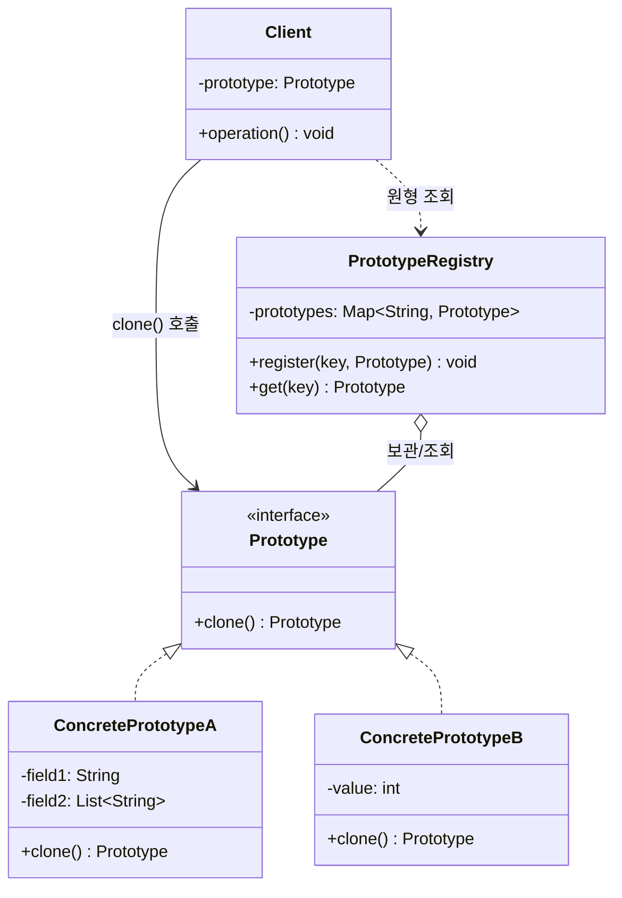

# 프로토타입(Prototype) 디자인 패턴 가이드

> 한 줄 요약: 새 객체를 생성자로 만드는 대신, 이미 존재하는 원형(prototype) 객체를 복제(clone)하여 동일한 구조와 상태를 가진 인스턴스를 얻는 패턴이다.
>
> 분류: 생성 패턴 (Creational Pattern)
> 다른 이름(Aliases): Clone Pattern

---

## 상세 설명

프로토타입(Prototype) 패턴은 GoF의 생성 패턴 중 하나로, "객체를 어떻게 만들 것인가"라는 문제에 대해 "이미 만들어져 있는 객체를 복제한다"는 답을 제시한다. 일반적으로 객체 생성은 `new` 키워드와 생성자를 통해 이루어지지만, 생성 비용이 큰 객체(데이터베이스 조회 결과, 복잡한 그래픽 객체, 외부 시스템 응답을 파싱한 결과 등)를 매번 처음부터 만드는 것은 비효율적이다. 프로토타입 패턴은 한 번 만들어 둔 객체를 원형으로 등록해 두고, 필요할 때마다 그 원형을 복제하여 새 인스턴스를 얻는다.

이 패턴의 핵심 아이디어는 "객체 생성의 책임을 객체 자신에게 위임"하는 것이다. 클라이언트는 구체 클래스의 생성자나 팩토리를 직접 알 필요 없이 `prototype.clone()`만 호출하면 동일한 타입의 새 객체를 얻는다. 그 결과 클라이언트 코드는 구체 타입에 대한 의존성이 사라지고, 런타임에 동적으로 새로운 원형을 등록·교체할 수 있게 된다.

복제 방식에는 얕은 복사(shallow copy)와 깊은 복사(deep copy)가 있다. 얕은 복사는 객체의 최상위 필드만 그대로 복사하므로, 참조 타입 필드는 원본과 복제본이 같은 인스턴스를 공유하게 된다. 이는 빠르지만, 가변(mutable) 참조 필드를 한쪽에서 수정하면 다른 쪽도 영향을 받는 부작용이 발생한다. 깊은 복사는 참조하고 있는 객체들까지 재귀적으로 모두 복제하여 원본과 완전히 독립된 객체 그래프를 만든다. 안전하지만 비용이 크고, 순환 참조나 식별자(ID) 유지 문제 등 구현이 까다로워진다. 어떤 깊이로 복제할지는 도메인 요구사항에 따라 패턴 적용자가 결정해야 한다.

Java에서는 `java.lang.Object#clone()` 메서드와 마커 인터페이스 `Cloneable`이 이 패턴의 언어 차원 지원으로 자주 거론된다. 다만 `Object.clone()`은 기본적으로 얕은 복사를 수행하며, `Cloneable`을 구현하지 않은 객체에서 호출하면 `CloneNotSupportedException`을 던지는 등 사용성이 좋지 않다는 비판을 받는다. 따라서 실무에서는 `Cloneable`을 그대로 사용하는 대신, 직접 `copy()` 같은 메서드를 정의하거나 복사 생성자(copy constructor)를 사용하는 변형이 흔하다.

---

## 디자인 패턴을 충족하는 최소 조건

이 섹션에서는 "어떤 코드가 진짜로 프로토타입 패턴이라고 부를 수 있는가"의 기준을 명확히 한다.

1. **복제 인터페이스가 존재한다(Prototype Interface)** — 원형 역할을 하는 객체가 자기 자신과 동일한 타입의 새 객체를 반환하는 메서드(예: `clone()`, `copy()`)를 공통 인터페이스 또는 추상 클래스 수준에서 노출해야 한다.
2. **클라이언트는 구체 클래스를 몰라도 된다** — 새 객체를 얻기 위해 클라이언트가 `new ConcreteX()`를 호출하지 않고, `prototype.clone()`만 호출해도 동작해야 한다. 즉, 객체 생성의 진입점이 원형 객체 자신이다.
3. **복제본은 원본과 독립적으로 동작 가능해야 한다** — 의도한 복제 깊이(얕은/깊은) 안에서, 복제본의 상태 변경이 원본을 의도치 않게 훼손하지 않아야 한다. 이 경계가 문서화되어 있어야 한다.
4. **(선택) 프로토타입 레지스트리(Prototype Registry)** — 다양한 원형 객체들을 키로 등록·조회하여 복제하는 저장소를 둘 수 있다. 필수 조건은 아니지만, 런타임에 새로운 종류의 객체를 동적으로 추가하는 사용 사례에서는 사실상 필수다.

> 위 조건 1, 2, 3 중 하나라도 빠지면 본 패턴이라고 보기 어렵다. 단순히 `clone()` 메서드를 노출하기만 하고 클라이언트가 여전히 구체 생성자에 의존한다면, 그것은 프로토타입 패턴의 의도를 살리지 못한 형태다.

### 흔히 오해하는 지점
- **`Object.clone()`을 오버라이드했다고 모두 프로토타입 패턴은 아니다.** 클라이언트가 객체 생성을 원형 위임 형태로 사용하지 않으면 단순한 복사 메서드일 뿐이다.
- **싱글턴(Singleton)과의 혼동.** 싱글턴은 "유일한 인스턴스"가 목적이고, 프로토타입은 "동일한 모양의 새 인스턴스를 빠르게 다수 생성"하는 것이 목적이다. 목적이 정반대에 가깝다.
- **팩토리 메서드(Factory Method)와의 혼동.** 팩토리 메서드는 서브클래스가 어떤 구체 클래스를 만들지 결정하지만, 프로토타입은 인스턴스 자신이 새 인스턴스 생성의 주체가 된다.
- **얕은 복사면 충분하다는 가정.** 도메인 객체가 가변 참조 필드를 가지면 얕은 복사는 종종 버그의 원천이 된다. 복제 깊이는 "기본값"이 아니라 "설계 결정"으로 다루어야 한다.

---

## 사례를 통한 예시

### 예시 1: `Cloneable` 인터페이스를 직접 구현한 미니멀 예시

**상황**: 게임에서 동일한 속성을 가진 몬스터(Monster)를 다수 생성해야 한다. 매번 데이터베이스에서 스탯을 조회하는 대신, 한 번 만들어 둔 원형 몬스터를 복제해 사용한다.

```java
import java.util.ArrayList;
import java.util.List;

public class Monster implements Cloneable {
    private String name;
    private int hp;
    private int attack;
    private List<String> skills;

    public Monster(String name, int hp, int attack, List<String> skills) {
        this.name = name;
        this.hp = hp;
        this.attack = attack;
        this.skills = skills;
    }

    @Override
    public Monster clone() {
        try {
            Monster copy = (Monster) super.clone(); // shallow copy
            copy.skills = new ArrayList<>(this.skills); // deep copy for mutable field
            return copy;
        } catch (CloneNotSupportedException e) {
            throw new AssertionError(e); // Cloneable을 구현했으므로 발생 불가
        }
    }

    public void rename(String newName) { this.name = newName; }
    public void learn(String skill) { this.skills.add(skill); }

    @Override
    public String toString() {
        return name + "(HP=" + hp + ", ATK=" + attack + ", skills=" + skills + ")";
    }

    public static void main(String[] args) {
        List<String> baseSkills = new ArrayList<>();
        baseSkills.add("Bite");
        Monster prototype = new Monster("Goblin", 30, 5, baseSkills);

        Monster a = prototype.clone();
        Monster b = prototype.clone();
        b.rename("Elite Goblin");
        b.learn("Stab");

        System.out.println(prototype); // Goblin(HP=30, ATK=5, skills=[Bite])
        System.out.println(a);         // Goblin(HP=30, ATK=5, skills=[Bite])
        System.out.println(b);         // Elite Goblin(HP=30, ATK=5, skills=[Bite, Stab])
    }
}
```

**해설**: `Monster` 클래스는 패턴의 **Prototype** 역할을 한다. `clone()` 메서드는 `super.clone()`을 통해 얕은 복사 결과를 얻은 뒤, 가변 필드인 `skills`만 새 리스트로 다시 만들어 깊은 복사로 보강한다. 클라이언트(`main`)는 `Goblin`을 만들기 위해 `new Monster(...)`를 다시 호출하지 않고 원형의 `clone()`만 호출하므로, 객체 생성에 필요한 파라미터(스탯, 스킬 목록 등)에 대한 의존성이 사라진다. 원형의 `skills` 목록이 복제본의 변경에 의해 오염되지 않는 것에서 "복제본은 원본과 독립적으로 동작 가능해야 한다"는 최소 조건이 충족되는 것을 확인할 수 있다.

### 예시 2: `java.lang.Object#clone` 표준 활용 - 배열 복제

**상황**: 자바 표준 라이브러리는 배열의 `clone()`을 통해 프로토타입 패턴 형태의 복제 API를 광범위하게 노출한다. 또한 `ArrayList` 등 컬렉션 구현도 내부적으로 `Object.clone()` 메커니즘을 활용한다.

```java
import java.util.ArrayList;
import java.util.Arrays;

public class StandardCloneExample {
    public static void main(String[] args) {
        // 1) 배열은 언어 차원에서 Cloneable이며 clone()이 얕은 복사를 수행한다.
        int[] original = {1, 2, 3, 4, 5};
        int[] copied = original.clone();
        copied[0] = 99;
        System.out.println(Arrays.toString(original)); // [1, 2, 3, 4, 5]
        System.out.println(Arrays.toString(copied));   // [99, 2, 3, 4, 5]

        // 2) ArrayList.clone()도 Object.clone() 기반의 얕은 복사다.
        ArrayList<StringBuilder> list = new ArrayList<>();
        list.add(new StringBuilder("hello"));

        @SuppressWarnings("unchecked")
        ArrayList<StringBuilder> clonedList = (ArrayList<StringBuilder>) list.clone();
        clonedList.get(0).append(" world"); // 같은 StringBuilder를 공유

        System.out.println(list.get(0));       // hello world  <- 원본도 영향을 받음
        System.out.println(clonedList.get(0)); // hello world
    }
}
```

**해설**: 배열의 `clone()`은 `Object.clone()`의 가장 모범적인 활용 사례로, 새로운 배열 객체를 빠르게 만들어 준다(단, 참조 타입 배열에 대해서는 얕은 복사임을 유의해야 한다). `ArrayList.clone()` 역시 내부 백킹 배열만 새로 만들 뿐, 원소 자체는 복제하지 않는 얕은 복사다. 두 번째 출력에서 원본 리스트의 `StringBuilder`까지 변경된 결과가 보이는 것은 `Object.clone()`이 기본적으로 얕은 복사를 수행한다는 사실을 그대로 드러낸다. 이 사례는 프로토타입 패턴이 표준 API 수준에서도 통용되고 있다는 점과, 동시에 그 한계(얕은 복사의 함정)를 동시에 보여 준다.

---

## 어떨 때 사용하나

다음과 같은 신호(Symptom)가 보일 때 이 패턴 도입을 고려한다.

- 객체 생성 비용이 비싸다. 예를 들어 DB·외부 API에서 자료를 가져와 초기화하거나, 복잡한 계산을 거쳐 상태를 채워야 하는 객체를 반복적으로 만들어야 할 때.
- 클라이언트가 구체 클래스를 알아야 하는 결합도를 끊고 싶다. 새 객체를 만들기 위해 `new ConcreteFoo(...)`를 알지 않고 단지 "이 원형과 같은 것"을 요청하고 싶을 때.
- 런타임에 새로운 종류의 객체를 동적으로 추가·교체해야 한다. 예: 게임의 몬스터 종류, 그래픽 편집기의 도형, 워크플로우 엔진의 노드 템플릿 등 사용자가 정의한 새 종류를 코드 변경 없이 등록하고 싶은 경우.
- 객체의 종류 수가 많고, 그 차이가 "상태 값"으로 표현 가능할 때. 즉 클래스를 종류마다 새로 만드는 대신, 동일 클래스의 서로 다른 원형 인스턴스를 보유하는 편이 더 자연스러울 때.
- 명령(Command) 패턴, 메멘토(Memento) 패턴, 상태(State) 패턴 등에서 객체의 스냅샷을 보관·복원할 필요가 있을 때 자주 보조적으로 쓰인다.

### 사용하면 안 되는 경우 (Anti-patterns)

- 객체가 단순하고 생성 비용이 작을 때. 단순 값 객체(VO)를 굳이 복제 인프라로 만들 필요가 없다. 그냥 새로 만들어도 된다.
- 객체가 외부 자원(파일 핸들, 소켓, 스레드)을 강하게 점유하고 있을 때. 복제의 의미가 모호해지고 자원 누수의 원인이 된다.
- 객체에 식별자(ID)가 있고, 동일 도메인 내에서 ID 유일성이 보장되어야 할 때. 무분별한 복제는 도메인 불변식을 깨뜨린다.
- 깊은 복사를 안전하게 보장하기 어려운 복잡한 객체 그래프(순환 참조 포함). 이 경우 직렬화 기반 복사나 명시적 빌더 사용이 더 안전하다.

---

## 장점과 단점, 한계점

### 장점
- **객체 생성 비용 감소**: 무거운 초기화 과정을 매번 반복하지 않고, 미리 만들어 둔 원형을 빠르게 복제하여 인스턴스를 얻을 수 있다.
- **클라이언트와 구체 클래스의 결합도 감소**: 클라이언트는 `Prototype` 추상에만 의존하면 되며, 구체 클래스의 생성자 시그니처를 알 필요가 없다.
- **런타임 확장성**: 새로운 원형을 동적으로 등록·교체할 수 있어, 컴파일 타임에 모든 종류를 알 필요가 없다. 이는 플러그인성·구성 가능성을 높인다.
- **서브클래스 폭증 방지**: 상태가 약간씩 다른 변종마다 클래스를 따로 만들 필요 없이, 같은 클래스의 서로 다른 원형 인스턴스로 표현할 수 있다.

### 단점
- **깊은 복사 구현의 난이도**: 객체 그래프가 복잡하거나 순환 참조가 있으면 깊은 복사를 올바르게 구현하기 매우 까다롭다.
- **얕은 복사로 인한 미묘한 버그**: 기본 동작이 얕은 복사인 언어(Java 포함)에서 가변 참조 필드의 공유를 간과하면 디버깅이 어려운 버그가 발생한다.
- **`Cloneable` 자체의 결함(Java 한정)**: `Cloneable`은 인터페이스에 메서드가 없는 마커이고, `clone()`은 `Object`에 `protected`로 정의되어 있어 다형적 사용이 자연스럽지 않다. 또한 생성자를 거치지 않으므로 `final` 필드 초기화나 불변식 검증이 우회되는 문제가 있다.
- **순환 참조와 식별자 유지 문제**: 깊은 복사 시 같은 객체를 두 번 복사하지 않도록 식별자 추적이 필요하며, 도메인에 따라 의미가 모호해진다.

### 한계점
- **언어 지원 차이**: JavaScript의 `structuredClone`, Python의 `copy.deepcopy`처럼 깊은 복사를 표준 제공하는 언어가 있는 반면, Java처럼 그렇지 못한 언어도 있다. 패턴 구현 난이도와 관용구가 언어마다 다르다.
- **`Cloneable`의 한계**: 조슈아 블로크는 *Effective Java*에서 `Cloneable`/`clone()` 메커니즘을 "심하게 결함이 있다(profoundly broken)"고 평가하며, 대체로 **복사 생성자(copy constructor)** 또는 **정적 팩토리 `copyOf`** 사용을 권장한다. 즉, "프로토타입 패턴 = `Cloneable` 구현"으로 등치시키지 말아야 한다.
- **동시성 환경에서의 주의**: 복제 중 원본이 변경되면 일관성 없는 복제본이 만들어질 수 있다. 원자적 스냅샷이 필요하면 별도의 잠금 또는 불변(immutable) 설계가 필요하다.
- **테스트의 어려움**: 얕은/깊은 복사 경계가 도메인 결정이라는 점은 곧 그 경계가 잘 지켜지는지 검증하는 테스트가 별도로 필요하다는 뜻이다.

---

## 정보 표

| 항목 | 값 |
| --- | --- |
| 분류 | 생성 패턴 (Creational) |
| 언어 의존성 | 언어 비의존적. 단, Java의 `Cloneable`/`Object.clone()`처럼 언어가 부분 지원하는 경우가 있어 관용구는 언어마다 달라진다. |
| 활용성(1점~5점) | ★★★☆☆ (3/5) — 개념은 보편적이지만 실무에서는 복사 생성자·빌더·직렬화 기반 복사 등 대체 수단이 더 자주 선택된다. |
| 학습 난이도 | 중 — 개념은 단순하나, 얕은/깊은 복사 경계와 `Cloneable`의 함정까지 정확히 이해하려면 추가 학습이 필요하다. |
| 자주 함께 쓰이는 패턴 | 추상 팩토리(Abstract Factory), 컴포지트(Composite), 데코레이터(Decorator), 메멘토(Memento), 커맨드(Command) |
| 대표 사용 사례 | `java.lang.Object#clone`, 배열 `clone()`, `ArrayList.clone()`, 그래픽 편집기의 도형 복제, 게임의 몬스터/아이템 템플릿 |

---

## Class Diagram



> 다이어그램에 등장하는 각 클래스가 패턴의 어떤 역할(Role)을 담당하는지 위 "상세 설명" 섹션과 1:1로 대응되어야 한다.

### 역할 설명
- **Prototype**: 복제 인터페이스. 자기 자신과 동일한 타입의 인스턴스를 반환하는 `clone()`을 선언한다. 클라이언트가 의존하는 추상이다.
- **ConcretePrototypeA / ConcretePrototypeB**: 실제 복제 로직을 구현하는 구체 원형. `clone()` 내부에서 얕은/깊은 복사 정책을 결정한다.
- **Client**: 새 인스턴스가 필요할 때 구체 생성자 대신 `prototype.clone()`을 호출한다. 구체 타입에 의존하지 않는다.
- **PrototypeRegistry (선택)**: 다양한 원형 객체를 키로 등록·조회하는 저장소. 런타임에 새로운 원형을 추가·교체할 수 있게 해 주는 확장 지점이다.

---

## 참고 자료
- Gamma, Helm, Johnson, Vlissides, *Design Patterns: Elements of Reusable Object-Oriented Software*, Addison-Wesley, 1994. (GoF 원전, "Prototype" 장)
- Joshua Bloch, *Effective Java*, 3rd Edition, Item 13: "Override clone judiciously" — `Cloneable`/`clone()`의 결함과 복사 생성자·정적 팩토리 권장
- Oracle Java Platform Documentation, `java.lang.Object#clone()`, `java.lang.Cloneable`
- Refactoring Guru, "Prototype Pattern" — https://refactoring.guru/design-patterns/prototype
- Wikipedia, "Prototype pattern" — https://en.wikipedia.org/wiki/Prototype_pattern
