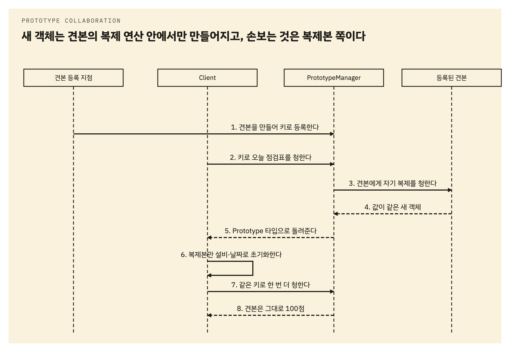
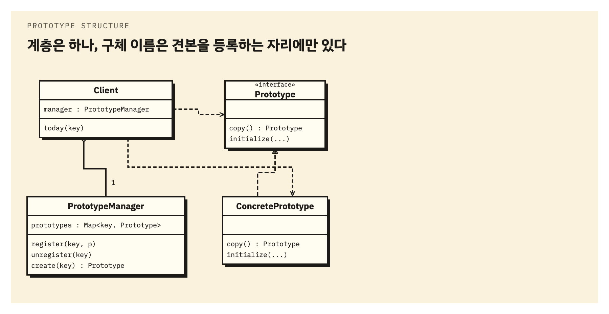

# Prototype — 만들 것을 클래스가 아니라 견본 하나로 정해 두기

## 한눈에 보는 개요

설비 점검 시스템을 하나 떠올려 봅시다. 점검 담당자가 오늘 볼 설비를 고르면 그 설비에 맞는 점검표가 한 장 나와야 해요. 펌프 일상 점검표, 펌프 법정 안전 점검표, 압축기 일상 점검표… 종류마다 클래스를 하나씩 두면 항목 이름과 배점만 다른 클래스가 줄줄이 생깁니다. 게다가 운영자가 "다음 달부터 압축기 점검에 토출 온도를 넣어 주세요" 하고 말할 때마다 코드를 고쳐 배포해야 해요. 종류를 정할 수 있는 곳이 클래스뿐이라서, 종류를 아는 사람이 종류를 만들지 못합니다.

Prototype 의 해법은 **만들 것을 미리 만들어 둔 객체 하나로 정해 두는 것**입니다. 그 객체를 견본이라고 부르고, 새 점검표가 필요하면 견본에게 자기 복제를 청해요. 그러면 새 종류는 새 클래스가 아니라 **새 견본**이 되고, 견본은 실행 중에도 등록하고 내릴 수 있는 그냥 객체입니다.

```text
Before : 종류를 클래스가 정함

  new PumpRoutineChecklist()        ← 클래스 하나
  new PumpSafetyChecklist()         ← 클래스 하나
  new CompressorRoutineChecklist()  ← 종류가 늘면 클래스가 늘고, 늘리려면 배포해야 함

After : 종류를 등록된 견본이 정함

  카탈로그 ─ "pump-routine"       → 견본(윤활유 30 · 진동 40 · 누유 30)
           ─ "pump-safety"        → 견본(압력 밸브 40 · 접지 저항 30, 입회 확인 +20)
           ─ "compressor-routine" → 견본(필터 차압 50 · 토출 온도 30)   ← 실행 중에 등록됨

  오늘 점검표 = 카탈로그에서 꺼낸 견본.복제()  → 복제본에 설비 번호와 날짜만 채움
                                                 견본은 그대로 남음
```

분류는 생성 패턴이고 객체 범위입니다 — 무엇을 만들지가 상속이 아니라 **어느 객체를 가지고 있는가**로 정해져요. 자주 함께 쓰는 패턴은 Composite 와 Decorator 로, 자식이 여럿 달린 구조나 겹겹이 감싼 구조를 처음부터 다시 조립하는 대신 통째로 복제하는 자리에서 함께 쓰입니다(근거: GoF 원서 Prototype 절 Related Patterns). 이 글은 시나리오 셋을 따라가요. 오늘 자 점검표 한 장이 견본에서 나오는 길, 새 종류가 더해져도 클래스가 늘지 않는 이유, 복제 깊이를 정하지 않으면 어느 단계에서 견본이 오염되는가. 끝까지 읽으면 어떤 코드를 Prototype 이라고 불러도 되는지 필수 조건 셋으로 판정할 수 있고, Factory Method·Abstract Factory 와 다른 점도 짚을 수 있게 됩니다.

## 패턴 자세히 들여다보기

### 시나리오 1 — 오늘 자 펌프 점검표 한 장이 견본에서 나오는 길

2026년 3월 11일, 점검 담당자가 설비 `P-12`(펌프)의 일상 점검을 시작합니다. 카탈로그에는 `"pump-routine"` 이라는 키로 견본 한 장이 등록돼 있고, 그 견본의 항목은 윤활유 상태 30점 · 진동 측정 40점 · 누유 확인 30점이라 총점이 100점이에요. 나와야 하는 것은 이 항목들을 그대로 갖되 설비 번호 `P-12` 와 날짜 `2026-03-11` 이 채워진 점검표 한 장입니다. 이 장면에는 넷이 등장해요. 점검표를 청해 쓰는 코드(패턴에서 Client 라고 부르는 역할), 키로 견본을 보관하는 `ChecklistCatalog`(PrototypeManager), 모든 점검표가 공통으로 따르는 연산 모양을 선언한 `Checklist`(Prototype), 그리고 그 선언을 구현한 `RoutineChecklist`(ConcretePrototype)입니다. 이름은 여기서 한 구절씩만 소개하고 정식 정의는 개념 정리에서 해요.



1. 프로그램이 시작될 때 누군가 견본을 만들어 `"pump-routine"` 이라는 키로 카탈로그에 등록합니다. 이 일을 요청을 받기 전에 해 두는 이유는, 2단계에서 키를 받은 카탈로그가 찾을 것이 이미 있어야 하기 때문이에요. 등록이 요청보다 늦으면 카탈로그에는 그 키가 없어서 복제를 청할 상대가 없습니다. 그리고 견본을 만드는 이 자리가 구체 클래스 이름(`RoutineChecklist`)이 등장하는 **유일한 곳**이에요. 여기서 한 번 이름을 대고 나면 그 뒤로는 아무도 대지 않습니다.
2. 담당자의 요청을 받은 Client 가 카탈로그에 `"pump-routine"` 키로 점검표를 청합니다. Client 가 클래스가 아니라 **키**로 청하는 이유는, 어떤 종류가 있는지가 코드가 아니라 등록된 견본 목록에 적혀 있기 때문이에요. 이 단계에서 Client 가 `new RoutineChecklist(...)` 를 쓰면 종류를 늘릴 때마다 Client 를 고쳐야 합니다.
3. 카탈로그가 그 키로 등록된 견본을 찾아, 그 견본에게 **자기 자신을 복제하라**고 청합니다. 만드는 일을 카탈로그가 직접 하지 않는 이유는 카탈로그도 그 견본이 어떤 클래스인지 모르기 때문이에요. 카탈로그가 아는 것은 `Checklist` 라는 연산 모양까지입니다.
4. 견본이 자기 값을 옮겨 담은 새 객체를 만들어 돌려줍니다. 이 단계가 이 패턴에서 가장 결정이 많은 자리예요. 이름과 항목 목록을 새 객체에 넘기면서 **무엇을 새로 만들고 무엇을 같이 쓸지**를 정해야 하거든요. 이 예에서는 항목 하나하나까지 새로 만듭니다 — 왜 그래야 하는지는 시나리오 3 이 보여 줘요.
5. 카탈로그가 그 복제본을 `Checklist` 타입으로 Client 에 돌려줍니다. 반환 타입이 구체 클래스가 아니어야 카탈로그 하나가 일상 점검표든 법정 점검표든 똑같이 다룰 수 있어요.
6. Client 가 받은 복제본에만 설비 번호 `P-12` 와 날짜 `2026-03-11` 을 채웁니다. 이 초기화를 복제 연산에 인자로 합치지 않는 이유가 있어요. 점검표 종류마다 채워야 할 칸이 다르면 복제 연산의 인자도 종류마다 달라지고, 그러면 3단계에서 카탈로그가 "아무 견본에게나 똑같이 복제를 청한다"고 말할 수 없게 됩니다(근거: GoF 원서 Prototype 절 Implementation — 초기화 인자를 복제 연산에 넘기면 복제 인터페이스를 균일하게 유지할 수 없다). 그래서 복제는 값을 그대로 옮기는 일만 하고, 무엇을 채울지는 복제가 끝난 뒤에 따로 정해요.
7. 같은 담당자가 조금 뒤 같은 키로 한 장을 더 청합니다. 카탈로그가 2~5단계를 **그대로** 되풀이할 수 있는 이유는, 6단계의 초기화가 복제본에만 적용돼 견본이 요청 전 상태로 남아 있기 때문이에요. 초기화를 견본에 했다면 두 번째 점검표에 첫 번째의 설비 번호가 그대로 나옵니다.
8. 두 번째 점검표도 총점 100점으로 나옵니다. 견본은 1단계 이후로 아무도 건드리지 않았기 때문이에요. 이것이 견본이 견본으로 남는다는 뜻이고, 시나리오 3 은 이 문장이 거짓이 되는 경우를 따라갑니다.

이 시나리오가 보여 준 것은 **새 객체가 만들어지는 자리가 견본의 복제 연산 안 하나뿐**이라는 점입니다. 클래스 이름은 견본을 등록하는 1단계에서 한 번 나오고 그 뒤로는 사라졌고, Client 도 카탈로그도 `Checklist` 라는 연산 모양까지만 알았어요. 그리고 복제와 초기화가 6단계에서 따로 이뤄졌습니다 — 둘을 붙이면 3단계의 균일함이 유지되지 않기 때문이었죠.

### 시나리오 2 — 압축기 점검표가 더해질 때 무엇이 늘고 무엇이 안 늘까

같은 날 오후, 운영자가 압축기용 일상 점검표를 요청합니다. 항목은 필터 차압 50점과 토출 온도 30점 둘이고 총점은 80점이에요. 계산 방식은 펌프 일상 점검표와 같습니다 — 항목 배점을 그냥 더하면 끝이니까요. 이 요구를 넣을 때 **클래스를 하나도 만들지 않고** 끝낼 수 있을까요? 됩니다. 어떻게 되는지 다섯 단계로 따라가 봅시다.

1. 이미 등록된 `"pump-routine"` 견본을 복제합니다. 여기서 시작하는 이유는 새 종류가 기존 종류와 계산 방식이 같아서, 값만 갈아 끼우면 되기 때문이에요. 바탕이 될 것이 없으면 이 자리에서 `RoutineChecklist` 를 새로 만들어도 됩니다 — 그래도 클래스는 안 늡니다.
2. 복제본의 이름을 "압축기 일상 점검"으로, 항목을 필터 차압 50 · 토출 온도 30 으로 갈아 끼웁니다. 이 손질을 **복제본에** 하는 것이 중요해요. 원본에 했다면 펌프 점검표가 사라집니다.
3. 손질이 끝난 그 객체를 `"compressor-routine"` 이라는 새 키로 카탈로그에 등록합니다. 이 순간부터 그 객체는 복제본이 아니라 **견본**이에요. 복제본과 견본을 가르는 것은 클래스가 아니라 카탈로그에 등록돼 있는가 하나뿐입니다.
4. 담당자가 설비 `C-07` 의 점검표를 청하면 카탈로그는 시나리오 1 의 3~5단계를 그대로 되풀이해 총점 80점짜리 점검표를 냅니다. Client 코드는 한 줄도 바뀌지 않았어요 — 키만 달라졌으니까요.
5. 반대로 쓰지 않게 된 종류는 키를 해제해 내립니다. 이 일을 카탈로그가 맡는 이유는 종류의 목록이 카탈로그 안에만 있기 때문이에요. 종류를 클래스로 두었다면 내리는 일에 해당하는 것이 클래스를 지우고 다시 배포하는 것이고, 그 사이에 그 종류를 쓰던 코드도 함께 동작하지 않게 됩니다. `"pump-safety"` 를 내리면 그 뒤의 요청은 실패하고, 남은 키 목록은 `pump-routine` 과 `compressor-routine` 둘이 돼요.

늘어난 것과 안 늘어난 것을 세어 봅시다. 이 예에서 점검표 **종류**는 셋인데 **클래스**는 둘입니다.

```text
종류(견본)                 계산 방식        클래스
pump-routine               항목 합           RoutineChecklist
compressor-routine         항목 합           RoutineChecklist   ← 같은 클래스, 값만 다름
pump-safety                항목 합 + 입회 20  SafetyChecklist

종류 m = 3 · 계산 갈래 k = 2 → 클래스 수 = k + 2 = 4 (Checklist · 카탈로그 · 클래스 2개)
종류를 하나 더 더하면 : 계산이 같으면 +0 클래스 · 계산이 다르면 +1 클래스
```

셈을 마저 해 봅시다. 종류마다 클래스를 두는 방식이면 전체 타입 수는 `Checklist` 하나에 종류 수 m 을 더한 `m + 1` 이고, 종류가 하나 늘 때마다 정확히 1 이 늡니다. 견본으로 두는 방식이면 `Checklist` 하나, 카탈로그 하나, 그리고 **계산이 다른 갈래 수** k 만큼의 클래스라 `k + 2` 예요. 두 식의 차는 `(m + 1) − (k + 2) = m − k − 1` 이고, m 은 종류 수, k 는 그 종류들이 쓰는 계산 갈래 수라 언제나 `k ≤ m` 입니다. 그러니 차는 `m − k` 가 1 보다 클 때, 곧 **같은 계산을 쓰는 종류가 둘 이상 겹칠 때**부터 벌어져요. 지금은 m = 3, k = 2 라 차가 0 이어서 둘이 같습니다. 하지만 펌프가 열 대 들어와 종류가 12 가 돼도 계산 갈래는 여전히 둘이라, 왼쪽은 13 이 되고 오른쪽은 4 에 머물러요. 그리고 이 셈에는 표에 안 적힌 항목이 하나 더 있습니다 — 왼쪽은 종류를 늘릴 때마다 배포가 필요하고, 오른쪽은 등록 한 줄이라 실행 중에도 됩니다.

이 시나리오가 보여 준 것은 **종류를 정의하는 일이 코드에서 데이터로 옮겨 갔다**는 점입니다. 2단계에서 값만 갈아 끼워 새 종류를 만들었고, 3단계와 5단계에서 그 종류를 실행 중에 올리고 내렸어요. 클래스 수는 종류 수가 아니라 계산 갈래 수를 따르게 됐어요.

### 시나리오 3 — 복제 깊이를 정하지 않으면 어느 단계에서 견본이 오염되는가

시나리오 1 의 4단계에서 견본은 항목 하나하나를 새로 만들어 복제본에 담았습니다. 그 자리에서 **항목 목록을 그대로 넘기면** 어떻게 되는지 따라가 봅시다. 이렇게 두어도 컴파일은 통과하고, 시나리오 1 의 출력도 글자 하나 다르지 않게 나와요. 문제는 첫 번째 조정이 들어올 때 생깁니다.

1. 복제 연산이 새 객체를 만들되, 항목 목록만은 견본이 가지고 있던 것을 그대로 가리키게 합니다. 이름과 설비 번호와 날짜는 값이라 복제본이 따로 갖지만, 항목은 객체라 **둘이 같은 것을 가리키는** 상태가 돼요.
2. 담당자가 오늘 자 복제본에서 진동 측정 배점을 40 에서 50 으로 조정합니다. 실제 설비 상태를 보고 그날 점검표만 손보는 것이라, 담당자 입장에서는 완전히 정상적인 작업이에요.
3. 그 조정이 견본에도 그대로 반영됩니다. 1단계에서 둘이 같은 항목 객체를 가리키게 두었으니까요. 이 단계에서 예외도 나지 않고 경고도 없습니다 — 코드가 시키는 대로 한 것이거든요.
4. 다음 요청부터 견본의 총점이 100 이 아니라 110 으로 나옵니다. 한 번으로 끝나지 않는 이유는 견본이 프로그램이 실행되는 내내 살아 있는 객체이기 때문이에요. 3단계에서 바뀐 값은 되돌리는 코드가 따로 없는 한 그대로 남고, 그 뒤 **모든** 복제본이 그 값을 물려받습니다.

실제로 그렇게 되는지 확인해 봤습니다. 구현 절 코드에서 항목을 새로 만드는 한 줄만 참조 그대로 넘기도록 바꾸고 실행한 결과입니다. 넷째 줄과 일곱째 줄이 정상 출력과 달라지는 자리예요.

```text
오늘 점검표 : P-12 2026-03-11 [일상] 펌프 일상 점검 100점 (윤활유 상태 30 · 진동 측정 40 · 누유 확인 30)
오늘 점검표 : P-12 2026-03-11 [법정] 펌프 법정 안전 점검 90점 (압력 밸브 40 · 접지 저항 30) + 입회 확인 20
복제본 조정 : P-12 2026-03-11 [일상] 펌프 일상 점검 110점 (윤활유 상태 30 · 진동 측정 50 · 누유 확인 30)
견본 재복제 : - - [일상] 펌프 일상 점검 110점 (윤활유 상태 30 · 진동 측정 50 · 누유 확인 30)
새 견본 등록 : compressor-routine (pump-routine, pump-safety, compressor-routine)
오늘 점검표 : C-07 2026-03-11 [일상] 압축기 일상 점검 80점 (필터 차압 50 · 토출 온도 30)
견본 재복제 : - - [일상] 펌프 일상 점검 110점 (윤활유 상태 30 · 진동 측정 50 · 누유 확인 30)
견본 해제 : pump-safety (pump-routine, compressor-routine)
```

정상 출력에서는 넷째 줄과 일곱째 줄이 둘 다 100점입니다(아래 상황 설정에 그 출력 전문이 있어요). 여기서는 둘 다 110점이 됐고, 3단계에서 담당자가 한 조정 하나가 그 뒤 모든 점검표의 기준 점수를 바꿔 버렸습니다. 이 시나리오가 보여 준 것은 **복제 깊이가 기본값이 아니라 결정**이라는 점이에요. 어디까지 새로 만들고 어디부터 같이 쓸지를 복제 연산이 정하지 않으면, 언어가 정해 주는 값이 그대로 설계가 됩니다. 그리고 그 값은 대개 "한 겹만 복사한다" 쪽이에요.

### 개념 정리

시나리오에 나온 역할 넷을 정식으로 정의합니다. 셋은 패턴의 참여자이고 PrototypeManager 는 참여자 목록 밖에서 견본을 보관하는 쪽인데, 시나리오와 구현에 계속 나오므로 함께 정의해요(근거: GoF 원서 Prototype 절 Participants·Implementation).

- **Prototype** — 자기 자신을 복제하는 연산을 선언합니다. 이 선언이 있어야 부르는 쪽이 어떤 구체 클래스인지 모른 채로 복제를 청할 수 있어요(시나리오 1 의 3단계). 복제 연산의 반환 타입도 이 타입이라, 복제본을 받는 변수 선언에도 구체 클래스 이름이 안 들어갑니다. 점검표 예에서는 `copy` 를 선언한 `Checklist` 가 Prototype 이에요.
- **ConcretePrototype** — Prototype 이 선언한 복제 연산을 실제로 구현합니다. 자기 상태를 옮겨 담은 새 객체를 만들어 돌려주는 것이 일이고, **무엇을 새로 만들고 무엇을 함께 쓸지**를 이 구현이 정해요(시나리오 1 의 4단계, 시나리오 3 의 1단계). 점검표 예에서는 `RoutineChecklist` 와 `SafetyChecklist` 가 각각 ConcretePrototype 입니다. 둘은 총점을 내는 방식이 다르고, 그 차이가 두 클래스를 따로 두는 유일한 이유예요.
- **Client** — 새 객체가 필요할 때 견본에게(또는 견본을 보관하는 쪽에) 복제를 청하고, 받은 복제본을 쓸 수 있게 손봅니다(시나리오 1 의 2·6단계). 견본을 처음 만들어 등록하는 것도 Client 쪽 일이고, 그 자리가 구체 클래스 이름을 대는 유일한 곳이에요(1단계). 점검표 예에서는 카탈로그를 꾸리고 오늘 자 점검표를 뽑는 진입점 코드가 Client 입니다.
- **PrototypeManager** — 견본을 키로 등록·해제·조회하는 보관소입니다. 견본 수가 고정돼 있지 않고 실행 중에 늘고 줄 때, Client 가 견본들을 직접 관리하지 않아도 되게 해 줘요(시나리오 2 의 3·5단계). 보관하는 타입이 Prototype 이라 관리자 자신도 구체 클래스를 모릅니다. 점검표 예에서는 `ChecklistCatalog` 가 PrototypeManager 예요.



그림에서 계층이 **하나뿐**이라는 점을 봐 두세요. 만드는 쪽의 클래스 계층이 따로 있지 않고, 제품 계층 하나가 자기를 만드는 일까지 맡습니다. `ConcretePrototype` 으로 들어가는 선은 Client 에서 내려온 점선 하나뿐인데, 그것이 견본을 처음 만들어 등록하는 자리예요. 나머지 선은 전부 `Prototype` 으로 향하고, `PrototypeManager` 가 보관하는 타입도 `Prototype` 입니다. 상속으로 맺는 관계와 객체를 가지고 있어 맺는 관계가 어떻게 다른지는 [참고 문서 「GoF 공통 어휘」의 클래스 패턴과 객체 패턴](../../reference/gof-vocabulary/gof-vocabulary-ref_v1.0.2.md#클래스-패턴과-객체-패턴)에 있어요.

> 만들 것을 클래스가 정하면 계층이 둘, 견본이 정하면 계층이 하나.

## 사용 목적

Prototype 이 필요하다는 단서가 코드나 요구에 보입니다. 셋을 차례로 봅시다.

**단서 1. 설정값만 다른 종류를 담으려고 클래스를 만들고 있습니다.** 새로 만든 클래스가 상위 클래스의 생성자에 다른 상수를 넘기는 것 말고 하는 일이 없다면 신호예요. 시나리오 2 의 압축기 점검표가 딱 그 모양이었고, 그것을 클래스로 만들었다면 `RoutineChecklist` 를 상속해 항목 목록만 바꾼 클래스가 하나 생겼을 겁니다(근거: GoF 원서 Prototype 절 Consequences — 값을 바꾸어 새로운 종류의 객체를 클래스 정의 없이 규정할 수 있다). 아래처럼 클래스 목록에 같은 모양이 반복되면 그 반복이 곧 견본 목록이에요.

```text
클래스 목록                         각 클래스가 실제로 담고 있는 것
PumpRoutineChecklist          →     항목 세 줄
CompressorRoutineChecklist    →     항목 두 줄
ConveyorRoutineChecklist      →     항목 네 줄
BoilerRoutineChecklist        →     항목 세 줄
                                    ── 전부 값이다. 계산은 네 클래스가 똑같다
```

**단서 2. 무엇을 만들지가 실행 중에 정해집니다.** 설정 파일이나 플러그인 목록을 읽고서야 어떤 종류를 다룰지 알게 되는 경우예요. 클래스로 두면 그 종류가 프로그램 안에 미리 다 적혀 있어야 하는데, 견본으로 두면 읽어 들인 만큼 등록하면 끝입니다(근거: GoF 원서 Prototype 절 Applicability — 인스턴스화할 클래스가 실행 시점에 정해질 때). 시나리오 2 의 3·5단계가 실행 중에 종류를 올리고 내린 자리였죠.

```text
설정 파일이 종류를 정하는 모양

  checklists:
    - key: pump-routine       → 읽은 줄마다 견본을 하나 만들어 등록
    - key: pump-safety        → 프로그램 코드에는 종류 이름이 하나도 없다
    - key: conveyor-daily     → 줄을 지우면 그 종류가 그대로 사라진다
```

**단서 3. 합성이나 장식으로 쌓아 올린 구조를 처음부터 다시 조립하고 있습니다.** 자식이 여럿 달린 트리나 겹겹이 감싼 객체를 매번 같은 순서로 다시 만드는 코드가 보이면, 완성된 것 하나를 견본으로 두고 복제하는 편이 짧습니다(근거: GoF 원서 Prototype 절 Related Patterns — Composite 와 Decorator 를 많이 쓰는 설계에서 이 패턴이 유용하다). 다만 이때 복제는 반드시 깊어야 합니다. 얕은 복제에서 무엇이 잘못되는지는 시나리오 3 이 보여 줬어요.

비슷한 단서에서 다른 패턴을 골라야 하는 경우가 둘 있습니다. 만들 것을 정하는 일을 하위 클래스에 맡기고 싶고 그 하위 클래스가 다른 일도 맡는다면 Factory Method 를, 함께 쓰여야 하는 여러 종류를 한 계열로 묶어야 한다면 Abstract Factory 를 먼저 보세요. 둘과의 차이는 「비슷한 패턴·안티패턴과의 차이」에서 풉니다. 그리고 아래 상황에서는 이 패턴을 쓰면 얻는 것보다 잃는 것이 큽니다.

| 쓰지 말아야 할 상황 | 쓰면 잃는 것 |
| --- | --- |
| 객체 안에 복사할 수 없는 자원이 있음 (열린 파일·소켓·잠금) | 복제 연산을 옳게 쓸 방법이 없음. 자원을 복제본이 같이 쓰면 둘 중 하나가 닫을 때 나머지는 그 자원을 쓸 수 없게 되고, 새로 여는 것은 복제가 아니라 재생성이라 "값이 같은 객체"라는 약속이 사라짐(근거: GoF 원서 Prototype 절 Consequences — 복사를 지원하지 않는 객체나 순환 참조를 내부에 가지면 복제 구현이 어렵다) |
| 객체 그래프에 순환 참조가 있음 | 깊은 복제가 끝나지 않거나 같은 노드를 여러 벌 만들어 구조가 달라짐. 방문 기록을 유지하며 순회하는 복제기를 따로 써야 하는데, 그건 이미 패턴이 아니라 직렬화기임 |
| 종류가 둘뿐이고 늘 계획이 없음 | 견본을 만들어 등록하는 자리와 보관소가 새로 생김. 종류가 m, 계산 갈래가 k 일 때 이득은 `m − k − 1` 이라 m = 2, k = 2 면 −1 로 손해 |

마지막 줄은 시나리오 2 의 셈을 그대로 가져온 것입니다. 이득이 종류 수가 아니라 **종류 수와 계산 갈래 수의 차**에서 나온다는 점이 중요해요. 종류가 아무리 많아도 전부 계산이 다르면 클래스는 똑같이 늡니다.

## 패턴의 경계

### 디자인 패턴을 충족하는 최소 조건

어떤 코드를 Prototype 이라고 불러도 되는지 가르는 기준입니다. `[필수]` 가 하나라도 빠지면 이 패턴이 아니고, `[선택]` 은 갖추면 좋은 구조예요. 조건은 언어와 상관없이 코드에서 확인할 수 있는 모양(타입 선언 · 참조 보유 · 호출 방향 · 생성 위치)으로 적었고, 조건마다 그것을 보여 준 시나리오의 단계를 가리킵니다.

1. [필수] 복제 연산이 추상 타입 수준에 선언되고, 그 반환 타입도 그 추상 타입입니다 — 인터페이스·추상 클래스·trait(Rust 에서 타입이 구현할 연산을 선언하는 문법) 가운데 하나에 "자기와 같은 것을 하나 더 돌려주는" 연산이 선언돼 있고, 그 선언의 반환 타입 자리에 구체 클래스 이름이 없습니다. 시나리오 1 의 3·5단계가 이 선언 덕분에 성립하는 자리예요 (근거: GoF 원서 Prototype 절 Participants — Prototype 은 자기 자신을 복제하는 인터페이스를 선언하고 ConcretePrototype 이 그 연산을 구현한다).
   - 빠지면: 구체 클래스에만 복사 수단이 있는 코드가 됩니다. 아래에서 세 언어로 확인해 봤는데, 선언을 빼면 복제를 청하는 자리가 전부 막혀요. 부르는 쪽이 `Checklist` 가 아니라 `RoutineChecklist` 로 변수를 선언해야 하고, 그 순간 시나리오 1 의 2단계에서 없앴던 구체 클래스 이름이 Client 코드에 다시 나타납니다.
2. [필수] 새 객체를 얻는 길이 **견본 인스턴스에 복제를 청하는 것**이고, 청하는 쪽이 구체 클래스를 고르지 않습니다 — 새 객체가 필요한 자리에 구체 클래스를 만드는 문장이 없고 대신 어떤 객체의 복제 연산 호출이 있으며, 그 객체를 고르는 코드에 구체 타입 검사나 타입별 분기가 없습니다. 시나리오 1 의 2·3단계가 이 자리이고, 시나리오 2 의 4단계에서 Client 가 한 줄도 안 바뀐 것이 그 결과예요 (근거: GoF 원서 Prototype 절 Intent — 만들 객체의 종류를 견본이 되는 인스턴스로 지정하고 그것을 복사해 새 객체를 만든다).
   - 빠지면: `copy()` 가 있는데도 부르는 쪽이 `if (종류 == "pump") new RoutineChecklist(...)` 로 분기하면, 복제 연산은 그저 복사 메서드이고 종류를 고르는 일은 여전히 코드에 박혀 있습니다. 시나리오 2 의 3단계처럼 실행 중에 종류를 올릴 길이 없어요 — 새 종류마다 그 분기를 고쳐야 하니까요.
3. [필수] 복제본과 견본이 무엇을 함께 쓰고 무엇을 따로 갖는지가 복제 연산 안에서 정해져 있고, 그 결정 밖에서 복제본을 고쳐도 견본이 바뀌지 않습니다 — 복제 연산의 본문에 하위 객체를 어떻게 다룰지가 적혀 있고(새로 만들거나, 같이 쓰기로 정한 것은 불변이거나), 복제본의 상태를 바꾸는 연산을 불러도 견본의 값이 그대로입니다. 이것이 이 패턴이 늘 유지해야 하는 불변식이고, 시나리오 1 의 8단계가 그 상태, 시나리오 3 의 3단계가 그것이 지켜지지 않은 자리예요 (근거: GoF 원서 Prototype 절 Implementation·Consequences — 복제는 무엇을 공유할지 정하는 일이고, 복합 구조를 프로토타입으로 두려면 복제가 깊어야 한다).
   - 빠지면: 시나리오 3 의 3·4단계입니다. 항목 목록을 그대로 넘기게 고치고 실행하면 넷째 줄과 일곱째 줄의 총점이 100 에서 110 으로 바뀌어요(직접 실행해 확인). 컴파일도 통과하고 예외도 없으며, 시나리오 1 의 출력만 보면 정상과 구별되지 않습니다.
4. [선택] 견본을 키로 보관하는 관리자가 있습니다 — 등록·해제·조회 연산을 가진 보관소가 있고, 그 보관 타입이 1번의 추상 타입입니다. 시나리오 2 의 3·5단계가 이 연산들을 쓰는 자리예요 (근거: GoF 원서 Prototype 절 Implementation — 견본 수가 고정되지 않고 늘고 줄 때 견본 관리자를 둔다). 견본이 두셋뿐이고 바뀌지 않으면 Client 가 직접 가지고 있어도 됩니다.
5. [선택] 복제본을 쓸 수 있게 손보는 초기화 연산이 따로 있습니다 — 복제 연산과 별개로, 복제본의 특정 칸을 채우는 연산이 있습니다. 시나리오 1 의 6단계가 그 자리예요 (근거: GoF 원서 Prototype 절 Implementation — 복제본을 초기화하는 연산을 두되 그 인자를 복제 연산에 넘기지는 않는다). 채울 칸이 없는 견본이면 이 연산도 필요 없습니다.
6. [선택] 언어가 주는 복제 수단을 복제 연산의 구현으로 씁니다 — 복제 연산의 본문이 언어나 표준 라이브러리의 복제 기능에 기대는 모양입니다. 시나리오 1 의 4단계를 구현하는 여러 방법 가운데 하나예요 (근거: 이 가이드의 정책 — 언어마다 있고 없고가 다른 수단이라 판정 기준으로 쓸 수 없다. 그 수단들의 주의할 점은 구현 해설에서 본다).
7. [선택] 견본을 복제해 새 견본을 정의합니다 — 새 종류를 만드는 코드가 기존 견본의 복제본에 값을 갈아 끼운 뒤 그것을 등록하는 모양입니다. 시나리오 2 의 1~3단계가 이 모양이에요 (근거: 이 가이드의 정책 — 새 견본을 처음부터 만들어 등록해도 패턴은 그대로 성립한다. 바탕이 있을 때 손이 덜 가는 방법일 뿐이다).

1번을 맨 앞에 둔 데는 이유가 있습니다. 1번이 빠지면 2번을 물을 대상 자체가 없어져요 — 청하는 쪽이 구체 클래스를 몰라도 되게 해 주는 것이 바로 그 선언이니까요. 실제로 1번만 빠진 코드가 가장 흔합니다. 클래스마다 복사 생성자나 복사 정적 메서드는 있는데 공통 선언이 없는 모양이에요.

```java no-compile
final class RoutineChecklist {
    // 복사 생성자는 있다. 그런데 Checklist 에는 이 연산의 선언이 없다
    RoutineChecklist(RoutineChecklist source) { /* 항목까지 새로 만든다 */ }
}

final class SafetyChecklist {
    SafetyChecklist(SafetyChecklist source) { /* 항목까지 새로 만든다 */ }
}

// 부르는 쪽 — 견본을 Checklist 로 들고 있으면 복사 생성자를 부를 길이 없다
Checklist prototype = catalog.find("pump-routine");
Checklist today = new RoutineChecklist(prototype);   // 인자 타입도, 고른 클래스도 구체다
```

이 코드는 3번을 만족할 수도 있습니다 — 복사 생성자가 항목까지 새로 만들면 견본은 안전하니까요. 그런데 부르는 쪽이 `RoutineChecklist` 라는 이름을 대야 하고, 그 이름을 대려면 견본이 어느 종류인지 먼저 알아야 합니다. 시나리오 2 에서 압축기 견본을 실행 중에 등록해도 이 코드는 그것을 만들 줄 몰라요. 2번도 함께 성립하지 않는 것이죠.

| 코드 | 1번 | 2번 | 3번 | 판정 |
| --- | --- | --- | --- | --- |
| 구현 절의 `Checklist`·두 점검표·`ChecklistCatalog` | 만족 | 만족 | 만족 | Prototype |
| 위 복사 생성자 판 | 빠짐 (공통 선언 없음) | 빠짐 (호출부가 클래스를 고름) | 만족할 수 있음 | 아님 |
| `copy()` 는 있고 호출부가 종류로 분기하는 판 | 만족 | 빠짐 | 만족할 수 있음 | 아님 |
| 시나리오 3 의 얕은 복제 판 | 만족 | 만족 | 빠짐 (견본이 오염됨) | 아님 |
| 항목이 불변 객체라 일부러 함께 쓰는 판 | 만족 | 만족 | 만족 (바뀌지 않으니 오염이 없음) | Prototype |

`[필수]` 는 하나만 빠져도 판정이 끝나므로 1번부터 차례로 봅니다. 1번은 추상 타입의 선언만, 2번은 새 객체를 얻는 자리만, 3번은 복제 연산의 본문과 복제본을 고친 뒤의 견본만 보면 되어서 앞에서 멈추면 뒤는 읽지 않아도 돼요. 표의 마지막 줄이 3번을 오해하지 않게 해 줍니다 — 3번이 요구하는 것은 **깊은 복제**가 아니라 **결정과 그 결과**예요. 하위 객체가 바뀌지 않는 값이면 함께 써도 견본은 오염되지 않고, 그때는 함께 쓰는 쪽이 오히려 낫습니다.

> 깊게 복사하라가 아니라, 어디까지 복사할지 정하고 그 약속을 지켜라.

### 비슷한 패턴·안티패턴과의 차이

Prototype 과 구조가 닮았거나 같은 단서에서 떠오르는 대상 넷을 비교합니다. Factory Method 와 Abstract Factory 는 사용 목적에서 이름만 꺼냈고, 나머지 둘은 이름이나 모양 때문에 이 패턴으로 오해받는 것들이에요. 표에 기준을 먼저 모으고, 대상마다 코드와 시나리오로 풀어 볼게요.

| 비교 대상 | 구분 기준 | Prototype 을 고르면 얻는 것 | 포기하는 것 |
| --- | --- | --- | --- |
| Factory Method | 새 제품을 만들 때 새 클래스를 쓰는가, 미리 만들어 둔 견본을 복제하는가 | 제품 계층과 나란한 Creator 계층이 필요 없음. 종류를 실행 중에 올리고 내릴 수 있음 | 제품 종류가 타입으로 표현돼 컴파일러가 계약을 검사해 주는 것. 대신 복제본을 쓸 수 있게 손보는 단계가 필요할 수 있음 |
| Abstract Factory | 구체 제품을 클래스 이름으로 만드는가, 미리 만들어 둔 견본을 복제해서 얻는가 | 계열이 늘어도 클래스가 함께 늘지 않음. 견본 집합만 갈아 끼우면 됨 | 어느 계열에 어떤 제품이 있는지가 타입으로 표현되는 것. 빠뜨린 견본은 컴파일이 아니라 그 종류를 청할 때 확인됨 |
| Spring 의 `prototype` 빈 스코프 (이름만 같음) | 기존 인스턴스를 복제하는가, 청할 때마다 새로 만드는가 | 값이 채워진 상태에서 시작하는 새 객체. 종류를 값으로 정의할 수 있음 | 컨테이너가 생성과 주입을 대신해 주는 것. 견본의 등록과 수명을 이쪽이 관리해야 함 |
| 복사 생성자·복사 메서드만 있는 코드 (이 패턴으로 오해받는 코드) | 복제 연산이 추상 타입에 선언돼 있는가, 구체 클래스에만 있는가 | 청하는 쪽이 종류를 몰라도 됨. 종류가 늘어도 청하는 코드가 안 바뀜 | 구체 타입을 그대로 돌려받는 편의. 복제본을 쓰려면 추상 타입이 선언한 연산으로 충분해야 함 |

**Factory Method 와의 차이.** 구분 기준은 새 제품을 만들 때 새 클래스를 쓰는지, 미리 만들어 둔 견본을 복제하는지입니다. Factory Method 는 제품 계층과 나란한 Creator 계층을 요구하는 대신 만든 뒤에 따로 초기화할 필요가 없고, Prototype 은 Creator 계층이 필요 없는 대신 복제한 객체를 쓸 수 있게 손보는 단계가 필요할 수 있어요(근거: GoF 원서 Factory Method 절 Related Patterns — 프로토타입은 Creator 의 서브클래스 계층을 요구하지 않지만 복제본을 초기화하는 연산을 필요로 하는 경우가 흔하다). 그 "손보는 단계"가 시나리오 1 의 6단계였고, 이 가이드가 `[선택]` 5번으로 둔 자리예요.

```text
             Factory Method                    Prototype
계층          Creator 계층 + Product 계층 둘     Prototype 계층 하나
종류를 늘리면  ConcreteCreator 서브클래스 +1     견본 객체 +1 (클래스 그대로)
정해지는 때    어느 서브클래스를 쓰는가 (배포)    어느 견본을 등록하는가 (실행 중)
만든 뒤        바로 씀                           채울 칸이 있으면 초기화 연산을 한 번 더
```

여기서 헷갈리기 쉬운 포인트는 둘을 서로 배타적인 선택지로 보는 것입니다. **두 패턴은 포개집니다.** 생성 연산을 하나 열어 두고 그 안에서 견본을 복제해 제품을 내면 한 코드가 둘 다예요(근거: GoF 원서 Factory Method 절 Related Patterns). 아래가 그 모양인데, 이 가이드의 최소 조건으로 따져 보면 1번은 `PaySlip` 에 복제 연산이 선언돼 있어 만족하고, 2번은 `StudioRun` 이 견본을 `PaySlip` 타입으로 가지고 복제를 청할 뿐 구체 클래스를 고르지 않으니 만족합니다. 3번은 이 조각만으로는 판단할 수 없어요 — 공유 범위를 정하는 것은 `copyFor` 의 본문인데 그것이 여기 없으니까요.

```java no-compile
final class StudioRun extends PayrollRun {
    private final PaySlip prototype;                 // 미리 만들어 둔 견본 하나

    StudioRun(PaySlip prototype) {
        this.prototype = prototype;
    }

    @Override
    protected PaySlip createSlip(Employee employee) {
        return prototype.copyFor(employee);          // 새 클래스가 아니라 복제로 만든다
    }
}
```

이 코드는 [Factory Method 가이드](../factory-method/factory-method-guide_v1.0.1.md)가 같은 자리에서 든 것과 같고, 그쪽 최소 조건 다섯도 그대로 만족합니다. 그러니 이 조각은 Factory Method 이면서 Prototype 이에요. 다만 한 가지가 이 가이드의 구현과 다릅니다. `copyFor(employee)` 는 복제와 초기화를 한 연산으로 합친 모양이라, 견본 종류마다 채울 칸이 달라지면 인자도 달라져 시나리오 1 의 3단계에서 본 균일함이 유지되지 않아요. 그래서 이 가이드는 `copy()` 와 `assignTo(...)` 를 나눠 두었고, 합치는 쪽을 택할 수 있는 조건은 "모든 견본이 같은 것으로 초기화된다"는 것입니다.

**Abstract Factory 와의 차이.** 구분 기준은 구체 제품을 클래스 이름으로 만드는지, 미리 만들어 둔 견본을 복제해서 얻는지입니다. 계열마다 팩토리 클래스를 두면 어느 계열에 어떤 제품이 있는지가 타입으로 표현돼 빠뜨린 연산을 컴파일러가 잡아 주고, 견본 집합으로 두면 클래스 수가 줄지만 그 검사도 함께 사라져요. 시나리오 2 에서 압축기 종류를 더할 때 컴파일러가 아무것도 검사해 주지 않았던 것이 바로 그 대가입니다 — 견본을 빠뜨렸는지는 그 키를 청하는 순간에야 알 수 있으니까요.

```text
클래스로 계열을 두면                 견본 복제로 계열을 두면
  계열마다 팩토리 클래스를 새로 씀     팩토리 하나에 그 계열 견본들을 등록
  구체 제품 클래스도 계열마다 새로 씀   등록된 견본을 복제해 제품을 냄
  빠뜨린 연산은 컴파일이 막음          빠뜨린 견본은 그 종류를 청할 때 확인됨
```

여기서도 둘을 배타적 선택지로 보면 안 됩니다. **두 패턴 역시 포개져요.** 구체 팩토리가 계열마다 견본 집합을 가지고 있다가 생성 연산마다 해당 견본을 복제해 돌려주면, 팩토리 클래스는 하나뿐이어도 계열은 견본 집합 수만큼 생깁니다(근거: GoF 원서 Abstract Factory 절 Implementation — 제품군이 많으면 프로토타입을 가지고 복제하는 구체 팩토리로 계열마다 서브클래스를 만들 필요를 없앤다). [Abstract Factory 가이드](../abstract-factory/abstract-factory-guide_v1.0.1.md)도 이 구성을 최소 조건의 `[선택]` 항목 하나로 올려 두었어요. 그 구성을 이 가이드의 조건으로 따져 보면 견본을 보관하는 팩토리가 곧 4번의 관리자이고, 생성 연산마다 키가 하나씩 고정돼 있는 관리자라고 읽으면 됩니다.

**Spring 의 `prototype` 빈 스코프와의 차이.** 구분 기준은 기존 인스턴스를 복제하는지, 청할 때마다 새로 만드는지입니다. 이름이 같아서 가장 자주 혼동되는 자리인데, 스프링의 그 스코프는 빈을 청할 때마다 컨테이너가 **새 인스턴스를 만들어** 주는 것이고 어떤 기존 객체를 복사하지 않아요([Spring Framework — Bean Scopes](https://docs.spring.io/spring-framework/reference/core/beans/factory-scopes.html)). 시나리오 1 의 3·4단계에서 견본의 값이 복제본으로 넘어간 일이 그쪽에는 없습니다. 정의된 대로 매번 새로 만들 뿐이니까요.

```java no-compile
@Scope("prototype")
@Component
class TodayChecklist { }                 // 청할 때마다 "새로 만든다" — 복제가 아니다

// GoF Prototype 이라면 이 모양이어야 한다
Checklist today = catalog.create("pump-routine");   // 등록된 견본의 값을 물려받은 새 객체
```

**복사 생성자·복사 메서드만 있는 코드와의 차이.** 구분 기준은 복제 연산이 추상 타입에 선언돼 있는지, 구체 클래스에만 있는지입니다. 최소 조건 1번의 반례로 이미 본 모양이죠. 그런데 여기서 한 번 더 꺼내는 이유가 따로 있어요. 이것은 나쁜 코드가 아닙니다. 복사 생성자는 그 자체로 훌륭한 도구이고, 종류가 고정돼 있고 부르는 쪽이 구체 타입을 알아도 되는 상황이면 그쪽이 더 짧고 읽기 쉽습니다. 다만 그때 얻지 못하는 것이 시나리오 2 의 4단계예요 — 새 종류가 들어와도 청하는 코드가 안 바뀐다는 성질 말입니다.

## 구현 예시

### 상황 설정

시나리오 1·2 의 점검표 장면을 세 언어로 똑같이 구현합니다. 점검표의 총점은 항목 배점에서 나오고, 종류마다 달라지는 것은 항목 목록과 이름이에요.

- 고정되는 것: 점검표가 갖는 칸(이름 · 항목 목록 · 설비 번호 · 날짜), 복제 연산의 모양(인자 없이 같은 추상 타입을 반환함), 초기화 연산의 모양(설비 번호와 날짜를 받음)
- 바뀌는 것: 등록된 견본의 집합과 각 견본의 항목 목록. 그리고 총점 계산 갈래 둘(항목 배점의 합 · 항목 배점의 합에 입회 확인 20점을 더함)
- 입력 범위: 배점과 총점은 0 이상의 작은 정수이고, 세 언어의 수 타입(Java `int` · TypeScript `number` · Rust `i32`)이 모두 정확히 담는 크기만 씀. 설비 번호와 날짜는 문자열이고 견본 상태에서는 `-` 임
- 진입점의 실행 순서: 견본 둘을 등록 → `P-12` 의 일상·법정 점검표를 뽑음 → 일상 점검표 복제본의 진동 측정 배점을 50 으로 조정 → 같은 키로 다시 복제해 견본이 안 바뀐 것을 확인 → 견본을 복제·수정해 `compressor-routine` 으로 등록 → `C-07` 의 점검표를 뽑음 → 견본을 다시 확인 → `pump-safety` 를 해제
- 시나리오 3 의 얕은 복제 판은 정본 코드에 넣지 않고, 항목을 새로 만드는 한 줄만 바꿔 따로 실행한 결과를 시나리오 3 에서 보였음

예시 타입이 맡는 역할은 다음과 같습니다. Rust 판은 함수 이름만 snake_case(소문자 단어를 밑줄로 잇는 이름 규칙)로 바뀌어 `assign_to`·`total_points`·`item_points` 가 돼요.

| 예시 타입·함수 | 역할 |
| --- | --- |
| `Checklist` | Prototype |
| `RoutineChecklist` · `SafetyChecklist` | ConcretePrototype |
| `ChecklistCatalog` | PrototypeManager |
| 진입점(Java `ChecklistApp.main` · TypeScript 최상위 코드 · Rust `main`) | Client |
| `CheckItem` | 역할 없음. 점검표가 가지고 있는 가변 하위 객체이고, 복제 깊이 결정의 대상 |
| `AbstractChecklist`(Rust 는 `ChecklistBody`) | 역할 없음. 두 ConcretePrototype 이 같은 상태와 복제 규칙을 나눠 쓰려고 둔 자리 |

손으로 적은 총점이 실제로 그렇게 나오는지는 실행해 보면 압니다. 아래가 그 실행 출력이고, 가이드 폴더의 `code/expected-output.txt` 에 그대로 담긴 여덟 줄이에요. 이 글의 수치는 전부 이 출력에서 왔습니다.

```text
오늘 점검표 : P-12 2026-03-11 [일상] 펌프 일상 점검 100점 (윤활유 상태 30 · 진동 측정 40 · 누유 확인 30)
오늘 점검표 : P-12 2026-03-11 [법정] 펌프 법정 안전 점검 90점 (압력 밸브 40 · 접지 저항 30) + 입회 확인 20
복제본 조정 : P-12 2026-03-11 [일상] 펌프 일상 점검 110점 (윤활유 상태 30 · 진동 측정 50 · 누유 확인 30)
견본 재복제 : - - [일상] 펌프 일상 점검 100점 (윤활유 상태 30 · 진동 측정 40 · 누유 확인 30)
새 견본 등록 : compressor-routine (pump-routine, pump-safety, compressor-routine)
오늘 점검표 : C-07 2026-03-11 [일상] 압축기 일상 점검 80점 (필터 차압 50 · 토출 온도 30)
견본 재복제 : - - [일상] 펌프 일상 점검 100점 (윤활유 상태 30 · 진동 측정 40 · 누유 확인 30)
견본 해제 : pump-safety (pump-routine, compressor-routine)
```

### 구현

```java
import java.util.ArrayList;
import java.util.LinkedHashMap;
import java.util.List;
import java.util.Map;

/** 점검 항목. 배점이 바뀔 수 있는 가변 객체라, 견본과 복제본이 같은 것을 가리키면 안 된다. */
final class CheckItem {
    private final String name;
    private int points;

    CheckItem(String name, int points) {
        this.name = name;
        this.points = points;
    }

    CheckItem copy() {
        return new CheckItem(name, points);
    }

    String name() {
        return name;
    }

    int points() {
        return points;
    }

    void setPoints(int points) {
        this.points = points;
    }
}

/** Prototype — 자기 자신을 복제하는 연산을 선언한다. */
interface Checklist {
    Checklist copy();

    void assignTo(String equipmentId, String date);

    void redefine(String label, List<CheckItem> items);

    void adjust(String itemName, int points);

    int totalPoints();

    String render();
}

/** 두 ConcretePrototype 이 함께 쓰는 상태와 깊은 복사 규칙. */
abstract class AbstractChecklist implements Checklist {
    protected String label;
    protected final List<CheckItem> items = new ArrayList<>();
    protected String equipmentId = "-";
    protected String date = "-";

    protected AbstractChecklist(String label, List<CheckItem> items) {
        this.label = label;
        replaceItems(items);
    }

    /** 복사 생성자. 하위 클래스의 copy() 가 이 자리를 지나며 항목까지 새로 만든다. */
    protected AbstractChecklist(AbstractChecklist source) {
        this.label = source.label;
        this.equipmentId = source.equipmentId;
        this.date = source.date;
        replaceItems(source.items);
    }

    private void replaceItems(List<CheckItem> source) {
        items.clear();
        for (CheckItem item : source) {
            items.add(item.copy());
        }
    }

    @Override
    public void assignTo(String equipmentId, String date) {
        this.equipmentId = equipmentId;
        this.date = date;
    }

    @Override
    public void redefine(String label, List<CheckItem> items) {
        this.label = label;
        replaceItems(items);
    }

    @Override
    public void adjust(String itemName, int points) {
        for (CheckItem item : items) {
            if (item.name().equals(itemName)) {
                item.setPoints(points);
            }
        }
    }

    protected int itemPoints() {
        int sum = 0;
        for (CheckItem item : items) {
            sum += item.points();
        }
        return sum;
    }

    protected String itemText() {
        List<String> parts = new ArrayList<>();
        for (CheckItem item : items) {
            parts.add(item.name() + " " + item.points());
        }
        return String.join(" · ", parts);
    }

    protected String head() {
        return equipmentId + " " + date;
    }
}

/** ConcretePrototype — 일상 점검표. 총점은 항목 배점의 합이다. */
final class RoutineChecklist extends AbstractChecklist {
    RoutineChecklist(String label, List<CheckItem> items) {
        super(label, items);
    }

    private RoutineChecklist(RoutineChecklist source) {
        super(source);
    }

    @Override
    public Checklist copy() {
        return new RoutineChecklist(this);
    }

    @Override
    public int totalPoints() {
        return itemPoints();
    }

    @Override
    public String render() {
        return head() + " [일상] " + label + " " + totalPoints() + "점 (" + itemText() + ")";
    }
}

/** ConcretePrototype — 법정 안전 점검표. 입회 확인 배점이 항상 더해진다. */
final class SafetyChecklist extends AbstractChecklist {
    private static final int WITNESS_POINTS = 20;

    SafetyChecklist(String label, List<CheckItem> items) {
        super(label, items);
    }

    private SafetyChecklist(SafetyChecklist source) {
        super(source);
    }

    @Override
    public Checklist copy() {
        return new SafetyChecklist(this);
    }

    @Override
    public int totalPoints() {
        return itemPoints() + WITNESS_POINTS;
    }

    @Override
    public String render() {
        return head() + " [법정] " + label + " " + totalPoints() + "점 (" + itemText()
                + ") + 입회 확인 " + WITNESS_POINTS;
    }
}

/** PrototypeManager — 키로 견본을 등록·조회하고, 요청이 오면 그 견본의 복제본을 낸다. */
final class ChecklistCatalog {
    private final Map<String, Checklist> prototypes = new LinkedHashMap<>();

    void register(String key, Checklist prototype) {
        prototypes.put(key, prototype);
    }

    void unregister(String key) {
        prototypes.remove(key);
    }

    Checklist create(String key) {
        Checklist prototype = prototypes.get(key);
        if (prototype == null) {
            throw new IllegalArgumentException("등록되지 않은 견본: " + key);
        }
        return prototype.copy();
    }

    List<String> keys() {
        return new ArrayList<>(prototypes.keySet());
    }
}

/** Client — 견본을 등록하고, 복제해 오늘 자 점검표로 초기화한다. */
public final class ChecklistApp {
    public static void main(String[] args) {
        ChecklistCatalog catalog = new ChecklistCatalog();
        catalog.register("pump-routine", new RoutineChecklist("펌프 일상 점검",
                List.of(new CheckItem("윤활유 상태", 30), new CheckItem("진동 측정", 40),
                        new CheckItem("누유 확인", 30))));
        catalog.register("pump-safety", new SafetyChecklist("펌프 법정 안전 점검",
                List.of(new CheckItem("압력 밸브", 40), new CheckItem("접지 저항", 30))));

        Checklist today = catalog.create("pump-routine");
        today.assignTo("P-12", "2026-03-11");
        System.out.println("오늘 점검표 : " + today.render());

        Checklist safety = catalog.create("pump-safety");
        safety.assignTo("P-12", "2026-03-11");
        System.out.println("오늘 점검표 : " + safety.render());

        today.adjust("진동 측정", 50);
        System.out.println("복제본 조정 : " + today.render());
        System.out.println("견본 재복제 : " + catalog.create("pump-routine").render());

        Checklist compressor = catalog.create("pump-routine");
        compressor.redefine("압축기 일상 점검",
                List.of(new CheckItem("필터 차압", 50), new CheckItem("토출 온도", 30)));
        catalog.register("compressor-routine", compressor);
        System.out.println("새 견본 등록 : compressor-routine (" + String.join(", ", catalog.keys()) + ")");

        Checklist todayCompressor = catalog.create("compressor-routine");
        todayCompressor.assignTo("C-07", "2026-03-11");
        System.out.println("오늘 점검표 : " + todayCompressor.render());
        System.out.println("견본 재복제 : " + catalog.create("pump-routine").render());

        catalog.unregister("pump-safety");
        System.out.println("견본 해제 : pump-safety (" + String.join(", ", catalog.keys()) + ")");
    }
}
```

```typescript
/** 점검 항목. 배점이 바뀔 수 있는 가변 객체라, 견본과 복제본이 같은 것을 가리키면 안 된다. */
class CheckItem {
  constructor(
    readonly name: string,
    public points: number,
  ) {}

  copy(): CheckItem {
    return new CheckItem(this.name, this.points);
  }
}

/** Prototype — 자기 자신을 복제하는 연산을 선언한다. */
interface Checklist {
  copy(): Checklist;
  assignTo(equipmentId: string, date: string): void;
  redefine(label: string, items: CheckItem[]): void;
  adjust(itemName: string, points: number): void;
  totalPoints(): number;
  render(): string;
}

/** 두 ConcretePrototype 이 함께 쓰는 상태와 깊은 복사 규칙. */
abstract class AbstractChecklist implements Checklist {
  protected label: string;
  protected items: CheckItem[] = [];
  protected equipmentId = '-';
  protected date = '-';

  protected constructor(label: string, items: CheckItem[]) {
    this.label = label;
    this.replaceItems(items);
  }

  abstract copy(): Checklist;

  abstract totalPoints(): number;

  abstract render(): string;

  /** 복제본이 견본과 아무것도 공유하지 않도록 항목까지 새로 만든다. */
  protected copyStateFrom(source: AbstractChecklist): void {
    this.label = source.label;
    this.equipmentId = source.equipmentId;
    this.date = source.date;
    this.replaceItems(source.items);
  }

  private replaceItems(source: CheckItem[]): void {
    this.items = source.map((item) => item.copy());
  }

  assignTo(equipmentId: string, date: string): void {
    this.equipmentId = equipmentId;
    this.date = date;
  }

  redefine(label: string, items: CheckItem[]): void {
    this.label = label;
    this.replaceItems(items);
  }

  adjust(itemName: string, points: number): void {
    for (const item of this.items) {
      if (item.name === itemName) {
        item.points = points;
      }
    }
  }

  protected itemPoints(): number {
    return this.items.reduce((sum, item) => sum + item.points, 0);
  }

  protected itemText(): string {
    return this.items.map((item) => `${item.name} ${item.points}`).join(' · ');
  }

  protected head(): string {
    return `${this.equipmentId} ${this.date}`;
  }
}

/** ConcretePrototype — 일상 점검표. 총점은 항목 배점의 합이다. */
class RoutineChecklist extends AbstractChecklist {
  constructor(label: string, items: CheckItem[]) {
    super(label, items);
  }

  override copy(): Checklist {
    const clone = new RoutineChecklist(this.label, []);
    clone.copyStateFrom(this);
    return clone;
  }

  override totalPoints(): number {
    return this.itemPoints();
  }

  override render(): string {
    return `${this.head()} [일상] ${this.label} ${this.totalPoints()}점 (${this.itemText()})`;
  }
}

/** ConcretePrototype — 법정 안전 점검표. 입회 확인 배점이 항상 더해진다. */
class SafetyChecklist extends AbstractChecklist {
  private static readonly WITNESS_POINTS = 20;

  constructor(label: string, items: CheckItem[]) {
    super(label, items);
  }

  override copy(): Checklist {
    const clone = new SafetyChecklist(this.label, []);
    clone.copyStateFrom(this);
    return clone;
  }

  override totalPoints(): number {
    return this.itemPoints() + SafetyChecklist.WITNESS_POINTS;
  }

  override render(): string {
    return `${this.head()} [법정] ${this.label} ${this.totalPoints()}점 (${this.itemText()})`
      + ` + 입회 확인 ${SafetyChecklist.WITNESS_POINTS}`;
  }
}

/** PrototypeManager — 키로 견본을 등록·조회하고, 요청이 오면 그 견본의 복제본을 낸다. */
class ChecklistCatalog {
  private readonly prototypes = new Map<string, Checklist>();

  register(key: string, prototype: Checklist): void {
    this.prototypes.set(key, prototype);
  }

  unregister(key: string): void {
    this.prototypes.delete(key);
  }

  create(key: string): Checklist {
    const prototype = this.prototypes.get(key);
    if (prototype === undefined) {
      throw new Error(`등록되지 않은 견본: ${key}`);
    }
    return prototype.copy();
  }

  keys(): string[] {
    return [...this.prototypes.keys()];
  }
}

// Client — 견본을 등록하고, 복제해 오늘 자 점검표로 초기화한다.
const catalog = new ChecklistCatalog();
catalog.register('pump-routine', new RoutineChecklist('펌프 일상 점검', [
  new CheckItem('윤활유 상태', 30),
  new CheckItem('진동 측정', 40),
  new CheckItem('누유 확인', 30),
]));
catalog.register('pump-safety', new SafetyChecklist('펌프 법정 안전 점검', [
  new CheckItem('압력 밸브', 40),
  new CheckItem('접지 저항', 30),
]));

const today = catalog.create('pump-routine');
today.assignTo('P-12', '2026-03-11');
console.log(`오늘 점검표 : ${today.render()}`);

const safety = catalog.create('pump-safety');
safety.assignTo('P-12', '2026-03-11');
console.log(`오늘 점검표 : ${safety.render()}`);

today.adjust('진동 측정', 50);
console.log(`복제본 조정 : ${today.render()}`);
console.log(`견본 재복제 : ${catalog.create('pump-routine').render()}`);

const compressor = catalog.create('pump-routine');
compressor.redefine('압축기 일상 점검', [
  new CheckItem('필터 차압', 50),
  new CheckItem('토출 온도', 30),
]);
catalog.register('compressor-routine', compressor);
console.log(`새 견본 등록 : compressor-routine (${catalog.keys().join(', ')})`);

const todayCompressor = catalog.create('compressor-routine');
todayCompressor.assignTo('C-07', '2026-03-11');
console.log(`오늘 점검표 : ${todayCompressor.render()}`);
console.log(`견본 재복제 : ${catalog.create('pump-routine').render()}`);

catalog.unregister('pump-safety');
console.log(`견본 해제 : pump-safety (${catalog.keys().join(', ')})`);
```

```rust
/// 점검 항목. 배점이 바뀔 수 있는 값이라, 견본과 복제본이 같은 것을 가리키면 안 된다.
#[derive(Clone)]
struct CheckItem {
    name: String,
    points: i32,
}

impl CheckItem {
    fn new(name: &str, points: i32) -> CheckItem {
        CheckItem { name: name.to_string(), points }
    }
}

/// Prototype — 자기 자신을 복제하는 연산을 선언한다.
/// `Clone` 을 그대로 쓰지 않는 이유는 구현 해설에 적었다.
trait Checklist {
    fn copy(&self) -> Box<dyn Checklist>;
    fn assign_to(&mut self, equipment_id: &str, date: &str);
    fn redefine(&mut self, label: &str, items: Vec<CheckItem>);
    fn adjust(&mut self, item_name: &str, points: i32);
    fn total_points(&self) -> i32;
    fn render(&self) -> String;
}

/// 두 ConcretePrototype 이 함께 쓰는 상태. 파생된 `Clone` 이 깊은 복사를 한다.
#[derive(Clone)]
struct ChecklistBody {
    label: String,
    items: Vec<CheckItem>,
    equipment_id: String,
    date: String,
}

impl ChecklistBody {
    fn new(label: &str, items: Vec<CheckItem>) -> ChecklistBody {
        ChecklistBody {
            label: label.to_string(),
            items,
            equipment_id: "-".to_string(),
            date: "-".to_string(),
        }
    }

    fn assign_to(&mut self, equipment_id: &str, date: &str) {
        self.equipment_id = equipment_id.to_string();
        self.date = date.to_string();
    }

    fn redefine(&mut self, label: &str, items: Vec<CheckItem>) {
        self.label = label.to_string();
        self.items = items;
    }

    fn adjust(&mut self, item_name: &str, points: i32) {
        for item in self.items.iter_mut() {
            if item.name == item_name {
                item.points = points;
            }
        }
    }

    fn item_points(&self) -> i32 {
        self.items.iter().map(|item| item.points).sum()
    }

    fn item_text(&self) -> String {
        self.items
            .iter()
            .map(|item| format!("{} {}", item.name, item.points))
            .collect::<Vec<String>>()
            .join(" · ")
    }

    fn head(&self) -> String {
        format!("{} {}", self.equipment_id, self.date)
    }
}

/// ConcretePrototype — 일상 점검표. 총점은 항목 배점의 합이다.
struct RoutineChecklist {
    body: ChecklistBody,
}

impl RoutineChecklist {
    fn new(label: &str, items: Vec<CheckItem>) -> RoutineChecklist {
        RoutineChecklist { body: ChecklistBody::new(label, items) }
    }
}

impl Checklist for RoutineChecklist {
    fn copy(&self) -> Box<dyn Checklist> {
        Box::new(RoutineChecklist { body: self.body.clone() })
    }

    fn assign_to(&mut self, equipment_id: &str, date: &str) {
        self.body.assign_to(equipment_id, date);
    }

    fn redefine(&mut self, label: &str, items: Vec<CheckItem>) {
        self.body.redefine(label, items);
    }

    fn adjust(&mut self, item_name: &str, points: i32) {
        self.body.adjust(item_name, points);
    }

    fn total_points(&self) -> i32 {
        self.body.item_points()
    }

    fn render(&self) -> String {
        format!(
            "{} [일상] {} {}점 ({})",
            self.body.head(),
            self.body.label,
            self.total_points(),
            self.body.item_text()
        )
    }
}

/// ConcretePrototype — 법정 안전 점검표. 입회 확인 배점이 항상 더해진다.
struct SafetyChecklist {
    body: ChecklistBody,
}

const WITNESS_POINTS: i32 = 20;

impl SafetyChecklist {
    fn new(label: &str, items: Vec<CheckItem>) -> SafetyChecklist {
        SafetyChecklist { body: ChecklistBody::new(label, items) }
    }
}

impl Checklist for SafetyChecklist {
    fn copy(&self) -> Box<dyn Checklist> {
        Box::new(SafetyChecklist { body: self.body.clone() })
    }

    fn assign_to(&mut self, equipment_id: &str, date: &str) {
        self.body.assign_to(equipment_id, date);
    }

    fn redefine(&mut self, label: &str, items: Vec<CheckItem>) {
        self.body.redefine(label, items);
    }

    fn adjust(&mut self, item_name: &str, points: i32) {
        self.body.adjust(item_name, points);
    }

    fn total_points(&self) -> i32 {
        self.body.item_points() + WITNESS_POINTS
    }

    fn render(&self) -> String {
        format!(
            "{} [법정] {} {}점 ({}) + 입회 확인 {}",
            self.body.head(),
            self.body.label,
            self.total_points(),
            self.body.item_text(),
            WITNESS_POINTS
        )
    }
}

/// PrototypeManager — 키로 견본을 등록·조회하고, 요청이 오면 그 견본의 복제본을 낸다.
struct ChecklistCatalog {
    entries: Vec<(String, Box<dyn Checklist>)>,
}

impl ChecklistCatalog {
    fn new() -> ChecklistCatalog {
        ChecklistCatalog { entries: Vec::new() }
    }

    fn register(&mut self, key: &str, prototype: Box<dyn Checklist>) {
        match self.entries.iter_mut().find(|entry| entry.0 == key) {
            Some(entry) => entry.1 = prototype,
            None => self.entries.push((key.to_string(), prototype)),
        }
    }

    fn unregister(&mut self, key: &str) {
        self.entries.retain(|entry| entry.0 != key);
    }

    fn create(&self, key: &str) -> Box<dyn Checklist> {
        match self.entries.iter().find(|entry| entry.0 == key) {
            Some(entry) => entry.1.copy(),
            None => panic!("등록되지 않은 견본: {}", key),
        }
    }

    fn keys(&self) -> Vec<String> {
        self.entries.iter().map(|entry| entry.0.clone()).collect()
    }
}

// Client — 견본을 등록하고, 복제해 오늘 자 점검표로 초기화한다.
fn main() {
    let mut catalog = ChecklistCatalog::new();
    catalog.register(
        "pump-routine",
        Box::new(RoutineChecklist::new(
            "펌프 일상 점검",
            vec![
                CheckItem::new("윤활유 상태", 30),
                CheckItem::new("진동 측정", 40),
                CheckItem::new("누유 확인", 30),
            ],
        )),
    );
    catalog.register(
        "pump-safety",
        Box::new(SafetyChecklist::new(
            "펌프 법정 안전 점검",
            vec![CheckItem::new("압력 밸브", 40), CheckItem::new("접지 저항", 30)],
        )),
    );

    let mut today = catalog.create("pump-routine");
    today.assign_to("P-12", "2026-03-11");
    println!("오늘 점검표 : {}", today.render());

    let mut safety = catalog.create("pump-safety");
    safety.assign_to("P-12", "2026-03-11");
    println!("오늘 점검표 : {}", safety.render());

    today.adjust("진동 측정", 50);
    println!("복제본 조정 : {}", today.render());
    println!("견본 재복제 : {}", catalog.create("pump-routine").render());

    let mut compressor = catalog.create("pump-routine");
    compressor.redefine(
        "압축기 일상 점검",
        vec![CheckItem::new("필터 차압", 50), CheckItem::new("토출 온도", 30)],
    );
    catalog.register("compressor-routine", compressor);
    println!("새 견본 등록 : compressor-routine ({})", catalog.keys().join(", "));

    let mut today_compressor = catalog.create("compressor-routine");
    today_compressor.assign_to("C-07", "2026-03-11");
    println!("오늘 점검표 : {}", today_compressor.render());
    println!("견본 재복제 : {}", catalog.create("pump-routine").render());

    catalog.unregister("pump-safety");
    println!("견본 해제 : pump-safety ({})", catalog.keys().join(", "));
}
```

시나리오의 단계가 코드 어디에 있는지부터 짚을게요. 시나리오 1 의 1단계(견본 등록)는 Java 201·204행 · TypeScript 156·161행 · Rust 204·215행이고, 구체 클래스 이름 `RoutineChecklist`·`SafetyChecklist` 가 진입점에서 등장하는 곳이 그 두 줄뿐입니다. 2단계(키로 청함)와 3단계(견본에게 복제를 청함)는 카탈로그의 조회 연산 하나에 함께 들어 있고, 위치는 Java 184~190행 · TypeScript 141~147행 · Rust 189~194행이며, 그 본문의 `prototype.copy()`·`entry.1.copy()` 가 3단계예요. 4단계(값을 옮긴 새 객체)는 각 ConcretePrototype 의 복제 연산이라 Java 128·156행 · TypeScript 90·113행 · Rust 91·136행이고, 그 안에서 실제로 무엇을 새로 만드는지는 Java 68~73행 · TypeScript 49~51행 · Rust 26~32행의 `#[derive(Clone)]` 이 맡습니다. 6단계(복제본만 초기화)는 Java 208행 · TypeScript 167행 · Rust 224행이고요. 시나리오 2 의 1~3단계는 Java 219~222행 · TypeScript 178~183행 · Rust 235~240행에 나란히 있습니다 — 복제하고, 값을 갈아 끼우고, 새 키로 등록하는 세 줄이에요.

최소 조건 3번이 코드의 어느 줄인지도 짚어 둘게요. Java 71행 `items.add(item.copy())` 와 TypeScript 50행 `source.map((item) => item.copy())` 가 항목을 새로 만드는 자리이고, 여기서 `item.copy()` 를 `item` 으로 바꾼 것이 시나리오 3 의 반례였습니다. Rust 는 이 결정이 26행의 `#[derive(Clone)]` 한 줄에 들어 있어요 — `Vec<CheckItem>` 의 `Clone` 이 원소마다 `Clone` 을 불러 주기 때문입니다.

| 언어 | 복제 깊이가 정해지는 줄 | 얕게 만들려면 |
| --- | --- | --- |
| Java | 71행 `items.add(item.copy())` | `item.copy()` 를 `item` 으로 |
| TypeScript | 50행 `source.map((item) => item.copy())` | `item.copy()` 를 `item` 으로 |
| Rust | 26행 `#[derive(Clone)]` | 필드 타입을 `Vec<CheckItem>` 에서 `Vec<Rc<CheckItem>>` 같은 공유 타입으로 바꿔야 함 |

언어 차이는 셋입니다.

1. **Java 와 TypeScript 는 복제를 손으로 적어야 하고, Rust 는 `#[derive(Clone)]` 한 줄이 필드 타입을 따라 내려가며 만들어 줍니다.** 다만 Rust 의 이 편의는 필드 타입의 복제가 실제로 값을 복사할 때만 성립해요. 필드가 `Rc<T>` 라면 그 필드의 `Clone` 은 같은 할당을 가리키는 포인터를 하나 더 만들 뿐이라, 파생된 복제가 그 부분만 얕아집니다([Rust std — `std::rc`](https://doc.rust-lang.org/std/rc/index.html)).
2. **Rust 에서는 복제 연산을 `Clone` 트레이트로 대신할 수 없습니다.** `Clone` 이 `Sized` 를 요구해서 트레이트 객체로 만들 수 없거든요. `Box<dyn Clone>` 을 받는 함수 하나를 써서 실제로 컴파일해 봤고, rustc 1.95.0 이 낸 진단 두 줄이 아래 표에 있습니다. 그래서 17행처럼 `Box<dyn Checklist>` 를 돌려주는 연산을 직접 선언했어요.
3. **Java 에는 표준 복제 수단이 따로 있지만 이 코드는 쓰지 않았습니다.** 그 이유는 바로 아래 「실제 라이브러리에서」가 보여 줍니다.

| 자리 | rustc 1.95.0 이 낸 그대로 |
| --- | --- |
| 오류 머리 | ``error[E0038]: the trait `Clone` is not dyn compatible`` |
| 이유를 적은 note | ``  = note: the trait is not dyn compatible because it requires `Self: Sized`` |

표의 두 줄은 진단 전체가 아니라 그 가운데 둘입니다(직접 컴파일해 확인). 파일 이름과 줄 번호가 붙는 `-->` 줄, 소스를 다시 보여 주는 줄, 캐럿 줄, 안내 링크 줄은 뺐어요. 남긴 두 줄은 앞머리 공백까지 원문 그대로입니다.

### 실제 라이브러리에서

표준 라이브러리에서 같은 구조를 찾아 역할을 대응시켜 봅니다. 아래 셋은 모두 공식 문서로 확인한 것이고, Java 항목은 이 자리에서 직접 컴파일·실행해 동작까지 확인했어요.

| 사용처 | Prototype | ConcretePrototype | 비고 |
| --- | --- | --- | --- |
| Java SE 21 [`Object#clone`](https://docs.oracle.com/en/java/javase/21/docs/api/java.base/java/lang/Object.html) · [`Cloneable`](https://docs.oracle.com/en/java/javase/21/docs/api/java.base/java/lang/Cloneable.html) | `clone()` 연산 자체 | `Cloneable` 을 구현하고 `clone` 을 공개로 재정의한 클래스 | 최소 조건 1번을 절반만 채움 — 아래 설명 |
| DOM [`Node.cloneNode(deep)`](https://developer.mozilla.org/en-US/docs/Web/API/Node/cloneNode) | `Node` 의 `cloneNode(deep)` | `Element` · `Text` 등 `Node` 를 구현한 인터페이스들 | `deep` 인자가 복제 깊이를 **호출할 때** 고름. 이벤트 리스너는 복제되지 않음 |
| Rust [`std::clone::Clone`](https://doc.rust-lang.org/std/clone/trait.Clone.html) | `clone()` 을 선언한 `Clone` 트레이트 | `Clone` 을 구현하거나 파생한 모든 타입 | 정적 디스패치 전용. 위에서 본 `E0038` 때문에 트레이트 객체로는 못 씀 |

Java 의 `Cloneable` 이 최소 조건 1번을 **절반만** 채운다는 것이 이 표에서 가장 중요한 줄입니다. `javap java.lang.Cloneable` 을 실행해 보면 본문이 비어 있어요 — 이 인터페이스에는 `clone` 메서드가 선언돼 있지 않습니다(직접 실행해 확인). 실제 선언은 `Object` 에 있는데 `protected native java.lang.Object java.lang.Object.clone()` 이라 밖에서 부를 수 없고요(리플렉션으로 읽어 확인). 그래서 `Cloneable` 타입으로 견본을 가지고 있어도 복제를 청할 수가 없고, 시나리오 1 의 3단계가 성립하지 않습니다. 이 가이드가 `Checklist` 라는 선언을 직접 둔 이유가 이것이에요.

기본 동작이 얕은 복제라는 것도 실행해서 확인했습니다. 가변 리스트를 필드로 가진 클래스에서 `super.clone()` 으로 복제한 뒤 복제본의 리스트에 원소를 더하면, 원본의 리스트도 `[1, 2, 3, 4]` 가 돼요(직접 실행해 확인). 같은 실행에서 복제본이 원본과 다른 객체이고 클래스는 같다는 것도 확인했고, `Cloneable` 을 구현하지 않은 클래스에서 `super.clone()` 을 부르면 `java.lang.CloneNotSupportedException` 이 납니다.

```text
javap java.lang.Cloneable
  public interface java.lang.Cloneable { }          ← clone 선언이 없다

Object.class.getDeclaredMethod("clone")
  protected native java.lang.Object java.lang.Object.clone()
      throws java.lang.CloneNotSupportedException   ← protected 라 밖에서 못 부른다
```

`Node.cloneNode(deep)` 는 이 가이드와 다른 선택을 보여 줍니다. 복제 깊이를 구현이 정하지 않고 **부르는 쪽이 인자로** 고르게 했어요. 최소 조건 3번으로 따져 보면 여전히 만족하는데, 3번이 요구하는 것은 결정이 어디에 있느냐가 아니라 결정이 있고 그 약속이 지켜지느냐이기 때문입니다. 다만 그 인자로 정할 수 없는 것이 있어요 — 이벤트 리스너는 `deep` 이 참이어도 복제되지 않습니다. 이런 칸이 하나라도 있으면 "복제본이 원본과 값이 같다"는 문장이 조건부가 되고, 그 조건을 문서가 대신 적어 주어야 해요.

## 스스로 점검하기

1. 아래 `Report` 가 Prototype 인지 최소 조건 1~3번을 하나씩 적용해 판정해 보세요. 빠진 조건이 있다면 몇 번이고, 시나리오 몇의 어느 단계와 같은 모양이며, 어느 줄을 어떻게 바꾸면 채워지나요? (`Section` 은 제목과 본문을 담은 가변 객체입니다.)

   ```java
   interface Report {
       Report copy();
       String render();
   }

   final class SalesReport implements Report {
       private final List<Section> sections;

       SalesReport(List<Section> sections) {
           this.sections = sections;
       }

       @Override
       public Report copy() {
           return new SalesReport(this.sections);
       }

       @Override
       public String render() {
           return "";
       }
   }

   final class ReportDesk {
       private final Map<String, Report> samples = new HashMap<>();

       Report open(String key) {
           return samples.get(key).copy();
       }
   }
   ```

2. 아래 `Palette.stamp` 는 Prototype 과 Factory Method 중 어느 쪽인가요? 비교 절의 구분 기준으로 답해 보세요. 이어서 `stamp` 를 `abstract Shape stamp();` 로 바꾸고 도형 종류마다 `Palette` 의 하위 클래스를 두면 판정이 어떻게 바뀌는지, 그때 시나리오 2 의 4단계에 해당하는 성질을 잃는지 지키는지도 적어 보세요.

   ```java
   final class Palette {
       private final Shape sample;

       Palette(Shape sample) {
           this.sample = sample;
       }

       Shape stamp(int x, int y) {
           Shape s = sample.copy();
           s.moveTo(x, y);
           return s;
       }
   }
   ```

3. 구현 절 코드에서 `CheckItem` 을 불변으로 바꿨다고 해 봅시다. 배점을 바꾸는 연산을 없애고, 배점을 고칠 때는 값이 다른 `CheckItem` 을 새로 만들어 목록의 그 자리에 넣는 식으로요. 그러면 Java 71행의 `item.copy()` 를 `item` 으로 되돌려도 최소 조건 3번이 유지될까요? 유지된다면 시나리오 3 의 어느 단계가 더 이상 일어날 수 없게 되는지, 그래도 남아 있는 공유가 무엇이고 그것이 왜 안전한지 짚어 보세요.

## 참고 자료

웹 자료의 링크는 리서치 노트가 2026-09-17 에 확인한 것을 그대로 씁니다. 본문이 동작을 단정한 자리는 이 편을 쓰면서 직접 컴파일·실행해 따로 확인했고, 그 표시를 그 자리에 달아 두었어요.

- Erich Gamma · Richard Helm · Ralph Johnson · John Vlissides, *Design Patterns: Elements of Reusable Object-Oriented Software*, Addison-Wesley, 1994.
  - 3장 Creational Patterns, Prototype(117쪽부터) — 의도(Intent) · 적용 대상(Applicability) · 참여자(Participants) · 협력(Collaborations) · 결과(Consequences: 실행 중 제품 추가·제거, 값으로 새 종류 규정, 구조로 새 종류 규정, 서브클래싱 감소, 복제 구현의 어려움) · 구현(Implementation: 프로토타입 관리자, 얕은 복제와 깊은 복제, 복제본 초기화) · 관련 패턴. 개요 · 시나리오 1~3 · 개념 정리 · 사용 목적 · 최소 조건 전부의 근거
  - 3장 Creational Patterns, Factory Method(107쪽부터) — 프로토타입과 대비한 관련 패턴(Related Patterns) 설명. Factory Method 비교와 포개짐 문단의 근거
  - 3장 Creational Patterns, Abstract Factory(87쪽부터) — 프로토타입을 가지고 복제하는 구체 팩토리를 다룬 구현(Implementation) 설명. Abstract Factory 비교와 포개짐 문단의 근거
- [Factory Method 가이드](../factory-method/factory-method-guide_v1.0.1.md) — 비교 절의 `StudioRun` 코드와 Creator 계층 쪽 판정 기준
- [Abstract Factory 가이드](../abstract-factory/abstract-factory-guide_v1.0.1.md) — 견본 복제를 `[선택]` 조건으로 올려 둔 최소 조건 절
- [참고 문서 「GoF 공통 어휘」](../../reference/gof-vocabulary/gof-vocabulary-ref_v1.0.2.md) — 개념 정리에서 계층이 하나라는 말을 풀 때 쓴 클래스 패턴과 객체 패턴
- [Java SE 21 — Object](https://docs.oracle.com/en/java/javase/21/docs/api/java.base/java/lang/Object.html) — `clone()` 의 계약(복제본은 원본과 다른 객체이고 클래스는 같다), 기본 동작이 얕은 복제라는 점
- [Java SE 21 — Cloneable](https://docs.oracle.com/en/java/javase/21/docs/api/java.base/java/lang/Cloneable.html) — 이 인터페이스에 `clone` 선언이 없다는 점, `CloneNotSupportedException`
- [MDN — Node.cloneNode()](https://developer.mozilla.org/en-US/docs/Web/API/Node/cloneNode) — `deep` 인자가 복제 깊이를 고른다는 점, 이벤트 리스너가 복제되지 않는다는 점
- [Rust std — Clone](https://doc.rust-lang.org/std/clone/trait.Clone.html) — `Clone` 이 `Sized` 를 요구한다는 선언, 명시적 복제라는 성격
- [Rust std — std::rc](https://doc.rust-lang.org/std/rc/index.html) — `Rc` 의 복제가 같은 할당을 가리키는 새 포인터를 만든다는 점
- [Spring Framework — Bean Scopes](https://docs.spring.io/spring-framework/reference/core/beans/factory-scopes.html) — `prototype` 스코프가 청할 때마다 새 인스턴스를 만든다는 정의
