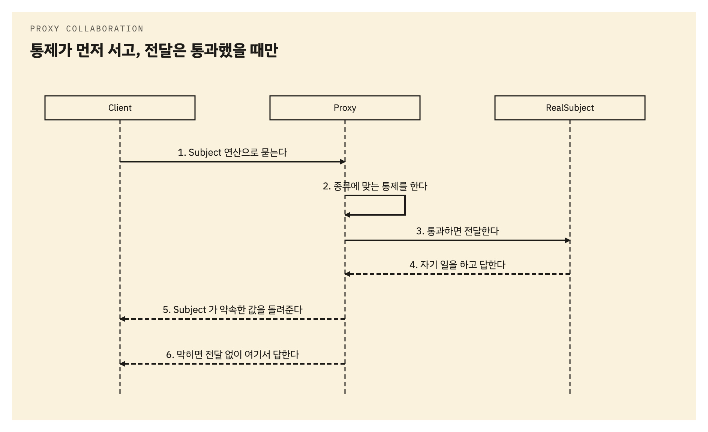
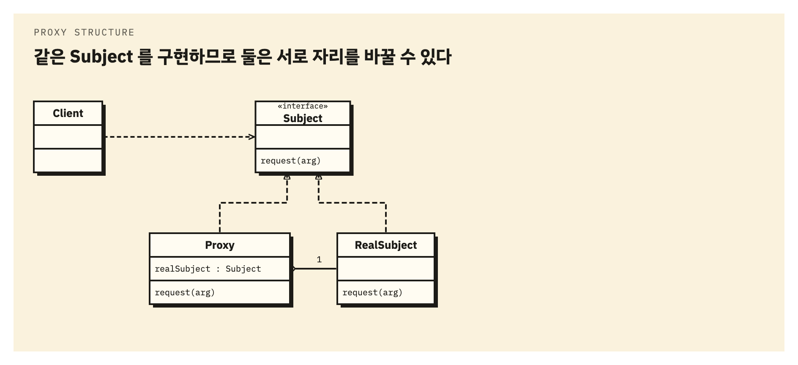

# Proxy — 같은 얼굴로 앞에 서서, 닿을지 언제 닿을지를 먼저 정하기

## 한눈에 보는 개요

사내 계약서 보관소를 하나 떠올려 봅시다. 계약서는 스캔한 원본으로 들어와 있고, 한 건이 수십 쪽이에요. 화면은 셋입니다. 목록 화면은 제목과 쪽수만 보여 주고, 열람 화면은 특정 쪽 본문을 보여 주고, 요약 화면은 첫 쪽 앞머리를 보여 줍니다. 여기에 요구가 하나 더 붙어요 — 계약서마다 열람 등급이 있고, 등급이 모자라면 본문을 내주면 안 됩니다.

계약서 객체를 곧바로 들고 쓰면 두 가지가 부르는 쪽마다 붙습니다. 목록만 띄우는데도 스캔 원본을 전부 읽어야 하고, 등급을 견주는 세 줄이 화면마다 복제돼요. 이 글의 예시 코드를 실제로 돌려 보면 목록만 찍는 데에도 스캔 2건이 읽힙니다(`7) no proxy, listing only: … | scans loaded 2`).

```text
Before : 대상을 곧바로 들고 있으면, 만드는 일과 막는 일이 부르는 쪽마다 붙는다

  목록 화면 ──▶ ScannedContract 2건을 바로 만든다         스캔 2건 로드 (본문은 아무도 안 봤다)
  열람 화면 ──▶ if (등급 < 요구) 거부; else page(2)        같은 검사 세 줄이 화면마다 복제
  요약 화면 ──▶ if (등급 < 요구) 거부; else digest()       한 곳이 검사를 빠뜨려도 티가 안 난다

After : 같은 얼굴의 대리자를 앞에 세우고, 만들 시점과 막을 자리를 그 칸이 쥔다

  목록 화면 ─┐
  열람 화면 ─┼──▶ 계약서 대리자 ──▶ 등급 검사 · 첫 요청까지 생성 보류 ──▶ ScannedContract
  요약 화면 ─┘     (원본과 같은 연산 모양)                                  (그대로 둔다)
```

Proxy 가 두는 한 수는 **대상과 똑같은 연산 모양을 가진 대리자를 앞에 세우는 것**입니다. 대리자는 얼굴을 바꾸지 않아요. 부르는 쪽은 자기가 원본을 들었는지 대리자를 들었는지 모릅니다. 바뀌는 것은 요청이 언제 대상에 닿는가와 닿기는 하는가 둘뿐이에요. 같은 코드를 대리자와 함께 돌리면 목록 단계의 스캔 로드가 0 이 됩니다(`1) shelf: … | scans loaded 0`).

```text
대리자를 끼워도 안 바뀌는 것과, 대리자가 새로 쥐는 것

  안 바뀌는 것       연산 이름 · 인자 · 반환 형식 · 부르는 쪽의 코드
  대리자가 쥐는 것    대상을 언제 만드는가 · 그 요청을 대상까지 보낼 것인가
```

이 패턴의 이름은 GoF(Gang of Four, 1994년에 나온 *Design Patterns* 의 저자 네 명을 함께 부르는 이름)가 붙인 것이고, 다른 이름은 Surrogate 예요(근거: GoF 원서 Proxy 절 Also Known As). 분류는 구조 패턴이면서 객체 범위인데, 통제를 상속으로 끼워 넣지 않고 대상을 들고 있는 객체 하나로 다루기 때문입니다. 두 범위를 가르는 기준은 [참고 문서 「GoF 공통 어휘」의 클래스 패턴과 객체 패턴](../../reference/gof-vocabulary/gof-vocabulary-ref_v1.0.1.md#클래스-패턴과-객체-패턴)에 있어요. 함께 쓰는 패턴은 Adapter·Decorator 입니다 — 셋 다 대상을 감싸지만 감싼 뒤에 내미는 얼굴과 끼어드는 목적이 달라서, 어댑터가 맞춰 놓은 연산 모양 **위에** 프록시를 겹쳐 쓸 수 있어요.

이 글은 시나리오 셋을 따라갑니다. 열람 요청 하나가 통제를 거쳐 본문에 닿는 길, 새 통제가 더해질 때 무엇이 바뀌는가, 대리자의 규칙을 어기면 어느 단계에서 무엇이 새는가. 끝까지 읽으면 어떤 코드를 Proxy 라고 불러도 되는지 필수 조건 넷으로 판정할 수 있고, 구조가 거의 같은 Adapter·Decorator 와도 갈림 셋으로 구분할 수 있게 됩니다.

## 패턴 자세히 들여다보기

### 시나리오 1 — 열람 요청 하나가 통제를 거쳐 본문에 닿는 길

법무팀 담당자가 계약서 `NDA-2031` 의 2쪽을 엽니다. 이 계약서는 4쪽짜리이고 열람 요구 등급은 1, 담당자가 가진 등급은 3 이에요. 나와야 하는 값은 2쪽 본문 한 줄이고, 그 값이 나오기까지 스캔 원본은 **딱 한 번** 읽혀야 합니다. 이 장면에는 넷이 등장해요. 계약서를 다루는 화면 `ContractDesk`(패턴에서는 Client 라고 부르는 역할), 계약서에 물을 수 있는 연산 모양 `Contract`(Subject), 스캔 원본을 들고 답하는 `ScannedContract`(RealSubject), 그리고 그 앞에 서는 대리자 둘 `GuardedContract`·`LazyContract`(Proxy)입니다. 이름은 여기서 한 구절씩만 소개하고 정식 정의는 개념 정리에서 해요.



1. `ContractDesk` 가 `Contract` 의 `page("NDA-2031", 2)` 를 부릅니다. 화면이 `Contract` 에만 묻는 이유는, 손에 쥔 것이 원본인지 대리자인지 아는 순간 화면 코드가 그 선택에 묶이기 때문이에요. 지금 화면에 필요한 것은 "2쪽 본문" 하나이고, 그것이 어디서 어떻게 오는지는 화면의 일이 아닙니다.
2. 바깥쪽 대리자 `GuardedContract` 가 등급을 견줍니다. 가진 등급 3 이 요구 등급 1 이상이라 통과예요. 이 검사가 **전달보다 앞에** 서는 이유는 하나입니다. 전달한 뒤에 검사하면 이미 대상이 일을 한 뒤이고, 막아야 할 요청이 막히지 않아요. 순서를 바꾸면 거부라는 말이 "결과를 안 보여 준다"로 줄어듭니다.
   - 갈래 2-a. 인턴(등급 1)이 `MNA-0079` 의 2쪽을 열면 요구 등급이 3 이라 여기서 막힙니다. 3단계 아래로는 아무 일도 일어나지 않고, 대리자가 거부 값을 직접 지어내 돌려줘요. 실행 출력 4번 줄이 이 갈래이고, 같은 줄의 `scans loaded 1` 이 **막힌 요청은 안쪽 대리자까지 가지 않아 원본도 안 만들어졌다**는 사실을 보여 줍니다.
3. 통과했으므로 `GuardedContract` 가 안쪽으로 같은 요청을 넘깁니다. 검사에 통과했다는 것이 곧 답이 되는 것은 아니니까요 — 통제는 전달을 **거르는** 일이지 대신하는 일이 아닙니다. 여기서 대리자가 스스로 답하기 시작하면 그것은 대리가 아니라 또 하나의 구현이에요(시나리오 3 의 4단계가 그 모양입니다).
4. 안쪽 대리자 `LazyContract` 가 스캔 원본이 아직 없다는 것을 보고 이때 만듭니다. 이 대리자가 처음부터 들고 있던 것은 원본이 아니라 **원본을 만드는 방법**이었어요. 목록 화면은 제목과 쪽수만 필요한데 그때 원본을 만들면 아무도 안 볼 수십 쪽을 읽게 되니까, 원본에 실제로 물어야 하는 첫 요청까지 생성을 미룬 겁니다. 대리자가 대상을 가리키는 방법이 직접 참조일 필요는 없다는 점이 여기서 드러나요 — 원격 대리자는 호스트 식별자를, 지연 생성 대리자는 만드는 방법을 들고 있다가 나중에 직접 참조를 얻습니다.
5. `LazyContract` 가 방금 만든 `ScannedContract` 에 같은 요청을 넘깁니다. 넘길 때 인자도 반환 형식도 손대지 않아요. 두 대리자 중 어느 쪽도 값을 바꾸지 않기 때문에, 대리자를 끼우기 전과 뒤의 답이 같습니다. 이 성질이 없으면 대리자를 끼우는 일이 곧 동작을 바꾸는 일이 돼요.
6. `ScannedContract` 가 2쪽 본문을 돌려줍니다. 이 객체는 `Contract` 라는 타입이 있다는 것은 알지만 자기 앞에 대리자가 서 있다는 것은 모르고, 알 필요도 없어요. 대리자 쪽에서 대상을 아는 방향만 있고 반대 방향이 없다는 점이 "대상 코드를 건드리지 않는다"는 말의 실제 내용입니다.
7. 두 대리자가 받은 값을 그대로 위로 올려보내고 `ContractDesk` 가 그것을 화면에 씁니다. 화면은 답이 대리자 둘을 거쳐 왔다는 것도, 그 사이에 원본이 방금 만들어졌다는 것도 모릅니다. 아는 것은 `Contract` 가 약속한 의미 하나뿐이에요. 실행 출력 2번 줄이 이 결과이고, 그 줄의 `scans loaded 1` 이 원본이 이 순간 처음 만들어졌다는 표시입니다.

```text
단계   부르는 쪽 → 받는 쪽              하는 일                             남는 자취
 1     Client → Subject                page("NDA-2031", 2)                 —
 2     보호 대리자 → (자기 안)           등급 3 ≥ 요구 1 → 통과              막히면 여기서 끝(갈래 2-a)
 3     보호 대리자 → 지연 대리자          같은 요청을 그대로                   —
 4     지연 대리자 → (자기 안)           원본이 없다 → 지금 만든다             scans loaded 0 → 1
 5     지연 대리자 → RealSubject         같은 요청을 그대로                   —
 6     RealSubject → 지연 대리자         2쪽 본문                            —
 7     대리자들 → Client                 받은 값 그대로                       출력 2번 줄
```

잠깐, 확인 하나만 해 볼까요? 4단계를 1단계 앞으로 옮기면 — 곧 목록을 만들 때 원본도 함께 만들면 — 위 표에서 무엇이 달라질까요?

7단계의 답은 그대로입니다. 2쪽 본문은 어차피 같은 값이니까요. 달라지는 것은 4단계의 자취입니다. 목록을 띄우는 순간 이미 `scans loaded` 가 올라가 있고, 아무도 열어 보지 않은 계약서까지 읽힌 뒤예요. 실행 출력의 1번 줄과 7번 줄이 정확히 그 둘을 나란히 보여 줍니다.

```text
같은 목록을 같은 화면 코드로 찍었을 때

  대리자를 끼운 쪽    1) shelf: … | scans loaded 0     ← 본문은 아직 아무도 안 봤다
  원본을 바로 꽂은 쪽  7) no proxy, listing only: … | scans loaded 2
```

이 시나리오가 보여 준 것은 역할 넷과 **통제가 전달보다 앞에 선다**는 순서입니다. 요청은 Subject 연산으로 들어오고(1단계), 대리자가 자기 종류에 맞는 통제를 먼저 하고(2·4단계), 통과했을 때만 대상에 넘어가고(3·5단계), 돌아오는 값은 손대지 않은 채 올라옵니다(6·7단계). 막히면 대상 쪽에서는 아무 일도 일어나지 않아요(갈래 2-a). 그리고 대리자가 대상을 가리키는 방법은 직접 참조가 아니어도 됩니다(4단계).

### 시나리오 2 — 열람 등급 요구가 새로 들어올 때

보관소는 이미 지연 생성 대리자로 목록을 띄우고 있었습니다. 여기에 요구가 하나 들어와요 — 계약서마다 열람 등급을 두고, 등급이 모자란 사람에게는 본문을 내주지 말라는 겁니다. `MNA-0079` 는 요구 등급 3 이고 인턴은 등급 1 이에요. 인턴이 2쪽을 열면 거부 문구가 나와야 하고, 법무팀이 같은 쪽을 열면 본문이 나와야 합니다.

1. 개발자가 `GuardedContract` 를 새로 씁니다. 구현하는 연산 모양은 시나리오 1 의 `Contract` 그대로예요. 모양을 바꾸지 않는 이유는 그 모양이 화면과 모든 계약서 사이의 계약이기 때문입니다. 여기서 `pageOrDenied` 같은 새 이름을 쓰면 화면이 "등급이 붙은 계약서"와 "안 붙은 계약서"를 갈라 부르게 되고, 그 순간 대리자를 둔 이유가 사라져요.
2. 조립 코드가 사용자 등급을 알고 한 겹 더 쌉니다. 등급은 계약서의 성질이 아니라 **보는 사람**의 성질이라 대리자를 만들 때 정해지고, 그래서 같은 계약서라도 인턴의 선반과 법무팀의 선반에 서로 다른 보호 대리자가 꽂혀요. 안쪽의 지연 생성 대리자는 둘이 함께 씁니다.
3. `ContractDesk`·`ScannedContract`·`LazyContract` 는 한 줄도 바뀌지 않습니다. 화면에 적힌 계약서 관련 이름이 `Contract` 와 그 연산뿐이라 새 대리자 이름이 들어갈 자리가 없어서예요. 바뀐 곳을 세면 새 클래스 하나와 선반을 만드는 조립 코드입니다.
4. 겹치는 순서에는 뜻이 있습니다. 보호가 바깥, 지연이 안쪽이에요. 뒤집어서 지연을 바깥에 두면 거부될 요청도 먼저 원본을 만들고 나서 막히게 됩니다. 무엇을 아끼려고 지연을 뒀는지 생각하면 순서가 정해져요 — **품이 덜 드는 통제가 앞에 섭니다.**
5. 이 겹침을 화면이 고르지 않는다는 점이 중요합니다. 어느 대리자를 몇 겹으로 쌀지는 조립 코드가 고정하고, 화면은 선반에서 `Contract` 하나를 받을 뿐이에요. 겹을 바꾸고 싶으면 조립 코드를 고치지 화면을 고치지 않습니다.

```text
변화                    바뀐 곳                              안 바뀐 곳
열람 등급 요구 추가       GuardedContract (새 클래스)           ContractDesk 전체
                       선반을 만드는 조립 코드                 Contract 의 연산 모양
                                                            LazyContract
                                                            ScannedContract
```

| 겹치는 순서 | 인턴이 `MNA-0079` 2쪽을 열 때 | 스캔 원본 |
| --- | --- | --- |
| 보호(바깥) → 지연(안쪽) · 이 가이드의 순서 | 등급에서 막힘 | 안 만들어짐 — 출력 4번 줄의 `scans loaded 1` |
| 지연(바깥) → 보호(안쪽) | 등급에서 막힘 | 먼저 만들어진 뒤 막힘 |

여기서 헷갈리기 쉬운 포인트는 대리자를 두 겹으로 쌌다는 사실 하나로 이것을 Decorator 라고 부르는 것입니다. 겹쳐 쌀 수 있다는 것과 **겹쳐 쌓는 것이 설계의 전제**라는 것은 다른 말이에요. 여기서 겹은 조립 코드가 고정으로 정한 두 겹이고, 화면이 조합을 고르지 않으며, 겹을 하나 빼도 남은 대리자의 의미가 그대로입니다(5단계). 데코레이터는 조합 자체가 요구에서 오고 그 조합을 쓰는 쪽이 정해요. 이 차이는 비교 절의 갈림 3 에서 코드로 다시 확인합니다.

이 시나리오가 보여 준 것은 변화의 범위와 겹의 성질입니다. 통제가 하나 늘 때 바뀌는 곳은 새 대리자 하나와 조립 코드이고, Subject·Client·RealSubject 와 기존 대리자는 그대로예요(1·3단계). 대리자를 겹칠 수는 있지만 그 순서는 무엇을 아끼려는지가 정하고(4단계), 겹을 고르는 쪽은 조립 코드이지 Client 가 아닙니다(5단계).

### 시나리오 3 — 대리자의 규칙을 어기면 어느 단계에서 무엇이 새는가

같은 보관소에서 네 가지 일이 벌어집니다. 조립 코드를 손보던 개발자가 대리자를 빼고 원본을 바로 꽂고, 다른 개발자가 대리자를 쓰다가 연산 하나를 빠뜨리고, 성능을 걱정한 누군가가 대리자 안에 답을 미리 채워 두고, 마지막으로 인턴이 거부당한 본문을 요약 화면에서 읽습니다. 같은 계약서 `NDA-2031`(4쪽)·`MNA-0079`(12쪽, 요구 등급 3)를 쓰고, 인턴의 등급은 1 이에요. 아래 결과는 Java 21.0.11 · TypeScript 5.9.3 · Rust 1.95.0 으로 실제로 컴파일하거나 실행해 확인한 것입니다.

1. 조립 코드가 대리자를 빼고 `ScannedContract` 두 개를 선반에 바로 꽂습니다. 화면 코드는 한 글자도 안 바뀌고 목록도 똑같이 찍혀요. 그런데 목록을 찍는 시점에 스캔 2건이 이미 읽혀 있습니다. 실행 출력 7번 줄이 그것이고, 같은 목록을 대리자로 찍은 1번 줄은 `scans loaded 0` 이에요. **틀린 값이 나오지 않기 때문에** 이 우회는 화면만 봐서는 드러나지 않습니다.
2. 다른 개발자가 보호 대리자를 새로 쓰다가 `digest` 를 빠뜨립니다. 이 갈래는 세 언어 모두 컴파일에서 막혀요. 대리자가 Subject 의 연산 **전부**를 내밀지 못하면 대상이 서 있던 자리에 들어갈 수 없으니까요. 1번 갈래와 이 갈래의 차이가 중요합니다 — 이쪽은 타입이 모자라서 기계가 잡아 주고, 1번은 타입이 멀쩡한 채로 비용만 늘어서 아무도 못 잡습니다.
3. 2번 갈래의 진단을 그대로 옮깁니다. 연산 다섯 중 `digest` 하나만 뺀 클래스를 세 언어로 만들어 실제로 컴파일한 결과예요.

```text
javac 21.0.11  (파일명·줄 번호 앞머리 `Bad.java:9: ` 를 지웠고, 그 아래 소스 줄과 캐럿 표시 줄은 옮기지 않았습니다)
error: PartialGuard is not abstract and does not override abstract method digest() in Contract

tsc 5.9.3      (파일·줄·칸 앞머리 `bad.ts(7,7): ` 를 지웠고, 같은 원인으로 이어 나온 TS2741 한 줄은 옮기지 않았습니다)
error TS2420: Class 'PartialGuard' incorrectly implements interface 'Contract'.
  Property 'digest' is missing in type 'PartialGuard' but required in type 'Contract'.

rustc 1.95.0   (머리 줄만 옮겼고 `--> 파일:줄:칸` 위치 줄과 그 아래 표시 줄은 지웠습니다)
error[E0046]: not all trait items implemented, missing: `digest`
```

4. 성능을 걱정한 개발자가 `LazyContract` 안에 쪽 본문 표를 미리 채워 두고, `page` 가 원본을 만들지 않고 그 표를 읽게 고칩니다. 지금 이 순간에는 같은 문자열이 나오지만, 스캔이 다시 떠서 원본이 바뀌는 순간 대리자의 답과 원본이 갈라져요. 이 클래스는 더 이상 대상을 **대리**하지 않고 대상을 **다시 구현**한 것이고, 그러면 대리자라고 부를 근거가 사라집니다. 시나리오 1 의 3단계가 "통제는 전달을 대신하지 않는다"고 한 자리예요.
5. 인턴이 `MNA-0079` 의 2쪽을 열려다 거부당한 뒤, 요약 화면에서 같은 계약서의 `digest` 를 부릅니다. 보호 대리자는 `digest` 를 막지 않아요 — 정책이 막은 것은 본문 쪽 열람이었으니까요. 그런데 원본의 `digest` 는 자기 안에서 자기 `page(1)` 을 부르고, 그 호출은 원본 **안에서** 일어나므로 바깥에 선 대리자를 거치지 않습니다. 결과는 실행 출력 5번 줄입니다.

```text
4) intern opens MNA-0079 p2: [denied] MNA-0079 p2 needs clearance 3 | scans loaded 1
5) intern reads MNA-0079 digest: [MNA-0079 p1] 양수인은 잔금일에 지분... | scans loaded 2
```

4번 줄에서 막힌 사람이 5번 줄에서 같은 계약서의 1쪽 앞머리를 읽고 있습니다. 대리자가 볼 수 있는 것은 **바깥에서 들어오는 호출**뿐이고, 대상이 자기 메서드를 자기가 부르는 길은 대리자를 지나지 않기 때문이에요. 이 성질은 이 예시의 실수가 아니라 대리자 방식 자체의 경계이고, 프레임워크가 만들어 주는 대리자에서도 같습니다([Spring Framework — Proxying Mechanisms](https://docs.spring.io/spring-framework/reference/core/aop/proxying.html)). 막아야 할 것이 대상 내부의 호출까지라면 통제를 대리자에 두는 설계로는 닿지 않아요.

```text
대리자가 보는 호출과 못 보는 호출

  바깥 호출   Client ──▶ [보호 대리자] ──▶ [지연 대리자] ──▶ RealSubject.page(2)      보인다 → 막을 수 있다
  자기 호출   Client ──▶ [보호 대리자] ──▶ [지연 대리자] ──▶ RealSubject.digest()
                                                                └─ 자기 page(1) 호출   안 보인다 → 못 막는다
```

이 시나리오가 보여 준 것은 대리자를 어기는 네 가지 길과 그 대가입니다. 대리자를 빼면 답은 같고 비용만 돌아오며(1단계), 연산을 빠뜨리면 컴파일이 막아 주지만(2·3단계) 대리자가 스스로 답하기 시작하면 아무도 막아 주지 않습니다(4단계). 그리고 통제는 바깥에서 들어오는 호출에만 걸리므로, 대상 안에서 나가는 길은 통제 밖에 남습니다(5단계).

### 개념 정리

시나리오에 나온 역할 넷을 정식으로 정의합니다. 앞의 셋은 GoF 가 이 패턴의 참여자로 적은 역할이고, Client 는 원전 목록에 없지만 시나리오와 구현에 등장하므로 함께 정의해요(근거: GoF 원서 Proxy 절 Participants).

- **Subject** — RealSubject 와 Proxy 가 함께 구현하는 연산 모양입니다. 이 타입이 있어야 대상이 기대되는 자리에 대리자를 대신 넣을 수 있고, 그것이 이 패턴이 성립하는 바탕이에요. 그래서 Subject 의 연산 집합은 대리자를 끼우든 빼든 그대로여야 합니다. 계약서 예에서는 `id`·`title`·`pageCount`·`page`·`digest` 를 선언한 `Contract` 가 Subject 예요.
- **RealSubject** — 대리자가 대표하는 실제 객체입니다. 요청을 실제로 수행하는 쪽이고, 자기 앞에 대리자가 있는지 모릅니다(시나리오 1 의 6단계). 대리자를 두는 이유가 이 객체에 있어요 — 만드는 데 품이 많이 들거나, 다른 주소 공간에 있거나, 아무나 닿으면 안 되거나. 계약서 예에서는 만들어지는 순간 스캔 원본을 전부 읽는 `ScannedContract` 가 RealSubject 입니다.
- **Proxy** — Subject 를 구현해 RealSubject 자리에 대신 서고, RealSubject 에 닿는 참조를 유지하며, 적절할 때 요청을 전달하는 쪽입니다. 전달 앞뒤에 자기 종류에 맞는 통제를 하고(시나리오 1 의 2·4단계), 통제가 막으면 전달하지 않습니다(갈래 2-a). RealSubject 의 생성과 삭제를 함께 책임질 수도 있어요. 계약서 예에서는 `GuardedContract` 와 `LazyContract` 가 각각 Proxy 입니다.
- **Client** — Subject 를 따르는 객체와만 협력하는 쪽입니다. 손에 쥔 것이 대리자인지 원본인지 모른 채 Subject 연산만 부르고, 그 연산이 약속한 의미로 결과를 씁니다(시나리오 1 의 1·7단계). 계약서 예에서는 목록을 찍고 열람 요청을 넘기는 `ContractDesk` 가 Client 예요. 겹을 몇 층으로 쌓을지 고르는 일은 이 역할이 아니라 선반을 만드는 **조립 코드**가 맡고, 뒤의 갈림 3 에서 「조합을 Client 가 고른다」고 할 때의 Client 는 패턴 바깥에서 층을 엮어 쓰는 쪽을 넓게 가리키는 말이라 이 예시에서는 그 조립 코드를 가리켜요(시나리오 2 의 2·5단계).



그림에서 Client 에서 나가는 화살표가 Subject 로만 향한다는 점, 그리고 Proxy 와 RealSubject 에서 나가는 실선이 **둘 다** Subject 로 올라간다는 점을 봐 두세요. 앞의 것이 최소 조건 4번이, 뒤의 것이 최소 조건 1번이 코드에서 확인하는 모양입니다. Proxy 안의 `realSubject : Subject` 칸은 최소 조건 2번이고요.

Proxy 가 하는 통제는 다섯 갈래입니다. 이 목록은 이 패턴의 경계이기도 해요 — 끼어드는 목적이 이 다섯 밖이면 Proxy 라고 부르지 않습니다.

```text
통제 다섯 갈래                         대리자가 실제로 하는 일
──────────────────────────────────    ─────────────────────────────────────────────
지연 생성 (가상 대리자)                 첫 요청까지 대상을 만들지 않는다. 그동안 메타데이터로 답한다
권한 검사 (보호 대리자)                 호출자가 그 요청에 필요한 자격을 가졌는지 보고 아니면 전달하지 않는다
원격                                  요청과 인자를 실어 다른 주소 공간의 대상에 보낸다
참조 수 · 잠금 관리 (스마트 참조)        참조를 세어 아무도 안 쓰면 풀고, 닿기 전에 잠금 상태를 확인한다
쓸 때 복사                             복사 요청에는 참조만 늘리고, 고치려는 요청이 올 때 실제로 복사한다
```

앞의 둘은 이 가이드의 예시 코드에 그대로 들어 있고, 뒤의 셋은 표준 라이브러리에 실물이 있어 구현 예시 뒤의 절에서 이름을 대고 확인합니다.

> 대리자는 얼굴을 바꾸지 않는다. 바꾸는 것은 닿는 시점과 닿을 자격이다.

## 사용 목적

Proxy 를 꺼내게 하는 단서는 대상을 만드는 비용과 대상에 닿는 자격, 둘 중 하나에서 나옵니다. 셋을 차례로 봅시다.

**단서 1. 화면 하나 띄우는데 쓰지도 않을 무거운 객체가 다 만들어집니다.** 목록·검색 결과처럼 요약만 필요한 자리에서 본문·첨부·연관 엔티티까지 전부 읽히는 모양이에요. 시나리오 3 의 1단계가 그 결과였습니다 — 목록만 찍었는데 스캔 2건이 읽혔고, 화면에는 아무 표시도 나지 않았죠. 생성 로그를 한 줄 심어 세면 바로 보이는 단서라 확인이 쉽습니다.

```text
목록 한 번에 만들어지는 객체를 세어 보면
────────────────────────────────────────────────────
화면이 실제로 쓴 것    제목 · 쪽수                     메타데이터뿐
그때 만들어진 것       ScannedContract × 2            본문 16쪽분
```

**단서 2. 같은 권한 검사 세 줄이 메서드마다 복제돼 있습니다.** 열람·다운로드·요약처럼 한 대상에 닿는 길마다 앞머리에 같은 `if` 가 붙어 다니는 모양이에요. 검색으로 셀 수 있는 단서이고, 복제된 것 중 하나가 빠졌을 때 그 사실이 드러나지 않는다는 점이 단서 1 과 같습니다. 대상 바깥의 한 칸에 모아 두면 빠뜨릴 자리가 하나로 줄어요.

**단서 3. 참조를 세거나 잠금을 확인하는 일이 호출부마다 붙습니다.** 공유 객체를 쓰기 전에 잠겼는지 보고, 다 쓰면 참조를 줄이고, 아무도 안 쓰면 푸는 일이에요. 원격 호출을 로컬 객체처럼 부르고 싶은 요구도 같은 갈래입니다 — 주소를 실어 보내고 결과를 풀어내는 일이 호출부마다 반복되니까요. 세 단서를 코드에서 무엇을 보면 되는지로 정리하면 아래와 같습니다.

| 단서 | 코드에서 관찰되는 것 | 확인 방법 |
| --- | --- | --- |
| 1. 안 쓰는 객체의 생성 | 요약만 쓰는 화면에서 본문까지 읽는 생성자가 불림 | 생성자에 로그를 심고 화면 한 번에 몇 건이 만들어지는지 셈 |
| 2. 권한 검사의 복제 | 한 대상에 닿는 메서드마다 같은 자격 검사 `if` 가 앞머리에 있음 | 검사 조건 문자열로 검색해 호출부 수를 셈 |
| 3. 참조·잠금·원격의 반복 | 대상을 쓰기 전후에 참조 수 조정·잠금 확인·주소 해석이 붙어 다님 | 대상 타입 이름으로 검색해 앞뒤 줄을 봄 |

비슷한 단서에서 다른 패턴을 고르게 되는 경우가 셋 있습니다. 감싸는 목적이 접근 통제가 아니라 기능 추가면 Decorator 를, 연산 모양 자체를 바꿔야 하면 Adapter 를, 여러 객체를 묶어 새 진입점을 만드는 것이면 Facade 를 먼저 검토하세요. 차이는 다음 절에서 풉니다. 그리고 아래 상황에서는 대리자를 두면 얻는 것보다 잃는 것이 큽니다.

| 쓰지 말아야 할 상황 | 쓰면 잃는 것 |
| --- | --- |
| 통제할 것이 없는데 한 겹 감쌈 | 타입 하나와 호출 한 단계가 늘 뿐입니다. 대리자를 알아보는 기준이 흐려지는 것이 더 큰 손해예요 — 통제 없는 래퍼가 섞이면 다음 사람이 이 코드에서 무엇이 통제인지 찾아야 합니다 |
| 대상 **안에서** 나가는 호출까지 막아야 함 | 막았다고 믿게 되는 것. 시나리오 3 의 5단계가 그 자리이고, 거부당한 사람이 다른 연산으로 같은 내용을 읽었습니다 |
| 기능을 여러 겹으로 **조합**해야 함 | 조합을 쓰는 쪽이 고르는 자유. 대리자는 대상과의 한 관계에 집중하고 그 관계는 조립 시점에 고정돼요. 겹을 바꿔 가며 쓰는 것이 요구라면 Decorator 쪽입니다 |
| 응답이 한 단계 늦어도 안 되는 자리 | 지연 생성 대리자는 첫 요청에서 대상을 만들므로 그 한 번이 느려집니다. 첫 응답 시간이 요구에 걸려 있으면 미루는 것 자체가 손해예요([refactoring.guru — Proxy](https://refactoring.guru/design-patterns/proxy)) |

## 패턴의 경계

### 디자인 패턴을 충족하는 최소 조건

어떤 코드를 Proxy 라고 불러도 되는지 가르는 기준입니다. `[필수]` 가 하나라도 빠지면 Proxy 가 아니고, `[선택]` 은 갖추면 좋거나 종류에 따라 갈리는 것이에요. 조건은 언어와 상관없이 코드에서 확인할 수 있는 모양(타입 선언·참조 보유·호출 방향·생성 위치)으로 적었고, 조건마다 그것을 보여 준 시나리오의 단계를 가리킵니다.

1. [필수] Proxy 가 RealSubject 와 **같은 인터페이스**를 내밉니다 — 둘이 같은 Subject 타입을 구현해, 대상이 기대되는 자리에 대리자를 그대로 넣을 수 있습니다. 판정은 **선언된 타입**으로 합니다. 시나리오 1 의 7단계에서 화면이 답의 출처를 모른 채 값을 쓴 것이 이 조건이고, 시나리오 3 의 2·3단계 진단이 이것을 기계로 확인한 자리예요 (근거: GoF 원서 Proxy 절 Participants — Subject 는 RealSubject 와 Proxy 의 공통 인터페이스를 정의해 RealSubject 가 기대되는 곳 어디서나 Proxy 를 쓸 수 있게 한다).
   - 빠지면: 감싼 결과가 다른 연산 모양을 내밀면 그것은 Adapter 입니다. 시나리오 2 의 1단계에서 `pageOrDenied` 라는 새 이름을 쓰지 않은 이유가 이것이고, 그 이름을 썼다면 화면이 계약서를 두 종류로 갈라 불러야 했어요.
2. [필수] Proxy 가 RealSubject 에 **닿는 참조를 유지하고 적절할 때 전달**합니다 — 대리자가 대상을 가리키는 값을 필드로 들고, 자기 연산 안에서 그것을 부릅니다. 참조가 처음부터 대상 자체일 필요는 없어요. 시나리오 1 의 4·5단계가 이 자리이고, 거기서 대리자가 처음 들고 있던 것은 대상이 아니라 대상을 만드는 방법이었습니다 (근거: GoF 원서 Proxy 절 Participants·Collaborations — Proxy 는 실제 대상에 접근하게 해 주는 참조를 유지하고, 적절할 때 RealSubject 에 요청을 전달한다).
   - 빠지면: 대상 없이 스스로 답을 만들어 내는 객체는 대리자가 아니라 같은 인터페이스의 또 하나의 구현입니다. 시나리오 3 의 4단계가 그 모양이고, 원본이 바뀌는 순간 두 답이 갈라져요.
3. [필수] 끼어드는 목적이 **접근 통제**입니다 — 지연 생성·권한 검사·원격·참조 수와 잠금 관리·쓸 때 복사 가운데 하나 이상을 대리자 안에서 합니다. 시나리오 1 의 2단계가 권한 검사, 4단계가 지연 생성이에요 (근거: GoF 원서 Proxy 절 Intent — 다른 객체에 대한 접근을 통제하려고 그 객체의 대리자를 둔다).
   - 빠지면: 목적이 전달 전후에 연산을 더하는 것이면 Decorator 입니다. 목적이 아예 없이 받은 것을 그대로 넘기기만 하면 통제도 추가도 없는 단순 위임이고, 그때는 대리자를 뺀 것과 동작이 같아요. 시나리오 2 의 5단계에서 겹을 하나 빼도 남은 대리자의 의미가 그대로였던 것과 대비됩니다.
4. [필수] Client 가 Proxy 를 **Subject 타입으로만** 씁니다 — Client 의 필드·인자·반환에 적힌 타입이 Subject 이고, 대리자 고유의 공개 연산을 Client 가 직접 부르는 자리가 없습니다. 시나리오 1 의 1·7단계가 이 모양이고, 시나리오 2 의 3단계에서 화면이 한 줄도 안 바뀐 이유가 이 조건이에요 (근거: GoF 원서 Proxy 절 Participants — Subject 를 정의하는 목적이 RealSubject 가 기대되는 곳 어디서나 Proxy 를 쓸 수 있게 하는 것이다).
   - 빠지면: 화면이 `GuardedContract` 라는 구체 타입으로 대리자를 받아 그 고유 메서드를 부르면, 대리자를 빼거나 종류를 바꿀 때 화면을 고쳐야 합니다. 대리자를 끼우고 빼는 자유가 사라지는 것이고, 그 자유가 이 패턴이 주는 것 전부예요.
5. [선택] Proxy 가 RealSubject 의 **생성과 삭제를 책임집니다** — 대상을 언제 만들고 언제 놓을지를 대리자가 정합니다. 시나리오 1 의 4단계가 만드는 쪽이에요 (근거: GoF 원서 Proxy 절 Participants — 접근 통제와 함께 생성·삭제를 책임질 수도 있다고 적은 자리).
6. [선택] Proxy 가 요청을 **거부합니다** — 자격이 모자라면 전달하지 않고 대리자가 직접 답합니다. 시나리오 1 의 갈래 2-a 가 이 자리이고, 거부가 있어도 선언된 연산 집합은 그대로라 조건 1번은 유지됩니다 (근거: GoF 원서 Proxy 절 Collaborations — 보호 대리자는 권한이 없는 요청을 전달하지 않을 수 있다).
7. [선택] 한 Proxy 클래스가 **여러 RealSubject 종류**를 다룹니다 — 대리자가 대상을 추상 인터페이스로만 다루면 대상 종류마다 대리자를 따로 쓰지 않아도 됩니다. 다만 대상을 직접 만들어야 하면 구체 타입을 알아야 해요. 시나리오 2 의 2단계에서 보호 대리자가 안쪽이 무엇인지 모른 채 감쌀 수 있었던 것이 이 성질입니다 (근거: GoF 원서 Proxy 절 Implementation — 대리자가 실제 대상의 구체 타입을 항상 알 필요는 없다고 적은 자리).
8. [선택] Proxy 가 Subject 에 없는 공개 연산을 더 가집니다 — 캐시를 비우는 연산처럼 대리자 관리용 연산을 프록시가 공개해도 이 패턴입니다. 다만 Client 가 그것을 부르는 순간 조건 4번이 깨져요. 시나리오 2 의 5단계에서 겹을 조립 코드가 고정한다고 한 것이 이 연산을 부를 수 있는 쪽의 자리입니다 (근거: 이 가이드의 정책 — 원전은 Proxy 가 Subject 와 같은 인터페이스를 제공한다고 적을 뿐 그 밖의 연산을 금하지 않아, 금지로 읽으면 원전보다 좁아집니다).

조건 3번이 판정을 가르는 자리인 데는 이유가 있습니다. 1·2·4번을 전부 만족하면서 3번만 빠지는 코드가 흔하고, 그 코드는 Proxy 가 아니라 Decorator 거든요. 아래 표로 판정 순서를 봅시다.

| 코드 | 1번 | 2번 | 3번 | 4번 | 판정 |
| --- | --- | --- | --- | --- | --- |
| `LazyContract`(같은 `Contract`, 첫 요청까지 생성 보류) | 만족 | 만족 | 만족 (지연 생성) | 만족 | Proxy |
| `GuardedContract`(같은 `Contract`, 등급 검사 후 거부) | 만족 | 만족 | 만족 (권한 검사) | 만족 | Proxy |
| `AuditedContract`(같은 `Contract`, 전달 전에 기록 한 줄) | 만족 | 만족 | 빠짐 (책임 추가) | 만족 | Proxy 아님 — Decorator |
| 대리자 안에 본문 표를 들고 답하는 코드 | 만족 | 빠짐 | 만족 | 만족 | Proxy 아님 |
| 화면이 `GuardedContract` 타입으로 받아 고유 메서드를 부르는 코드 | 만족 | 만족 | 만족 | 빠짐 | Proxy 아님 |

표의 세 번째 줄이 가장 헷갈리는 자리입니다. `AuditedContract` 는 `Contract` 를 구현하고, `Contract` 를 필드로 들고, 받은 요청을 그 필드에 넘겨요. 1·2·4번만 보면 통과합니다. 갈리는 것은 하나뿐이에요 — 그 클래스를 지나가는 모든 요청이 대상에 **닿는다**는 점입니다. 닿지 않는 요청이 하나도 없으면 통제한 것이 없고, 한 일은 기록을 더한 것, 곧 책임 추가입니다.

### 비슷한 패턴·안티패턴과의 차이

Proxy 와 구조가 닮았거나 같은 단서에서 떠오르는 대상 넷을 비교합니다. Adapter·Decorator 는 Proxy 와 구조가 거의 같아 셋을 함께 가르는 갈림을 먼저 세우고, 그다음 Facade, 마지막으로 프록시로 오해받는 통제 없는 래퍼를 봅니다.

| 비교 대상 | 구분 기준 (코드에서 보는 것) | Proxy 를 고르면 얻는 것 | 포기하는 것 |
| --- | --- | --- | --- |
| Adapter | 감싼 결과가 내미는 인터페이스가 대상의 것과 **같은가** — 다르면 Adapter | 대리자를 끼우고 빼도 Client 가 안 바뀜. 시나리오 2 의 3단계 | 두 인터페이스의 불일치를 메우는 일. 프록시는 말을 옮기지 않으므로 맞지 않는 상대는 붙이지 못함 |
| Decorator | 인터페이스가 **같으면서** 끼어드는 목적이 접근 통제인가, 책임 추가인가 | 대상의 생성·수명을 감추고 요청을 막을 수 있음. 시나리오 1 의 4단계와 갈래 2-a | 겹을 바꿔 가며 쓰는 재귀 합성과 그 조합을 Client 가 고르는 자유 |
| Facade | Client 가 쓰는 인터페이스를 **새로 만들었는가**, 대상의 것을 그대로 쓰는가 | 대상과 교체 가능함 — 같은 자리에 원본을 꽂아도 돌아감 | 여러 객체의 협력을 하나로 줄여 주는 단순화. 프록시는 대상 하나를 맡음 |
| 통제 없는 위임 래퍼 | 대리자 안에 **닿지 않는 요청이 하나라도** 있는가, 닿는 시점을 바꾸는가 | 통제가 한 칸에 모임 | 없음 — 통제가 없으면 그 래퍼는 뺄 수 있는 층이고, 얻는 것 없이 호출만 깊어짐 |

**Adapter·Decorator 와 갈리는 물음 셋.** 이 셋은 대상을 감싸 같은 요청을 넘긴다는 구조가 거의 같아서, 구조만 보면 갈라지지 않습니다. 아래 갈림 셋을 순서대로 적용하세요. 갈림 1 에서 갈리면 거기서 끝이고, 갈리지 않으면 갈림 2 로 내려갑니다. 갈림 3 은 갈림 2 의 판정을 코드에서 다시 확인하는 보조 물음이에요.

```text
갈림 1 — 감싼 결과가 내미는 인터페이스가 대상의 것과 같은가?
       │
       ├─ 다르다 ───────────────────────────────▶ Adapter
       │     (근거: GoF Adapter 절 Intent / GoF Decorator 절 Related Patterns /
       │            GoF Proxy 절 Related Patterns — Adapter 는 감싼 객체에 다른 인터페이스를 준다)
       │
       └─ 같다 ──▶ 갈림 2 — 끼어드는 목적이 무엇인가?
                     │
                     ├─ 책임을 더한다 (전달 전후에 연산을 수행) ──▶ Decorator
                     │     (근거: GoF Decorator 절 Intent — 객체에 책임을 동적으로 덧붙인다 /
                     │            GoF Proxy 절 Related Patterns — 데코레이터는 책임을 더하고 프록시는 접근을 통제한다)
                     │
                     └─ 접근을 통제한다 (지연 생성·권한 검사·원격·참조 관리·쓸 때 복사) ──▶ Proxy
                           (근거: GoF Proxy 절 Intent — 다른 객체에 대한 접근을 통제하려고 대리자를 둔다)

갈림 3 — 겹쳐 쌓는 것이 설계의 전제인가? (갈림 2 의 판정을 코드에서 재확인)
       Decorator : 참조 필드가 데코레이터와 감싼 대상이 함께 구현하는 공통 인터페이스 타입(Decorator 가 Component 라고
                   부르는 역할)이라, 데코레이터 위에 데코레이터를 겹칠 수 있고 조합을 Client 가 고른다
       Proxy     : 대상과 프록시의 한 관계에 집중하며 보통 한 겹, 대상의 생성·수명까지 감출 수 있다
       Adapter   : 얼굴이 바뀌므로 같은 어댑터를 겹쳐 쌓을 수 없다
       (근거: GoF Adapter 절 Related Patterns — Decorator 는 더 투명해 재귀 합성이 가능하고 순수 Adapter 는 그렇지 않다 /
              GoF Discussion of Structural Patterns — Decorator 는 재귀 합성을 전제하고 Proxy 의 관계는 정적으로 표현될 수 있다)
```

**Decorator 와의 차이.** 구분 기준은 갈림 2 입니다 — 인터페이스가 같을 때, 끼어드는 목적이 접근 통제인가 책임 추가인가. 코드에서 보는 자리는 하나예요. **대상에 닿지 않는 요청이 하나라도 있는가, 또는 닿는 시점을 대리자가 정하는가.** 아래 두 클래스를 견줘 봅시다. 위는 이 가이드의 예시 코드에 실제로 들어 있는 보호 대리자이고, 아래는 같은 인터페이스를 감싸 기록을 더하는 클래스예요.

```java no-compile
// Proxy — 어떤 요청은 대상에 닿지 않는다
@Override
public String page(int n) {
    if (clearance < required) {
        return "[denied] " + inner.id() + " p" + n + " needs clearance " + required;   // 전달 없음
    }
    return inner.page(n);
}

// Decorator — 모든 요청이 대상에 닿고, 앞뒤에 일이 붙는다
@Override
public String page(int n) {
    trail.add(inner.id() + " p" + n);   // 기록을 더한다
    return inner.page(n);               // 이 줄을 건너뛰는 길이 없다
}
```

시나리오 1 의 갈래 2-a 가 위쪽 모양이 실제로 하는 일입니다. 인턴의 요청은 3단계 아래로 내려가지 않았고, 그 사실이 실행 출력 4번 줄의 `scans loaded 1` 에 남았어요. 아래쪽 모양에는 그런 줄이 나올 수가 없습니다. 기록을 남기고 나서 반드시 대상을 부르니까요. 갈림 3 으로 한 번 더 확인하면, 시나리오 2 의 5단계에서 본 것처럼 이 가이드의 겹은 조립 코드가 고정한 두 겹이고 화면이 조합을 고르지 않습니다. Proxy 를 고르면 대상의 생성·수명을 감추고 요청을 막을 수 있는 것을 얻고, 겹을 바꿔 가며 쓰는 재귀 합성을 포기합니다.

**Adapter 와의 차이.** 구분 기준은 갈림 1 입니다 — 감싼 결과가 내미는 인터페이스가 대상의 것과 같은지. 프록시는 같고 어댑터는 다릅니다. 이 물음이 셋 중 맨 앞에 오는 이유는 코드에서 가장 적은 품으로 확인되기 때문이에요. 타입 선언 한 줄만 보면 갈립니다.

```text
같은 것을 감쌌을 때 내미는 얼굴

  Adapter : LegacyApi     ──감쌈──▶ Contract 를 내민다      얼굴이 바뀜   → 변환
  Proxy   : Contract      ──감쌈──▶ Contract 를 내민다      얼굴이 그대로 → 접근 통제
  Decorator: Contract     ──감쌈──▶ Contract 를 내민다      얼굴이 그대로 → 책임 추가
```

여기서 경계 사례가 하나 있습니다. 보호 대리자가 일부 연산을 거부하면 실제로 쓸 수 있는 연산이 대상의 부분집합이 되어, 인터페이스가 같다는 판정이 흔들려 보여요. 이때도 **선언된 타입**은 같습니다. 거부는 실행 중에 일어나지 시그니처에서 빠지는 것이 아니니까요(근거: GoF Proxy 절 Related Patterns). 그래서 갈림 1 은 실행 결과가 아니라 선언된 타입으로 판정합니다. 시나리오 3 의 3단계에서 본 진단 셋이 전부 **타입 검사** 결과였던 것과 같은 이유예요 — `digest` 를 빼면 세 언어 모두 막았지만, `digest` 를 두고 실행 중에 거부 값을 돌려주는 것은 어느 언어도 막지 않아요. 최소 조건 6번이 요청 거부를 `[선택]` 에 둔 것은 거부가 보호 대리자에만 있는 성질이어서이고, 거부가 있어도 조건 1번이 유지되는 근거가 바로 이 판정 기준입니다. Proxy 를 고르면 대리자를 끼우고 빼도 Client 가 안 바뀌는 것을 얻고, 맞지 않는 상대를 붙이는 일을 포기합니다.

**포개지는 관계 — 셋은 배타적 선택지가 아닙니다.** 어댑터가 맞춰 놓은 연산 모양 위에 프록시를 겹치는 구성은 성립합니다. 다만 순서는 한쪽으로만 서요. 어댑터가 감싸야 하는 것은 원래 어휘를 쓰는 대상이고, 어댑터가 내미는 것은 우리 쪽 Subject 니까요. 프록시와 데코레이터는 Subject 를 감싸 Subject 를 내밀므로 어댑터 **바깥**에만 설 수 있습니다.

```text
바깥                                                                            안쪽
Client ──▶ 보호 프록시 ──▶ 지연 프록시 ──▶ 어댑터 ──▶ 원래 어휘를 쓰는 대상
           Subject 유지     Subject 유지    Subject 로 변환   자기 어휘
           ↑ 데코레이터도 같은 층에 들어갈 수 있다
```

**Facade 와의 차이.** 구분 기준은 Client 가 쓰는 인터페이스를 이번에 새로 만들었는지, 이미 있던 것을 그대로 쓰는지입니다. 둘 다 복잡한 대상을 가려 주고 스스로 대상을 초기화할 수 있어서 모양이 닮아 보여요. 갈리는 것은 교체 가능성입니다 — 프록시는 대상과 같은 인터페이스라 같은 자리에 원본을 꽂아도 돌아가고, 파사드는 새 인터페이스라 그 자리에 원본을 꽂을 수 없어요([refactoring.guru 의 Proxy 문서](https://refactoring.guru/design-patterns/proxy)). 시나리오 2 에서 등급 요구가 들어왔을 때 우리는 `Contract` 를 그대로 구현했고, 만약 그때 `ContractViewing` 이라는 새 인터페이스를 만들어 열람·요약·다운로드를 묶었다면 그건 Facade 입니다. 새로 만들었으니까요. Proxy 를 고르면 같은 자리에 원본을 꽂을 수 있는 교체 가능성을 얻고, 여러 객체의 협력을 한 연산으로 줄여 주는 단순화를 포기합니다.

**통제 없는 위임 래퍼와의 차이.** 구분 기준은 대리자 안에 닿지 않는 요청이 하나라도 있는지, 또는 닿는 시점을 대리자가 정하는지입니다. 아래는 프록시로 오해받기 쉬운 코드예요.

```java no-compile
// 받은 것을 그대로 넘기기만 한다. 막지도, 미루지도, 세지도 않는다.
final class ContractHandle implements Contract {
    private final Contract inner;

    ContractHandle(Contract inner) {
        this.inner = inner;
    }

    @Override public String id() { return inner.id(); }
    @Override public String title() { return inner.title(); }
    @Override public int pageCount() { return inner.pageCount(); }
    @Override public String page(int n) { return inner.page(n); }
    @Override public String digest() { return inner.digest(); }
}
```

이 클래스는 최소 조건 1·2·4번을 만족하고 3번만 빠집니다. 판정은 Proxy 아님이에요. 확인하는 방법도 간단합니다 — 이 클래스를 선반에서 빼고 `inner` 를 바로 꽂아도 출력이 한 글자도 안 바뀌면, 그 층은 통제가 아니라 그냥 층입니다. 시나리오 1 의 2·4단계에서 본 두 대리자는 빼면 출력이 바뀌어요. 보호 대리자를 빼면 4번 줄의 거부가 사라지고, 지연 대리자를 빼면 1번 줄의 `scans loaded 0` 이 2 가 됩니다.

## 구현 예시

### 상황 설정

시나리오가 쓴 도메인을 그대로 코드 크기로 고정합니다. 화면이 계약서를 목록으로 보고 특정 쪽을 열며, 계약서마다 열람 등급이 있고, 스캔 원본은 만들어지는 순간 전부 읽혀요. 스캔 저장소는 바깥에 있다고 두되 세 언어 표준 라이브러리만 쓰기 위해 메모리 안의 문자열로 채웁니다 — 이 예시에서 중요한 것은 대상을 만드는 데 품이 많이 든다는 점이지 저장 방식이 아니니까요. 만든 횟수는 생성 기록 목록 하나로 셉니다.

| 고정된 것 | 바뀌는 것 |
| --- | --- |
| `Contract` 의 연산 모양 — `id` · `title` · `pageCount` · `page` · `digest` | 선반에 무엇이 꽂히는가 — 원본이 올 수도, 대리자 한 겹이나 두 겹이 올 수도 있음 |
| `ContractDesk` 의 화면 규칙 — 목록은 메타데이터만, 열람은 쪽 본문 | 보는 사람의 등급 — 같은 계약서라도 사람마다 다른 보호 대리자가 꽂힘 |

들어가는 값과 나오는 값은 이렇습니다. 보관소에는 `NDA-2031`(제목 비밀유지계약, 4쪽, 요구 등급 1)과 `MNA-0079`(제목 지분양수도계약, 12쪽, 요구 등급 3)가 있고, 법무팀은 등급 3, 인턴은 등급 1 이에요. 쪽 본문은 `[<계약서 번호> p<쪽>] <본문>` 꼴이고, `digest` 는 1쪽 앞 26자에 말줄임을 붙입니다. 예시 타입이 맡는 역할은 아래와 같아요.

| 예시 타입 | 역할 |
| --- | --- |
| `Contract` | Subject |
| `ContractDesk` | Client |
| `ScannedContract` | RealSubject |
| `LazyContract` | Proxy — 지연 생성 |
| `GuardedContract` | Proxy — 권한 검사 |

세 언어를 컴파일해 실행하면 아래 일곱 줄이 나옵니다. 본문이 드는 수치는 전부 이 출력에서 온 것이에요.

```text
1) shelf: NDA-2031 비밀유지계약 4p · MNA-0079 지분양수도계약 12p | scans loaded 0
2) legal opens NDA-2031 p2: [NDA-2031 p2] 비밀정보는 서면으로 표시한 것에 한정한다 | scans loaded 1
3) legal opens NDA-2031 p3: [NDA-2031 p3] 비밀정보는 서면으로 표시한 것에 한정한다 | scans loaded 1
4) intern opens MNA-0079 p2: [denied] MNA-0079 p2 needs clearance 3 | scans loaded 1
5) intern reads MNA-0079 digest: [MNA-0079 p1] 양수인은 잔금일에 지분... | scans loaded 2
6) legal opens MNA-0079 p2: [MNA-0079 p2] 양수인은 잔금일에 지분 전부를 인수한다 | scans loaded 2
7) no proxy, listing only: NDA-2031 비밀유지계약 4p · MNA-0079 지분양수도계약 12p | scans loaded 2
```

### 구현

```java
import java.util.ArrayList;
import java.util.LinkedHashMap;
import java.util.List;
import java.util.Map;
import java.util.function.Supplier;

/** Subject — 계약서 한 건에 물을 수 있는 연산 모양. Client 는 이 타입으로만 계약서를 다룬다. */
interface Contract {
    String id();

    String title();

    int pageCount();

    String page(int n);

    String digest();
}

/** RealSubject — 스캔 원본. 만들어지는 순간 원본을 전부 읽으므로 만드는 일 자체에 품이 많이 든다. */
final class ScannedContract implements Contract {
    private final String id;
    private final String title;
    private final List<String> pages = new ArrayList<>();

    ScannedContract(String id, String title, int pageCount, String body, List<String> loadLog) {
        this.id = id;
        this.title = title;
        for (int n = 1; n <= pageCount; n++) {
            pages.add("[" + id + " p" + n + "] " + body);
        }
        loadLog.add(id);
    }

    @Override
    public String id() {
        return id;
    }

    @Override
    public String title() {
        return title;
    }

    @Override
    public int pageCount() {
        return pages.size();
    }

    @Override
    public String page(int n) {
        return pages.get(n - 1);
    }

    @Override
    public String digest() {
        String first = this.page(1);          // 자기 호출 — 바깥의 프록시를 거치지 않는다
        return first.substring(0, 26) + "...";
    }
}

/** Proxy(지연 생성) — 목록 메타데이터로 버티다가 본문이 필요할 때 RealSubject 를 만든다. */
final class LazyContract implements Contract {
    private final String id;
    private final String title;
    private final int pageCount;
    private final Supplier<Contract> factory;
    private Contract real;

    LazyContract(String id, String title, int pageCount, Supplier<Contract> factory) {
        this.id = id;
        this.title = title;
        this.pageCount = pageCount;
        this.factory = factory;
    }

    private Contract real() {
        if (real == null) {
            real = factory.get();
        }
        return real;
    }

    @Override
    public String id() {
        return id;
    }

    @Override
    public String title() {
        return title;
    }

    @Override
    public int pageCount() {
        return pageCount;
    }

    @Override
    public String page(int n) {
        return real().page(n);
    }

    @Override
    public String digest() {
        return real().digest();
    }
}

/** Proxy(권한 검사) — 열람 등급이 모자라면 본문 요청을 전달하지 않는다. */
final class GuardedContract implements Contract {
    private final Contract inner;
    private final int required;
    private final int clearance;

    GuardedContract(Contract inner, int required, int clearance) {
        this.inner = inner;
        this.required = required;
        this.clearance = clearance;
    }

    @Override
    public String id() {
        return inner.id();
    }

    @Override
    public String title() {
        return inner.title();
    }

    @Override
    public int pageCount() {
        return inner.pageCount();
    }

    @Override
    public String page(int n) {
        if (clearance < required) {
            return "[denied] " + inner.id() + " p" + n + " needs clearance " + required;
        }
        return inner.page(n);
    }

    @Override
    public String digest() {
        return inner.digest();
    }
}

/** Client — 선반에 꽂힌 것이 대리자인지 원본인지 모른 채 Subject 연산만 부른다. */
final class ContractDesk {
    private final List<Contract> shelf;

    ContractDesk(List<Contract> shelf) {
        this.shelf = shelf;
    }

    String listing() {
        List<String> parts = new ArrayList<>();
        for (Contract c : shelf) {
            parts.add(c.id() + " " + c.title() + " " + c.pageCount() + "p");
        }
        return String.join(" · ", parts);
    }

    private Contract find(String id) {
        for (Contract c : shelf) {
            if (c.id().equals(id)) {
                return c;
            }
        }
        throw new IllegalArgumentException("no such contract: " + id);
    }

    String open(String id, int n) {
        return find(id).page(n);
    }

    String digestOf(String id) {
        return find(id).digest();
    }
}

public final class ContractVaultApp {
    private static final String NDA_BODY = "비밀정보는 서면으로 표시한 것에 한정한다";
    private static final String MNA_BODY = "양수인은 잔금일에 지분 전부를 인수한다";

    private static List<Contract> shelfFor(int clearance, Map<String, Contract> vault) {
        return List.of(new GuardedContract(vault.get("NDA-2031"), 1, clearance),
                       new GuardedContract(vault.get("MNA-0079"), 3, clearance));
    }

    public static void main(String[] args) {
        List<String> loadLog = new ArrayList<>();
        Map<String, Contract> vault = new LinkedHashMap<>();
        vault.put("NDA-2031", new LazyContract("NDA-2031", "비밀유지계약", 4,
                () -> new ScannedContract("NDA-2031", "비밀유지계약", 4, NDA_BODY, loadLog)));
        vault.put("MNA-0079", new LazyContract("MNA-0079", "지분양수도계약", 12,
                () -> new ScannedContract("MNA-0079", "지분양수도계약", 12, MNA_BODY, loadLog)));

        ContractDesk legal = new ContractDesk(shelfFor(3, vault));
        ContractDesk intern = new ContractDesk(shelfFor(1, vault));

        System.out.println("1) shelf: " + legal.listing() + " | scans loaded " + loadLog.size());
        System.out.println("2) legal opens NDA-2031 p2: " + legal.open("NDA-2031", 2)
                + " | scans loaded " + loadLog.size());
        System.out.println("3) legal opens NDA-2031 p3: " + legal.open("NDA-2031", 3)
                + " | scans loaded " + loadLog.size());
        System.out.println("4) intern opens MNA-0079 p2: " + intern.open("MNA-0079", 2)
                + " | scans loaded " + loadLog.size());
        System.out.println("5) intern reads MNA-0079 digest: " + intern.digestOf("MNA-0079")
                + " | scans loaded " + loadLog.size());
        System.out.println("6) legal opens MNA-0079 p2: " + legal.open("MNA-0079", 2)
                + " | scans loaded " + loadLog.size());

        List<String> directLog = new ArrayList<>();
        ContractDesk noProxy = new ContractDesk(List.of(
                new ScannedContract("NDA-2031", "비밀유지계약", 4, NDA_BODY, directLog),
                new ScannedContract("MNA-0079", "지분양수도계약", 12, MNA_BODY, directLog)));
        System.out.println("7) no proxy, listing only: " + noProxy.listing()
                + " | scans loaded " + directLog.size());
    }
}
```

```typescript
/** Subject — 계약서 한 건에 물을 수 있는 연산 모양. Client 는 이 타입으로만 계약서를 다룬다. */
interface Contract {
  id(): string;
  title(): string;
  pageCount(): number;
  page(n: number): string;
  digest(): string;
}

/** RealSubject — 스캔 원본. 만들어지는 순간 원본을 전부 읽으므로 만드는 일 자체에 품이 많이 든다. */
class ScannedContract implements Contract {
  private readonly pages: string[] = [];

  constructor(
    private readonly docId: string,
    private readonly docTitle: string,
    pageCount: number,
    body: string,
    loadLog: string[],
  ) {
    for (let n = 1; n <= pageCount; n++) {
      this.pages.push(`[${docId} p${n}] ${body}`);
    }
    loadLog.push(docId);
  }

  id(): string {
    return this.docId;
  }

  title(): string {
    return this.docTitle;
  }

  pageCount(): number {
    return this.pages.length;
  }

  page(n: number): string {
    return this.pages[n - 1]!;
  }

  digest(): string {
    const first = this.page(1);           // 자기 호출 — 바깥의 프록시를 거치지 않는다
    return first.slice(0, 26) + "...";
  }
}

/** Proxy(지연 생성) — 목록 메타데이터로 버티다가 본문이 필요할 때 RealSubject 를 만든다. */
class LazyContract implements Contract {
  private realSubject: Contract | null = null;

  constructor(
    private readonly docId: string,
    private readonly docTitle: string,
    private readonly pages: number,
    private readonly factory: () => Contract,
  ) {}

  private real(): Contract {
    if (this.realSubject === null) {
      this.realSubject = this.factory();
    }
    return this.realSubject;
  }

  id(): string {
    return this.docId;
  }

  title(): string {
    return this.docTitle;
  }

  pageCount(): number {
    return this.pages;
  }

  page(n: number): string {
    return this.real().page(n);
  }

  digest(): string {
    return this.real().digest();
  }
}

/** Proxy(권한 검사) — 열람 등급이 모자라면 본문 요청을 전달하지 않는다. */
class GuardedContract implements Contract {
  constructor(
    private readonly inner: Contract,
    private readonly required: number,
    private readonly clearance: number,
  ) {}

  id(): string {
    return this.inner.id();
  }

  title(): string {
    return this.inner.title();
  }

  pageCount(): number {
    return this.inner.pageCount();
  }

  page(n: number): string {
    if (this.clearance < this.required) {
      return `[denied] ${this.inner.id()} p${n} needs clearance ${this.required}`;
    }
    return this.inner.page(n);
  }

  digest(): string {
    return this.inner.digest();
  }
}

/** Client — 선반에 꽂힌 것이 대리자인지 원본인지 모른 채 Subject 연산만 부른다. */
class ContractDesk {
  constructor(private readonly shelf: readonly Contract[]) {}

  listing(): string {
    return this.shelf.map((c) => `${c.id()} ${c.title()} ${c.pageCount()}p`).join(" · ");
  }

  private find(id: string): Contract {
    const found = this.shelf.find((c) => c.id() === id);
    if (found === undefined) {
      throw new Error(`no such contract: ${id}`);
    }
    return found;
  }

  open(id: string, n: number): string {
    return this.find(id).page(n);
  }

  digestOf(id: string): string {
    return this.find(id).digest();
  }
}

const NDA_BODY = "비밀정보는 서면으로 표시한 것에 한정한다";
const MNA_BODY = "양수인은 잔금일에 지분 전부를 인수한다";

function shelfFor(clearance: number, vault: Map<string, Contract>): Contract[] {
  return [
    new GuardedContract(vault.get("NDA-2031")!, 1, clearance),
    new GuardedContract(vault.get("MNA-0079")!, 3, clearance),
  ];
}

const loadLog: string[] = [];
const vault = new Map<string, Contract>();
vault.set(
  "NDA-2031",
  new LazyContract("NDA-2031", "비밀유지계약", 4,
    () => new ScannedContract("NDA-2031", "비밀유지계약", 4, NDA_BODY, loadLog)),
);
vault.set(
  "MNA-0079",
  new LazyContract("MNA-0079", "지분양수도계약", 12,
    () => new ScannedContract("MNA-0079", "지분양수도계약", 12, MNA_BODY, loadLog)),
);

const legal = new ContractDesk(shelfFor(3, vault));
const intern = new ContractDesk(shelfFor(1, vault));

console.log(`1) shelf: ${legal.listing()} | scans loaded ${loadLog.length}`);
console.log(`2) legal opens NDA-2031 p2: ${legal.open("NDA-2031", 2)} | scans loaded ${loadLog.length}`);
console.log(`3) legal opens NDA-2031 p3: ${legal.open("NDA-2031", 3)} | scans loaded ${loadLog.length}`);
console.log(`4) intern opens MNA-0079 p2: ${intern.open("MNA-0079", 2)} | scans loaded ${loadLog.length}`);
console.log(`5) intern reads MNA-0079 digest: ${intern.digestOf("MNA-0079")} | scans loaded ${loadLog.length}`);
console.log(`6) legal opens MNA-0079 p2: ${legal.open("MNA-0079", 2)} | scans loaded ${loadLog.length}`);

const directLog: string[] = [];
const noProxy = new ContractDesk([
  new ScannedContract("NDA-2031", "비밀유지계약", 4, NDA_BODY, directLog),
  new ScannedContract("MNA-0079", "지분양수도계약", 12, MNA_BODY, directLog),
]);
console.log(`7) no proxy, listing only: ${noProxy.listing()} | scans loaded ${directLog.length}`);
```

```rust
use std::cell::RefCell;
use std::collections::HashMap;
use std::rc::Rc;

/// Subject — 계약서 한 건에 물을 수 있는 연산 모양. Client 는 이 타입으로만 계약서를 다룬다.
trait Contract {
    fn id(&self) -> String;
    fn title(&self) -> String;
    fn page_count(&self) -> usize;
    fn page(&self, n: usize) -> String;
    fn digest(&self) -> String;
}

/// RealSubject — 스캔 원본. 만들어지는 순간 원본을 전부 읽으므로 만드는 일 자체에 품이 많이 든다.
struct ScannedContract {
    doc_id: String,
    doc_title: String,
    pages: Vec<String>,
}

impl ScannedContract {
    fn new(id: &str, title: &str, page_count: usize, body: &str, load_log: &Rc<RefCell<Vec<String>>>) -> Self {
        let mut pages = Vec::new();
        for n in 1..=page_count {
            pages.push(format!("[{} p{}] {}", id, n, body));
        }
        load_log.borrow_mut().push(id.to_string());
        Self { doc_id: id.to_string(), doc_title: title.to_string(), pages }
    }
}

impl Contract for ScannedContract {
    fn id(&self) -> String {
        self.doc_id.clone()
    }

    fn title(&self) -> String {
        self.doc_title.clone()
    }

    fn page_count(&self) -> usize {
        self.pages.len()
    }

    fn page(&self, n: usize) -> String {
        self.pages[n - 1].clone()
    }

    fn digest(&self) -> String {
        let first = self.page(1); // 자기 호출 — 바깥의 프록시를 거치지 않는다
        let head: String = first.chars().take(26).collect();
        format!("{}...", head)
    }
}

/// Proxy(지연 생성) — 목록 메타데이터로 버티다가 본문이 필요할 때 RealSubject 를 만든다.
struct LazyContract {
    doc_id: String,
    doc_title: String,
    pages: usize,
    factory: Box<dyn Fn() -> Rc<dyn Contract>>,
    real: RefCell<Option<Rc<dyn Contract>>>,
}

impl LazyContract {
    fn new(id: &str, title: &str, pages: usize, factory: Box<dyn Fn() -> Rc<dyn Contract>>) -> Self {
        Self {
            doc_id: id.to_string(),
            doc_title: title.to_string(),
            pages,
            factory,
            real: RefCell::new(None),
        }
    }

    fn real(&self) -> Rc<dyn Contract> {
        let mut slot = self.real.borrow_mut();
        if slot.is_none() {
            *slot = Some((self.factory)());
        }
        Rc::clone(slot.as_ref().expect("just filled"))
    }
}

impl Contract for LazyContract {
    fn id(&self) -> String {
        self.doc_id.clone()
    }

    fn title(&self) -> String {
        self.doc_title.clone()
    }

    fn page_count(&self) -> usize {
        self.pages
    }

    fn page(&self, n: usize) -> String {
        self.real().page(n)
    }

    fn digest(&self) -> String {
        self.real().digest()
    }
}

/// Proxy(권한 검사) — 열람 등급이 모자라면 본문 요청을 전달하지 않는다.
struct GuardedContract {
    inner: Rc<dyn Contract>,
    required: u32,
    clearance: u32,
}

impl Contract for GuardedContract {
    fn id(&self) -> String {
        self.inner.id()
    }

    fn title(&self) -> String {
        self.inner.title()
    }

    fn page_count(&self) -> usize {
        self.inner.page_count()
    }

    fn page(&self, n: usize) -> String {
        if self.clearance < self.required {
            return format!("[denied] {} p{} needs clearance {}", self.inner.id(), n, self.required);
        }
        self.inner.page(n)
    }

    fn digest(&self) -> String {
        self.inner.digest()
    }
}

/// Client — 선반에 꽂힌 것이 대리자인지 원본인지 모른 채 Subject 연산만 부른다.
struct ContractDesk {
    shelf: Vec<Rc<dyn Contract>>,
}

impl ContractDesk {
    fn new(shelf: Vec<Rc<dyn Contract>>) -> Self {
        Self { shelf }
    }

    fn listing(&self) -> String {
        self.shelf
            .iter()
            .map(|c| format!("{} {} {}p", c.id(), c.title(), c.page_count()))
            .collect::<Vec<String>>()
            .join(" · ")
    }

    fn find(&self, id: &str) -> &Rc<dyn Contract> {
        self.shelf.iter().find(|c| c.id() == id).expect("no such contract")
    }

    fn open(&self, id: &str, n: usize) -> String {
        self.find(id).page(n)
    }

    fn digest_of(&self, id: &str) -> String {
        self.find(id).digest()
    }
}

const NDA_BODY: &str = "비밀정보는 서면으로 표시한 것에 한정한다";
const MNA_BODY: &str = "양수인은 잔금일에 지분 전부를 인수한다";

fn shelf_for(clearance: u32, vault: &HashMap<String, Rc<dyn Contract>>) -> Vec<Rc<dyn Contract>> {
    vec![
        Rc::new(GuardedContract {
            inner: Rc::clone(&vault["NDA-2031"]),
            required: 1,
            clearance,
        }) as Rc<dyn Contract>,
        Rc::new(GuardedContract {
            inner: Rc::clone(&vault["MNA-0079"]),
            required: 3,
            clearance,
        }) as Rc<dyn Contract>,
    ]
}

fn main() {
    let load_log: Rc<RefCell<Vec<String>>> = Rc::new(RefCell::new(Vec::new()));
    let mut vault: HashMap<String, Rc<dyn Contract>> = HashMap::new();

    let nda_log = Rc::clone(&load_log);
    vault.insert(
        "NDA-2031".to_string(),
        Rc::new(LazyContract::new("NDA-2031", "비밀유지계약", 4, Box::new(move || {
            Rc::new(ScannedContract::new("NDA-2031", "비밀유지계약", 4, NDA_BODY, &nda_log)) as Rc<dyn Contract>
        }))) as Rc<dyn Contract>,
    );
    let mna_log = Rc::clone(&load_log);
    vault.insert(
        "MNA-0079".to_string(),
        Rc::new(LazyContract::new("MNA-0079", "지분양수도계약", 12, Box::new(move || {
            Rc::new(ScannedContract::new("MNA-0079", "지분양수도계약", 12, MNA_BODY, &mna_log)) as Rc<dyn Contract>
        }))) as Rc<dyn Contract>,
    );

    let legal = ContractDesk::new(shelf_for(3, &vault));
    let intern = ContractDesk::new(shelf_for(1, &vault));

    println!("1) shelf: {} | scans loaded {}", legal.listing(), load_log.borrow().len());
    println!("2) legal opens NDA-2031 p2: {} | scans loaded {}", legal.open("NDA-2031", 2), load_log.borrow().len());
    println!("3) legal opens NDA-2031 p3: {} | scans loaded {}", legal.open("NDA-2031", 3), load_log.borrow().len());
    println!("4) intern opens MNA-0079 p2: {} | scans loaded {}", intern.open("MNA-0079", 2), load_log.borrow().len());
    println!("5) intern reads MNA-0079 digest: {} | scans loaded {}", intern.digest_of("MNA-0079"), load_log.borrow().len());
    println!("6) legal opens MNA-0079 p2: {} | scans loaded {}", legal.open("MNA-0079", 2), load_log.borrow().len());

    let direct_log: Rc<RefCell<Vec<String>>> = Rc::new(RefCell::new(Vec::new()));
    let no_proxy = ContractDesk::new(vec![
        Rc::new(ScannedContract::new("NDA-2031", "비밀유지계약", 4, NDA_BODY, &direct_log)) as Rc<dyn Contract>,
        Rc::new(ScannedContract::new("MNA-0079", "지분양수도계약", 12, MNA_BODY, &direct_log)) as Rc<dyn Contract>,
    ]);
    println!("7) no proxy, listing only: {} | scans loaded {}", no_proxy.listing(), direct_log.borrow().len());
}
```

해설은 시나리오 1 의 단계를 코드 줄에 붙이는 것으로 시작합니다. 세 언어의 대응 줄을 함께 적었어요.

| 시나리오 1 의 단계 | Java | TypeScript | Rust |
| --- | --- | --- | --- |
| 1. Client 가 Subject 연산으로 묻는다 | 177행 | 137행 | 162행 |
| 2. 보호 대리자가 등급을 견준다 | 139행 | 109행 | 128행 |
| 3. 통과하면 안쪽으로 전달한다 | 142행 | 112행 | 131행 |
| 4. 지연 대리자가 없으면 그때 만든다 | 79행 | 62행 | 79행 |
| 5. 지연 대리자가 대상에 전달한다 | 101행 | 80행 | 99행 |
| 6. RealSubject 가 답한다 | 52행 | 40행 | 46행 |
| 갈래 2-a. 막히면 여기서 답한다 | 140행 | 110행 | 129행 |

가장 중요한 줄은 2단계와 3단계가 붙어 있는 자리입니다. Java 139~142행 · TypeScript 109~112행 · Rust 128~131행이에요. 검사하는 줄이 전달하는 줄보다 **위에** 있고, 검사에 걸리면 전달하는 줄에 도달하지 못합니다. 이 두 줄의 순서가 뒤집히면 거부 문구는 그대로 나오지만 대상은 이미 일을 한 뒤가 되고, 시나리오 1 의 2단계에서 말한 "전달보다 앞에 선다"가 깨져요.

| 보호 대리자 안의 두 줄 | 그 자리가 하는 일 |
| --- | --- |
| 등급을 견주는 줄 — Java 139행 · TypeScript 109행 · Rust 128행 | 이 줄이 위에 있어야 막힙니다. 걸리면 아래 줄에 도달하지 못해요 |
| 안쪽에 넘기는 줄 — Java 142행 · TypeScript 112행 · Rust 131행 | 여기까지 내려온 요청은 이미 통과한 요청입니다 |

시나리오 3 의 5단계가 가리키는 줄도 짚어 둡니다. Java 57행 · TypeScript 44행 · Rust 50행이 원본이 자기 `page(1)` 을 부르는 자리예요. 이 호출은 이미 원본 안에 들어온 뒤라서, 바깥의 보호 대리자가 있어도 139·109·128행을 지나지 않습니다. 실행 출력 5번 줄의 값이 여기서 나옵니다.

언어 차이는 셋입니다. Java 는 `Supplier<Contract>` 로 "대상을 만드는 방법"을 들고 있고(67행, 부르는 자리는 79행), TypeScript 는 같은 자리를 `() => Contract` 로 적습니다(57행, 부르는 자리는 62행). Rust 는 소유권 때문에 두 가지가 더 붙어요. 지연 생성 대리자가 `&self` 를 받는 연산 안에서 자기 필드를 채워야 하므로 `RefCell` 로 감싸고(62행, 채우는 자리는 79행), 안쪽 대리자 하나를 인턴의 선반과 법무팀의 선반이 함께 가리켜야 하므로 `Rc` 로 셉니다(176·181행). 세 언어 모두 최소 조건 2번이 말하는 "닿는 참조"를 들고 있다는 점은 같고, 그 참조를 안전하게 공유하는 장치만 다릅니다.

### 실제 라이브러리에서

다섯 갈래의 통제 가운데 이 가이드의 코드가 보인 것은 둘이고, 나머지 셋은 표준 라이브러리와 널리 쓰이는 프레임워크에 실물이 있습니다. 사용처마다 무엇이 어느 역할인지 짚었어요.

- **`java.lang.reflect.Proxy`** — 런타임에 지정한 인터페이스들을 구현하는 클래스를 만들고, 그 인터페이스 메서드 호출을 `InvocationHandler.invoke` 로 보냅니다. 여기서 Subject 는 프록시에 넘긴 인터페이스들, Proxy 는 그렇게 만들어진 인스턴스, RealSubject 는 핸들러가 호출을 넘기는 대상이에요. `Object` 의 `hashCode`·`equals`·`toString` 호출도 핸들러로 갑니다 — 핸들러가 이 셋을 대상에 넘기지 않으면 동등성의 의미가 대리자와 원본 사이에서 갈라집니다([Proxy (Java SE 21)](https://docs.oracle.com/en/java/javase/21/docs/api/java.base/java/lang/reflect/Proxy.html)).
- **Spring AOP 프록시** — 대상이 인터페이스를 하나라도 구현하면 JDK 동적 프록시를, 아니면 대상 타입의 런타임 하위 클래스를 만듭니다. Proxy 는 그렇게 만들어진 객체, RealSubject 는 대상 빈, 통제는 트랜잭션·보안 같은 advice 예요. 하위 클래스 방식에서는 `final` 클래스를 대리할 수 없고 `final`·`private` 메서드에는 advice 가 걸리지 않습니다. 그리고 시나리오 3 의 5단계에서 본 것과 같은 일이 여기서도 일어나요 — 대상 안에서 자기 메서드를 부르면 그 호출은 대리자를 거치지 않습니다([Proxying Mechanisms — Spring Framework](https://docs.spring.io/spring-framework/reference/core/aop/proxying.html)).
- **JavaScript `Proxy`** — `new Proxy(target, handler)` 로 만들고, 핸들러의 트랩이 대상 객체의 기본 동작을 가로챕니다. Proxy 는 그 결과 객체, RealSubject 는 `target`, 통제는 트랩이에요. 대리자는 대상과 **다른 객체**라, 대상의 private 필드를 읽는 메서드를 대리자를 통해 부르면 오류가 납니다([MDN — Proxy](https://developer.mozilla.org/en-US/docs/Web/JavaScript/Reference/Global_Objects/Proxy)).
- **Rust `std::sync::MutexGuard`** — 참조 수·잠금 관리 갈래의 실물입니다. RealSubject 는 뮤텍스가 보호하는 데이터이고, 가드가 살아 있는 동안에만 그 데이터에 닿을 수 있으며, 가드가 스코프를 벗어나면 잠금이 풀려요([MutexGuard (Rust std)](https://doc.rust-lang.org/std/sync/struct.MutexGuard.html)). 참조 수 쪽은 `std::rc::Rc` 가 맡고, 이 가이드의 Rust 코드도 대리자 하나를 두 선반이 나눠 가리키는 데 그것을 씁니다([Rc (Rust std)](https://doc.rust-lang.org/std/rc/struct.Rc.html)).
- **Rust `std::borrow::Cow`** — 쓸 때 복사 갈래의 실물입니다. 빌린 값을 그대로 내주다가 고치려는 요청이 올 때 소유한 값으로 복제해요([Cow (Rust std)](https://doc.rust-lang.org/std/borrow/enum.Cow.html)).

## 스스로 점검하기

1. 아래 `CachedContract` 는 Proxy 인가요? 최소 조건 1~4번을 차례로 적용해 판정하고, 빠진 조건이 있으면 그 조건이 요구하는 것이 코드의 어디에 없는지 적어 보세요.

   ```java
   final class CachedContract implements Contract {
       private final String contractId;
       private final Map<Integer, String> body;

       CachedContract(String contractId, Map<Integer, String> body) {
           this.contractId = contractId;
           this.body = body;
       }

       @Override public String id() { return contractId; }
       @Override public String title() { return "(제목 없음)"; }
       @Override public int pageCount() { return body.size(); }
       @Override public String page(int n) { return body.getOrDefault(n, ""); }
       @Override public String digest() { return page(1); }
   }
   ```

2. 아래 두 클래스는 각각 Adapter · Decorator · Proxy 중 무엇인가요? 비교 절의 갈림 1 과 갈림 2 를 순서대로 적용해 답하고, 갈림 1 만으로 갈리는지 갈림 2 까지 내려가야 하는지도 밝혀 주세요. 이어서 `MeteredContract` 가 세는 일을 그만두고 대신 하루 열람 횟수가 넘으면 `page` 를 거부하도록 바뀌면 판정이 어떻게 달라지는지도 적어 보세요. `Transport` 는 호스트 이름·계약서 번호·연산 이름·쪽 번호를 받아 다른 주소 공간에 요청을 보내고 문자열을 돌려주는 타입이라고 봅시다.

   ```java
   final class MeteredContract implements Contract {
       private final Contract inner;
       private int calls;

       MeteredContract(Contract inner) {
           this.inner = inner;
       }

       @Override public String id() { return inner.id(); }
       @Override public String title() { return inner.title(); }
       @Override public int pageCount() { return inner.pageCount(); }

       @Override
       public String page(int n) {
           calls++;
           return inner.page(n);
       }

       @Override public String digest() { return inner.digest(); }
   }

   final class RemoteContract implements Contract {
       private final String host;
       private final String contractId;
       private final Transport transport;

       RemoteContract(String host, String contractId, Transport transport) {
           this.host = host;
           this.contractId = contractId;
           this.transport = transport;
       }

       @Override public String id() { return contractId; }
       @Override public String title() { return transport.call(host, contractId, "title", 0); }
       @Override public int pageCount() { return Integer.parseInt(transport.call(host, contractId, "pageCount", 0)); }
       @Override public String page(int n) { return transport.call(host, contractId, "page", n); }
       @Override public String digest() { return transport.call(host, contractId, "digest", 0); }
   }
   ```

3. 구현 절의 코드에서 시나리오 2 의 4단계가 정한 겹침 순서를 뒤집어, 조립 코드가 `LazyContract` 로 `GuardedContract` 를 감싸도록 바꿨다고 해 봅시다. 세 언어 모두 컴파일은 통과하고 실행 출력의 4번 줄도 그대로입니다. 그런데 같은 줄의 `scans loaded` 값이 달라져요. 무엇으로 바뀌는지, 그리고 왜 그렇게 되는지를 시나리오 1 의 단계 번호로 짚어 적어 보세요. 이어서 최소 조건 1~4번 중에 깨지는 것이 있는지도 판정해 주세요.

## 참고 자료

원전 외의 웹 자료는 이 시리즈의 리서치 노트가 2026-09-17 에 확인한 내용을 따랐습니다. 본문이 코드·진단·실행 결과에 대해 단정한 자리는 집필 중에 직접 컴파일하고 실행해 확인했어요.

- Erich Gamma · Richard Helm · Ralph Johnson · John Vlissides, *Design Patterns: Elements of Reusable Object-Oriented Software*, Addison-Wesley, 1994. 쪽 번호는 원서 표 1.1(Design pattern space)의 교차참조 표기를 따랐고 종이책과 대조하지 않았습니다.
  - 1장 Introduction, Table 1.1(Design pattern space) — Proxy 가 구조·객체 범위로 실린다는 개요의 분류 근거
  - 4장 Structural Patterns, Proxy(207쪽부터) — 의도(Intent)·다른 이름(Surrogate)·적용 대상(Applicability: 원격·가상·보호·스마트 참조)·참여자(Participants)·협력(Collaborations)·결과(Consequences: 쓸 때 복사)·구현(Implementation)·관련 패턴(Related Patterns). 개요·시나리오 1~3·개념 정리·최소 조건 1~7번·비교 갈림 1·2 와 보호 프록시 경계 사례의 근거
  - 4장 Structural Patterns, Adapter(139쪽부터) — 의도(다른 인터페이스로 바꾼다)와 관련 패턴(Decorator 는 재귀 합성이 가능하고 순수 Adapter 는 그렇지 않다). 비교 갈림 1·3 의 근거
  - 4장 Structural Patterns, Decorator(175쪽부터) — 의도(책임을 동적으로 덧붙인다)와 관련 패턴. 비교 갈림 1·2 의 근거
  - 4장 Structural Patterns, Discussion of Structural Patterns — Decorator versus Proxy(재귀 합성의 전제와 정적으로 표현되는 관계). 비교 갈림 3 의 근거
- [참고 문서 「GoF 공통 어휘」](../../reference/gof-vocabulary/gof-vocabulary-ref_v1.0.1.md) — 개요에서 이 패턴이 객체 범위인 이유를 풀 때 쓴 클래스 패턴과 객체 패턴
- [refactoring.guru — Proxy](https://refactoring.guru/design-patterns/proxy) — 서비스 응답이 늦어질 수 있다는 단점과, Facade 는 새 인터페이스를 주는 반면 Proxy 는 같은 인터페이스라 교체 가능하다는 구분. 사용 목적의 "쓰지 말아야 할 상황" 표와 Facade 비교의 근거
- [Proxy (Java SE 21 API)](https://docs.oracle.com/en/java/javase/21/docs/api/java.base/java/lang/reflect/Proxy.html) — 런타임에 인터페이스를 구현하는 프록시 클래스를 만들고 호출을 `InvocationHandler` 로 보내며 `Object` 의 세 메서드도 핸들러로 디스패치한다는 설명. 실제 사용처의 근거
- [Proxying Mechanisms — Spring Framework](https://docs.spring.io/spring-framework/reference/core/aop/proxying.html) — JDK 동적 프록시와 하위 클래스 방식의 선택, `final`·`private` 제약, 대상 안의 자기 호출이 프록시를 거치지 않는다는 설명. 시나리오 3 의 5단계와 실제 사용처의 근거
- [MDN — Proxy](https://developer.mozilla.org/en-US/docs/Web/JavaScript/Reference/Global_Objects/Proxy) — 핸들러 트랩으로 기본 동작을 가로챈다는 정의와, 프록시가 별개 객체라 대상의 private 필드에 닿지 못한다는 설명. 실제 사용처의 근거
- [MutexGuard (Rust std)](https://doc.rust-lang.org/std/sync/struct.MutexGuard.html) — 스코프를 벗어나면 잠금이 풀리는 가드라는 설명. 참조 수·잠금 관리 갈래의 실물 근거
- [Rc (Rust std)](https://doc.rust-lang.org/std/rc/struct.Rc.html) — 단일 스레드 참조 카운트 포인터. 구현 해설의 Rust 언어 차이와 참조 수 관리 갈래의 근거
- [Cow (Rust std)](https://doc.rust-lang.org/std/borrow/enum.Cow.html) — 고치려 할 때 복제하는 스마트 포인터라는 설명. 쓸 때 복사 갈래의 실물 근거
