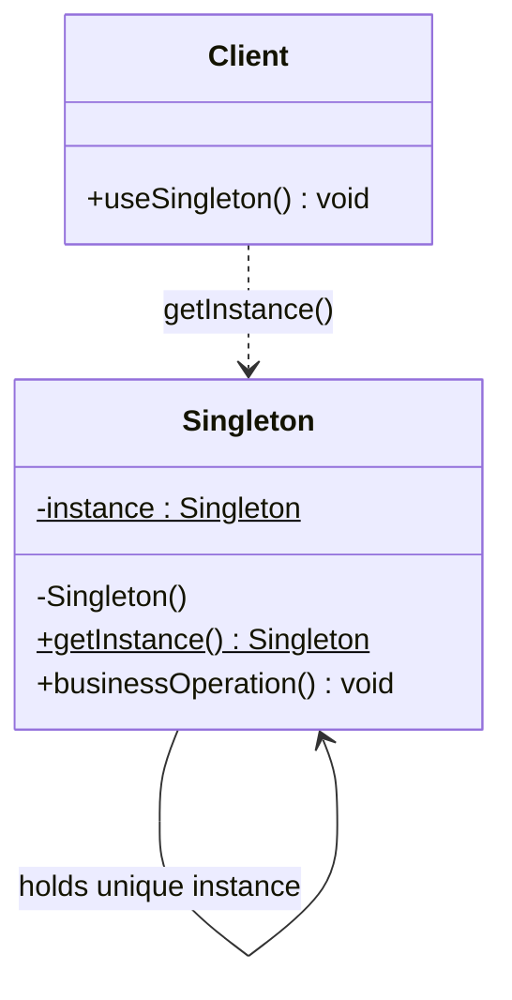

# 싱글톤(Singleton) 디자인 패턴 가이드

> 한 줄 요약: 어떤 클래스의 인스턴스가 시스템 전체에서 정확히 하나만 존재하도록 보장하고, 그 단일 인스턴스에 전역적으로 접근할 수 있는 통로를 제공한다.
>
> 분류: 생성 패턴(Creational Pattern)
> 다른 이름(Aliases): 단일체(Singleton), 유일 인스턴스(Single Instance)

---

## 상세 설명

싱글톤(Singleton) 패턴은 "이 클래스의 인스턴스는 단 하나여야 하며, 그 하나에 누구나 동일한 방법으로 접근할 수 있어야 한다"라는 요구를 코드 구조로 강제하기 위한 생성 패턴(Creational Pattern)이다. GoF(Gang of Four)는 이 패턴의 의도(Intent)를 "클래스에 인스턴스가 단 하나임을 보장하고, 이에 대한 전역적인 접근점(Global Point of Access)을 제공한다"라고 정의한다.

해결하고자 하는 문제(Problem)는 대개 두 가지다. 첫째, 특정 자원이 본질적으로 하나만 존재해야 하는 상황이다. 예를 들어 운영체제의 프린트 스풀러, 윈도우 매니저, 어플리케이션 환경 설정(Configuration) 객체, 로깅(Logging) 시스템의 진입점은 동시에 여러 인스턴스가 존재하면 상태가 분기되어 일관성을 잃는다. 둘째, 동일한 객체를 여러 모듈이 공유해야 하는데 매번 새로 만들면 메모리·초기화 비용이 과도하게 발생하는 경우다. 데이터베이스 커넥션 풀(Connection Pool)이나 스레드 풀(Thread Pool)이 대표적이다.

해결책(Solution)은 단순하다. 생성자(Constructor)를 외부에서 호출할 수 없도록 막고(`private`), 내부에 자기 자신을 가리키는 정적(static) 필드를 두며, 그 필드를 반환하는 공개 접근자(Public Accessor, 일반적으로 `getInstance()`)를 제공한다. 클라이언트는 `new`를 사용할 수 없고 오직 접근자를 통해서만 인스턴스를 얻을 수 있으므로 "하나만 존재한다"라는 불변식(Invariant)이 컴파일 시점부터 강제된다.

핵심 개념은 "인스턴스의 유일성(Uniqueness)"과 "전역 접근점(Global Access Point)" 두 가지다. 단순히 전역 변수(Global Variable)와 다른 점은, 싱글톤은 "유일성 자체를 클래스가 책임진다"는 것이다. 전역 변수는 누구나 새 객체를 또 만들 수 있고 그 책임은 호출자에게 분산되지만, 싱글톤은 클래스 정의 자체가 두 번째 인스턴스의 생성을 금지한다.

역사적으로 싱글톤은 GoF 23개 패턴 중 가장 단순해 보이지만 가장 논란이 많은 패턴이기도 하다. 멀티스레드(Multi-thread) 환경에서의 이중 점검 잠금(Double-Checked Locking) 문제, 클래스 로더(Class Loader)가 여러 개인 환경에서의 인스턴스 중복, 단위 테스트(Unit Test)에서의 격리 어려움 등이 알려지면서 Joshua Bloch는 저서 `Effective Java`에서 "원소가 하나뿐인 `enum` 타입이 싱글톤을 구현하는 가장 좋은 방법"이라고 권고했다. 또한 의존성 주입(Dependency Injection, DI) 컨테이너의 보급으로 "직렬 싱글톤(Hand-rolled Singleton)" 대신 컨테이너가 스코프로 단일 인스턴스를 보장하는 방식이 일반화되었다.

---

## 디자인 패턴을 충족하는 최소 조건

이 섹션에서는 "어떤 코드가 진짜로 이 패턴이라고 부를 수 있는가"의 기준을 명확히 한다.

1. **외부에서의 인스턴스화 차단** — 클래스의 모든 생성자가 `private`(또는 언어에 따라 동등한 접근 제한)이어야 하며, 외부 코드가 `new` 키워드로 직접 객체를 만들 수 없어야 한다. 생성자가 `public`이거나 패키지 공개 범위에 노출되어 있다면, 그것은 "관습적으로 하나만 쓰는 객체"일 뿐 싱글톤이 아니다.
2. **유일 인스턴스에 대한 자체 관리** — 클래스 내부에 자기 자신의 단일 인스턴스를 참조하는 `static` 필드를 보유하고, 그 인스턴스의 생성과 수명(Lifecycle)을 클래스 스스로 책임져야 한다. 외부에서 누군가가 인스턴스를 별도로 들고 다니며 "전역 변수처럼" 쓰는 구조는 싱글톤이 아니다.
3. **공개된 전역 접근점 제공** — 동일한 시그니처(일반적으로 `public static Type getInstance()` 형태)로 누구나 같은 인스턴스를 얻을 수 있어야 한다. 호출 시점·호출자에 따라 다른 객체를 돌려준다면 유일성이 깨진 것이다.
4. **동시성 환경에서의 유일성 보장** — 멀티스레드(Multi-thread) 환경에서도 두 번째 인스턴스가 만들어지지 않아야 한다. 즉, `getInstance()`가 동기화(Synchronization)되어 있거나, 초기화-시점 안전성(Initialization-on-demand) 또는 `enum` 같은 언어 차원의 메커니즘으로 동시 진입 문제가 해결되어야 한다.

> 위 조건 중 하나라도 빠지면 본 패턴이라고 보기 어렵다 / 변형 패턴으로 분류된다.

### 흔히 오해하는 지점
- "정적 유틸리티 클래스(`static`만으로 채워진 클래스)"를 싱글톤이라고 부르는 경우가 많지만, 인스턴스 자체가 존재하지 않으므로 싱글톤이 아니라 "유틸리티 클래스(Utility Class)"로 분류된다. 싱글톤은 "딱 하나의 인스턴스"가 있다는 점이 핵심이다.
- 스프링(Spring) 빈(Bean)의 기본 스코프가 "singleton"이라는 이유로 모든 스프링 빈을 싱글톤 패턴이라고 부르는 경우가 있다. 그러나 스프링의 싱글톤 스코프는 "컨테이너당 하나"를 의미하며, 클래스 자체는 여러 번 `new`로 만들 수도 있다. 즉 GoF의 싱글톤 조건(생성자 차단)을 만족하지 않으므로 엄밀히는 컨테이너-관리 단일 인스턴스(Container-Managed Singleton)에 해당한다.
- 게으른 초기화(Lazy Initialization)와 싱글톤을 동의어로 착각하는 경우가 있다. 게으른 초기화는 "필요할 때까지 생성을 지연"하는 기법이고, 싱글톤은 "유일성"이 본질이다. 즉시 초기화(Eager Initialization)도 정상적인 싱글톤이다.

---

## 사례를 통한 예시

### 예시 1: 애플리케이션 설정 로더 (미니멀 구현)

**상황**: 애플리케이션 시작 시 `application.properties` 파일을 한 번 읽어 들이고, 모든 모듈이 동일한 설정 객체를 참조해야 한다. 설정을 두 번 로드하면 디스크 I/O가 낭비될 뿐 아니라, 도중에 파일이 바뀌면 모듈마다 다른 값을 보게 되어 일관성이 깨진다.

```java
import java.io.IOException;
import java.io.InputStream;
import java.util.Properties;

public final class AppConfig {

    // 1. 자기 자신을 가리키는 유일 인스턴스 (초기화-시점 안전성 활용)
    private static class Holder {
        private static final AppConfig INSTANCE = new AppConfig();
    }

    private final Properties properties = new Properties();

    // 2. 외부에서의 인스턴스화 차단
    private AppConfig() {
        try (InputStream in = AppConfig.class.getResourceAsStream("/application.properties")) {
            if (in == null) {
                throw new IllegalStateException("application.properties not found on classpath");
            }
            properties.load(in);
        } catch (IOException e) {
            throw new IllegalStateException("Failed to load configuration", e);
        }
    }

    // 3. 공개된 전역 접근점
    public static AppConfig getInstance() {
        return Holder.INSTANCE;
    }

    public String get(String key) {
        return properties.getProperty(key);
    }

    public int getInt(String key, int defaultValue) {
        String value = properties.getProperty(key);
        return value == null ? defaultValue : Integer.parseInt(value.trim());
    }
}

// 사용 예
class UsageDemo {
    public static void main(String[] args) {
        AppConfig config = AppConfig.getInstance();
        String dbUrl = config.get("db.url");
        int poolSize = config.getInt("db.pool.size", 10);
        System.out.println("DB URL = " + dbUrl + ", pool size = " + poolSize);
    }
}
```

**해설**: `private` 생성자가 외부의 `new AppConfig()` 호출을 컴파일 단계에서 막는다(조건 1). `Holder` 정적 중첩 클래스는 JVM의 클래스 로딩 규칙에 의해 `getInstance()`가 처음 호출될 때 단 한 번만 초기화되므로, 별도의 `synchronized` 키워드 없이도 스레드 안전(Thread-safe)하게 단일 인스턴스를 보장한다(조건 2, 4). 이 관용구를 초기화-시점 보유자 관용구(Initialization-on-demand Holder Idiom)라고 부른다. 마지막으로 `getInstance()`가 동일한 시그니처로 모든 호출자에게 같은 `AppConfig`를 반환한다(조건 3).

### 예시 2: `java.lang.Runtime` — 표준 라이브러리의 싱글톤

**상황**: JVM과 운영체제의 인터페이스 역할을 하는 `Runtime` 객체는 JVM 프로세스당 정확히 하나만 존재해야 한다. 현재 메모리 상태, 셧다운 훅(Shutdown Hook) 등록, 외부 프로세스 실행 같은 책임이 여러 인스턴스로 분산되면 자원 관리가 불가능해진다.

```java
public class RuntimeUsage {
    public static void main(String[] args) throws Exception {
        // new Runtime()  // 컴파일 오류: 생성자가 private
        Runtime runtime = Runtime.getRuntime();

        long maxMemory = runtime.maxMemory();
        long freeMemory = runtime.freeMemory();
        int processors = runtime.availableProcessors();

        System.out.println("CPU cores       = " + processors);
        System.out.println("Max memory (MB) = " + (maxMemory / (1024 * 1024)));
        System.out.println("Free memory(MB) = " + (freeMemory / (1024 * 1024)));

        runtime.addShutdownHook(new Thread(() -> {
            System.out.println("JVM is shutting down, flushing resources...");
        }));

        // 어디서 다시 호출해도 동일한 인스턴스
        Runtime again = Runtime.getRuntime();
        System.out.println("Same instance? " + (runtime == again)); // true
    }
}
```

JDK의 `Runtime` 클래스 내부는 본질적으로 다음과 같은 구조다.

```java
public class Runtime {
    private static final Runtime currentRuntime = new Runtime();

    public static Runtime getRuntime() {
        return currentRuntime;
    }

    private Runtime() {
        // JVM 내부 초기화
    }
    // ... maxMemory, addShutdownHook 등
}
```

**해설**: 즉시 초기화(Eager Initialization) 방식의 전형적인 싱글톤이다. `currentRuntime` 필드는 클래스 로드 시 한 번 생성되며, `getRuntime()`은 매번 같은 참조를 반환한다. JVM의 자원과 직접 결합되어 있어 "인스턴스가 여러 개일 수 없다"라는 도메인적 필연성이 패턴 선택의 근거가 되는 모범 사례다. `java.awt.Desktop`, `java.util.logging.LogManager`도 같은 구조를 따른다.

---

## 어떨 때 사용하나

다음과 같은 신호(Symptom)가 보일 때 이 패턴 도입을 고려한다.

- 도메인 자체가 "이 객체는 본질적으로 하나여야 한다"고 말할 때. 예를 들어 프린트 스풀러, 윈도우 매니저, 운영체제 자원에 대한 진입점처럼 두 개의 인스턴스가 공존하면 모순이 발생하는 경우다.
- 초기화 비용이 매우 크고 상태가 광범위하게 공유되는 자원이 있을 때. 예를 들어 데이터베이스 커넥션 풀(Connection Pool), 스레드 풀(Thread Pool), 캐시(Cache), 메트릭 수집기(Metric Collector) 등은 한 번 만들어두고 모든 코드가 같은 인스턴스를 재사용하는 것이 합리적이다.
- 전역 설정(Configuration)이나 로깅(Logging)처럼 "어디서나 같은 결과/같은 출력 대상"을 보장해야 할 때. 인스턴스가 분기되면 로그가 여러 파일로 흩어지거나 환경 설정이 모듈마다 달라지는 사고로 이어진다.
- 레지스트리(Registry) 역할을 하는 객체가 필요할 때. 예를 들어 직렬화 가능한 객체 ID와 객체 인스턴스를 매핑하는 중앙 테이블은 단 하나여야 일관된 조회가 가능하다.

### 사용하면 안 되는 경우 (Anti-patterns)

- 단순한 정적 함수(Static Method) 묶음으로 충분한 경우. 상태가 전혀 없는 변환 함수, 수학 유틸은 인스턴스 자체가 의미가 없으므로 `Math` 같은 유틸리티 클래스가 더 적절하다.
- 의존성 주입(DI) 컨테이너가 이미 단일 인스턴스 스코프를 제공하는 경우. 스프링(Spring), 구글 주스(Google Guice) 등을 사용하는 코드에서 또다시 `getInstance()` 패턴을 손수 만들면 컨테이너의 수명 관리와 충돌하고, 테스트용 모킹(Mocking)이 거의 불가능해진다.
- 테스트마다 상태를 깨끗이 초기화해야 하는 객체. 싱글톤은 JVM 수명 동안 상태를 유지하므로, 한 테스트의 부수 효과(Side Effect)가 다음 테스트로 누수되어 테스트가 순서 의존적으로 변하기 쉽다.
- "전역 변수로 쓰고 싶다"는 이유만으로 도입하는 경우. 이는 본질적으로 전역 가변 상태(Global Mutable State)이며, 결합도(Coupling)를 높이고 추적 가능성(Traceability)을 떨어뜨린다.

---

## 장점과 단점, 한계점

### 장점
- **유일성 강제(Enforced Uniqueness)**: 두 번째 인스턴스를 만드는 실수가 컴파일 단계에서 차단되므로, "하나여야 한다"라는 도메인 제약을 코드가 직접 표현한다.
- **자원 효율(Resource Efficiency)**: 무거운 초기화(파일 I/O, 네트워크 핸드셰이크, 풀 구성 등)를 한 번만 수행하고, 모든 호출자가 같은 인스턴스를 재사용하므로 메모리·시간 비용이 절감된다.
- **전역 일관성(Global Consistency)**: 설정, 로그, 캐시처럼 분기되면 안 되는 상태를 단일 진입점으로 통일하므로, 모듈 간 상태 불일치(State Drift) 문제가 발생하지 않는다.
- **지연 초기화 지원(Lazy Initialization Support)**: 초기화-시점 보유자 관용구 같은 구현을 사용하면, 실제로 처음 필요할 때까지 비용을 미룰 수 있다.

### 단점
- **숨겨진 의존성(Hidden Dependency)**: `getInstance()`를 호출하는 코드는 시그니처상으로는 그 의존성을 드러내지 않는다. 결과적으로 어떤 클래스가 무엇에 의존하는지 코드를 깊게 읽기 전까지 알 수 없고, 결합도(Coupling)가 조용히 증가한다.
- **테스트 곤란(Testability Issue)**: 단위 테스트에서 의존을 가짜 객체(Stub/Mock)로 교체하기 어렵다. 싱글톤은 일반적으로 인터페이스 뒤에 숨길 수도 없고, 상태가 JVM 수명 내내 유지되어 테스트 간 격리(Isolation)가 깨진다.
- **단일 책임 원칙(Single Responsibility Principle) 위반 위험**: "유일성 보장"과 "본래 비즈니스 책임"을 한 클래스가 동시에 떠안게 되어, 변경 이유가 두 가지 이상 생긴다.
- **확장 어려움**: 싱글톤 클래스를 상속해 변형 동작을 만들거나, 두 개의 인스턴스를 갖도록 정책을 바꾸는 변경은 거의 항상 호출부 전체를 수정해야 한다.

### 한계점
- **다중 클래스 로더(Multiple Class Loaders) 환경**: 자바 EE 컨테이너처럼 클래스 로더가 여러 개인 환경에서는 같은 클래스가 로더별로 따로 로드되어, 결과적으로 싱글톤이 여러 개 생긴다. JVM당 하나가 아니라 "클래스 로더당 하나"가 되는 셈이다.
- **직렬화(Serialization)와 역직렬화(Deserialization)**: `Serializable`을 구현한 싱글톤은 역직렬화 시 새 인스턴스가 만들어져 유일성이 깨질 수 있다. `readResolve()` 메서드를 직접 구현하거나, `enum` 기반 싱글톤을 사용해 이 문제를 우회해야 한다.
- **리플렉션(Reflection) 공격**: `setAccessible(true)`로 `private` 생성자를 강제로 호출하면 두 번째 인스턴스를 만들 수 있다. `enum` 싱글톤은 JVM 차원에서 이를 막아주지만, 일반 클래스 기반 싱글톤은 방어 로직(생성자 안에서 인스턴스 존재 여부 검사)이 필요하다.
- **분산 환경(Distributed System)**: 싱글톤은 JVM 프로세스 내부의 유일성만 보장한다. 여러 프로세스·여러 노드가 협력하는 분산 환경에서는 "전역 유일성"을 자동으로 보장하지 못하며, 외부 코디네이션(예: 분산 락, 리더 선출)이 필요하다.

---

## 정보 표

| 항목 | 값 |
| --- | --- |
| 분류 | 생성 패턴(Creational Pattern) |
| 언어 의존성 | 언어 비의존적. 단, 안전한 구현 방식은 언어 기능에 의존(Java의 `enum` 또는 정적 중첩 클래스, C++의 `static` 지역 변수, Python의 모듈 수준 객체 등). |
| 활용성(1점~5점) | ★★★★☆ (4/5) — 실무 빈도는 매우 높지만, DI 컨테이너 등장 이후 "직접 손으로 짜는" 빈도는 줄어 5점은 아니다. |
| 학습 난이도 | 하 (개념은 가장 단순한 GoF 패턴 중 하나이나, 동시성·직렬화·테스트 측면의 함정까지 이해하면 중) |
| 자주 함께 쓰이는 패턴 | 추상 팩토리(Abstract Factory), 빌더(Builder), 파사드(Facade), 레지스트리(Registry), 프로토타입(Prototype) |
| 대표 사용 사례 | `java.lang.Runtime`, `java.awt.Desktop`, 로깅 프레임워크의 `LogManager`, 데이터베이스 커넥션 풀, 애플리케이션 설정 로더 |

---

## Class Diagram



> 다이어그램에 등장하는 각 클래스가 패턴의 어떤 역할(Role)을 담당하는지 위 "상세 설명" 섹션과 1:1로 대응되어야 한다.

### 역할 설명
- **Singleton**: 패턴의 주체. `private` 생성자로 외부 인스턴스화를 막고, 자기 자신을 가리키는 `static` 필드 `instance`를 보유하며, 공개 접근자 `getInstance()`를 통해 그 단일 인스턴스를 반환한다. 동시에 본래의 비즈니스 책임(`businessOperation()`)도 함께 수행한다.
- **Client**: `Singleton.getInstance()`를 통해서만 인스턴스를 획득하고, 그 인스턴스의 메서드를 호출한다. `new Singleton()`은 호출할 수 없다. 의존 방향은 항상 Client → Singleton 단방향이다.

---

## 참고 자료
- Erich Gamma, Richard Helm, Ralph Johnson, John Vlissides, "Design Patterns: Elements of Reusable Object-Oriented Software", Addison-Wesley, 1994 — Singleton 패턴의 원전.
- Joshua Bloch, "Effective Java" (3rd Edition), Addison-Wesley, 2017 — Item 3: "Enforce the singleton property with a private constructor or an enum type". `enum` 기반 싱글톤 권고의 출처.
- Bill Pugh, "The Java Memory Model and the Initialization-on-demand Holder Idiom" — 초기화-시점 보유자 관용구(Holder Idiom)의 정식 설명.
- Oracle JDK 문서, `java.lang.Runtime` — 표준 라이브러리의 싱글톤 구현 사례. https://docs.oracle.com/en/java/javase/17/docs/api/java.base/java/lang/Runtime.html
- Refactoring Guru, "Singleton Pattern" — 다이어그램과 다양한 언어별 구현 비교. https://refactoring.guru/design-patterns/singleton
