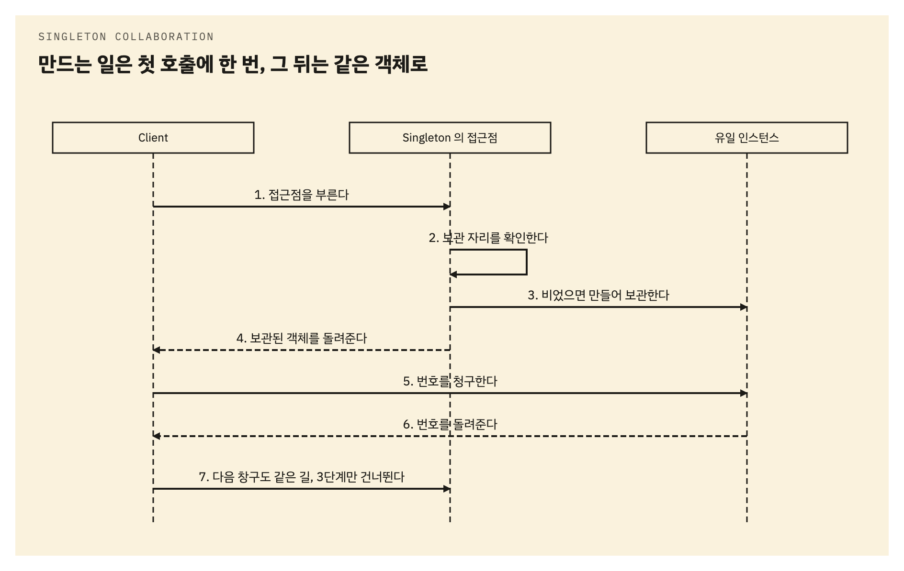
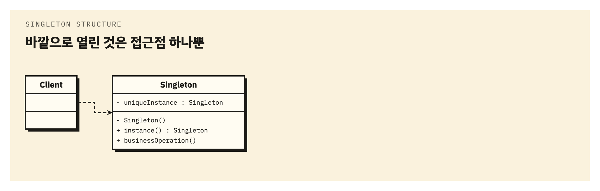

# Singleton — 만드는 자리를 닫고 통로를 하나만 내기

## 한눈에 보는 개요

상점의 주문 번호 발급기를 하나 떠올려 봅시다. 주문이 들어올 때마다 `B-0001`, `B-0002` 처럼 번호를 하나씩 올려 주는 객체예요. 웹 창구는 프로그램이 시작할 때 만든 발급기를 쓰는데, 나중에 붙은 정산 배치 코드가 그 객체를 넘겨받을 길을 못 찾아 `new OrderNumberIssuer()` 를 한 번 더 부릅니다. 새로 만들어진 발급기의 카운터는 0부터 시작하죠. 그래서 웹이 이미 내준 `B-0001` 이 배치가 만든 주문에 또 붙습니다.

Singleton 의 해법은 **만드는 자리를 타입 안으로 닫고 바깥에는 통로를 하나만 내는 것**입니다. 생성자를 바깥에서 부를 수 없게 막고, 그 타입에 속한 연산 하나가 자기가 보관한 객체를 돌려주게 해요. 배치 코드는 `new` 를 쓸 방법이 없으니 웹과 같은 통로로 들어오고, 같은 발급기를 받습니다.

```text
Before : 만드는 문법이 바깥에 열려 있음

  웹 창구     ── new OrderNumberIssuer() ──▶ 발급기 #1 ── next() ──▶ B-0001, B-0002
  정산 배치   ── new OrderNumberIssuer() ──▶ 발급기 #2 ── next() ──▶ B-0001   ← 같은 번호

After : 만드는 자리는 타입 안, 바깥에는 통로 하나

  웹 창구     ─┐
  콜센터 창구 ─┼─ instance() ─▶ OrderNumberIssuer
  정산 배치   ─┘                  uniqueInstance ─▶ 발급기 (하나)
                                  private 생성자  ← 바깥에서 부를 수 없음
                                                    next() ─▶ B-0001, B-0002, B-0003
```

이 패턴의 이름은 GoF(Gang of Four, 1994년에 나온 *Design Patterns* 의 저자 네 명을 함께 부르는 이름)가 붙였고, 분류는 생성 패턴이면서 객체 범위입니다. 인스턴스가 하나라는 제약을 상속 구조가 아니라 객체 하나의 수명으로 다루기 때문인데, 두 범위를 가르는 기준은 [참고 문서 「GoF 공통 어휘」의 클래스 패턴과 객체 패턴](../../reference/gof-vocabulary/gof-vocabulary-ref_v1.0.2.md#클래스-패턴과-객체-패턴)에 있어요. 함께 쓰는 패턴은 Abstract Factory 와 Facade 입니다. 둘 다 프로그램에 하나만 두면 충분한 객체라서 접근점을 이 패턴으로 내는 일이 흔해요. 이 글은 시나리오 셋을 따라갑니다. 주문 하나가 번호를 받는 길, 창구가 늘고 번호 형식이 바뀔 때 무엇이 안 바뀌는가, 통로를 우회하면 어느 단계에서 번호가 겹치는가. 끝까지 읽으면 어떤 코드를 Singleton 이라고 불러도 되는지 필수 조건 셋으로 판정할 수 있고, 전역 변수나 정적 유틸리티 클래스와도 구분할 수 있게 됩니다.

## 패턴 자세히 들여다보기

### 시나리오 1 — 첫 주문에 번호가 붙는 길

상점 설정에 지점 코드 `"B"` 가 들어 있고, 프로그램이 막 시작했습니다. 아직 아무 번호도 나가지 않은 상태예요. 웹 창구로 주문 하나가 들어오면 `B-0001` 이 나와야 하고, 바로 뒤에 콜센터 창구로 들어온 주문에는 `B-0002` 가 붙어야 합니다. 이 장면에는 넷이 등장해요. 번호를 세어 발급하는 객체 `OrderNumberIssuer`(패턴에서는 Singleton 이라고 부르는 역할), 그 객체를 얻는 통로인 클래스 연산 `instance()`(이 글에서는 접근점이라고 부릅니다), 만들어진 객체를 담아 두는 자리 `uniqueInstance`, 그리고 주문을 받아 번호를 청구하는 창구 `OrderDesk`(Client)입니다. 지점 코드를 가지고 있는 `ShopConfig` 는 설정 값을 담은 상자일 뿐 패턴의 역할은 아니에요. 이름은 여기서 한 번씩만 소개하고 정식 정의는 개념 정리에서 합니다.



1. 진입점이 상점 설정을 읽어 `ShopConfig` 에 지점 코드 `"B"` 를 채웁니다. 이 단계가 맨 앞인 이유는 발급기가 만들어지는 순간 그 값을 읽어 자기 접두어로 굳히기 때문이에요. 순서를 뒤로 미루면 접두어가 빈 문자열로 굳어 번호가 `-0001` 로 나옵니다(세 언어 모두 순서를 바꿔 직접 실행해 확인).
2. 웹 창구가 접근점 `instance()` 를 부릅니다. 창구가 `new` 를 쓰지 않는 이유는 생성자가 바깥에 닫혀 있어서예요. 유일성을 지키는 코드가 이 연산 안에 모여 있으니, 창구가 발급기를 얻는 길은 이 호출 하나뿐입니다.
3. 접근점이 보관 자리 `uniqueInstance` 를 들여다봅니다. 비어 있네요. 확인을 먼저 하는 이유는 이 검사가 빠지면 부를 때마다 새 객체가 생겨 패턴이 아예 성립하지 않아서입니다.
4. 비어 있으니 접근점이 발급기를 만들어 그 자리에 넣습니다. 만드는 일을 접근점 뒤에 숨겨 두면 바깥은 생성 시점을 고를 수 없고, 대신 첫 사용 직전에 반드시 한 번 만들어진다는 것이 보장돼요. 이때 1단계에서 채워 둔 지점 코드를 읽습니다.
5. 접근점이 보관된 객체를 돌려줍니다. 창구는 그 객체가 방금 만들어진 것인지 원래 있던 것인지 구분할 수 없고, 구분할 필요도 없어요. 접근점이 그 차이를 감추는 것이 이 연산의 존재 이유입니다.
6. 웹 창구가 받은 발급기에 번호를 청구하면 `B-0001` 이 돌아옵니다. 번호를 세는 값이 발급기 안에 있기 때문에, 그 값을 올리는 일도 발급기가 합니다. 창구가 대신 세면 창구마다 따로 세게 되어 1단계로 돌아가게 돼요.
7. 콜센터 창구가 접근점을 다시 부릅니다. 이번에는 보관 자리가 차 있어서 3단계의 검사에서 바로 분기하고 4단계를 지나지 않아요. 같은 발급기를 받으니 번호는 `B-0002` 로 이어집니다.

```text
단계   부르는 쪽 → 받는 쪽             넘기는 것          돌아오는 것
 1     진입점 → ShopConfig            "B"                —
 2     웹 창구 → instance()           —                  (5단계에서 발급기)
 3     instance() → uniqueInstance    —                  비어 있음
 4     instance() → (new)             지점 코드 "B"       발급기 객체 · 보관 자리에 저장
 5     instance() → 웹 창구           —                  발급기 객체
 6     웹 창구 → 발급기               —                  B-0001
 7     콜센터 창구 → instance()       —                  같은 발급기 (3단계에서 분기함)
```

잠깐, 확인 하나만 해 볼까요? 7단계에서 콜센터 창구가 받은 발급기와 2단계에서 웹 창구가 받은 발급기를 `==` 로 견주면 무엇이 나올까요?

같은 객체이므로 참입니다. 구현 예시의 출력 두 번째 줄 `same-instance=true` 가 그 값이에요. 창구 둘이 각각 접근점을 따로 불렀는데도 같은 객체가 나온다는 것이 이 패턴이 주는 것의 전부이고, 번호가 `B-0001` 에서 `B-0002` 로 이어지는 것도 그 하나에서 따라 나옵니다.

```text
웹 창구의 참조        ─┐
                      ├──▶ 같은 발급기 ──▶ 1 → 2 → 3   (번호가 한 줄로 이어짐)
콜센터 창구의 참조     ─┘

발급기가 둘이었다면
  웹 창구    ──▶ 발급기 #1 ──▶ 1 → 2
  콜센터     ──▶ 발급기 #2 ──▶ 1          ← 웹이 이미 낸 번호와 겹침
```

이 시나리오가 보여 준 것은 통로가 하나라는 사실과 그 통로 안에서 일어나는 분기입니다. 창구는 접근점만 부르고(2·7단계), 만드는 일과 보관하는 일은 접근점 안에서 끝나며(3·4단계), 만들지 말지는 보관 자리가 비었는지로 정해집니다. 비어 있다는 조건은 딱 한 번만 참이에요. 발급기가 자기 상태를 세는 일(6단계)은 패턴이 아니라 그 객체의 업무예요. 다만 그 업무 상태가 하나로 모여 있다는 것이 유일성이 쓸모 있는 이유가 됩니다.

### 시나리오 2 — 창구가 셋으로 늘고 번호 앞에 지점 코드가 붙을 때

같은 상점에 모바일 앱 창구가 붙습니다. 그리고 본사가 지점을 구분하려고 번호 앞에 지점 코드를 붙이기로 했어요. 바뀐 뒤에 기대하는 결과는 이렇습니다. 웹·콜센터·모바일 창구가 차례로 주문을 받으면 `B-0001`, `B-0002`, `B-0003` 이 한 줄씩 나오고, 발급기가 지금까지 몇 개를 냈는지 물으면 3 이 나와야 해요.

1. 개발자가 모바일 창구 클래스를 새로 씁니다. 생성자에서 접근점을 부르는 한 줄이 전부이고, 발급기를 넘겨받는 인자나 배선은 없어요. 이 배선이 없어도 되는 이유는 전역에서 이름만으로 접근점을 부를 수 있기 때문입니다. 창구를 만드는 쪽은 발급기가 어디서 오는지 몰라도 됩니다.
2. 같은 이유로 잃는 것도 그 자리에 생깁니다. 모바일 창구의 생성자 시그니처에는 발급기가 나타나지 않으므로, 이 클래스가 무엇에 기대는지 선언만 읽어서는 알 수 없어요. 인자로 받았다면 시그니처가 그 의존을 적어 두었을 텐데, 접근점을 직접 부르면 그 기록이 본문 안에 감춰집니다.
3. 번호 형식이 바뀌는 변화는 발급기 안에서 끝납니다. 접두어를 붙이는 코드는 번호를 만드는 연산 한 줄이고, 창구 셋은 한 글자도 바뀌지 않아요. 창구가 아는 것이 접근점 이름과 번호를 청구하는 연산 이름뿐이라서, 그 둘이 그대로면 안쪽이 무엇을 하든 창구는 영향을 받지 않습니다.
4. 그런데 접두어 값은 발급기가 **만들어지는 순간** 굳습니다. 1단계의 설정 채우기가 첫 창구 생성보다 뒤로 가면 발급기는 빈 접두어로 만들어지고, 번호는 `-0001` 로 나와요. 세 언어 모두 진입점의 두 줄을 아래로 옮겨 실행해 이 결과를 확인했습니다. 지연 초기화가 있는 이유가 여기 있어요. 첫 호출까지 만들기를 미루면 그 사이에 설정을 채울 시간이 생기니까요.
5. 반대로 한 번 만들어진 인스턴스는 되돌릴 수 없습니다. 4단계에서 빈 접두어로 굳은 뒤에 설정을 다시 채워도 이미 만들어진 발급기는 그대로예요. 보관 자리가 차 있으면 접근점이 만드는 단계를 건너뛰기 때문인데, 그것이 시나리오 1 의 7단계에서 번호를 이어 준 바로 그 동작입니다. 같은 성질이 한쪽에서는 이득이고 다른 쪽에서는 비용이 됩니다.

```text
변화                    바뀐 곳                              안 바뀐 곳
모바일 창구 추가         OrderDesk 를 하나 더 만드는 진입점 한 줄   OrderNumberIssuer 전체
                                                              웹·콜센터 창구
지점 코드 접두어 추가     번호를 만드는 연산 한 줄                  창구 셋 전체
                        (접두어를 읽어 오는 생성자 한 줄)          접근점 이름 · 번호 청구 연산 이름

순서를 바꾸면
  설정 채우기를 창구 생성 뒤로  →  web -0001 · phone -0002 · mobile -0003   (세 언어 모두 실행해 확인)
  그 뒤에 설정을 다시 채워도    →  이미 만든 발급기는 그대로
```

여기서 헷갈리기 쉬운 포인트는 지연 초기화를 이 패턴의 정의로 받아들이는 것입니다. 4단계가 보여 준 것은 지연 초기화가 **설정 순서 문제를 푸는 수단**이라는 점이지, 그것이 없으면 싱글톤이 아니라는 뜻이 아니에요. 둘은 다른 질문입니다. 프로그램이 시작할 때 바로 만들어 두는 즉시 초기화도 통로가 하나이고 객체가 하나이면 그대로 싱글톤입니다. 다만 그때는 설정을 발급기 생성보다 먼저 채워야 한다는 순서 제약이 코드 바깥의 규약으로 남습니다.

이 시나리오가 보여 준 것은 변화의 범위와 그 대가입니다. 쓰는 쪽이 늘 때 배선이 들지 않고(1단계), 안쪽 형식이 바뀔 때 쓰는 쪽이 안 바뀝니다(3단계). 대신 의존이 시그니처에서 사라지고(2단계), 생성 시점이 첫 호출 순서에 따라 정해지며(4단계), 한 번 만들어진 인스턴스는 프로그램이 끝날 때까지 남습니다(5단계).

### 시나리오 3 — 통로를 우회하면 어느 단계에서 번호가 겹치는가

이번에는 같은 상점의 다른 코드베이스입니다. 발급기 클래스는 접근점 `instance()` 를 갖추고 있지만 생성자를 닫지 않았어요. 팀 규약으로 "발급기는 접근점으로만 얻는다" 고 적어 두었을 뿐입니다. 여기에 정산 배치 코드가 새로 붙고, 그 코드를 쓴 사람은 규약 문서를 읽지 않았어요. 웹 창구가 이미 `B-0001` 과 `B-0002` 를 내준 뒤에 배치가 번호를 청구하면 `B-0003` 이 나와야 하는데, 실제로는 무엇이 나올까요.

1. 배치 코드가 발급기를 얻으려고 가장 짧은 길을 고릅니다. 생성자가 열려 있으면 `new OrderNumberIssuer()` 가 접근점을 찾아 이름을 외우는 것보다 짧아요. 규약이 막는 힘이 없는 이유가 이것입니다. 컴파일러가 검사하지 않는 규칙은 코드를 쓰는 사람의 기억에만 의존합니다.
2. 새로 만들어진 발급기는 자기 카운터를 0부터 셉니다. 보관 자리에 있는 객체와 아무 관계가 없으니 웹이 어디까지 냈는지 알 길이 없어요. 그래서 배치가 받는 번호는 `B-0001` 이고, 웹이 이미 내준 번호와 겹칩니다. 이 모양을 Java 로 실제로 컴파일해 실행하면 `web B-0001`, `web B-0002`, `batch B-0001`, `same-instance=false` 가 나옵니다(직접 실행해 확인).
3. 되돌리는 길은 생성자를 닫는 것 하나뿐입니다. 닫고 나면 배치 코드의 `new` 줄이 컴파일 단계에서 멈춰요. 규약 문서가 하던 일을 컴파일러가 대신 하는 셈인데, 세 언어가 내는 진단은 아래 표에 실측한 그대로입니다.
4. 갈래 하나를 더 봅시다. 생성자를 닫아도 스레드 둘이 거의 동시에 접근점에 들어오면 둘 다 보관 자리를 비어 있다고 보고 각자 만들 수 있어요. 발급기 생성에 50밀리초가 걸리게 해 두고 스레드 둘을 동시에 들여보냈더니, 세 번 실행에서 세 번 모두 서로 다른 객체가 나왔습니다(직접 실행해 확인). 접근점 안의 검사와 저장이 한 동작으로 묶여 있지 않아서 그렇습니다.
5. 갈래 하나가 더 있습니다. 인스턴스가 정확히 하나여도 번호를 올리는 연산이 동시 호출에 열려 있으면 값이 겹쳐요. 스레드 둘이 각각 5만 번씩 번호를 받게 했더니 받은 번호 10만 개 가운데 서로 다른 번호가 99,998개·99,994개·99,995개였습니다(세 번 실행, 직접 실행해 확인). 읽고 더하고 쓰는 세 동작 사이에 다른 스레드가 끼어들면 같은 값이 두 번 나갑니다.

```text
Before (시나리오 3)                         After (시나리오 1 의 모양)

  OrderNumberIssuer()  ← 바깥에 열림          private OrderNumberIssuer()  ← 닫힘
  instance()           ← 있기는 함            instance()                   ← 유일한 통로

  웹    instance().next() → B-0001, B-0002    웹    instance().next() → B-0001, B-0002
  배치  new ...().next()  → B-0001  ← 겹침    배치  instance().next() → B-0003
                                              배치의 new 줄 → 컴파일 오류
```

| 언어 | 생성자를 닫은 뒤 `new` 를 부르면 | 실측한 진단 |
| --- | --- | --- |
| Java 21.0.11 | 컴파일 실패 | `OrderNumberIssuer() has private access in OrderNumberIssuer` |
| TypeScript 5.9.3 | 타입 검사 실패 | `error TS2673: Constructor of class 'OrderNumberIssuer' is private and only accessible within the class declaration.` |
| Rust 1.95.0 | 컴파일 실패 | ``error[E0624]: associated function `new` is private`` |

TypeScript 만 성격이 다릅니다. 여기서 막히는 것은 타입 검사이고, 컴파일된 JavaScript 에는 그 제한이 남지 않아요. 실제로 클래스를 생성자 시그니처를 가진 타입으로 단언해 넘기면 타입 검사가 통과하고, 실행하면 두 번째 발급기가 만들어져 `bypass same-instance=false` 와 함께 겹친 번호 `B-0001` 이 나옵니다(직접 실행해 확인). 그래서 이 언어에서 유일성을 더 단단히 지키고 싶으면 클래스를 모듈 밖으로 내보내지 않고 접근점만 내보내는 쪽을 씁니다.

이 시나리오가 보여 준 것은 세 가지가 각각 어디서 어긋나는지입니다. 만드는 문법이 바깥에 열려 있으면 두 번째 인스턴스가 생기고(1·2단계), 닫혀 있어도 접근점 안의 검사와 저장이 한 동작으로 묶여 있지 않으면 역시 둘이 생기며(4단계), 인스턴스가 하나여도 그 안의 상태를 동시에 고치면 결과가 겹칩니다(5단계). 앞의 둘은 최소 조건 1·2번과 선택 조건 4번으로 가려내고, 마지막 하나는 이 패턴이 책임지지 않는 자리예요. 유일성은 객체가 하나라는 것까지이고, 그 객체 안이 동시 호출에도 안전한지는 그 객체의 설계 문제입니다.

### 개념 정리

시나리오에 나온 역할은 둘입니다. 원전이 참여자로 세는 것은 Singleton 하나뿐인데, Client 는 시나리오와 구현에 늘 나오므로 함께 정의해요(근거: GoF 원서 Singleton 절 Participants·Collaborations).

- **Singleton** — 인스턴스가 하나라는 제약을 스스로 지키는 타입입니다. 책임이 셋이에요. 바깥이 인스턴스를 만들 수 없게 생성 경로를 닫고(시나리오 3 의 3단계), 유일 인스턴스를 자기 안의 자리에 담아 두며(시나리오 1 의 4단계), 그 자리를 돌려주는 접근점을 클래스 연산으로 공개합니다(시나리오 1 의 2·5단계). 여기에 원래의 업무 책임이 더해져요. 번호 예에서는 `OrderNumberIssuer` 가 Singleton 이고, 번호를 세어 발급하는 일이 그 업무입니다.
- **Client** — 접근점으로만 유일 인스턴스를 얻고, 받은 객체의 연산을 부르는 쪽입니다. 인스턴스를 직접 만들지 않고, 받은 참조를 자기 필드에 두더라도 그 참조가 유일 인스턴스라는 사실에만 기댑니다(시나리오 1 의 6단계). 번호 예에서는 창구 `OrderDesk` 셋과 진입점이 Client 예요.



그림에서 Client 에서 나가는 화살표가 Singleton 칸 하나로만 향한다는 점을 봐 두세요. 칸 안을 보면 생성자 앞에 `-` 가 붙어 바깥에 닫혀 있고, 보관 자리 `uniqueInstance` 도 같은 칸 안에 있습니다. 바깥으로 `+` 가 붙어 열린 것은 접근점과 업무 연산뿐이에요. 안과 밖이 그 선으로 나뉩니다. 최소 조건 1번은 생성자 줄을, 2번은 보관 자리 줄을, 3번은 접근점 줄을 코드에서 확인합니다.

> 통로는 하나, 만드는 자리는 안쪽, 담는 자리도 안쪽.

## 사용 목적

Singleton 이 필요하다는 단서는 코드와 장애 기록에서 보입니다. 셋을 차례로 봅시다.

**단서 1. 같은 타입을 두 번 만들어 상태가 둘로 나뉜 사고가 이미 났습니다.** 누적 상태를 가진 객체(번호 카운터·캐시·버퍼·연결 풀)를 만드는 `new` 가 여러 파일에 흩어져 있으면 신호예요. 시나리오 3 의 2단계가 정확히 이 모양이었습니다. 코드에서 확인하는 방법은 간단합니다. 그 타입 이름으로 생성 호출을 전부 찾아 몇 곳에서 부르는지 세면 돼요.

```text
검색 대상                     찾은 곳
──────────────────────────    ─────────────────────────────────
new OrderNumberIssuer()       web/OrderDesk        (프로그램 시작 때)
                              batch/SettlementJob  (배치 실행 때)   ← 두 번째 인스턴스
                              test/IssuerTest      (테스트마다)
```

**단서 2. 전역 변수를 두었더니 누가 언제 덮어썼는지 추적이 안 됩니다.** 모듈이 내보낸 변수에 아무나 다시 대입할 수 있으면, 값이 바뀐 자리를 찾으려고 대입문을 전부 뒤져야 해요. 접근점만 내보내면 대입할 자리가 타입 안으로 모입니다. 전역 변수와의 차이는 아래 비교 절에서 코드로 풉니다.

```text
값을 다시 채울 수 있는 자리

  모듈이 객체를 그대로 내보냄   →  그 이름을 임포트한 파일 전부 (몇 곳인지 세어 봐야 안다)
  모듈이 접근점만 내보냄        →  그 모듈 안의 한 곳
```

**단서 3. 바깥 자원이 프로세스당 하나뿐입니다.** 런타임 환경 핸들, 프린터 스풀, 파일 잠금처럼 두 개가 존재한다는 말 자체가 모순인 자원이 있어요. 이럴 때는 인스턴스가 둘이면 둘 중 하나가 반드시 틀린 상태를 보게 됩니다. 표준 라이브러리의 예는 「실제 라이브러리에서」에 있어요.

비슷한 단서에서 다른 선택지를 골라야 하는 경우도 있습니다. "하나만 있으면 좋겠다" 와 "하나만 있어야 한다" 는 다른 요구이고, 앞쪽이면 조립 코드나 의존성 주입(Dependency Injection, 객체가 쓸 협력 객체를 바깥에서 넣어 주는 방식) 컨테이너의 단일 스코프로 충분해요. 차이는 비교 절에서 풉니다. 그리고 아래 상황에서는 이 패턴을 쓰면 잃는 것이 더 큽니다.

| 쓰지 말아야 할 상황 | 쓰면 잃는 것 |
| --- | --- |
| 테스트마다 깨끗한 상태로 시작해야 하는 객체 | 유일 인스턴스는 프로그램이 끝날 때까지 남으므로 앞 테스트가 올려 둔 카운터가 다음 테스트로 넘어감. 시나리오 2 의 5단계가 그 성질이고, 되돌리려면 보관 자리를 비우는 뒷문을 내야 하는데 그러면 조건 1이 성립하지 않음 |
| 협력 객체를 가짜로 바꿔 끼워야 하는 자리 | 접근점을 직접 부르는 코드는 그 의존을 인자로 드러내지 않아 바꿔 끼울 지점이 없음(시나리오 2 의 2단계). 인자로 받는 설계였다면 호출하는 쪽에서 다른 객체를 넣으면 끝남 |
| 인자마다 다른 공유 객체가 필요한 경우 | 접근점이 인자를 받아 다른 객체를 돌려주면 유일성 자체가 없어짐. 이 요구는 Flyweight 쪽이고, 비교 절에서 구분함 |
| 하나만 두면 충분하지만 강제할 필요는 없는 경우 | 생성자를 닫는 대가로 생성 시점·수명·교체 가능성을 전부 포기함. 조립 코드에서 한 번 만들어 넘기면 같은 이득을 얻으면서 그 셋을 남겨 둘 수 있음 |

## 패턴의 경계

### 디자인 패턴을 충족하는 최소 조건

어떤 코드를 Singleton 이라고 불러도 되는지 가르는 기준입니다. `[필수]` 가 하나라도 빠지면 Singleton 이 아니고, `[선택]` 은 갖추면 좋은 구조예요. 조건은 언어와 상관없이 코드에서 확인할 수 있는 모양(생성 경로의 공개 범위·보관 자리의 소속·접근점의 반환값)으로 적었고, 조건마다 그것을 보여 준 시나리오의 단계를 가리킵니다.

1. [필수] 바깥에서 그 타입의 인스턴스를 새로 만들 수 없습니다 — 인스턴스를 만드는 문법이 그 타입이 속한 범위(클래스·모듈) 바깥에서 쓸 수 없게 닫혀 있거나, 그 타입이 생성 호출을 가로채 이미 보관한 객체를 돌려줍니다. 생성자를 비공개나 하위 타입 전용으로 두는 것, 구조체의 필드를 비공개로 두어 리터럴 생성을 막는 것, 생성 함수를 모듈 밖으로 내보내지 않는 것, 언어가 인스턴스 수를 고정해 주는 열거 상수를 쓰는 것이 모두 이 조건을 만족해요. 타입을 부르는 일 자체를 그 타입이 가로채는 언어(파이썬의 `__new__` 같은 생성 훅)도 같은 자리인데, 바깥이 `Issuer()` 를 몇 번 부르든 받는 것은 보관된 그 객체 하나입니다. 시나리오 3 의 3단계가 이 닫힘을 세 언어의 컴파일 진단으로 확인한 자리입니다 (근거: GoF 원서 Singleton 절 **Intent·Applicability** — 「한 클래스에 인스턴스가 **하나뿐이게 한다**」와 「그 클래스의 인스턴스가 **정확히 하나여야 한다**」로 수단을 지정하지 않고 적는다. Implementation 도 「그 클래스가 **인스턴스를 하나만 만들 수 있게 쓰인다**」로 같은 말을 하는데, 바로 뒤의 「생성 연산을 클래스 연산 뒤에 숨긴다」는 **「흔한 방법」(a common way)이라 수단 하나를 든 것**이라 근거로 쓰지 않는다 — 이 조건은 다섯 수단을 나란히 인정한다).
   - 빠지면: 시나리오 3 의 1·2단계가 그 모양이에요. 생성자가 열려 있으면 규약 문서만 남고, 그 문서를 읽지 않은 코드 한 줄이 두 번째 인스턴스를 만듭니다. 실제로 실행해 보면 웹이 `B-0001`·`B-0002` 를 낸 뒤 배치가 다시 `B-0001` 을 받고 `same-instance=false` 가 찍혀요(직접 실행해 확인). 이때 남는 것은 "하나만 쓰기로 한 평범한 클래스" 이지 Singleton 이 아닙니다.
2. [필수] 유일 인스턴스를 그 타입 자신이 보관합니다 — 인스턴스를 담는 자리가 그 타입에 속해 있고(클래스의 정적 필드, 그 타입의 연산 안에 있는 정적 저장소, 그 타입만 내보내는 모듈의 스코프 변수), 그 자리를 채우는 코드가 타입이나 모듈 안에 있습니다. 시나리오 1 의 3·4단계가 그 자리이고, 시나리오 2 의 5단계가 한 번 채워진 뒤로는 다시 채우지 않는다는 것을 보여 줍니다 (근거: GoF 원서 Singleton 절 Intent·Participants — 클래스에 인스턴스가 하나만 있음을 보장하고, 유일 인스턴스에 접근하는 Instance 연산을 그 클래스의 연산으로 둔다).
   - 빠지면: 보관을 바깥이 맡는 모양이 됩니다. 조립 코드나 컨테이너가 객체 하나를 만들어 가지고 있다가 필요한 곳에 넣어 주는 구조가 그것인데, 클래스 자체는 여전히 몇 번이든 만들 수 있으므로 유일성은 코드가 아니라 그 바깥 규약에 달려 있어요. 쓸모없다는 뜻이 아니라 판정이 다르다는 뜻입니다.
3. [필수] 잘 알려진 연산 하나가 언제 불러도 같은 인스턴스를 돌려줍니다 — 그 연산은 타입에 속한 공개 연산(정적 메서드·클래스 메서드·모듈이 내보내는 함수·타입 자체를 부르는 호출)이고, 정해진 범위 안에서 호출 시점이나 호출자와 무관하게 같은 객체를 돌려줍니다. 이것이 이 패턴의 불변식이라 코드가 그 범위를 밝혀야 해요. 시나리오 1 의 2·5·7단계가 창구 둘이 같은 객체를 받는 자리이고, 구현 예시의 출력 두 번째 줄이 그 결과입니다 (근거: GoF 원서 Singleton 절 Intent·Collaborations — 유일 인스턴스에 이르는 전역 접근점을 제공하고, 클라이언트는 오직 그 Instance 연산으로만 인스턴스에 접근한다).
   - 빠지면: 접근점이 인자를 받아 인자마다 다른 객체를 돌려주면 유일성이 사라집니다. 키별로 객체를 캐시해 돌려주는 `instance(key)` 가 그 모양인데, 그것은 공유 대상이 여럿인 구조라 비교 절의 기준으로 Flyweight 쪽이에요. 다만 키 캐시가 있다고 그것만으로 Flyweight 가 되지는 않습니다 — 자리마다 달라지는 값을 공유 객체 밖으로 빼 연산 인자로 넘기는 일이 더 있어야 하고, 그 기준은 [Flyweight 가이드의 최소 조건 1·2번](../flyweight/flyweight-guide_v1.0.1.md#디자인-패턴을-충족하는-최소-조건)에 있어요. 그 둘까지 보면 키 캐시만 있는 코드는 어느 쪽도 아닌 인스턴스 통제 캐시입니다. 호출할 때마다 새 객체를 만들어 주는 연산은 이름이 `instance` 여도 그냥 생성 메서드입니다.
4. [선택] 동시에 접근점에 들어와도 두 번째 인스턴스가 생기지 않습니다 — 보관 자리를 확인하고 채우는 구간이 한 번에 하나씩만 지나가도록 잠금이나 언어 차원의 초기화 보장으로 묶여 있습니다. 실행 환경에 스레드가 없으면 이 조건은 저절로 만족돼요. 시나리오 3 의 4단계가 이 묶음이 없을 때의 결과입니다 (근거: 이 가이드의 정책 — 원전은 이 조건을 패턴의 성립 요건으로 적지 않고 단일 스레드 예제를 전제하므로, 필수로 올리면 스레드가 없는 프로그램의 멀쩡한 싱글톤까지 패턴 아님으로 판정된다. 3번을 여러 스레드 환경에서 실행 중에도 지키려는 구현 조건으로 둔다).
5. [선택] 유일 인스턴스를 첫 접근 때 만듭니다 — 보관 자리가 비었는지 보고 비었을 때만 만드는 코드가 접근점 안에 있습니다. 시나리오 2 의 4단계가 이 미룸으로 무엇을 얻는지 보여 줘요 (근거: 이 가이드의 정책 — 원전 예제는 지연 초기화이지만 즉시 초기화도 1~3번을 그대로 만족하므로 갈라 둔다).
6. [선택] 유일 인스턴스의 구체 타입을 접근점이 고릅니다 — 접근점이 설정이나 이름표를 보고 어느 하위 타입을 만들지 정하거나, 이름과 인스턴스를 짝지어 둔 등록부에서 꺼내 씁니다. 생성자를 하위 타입에만 열어 두는 것이 이 선택지를 여는 조건이고, 시나리오 2 의 3단계가 바뀌는 자리를 안쪽으로 모아 둔 덕에 열리는 자리예요 (근거: GoF 원서 Singleton 절 Implementation 2 — 환경 변수로 서브클래스를 고르거나 이름에서 인스턴스를 찾는 싱글톤 등록부를 둔다).
7. [선택] 언어가 제공하는 우회 경로로도 두 번째 인스턴스가 생기지 않습니다 — 직렬화와 역직렬화, 접근 제한을 무시하는 반영(reflection, 실행 중에 타입 정보를 읽고 조작하는 기능), 타입 단언 같은 뒷문이 막혀 있습니다. 시나리오 3 의 3단계 표 아래에서 TypeScript 가 이 뒷문을 열어 두고 있다는 것을 실행으로 확인했어요 (근거: 이 가이드의 정책 — 뒷문의 종류와 막는 수단이 언어마다 달라 코드 구조만으로 일관되게 판정할 수 없다).

여기서 헷갈리기 쉬운 포인트는 4번 동시성을 필수로 올리고 싶어지는 것입니다. 여러 스레드가 실행되는 프로그램에서 이 조건이 빠지면 3번이 실행 중에 성립하지 않으니 중요한 것은 맞아요. 그래도 필수는 아닙니다. 필수로 올리면 스레드가 아예 없는 실행 환경의 코드가 전부 패턴 아님으로 판정되거든요. 구현 절의 TypeScript 판이 그런 코드예요. 접근점에 잠금이 한 줄도 없는데 출력이 Java·Rust 판과 글자까지 같습니다(세 언어 실행 대조로 확인). 그 코드가 실행되는 환경에서는 접근점 안에 두 흐름이 겹칠 자리가 없어서예요. 그래서 이 가이드는 4번을 선택에 두고, 스레드가 있는 환경이라면 권장 조치로 올립니다.

| 판정할 코드 | 1번 | 2번 | 3번 | 판정 |
| --- | --- | --- | --- | --- |
| 구현 절의 `OrderNumberIssuer` 와 창구 셋 | 만족 (비공개 생성자) | 만족 (정적 보관 자리) | 만족 (`instance()`) | Singleton |
| 시나리오 3 의 열린 생성자 판 | 빠짐 | 만족 | 접근점은 있으나 다른 인스턴스가 공존 | Singleton 아님 |
| 생성 호출을 가로채 보관된 객체를 돌려주는 판 | 만족 (가로채기) | 만족 | 만족 (타입 호출이 접근점) | Singleton |
| 조립 코드가 하나 만들어 넘기는 객체 | 빠짐 (생성자가 열림) | 빠짐 (바깥이 보관) | 빠짐 (접근점 없음) | Singleton 아님 |
| `instance(key)` 가 키마다 다른 객체를 주는 판 | 만족 | 만족 | 빠짐 | Singleton 아님 |
| 인스턴스가 아예 없고 정적 연산만 있는 클래스 | 만족할 수 있음 | 빠짐 (담을 객체가 없음) | 빠짐 (돌려줄 객체가 없음) | Singleton 아님 |

`[필수]` 는 하나만 빠져도 판정이 끝나므로 1번부터 차례로 봅니다. 1번은 생성 문법의 공개 범위만, 2번은 보관 자리가 어디에 선언됐는지만, 3번은 접근점의 반환값만 보면 되어서 앞에서 멈추면 뒤는 읽지 않아도 돼요. 3번의 범위는 언어와 실행 환경이 정합니다. 같은 코드라도 무엇이 한 개인지가 달라지니 아래 표를 코드 옆에 두고 읽으세요.

| 실행 환경 | 유일성이 성립하는 범위 | 그 범위가 둘이 되는 조건 |
| --- | --- | --- |
| Java | 클래스를 읽어 들인 클래스 로더(ClassLoader)마다 하나 | 같은 클래스를 로더 둘이 각각 읽어 들이면 정적 필드도 둘 |
| Node.js 의 CommonJS 모듈 | 해석된 파일 경로마다 하나 | 같은 패키지가 서로 다른 경로에 설치되면 다른 객체 |
| Rust | 프로세스의 정적 저장소마다 하나 | 같은 코드를 담은 프로세스가 둘이면 당연히 둘 |

마지막으로 1번을 만족하는 것처럼 보이지만 2·3번을 만족하지 못하는 코드를 봅시다. 생성자를 닫아 두었으니 첫 줄만 보면 Singleton 같아 보이는 모양이에요.

```java no-compile
final class OrderNumbers {
    private OrderNumbers() {                      // 생성자는 닫혀 있다
    }

    private static long issued;                   // 담긴 것은 값이지 인스턴스가 아니다

    static String next() {                        // 돌려주는 것도 객체가 아니다
        issued += 1;
        return String.format("B-%04d", issued);
    }
}
```

이 클래스는 번호를 하나씩 올려 주고, 프로그램 어디서나 같은 값을 이어 받습니다. 그런데 인스턴스가 하나도 없어요. 2번이 말하는 보관 자리에는 객체가 아니라 `long` 값이 있고, 3번이 말하는 접근점이 돌려주는 것도 객체가 아니라 문자열입니다. 그래서 시나리오 2 의 3단계처럼 번호 형식을 바꿀 수는 있어도, 시나리오 2 가 열어 둔 다른 문 하나는 닫혀 있어요. 지점마다 다른 발급 규칙을 쓰려고 하위 타입을 만들어 끼우는 일이 불가능합니다. 정적 연산은 실제 객체를 보고 고르는 호출이 아니라서 하위 타입이 끼어들 자리가 없거든요.

### 비슷한 패턴·안티패턴과의 차이

Singleton 과 겉모습이 닮았거나 같은 단서에서 떠오르는 대상 넷을 비교합니다. 앞의 둘은 패턴이 아니라 코드 모양이고, 나머지 둘은 프레임워크가 주는 기능과 GoF 패턴이에요. 표에 기준을 먼저 모으고 대상마다 코드와 시나리오로 풀어 볼게요.

| 비교 대상 | 구분 기준 | Singleton 을 고르면 얻는 것 | 포기하는 것 |
| --- | --- | --- | --- |
| 전역 변수 | 그 자리를 바깥에서 다시 채울 수 있는가. 코드에서는 그 이름에 대입하는 문장이 타입 밖에 있는지부터 봄 | 대입할 자리가 타입 안으로 모여, 값이 바뀌는 지점이 한 곳이 됨 | 초기화를 미루는 분기와 접근점 호출 한 겹이 늘어남 |
| 정적 유틸리티 클래스 | 돌려주는 것이 객체인가 값인가. 코드에서는 접근점의 반환 타입이 그 타입 자신인지를 봄 | 유일 인스턴스를 하위 타입으로 바꿔 끼울 수 있고, 인터페이스 뒤에 숨길 수 있음 | 보관 자리와 지연 초기화 분기가 필요해 코드가 조금 더 김 |
| 의존성 주입 컨테이너의 단일 스코프 | 유일성을 누가 지키는가. 코드에서는 그 클래스의 생성자가 열려 있는지를 봄 | 컨테이너 없이도 유일성이 성립하고, 컨테이너를 모르는 코드에서도 같은 객체를 받음 | 생성 시점·수명·교체를 컨테이너에 맡길 수 없고, 테스트에서 바꿔 끼우기 어려움 |
| Flyweight | 공유되는 것이 하나인가 여럿인가. 코드에서는 접근점이 인자를 받는지를 봄 | 접근점 호출에 인자가 없어 부르는 쪽이 아무것도 몰라도 됨 | 값마다 다른 객체를 공유하는 일은 못 함. 그 요구가 있으면 Flyweight 를 따로 둬야 함 |

**전역 변수와의 차이.** 구분 기준은 그 자리를 바깥에서 다시 채울 수 있는지입니다. 코드에서는 그 이름에 대입하는 문장이 타입 밖에 있는지부터 봐요. 전역 변수도 프로그램 전체가 같은 객체를 보게 해 주므로 시나리오 1 의 결과만 놓고 보면 구분이 안 됩니다. 차이는 시나리오 3 의 1단계 같은 순간에 생겨요. 아래 코드에서 정산 배치가 한 줄을 더하면 그 뒤로 모든 창구가 새 발급기를 보게 됩니다.

```typescript no-compile
// 모듈이 객체를 그대로 내보낸다
export let issuer = new OrderNumberIssuer();

// 어느 파일에서든 다시 채울 수 있다
import { issuer } from "./issuer";
// issuer = new OrderNumberIssuer();   ← 이 한 줄이 통과하면 그 뒤 모두가 새 객체를 본다
```

접근점만 내보내면 이 대입이 아예 불가능해집니다. 바깥에서 볼 수 있는 이름이 함수 하나뿐이고 보관 자리는 모듈 안에 있으니까요. 얻는 것은 값이 바뀌는 지점이 한 곳으로 모인다는 것이고, 치르는 값은 초기화 분기와 호출 한 겹입니다. 값이 두 번 다시 바뀌지 않는 상수라면 이렇게 해서 얻는 게 없어요.

**정적 유틸리티 클래스와의 차이.** 구분 기준은 접근점이 돌려주는 것이 객체인지 값인지입니다. 앞 절 끝의 `OrderNumbers` 가 그 모양이었어요. 겉으로 나타나는 차이는 호출 문법 한 군데뿐이고, 진짜 차이는 시나리오 2 의 3단계에서 열어 둔 확장 경로에 있습니다. 유일 인스턴스가 객체이면 그 자리에 하위 타입을 두어 연산을 다시 정의할 수 있고 인터페이스 뒤에 숨길 수도 있는데, 정적 연산은 실제 객체를 보고 고르는 호출이 아니라서 둘 다 안 돼요. 최소 조건의 선택 조건 6번이 정확히 그 문을 가리킵니다. 상태가 전혀 없는 계산 함수 묶음이라면 반대로 정적 유틸리티 쪽이 맞아요. 담아 둘 상태가 없는데 인스턴스를 만들면 보관 자리와 초기화 분기만 늘어납니다.

```text
접근점이 돌려주는 것

  IssuerA.instance()  →  IssuerA 객체   하위 타입을 두어 연산을 다시 정의할 수 있다
  IssuerB.next()      →  String 값      담을 객체가 없어 하위 타입이 끼어들 자리도 없다
```

**의존성 주입 컨테이너의 단일 스코프와의 차이.** 구분 기준은 유일성을 누가 지키는지입니다. 코드에서는 그 클래스의 생성자가 열려 있는지를 보면 돼요. 컨테이너가 관리하는 단일 인스턴스는 컨테이너가 하나를 만들어 가지고 있다가 필요한 곳에 넣어 주는 구조라, 최소 조건 1번과 2번을 둘 다 만족하지 않습니다. 클래스는 여전히 몇 번이든 만들 수 있고, 유일성은 컨테이너 설정에 달려 있어요. 컨테이너가 둘이면 인스턴스도 둘입니다. 시나리오 2 의 2단계에서 짚은 비용이 여기서는 반대로 이득이 돼요. 의존이 생성자 인자에 적혀 있으니 테스트에서 다른 객체를 넣으면 그만이거든요. 컨테이너를 이미 쓰고 있다면 그 위에 접근점을 또 내는 일은 수명 관리를 두 곳으로 쪼개는 셈입니다. 넣어 주는 쪽의 구조는 [Dependency Injection 편](../dependency-injection/dependency-injection-guide_v1.0.1.md)에서 조건으로 풉니다 — 그 편은 이 구분을 반대쪽에서 보고, 이 편의 접근점을 「의존 객체가 밖으로 나가 꺼내 오는」 모양으로 다룹니다.

```text
유일성을 지키는 주체

  Singleton            →  클래스 자신. 생성자가 닫혀 있어 컴파일러가 두 번째를 막는다
  컨테이너의 단일 스코프  →  컨테이너 설정. 클래스는 몇 번이든 만들 수 있다
```

**Flyweight 와의 차이.** 구분 기준은 공유되는 것이 하나인지 여럿인지이고, 코드에서는 접근점이 인자를 받는지를 봅니다. 최소 조건 3번의 `빠지면:` 이 이 자리예요. `instance()` 는 아무것도 묻지 않고 하나를 주지만 `flyweight(key)` 는 키를 받아 키마다 다른 객체를 줍니다. 대신 같은 키에는 같은 객체를 주므로 공유라는 말은 양쪽에 다 붙어요. 두 패턴의 차이는 공유 단위가 전체인가 키별인가 하나입니다. 어느 값이 키가 되고 어느 값이 그때그때 넘어가는지를 구분하는 어휘는 [참고 문서 「GoF 공통 어휘」의 내재 상태와 외재 상태](../../reference/gof-vocabulary/gof-vocabulary-ref_v1.0.2.md#내재-상태와-외재-상태)에 있습니다.

## 구현 예시

### 상황 설정

시나리오 1·2 의 주문 접수 장면을 세 언어로 똑같이 구현합니다. 지점 코드를 읽어 둔 뒤 창구 셋이 차례로 주문을 받고, 번호가 이어지는지와 창구들이 받은 발급기가 같은 객체인지를 확인하는 프로그램이에요.

- 고정되는 것: 접근점 이름(`instance`)과 번호 청구 연산 이름(`next`), 번호 형식(지점 코드 + `-` + 네 자리 일련번호), 창구가 발급기를 얻는 길(접근점 호출 하나)
- 바뀌는 것: 지점 코드 값과 창구의 수. 시나리오 2 의 변화가 그 둘이고, 발급기 코드와 창구 코드는 서로를 건드리지 않고 각자 바뀝니다
- 입력 범위: 일련번호는 0 이상의 정수이고 이 프로그램은 3까지만 씁니다. 네 자리로 찍는 형식은 9,999 까지만 자릿수를 맞춰 주고 그 위로는 자릿수가 늘어요. 세 언어의 결과가 같다는 말은 이 범위에서 한 말입니다
- 진입점의 실행 순서: 지점 코드 `"B"` 를 채우고 찍은 뒤, 창구 셋을 만들고, 웹과 콜센터가 받은 발급기가 같은 객체인지 찍고, 웹 → 콜센터 → 모바일 순서로 주문을 받아 번호를 한 줄씩 찍고, 마지막에 지금까지 발급한 개수를 찍습니다
- 이 예시가 다루지 않는 것: 시나리오 3 의 반례와 동시성 실험은 정본 코드에 넣지 않았어요. 결과가 실행마다 달라지는 것을 기대 출력에 담을 수 없어서이고, 대신 구현 해설에서 따로 컴파일·실행한 결과로 보입니다

손으로 내면 웹이 `B-0001`, 콜센터가 `B-0002`, 모바일이 `B-0003` 이고 발급 개수는 3 입니다. 세 언어가 실제로 그 값을 내는지는 실행해 보면 알아요. 아래가 그 실행 출력이고, 가이드 폴더의 `code/expected-output.txt` 에 그대로 담긴 여섯 줄이에요. 이 글의 수치는 전부 이 출력에서 왔습니다.

```text
branch=B
same-instance=true
web B-0001
phone B-0002
mobile B-0003
issued=3
```

예시 타입이 맡는 역할은 다음과 같습니다. Rust 판은 이름 규칙만 snake_case(소문자 단어를 밑줄로 잇는 이름 규칙)로 바뀌어 `set_branch_code`·`branch_code`·`issued_count` 가 돼요.

| 예시 타입·연산 | 역할 |
| --- | --- |
| `OrderNumberIssuer` (`instance` · `next` · `issuedCount`) | Singleton. `instance` 가 접근점이고 `uniqueInstance` 가 보관 자리 |
| `OrderDesk` 셋과 진입점 | Client |
| `ShopConfig` | 역할 없음. 발급기가 만들어질 때 읽는 설정 값을 담은 상자 |

### 구현

```java
final class ShopConfig {
    private static String branchCode = "";

    private ShopConfig() {
    }

    static void setBranchCode(String code) {
        branchCode = code;
    }

    static String branchCode() {
        return branchCode;
    }
}

final class OrderNumberIssuer {
    private static OrderNumberIssuer uniqueInstance;

    private final String prefix;
    private long issued;

    private OrderNumberIssuer() {
        this.prefix = ShopConfig.branchCode();
        this.issued = 0;
    }

    static synchronized OrderNumberIssuer instance() {
        if (uniqueInstance == null) {
            uniqueInstance = new OrderNumberIssuer();
        }
        return uniqueInstance;
    }

    synchronized String next() {
        this.issued += 1;
        return String.format("%s-%04d", this.prefix, this.issued);
    }

    synchronized long issuedCount() {
        return this.issued;
    }
}

final class OrderDesk {
    final OrderNumberIssuer issuer;

    private final String channel;

    OrderDesk(String channel) {
        this.channel = channel;
        this.issuer = OrderNumberIssuer.instance();
    }

    String accept() {
        return this.channel + " " + this.issuer.next();
    }
}

public final class OrderDeskApp {
    private OrderDeskApp() {
    }

    public static void main(String[] args) {
        ShopConfig.setBranchCode("B");
        System.out.println("branch=" + ShopConfig.branchCode());

        OrderDesk web = new OrderDesk("web");
        OrderDesk phone = new OrderDesk("phone");
        OrderDesk mobile = new OrderDesk("mobile");

        System.out.println("same-instance=" + (web.issuer == phone.issuer));
        System.out.println(web.accept());
        System.out.println(phone.accept());
        System.out.println(mobile.accept());
        System.out.println("issued=" + OrderNumberIssuer.instance().issuedCount());
    }
}
```

```typescript
class ShopConfig {
  private static code = "";

  private constructor() {}

  static setBranchCode(code: string): void {
    ShopConfig.code = code;
  }

  static branchCode(): string {
    return ShopConfig.code;
  }
}

class OrderNumberIssuer {
  private static uniqueInstance: OrderNumberIssuer | null = null;

  private readonly prefix: string;
  private issued = 0;

  private constructor() {
    this.prefix = ShopConfig.branchCode();
  }

  static instance(): OrderNumberIssuer {
    if (OrderNumberIssuer.uniqueInstance === null) {
      OrderNumberIssuer.uniqueInstance = new OrderNumberIssuer();
    }
    return OrderNumberIssuer.uniqueInstance;
  }

  next(): string {
    this.issued += 1;
    return `${this.prefix}-${String(this.issued).padStart(4, "0")}`;
  }

  issuedCount(): number {
    return this.issued;
  }
}

class OrderDesk {
  readonly issuer: OrderNumberIssuer;

  private readonly channel: string;

  constructor(channel: string) {
    this.channel = channel;
    this.issuer = OrderNumberIssuer.instance();
  }

  accept(): string {
    return `${this.channel} ${this.issuer.next()}`;
  }
}

ShopConfig.setBranchCode("B");
console.log(`branch=${ShopConfig.branchCode()}`);

const web = new OrderDesk("web");
const phone = new OrderDesk("phone");
const mobile = new OrderDesk("mobile");

console.log(`same-instance=${web.issuer === phone.issuer}`);
console.log(web.accept());
console.log(phone.accept());
console.log(mobile.accept());
console.log(`issued=${OrderNumberIssuer.instance().issuedCount()}`);
```

```rust
mod config {
    use std::sync::{Mutex, OnceLock};

    pub struct ShopConfig;

    fn slot() -> &'static Mutex<String> {
        static SLOT: OnceLock<Mutex<String>> = OnceLock::new();
        SLOT.get_or_init(|| Mutex::new(String::new()))
    }

    impl ShopConfig {
        pub fn set_branch_code(code: &str) {
            *slot().lock().unwrap() = code.to_string();
        }

        pub fn branch_code() -> String {
            slot().lock().unwrap().clone()
        }
    }
}

mod issuer {
    use crate::config::ShopConfig;
    use std::sync::{Mutex, OnceLock};

    pub struct OrderNumberIssuer {
        prefix: String,
        issued: Mutex<u64>,
    }

    impl OrderNumberIssuer {
        fn new() -> OrderNumberIssuer {
            OrderNumberIssuer {
                prefix: ShopConfig::branch_code(),
                issued: Mutex::new(0),
            }
        }

        pub fn instance() -> &'static OrderNumberIssuer {
            static UNIQUE: OnceLock<OrderNumberIssuer> = OnceLock::new();
            UNIQUE.get_or_init(OrderNumberIssuer::new)
        }

        pub fn next(&self) -> String {
            let mut issued = self.issued.lock().unwrap();
            *issued += 1;
            format!("{}-{:04}", self.prefix, *issued)
        }

        pub fn issued_count(&self) -> u64 {
            *self.issued.lock().unwrap()
        }
    }
}

use config::ShopConfig;
use issuer::OrderNumberIssuer;

struct OrderDesk {
    issuer: &'static OrderNumberIssuer,
    channel: &'static str,
}

impl OrderDesk {
    fn new(channel: &'static str) -> OrderDesk {
        OrderDesk {
            issuer: OrderNumberIssuer::instance(),
            channel,
        }
    }

    fn accept(&self) -> String {
        format!("{} {}", self.channel, self.issuer.next())
    }
}

fn main() {
    ShopConfig::set_branch_code("B");
    println!("branch={}", ShopConfig::branch_code());

    let web = OrderDesk::new("web");
    let phone = OrderDesk::new("phone");
    let mobile = OrderDesk::new("mobile");

    println!("same-instance={}", std::ptr::eq(web.issuer, phone.issuer));
    println!("{}", web.accept());
    println!("{}", phone.accept());
    println!("{}", mobile.accept());
    println!("issued={}", OrderNumberIssuer::instance().issued_count());
}
```

세 프로그램을 실제로 실행하면 상황 설정에 실은 그 여섯 줄이 나옵니다. Java 는 21.0.11 로, TypeScript 는 5.9.3 으로 컴파일해 Node.js 22.22.3 에서, Rust 는 1.95.0 으로 2021 에디션에 맞춰 실행했고 세 언어의 출력이 글자까지 같아요. 시나리오의 단계가 코드의 어느 줄인지부터 맞춰 봅시다. 줄 번호는 위 펜스의 첫 줄을 1 로 센 것입니다.

| 시나리오 단계 | Java | TypeScript | Rust |
| --- | --- | --- | --- |
| 시나리오 1 의 1단계 — 설정을 채운다 | 64행, 저장은 7~9행 | 57행, 저장은 6~8행 | 78행, 저장은 12~14행 |
| 시나리오 1 의 2단계 — 창구가 접근점을 부른다 | 51행(`OrderDesk` 생성자 안), 호출은 67행 | 49행, 호출은 60행 | 67행, 호출은 81행 |
| 시나리오 1 의 3단계 — 보관 자리를 확인한다 | 28행 | 26행 | 41행(`get_or_init` 안에서) |
| 시나리오 1 의 4단계 — 만들어 보관한다 | 29행, 생성자는 22~25행 | 27행, 생성자는 21~23행 | 41행, 생성 함수는 32~37행 |
| 시나리오 1 의 5단계 — 보관된 객체를 돌려준다 | 31행 | 29행 | 41행이 그대로 참조를 돌려줌 |
| 시나리오 1 의 6단계 — 번호를 청구한다 | 55행, 세는 코드는 34~37행 | 53행, 32~35행 | 73행, 44~48행 |
| 시나리오 1 의 7단계 — 두 번째 창구가 같은 객체를 받는다 | 68행 → 28행의 검사에서 분기함, 결과는 71행 | 61행 → 26행, 결과는 64행 | 82행 → 41행, 결과는 85행 |
| 시나리오 2 의 1단계 — 창구가 늘어도 배선이 없다 | 69행 한 줄 | 62행 | 83행 |
| 시나리오 2 의 3단계 — 번호 형식은 안쪽에서만 바뀐다 | 36행, 접두어는 23행 | 34행, 22행 | 47행, 34행 |
| 시나리오 2 의 5단계 — 한 번 만들면 다시 만들지 않는다 | 28행의 조건이 두 번째부터 거짓 | 26행 | 41행의 `get_or_init` 이 이미 찬 자리를 그대로 반환 |

여기서 가장 중요한 줄은 셋입니다. 생성자를 닫은 줄, 유일 인스턴스를 담아 두는 자리를 선언한 줄, 비었을 때만 만들어 돌려주는 줄이에요.

| 언어 | 생성자를 닫은 줄 (최소 조건 1번) | 보관 자리 선언 줄 (2번) | 접근점 본문 (3번 · 선택 조건 5번) |
| --- | --- | --- | --- |
| Java | 22행 `private OrderNumberIssuer() {` | 17행 `private static OrderNumberIssuer uniqueInstance;` | 27~32행 `static synchronized OrderNumberIssuer instance()` |
| TypeScript | 21행 `private constructor() {` | 16행 `private static uniqueInstance: OrderNumberIssuer \| null = null;` | 25~30행 `static instance(): OrderNumberIssuer` |
| Rust | 32행 `fn new() -> OrderNumberIssuer {` (`pub` 이 없어 모듈 밖에 닫힘) | 40행 `static UNIQUE: OnceLock<OrderNumberIssuer> = OnceLock::new();` | 39~42행 `pub fn instance() -> &'static OrderNumberIssuer` |

이 줄들을 바꿔 컴파일해 보면 각 줄이 맡은 조건이 바로 보입니다. 아래는 정본 코드의 해당 줄만 바꿔 직접 컴파일하고 실행한 결과예요.

| 바꾼 곳 | 직접 컴파일·실행한 결과 | 최소 조건으로 보면 |
| --- | --- | --- |
| 진입점에서 `new OrderNumberIssuer()`(Rust 는 `OrderNumberIssuer::new()`)를 불러 봄 | Java `OrderNumberIssuer() has private access in OrderNumberIssuer` · TypeScript `error TS2673: Constructor of class 'OrderNumberIssuer' is private and only accessible within the class declaration.` · Rust ``error[E0624]: associated function `new` is private`` | 1번이 막는 자리. 세 언어 모두 실행 전에 멈춤 |
| TypeScript 에서 클래스를 생성자 시그니처를 가진 타입으로 단언해 `new` 를 부름 | 타입 검사 통과. 실행하면 `bypass same-instance=false` 와 `bypass B-0001` 이 더 찍힘 | 1번은 타입 검사까지만 막고 실행 시점에는 열려 있음. 선택 조건 7번이 가리키는 뒷문 |
| 진입점의 설정 채우기 두 줄을 창구 생성 뒤로 옮김 | 세 언어 모두 `web -0001` · `phone -0002` · `mobile -0003` | 조건은 그대로 만족하지만 접두어가 빈 채로 굳음. 시나리오 2 의 4단계 |
| Java 에서 `instance()` 의 `synchronized` 를 떼고 생성자에 50밀리초 대기를 넣은 뒤 스레드 둘로 동시 호출 | 세 번 실행에서 세 번 모두 서로 다른 객체 | 선택 조건 4번이 빠진 자리. 1·2·3번은 그대로인데 실행 중에 유일성이 성립하지 않음 |
| Java 에서 `next()` 의 `synchronized` 만 떼고 스레드 둘이 5만 번씩 호출 | 받은 번호 10만 개 중 서로 다른 번호가 99,998 · 99,994 · 99,995개 | 인스턴스는 하나인데 그 안의 상태가 겹침. 최소 조건이 다루지 않는 자리 |

세 언어의 다른 점은 보관 자리를 어디에 두느냐 하나입니다. Java 와 TypeScript 는 클래스의 정적 필드에 두고 접근점이 비었는지 직접 검사하는데, Rust 에는 클래스의 정적 필드가 없어서 함수 안의 `static` 항목에 두고 표준 라이브러리의 `OnceLock` 에 검사와 저장을 맡겼어요. 이 타입은 값을 한 번만 채울 수 있고 채우는 동안 다른 호출을 기다리게 하므로, 선택 조건 4번을 코드에 따로 쓰지 않아도 얻습니다. Java 판이 `synchronized` 로 손수 얻는 것과 같은 보장이에요. 반대로 Rust 판은 발급기 안의 카운터를 `Mutex` 로 감싸야 했습니다. 공유 참조로만 접근하는 값은 그대로 고칠 수 없어서인데, 그 덕에 시나리오 3 의 5단계에서 본 카운터 겹침이 Rust 판에서는 애초에 일어나지 않아요.

### 실제 라이브러리에서

표준 라이브러리와 런타임에서 같은 구조를 찾아 역할을 대응시켜 봅니다. 아래 두 줄은 문서를 확인하고 직접 실행해 본 것만 실었어요.

| 사용처 | Singleton | 접근점 | 유일성의 범위 |
| --- | --- | --- | --- |
| Java SE 21 [`java.lang.Runtime`](https://docs.oracle.com/en/java/javase/21/docs/api/java.base/java/lang/Runtime.html) | `Runtime` 클래스. 생성자가 비공개라 `new Runtime()` 이 막힘 | `Runtime.getRuntime()` | 클래스를 읽어 들인 클래스 로더 |
| Node.js [CommonJS 모듈 캐시](https://nodejs.org/api/modules.html) | 모듈이 내보내는 객체 | `require("./모듈")` | 해석된 파일 경로 |

`Runtime` 은 공식 문서가 애플리케이션마다 이 클래스의 인스턴스가 하나 있다고 적고, 그 인스턴스를 얻는 연산으로 `getRuntime` 을 듭니다. 문서 설명뿐 아니라 클래스 파일에서도 확인할 수 있어요. `javap -p java.lang.Runtime` 을 실행하면 생성자 줄이 `private java.lang.Runtime();` 으로, 접근점 줄이 `public static java.lang.Runtime getRuntime();` 으로 나옵니다(직접 실행해 확인). 최소 조건 1번과 3번이 그대로 보이는 모양이에요.

CommonJS 모듈 캐시는 조금 다릅니다. 유일성을 지키는 주체가 타입이 아니라 런타임이거든요. 같은 파일로 해석되는 `require` 는 매번 같은 객체를 돌려주므로 3번은 성립하고, 모듈 스코프 변수에 상태를 두면 2번도 성립해요. 카운터를 모듈 변수에 두고 두 번 `require` 해 보면 `same-object=true` 가 나오고 번호가 `1 2 3` 으로 이어집니다(직접 실행해 확인). 다만 1번은 코드가 아니라 모듈 시스템이 지켜 주는 것이고, 범위가 파일 경로라서 같은 패키지가 두 경로에 설치되면 객체가 둘이 돼요.

## 스스로 점검하기

1. 아래 `SessionCache` 가 Singleton 인지 최소 조건 1~3번을 하나씩 적용해 판정해 보세요. 빠진 조건이 있다면 몇 번이고, 시나리오 3 의 어느 단계와 같은 모양이며, 어느 줄을 어떻게 바꾸면 채워지나요?

   ```java
   final class SessionCache {
       private static SessionCache uniqueInstance;

       private final java.util.Map<String, String> entries = new java.util.HashMap<>();

       SessionCache() {
       }

       static SessionCache instance() {
           if (uniqueInstance == null) {
               uniqueInstance = new SessionCache();
           }
           return uniqueInstance;
       }

       void put(String key, String value) {
           entries.put(key, value);
       }
   }
   ```

2. 아래 두 코드 가운데 어느 쪽이 Singleton 이고 어느 쪽이 정적 유틸리티 클래스인가요? 비교 절의 구분 기준으로 답하고, 두 코드의 차이가 최소 조건 몇 번에서 나는지도 짚어 보세요. 이어서 지점마다 다른 번호 규칙을 쓰려고 하위 타입을 만들어 끼우려 할 때 어느 쪽에서 막히는지 설명해 보세요.

   ```java
   final class IssuerA {
       private static final IssuerA UNIQUE = new IssuerA();
       private long issued;

       private IssuerA() {
       }

       static IssuerA instance() {
           return UNIQUE;
       }

       String next() {
           issued += 1;
           return String.format("B-%04d", issued);
       }
   }

   final class IssuerB {
       private static long issued;

       private IssuerB() {
       }

       static String next() {
           issued += 1;
           return String.format("B-%04d", issued);
       }
   }
   ```

3. 구현 절의 코드에서 `OrderDesk` 가 생성자에서 접근점을 부르는 대신, 진입점이 접근점을 한 번 불러 얻은 발급기를 생성자 인자로 셋에 나눠 주도록 바꿨다고 해 봅시다. 출력 여섯 줄은 그대로일까요? 그다음, 이 변경으로 최소 조건 1~3번의 판정이 달라지는지 하나씩 따져 보고, 시나리오 2 의 2단계에서 말한 비용이 이 모양에서는 어떻게 되는지도 적어 보세요.

## 참고 자료

웹 자료는 모두 2026-09-27 에 확인했습니다.

- Erich Gamma · Richard Helm · Ralph Johnson · John Vlissides, *Design Patterns: Elements of Reusable Object-Oriented Software*, Addison-Wesley, 1994. 생성 패턴의 쪽 번호는 원서 표 1.1(Design pattern space)의 교차참조 표기를 따랐고 종이책과 대조하지 않았습니다.
  - 3장 Creational Patterns, Singleton(127쪽부터) — 의도(인스턴스 하나 보장과 전역 접근점)·참여자(Instance 는 클래스 연산)·협력(클라이언트는 Instance 로만 접근)·결과 1~5(통제된 접근, 이름 공간 축소, 연산과 표현의 정제, 인스턴스 수 가변, 클래스 연산보다 유연함)·구현 1~2(생성 연산을 클래스 연산 뒤에 숨기고 생성자를 protected 로, 서브클래싱과 싱글톤 등록부)·예제 코드. 개요·시나리오 1~3·개념 정리·최소 조건 1·2·3·6번의 근거
- [참고 문서 「GoF 공통 어휘」](../../reference/gof-vocabulary/gof-vocabulary-ref_v1.0.2.md) — 개요의 클래스 패턴과 객체 패턴(이 패턴이 객체 범위인 이유), Flyweight 비교의 내재 상태와 외재 상태(공유 단위가 키별로 나뉘는 자리)
- [Flyweight 가이드](../flyweight/flyweight-guide_v1.0.1.md) — 최소 조건 3번의 `빠지면:` 이 보낸 곳. `instance(key)` 가 Flyweight 로 판정되려면 무엇이 더 있어야 하는지를 그 편의 최소 조건 1·2번이 정한다
- [Runtime (Java SE 21 API)](https://docs.oracle.com/en/java/javase/21/docs/api/java.base/java/lang/Runtime.html) — 애플리케이션마다 인스턴스가 하나라는 서술과 `getRuntime`. 「실제 라이브러리에서」 첫 줄의 근거이고, 비공개 생성자는 `javap -p` 로 따로 확인했습니다
- [Modules: CommonJS modules | Node.js](https://nodejs.org/api/modules.html) — 같은 파일로 해석되는 `require` 가 같은 객체를 돌려준다는 캐시 규칙과 경로가 달라질 때의 예외. 「실제 라이브러리에서」의 두 번째 줄과 최소 조건 3번의 범위 표
- [OnceLock (Rust std)](https://doc.rust-lang.org/std/sync/struct.OnceLock.html) — 값을 한 번만 채우고 채우는 동안 다른 호출을 기다리게 하는 동기화 타입. 구현 해설에서 Rust 판이 선택 조건 4번을 표준 라이브러리에서 얻는다고 한 근거
- [Mutex (Rust std)](https://doc.rust-lang.org/std/sync/struct.Mutex.html) — 공유 참조로 값을 고치려면 필요한 잠금. Rust 판의 카운터와 설정 상자
- [TypeScript Handbook — Classes](https://www.typescriptlang.org/docs/handbook/2/classes.html) — `private` 가 타입 검사 때만 강제되고 컴파일된 JavaScript 에는 남지 않는다는 설명. 시나리오 3 의 뒷문과 선택 조건 7번
- [Rust Book 7.3 — 경로로 모듈 트리의 항목 가리키기](https://doc.rust-lang.org/book/ch07-03-paths-for-referring-to-an-item-in-the-module-tree.html) — 항목과 필드의 기본 공개 범위가 모듈 안이라는 규칙. 최소 조건 1번이 Rust 에서 무엇으로 확인되는지의 근거
