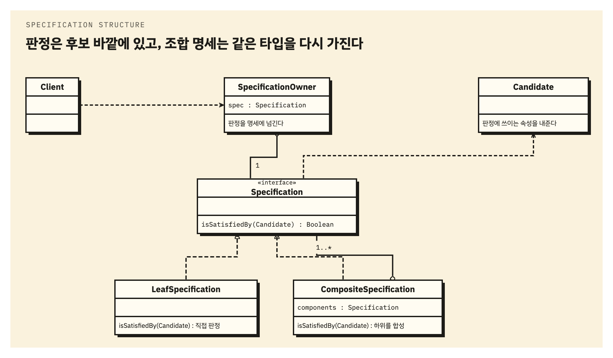

# Specification — 판정 기준에 도메인의 이름을 주어, 검증과 선택이 같은 문장을 쓰게 하기

## 한눈에 보는 개요

냉동육을 컨테이너에 싣는 배송 회사의 코드를 하나 떠올려 봅시다. 배정 창구는 "이 컨테이너에 실어도 됩니까" 를 묻고, 야적장 조회 화면은 "실을 수 있는 컨테이너를 전부 보여 주세요" 를 묻습니다. 두 물음의 답은 같은 규칙에서 나오는데, 코드에서는 `container.lowestTempC() <= -4 && container.foodSafe()` 라는 조건식이 두 곳에 각각 적혀 있어요. 검역 규정이 바뀌어 습도 조건이 하나 붙으면 두 곳을 함께 고쳐야 하고, 한쪽만 고치면 같은 컨테이너가 배정에서는 통과하고 조회에서는 빠집니다.

Specification 의 해법은 **판정하는 문장 자체를 후보 바깥의 객체 하나로 만드는 것**입니다. 그 객체는 "후보가 기준에 맞습니까" 하나에만 답하고, 도메인이 실제로 부르는 이름(보관 명세)을 답니다. 배정 창구도 조회 화면도 그 객체를 받아서 묻기만 해요.

```text
Before : 같은 기준이 물어보는 자리마다 다시 적힌다

  배정 창구   if (c.lowestTempC() <= -4 && c.foodSafe())            ← 여기 한 벌
  조회 화면   if (c.lowestTempC() <= -4 && c.foodSafe())            ← 저기 또 한 벌
              습도 조건이 붙으면 두 곳을 함께 고친다 — 한쪽만 고치면 답이 갈린다

After : 기준이 객체 하나로 만들어지고, 묻는 쪽은 그 객체에 넘긴다

  화물 CG-5521 ── 보관 명세 ──▶  Specification
                                   isSatisfiedBy(컨테이너) : 참/거짓
                                     ├─ TempAtMost(-4)
                                     ├─ FoodSafe
                                     └─ and(…, HumidityAtMost(60))   ← 조합해도 다시 명세

  배정 창구   meat.fits(REEFER-01)              ← 같은 명세
  조회 화면   yard.matching(meat.storageSpec)   ← 같은 명세
```

이 패턴의 이름은 Eric Evans 와 Martin Fowler 가 붙였고, 두 사람은 이것을 사람이 도메인을 생각하는 방식을 담은 분석 패턴이자 시스템이 할 일을 해내는 설계 패턴, 둘 다로 분류합니다([Specifications](https://martinfowler.com/apsupp/spec.pdf)). 그래서 GoF(Gang of Four, 1994년에 나온 *Design Patterns* 의 저자 네 명을 함께 부르는 이름)의 생성·구조·행위 어느 칸에도 들어가지 않아요. 자주 함께 쓰는 패턴은 [Composite](../composite/composite-guide_v1.0.1.md) · [Interpreter](../interpreter/interpreter-guide_v1.0.1.md) · [Strategy](../strategy/strategy-guide_v1.1.1.md) 셋입니다. 이 글은 화물과 컨테이너를 따라가는 시나리오 셋으로 설명합니다. 화물 한 건이 컨테이너 배정 판정을 통과하는 길, 규칙이 늘고 같은 문장이 고르기에도 쓰일 때 무엇이 안 바뀌는가, 규칙을 어기면 어느 단계에서 무엇이 어긋나는가. 끝까지 읽으면 어떤 코드를 Specification 이라고 불러도 되는지 필수 조건 넷으로 판정할 수 있고, **조건 넷을 다 갖춘 코드가 동시에 Strategy 이기도 하고 Interpreter 이기도 한 이유**까지 설명할 수 있게 됩니다.

## 패턴 자세히 들여다보기

### 시나리오 1 — 냉동육 한 건에 컨테이너를 배정하는 요청이 판정을 통과하는 길

화물 `CG-5521`(냉동육)이 들어왔습니다. 보관 요구는 둘이에요. 유지할 수 있는 온도가 −4 °C 이하여야 하고, 식품 위생 인증이 있어야 합니다. 야적장에는 컨테이너 넷이 놓여 있어요 — `REEFER-01`(−18 °C · 인증 있음 · 습도 55 % · 밀폐 아님), `REEFER-02`(−18 °C · 인증 없음 · 습도 60 % · 밀폐 아님), `DRYBOX-11`(4 °C · 인증 있음 · 습도 70 % · 밀폐), `REEFER-03`(−20 °C · 인증 있음 · 습도 72 % · 밀폐 아님). 배정 창구가 `REEFER-01` 부터 차례로 묻습니다. 나와야 하는 것은 컨테이너마다 `accepted` 또는 `rejected` 한 줄이에요.

1. **Client 가 잎 명세 둘을 만들어 하나로 묶습니다.** `TempAtMost(-4)` 와 `FoodSafe` 를 만들고 `and` 로 엮어 보관 명세 하나를 얻어요. 여기서 **잎 명세**는 조건 한 가지만 직접 재는 명세이고, **Client** 는 그 부품을 골라 조립하는 바깥 코드입니다. 왜 Client 가 맡는가 — 무엇을 요구하는지는 업무가 정하는 일이라 화물 클래스 안에서 결정할 일이 아니에요. 화물이 자기 명세를 스스로 만들면 요구가 바뀔 때마다 화물 클래스를 열게 됩니다.
2. **화물이 그 보관 명세를 필드로 받아 둡니다.** 화물 `CG-5521` 은 명세를 만들지 않고 넘겨받아 보관해요. 여기서 화물처럼 명세를 가지고 있는 도메인 객체를 **명세 보유자**라고 부르겠습니다. 왜 화물이 가지는가 — 명세가 화물에 붙어 있어야 배정 창구든 조회 화면이든 같은 문장을 꺼내 쓸 수 있습니다. 화물이 가지지 않으면 5단계의 물음이 묻는 자리마다 따로 적히게 돼요.
3. **배정 창구가 화물에게 `REEFER-01` 을 써도 되는지 묻습니다.** 화물은 답을 스스로 내지 않고, 가지고 있던 명세의 판정 연산에 후보 컨테이너를 그대로 넘겨요. 이때 판정 대상이 되는 컨테이너를 **후보**라고 부릅니다. 왜 넘기는가 — 화물은 "무엇을 요구하는가" 를 알고, "그 요구를 어떻게 재는가" 는 명세가 압니다. 화물이 직접 재면 조건 내용이 화물 클래스로 되돌아가요.
4. **조합 명세가 왼쪽 잎에 먼저 묻습니다.** 둘을 묶어 둔 **조합 명세**가 `TempAtMost(-4)` 를 부르고, 그 잎은 `REEFER-01` 의 유지 온도 −18 을 −4 와 견줘 참을 돌려줍니다. 왜 잎이 직접 후보를 읽는가 — 잎은 자기 한 가지만 알고 나머지 조건은 모릅니다. 그래야 같은 잎을 다른 화물의 명세에도 그대로 끼울 수 있어요.
5. **왼쪽이 참이라 오른쪽 잎에도 묻습니다.** `FoodSafe` 가 `REEFER-01` 의 인증 여부를 읽고 참을 돌려줍니다. 왼쪽이 거짓이었다면 오른쪽은 묻지 않아요. 왜 순서가 뜻을 갖는가 — 논리곱은 하나가 거짓이면 나머지를 볼 필요가 없고, 잎의 검사가 비용을 치르는 일(원격 조회 같은 것)이면 그 차이가 그대로 나타납니다. 순서를 바꿔 둘 다 물어도 답 자체는 같아요.
6. **조합 명세가 참을 돌려주고, 화물이 그대로 돌려주고, 창구가 `accepted` 를 찍습니다.** 출력 1번 줄이 이 자리예요. 왜 아무도 답을 손대지 않는가 — 판정 결과가 오가는 길에서 누군가 기준을 다시 해석하면, 같은 명세가 자리마다 다른 답을 내게 됩니다.
7. **같은 명세로 나머지 셋을 차례로 묻습니다.** `REEFER-02` 는 인증이 없어 `rejected`, `DRYBOX-11` 은 4 °C 라 `rejected`, `REEFER-03` 은 둘 다 만족해 `accepted` 입니다. 출력 2~4번 줄이에요. 왜 명세 하나로 넷을 다 잴 수 있는가 — 명세는 방금 잰 후보를 자기 필드에 남기지 않습니다. 남기면 앞 판정이 뒤 판정을 오염시켜요.

```text
배정 창구        화물 CG-5521        보관 명세(and)        잎 TempAtMost(-4)   잎 FoodSafe
    │ fits(REEFER-01)  │                   │                      │                │
    ├─────────────────▶│ isSatisfiedBy     │                      │                │
    │                  ├──────────────────▶│ isSatisfiedBy        │                │
    │                  │                   ├─────────────────────▶│ -18 <= -4      │
    │                  │                   │◀── true ─────────────┤                │
    │                  │                   ├──────────────────────┼───────────────▶│ 인증 있음
    │                  │                   │◀── true ─────────────┼────────────────┤
    │                  │◀── true ──────────┤                      │                │
    │◀── accepted ─────┤                   │                      │                │
```

이 시나리오에서 확인한 것은 다섯입니다. 판정 연산이 후보를 받아 참·거짓만 돌려준다는 것, 그 연산이 후보 바깥의 명세 타입에 있다는 것, 명세 보유자가 판정을 자기가 하지 않고 명세에 넘긴다는 것, 잎 명세는 한 가지만 재고 조합 명세는 하위의 답을 합친다는 것, 그리고 명세가 후보를 기억하지 않아서 하나로 여럿을 잰다는 것. 이 이름들의 정식 정의는 아래 「개념 정리」에 모았습니다.

### 시나리오 2 — 습도 규칙이 더해지고, 같은 명세가 고르기에도 쓰일 때

검역 규정이 바뀌어 냉동육은 습도 60 % 이하 컨테이너에만 실을 수 있게 됐습니다. 그리고 창구가 묻는 방식도 늘었어요 — 한 건씩 확인하는 대신 "지금 쓸 수 있는 컨테이너를 전부 보여 달라" 고 합니다. 야적장의 컨테이너 넷은 그대로고, 나와야 하는 것은 규칙을 넣기 전후의 후보 목록 두 줄입니다.

1. **Client 가 잎 명세를 하나 더 만듭니다.** `HumidityAtMost(60)` 입니다. 이때 기존 잎 둘도, 조합 명세도, 화물도, 후보 컨테이너도 한 줄 바뀌지 않습니다. 왜 안 바뀌는가 — 잎은 자기가 재는 속성 하나만 알고, 다른 잎이 몇 개 있는지 모릅니다. 서로를 모르니까 하나 더 놓는 일이 기존 것에 영향을 주지 않아요.
2. **그 잎을 기존 보관 명세와 `and` 로 묶습니다.** 나온 것은 또 하나의 명세이고, 원래 명세가 있던 자리에 그대로 들어갑니다. 왜 그대로 들어가는가 — 조합 연산이 돌려주는 타입이 명세 공통 타입이기 때문이에요. 조합 결과가 다른 타입이었다면 명세를 받는 자리마다 "낱개냐 조합이냐" 를 물어야 했을 겁니다.
3. **야적장에 그 명세를 그대로 건네 고르기를 시킵니다.** 야적장은 화물이 무엇인지도, 규칙 내용이 무엇인지도 모른 채 컨테이너를 하나씩 명세에 물어 통과한 것만 모아요. 규칙을 넣기 전에는 `REEFER-01, REEFER-03` 이 나오고, 넣은 뒤에는 `REEFER-01` 만 나옵니다. 출력 5·6번 줄이에요. 왜 이 자리가 중요한가 — 시나리오 1 의 검증과 여기의 선택이 **같은 명세 객체**를 씁니다. 기준이 한 벌이라 둘이 갈릴 길이 없어요.
4. **다른 화물 둘이 같은 부품으로 다른 문장을 만듭니다.** 생화 `CG-7702` 는 8 °C 이하이면서 밀폐가 **아닌** 컨테이너를 요구하므로 `and(TempAtMost(8), not(Sealed))` 이고, 건조식품 `CG-9033` 은 습도 60 % 이하**이거나** 밀폐면 되므로 `or(HumidityAtMost(60), Sealed)` 입니다. 결과는 `REEFER-01, REEFER-02, REEFER-03` 과 `REEFER-01, REEFER-02, DRYBOX-11` 이에요. 출력 7·8번 줄입니다. 왜 부정과 논리합까지 두는가 — 업무의 요구가 논리곱만으로 적히지 않기 때문이고, 셋을 갖추면 잎을 더 만들지 않고도 문장을 늘릴 수 있습니다.
5. **새 명세가 옛 명세의 특수 경우라는 것을 후보를 보지 않고 압니다.** 2단계에서 만든 명세는 옛 명세를 `and` 로 감싼 것이라, 새 명세를 만족하는 후보는 반드시 옛 명세도 만족합니다. 그래서 6번 줄의 결과는 5번 줄 결과의 부분집합이어야 하고, 실제로 `REEFER-01` 은 `REEFER-01, REEFER-03` 안에 있어요. 왜 이것이 쓸모 있는가 — 이미 옛 명세로 걸러 둔 목록이 있으면 새 명세는 그 목록 안에서만 찾으면 됩니다. 이 관계를 코드로 직접 묻는 연산이 최소 조건 8번이고, 이 예제는 두지 않았습니다.

```text
규칙을 넣기 전                            규칙을 넣은 뒤

  and( TempAtMost(-4), FoodSafe )          and( and( TempAtMost(-4), FoodSafe ), HumidityAtMost(60) )
        └── 바뀌지 않은 부분 ──┘                  └────── 통째로 그대로 들어간다 ──────┘  └ 새 잎 하나 ┘

  선택 결과  REEFER-01, REEFER-03          선택 결과  REEFER-01        ⊆ 왼쪽 결과
  고친 파일  —                             고친 파일  Client 한 곳 (잎 1개 + 조합 1줄)
```

이 시나리오에서 확인한 것은 둘입니다. 하나는 조합 결과가 다시 같은 타입이라 명세를 받는 자리가 낱개와 조합을 구분하지 않아도 된다는 것이고, 다른 하나는 검증과 선택이라는 서로 다른 일이 같은 명세 객체를 나눠 쓴다는 것입니다. 이 두 성질이 최소 조건 6번과 7번이 되고, 5단계에서 본 포함 관계가 8번이 됩니다.

### 시나리오 3 — 명세의 규칙을 어기면 어느 단계에서 무엇이 어긋나는가

아래 넷은 구현 절의 코드를 한 군데씩 바꿔 실제로 컴파일하고 실행해 본 것입니다. 도구는 `javac 21.0.11` · `tsc 5.9.3`(Node v22.22.3) · `rustc 1.95.0` 이고, 바꾼 자리 말고는 구현 절 코드와 같습니다. 재현하려면 구현 절 코드를 그대로 저장한 뒤 아래에 적은 자리만 고치면 돼요.

1. **판정 연산이 참·거짓 대신 적합도 점수를 돌려주게 바꿨습니다.** 공통 타입의 반환 타입을 정수로 바꾸고, 잎 넷이 만족하면 100 아니면 0 을 돌려주게만 고쳤어요. 세 언어가 모두 컴파일에서 멈췄는데 **막힌 자리가 언어마다 달랐습니다.** Java 는 오류 5건(`&&` 의 피연산자, `||` 의 피연산자, `!` 의 피연산자, 화물의 판정 반환, 야적장의 `if`), TypeScript 는 2건(부정 노드의 반환 타입, 화물의 판정 반환), Rust 는 `E0308` 8건(논리곱 노드 3건, 논리합 노드 3건, 화물의 판정 반환, 야적장의 `if`)이었어요. 세 언어 가운데 **Rust 만 부정 노드를 그냥 통과시킵니다** — 정수에 붙은 `!` 는 논리 부정이 아니라 비트 반전이라 정수를 돌려주고, 바꿔 놓은 선언과 그대로 맞아떨어지거든요(직접 컴파일해 확인). 그래서 이 판을 Rust 로만 확인하면 부정 노드가 뜻을 잃었다는 사실을 컴파일러가 말해 주지 않습니다. 왜 이 자리에서 오류가 나는가 — 논리곱·논리합·부정은 참·거짓 위에서만 뜻이 있고, 점수가 오면 "둘의 점수를 어떻게 합치는가" 에 답이 없기 때문입니다.
2. **판정을 후보 안으로 들였습니다.** 명세 타입을 없애고 컨테이너에 `isSuitableForFrozenMeat()` 같은 메서드 넷을 붙였어요. 이 판은 **컴파일도 실행도 통과하고 출력이 여덟 줄 모두 글자 단위로 같았습니다.** 대신 화물 종류로 가르는 `switch` 가 돌아왔고, 화물 종류가 하나 늘 때마다 컨테이너 클래스와 그 `switch` 두 곳을 함께 고치게 됐어요. 왜 출력으로는 알 수 없는가 — 이 조건이 지키는 것은 답의 값이 아니라 **고쳐야 할 자리의 수**입니다. 시나리오 2 의 1단계에서 "기존 것이 한 줄도 안 바뀐다" 고 한 성질이 여기서 사라져요.
3. **기준을 묻는 자리마다 직접 박았습니다.** 화물의 판정 메서드 안과 야적장의 조회 메서드 안에 조건식을 각각 적고, 시나리오 2 의 습도 규칙을 **야적장 쪽에만** 반영했습니다. 그랬더니 `REEFER-03` 이 검증에서는 `accepted` 로 나오고 선택 결과에서는 빠졌어요. 같은 후보에 답이 둘입니다. 왜 이렇게 되는가 — 기준이 두 벌이면 둘을 같이 고치는 일은 사람의 기억에 달리고, 기억은 한쪽을 빠뜨립니다.
4. **명세에 후보가 맡을 업무 연산을 더했습니다.** 공통 타입에 "계획 온도를 알려 달라" 는 연산을 하나 붙여 봤어요. 잎은 답할 수 있지만 습도 잎과 밀폐 잎에는 답할 온도가 없고, 논리합 조합 노드는 어느 하위를 골라도 근거가 없습니다. 실행하면 판정 자체는 `true` 를 내고 그다음 줄에서 `UnsupportedOperationException` 으로 실패했어요(종료 코드 1). 왜 이 연산이 명세에 들어갈 수 없는가 — 명세는 "무엇을 요구하는가" 를 말하는 객체이고 "실제로 무엇인가" 를 말하는 객체가 아닙니다. 둘을 한 객체에 담으면 조합 노드가 답할 수 없는 물음이 생겨요.

```text
바꾼 자리                        생긴 문제                                    확인되는 때
─────────────────────────────  ──────────────────────────────────────────  ──────────────
판정이 점수를 돌려준다          조합 노드(and · or · not)에 뜻이 없다        컴파일
판정이 후보 안에 있다           화물 종류 분기가 되살아난다                  고칠 때 (출력은 같다)
기준이 묻는 자리마다 적혀 있다   같은 후보에 답이 둘 — REEFER-03             실행 (값이 어긋난다)
명세가 업무 연산을 갖는다       조합 노드가 답할 수 없는 물음이 생긴다        실행 (예외)
```

여기서 헷갈리기 쉬운 포인트는 2번입니다. 컴파일도 되고 실행 출력도 글자 하나까지 같으니 "그럼 같은 코드 아닌가" 싶어지죠. 그런데 시나리오 2 를 그 판에 다시 넣어 보면 차이가 납니다. 명세 판은 Client 한 곳에 잎 하나와 조합 한 줄을 더하는 것으로 끝났는데, 후보 안 판정 판은 컨테이너 클래스에 메서드를 더하고 `switch` 에 갈래를 더해야 해요. **출력이 같다고 두 코드가 같은 것은 아니고, 이 패턴이 효과를 내는 때는 처음 실행할 때가 아니라 두 번째 요구가 들어올 때입니다.**

### 개념 정리

시나리오에 나온 이름 여섯을 역할 이름으로 정의합니다. 예시 코드의 타입 이름(`ContainerSpec`·`Cargo`)은 정의 대상이 아니라 「상황 설정」에서 이 역할들에 매핑하는 쪽이에요.

- **Specification(명세)** — 판정 연산 `isSatisfiedBy(Candidate) : Boolean` 하나를 선언하는 공통 타입입니다. 후보가 기준에 맞는지에만 답할 책임을 지고, 그 답을 쓰는 쪽이 누구인지는 모릅니다. LeafSpecification 과 CompositeSpecification 이 이 타입을 구현하고, SpecificationOwner 와 Client 가 이 타입으로만 명세를 다룹니다.
- **LeafSpecification(잎 명세)** — 조건 한 가지를 직접 재는 명세입니다. 하위 명세를 가지지 않아서 판정이 여기서 끝나요. 후보의 속성을 읽어 참·거짓을 내는 것이 전부이고, 다른 잎이 무엇을 재는지는 모릅니다. 자주 달라지는 값(온도 한계·습도 한계)을 자기 속성으로 가지면 같은 클래스로 여러 기준을 만들 수 있습니다.
- **CompositeSpecification(조합 명세)** — 하위 명세들을 Specification 타입으로 가지고, 논리곱·논리합·부정으로 하위의 답을 합치는 명세입니다. 자기도 Specification 이라서 조합 결과가 다시 조합의 하위로 들어가요. 하위가 무엇을 재는지는 모르고, 몇 개인지와 어떻게 합칠지만 압니다.
- **Candidate(후보)** — 판정 대상입니다. 판정에 쓰이는 속성을 내주기만 하고 명세를 모릅니다. 후보가 명세를 알게 되는 순간 기준이 후보 안으로 들어와 재사용도 조합도 막혀요.
- **SpecificationOwner(명세 보유자)** — 기준을 쓰는 도메인 객체입니다. 명세를 필드로 가지고, 적합성을 묻는 요청이 오면 자기가 판정하지 않고 가지고 있던 명세에 후보를 넘깁니다. 화물이 보관 명세를 가지는 것이 이 자리예요. 이 역할이 없는 설계도 있습니다 — 그때는 Client 가 명세를 직접 가지고 있습니다.
- **Client** — 잎 명세를 고르고 조합해 명세를 만들고, 그것을 SpecificationOwner 에게 넘기거나 선택하는 쪽에 건네는 바깥 코드입니다. 무엇을 요구할지 정하는 일이 여기 있어요.



그림에서 눈여겨볼 선은 둘입니다. CompositeSpecification 에서 Specification 으로 가는 선이 **두 개**예요 — 하나는 "나도 명세다"(구현)이고 다른 하나는 "명세를 1개 이상 가진다"(집약)입니다. 이 둘이 같이 있어서 조합이 몇 겹이든 쌓입니다. 그리고 Specification 에서 Candidate 로 가는 선은 **의존 한 방향**뿐이에요. 후보에서 명세로 돌아오는 선이 없다는 것이 이 그림이 말하는 핵심이고, 시나리오 3 의 2단계가 그 선을 그었을 때 무엇이 되는지 보여 줍니다.

## 사용 목적

어떤 단서가 보일 때 이 패턴을 꺼내는지부터 봅시다. 셋 다 코드나 요구사항에서 눈으로 확인되는 것들이에요.

1. **같은 조건식이 묻는 자리마다 복제돼 있습니다.** 배정 쪽과 조회 쪽에 같은 `&&` 사슬이 적혀 있고, 규칙이 바뀌면 둘을 함께 고쳐야 하는 상태입니다. 시나리오 3 의 3단계가 이 상태에서 한쪽만 고쳤을 때 무엇이 나오는지 보여 줘요 — 같은 컨테이너가 한 곳에서는 통과하고 다른 곳에서는 빠집니다.
2. **업무가 이름으로 부르는 기준이 코드에는 이름 없는 조건식으로만 있습니다.** 담당자는 이 화물의 보관 요건이라고 말하는데 코드에는 그 이름을 가진 것이 없고 `if` 안의 표현식만 있는 경우예요. 이름이 없으면 그 기준을 인자로 넘기지도, 저장해 두지도, 나중에 다시 꺼내 보지도 못합니다.
3. **조건을 사용자가 조립합니다.** 화면에서 항목을 고르고 "그리고 / 또는" 으로 엮어 규칙을 만드는 요구가 있으면, 그 규칙은 실행 중에 만들어져야 하므로 코드에 박은 조건식으로는 표현할 수 없어요. 시나리오 2 의 2·4단계가 그 조립을 코드로 보여 줍니다.

```text
단서를 만났을 때 물어볼 것

  이 기준에 업무가 부르는 이름이 있는가?   ──아니오──▶ 조건식 한 줄로 둔다
          │ 예
  같은 기준을 두 군데 이상에서 묻는가,
  아니면 규칙이 앞으로 늘어나는가?         ──아니오──▶ 조건식 한 줄로 둔다
          │ 예
  그 객체가 요구를 말하는가, 사실을 말하는가?
          │ 요구                              │ 사실
     Specification                        도메인 엔티티로 둔다
```

반대로 이 패턴을 쓰면 손해인 자리도 분명합니다.

- **조건이 하나뿐이고 한 곳에서만 쓰일 때** 는 쓰지 않습니다. 잃는 것은 읽기 쉬움이에요. `if (c.foodSafe())` 한 줄이면 끝날 일에 공통 타입 하나와 잎 클래스 하나와 조립 코드가 붙으면, 읽는 사람이 세 파일을 오가고도 조건 하나를 확인하게 됩니다. 시나리오 2 처럼 규칙이 늘거나 시나리오 1 의 3단계처럼 묻는 자리가 여럿일 때 쓸모가 있습니다.
- **그 객체가 도메인의 실제 개체를 나타내게 될 때** 도 쓰지 않습니다. 경로 명세와 경로는 속성 목록이 거의 같아서 하나로 합치고 싶어지는데, 합치면 "몇 시까지 도착해야 한다" 와 "몇 시에 도착한다" 가 한 칸에 들어갑니다. 잃는 것은 설계의 뜻이에요 — 요구와 사실이 구분되지 않으면 어느 쪽을 고쳐야 하는지가 코드에서 안 보입니다. 시나리오 3 의 4단계가 그 혼동이 실행 중에 어떻게 실패로 이어지는지 보여 줍니다.

이 패턴은 구조가 Strategy · Interpreter · Composite 와 겹칩니다. 겹치는 정도가 닮았다는 수준이 아니라 **같은 코드가 둘 다인 수준**이어서, 그 이야기는 아래 비교 절에서 따로 풉니다.

## 패턴의 경계

### 디자인 패턴을 충족하는 최소 조건

어떤 코드를 Specification 이라고 불러도 되는지 가르는 기준입니다. `[필수]` 가 하나라도 빠지면 Specification 이 아니고, `[선택]` 은 갖추면 좋거나 상황에 따라 고르는 구조예요. 조건은 언어와 상관없이 코드에서 확인할 수 있는 모양(타입 선언 · 참조 보유 · 호출 방향 · 반환 타입)으로 적었고, 조건마다 그것을 보여 준 시나리오의 단계를 가리킵니다. **여기서 "후보" 는 1번이 정합니다** — 판정 연산의 매개변수 자리에 오는 타입이 후보이고, 다른 조건들은 그 타입을 가리켜요.

1. [필수] 판정이 후보 객체를 받아 참·거짓만 돌려주는 연산 하나로 이뤄져 있습니다 — 공통 타입이 선언한 연산이 객체 하나를 매개변수로 받고 불리언을 돌려주며, 그 공통 타입을 구현한 **모든** 타입이 그 연산으로 판정을 끝냅니다. 판정 자리에 계산값·정렬 키·변환 결과가 오면 이 조건이 아니에요. 시나리오 1 의 3단계가 그 호출이고 6단계가 그 반환입니다 (근거: Evans·Fowler 「Specifications」(apsupp) Specification 절 Solution — 후보가 기준에 맞는지 알려 주는 명세를 만들고, 그 명세는 후보가 기준을 모두 만족하면 참을 돌려주는 `isSatisfiedBy(anObject) : Boolean` 을 갖는다). 위 근거 괄호가 받쳐 주는 것은 **판정 연산이 후보 하나를 받아 불리언을 돌려준다는 것까지**입니다. 그 연산의 이름이 무엇인지, 공통 타입이 인터페이스인지 추상 클래스인지 trait 인지는 여기서 오지 않아요.
   - 빠지면: 시나리오 3 의 1단계가 그 자리입니다. 판정이 적합도 점수를 돌려주게 바꾸면 논리곱·논리합·부정에 뜻이 없어져 세 언어가 모두 컴파일에서 멈췄어요(Java 5건 · TypeScript 2건 · Rust 8건, 직접 컴파일해 확인).
   - 빠지면: 반환이 값이면 그것은 계산을 갈아 끼우는 Strategy 입니다. 발행된 [Strategy 편](../strategy/strategy-guide_v1.1.1.md)의 구현 절 코드가 그 자리예요 — 세 요금제가 같은 연산 모양을 공유하고 바깥에서 설치되지만, `fee(long, long)` 이 돌려주는 것은 판정이 아니라 금액입니다.
2. [필수] 그 판정 연산이 후보 바깥의 타입에 있습니다 — 1번이 정한 후보 타입, 그리고 **그 타입이 구현·상속한 타입 어디에도** 같은 판정 연산이 없고, 판정을 선언한 공통 타입과 후보 타입이 서로 다릅니다. 시나리오 1 의 4단계가 잎 명세가 후보의 속성을 바깥에서 읽는 자리예요 (근거: Evans·Fowler 「Specifications」(apsupp) Introduction — 이 패턴의 중심 생각은 후보를 어떻게 맞춰 볼지의 진술을, 그것이 맞춰지는 후보 객체로부터 떼어 내는 것이다). 위 근거 괄호가 받쳐 주는 것은 **판정의 진술이 후보 바깥에 있다는 것까지**입니다.
   - 빠지면: 시나리오 3 의 2단계가 그 자리입니다. 컨테이너가 `isSuitableForFrozenMeat()` 로 스스로 답하게 하면 컴파일도 실행도 통과하고 출력이 여덟 줄 모두 같았지만(직접 실행해 확인), 화물 종류로 가르는 `switch` 가 되살아나고 화물 종류가 늘 때마다 후보 클래스를 열게 됩니다.
   - 먼저 보는 곳: 이 조건은 1번이 후보를 정해 준 뒤에만 확인할 수 있습니다. 1번이 빠져 후보 매개변수가 아예 없는 코드에는 확인할 대상이 없고, 그런 코드는 1번에서 이미 판정이 끝나요. 아래 조건표의 `—` 칸이 그 자리입니다.
3. [필수] 기준을 쓰는 쪽이 명세 객체를 받아서 판정을 그 객체에 넘깁니다 — 후보를 판정하는 자리가 기준의 내용을 자기 코드로 다시 적지 않고, 필드로 보유하거나 인자로 받은 **명세 객체**의 판정 연산을 부릅니다. 시나리오 1 의 2·3단계(화물이 가지고 있다가 넘기는 자리)와 시나리오 2 의 3단계(야적장이 인자로 받아 부르는 자리)가 그 두 모양이에요 (근거: Evans·Fowler 「Specifications」(apsupp) Uses of Specification 절 — 이 쓰임들 모두에서 명세 객체는 그것을 쓰는 도메인 객체와 별개의 객체다). 위 근거 괄호가 받쳐 주는 것은 **명세가 그것을 쓰는 도메인 객체와 별개의 객체라는 것까지**입니다. 그 객체를 필드로 가져야 하는지 인자로 받아도 되는지는 여기서 오지 않아요.
   - 빠지면: 시나리오 3 의 3단계가 그 자리입니다. 조건식을 검증 쪽과 선택 쪽에 각각 적고 습도 규칙을 한쪽에만 반영했더니 `REEFER-03` 이 검증에서는 `accepted`, 선택에서는 빠졌어요(직접 실행해 확인). 기준이 두 벌이면 같은 후보에 답이 둘입니다.
4. [필수] 명세 타입이 후보가 맡을 업무 연산을 갖지 않습니다 — 공통 타입과 그것을 구현한 **모든** 타입이 공개하는 연산이 1번의 판정 연산, 명세끼리 결합해 같은 타입을 돌려주는 연산, 그리고 명세를 만들고 그 속성을 읽는 연산으로 한정되고, 후보 객체가 맡는 업무 연산이 명세 타입에 없습니다. 시나리오 3 의 4단계가 이 조건을 어긴 자리예요 (근거: Evans·Fowler 「Specifications」(apsupp) When Not to Use Specification 절 — 초기화 말고 다른 프로토콜을 더하고 있거나 그 객체가 도메인의 실제 개체를 나타내게 됐다면 이 패턴을 다시 생각하라고 적고, 명세의 책임을 자기를 만족하는 객체를 알아보는 것과 그 책임을 떠받치는 방식으로 다른 명세와 결합하는 것으로 한정한다). 위 근거 괄호가 받쳐 주는 것은 **명세의 공개 프로토콜이 판정·결합·초기화로 한정된다는 것까지**입니다.
   - 빠지면: 시나리오 3 의 4단계에서 계획 온도를 묻는 연산을 더했더니 판정은 `true` 를 내고 그다음 줄이 `UnsupportedOperationException` 으로 실패했습니다(종료 코드 1, 직접 실행해 확인). 요구를 말하는 객체와 사실을 말하는 객체가 한 객체가 되면 조합 노드가 답할 수 없는 물음이 생겨요.
5. [선택] 자주 달라지는 값을 잎 명세의 속성으로 둡니다 — 온도 한계나 습도 한계처럼 기준마다 달라지는 값을 잎의 필드로 두면, 값이 다른 기준을 클래스를 늘리지 않고 만들 수 있습니다. 시나리오 2 의 1단계에서 `HumidityAtMost(60)` 이 그 모양이에요 (근거: Evans·Fowler 「Specifications」(apsupp) Parameterized Specification 절 — 명세 구현 전략 가운데 하나로 들었으므로 필수로 올리지 않았습니다). 값을 박은 잎만으로도 1~4번은 그대로 만족합니다.
6. [선택] 명세끼리 논리 연산으로 조합하고, 조합 결과가 다시 같은 명세 타입입니다 — 논리곱·논리합·부정 노드가 하위를 공통 타입으로 가지고, 조합 연산이 돌려주는 타입이 그 공통 타입입니다. 시나리오 2 의 2단계가 그 자리예요 (근거: Evans·Fowler 「Specifications」(apsupp) Composite Specification 절 · Logical Expressions for Composite Specifications 절 — 역시 구현 전략 가운데 하나로 들었으므로 필수로 올리지 않았습니다). 조합 없이 잎 하나만 쓰는 명세도 1~4번을 만족하면 Specification 입니다.
7. [선택] 같은 명세가 검증 자리와 선택 자리 둘 다에서 쓰입니다 — 한 번 만든 명세 객체가 후보 하나를 확인하는 자리와 후보 집합을 거르는 자리 양쪽에 건네집니다. 시나리오 2 의 3단계가 검증에 쓰던 명세를 그대로 고르기에 넘긴 자리예요 (근거: Evans·Fowler 「Specifications」(apsupp) Specification 절 Problem — 선택 · 검증 · 주문 제작 세 가지를 이 패턴이 푸는 문제로 나란히 든다. 셋 중 하나만 필요한 자리도 있으므로 필수로 올리지 않았습니다).
8. [선택] 명세끼리 포함 관계를 비교하는 연산을 둡니다 — 후보 없이 명세 둘을 놓고 한쪽이 다른 쪽의 특수 경우인지 묻는 연산입니다. 시나리오 2 의 5단계에서 손으로 확인한 관계가 이것이고, 이 예제는 연산을 두지 않았어요 (근거: Evans·Fowler 「Specifications」(apsupp) Subsumption 절 — `isSpecialCaseOf(Specification) : Boolean` 을 만들고 짝이 되는 `isGeneralizationOf` 도 두면 편리하다고 적는다. "편리하다" 인 자리라 필수로 올리지 않았습니다).
9. [선택] 강타입 언어에서 판정 연산의 매개변수 타입을 후보 타입으로 좁힙니다 — 매개변수를 최상위 객체 타입으로 열어 두지 않고 찾는 후보의 타입으로 적습니다. 시나리오 1 의 3단계에서 넘어가는 값이 컨테이너 타입인 것이 그 자리예요 (근거: Evans·Fowler 「Specifications」(apsupp) Specification 절 — 강타입 언어에서는 매개변수 타입을 찾고 있는 후보의 타입으로 두는 것이 보통이라고 적는다. "보통" 인 자리라 필수로 올리지 않았습니다).
10. [선택] 명세가 방금 잰 후보를 자기 필드에 남기지 않습니다 — 판정 연산이 받은 후보나 그 판정 결과를 명세의 필드에 쓰지 않아서, 명세 객체 하나를 후보 여럿에 차례로 넘겨도 앞 판정이 뒤 판정의 답을 바꾸지 않습니다. 시나리오 1 의 7단계에서 보관 명세 하나로 컨테이너 넷을 차례로 잰 자리가 이 모양이에요 (근거: 이 가이드의 정책 — 원전은 명세가 상태를 갖는지 다루지 않습니다. 다만 7번처럼 검증 자리와 선택 자리가 명세 하나를 나눠 쓰면 앞 후보의 값이 뒤 판정에 섞일 수 있어 조건으로 적어 둡니다). 후보마다 명세를 새로 만들어 쓰는 코드는 이 조건을 확인할 일이 없습니다.

판정 순서를 정리해 둡시다. 1번은 **공통 타입의 연산 선언만** 보면 답이 나오고, 2번은 후보 타입의 연산 목록을, 3번은 묻는 쪽의 호출 한 줄을, 4번은 명세 타입의 공개 연산 목록을 봅니다. 보는 품이 적은 1번부터 적용하면 대부분 거기서 끝나요.

| 코드 | 1번 | 2번 | 3번 | 4번 | 판정 |
| --- | --- | --- | --- | --- | --- |
| 구현 절 정본 | 만족 | 만족 | 만족 | 만족 | Specification |
| 판정이 점수를 돌려주는 판 (시나리오 3 의 1단계) | **빠짐** | — | 만족 | 만족 | 아님 — 조합 노드가 뜻을 잃는다 |
| 판정을 후보 안으로 들인 판 (시나리오 3 의 2단계) | **빠짐** | **빠짐** | **빠짐** | — | 아님 — 종류 분기가 되살아난다 |
| 기준을 묻는 자리마다 박은 판 (시나리오 3 의 3단계) | **빠짐** | 만족 | **빠짐** | — | 아님 — 같은 후보에 답이 둘 |
| 명세에 업무 연산을 더한 판 (시나리오 3 의 4단계) | 만족 | 만족 | 만족 | **빠짐** | 아님 — 명세가 엔티티로 바뀐다 |
| 정적 검증 유틸리티 (`static boolean check(Container)`) | **빠짐** | 만족 | **빠짐** | — | 아님 — 넘길 객체가 없다 |
| 발행된 Strategy 편의 구현 절 코드 | **빠짐** | — | 만족 | — | 아님 — 판정이 아니라 금액을 돌려준다 |
| 불리언을 돌려주는 Strategy (재시도 정책) | 만족 | 만족 | 만족 | 만족 | **Specification 이면서 Strategy** |
| 발행된 Interpreter 편의 구현 절 코드 | 만족 | 만족 | 만족 | 만족 | **Specification 이면서 Interpreter** |

`—` 칸은 그 조건을 적용할 대상이 그 코드에 없다는 뜻이에요. 2번의 `—` 는 **판정** 연산이 없어 후보가 정해지지 않은 자리입니다 — 후보는 1번이 판정 연산의 매개변수 자리로 정하므로, 매개변수 이름이 `candidate` 로 남아 있더라도 그 연산이 판정이 아니면 2번이 가리킬 후보가 없어요. 4번의 `—` 는 살펴볼 명세 공통 타입이 아예 없거나, 그 타입의 연산이 판정도 조합도 아니어서 무엇이 후보의 몫인지 가를 기준 자체가 없는 자리입니다.

마지막 두 줄이 이 편에서 가장 중요한 자리입니다. **필수 조건 넷을 전부 만족하면서 동시에 다른 패턴이기도 한 코드가 있고, 그것은 이 조건들의 결함이 아닙니다.** 오히려 원전이 그렇게 적어요 — 명세를 코드 조각으로 박아 구현하는 방식을 두 저자가 직접 Strategy 의 적용이라고 부르고, 잎과 조합 노드로 구성하는 방식을 인터프리터라고 부릅니다. 그래서 조건을 더 좁혀 다른 패턴을 배제하려 하면 원전이 인정하는 코드를 탈락시키게 됩니다. 가르는 일은 조건이 아니라 다음 절이 맡아요.

> 명세는 후보 바깥에서 후보에 대해 참·거짓만 답합니다. 쓰는 쪽은 기준을 다시 적지 않고 묻기만 하고, 답을 조합해도 나오는 것은 다시 명세입니다.

### 비슷한 패턴·안티패턴과의 차이

Specification 과 겹치는 대상 넷을 비교합니다. 앞의 셋은 **구조가 닮은 정도가 아니라 같은 코드가 둘 다인 관계**라서 먼저 그 사실을 분명히 하고 시작할게요. 마지막 하나는 이 패턴으로 오해받는 코드입니다.

| 비교 대상 | 구분 기준 (코드에서 보는 것) | Specification 이라고 부르면 얻는 것 | 포기하는 것 |
| --- | --- | --- | --- |
| Strategy | 갈아 끼우는 연산이 **후보에 대한 참·거짓**을 돌려주는가, 그 밖의 값을 돌려주는가 | 기준을 저장·전달·조합할 수 있게 됨. 같은 객체가 검증과 선택에 다 쓰임 | 계산을 갈아 끼우는 넓은 쓰임. 값을 돌려주는 연산은 이 이름으로 부르지 않음 |
| Interpreter | 그 계층이 **문법을 이루는 언어**로 다뤄지는가, 도메인의 기준 하나로 다뤄지는가 | 기준에 도메인 이름이 붙고, 후보에 대한 물음 하나로 쓰임이 좁혀짐 | 문법을 늘려 표현력을 키우는 방향. 해석 결과가 참·거짓 밖으로 못 나감 |
| Composite | 가진 참조가 **판정을 합치는 자리**인가, 부분-전체의 집계를 만드는 자리인가 | 트리가 논리식이 되어 `and`·`or`·`not` 의 뜻이 정해짐 | 임의의 결과 타입을 합치는 자유. 합쳐 낼 수 있는 것은 참·거짓뿐 |
| 정적 검증 유틸리티 (오해받는 코드) | 기준이 **넘길 수 있는 객체**인가, 부르기만 하는 함수인가 | 기준을 인자로 넘기고 저장하고 조합함 | 호출 한 줄의 간단함. 타입과 객체가 늘어남 |

**Strategy 와의 관계.** 먼저 사실부터 적습니다. **이 가이드의 예시 코드는 발행된 Strategy 편의 필수 조건 셋을 전부 만족합니다.** 직접 대조해 봤어요. 그 편의 1번은 "교체할 알고리즘들이 같은 연산 모양을 따르고 계산 방법마다 따로 구현" 을 요구하는데, `ContainerSpec` 이 연산 모양을 선언하고 잎 넷과 조합 셋이 각각 별도 단위로 구현하며 어느 구현에도 방법을 고르는 분기가 없습니다. 2번은 "Context 가 전략을 그 연산 모양으로만 보유하고 호출" 인데, `Cargo` 의 필드 타입이 `ContainerSpec` 이고 `fits` 가 그 연산만 부르며 타입 검사나 다운캐스트가 없어요. 3번은 "고르는 분기가 Context 안에 없고 전략을 받는 경로가 있다" 인데, `Cargo` 는 생성자로 명세를 받고 안에서 고르지 않습니다. 셋 다 통과예요.

이것이 오류가 아니라는 점이 중요합니다. 원전이 명세를 코드 조각으로 박아 구현하는 방식을 **Strategy 의 적용**이라고 직접 부르고, 화물마다 컨테이너를 평가할 전략을 하나씩 갖는 구조라고 설명해요(근거: Evans·Fowler 「Specifications」(apsupp) Hard Coded Specification 절). 그러니 두 이름이 같은 코드에 붙는 것은 정상이고, 조건 문면을 좁혀 풀 문제가 아닙니다. 반대 방향은 다릅니다 — Strategy 편의 구현 절 코드를 이 편의 필수 조건으로 채점하면 1번에서 떨어져요. `ShippingPolicy.fee(long, long)` 이 돌려주는 것은 금액이지 판정이 아니니까요.

```text
              같은 연산 모양 · 바깥에서 설치 · Context 는 구체 타입을 모름   ← 여기까지는 둘이 같다
                                    │
                  그 연산이 돌려주는 것이 무엇인가?
                                    │
        ┌───────────────────────────┴───────────────────────────┐
   후보에 대한 참·거짓                                      그 밖의 값 (금액 · 정렬 키 · 변환 결과)
        │                                                       │
   Specification 이라고도 부른다                            Strategy 라고만 부른다
   (원전이 이것을 Strategy 의 적용이라고 적는다)             예: 배송비 정책 fee(subtotal, weight)
```

그럼 불리언을 돌려주는 Strategy 는 전부 Specification 일까요? 원전의 기준으로는 그렇습니다. 그래서 이름을 고르는 일이 판정과 다릅니다. **판정은 조건으로 하고, 이름은 그 객체가 도메인에서 무엇으로 불리는가로 고릅니다.** 담당자가 이 화물의 보관 요건이라고 부르고 그 기준을 저장하거나 다른 화물에 다시 적용한다면 Specification 이라고 부르는 편이 읽는 사람에게 더 알려 줘요. 시나리오 2 의 3단계에서 같은 객체를 검증과 선택에 나눠 쓴 것이 그 이름이 실제로 쓸모 있는 자리입니다. 반대로 Strategy 를 고르면 계산을 갈아 끼우는 넓은 쓰임을 얻는 대신, 그 객체를 저장하고 조합하고 포함 관계를 비교하는 이야기는 따라오지 않습니다.

**Interpreter 와의 관계.** 여기도 같습니다. 이 가이드의 예시 코드는 발행된 [Interpreter 편](../interpreter/interpreter-guide_v1.0.1.md)의 필수 조건 넷을 전부 만족해요. 기준 하나가 노드 트리 한 그루로 만들어지고(1번), 규칙마다 노드 종류가 있으며 조합 노드가 하위를 공통 타입으로 가지고(2번), 모든 노드를 받는 공통 타입이 하나이고(3번), 판정이 트리를 따라 재귀로 합성돼 잎에서 멈춥니다(4번). 원전도 잎과 조합 노드로 구성한 명세가 사실상 인터프리터를 만드는 것이라고 적고요(근거: Evans·Fowler 「Specifications」(apsupp) Logical Expressions for Composite Specifications 절). 차이가 나는 자리는 Interpreter 편이 스스로 `[선택]` 으로 내려 둔 조건입니다 — **그 계층이 나타내는 것을 언어로 볼 것인가**, 문법 규칙 목록을 글로 적을 것인가예요. 명세를 쓸 때는 보통 그러지 않습니다. 관심이 문법의 표현력이 아니라 "이 후보가 이 요건에 맞는가" 하나에 있으니까요. Specification 이라고 부르면 그 좁은 쓰임이 이름에 실리고, 대신 해석 결과를 참·거짓 밖으로 넓히는 길을 포기합니다.

```text
같은 트리, 다른 이름이 붙는 이유

  선물 상자 트리   grams() : int             부분의 무게를 더해 전체의 무게를 만든다    → Composite
  규칙 트리        interpret(ctx) : 참        문법 규칙마다 타입이 있고 문장을 해석한다  → Interpreter
  명세 트리        isSatisfiedBy(후보) : 참   후보 하나에 대한 요건을 합친다             → Specification

  차이는 트리 모양이 아니라 **잎과 조합 노드가 무엇을 합치는가**,
  그리고 그 계층을 무엇이라고 부를 때 읽는 사람이 더 알게 되는가다.
```

**Composite 와의 관계.** 구분 기준은 가진 참조가 판정을 합치는 자리인가, 부분-전체의 집계를 만드는 자리인가입니다. 조합 명세를 원전처럼 하위 목록으로 가지면 발행된 [Composite 편](../composite/composite-guide_v1.0.1.md)의 필수 조건 다섯을 전부 만족해요. 다만 이 가이드의 예시는 하위를 목록이 아니라 **왼쪽·오른쪽 두 필드**로 가집니다. 그래서 그 편의 2번(자식 컬렉션의 원소 타입이 Component 인가)을 컬렉션으로 확인할 수 없고, 그 편이 앞세운 물음 — 참조가 하나인가 여럿을 담는 자리인가 — 에도 딱 떨어지지 않아요. 둘 다 아닌 정확히 둘이니까요. 판정이 갈리는 자리라 그대로 적어 둡니다.

**정적 검증 유틸리티와의 차이.** 이 모양이 Specification 으로 가장 자주 오해받습니다. 구분 기준은 기준이 넘길 수 있는 객체인가, 부르기만 하는 함수인가예요.

```java no-compile
// 판정도 하고 불리언도 돌려주는데, 기준을 넘길 수도 조합할 수도 없다
final class ContainerRules {
    static boolean fitsFrozenMeat(Container c) {
        return c.lowestTempC() <= -4 && c.foodSafe();
    }

    static boolean fitsFreshFlowers(Container c) {
        return c.lowestTempC() <= 8 && !c.sealed();
    }
}
```

후보를 받고 참·거짓을 돌려주니 얼핏 1번을 만족하는 것처럼 보이죠. 그런데 이 둘을 묶는 공통 타입이 없어서 "이 화물의 기준" 을 변수에 담을 수 없습니다. 시나리오 1 의 2단계에서 화물이 명세를 필드로 가진 일도, 시나리오 2 의 3단계에서 야적장에 명세를 건넨 일도 여기서는 불가능해요 — 넘길 것이 없으니 야적장은 화물 종류를 받아 `switch` 로 갈라야 하고, 그러면 시나리오 3 의 2단계와 같은 코드가 됩니다. 조합도 안 되고요. 새 요구가 "온도와 위생을 만족하되 밀폐는 아닌" 이면 세 번째 정적 메서드를 손으로 써야 합니다. Specification 을 고르면 기준을 인자로 넘기고 저장하고 조합하는 것을 얻고, 호출 한 줄로 끝나던 간단함을 포기합니다.

두 경로로 판정했을 때 답이 갈리는지도 확인해 뒀습니다. 경로 A 는 최소 조건의 `[필수]` 넷만 적용한 것이고, 경로 B 는 이 절의 구분 기준만 적용한 것이에요.

| 코드 | 경로 A (필수 조건 넷) | 경로 B (이 절의 구분 기준) | 갈리는가 |
| --- | --- | --- | --- |
| 구현 절 정본 | Specification | Specification | 같음 |
| Strategy 편 구현 절 코드 | 아님 (1번) | Strategy — 돌려주는 것이 금액 | 같음 |
| 불리언을 돌려주는 Strategy | Specification | 둘 다 — 이름은 도메인이 고른다 | 같음(둘 다로 판정) |
| Interpreter 편 구현 절 코드 | Specification | 둘 다 — 언어로 다루면 Interpreter | 같음(둘 다로 판정) |
| 정적 검증 유틸리티 | 아님 (1·3번) | 아님 — 넘길 객체가 없다 | 같음 |

두 경로가 어긋나는 자리는 없습니다. 어긋나지 않는 이유는 이 절이 최소 조건을 더 좁히지 않기 때문이에요 — **조건은 이 코드가 Specification 인지에 답하고, 이 절은 여러 이름이 다 맞을 때 어느 이름을 쓸지에 답합니다.** 그래서 불리언을 돌려주는 Strategy 와 Interpreter 편 코드, 이 두 줄의 답이 둘 다인 것은 모순이 아니라 정답입니다.

## 구현 예시

### 상황 설정

시나리오가 쓴 도메인을 그대로 코드 크기로 고정합니다. 화물 한 건에 컨테이너를 배정할 수 있는지 검증하고, 야적장에서 쓸 수 있는 컨테이너를 고르는 일이에요. 저울·운임·예약은 이 예시의 관심 밖이라 두지 않고, 야적장은 메모리 안의 목록입니다. 세 언어 표준 라이브러리 밖의 것은 쓰지 않아요.

**변하는 것**은 보관 기준입니다. 잎 명세가 늘고, 잎을 논리 연산으로 엮은 문장이 화물마다 다릅니다. **고정된 것**은 컨테이너의 속성 다섯(번호 · 유지 가능 최저 온도 · 식품 위생 인증 · 유지 습도 · 밀폐 여부)과 판정 연산의 모양, 그리고 야적장이 고르는 방식이에요. 입력은 컨테이너 넷과 화물 넷(냉동육은 규칙 전후로 둘)이고, 출력은 검증 네 줄과 선택 네 줄입니다.

| 예시 타입 | 역할 |
| --- | --- |
| `ContainerSpec` | Specification |
| `TempAtMost` · `HumidityAtMost` · `FoodSafe` · `Sealed` | LeafSpecification |
| `AndSpec` · `OrSpec` · `NotSpec` | CompositeSpecification |
| `Container` | Candidate |
| `Cargo` | SpecificationOwner |
| `main` 과 `ContainerYard` | Client |

세 언어로 실행해 나온 출력입니다. 셋이 글자 단위로 같아요.

```text
1) validate CG-5521 -> REEFER-01 : accepted
2) validate CG-5521 -> REEFER-02 : rejected
3) validate CG-5521 -> DRYBOX-11 : rejected
4) validate CG-5521 -> REEFER-03 : accepted
5) select CG-5521 : REEFER-01, REEFER-03
6) select CG-5521 with humidity rule : REEFER-01
7) select CG-7702 : REEFER-01, REEFER-02, REEFER-03
8) select CG-9033 : REEFER-01, REEFER-02, DRYBOX-11
```

### 구현

```java
import java.util.ArrayList;
import java.util.List;

public final class ContainerAssignment {

    // ── 후보 객체 ────────────────────────────────────────────────────────────
    record Container(String id, int lowestTempC, boolean foodSafe, int humidityPercent, boolean sealed) {
    }

    // ── 명세 공통 타입 ───────────────────────────────────────────────────────
    interface ContainerSpec {
        boolean isSatisfiedBy(Container candidate);
    }

    // ── 잎 명세 ──────────────────────────────────────────────────────────────
    record TempAtMost(int limitC) implements ContainerSpec {
        @Override
        public boolean isSatisfiedBy(Container candidate) {
            return candidate.lowestTempC() <= limitC;
        }
    }

    record HumidityAtMost(int limitPercent) implements ContainerSpec {
        @Override
        public boolean isSatisfiedBy(Container candidate) {
            return candidate.humidityPercent() <= limitPercent;
        }
    }

    record FoodSafe() implements ContainerSpec {
        @Override
        public boolean isSatisfiedBy(Container candidate) {
            return candidate.foodSafe();
        }
    }

    record Sealed() implements ContainerSpec {
        @Override
        public boolean isSatisfiedBy(Container candidate) {
            return candidate.sealed();
        }
    }

    // ── 조합 명세 ────────────────────────────────────────────────────────────
    record AndSpec(ContainerSpec left, ContainerSpec right) implements ContainerSpec {
        @Override
        public boolean isSatisfiedBy(Container candidate) {
            return left.isSatisfiedBy(candidate) && right.isSatisfiedBy(candidate);
        }
    }

    record OrSpec(ContainerSpec left, ContainerSpec right) implements ContainerSpec {
        @Override
        public boolean isSatisfiedBy(Container candidate) {
            return left.isSatisfiedBy(candidate) || right.isSatisfiedBy(candidate);
        }
    }

    record NotSpec(ContainerSpec inner) implements ContainerSpec {
        @Override
        public boolean isSatisfiedBy(Container candidate) {
            return !inner.isSatisfiedBy(candidate);
        }
    }

    static ContainerSpec and(ContainerSpec left, ContainerSpec right) {
        return new AndSpec(left, right);
    }

    static ContainerSpec or(ContainerSpec left, ContainerSpec right) {
        return new OrSpec(left, right);
    }

    static ContainerSpec not(ContainerSpec inner) {
        return new NotSpec(inner);
    }

    // ── 명세를 보유한 도메인 객체 ────────────────────────────────────────────
    record Cargo(String id, String goods, ContainerSpec storageSpec) {
        boolean fits(Container candidate) {
            return storageSpec.isSatisfiedBy(candidate);
        }
    }

    // ── 명세로 후보를 거르는 쪽 ──────────────────────────────────────────────
    record ContainerYard(List<Container> containers) {
        List<Container> matching(ContainerSpec spec) {
            List<Container> found = new ArrayList<>();
            for (Container candidate : containers) {
                if (spec.isSatisfiedBy(candidate)) {
                    found.add(candidate);
                }
            }
            return found;
        }
    }

    static String ids(List<Container> containers) {
        if (containers.isEmpty()) {
            return "none";
        }
        StringBuilder out = new StringBuilder();
        for (Container candidate : containers) {
            if (out.length() > 0) {
                out.append(", ");
            }
            out.append(candidate.id());
        }
        return out.toString();
    }

    // ── Client ───────────────────────────────────────────────────────────────
    public static void main(String[] args) {
        ContainerYard yard = new ContainerYard(List.of(
                new Container("REEFER-01", -18, true, 55, false),
                new Container("REEFER-02", -18, false, 60, false),
                new Container("DRYBOX-11", 4, true, 70, true),
                new Container("REEFER-03", -20, true, 72, false)));

        Cargo meat = new Cargo("CG-5521", "frozen meat",
                and(new TempAtMost(-4), new FoodSafe()));

        int line = 1;
        for (Container candidate : yard.containers()) {
            String verdict = meat.fits(candidate) ? "accepted" : "rejected";
            System.out.println(line++ + ") validate " + meat.id() + " -> " + candidate.id() + " : " + verdict);
        }
        System.out.println(line++ + ") select " + meat.id() + " : " + ids(yard.matching(meat.storageSpec())));

        Cargo meatV2 = new Cargo(meat.id(), meat.goods(),
                and(meat.storageSpec(), new HumidityAtMost(60)));
        System.out.println(line++ + ") select " + meatV2.id() + " with humidity rule : "
                + ids(yard.matching(meatV2.storageSpec())));

        Cargo flowers = new Cargo("CG-7702", "fresh flowers",
                and(new TempAtMost(8), not(new Sealed())));
        System.out.println(line++ + ") select " + flowers.id() + " : " + ids(yard.matching(flowers.storageSpec())));

        Cargo driedFood = new Cargo("CG-9033", "dried food",
                or(new HumidityAtMost(60), new Sealed()));
        System.out.println(line++ + ") select " + driedFood.id() + " : " + ids(yard.matching(driedFood.storageSpec())));
    }
}
```

```typescript
// ── 후보 객체 ──────────────────────────────────────────────────────────────
interface Container {
  readonly id: string;
  readonly lowestTempC: number;
  readonly foodSafe: boolean;
  readonly humidityPercent: number;
  readonly sealed: boolean;
}

// ── 명세 공통 타입 ─────────────────────────────────────────────────────────
interface ContainerSpec {
  isSatisfiedBy(candidate: Container): boolean;
}

// ── 잎 명세 ────────────────────────────────────────────────────────────────
class TempAtMost implements ContainerSpec {
  constructor(private readonly limitC: number) {}

  isSatisfiedBy(candidate: Container): boolean {
    return candidate.lowestTempC <= this.limitC;
  }
}

class HumidityAtMost implements ContainerSpec {
  constructor(private readonly limitPercent: number) {}

  isSatisfiedBy(candidate: Container): boolean {
    return candidate.humidityPercent <= this.limitPercent;
  }
}

class FoodSafe implements ContainerSpec {
  isSatisfiedBy(candidate: Container): boolean {
    return candidate.foodSafe;
  }
}

class Sealed implements ContainerSpec {
  isSatisfiedBy(candidate: Container): boolean {
    return candidate.sealed;
  }
}

// ── 조합 명세 ──────────────────────────────────────────────────────────────
class AndSpec implements ContainerSpec {
  constructor(private readonly left: ContainerSpec, private readonly right: ContainerSpec) {}

  isSatisfiedBy(candidate: Container): boolean {
    return this.left.isSatisfiedBy(candidate) && this.right.isSatisfiedBy(candidate);
  }
}

class OrSpec implements ContainerSpec {
  constructor(private readonly left: ContainerSpec, private readonly right: ContainerSpec) {}

  isSatisfiedBy(candidate: Container): boolean {
    return this.left.isSatisfiedBy(candidate) || this.right.isSatisfiedBy(candidate);
  }
}

class NotSpec implements ContainerSpec {
  constructor(private readonly inner: ContainerSpec) {}

  isSatisfiedBy(candidate: Container): boolean {
    return !this.inner.isSatisfiedBy(candidate);
  }
}

function and(left: ContainerSpec, right: ContainerSpec): ContainerSpec {
  return new AndSpec(left, right);
}

function or(left: ContainerSpec, right: ContainerSpec): ContainerSpec {
  return new OrSpec(left, right);
}

function not(inner: ContainerSpec): ContainerSpec {
  return new NotSpec(inner);
}

// ── 명세를 보유한 도메인 객체 ──────────────────────────────────────────────
class Cargo {
  constructor(
    readonly id: string,
    readonly goods: string,
    readonly storageSpec: ContainerSpec,
  ) {}

  fits(candidate: Container): boolean {
    return this.storageSpec.isSatisfiedBy(candidate);
  }
}

// ── 명세로 후보를 거르는 쪽 ────────────────────────────────────────────────
class ContainerYard {
  constructor(readonly containers: readonly Container[]) {}

  matching(spec: ContainerSpec): Container[] {
    const found: Container[] = [];
    for (const candidate of this.containers) {
      if (spec.isSatisfiedBy(candidate)) {
        found.push(candidate);
      }
    }
    return found;
  }
}

function ids(containers: readonly Container[]): string {
  if (containers.length === 0) {
    return "none";
  }
  const names: string[] = [];
  for (const candidate of containers) {
    names.push(candidate.id);
  }
  return names.join(", ");
}

// ── Client ─────────────────────────────────────────────────────────────────
const yard = new ContainerYard([
  { id: "REEFER-01", lowestTempC: -18, foodSafe: true, humidityPercent: 55, sealed: false },
  { id: "REEFER-02", lowestTempC: -18, foodSafe: false, humidityPercent: 60, sealed: false },
  { id: "DRYBOX-11", lowestTempC: 4, foodSafe: true, humidityPercent: 70, sealed: true },
  { id: "REEFER-03", lowestTempC: -20, foodSafe: true, humidityPercent: 72, sealed: false },
]);

const meat = new Cargo("CG-5521", "frozen meat", and(new TempAtMost(-4), new FoodSafe()));

let line = 1;
for (const candidate of yard.containers) {
  const verdict = meat.fits(candidate) ? "accepted" : "rejected";
  console.log(`${line++}) validate ${meat.id} -> ${candidate.id} : ${verdict}`);
}
console.log(`${line++}) select ${meat.id} : ${ids(yard.matching(meat.storageSpec))}`);

const meatV2 = new Cargo(meat.id, meat.goods, and(meat.storageSpec, new HumidityAtMost(60)));
console.log(`${line++}) select ${meatV2.id} with humidity rule : ${ids(yard.matching(meatV2.storageSpec))}`);

const flowers = new Cargo("CG-7702", "fresh flowers", and(new TempAtMost(8), not(new Sealed())));
console.log(`${line++}) select ${flowers.id} : ${ids(yard.matching(flowers.storageSpec))}`);

const driedFood = new Cargo("CG-9033", "dried food", or(new HumidityAtMost(60), new Sealed()));
console.log(`${line++}) select ${driedFood.id} : ${ids(yard.matching(driedFood.storageSpec))}`);
```

```rust
use std::rc::Rc;

// ── 후보 객체 ────────────────────────────────────────────────────────────────
struct Container {
    id: String,
    lowest_temp_c: i32,
    food_safe: bool,
    humidity_percent: i32,
    sealed: bool,
}

impl Container {
    fn new(id: &str, lowest_temp_c: i32, food_safe: bool, humidity_percent: i32, sealed: bool) -> Container {
        Container {
            id: id.to_string(),
            lowest_temp_c,
            food_safe,
            humidity_percent,
            sealed,
        }
    }
}

// ── 명세 공통 타입 ───────────────────────────────────────────────────────────
trait ContainerSpec {
    fn is_satisfied_by(&self, candidate: &Container) -> bool;
}

type Spec = Rc<dyn ContainerSpec>;

// ── 잎 명세 ──────────────────────────────────────────────────────────────────
struct TempAtMost {
    limit_c: i32,
}

impl ContainerSpec for TempAtMost {
    fn is_satisfied_by(&self, candidate: &Container) -> bool {
        candidate.lowest_temp_c <= self.limit_c
    }
}

struct HumidityAtMost {
    limit_percent: i32,
}

impl ContainerSpec for HumidityAtMost {
    fn is_satisfied_by(&self, candidate: &Container) -> bool {
        candidate.humidity_percent <= self.limit_percent
    }
}

struct FoodSafe;

impl ContainerSpec for FoodSafe {
    fn is_satisfied_by(&self, candidate: &Container) -> bool {
        candidate.food_safe
    }
}

struct Sealed;

impl ContainerSpec for Sealed {
    fn is_satisfied_by(&self, candidate: &Container) -> bool {
        candidate.sealed
    }
}

// ── 조합 명세 ────────────────────────────────────────────────────────────────
struct AndSpec {
    left: Spec,
    right: Spec,
}

impl ContainerSpec for AndSpec {
    fn is_satisfied_by(&self, candidate: &Container) -> bool {
        self.left.is_satisfied_by(candidate) && self.right.is_satisfied_by(candidate)
    }
}

struct OrSpec {
    left: Spec,
    right: Spec,
}

impl ContainerSpec for OrSpec {
    fn is_satisfied_by(&self, candidate: &Container) -> bool {
        self.left.is_satisfied_by(candidate) || self.right.is_satisfied_by(candidate)
    }
}

struct NotSpec {
    inner: Spec,
}

impl ContainerSpec for NotSpec {
    fn is_satisfied_by(&self, candidate: &Container) -> bool {
        !self.inner.is_satisfied_by(candidate)
    }
}

fn and(left: Spec, right: Spec) -> Spec {
    Rc::new(AndSpec { left, right })
}

fn or(left: Spec, right: Spec) -> Spec {
    Rc::new(OrSpec { left, right })
}

fn not(inner: Spec) -> Spec {
    Rc::new(NotSpec { inner })
}

// ── 명세를 보유한 도메인 객체 ────────────────────────────────────────────────
struct Cargo {
    id: String,
    goods: String,
    storage_spec: Spec,
}

impl Cargo {
    fn new(id: &str, goods: &str, storage_spec: Spec) -> Cargo {
        Cargo {
            id: id.to_string(),
            goods: goods.to_string(),
            storage_spec,
        }
    }

    fn fits(&self, candidate: &Container) -> bool {
        self.storage_spec.is_satisfied_by(candidate)
    }
}

// ── 명세로 후보를 거르는 쪽 ──────────────────────────────────────────────────
struct ContainerYard {
    containers: Vec<Container>,
}

impl ContainerYard {
    fn matching(&self, spec: &Spec) -> Vec<&Container> {
        let mut found: Vec<&Container> = Vec::new();
        for candidate in &self.containers {
            if spec.is_satisfied_by(candidate) {
                found.push(candidate);
            }
        }
        found
    }
}

fn ids(containers: &[&Container]) -> String {
    if containers.is_empty() {
        return "none".to_string();
    }
    let mut names: Vec<String> = Vec::new();
    for candidate in containers {
        names.push(candidate.id.clone());
    }
    names.join(", ")
}

// ── Client ───────────────────────────────────────────────────────────────────
fn main() {
    let yard = ContainerYard {
        containers: vec![
            Container::new("REEFER-01", -18, true, 55, false),
            Container::new("REEFER-02", -18, false, 60, false),
            Container::new("DRYBOX-11", 4, true, 70, true),
            Container::new("REEFER-03", -20, true, 72, false),
        ],
    };

    let meat = Cargo::new(
        "CG-5521",
        "frozen meat",
        and(Rc::new(TempAtMost { limit_c: -4 }), Rc::new(FoodSafe)),
    );

    let mut line = 1;
    for candidate in &yard.containers {
        let verdict = if meat.fits(candidate) { "accepted" } else { "rejected" };
        println!("{}) validate {} -> {} : {}", line, meat.id, candidate.id, verdict);
        line += 1;
    }
    println!("{}) select {} : {}", line, meat.id, ids(&yard.matching(&meat.storage_spec)));
    line += 1;

    let meat_v2 = Cargo::new(
        &meat.id,
        &meat.goods,
        and(Rc::clone(&meat.storage_spec), Rc::new(HumidityAtMost { limit_percent: 60 })),
    );
    println!(
        "{}) select {} with humidity rule : {}",
        line,
        meat_v2.id,
        ids(&yard.matching(&meat_v2.storage_spec))
    );
    line += 1;

    let flowers = Cargo::new(
        "CG-7702",
        "fresh flowers",
        and(Rc::new(TempAtMost { limit_c: 8 }), not(Rc::new(Sealed))),
    );
    println!("{}) select {} : {}", line, flowers.id, ids(&yard.matching(&flowers.storage_spec)));
    line += 1;

    let dried_food = Cargo::new(
        "CG-9033",
        "dried food",
        or(Rc::new(HumidityAtMost { limit_percent: 60 }), Rc::new(Sealed)),
    );
    println!("{}) select {} : {}", line, dried_food.id, ids(&yard.matching(&dried_food.storage_spec)));
}
```

시나리오의 단계를 코드 줄로 짚어 봅시다.

| 시나리오 단계 | Java | TypeScript | Rust |
| --- | --- | --- | --- |
| 1 의 1단계 — Client 가 잎을 만들어 묶는다 | 120~121행 | 128행 | 173~177행 |
| 1 의 2단계 — 화물이 명세를 필드로 가진다 | 79행 | 82~87행 | 114~118행 |
| 1 의 3단계 — 화물이 판정을 명세에 넘긴다 | 80~81행 | 89~90행 | 129~130행 |
| 1 의 4·5단계 — 조합 명세가 하위에 묻는다 | 45~50행 | 45~51행 | 69~78행 |
| 2 의 2단계 — 조합 결과가 다시 명세 타입이다 | 66~68행 | 69~71행 | 101~103행 |
| 2 의 3단계 — 야적장이 명세를 받아 거른다 | 87~95행 | 98~106행 | 140~149행 |

여기서 가장 중요한 줄은 그 3단계예요. 세 언어 모두 한 줄이고, Java 는 `return storageSpec.isSatisfiedBy(candidate);`, TypeScript 는 `return this.storageSpec.isSatisfiedBy(candidate);`, Rust 는 `self.storage_spec.is_satisfied_by(candidate)` 입니다. 이 한 줄이 최소 조건 2번과 3번을 동시에 만족시킵니다. 화물은 컨테이너의 속성을 하나도 읽지 않고 그대로 넘기기만 하죠. 이 줄을 `return candidate.lowestTempC() <= -4 && candidate.foodSafe();` 로 바꾸면 시나리오 3 의 3단계가 되고, 야적장 쪽에도 같은 식을 적어야 해서 기준이 두 벌이 됩니다.

언어 차이는 세 자리에서만 나타납니다.

- **소유권** — 조합 연산은 세 언어 모두 자유 함수이지만 Rust 만 `Rc` 로 소유권을 나눠 갖습니다. 시나리오 2 의 2단계에서 기존 명세를 새 조합에 넣으면서 원래 화물도 그 명세를 계속 가지고 있어야 하기 때문이에요(Rust 188~192행의 `Rc::clone`).
- **잎을 적는 문법** — Java 는 `record`, TypeScript 는 `class`, Rust 는 `struct` 와 `impl` 로 적지만 선언하는 연산은 같습니다.
- **값이 없는 잎** — `FoodSafe` 와 `Sealed` 를 Java 는 빈 `record` 로, Rust 는 유닛 구조체로 적어요.

### 실제 라이브러리에서

표준 라이브러리와 널리 쓰이는 프레임워크에 이 모양이 그대로 있습니다. 둘 다 링크로 확인한 것만 적었어요.

- **`java.util.function.Predicate<T>`** — `boolean test(T t)` 가 판정 연산이고 `T` 가 후보입니다. 기본 메서드 `and(Predicate<? super T>)` · `or(Predicate<? super T>)` · `negate()` 와 정적 메서드 `not(Predicate<? super T>)` 이 조합 명세를 만드는 연산이고, 돌려주는 타입이 다시 `Predicate<T>` 예요 — 최소 조건 6번의 모양 그대로입니다([Predicate (Java SE 21)](https://docs.oracle.com/en/java/javase/21/docs/api/java.base/java/util/function/Predicate.html)). 고르는 자리는 `Stream.filter(Predicate)` 이고, 이 가이드의 야적장이 그 자리에 해당합니다. 다만 표준 라이브러리가 주는 것은 판정·조합 기능까지예요. 도메인 이름을 붙이는 일은 쓰는 쪽 몫이라, 비교 절에서 본 "이름을 어디서 고르는가" 가 여기서도 그대로 남습니다.
- **`org.springframework.data.jpa.domain.Specification<T>`** — 이름 자체가 이 패턴에서 왔습니다. 단일 추상 메서드가 `Predicate toPredicate(Root<T> root, CriteriaQuery<?> query, CriteriaBuilder builder)` 이고, `and` 와 `or` 로 조합하며, `JpaSpecificationExecutor<T>` 의 `findAll(Specification<T> spec)` 이 명세를 받아 후보를 고릅니다([Spring Data JPA — Specifications](https://docs.spring.io/spring-data/jpa/reference/jpa/specifications.html)). 여기서 후보는 메모리 안의 객체가 아니라 데이터베이스의 행이고, 판정이 곧바로 참·거짓을 내는 대신 질의 조건으로 번역돼요. 그래서 이 구현은 최소 조건 1번을 문자 그대로 만족하지는 않습니다 — 같은 이름을 쓰지만 판정을 미루는 변형이라고 읽는 편이 정확합니다.

## 스스로 점검하기

1. **경계 판정.** 아래 코드를 최소 조건 1~4번으로 판정해 보세요. Specification 입니까? 아니라면 몇 번에서 걸리고, 그 자리를 어떻게 고치면 통과합니까?

   ```java
   interface RouteRule {
       int score(Route candidate);
   }

   final class MaxTransfers implements RouteRule {
       private final int limit;

       MaxTransfers(int limit) { this.limit = limit; }

       public int score(Route candidate) {
           return candidate.transfers() <= limit ? 100 : 0;
       }
   }

   final class Shipment {
       private final RouteRule rule;

       Shipment(RouteRule rule) { this.rule = rule; }

       boolean fits(Route candidate) { return rule.score(candidate) >= 100; }
   }
   ```

2. **비교 판별.** 어떤 팀이 `interface PricingPolicy { long priceFor(Order order); }` 를 만들고 주문마다 다른 구현을 끼워 씁니다. 다른 팀은 `interface OrderRule { boolean isSatisfiedBy(Order order); }` 를 만들어 할인 대상 주문을 고르는 데 씁니다. 둘 중 어느 쪽을 Specification 이라고 부를 수 있고, 어느 쪽은 Strategy 라고만 부를 수 있습니까? 판단의 근거가 되는 최소 조건 번호를 대고, **두 이름이 동시에 맞는 경우가 있다면** 그것이 어느 쪽인지도 적으세요.

3. **책임·순서.** 시나리오 1 의 3단계에서 화물이 하는 일을 야적장으로 옮긴다고 해 봅시다. 화물은 명세를 가지고만 있고, 야적장이 `cargo.storageSpec()` 을 꺼내 직접 `isSatisfiedBy` 를 부르는 식입니다. 이때 최소 조건 1~4번 가운데 성립하지 않는 것이 있습니까? 없다면, 그래도 이 변경으로 무엇이 달라지는지 시나리오 2 의 3단계와 견줘 한 문장으로 적으세요.

4. **경계 판정(반대 방향).** 시나리오 3 의 2단계처럼 판정을 후보 안에 둔 코드는 컴파일도 실행도 통과했고 출력도 같았습니다. 그런데도 최소 조건이 그 코드를 떨어뜨리는 이유를 "고쳐야 할 자리" 로 설명해 보세요. 시나리오 2 의 1단계를 그 코드에 적용하면 어느 파일 몇 곳을 열게 됩니까?

## 참고 자료

- Eric Evans · Martin Fowler, ["Specifications"](https://martinfowler.com/apsupp/spec.pdf) — 이 패턴의 원전입니다. 최소 조건 1번의 근거가 Specification 절 Solution, 2번이 Introduction, 3번이 Uses of Specification 절, 4번이 When Not to Use Specification 절이고, `[선택]` 5~9번의 근거가 Parameterized Specification 절 · Composite Specification 절 · Logical Expressions for Composite Specifications 절 · Specification 절 Problem · Subsumption 절 · Specification 절(강타입 매개변수)입니다. `[선택]` 10번만 원전이 아니라 이 가이드의 정책입니다 — 논문은 명세가 상태를 갖는지 다루지 않습니다. 비교 절이 인용한 "명세를 코드 조각으로 박는 방식은 Strategy 의 적용" 은 Hard Coded Specification 절에 있고, 논문 안의 도판은 Fowler 『Analysis Patterns』 §9.2(포트폴리오가 계약을 고르는 모델) · §3.5 · §4.1(관찰 대상 집단을 정의하는 모델)을 가리킵니다.
- Eric Evans, 『Domain-Driven Design』 9장 「Making Implicit Concepts Explicit」의 Specification 절 — 같은 패턴을 도메인 모델 쪽에서 다룬 자리입니다. 이 가이드는 원전으로 위 논문을 씁니다.
- [Observation 가이드](../../ddd-analysis-pattern-guide/observation/observation-guide_v1.0.1.md) — 위 논문의 도판 하나가 관찰 대상 집단을 명세로 정의하는 모델을 보입니다. 이 프로젝트에서 관찰 모델을 다룬 편이라 연결해 둡니다.
- [Strategy 가이드](../strategy/strategy-guide_v1.1.1.md) — 비교 절이 이 편의 필수 조건 셋으로 이 가이드의 예시 코드를 채점하고, 반대로 그 편의 구현 절 코드를 이 편의 조건으로 채점합니다.
- [Interpreter 가이드](../interpreter/interpreter-guide_v1.0.1.md) — 비교 절이 이 편의 필수 조건 넷과 `[선택]` 조건을 구분의 근거로 씁니다.
- [Composite 가이드](../composite/composite-guide_v1.0.1.md) — 비교 절이 조합 명세를 그 편의 조건으로 확인하는 자리에서 씁니다.
- [Predicate (Java SE 21 API 문서)](https://docs.oracle.com/en/java/javase/21/docs/api/java.base/java/util/function/Predicate.html) — 「실제 라이브러리에서」의 `test`·`and`·`or`·`negate`·`not` 시그니처 근거입니다.
- [Spring Data JPA — Specifications](https://docs.spring.io/spring-data/jpa/reference/jpa/specifications.html) — 「실제 라이브러리에서」의 `Specification`·`toPredicate`·`JpaSpecificationExecutor.findAll` 근거입니다.
