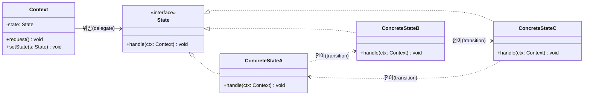

# 상태(State) 디자인 패턴 가이드

> 한 줄 요약: 객체의 내부 상태(internal state)를 별도의 클래스로 분리해, 상태가 바뀌면 마치 객체의 클래스가 바뀐 것처럼 동작이 달라지도록 만드는 패턴.
>
> 분류: 행위 패턴(Behavioral Pattern)
> 다른 이름(Aliases): Objects for States

---

## 상세 설명

상태(State) 패턴은 GoF의 행위 패턴 중 하나로, "객체의 내부 상태에 따라 동일한 요청에 대한 응답이 달라져야 하는" 문제를 해결한다. 가장 흔한 구현 안티패턴은 모든 동작 메서드에서 `if (state == OPEN) ... else if (state == CLOSED) ...` 와 같은 거대한 조건문 분기를 두는 것인데, 상태와 행동의 가짓수가 늘어날수록 분기 폭발(combinatorial branching)이 발생해 수정·확장이 어렵다. 상태 패턴은 이 분기 자체를 다형성(polymorphism)으로 치환한다.

핵심 아이디어는 두 가지다. 첫째, 컨텍스트(Context)가 갖던 "상태"라는 데이터를 하나의 객체(`State`)로 승격시킨다. 둘째, 각 구체 상태(Concrete State) 클래스가 그 상태에서만 유효한 행동을 자기 자신의 메서드로 가진다. 컨텍스트는 자신이 현재 어느 상태 객체를 참조하는지만 알고, 요청이 오면 그 상태 객체로 위임(delegate)한다. 결과적으로 클라이언트 입장에서는 컨텍스트의 메서드 하나만 호출했을 뿐인데, 마치 객체의 클래스 자체가 바뀐 듯이 다른 행동이 일어난다.

상태 패턴은 유한 상태 기계(FSM, Finite State Machine)의 객체지향적 구현으로 자주 설명된다. FSM이 "상태 집합 + 입력 + 전이 함수 + 출력"을 표 또는 수식으로 표현한다면, 상태 패턴은 같은 모델을 클래스 계층으로 옮긴 것이다. 단, 두 개념이 완전히 같지는 않다. FSM은 전이 테이블을 외부에서 관리할 수 있는 반면, GoF 원전의 상태 패턴은 일반적으로 다음 상태(next state)를 결정하는 책임을 상태 객체 스스로에게 둔다는 차이가 있다. 즉, 상태가 단순히 "현재 무엇을 할지"뿐 아니라 "다음에 어디로 갈지"까지 안다는 것이 GoF 상태 패턴의 특징이다.

역사적으로 GoF(1994)는 이 패턴을 TCP 연결의 `Established`, `Listen`, `Closed` 같은 프로토콜 상태를 모델링하는 예로 소개했다. 이후 Spring StateMachine, AWS Step Functions, Akka FSM 등 다양한 프레임워크가 이 패턴을 일반화·외부화한 형태로 제공한다. 변형으로는 상태 객체를 싱글톤(Singleton)으로 공유해서 메모리를 아끼는 방식, 전이 테이블을 별도 객체로 빼서 상태 객체가 직접 다음 상태를 알지 못하도록 만드는 "Table-driven State Machine" 등이 있다.

---

## 디자인 패턴을 충족하는 최소 조건

이 섹션에서는 "어떤 코드가 진짜로 상태 패턴이라고 부를 수 있는가"의 기준을 명확히 한다.

1. **상태가 객체로 추출되어 있어야 한다** — 상태가 `enum` 상수나 `int` 플래그가 아니라, 공통 인터페이스(예: `State`)를 구현하는 객체로 표현되어야 한다. 각 상태별 동작은 그 객체의 메서드에 캡슐화된다.
2. **컨텍스트는 현재 상태 객체에게 위임한다** — `Context`는 행동을 직접 구현하지 않고, 보유한 `State` 참조의 메서드를 호출한다. `Context` 안에 `switch`/`if-else`로 상태별 분기가 남아 있다면 상태 패턴이 아니다.
3. **상태 전이 결정권이 상태 측에 있다** — 다음 상태로의 전이는 `Context`가 외부에서 강제로 정하는 것이 아니라, 현재 상태 객체가 입력을 받아 "내가 끝났다, 다음은 X 상태다"라고 판단해 `context.setState(next)`를 호출한다. 이 점이 Strategy 패턴과 갈리는 결정적 차이다.
4. **상태별 클래스는 다른 상태의 내부 구현을 모른다** — 한 상태가 다른 상태의 필드를 직접 읽거나 쓰지 않는다. 전이는 새 상태 객체를 생성하거나 참조해서 컨텍스트에 주입하는 형태로만 이루어진다.

> 위 조건 중 하나라도 빠지면 본 패턴이라고 보기 어렵다. 특히 3번이 빠지면 사실상 Strategy 패턴, 2번이 빠지면 단순한 enum 분기 코드에 가깝다.

### 흔히 오해하는 지점

- **Strategy 패턴과의 혼동**: Strategy와 State는 클래스 다이어그램이 거의 동일하다(컨텍스트가 인터페이스에 위임). 차이는 "누가 알고리즘을 바꾸는가"다. Strategy는 클라이언트가 외부에서 명시적으로 교체하고, 교체된 전략 사이에는 시간적 순서가 없다. State는 상태 자신(또는 컨텍스트의 내부 이벤트)이 전이를 일으키며, 상태 간 순서(생명주기)가 존재한다.
- **enum + switch도 상태 패턴이라는 오해**: 상태값을 enum으로 두고 모든 메서드에서 `switch`로 분기하는 코드는 상태 패턴이 아니다. 새 상태를 추가할 때마다 모든 메서드의 `switch`를 수정해야 하므로 OCP(개방-폐쇄 원칙)를 위반한다.
- **FSM = State 패턴이라는 오해**: FSM은 수학적 모델이고 State 패턴은 OO 구현 방식 중 하나일 뿐이다. 전이 테이블을 외부 객체로 빼고 상태 객체는 행동만 가지게 만든 "table-driven" 구현도 충분히 FSM이지만, 엄밀한 의미의 GoF State 패턴과는 약간 다르다.
- **상태 객체가 가변(mutable)이어야 한다는 오해**: 상태 객체는 보통 상태별 동작만 가지므로 불변(immutable)인 경우가 많고, 흔히 싱글톤으로 공유한다. "상태가 변한다"는 것은 컨텍스트가 가리키는 참조가 바뀐다는 의미이지, 상태 객체 내부 필드가 바뀐다는 뜻이 아니다.

---

## 사례를 통한 예시

### 예시 1: 자판기(Vending Machine)

**상황**: 자판기는 동전 투입 여부, 상품 선택 여부, 재고 상태에 따라 같은 "동전 투입" 또는 "상품 분배" 요청을 다르게 처리해야 한다. 상태로는 `NoCoin`(동전 없음), `HasCoin`(동전 투입됨), `Dispensing`(상품 분배 중), `SoldOut`(매진)이 있다.

```java
// State 인터페이스: 자판기에 발생할 수 있는 이벤트 4종을 선언한다.
interface VendingState {
    void insertCoin(VendingMachine ctx);
    void ejectCoin(VendingMachine ctx);
    void selectProduct(VendingMachine ctx);
    void dispense(VendingMachine ctx);
}

// Context: 클라이언트가 호출하는 진입점. 모든 메서드를 현재 상태로 위임한다.
class VendingMachine {
    private VendingState state;
    private int stock;

    public VendingMachine(int stock) {
        this.stock = stock;
        this.state = (stock > 0) ? new NoCoinState() : new SoldOutState();
    }

    // 패턴 핵심: setState는 상태 객체가 호출한다. 외부 클라이언트가 직접 부르지 않는다.
    void setState(VendingState next) { this.state = next; }
    int  getStock()                  { return stock; }
    void decreaseStock()             { this.stock--; }

    public void insertCoin()    { state.insertCoin(this); }
    public void ejectCoin()     { state.ejectCoin(this); }
    public void selectProduct() { state.selectProduct(this); }
    public void dispense()      { state.dispense(this); }
}

// Concrete State 1: 동전 없음
class NoCoinState implements VendingState {
    public void insertCoin(VendingMachine ctx) {
        System.out.println("동전 투입됨");
        ctx.setState(new HasCoinState());        // 전이 결정권은 상태 측에 있다
    }
    public void ejectCoin(VendingMachine ctx)    { System.out.println("반환할 동전 없음"); }
    public void selectProduct(VendingMachine ctx){ System.out.println("먼저 동전을 넣으세요"); }
    public void dispense(VendingMachine ctx)     { System.out.println("동작 불가"); }
}

// Concrete State 2: 동전 있음
class HasCoinState implements VendingState {
    public void insertCoin(VendingMachine ctx)   { System.out.println("이미 동전이 들어있음"); }
    public void ejectCoin(VendingMachine ctx) {
        System.out.println("동전 반환");
        ctx.setState(new NoCoinState());
    }
    public void selectProduct(VendingMachine ctx){
        System.out.println("상품 선택됨");
        ctx.setState(new DispensingState());
    }
    public void dispense(VendingMachine ctx)     { System.out.println("먼저 상품을 선택하세요"); }
}

// Concrete State 3: 분배 중
class DispensingState implements VendingState {
    public void insertCoin(VendingMachine ctx)   { System.out.println("분배 중에는 동전 불가"); }
    public void ejectCoin(VendingMachine ctx)    { System.out.println("분배 중에는 반환 불가"); }
    public void selectProduct(VendingMachine ctx){ System.out.println("이미 선택 완료"); }
    public void dispense(VendingMachine ctx) {
        ctx.decreaseStock();
        System.out.println("상품 분배 완료");
        ctx.setState(ctx.getStock() > 0 ? new NoCoinState() : new SoldOutState());
    }
}

// Concrete State 4: 매진
class SoldOutState implements VendingState {
    public void insertCoin(VendingMachine ctx)   { System.out.println("매진, 동전 즉시 반환"); }
    public void ejectCoin(VendingMachine ctx)    { System.out.println("반환할 동전 없음"); }
    public void selectProduct(VendingMachine ctx){ System.out.println("매진"); }
    public void dispense(VendingMachine ctx)     { System.out.println("매진"); }
}

// 사용 예
class Demo {
    public static void main(String[] args) {
        VendingMachine vm = new VendingMachine(1);
        vm.insertCoin();      // NoCoin -> HasCoin
        vm.selectProduct();   // HasCoin -> Dispensing
        vm.dispense();        // Dispensing -> SoldOut (재고 0)
        vm.insertCoin();      // SoldOut: 즉시 반환
    }
}
```

**해설**: `VendingMachine`이 컨텍스트(Context), `VendingState`가 추상 상태(State), `NoCoinState`/`HasCoinState`/`DispensingState`/`SoldOutState`가 구체 상태(Concrete State)다. 핵심은 `VendingMachine` 어디에도 `if (state == ...)` 분기가 없다는 점, 그리고 `setState()`를 호출하는 주체가 항상 상태 객체 자신이라는 점이다. 새 상태(예: `MaintenanceState`)를 추가하려면 새 클래스만 만들고 기존 코드는 거의 건드리지 않는다(OCP 충족).

### 예시 2: `java.nio.channels.SelectionKey`의 readiness 상태

**상황**: Java NIO의 `SelectionKey`는 채널(Channel)이 어떤 I/O 연산을 할 준비가 되었는지(readiness)를 비트마스크 상수로 노출한다. 자바 표준 라이브러리는 성능 때문에 비트마스크를 쓰지만, 그 위에 얇은 디스패처(dispatcher)를 얹으면 전형적인 상태 패턴 형태가 된다.

```java
import java.nio.channels.*;
import java.util.*;

// 상태 인터페이스: "이 readiness에서 무엇을 할 것인가"
interface ReadinessHandler {
    void handle(SelectionKey key) throws Exception;
}

// 구체 상태들
class AcceptHandler  implements ReadinessHandler { public void handle(SelectionKey k) { /* accept */ } }
class ReadHandler    implements ReadinessHandler { public void handle(SelectionKey k) { /* read  */ } }
class WriteHandler   implements ReadinessHandler { public void handle(SelectionKey k) { /* write */ } }
class ConnectHandler implements ReadinessHandler { public void handle(SelectionKey k) { /* finish connect */ } }

// 컨텍스트 역할: Selector 루프
class Reactor {
    private final Selector selector;
    private final Map<Integer, ReadinessHandler> table = new HashMap<>();

    Reactor(Selector s) {
        this.selector = s;
        table.put(SelectionKey.OP_ACCEPT,  new AcceptHandler());
        table.put(SelectionKey.OP_READ,    new ReadHandler());
        table.put(SelectionKey.OP_WRITE,   new WriteHandler());
        table.put(SelectionKey.OP_CONNECT, new ConnectHandler());
    }

    void loop() throws Exception {
        while (true) {
            selector.select();
            for (SelectionKey key : selector.selectedKeys()) {
                // 컨텍스트는 분기 대신 "현재 상태에 해당하는 핸들러"로 위임한다.
                for (Map.Entry<Integer, ReadinessHandler> e : table.entrySet()) {
                    if ((key.readyOps() & e.getKey()) != 0) {
                        e.getValue().handle(key);
                    }
                }
            }
            selector.selectedKeys().clear();
        }
    }
}
```

**해설**: `SelectionKey`의 readiness 비트(`OP_ACCEPT`, `OP_READ`, `OP_WRITE`, `OP_CONNECT`)가 각각 하나의 상태에 대응되고, 각 상태에서 해야 할 동작은 별도의 `ReadinessHandler` 구현체에 캡슐화된다. 비트마스크 자체는 GoF 정의를 엄밀히 따르지 않지만, "현재 상태에 따라 처리 로직이 다형적으로 달라진다"는 본질은 동일하다. Netty의 `ChannelHandler` 파이프라인이나 Spring StateMachine의 `StateMachine<S, E>` 역시 같은 원리를 더 형식화한 사례다. 예컨대 Spring StateMachine은 `@WithStateMachine`과 `configure(StateMachineTransitionConfigurer)`를 통해 상태·전이·이벤트를 외부 설정으로 빼내며, 본문에서 본 "상태 객체가 직접 다음 상태를 가리키는" 결합을 줄여주는 변형이다.

---

## 어떨 때 사용하나

상태 패턴은 객체의 행동이 "지금 자신이 어떤 단계/모드/페이즈에 있느냐"에 따라 크게 달라지고, 그 단계가 시간의 흐름이나 외부 이벤트에 의해 분명히 전이될 때 가장 효과적이다. 동일한 메서드 호출이 상태마다 다른 응답을 내야 하고, 상태마다 허용/금지되는 행위가 명확히 구분되어 있다면 도입을 강하게 고려할 만하다. 거대한 `switch`나 중첩된 `if-else`로 상태 분기가 흩어져 있어 "새 상태 추가"가 두려운 단계에 들어섰다면 이미 도입 시점이 지난 것이다.

전형적인 도입 신호는 다음과 같다.

- 한 클래스 안에 여러 메서드가 똑같이 "현재 상태"를 검사하는 `if/switch`를 반복하고 있다.
- 새로운 상태를 하나 추가하려면 5개 이상의 메서드를 동시에 수정해야 한다(샷건 서저리, shotgun surgery).
- 상태마다 허용 가능한 작업과 금지된 작업의 표가 명확히 그릴 수 있다(즉, 사실상 FSM이다).
- 워크플로우/주문 처리/세션/네트워크 프로토콜/UI 화면 흐름 등 "단계가 있는" 도메인이다.
- 상태 전이 자체가 비즈니스 규칙이며, 잘못된 전이를 컴파일 타임 또는 런타임에 차단하고 싶다.

### 사용하면 안 되는 경우 (Anti-patterns)

- **상태가 2개뿐이고 동작 차이가 사소한 경우**: `boolean active` 한 개로 끝날 일을 굳이 클래스 4~5개로 분해하면 오히려 인지 비용이 늘어난다.
- **상태별 행동이 거의 같고 데이터만 다른 경우**: 이 경우는 상태가 아니라 단순한 값(value)이다. enum이나 데이터 클래스로 충분하다.
- **상태 전이가 사실상 일어나지 않는 경우**: 객체가 생성된 시점에 한 번 모드를 결정한 뒤 평생 바뀌지 않는다면 Strategy 패턴이 더 적합하다.
- **상태 수가 폭발하는 경우**: 직교(orthogonal)한 두 축이 동시에 변하면(예: `로그인 여부 × 결제 여부`) 상태 수가 곱으로 늘어난다. 이때는 단일 상태 패턴 대신 Hierarchical State Machine 또는 두 개의 상태 패턴을 분리해 적용한다.

---

## 장점과 단점, 한계점

### 장점
- **조건 분기 제거**: 거대한 `switch/if-else`가 다형성 호출로 대체되어 각 상태의 로직이 한 클래스에 응집된다. 이는 SRP(단일 책임 원칙)와 직접적으로 부합한다.
- **OCP(개방-폐쇄 원칙) 준수**: 새 상태를 추가할 때 새 클래스를 만들고, 전이 규칙을 가진 기존 상태 한두 곳만 수정하면 된다. 컨텍스트 본체는 거의 손대지 않는다.
- **명시적 상태 전이**: 전이 로직이 코드의 한 지점(상태 객체의 메서드 내부)에 모이므로, "어디서 어떤 상태로 갈 수 있는가"를 추적·테스트하기 쉽다.
- **불법 전이 차단의 자연스러움**: 어떤 상태에서 호출되면 안 되는 메서드는 그 상태 클래스 안에서 예외를 던지거나 무시하면 된다. 호출자는 같은 인터페이스를 쓰지만 행동은 안전하게 분리된다.

### 단점
- **클래스 수 증가**: 상태가 N개면 최소 N+1개의 클래스(컨텍스트, 추상 상태, N개 구체 상태)가 생긴다. 상태가 적을 때는 오히려 코드량이 늘어 보일 수 있다.
- **상태 객체 간 결합**: GoF 원전처럼 상태 객체가 직접 다음 상태를 `new`하면, 한 상태 클래스가 다른 구체 상태 클래스의 이름을 알게 된다. 이는 상태 그래프가 클래스 의존 그래프로 그대로 노출된다는 뜻이며, 변경 시 영향 범위가 넓어진다.
- **전체 그림 파악의 어려움**: 전이가 여러 클래스에 흩어지면 "이 객체가 가질 수 있는 모든 상태와 경로"를 한눈에 보기 어려워진다. 별도의 상태 다이어그램 문서가 거의 필수다.

### 한계점
- **동시성(concurrency)**: 여러 스레드가 동시에 컨텍스트의 행동을 호출하면 상태 전이 사이에 race condition이 생긴다. `setState`와 행동 호출이 원자적이지 않기 때문이다. 동시 접근 환경에서는 락(lock), CAS, 또는 액터(Actor) 모델 같은 추가 장치가 필요하다.
- **상태 폭발(state explosion)**: 직교 차원이 늘어나면 상태 수가 곱으로 증가한다. 평면(flat) 상태 패턴 한 번으로는 표현하기 어렵고, Statechart(Harel) 또는 Hierarchical State Machine 같은 확장이 필요하다.
- **테스트 시 컨텍스트 의존**: 각 상태의 단위 테스트가 결국 컨텍스트 객체를 필요로 하기 때문에, 상태 객체만 떼어내 완전히 독립적으로 테스트하기는 어렵다. 컨텍스트의 일부를 mock으로 두는 식의 보조가 필요하다.
- **언어별 표현 한계**: 일부 함수형 언어는 대수적 데이터 타입(ADT) + 패턴 매칭으로 같은 문제를 더 간결하게 표현하므로, 그 환경에서는 GoF 형태의 클래스 분해가 과잉일 수 있다.

---

## 정보 표

| 항목 | 값 |
| --- | --- |
| 분류 | 행위 패턴(Behavioral Pattern) |
| 언어 의존성 | 언어 비의존적. 인터페이스/상속과 다형성만 지원하면 모든 OOP 언어에서 구현 가능(Java, C#, Python, TypeScript 등). |
| 활용성(1점~5점) | 4/5 — 워크플로우, 주문/결제, 프로토콜, UI 흐름, 게임 AI 등 "단계가 있는" 도메인에서 매우 자주 쓰인다. |
| 학습 난이도 | 중 — 구조 자체는 단순하지만 Strategy와의 구분, 전이 책임 위치 결정에서 자주 헷갈린다. |
| 자주 함께 쓰이는 패턴 | Singleton(상태 객체 공유), Flyweight(불변 상태 공유), Strategy(구조 동일), Memento(상태 스냅샷 저장), Observer(상태 변경 알림) |
| 대표 사용 사례 | TCP 연결 상태 관리, 주문/배송 워크플로우, 자판기/엘리베이터 제어, Spring StateMachine, 게임 캐릭터 AI(예: Idle/Patrol/Chase/Attack) |

---

## Class Diagram



> 점선 화살표(`..>`)는 구체 상태가 `context.setState(new NextState())` 형태로 다음 상태를 결정하는 "전이"를 나타낸다. 컨텍스트는 `State` 인터페이스에만 의존하고, 구체 상태 클래스를 직접 알지 못한다는 점이 다이어그램의 핵심이다.

### 역할 설명
- **Context**: 클라이언트가 사용하는 진입점. 현재 상태 객체에 대한 참조(`state`)를 보유하고, 들어온 요청을 그 상태 객체에 위임한다. 상태별 분기 로직을 직접 갖지 않는다.
- **State (추상/인터페이스)**: 모든 구체 상태가 공통으로 제공해야 하는 행동을 선언한다. 컨텍스트가 의존하는 단 하나의 타입이다.
- **ConcreteStateA / B / C**: 특정 상태일 때의 행동을 구현하고, 입력과 컨텍스트의 정보를 바탕으로 "다음 상태가 누구인지"를 결정해 `context.setState(...)`를 호출한다. 상태 전이의 주체.

---

## 참고 자료
- Erich Gamma, Richard Helm, Ralph Johnson, John Vlissides, "Design Patterns: Elements of Reusable Object-Oriented Software" (Addison-Wesley, 1994) — State 패턴 원전.
- Eric Freeman, Elisabeth Robson, "Head First Design Patterns" 2nd ed. (O'Reilly, 2020) — 자판기(Gumball Machine) 예시로 유명한 State 패턴 챕터.
- Refactoring Guru, "State" — https://refactoring.guru/design-patterns/state
- Spring StateMachine 공식 문서 — https://docs.spring.io/spring-statemachine/docs/current/reference/
- David Harel, "Statecharts: A Visual Formalism for Complex Systems" (Science of Computer Programming, 1987) — 계층적 상태 기계(HSM)의 이론적 배경.
- Oracle JDK Docs, `java.nio.channels.SelectionKey` — https://docs.oracle.com/javase/8/docs/api/java/nio/channels/SelectionKey.html
