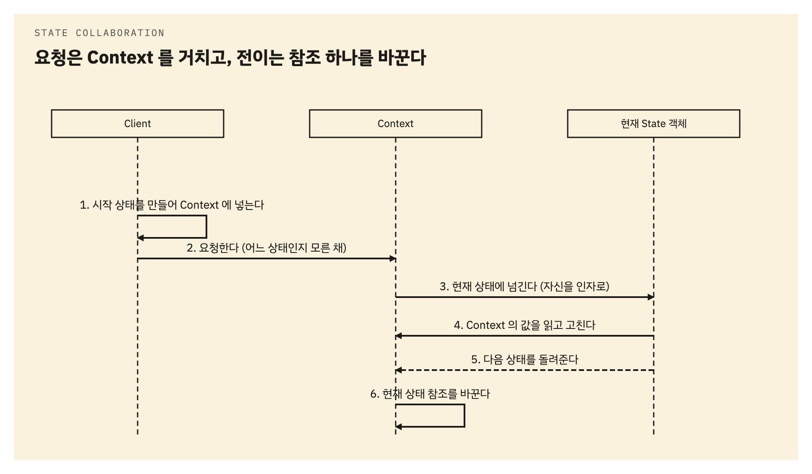
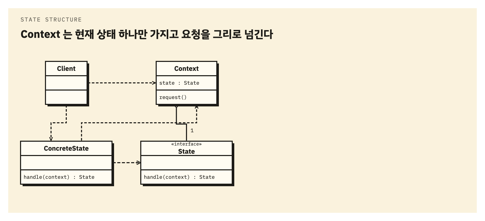

# State — 상태마다 객체를 두고, 다음 상태는 요청을 처리한 그 자리에서 정하기

## 한눈에 보는 개요

온라인 상점의 주문 코드를 하나 떠올려 봅시다. 주문 하나는 결제 대기에서 시작해 결제 완료를 거쳐 배송 중으로 가고, 도중에 취소될 수도 있어요. `Order` 클래스에는 `pay`·`ship`·`cancel` 세 메서드가 있고, 세 메서드가 모두 `switch (status)` 로 시작합니다. 같은 갈래가 세 번 적혀 있는 셈이죠. 여기에 분할 결제를 받기로 해서 「부분 결제」 상태가 하나 늘면 세 `switch` 를 전부 열어야 합니다.

State 의 해법은 **상태마다 객체를 하나 두고, 요청을 그 객체에 그대로 넘기는 것**입니다. 주문은 지금 어느 상태 객체를 가지고 있는지만 알고, 그 요청이 이 상태에서 무슨 뜻인지는 상태 객체가 답해요. 그리고 답하는 김에 다음 상태까지 정해 돌려줍니다. 상태가 하나 늘면 클래스가 하나 늘 뿐 `Order` 의 세 메서드는 그대로예요.

```text
Before : 주문 클래스 안에 상태별 갈래가 세 번 있음

  Order.pay(amount)     switch (status) { AWAITING_PAYMENT → …, PAID → …, SHIPPED → …, CANCELLED → … }
  Order.ship()          switch (status) { AWAITING_PAYMENT → …, PAID → …, SHIPPED → …, CANCELLED → … }
  Order.cancel()        switch (status) { AWAITING_PAYMENT → …, PAID → …, SHIPPED → …, CANCELLED → … }
  새 상태 하나           → 세 switch 를 모두 열어 case 추가

After : 상태마다 객체 하나, 주문은 현재 상태 객체에 넘기기만 함

  Order
    state ─┐
    pay    ├─▶ 현재 상태 객체.pay(주문, 금액) ──▶ 다음 상태 객체
    ship   ├─▶ 현재 상태 객체.ship(주문)     ──▶ 다음 상태 객체
    cancel ├─▶ 현재 상태 객체.cancel(주문)   ──▶ 다음 상태 객체
           │     ├─ AwaitingPayment
           │     ├─ Paid
           │     ├─ Shipped
           │     ├─ Cancelled
           └─────┴─ 새 상태 = 새 클래스 (Order 는 그대로)
```

이 패턴의 이름은 GoF(Gang of Four, 1994년에 나온 *Design Patterns* 의 저자 네 명을 함께 부르는 이름) 가 붙인 것이고 다른 이름은 Objects for States 예요(근거: GoF State 절 Also Known As). 분류는 행위 패턴이고, 함께 쓰는 패턴은 Flyweight 입니다. 상태 객체가 자기 필드에 아무것도 남기지 않으면 주문 여럿이 상태 객체 하나를 같이 써도 되는데, 그 조건을 이르는 말이 [참고 문서 「GoF 공통 어휘」의 내재 상태와 외재 상태](../../reference/gof-vocabulary/gof-vocabulary-ref_v1.0.2.md)예요. 이 글은 시나리오 셋을 따라갑니다. 주문 하나가 결제와 배송을 지나는 길, 상태가 하나 더 들어올 때 어디가 바뀌는가, 주문을 건너뛰고 상태 객체를 직접 부르면 어디서 어긋나는가. 끝까지 읽으면 어떤 코드를 State 라고 불러도 되는지 필수 조건 셋으로 판정할 수 있고, 클래스 그림이 거의 같은 [Strategy 편](../strategy/strategy-guide_v1.1.1.md)의 코드와도 구분할 수 있게 됩니다.

## 패턴 자세히 들여다보기

### 시나리오 1 — 주문 A 가 결제 대기에서 배송 중까지 가는 길

주문 A 가 들어왔습니다. 상품 금액 48,000원이고 아직 한 푼도 받지 않았어요. 손님이 배송부터 재촉하고, 그다음 48,000원을 결제하고, 결제가 끝나자 배송이 시작되고, 배송이 시작된 뒤에 취소를 요청합니다. 나와야 하는 것은 요청 네 건의 처리 기록 네 줄이에요. 이 장면에는 넷이 등장합니다. 요청을 받는 주문 객체 `Order`(패턴에서는 Context 라고 부르는 역할), 주문이 받을 수 있는 요청 셋의 모양을 선언한 `OrderState`(State), 그 모양을 상태마다 구현한 `AwaitingPayment`·`Paid`·`Shipped`(ConcreteState), 그리고 주문을 만들어 요청을 보내는 진입점 코드(Client)예요. 이름은 여기서 한 번씩만 소개하고 정식 정의는 개념 정리에서 합니다.



1. Client 가 주문 A 를 만들면서 시작 상태로 `AwaitingPayment` 객체를 넣습니다. 이 일을 Client 가 맡는 이유는 어느 상태에서 시작하는지가 업무 쪽 결정이어서예요. 선주문과 후결제를 나눠 받는 상점이면 같은 `Order` 클래스가 다른 상태에서 출발합니다. 이 판단을 `Order` 가 하면 시작 상태가 늘 때마다 `Order` 를 고치게 돼요. 그리고 이 자리가 Client 가 상태 객체를 직접 다루는 처음이자 마지막입니다.
2. Client 가 `order.ship()` 을 부릅니다. Client 는 주문이 지금 어느 상태인지 묻지 않아요. 물어서 분기해야 한다면 그 갈래가 주문을 부르는 코드마다 복제되고, 상태가 하나 늘 때 그 코드를 전부 찾아 고쳐야 합니다. 시나리오 3 이 이 규칙을 어긴 코드를 따라가요.
3. `Order.ship()` 은 자기 안에서 판단하지 않고 지금 가지고 있는 상태 객체의 `ship` 을 부릅니다. 요청 하나에 대한 답이 상태마다 다른데, 그 답을 `Order` 안의 갈래로 쓰면 상태가 늘 때마다 `Order` 의 세 메서드가 함께 길어져요. 개요의 Before 그림이 그 모양입니다.
4. `Order` 는 상태 객체를 부르면서 자기 자신을 인자로 함께 넘깁니다. 상태가 답을 내려면 `Order` 만 가지고 있는 값이 필요해서예요. 결제 대기 상태가 "다 받았는가" 를 판단하려면 상품 금액과 지금까지 받은 금액을 알아야 하는데, 그 둘은 주문의 데이터입니다. 넘기는 방식은 둘로 나뉘어요.
   - 갈래 4-a. Context 자신을 넘깁니다. 상태가 필요한 값을 `order.total()` 처럼 물어서 가져가고, 고칠 때도 `order.addPayment(...)` 처럼 `Order` 의 연산을 부릅니다. 이 가이드의 코드가 이 방식이에요.
   - 갈래 4-b. 필요한 값만 인자로 넘깁니다. `ship(총액, 받은금액)` 처럼 넘기면 상태가 `Order` 를 몰라도 되지만, 상태가 `Order` 를 고쳐야 하는 경우(받은 금액 적기, 환불)에는 고칠 값을 돌려줄 길을 따로 만들어야 합니다.
5. `AwaitingPayment.ship` 은 배송을 시작하지 않고 거절 기록을 남긴 뒤 **자기 자신**을 다음 상태로 돌려줍니다. 허용되지 않는 요청을 어떻게 다룰지도 상태마다 다른 답이라 상태 객체 안에 둬요. 여기서는 거절이지만 결제 대기에서 온 취소 요청은 받아들여집니다. 그리고 자기 자신을 돌려주는 것으로 "전이가 일어나지 않았다" 까지 같은 방식으로 말합니다.
6. Client 가 `order.pay(48_000)` 을 부르면 `AwaitingPayment.pay` 가 받은 금액을 `Order` 에 적고 상품 금액과 견줍니다. 48,000 이 48,000 이상이라 다 받았다고 판단하고 `Paid` 객체를 돌려줘요. 다음 상태를 이 자리에서 정하는 이유는 그 조건(다 받았는가)을 방금 요청을 처리한 쪽이 알고 있어서입니다. 다만 이것이 패턴의 요구는 아니에요. 다음 상태를 정하는 쪽은 둘 중 아무 쪽이어도 됩니다(근거: GoF State 절 Collaborations).
   - 갈래 6-a. Context 가 정합니다. 상태 객체는 처리만 하고, `Order.pay` 가 `paid >= total` 을 보고 다음 상태를 고르는 모양이에요. 전이 조건이 한곳에 모이는 대신 그 조건을 보는 코드가 `Order` 로 돌아옵니다.
   - 갈래 6-b. 상태가 돌려주지 않고 직접 바꿉니다. `order.setState(new Paid())` 를 상태 객체가 부르는 모양이에요. `Order` 에 상태를 넣는 연산을 공개해야 하고, 그 연산이 공개된 만큼 Client 도 부를 수 있게 됩니다.
7. `Order.pay` 가 반환받은 객체를 `state` 필드에 넣습니다. 이 대입 한 번이 전이의 전부예요. 그래서 "결제는 끝났는데 상태는 아직 결제 대기" 같은 중간 모습이 생기지 않습니다. 5·6단계의 처리를 먼저 하고 이 대입을 맨 뒤에 두는 순서도 그 때문이에요. 필드를 먼저 바꾸고 요청을 처리하면, 처리 도중에 예외가 나갔을 때 주문은 이미 결제 완료인데 돈은 받지 않은 상태로 남습니다.
8. 이어지는 `order.ship()` 은 이제 `Paid.ship` 으로 전달돼 송장을 발행하고 `Shipped` 를 돌려줍니다. 배송이 시작된 뒤에 온 `order.cancel()` 은 `Shipped.cancel` 이 거절해요. 같은 `cancel` 이 결제 완료에서는 환불로, 배송 중에서는 거절로 처리되는데, `Order.cancel()` 의 코드는 두 경우에 한 글자도 다르지 않습니다.

```text
요청            Order 가 부른 것                     상태 객체가 한 일            Order 가 받은 다음 상태
ship()          AwaitingPayment.ship(order)         거절 기록                   AwaitingPayment (그대로)
pay(48000)      AwaitingPayment.pay(order, 48000)   48,000 수납 · 총액 충족      Paid
ship()          Paid.ship(order)                    송장 발행                   Shipped
cancel()        Shipped.cancel(order)               거절 기록                   Shipped (그대로)
```

잠깐, 확인 하나만 해 볼까요? 4단계에서 `Order` 가 자신을 넘기지 않았다면 `AwaitingPayment.pay` 는 6단계의 판단 중 어느 것을 못 하게 될까요?

"다 받았는가" 를 못 합니다. 받은 금액을 주문에 적는 일도 못 하고요. 상품 금액과 누적 수납액은 상태가 아니라 주문의 데이터라서, 상태 객체가 그 둘에 접근할 길이 없으면 판단도 기록도 `Order` 로 돌아가야 합니다. 그러면 3단계에서 없앤 갈래가 그 자리에서 되살아나요.

```text
Order 를 함께 넘기지 않으면 AwaitingPayment 가 가진 것

  pay(48,000)            ← 인자로 온 것은 금액 하나뿐
  상품 금액 48,000 ?      ← 모름. Order 의 데이터다
  지금까지 받은 금액 ?     ← 모름. Order 의 데이터다
  받은 48,000 을 적을 곳 ? ← 없음. 자기 필드에 적으면 주문마다 상태 객체가 따로 필요해진다
```

이 시나리오가 보여 준 것은 역할 넷과 요청이 전달되는 방향입니다. 시작 상태를 정해 넣는 일(1단계)은 Client 가, 요청을 받아 넘기고 반환받은 상태를 다시 가지고 있는 일(3·7단계)은 Context 가, 그 요청이 이 상태에서 무슨 뜻인지와 다음 상태가 무엇인지(5·6단계)는 ConcreteState 가 맡아요. Context 는 상태 객체를 부를 때 자신을 함께 넘기고(4단계), 그래서 상태가 Context 의 값을 읽고 고칠 수 있습니다. 전이를 정하는 쪽(6-a·6-b)과 데이터를 넘기는 방식(4-a·4-b)은 이 뼈대 위의 선택지예요.

### 시나리오 2 — 부분 결제 상태가 하나 더 들어올 때

상점이 분할 결제를 받기로 했습니다. 주문 B 는 상품 금액 30,000원이고, 손님이 12,000원을 먼저 내고 나중에 18,000원을 더 냅니다. 바뀌기 전 코드에서는 결제 대기 상태가 상품 금액에 모자라는 돈을 거절했어요. 아래가 그 코드를 실제로 실행한 B 부분의 기록입니다. 12,000원도 18,000원도 들어가지 못하고, 결제 대기에서 그대로 취소됩니다.

```text
B awaiting-payment pay rejected(12000 < total 30000) -> awaiting-payment
B awaiting-payment pay rejected(18000 < total 30000) -> awaiting-payment
B awaiting-payment cancel before payment -> cancelled
B cancelled pay rejected(order cancelled) -> cancelled
```

1. 개발자가 `PartiallyPaid` 클래스를 새로 씁니다. 구현하는 모양은 시나리오 1 의 `OrderState` 그대로이고 본문만 달라요. `pay` 는 받은 돈을 더해 총액을 채웠으면 `Paid` 를, 아직 모자라면 자기 자신을 돌려줍니다. `ship` 은 "아직 다 내지 않았다" 로 거절하고, `cancel` 은 그때까지 받은 돈을 환불한 뒤 `Cancelled` 로 보내요. 모양을 바꾸지 않는 이유는 그 모양이 `Order` 와 모든 상태 사이의 계약이라서입니다. 모양이 바뀌면 `Order` 의 호출 줄과 기존 상태 넷이 전부 따라 바뀌어요.
2. `AwaitingPayment.pay` 를 고칩니다. 모자라는 돈을 거절하던 갈래를 지우고, 받은 돈을 더한 뒤 총액을 채웠으면 `Paid` 를 아니면 `PartiallyPaid` 를 돌려주게 바꿔요. 이 한 메서드를 고치는 것이 State 가 치르는 대가입니다. "결제 대기 다음은 무엇인가" 를 아는 쪽이 결제 대기 상태 자신이라, 그 뒤에 상태를 하나 끼우면 앞 상태가 새 이름을 알아야 해요.
3. `Order` 는 한 줄도 바뀌지 않습니다. `Order` 에 적힌 상태 관련 이름은 `OrderState` 와 `pay`·`ship`·`cancel` 뿐이라 새 클래스 이름이 들어갈 자리가 없어요. 바뀌기 전 파일과 바뀐 뒤 파일에서 `Order` 클래스만 떼어 비교하면 차이가 0줄입니다(직접 비교해 확인).
4. 고친 코드로 주문 B 를 다시 넣으면 12,000원이 `partially-paid` 를 만들고, 18,000원이 총액을 채워 `paid` 로 갑니다. 그다음 취소는 `Paid.cancel` 로 전달돼 30,000원을 환불해요. 취소된 뒤의 결제 요청은 `Cancelled.pay` 가 거절합니다. 이 네 줄이 구현 예시의 실행 출력 뒤쪽 네 줄이에요.
5. 같은 변화를 `switch` 로 쓴 코드에 넣으면 손대는 곳이 달라집니다. 상태를 열거형 상수로 두고 `Order` 의 세 메서드가 각각 `switch` 하는 판을 만들어 같은 여덟 줄을 내게 한 뒤 「부분 결제」를 더해 봤어요. `Order` 클래스 안에서 10줄이 바뀌고, 바뀐 자리는 열거형 선언 한 줄과 `pay`·`ship`·`cancel` 세 메서드의 `switch` 전부였습니다(직접 고쳐 컴파일·실행해 확인). 여기서 10줄은 고치기 전 파일과 고친 뒤 파일을 `diff` 로 견줘 지운 줄과 더한 줄을 합쳐 센 값이라, 같은 일을 하는 판이라도 어떻게 쓰느냐에 따라 이 수는 달라져요. 눈여겨볼 것은 총량이 아니라 **바뀐 자리** 입니다. State 판에서 `Order` 가 0줄이었던 것과 달라지는 자리가 여기예요.

```text
변화: 「부분 결제」 상태 추가          바뀐 곳                                      안 바뀐 곳
─────────────────────────────────    ────────────────────────────────────────    ────────────────────────────
State 로 쓴 판                        PartiallyPaid 클래스 (새로 씀)               Order 전체 (0줄)
                                     AwaitingPayment.pay 의 본문                  OrderState 의 연산 모양
                                                                                  Paid · Shipped · Cancelled
열거형 + switch 로 쓴 판               Order 안 10줄 — 열거형 선언 1줄과            —
                                     pay · ship · cancel 세 switch 전부
```

여기서 헷갈리기 쉬운 포인트는 State 가 변화를 비용 없이 처리한다고 믿는 것입니다. 2단계에서 `AwaitingPayment` 를 고쳐야 했죠. 상태가 스무 개쯤 되는 흐름의 한가운데에 상태를 끼우면 앞뒤 상태 둘을 고치게 되고, 그 상태들이 서로의 이름을 알고 있다는 사실이 그제야 확인됩니다. 전이를 상태가 정하면 상태끼리 묶인다는 것은 Rust 공식 책도 이 패턴의 단점으로 짚는 지점이에요([The Rust Programming Language 18.3](https://doc.rust-lang.org/book/ch18-03-oo-design-patterns.html)). 피하려면 시나리오 1 의 갈래 6-a 처럼 전이 판단을 `Order` 로 올리면 되는데, 그러면 전이 조건을 보는 갈래가 `Order` 에 생깁니다. 둘 중 무엇을 감당할지가 이 자리의 선택이에요.

이 시나리오가 보여 준 것은 변화가 미치는 범위입니다. 새 상태가 들어올 때 바뀌는 곳은 새 ConcreteState 하나와 그 앞 상태 하나이고, Context 와 나머지 상태는 그대로예요(1~3단계). 열거형과 `switch` 로 같은 일을 하면 같은 변화가 Context 의 메서드 전부에 미칩니다(5단계). 대신 State 쪽에서는 상태끼리 다음 상태의 이름을 알게 되고, 그것이 이 패턴이 Strategy 와 달라지는 자리이기도 해요.

### 시나리오 3 — Client 가 상태 객체를 직접 부르면 어디서 어긋나는가

같은 상점의 다른 코드베이스는 `Order` 를 조금 다르게 짰습니다. 현재 상태 객체를 돌려주는 `state()` 연산을 공개해 두었고, 결제 화면 코드가 편의상 `order.state().pay(order, 48_000)` 을 직접 부릅니다. 상태 객체가 공개돼 있으니 문법상 막을 것이 없어요. 아래 결과는 정본 코드에 `state()` 연산 한 개를 더하고 진입점의 `a.pay(48_000)` 한 줄을 그 직접 호출로 바꿔 Java 21 로 실제로 컴파일하고 실행한 것입니다. 마지막 줄의 `A paid=48000` 은 확인용으로 진입점 끝에 수납액을 찍는 줄 하나를 더해 얻은 값이에요. 주문 B 부분은 정본과 글자까지 같아서 아래에는 주문 A 부분만 옮겼습니다.

```text
A awaiting-payment ship rejected(not paid yet) -> awaiting-payment
A awaiting-payment ship rejected(not paid yet) -> awaiting-payment
A awaiting-payment cancel before payment -> cancelled
A paid=48000
```

1. 첫 줄은 시나리오 1 과 같습니다. 결제 전 배송 요청이 거절되고 결제 대기에 남아요. 여기까지는 `Order` 를 거쳤으니 기록도 남고 상태도 맞습니다.
2. 결제 화면이 `order.state().pay(order, 48_000)` 을 부릅니다. `AwaitingPayment.pay` 는 제 일을 다 해요. 48,000원을 주문에 적고, 총액을 채웠으니 `Paid` 객체를 만들어 돌려줍니다. 그런데 그 객체를 받아 `state` 필드에 넣어 줄 쪽이 없어요. 돌려준 값이 그대로 버려집니다. 시나리오 1 의 7단계가 없는 호출이라, 처리는 됐는데 전이만 사라진 것이죠.
3. 다음 `order.ship()` 이 다시 `AwaitingPayment.ship` 으로 전달돼 같은 거절을 냅니다. 둘째 줄이 첫째 줄과 글자까지 같은 이유가 이것이에요. 48,000원을 받고도 배송이 시작되지 않고, 주문 기록만 보는 사람은 손님이 결제를 안 한 것으로 읽습니다.
4. 취소 요청이 `AwaitingPayment.cancel` 로 전달됩니다. 결제 대기 상태의 취소는 "아직 받은 돈이 없다" 를 전제로 쓰였으니 환불하지 않아요. 그래서 셋째 줄은 `cancel before payment` 로 끝나고, 넷째 줄이 보여 주듯 48,000원은 주문에 적힌 채 남습니다. 돈은 받았는데 환불 없이 취소된 주문이 생긴 거예요. 시나리오 1 의 2단계에서 Client 가 `Order` 에게만 요청한다고 한 이유가 이것입니다. 전이와 처리가 한 호출 안에서 끝나야 둘이 어긋나지 않아요.
5. 되돌리는 길은 둘이고 고치는 자리가 다릅니다. 하나는 결제 화면이 `order.pay(48_000)` 을 부르게 하는 것이고, 다른 하나는 `Order` 에서 `state()` 연산을 지워 직접 부를 길 자체를 없애는 것이에요. 앞은 부르는 쪽을 고치는 일이고 뒤는 `Order` 의 공개 연산을 줄이는 일이라, 최소 조건 절에서도 둘은 같은 조건(2번)의 앞면과 뒷면으로 묶입니다.

```text
Before (시나리오 3)                                 After (시나리오 1 의 모양)

  order.state().pay(order, 48_000)                  order.pay(48_000)
    AwaitingPayment.pay 실행 → Paid 를 돌려줌           AwaitingPayment.pay 실행 → Paid 를 돌려줌
    돌려준 Paid 를 받는 쪽 없음 → 버려짐                 Order 가 state 필드에 Paid 를 넣음
    order.state 는 여전히 AwaitingPayment             order.state 는 Paid

  다음 ship()  → 거절, 배송 안 됨                      다음 ship()  → 송장 발행, Shipped
  다음 cancel() → 환불 없이 취소, paid=48000          다음 cancel() → 48,000 환불 뒤 Cancelled
```

이 시나리오가 보여 준 것은 요청의 진입점이 하나여야 하는 이유입니다. 처리와 전이가 분리되면 상태 객체는 제 일을 다 했는데도 주문의 상태는 바뀌지 않고(2단계), 그다음 요청부터 상태에 맞지 않는 답이 나옵니다(3단계). 그 어긋남이 돈처럼 되돌리기 어려운 값에 이르면 조용한 손실로 남아요(4단계). 상태 객체를 밖에 내주는 연산 하나가 그 길을 열어 줍니다.

### 개념 정리

시나리오에 나온 역할 넷을 정식으로 정의합니다. 셋은 패턴의 참여자이고 Client 는 참여자 목록 밖에서 주문을 만들어 요청을 보내는 쪽인데, 시나리오와 구현에 늘 나오므로 함께 정의해요(근거: GoF State 절 Participants·Collaborations).

- **Context** — Client 의 요청을 받는 객체입니다. 현재 상태를 나타내는 ConcreteState 인스턴스 하나를 State 타입 참조로 가지고 있고, 상태에 따라 답이 달라지는 요청이 오면 그 참조에 그대로 넘겨요(시나리오 1 의 3단계). 넘길 때 자신을 인자로 함께 주어 상태가 자기 데이터를 읽고 고칠 수 있게 합니다(4단계). 반환받은 상태를 다시 가지고 있는 것도 Context 의 일이에요(7단계). 일을 넘기는 이 방식이 위임이고 State 타입으로만 참조하는 것이 인터페이스에 프로그래밍한다는 원칙인데, 두 말의 정의는 [참고 문서 「GoF 공통 어휘」](../../reference/gof-vocabulary/gof-vocabulary-ref_v1.0.2.md)에 있습니다. 주문 예에서는 `Order` 가 Context 예요.
- **State** — 상태에 따라 답이 달라지는 요청들의 모양을 선언합니다. Context 는 이 선언만 보고 호출하고, ConcreteState 는 이 선언을 구현해요. 요청 하나가 연산 하나이고, 연산의 반환값이 다음 상태입니다. 주문 예에서는 `pay(주문, 금액)`·`ship(주문)`·`cancel(주문)` 과 상태 이름을 내는 `name()` 을 선언한 `OrderState` 가 State 예요.
- **ConcreteState** — 한 상태에서의 답을 구현합니다. 같은 요청이라도 이 상태에서 무엇을 하는지, 허용되지 않는 요청이면 어떻게 거절하는지, 그리고 처리를 마친 뒤 다음 상태가 무엇인지를 모두 이 클래스가 정해요(시나리오 1 의 5·6단계). 전이하지 않을 때는 자기 자신을 돌려줍니다. 주문 예에서는 `AwaitingPayment`·`PartiallyPaid`·`Paid`·`Shipped`·`Cancelled` 다섯이 각각 ConcreteState 예요.
- **Client** — Context 를 만들면서 시작 상태를 넣고(시나리오 1 의 1단계), 그 뒤로는 Context 에게만 요청합니다(2단계). 상태 객체를 직접 부르지 않아요. 주문 예에서는 주문 A·B 를 만들고 `pay`·`ship`·`cancel` 을 차례로 부르는 진입점 코드가 Client 입니다.



그림에서 Context 의 화살표가 State 로만 향하고 ConcreteState 를 직접 가리키지 않는다는 점을 봐 두세요. 붙어 있는 `1` 은 Context 가 한 번에 정확히 상태 하나만 가진다는 뜻입니다. ConcreteState 에서 Context 로 되돌아오는 점선이 시나리오 1 의 4단계이고, 이 되돌아오는 선이 같은 자리에서 Strategy 구조와 다른 곳이에요. 선 하나가 차이의 전부입니다. Context 쪽 화살표는 최소 조건 2번이, 되돌아오는 선은 5번이 코드에서 확인합니다.

> 요청이 무엇인지는 Context 가, 그 요청이 지금 무슨 뜻인지와 다음이 어디인지는 ConcreteState 가 정한다.

## 사용 목적

State 가 필요할 때는 코드나 요구에서 보이는 단서가 있습니다. 셋을 차례로 봅시다.

**단서 1. 같은 갈래가 여러 메서드에 복제돼 있습니다.** 한 클래스의 여러 메서드가 모두 같은 필드를 보고 같은 이름들로 분기하면 신호예요. 상태를 열거형 상수나 문자열로 두고 메서드마다 그 값을 `switch` 하는 모양이 이 패턴이 겨냥하는 첫 대상입니다(근거: GoF State 절 Applicability). 시나리오 2 의 5단계에서 실제로 세어 봤듯, 이런 코드에 상태 하나를 더하면 그 `switch` 를 전부 열게 돼요.

```text
Order 의 메서드      같은 필드로 가르는 갈래
─────────────────   ────────────────────────────────────────────────────────
pay(amount)         switch (status) { AWAITING_PAYMENT / PAID / SHIPPED / CANCELLED }
ship()              switch (status) { AWAITING_PAYMENT / PAID / SHIPPED / CANCELLED }
cancel()            switch (status) { AWAITING_PAYMENT / PAID / SHIPPED / CANCELLED }
```

**단서 2. 어떤 요청이 언제 허용되는지가 코드 여기저기 흩어져 있습니다.** `if (status == SHIPPED) throw ...` 같은 방어 줄이 메서드마다 조금씩 다른 조건으로 박혀 있는 경우예요. 규칙이 한곳에 모여 있지 않으니 빠진 자리를 눈으로 찾아야 하고, 표로 옮겨 적어 보면 빈칸이 나옵니다. 아래는 주문 예의 허용 표인데, 이 표의 한 줄이 그대로 ConcreteState 하나가 됩니다.

```text
                    pay                      ship                  cancel
awaiting-payment    받아서 수납               거절(미결제)           취소 (환불할 돈 없음)
partially-paid      받아서 수납               거절(잔액 남음)        환불 뒤 취소
paid                거절(이미 결제)           송장 발행              환불 뒤 취소
shipped             거절(이미 결제)           거절(이미 배송)        거절(배송 시작)
cancelled           거절(취소됨)              거절(취소됨)           거절(취소됨)
```

**단서 3. 같은 요청이 호출 순서에 따라 다른 뜻을 가져야 합니다.** `cancel()` 이 결제 전에는 그냥 취소이고 결제 뒤에는 환불이며 배송 뒤에는 거절이어야 한다면, 도메인에 생명주기가 있다는 뜻이에요. 시나리오 1 의 8단계가 그 자리입니다. 이런 요구는 대개 "주문 상태 흐름도" 같은 그림으로 먼저 옵니다. 그림의 동그라미가 상태이고 화살표가 전이인데, 동그라미를 클래스로 두면 그림과 코드가 같은 모양이 돼요.

비슷한 단서에서 다른 패턴을 골라야 하는 경우가 있습니다. 갈아 끼우는 구현들이 도메인의 상태가 아니라 같은 계산을 하는 서로 다른 방법이고 요청을 처리한 결과로 다음 구현이 정해지지 않으면 [Strategy 편](../strategy/strategy-guide_v1.1.1.md)을 먼저 검토하세요. 차이는 「비슷한 패턴·안티패턴과의 차이」에서 풉니다. 그리고 아래 상황에서는 State 를 쓰면 얻는 것보다 잃는 것이 커요.

| 쓰지 말아야 할 상황 | 쓰면 잃는 것 |
| --- | --- |
| 상태가 둘뿐이고 전이가 한 방향으로 한 번뿐임 | 클래스 둘과 인터페이스 하나가 생기는데, 그 대신 없앨 갈래가 `if` 한 줄뿐임. 표 아래에서 줄 수로 비교함 |
| 전이 규칙을 코드가 아니라 데이터로 바꿔 끼우는 것이 중요함 | 전이가 클래스 안에 흩어져 있어 규칙 전체를 한곳에서 확인할 수도, 설정으로 바꿀 수도 없음(근거는 비교 절의 테이블 기반 상태 기계 항목) |
| Rust 에서 잘못된 전이를 컴파일할 때 막는 것이 더 중요함 | 상태를 타입으로 인코딩하면 컴파일러가 잘못된 호출을 막아 주는데, 상태 객체 하나로 통일하면 그 검사가 실행 시점의 거절로 내려감([The Rust Programming Language 18.3](https://doc.rust-lang.org/book/ch18-03-oo-design-patterns.html)) |

표의 첫 줄부터 줄 수로 봅시다. 초안과 게시 둘뿐이고 게시된 글은 초안으로 되돌리지 않는 게시판이라고 해요.

```text
갈래로 쓴 코드
  Post.publish()   if (published) return;  published = true;
  늘어난 타입 0개 · 갈래 1곳

State 로 옮긴 코드
  interface PostState { PostState publish(Post post); }
  final class Draft implements PostState { … }        ← publish 하면 Published 를 돌려줌
  final class Published implements PostState { … }    ← publish 를 무시하고 자기를 돌려줌
  Post 에 PostState 필드 1개와 위임 메서드 1개
  늘어난 타입 3개 · 필드 1개 · 메서드 1개 · 갈래 0곳
```

갈래 하나를 없애려고 타입 셋이 생겼습니다. 상태가 늘거나 요청이 늘 때 이득이 나는 구조인데, 둘 다 늘지 않는 코드에서는 그 이득이 쓰일 자리가 없어요. 늘어날지는 앞으로의 일이라 코드에서 바로 볼 수 없으니, 대신 아래 세 곳을 확인해 모두 가운데 열에 해당하면 갈래로 둡니다.

| 확인할 곳 | 갈래로 둠 | State 를 검토함 |
| --- | --- | --- |
| 같은 상태 값으로 가르는 메서드의 수 | 한 메서드에만 있음 | 여러 메서드에 반복됨(단서 1) |
| 상태별로 다른 답이 필요한 요청의 수 | 하나 | 둘 이상이고 허용 표에 빈칸이 있음(단서 2) |
| 변경 이력 | 상태를 더하거나 전이를 고친 커밋이 없음 | 상태를 더한 커밋이 반복됨(단서 1) |

## 패턴의 경계

### 디자인 패턴을 충족하는 최소 조건

어떤 코드를 State 라고 불러도 되는지 가르는 기준입니다. `[필수]` 가 하나라도 빠지면 State 가 아니고, `[선택]` 은 갖추면 좋은 구조예요. 조건은 언어와 상관없이 코드에서 확인할 수 있는 모양(타입 선언·참조 보유·호출 방향·생성 위치)으로 적었고, 조건마다 그것을 보여 준 시나리오의 단계를 가리킵니다.

1. [필수] 상태마다 별도 구현 단위가 있고 모두 같은 연산 모양을 따릅니다 — 상태에 따라 답이 달라지는 요청들이 인터페이스·추상 클래스·trait(Rust 에서 타입이 구현할 연산을 선언하는 문법) 같은 공통 선언에 연산으로 적혀 있고, 상태마다 그 선언을 구현한 별도 타입이 있습니다. 한 구현의 연산 안에 "지금이 어느 상태인가" 를 다시 가르는 분기가 없습니다. 시나리오 2 의 1단계가 새 상태를 이 모양으로 더한 자리예요 (근거: GoF State 절 Participants — State 는 Context 의 특정 상태와 연관된 행위를 캡슐화하는 인터페이스를 정의하고, ConcreteState 서브클래스마다 Context 의 한 상태와 연관된 행위를 구현한다).
   - 빠지면: 첫 모양은 상태를 열거형 상수로 두고 Context 의 메서드마다 그 값을 `switch` 하는 코드입니다. 시나리오 2 의 5단계에서 이 모양에 상태 하나를 더해 보니 Context 안 10줄이 바뀌었어요. 상태별 답이 상태가 아니라 요청 쪽으로 모여 있는 것이라, 비교 절의 열거형과 `switch` 항목이 이 자리입니다.
   - 빠지면: 또 하나는 공통 선언은 있지만 구현이 `AnyState(String status)` 하나뿐이고 그 `pay` 안에서 다시 `switch (status)` 하는 코드예요. 분기가 Context 에서 상태 클래스 안으로 옮겨 갔을 뿐이라 상태를 더하려면 그 `switch` 를 고쳐야 합니다.
2. [필수] Context 가 상태에 따라 답이 달라지는 요청을 현재 상태 객체에 위임하고, 그 위임이 요청의 진입점입니다 — Context 가 1번의 공통 타입으로 상태 참조를 하나 들고, Context 의 공개 연산이 그 참조의 대응 연산을 불러 결과를 이어받습니다. Context 의 공개 연산 안에 상태에 따라 답이 달라지는 분기가 없습니다. 시나리오 1 의 3단계(위임)와 2단계(Client 는 Context 에게만 요청)가 이 조건의 두 면이에요 (근거: GoF State 절 Collaborations — Context 는 상태에 의존하는 요청을 현재 ConcreteState 객체에 위임하고, Context 가 클라이언트의 주 인터페이스라 클라이언트는 구성한 뒤에는 State 객체를 직접 다루지 않는다).
   - 빠지면: 위임이 빠지는 쪽은 필드 타입이 구체 상태 타입인 코드입니다. 구현 절 코드의 Java 147행 `private OrderState state;` 를 `private AwaitingPayment state;` 로 바꾸고 다시 컴파일하면 152·157·163·169행에서 `incompatible types: OrderState cannot be converted to AwaitingPayment` 가 나 4건으로 멈춰요(직접 컴파일해 확인).
   - 빠지면: 진입점이 빠지는 쪽은 시나리오 3 입니다. Context 가 상태 객체를 내주고 Client 가 그것을 직접 부르면, 상태는 제 일을 했는데 전이가 사라져 48,000원을 받은 주문이 결제 대기로 남습니다(2~4단계).
3. [필수] Context 가 가지고 있는 상태 객체가 만든 뒤에 바뀝니다 — 상태 참조에 새 값을 넣는 코드가 Context 를 만드는 자리 밖에 있고, 그래서 같은 Context 객체가 살아 있는 동안 서로 다른 ConcreteState 를 가리키게 됩니다. 넣을 값을 정하는 쪽은 상태 객체여도 되고 Context 여도 됩니다. 시나리오 1 의 6·7단계가 이 자리예요 (근거: GoF State 절 Intent·Applicability — 객체의 내부 상태가 바뀔 때 행위를 바꿀 수 있게 하고, 객체의 행위가 상태에 의존해 실행 중에 그 상태에 따라 바뀌어야 할 때 쓴다).
   - 빠지면: 구현 절 코드의 Java 157·163·169행에서 `state = ` 대입만 지워 상태 객체를 부르기만 하게 바꾸면 컴파일은 그대로 통과합니다. 그런데 주문 A 도 B 도 끝까지 `awaiting-payment` 에 머물고, 마지막 줄은 취소된 주문 B 가 5,000원을 더 받아 `pay 5000 (paid 35000/30000)` 을 찍어요(직접 고쳐 컴파일·실행해 확인). 상태 객체는 있지만 상태가 바뀌지 않는 코드는 도우미 하나에 일을 넘기는 위임일 뿐입니다. 만들 때 한 번 주입하고 바뀌지 않는다면 비교 절의 기준으로 Strategy 쪽을 먼저 봐야 해요.
   - 먼저 보는 곳: 그 대입은 대개 Context 가 요청을 처리하는 흐름 안에 있습니다(시나리오 1 의 7단계). 코드에서 이 조건을 찾을 때 가장 먼저 열어 볼 자리이고 Strategy 와 가장 빨리 구분되는 자리이기도 한데, **흐름 안이어야 한다는 것은 이 조건의 요구가 아니에요.** 밖에서 온 선택이 현재 상태 객체를 갈아 끼우는 형태도 이 패턴으로 다뤄집니다(비교 절의 그리기 편집기 이야기). 위 근거 괄호가 뒷받침하는 것은 「만든 뒤에 바뀐다」 까지입니다.
4. [선택] 다음 상태를 상태 객체가 정해 돌려줍니다 — 상태 연산의 반환 타입이 공통 State 타입이고, 그 안에서 다음 상태 객체를 만들거나 골라 돌려줍니다. 시나리오 1 의 6단계가 이 모양이에요 (근거: GoF State 절 Collaborations — 어떤 상태가 다음 상태가 되는지와 그 조건은 Context 와 ConcreteState 어느 쪽이 정해도 된다고 적혀 있어, 한쪽을 필수로 올리지 않았다). 갈래 6-a 처럼 Context 가 정하는 코드도 이 패턴이고, 갈래 6-b 처럼 상태가 Context 의 설정 연산을 부르는 코드도 이 패턴입니다.
5. [선택] 상태 연산이 Context 를 인자로 받아 Context 의 값을 읽고 고칩니다 — 상태 연산의 매개변수에 Context 타입이 있고, 그 연산 안에서 Context 의 조회·변경 연산을 부릅니다. 시나리오 1 의 4단계가 이 모양이에요 (근거: GoF State 절 Collaborations — Context 는 요청을 처리하는 State 객체에 자신을 인자로 넘겨, State 가 필요하면 Context 에 접근할 수 있게 한다).
6. [선택] 각 상태에서 허용되지 않는 요청의 처리가 그 상태 객체 안에 있습니다 — 공통 선언의 연산이 모든 ConcreteState 에 구현돼 있고, 그 상태에서 받아들일 수 없는 요청도 무시·오류·기록 중 하나로 그 자리에서 답합니다. 시나리오 1 의 5단계와 8단계가 그 자리예요 (근거: 이 가이드의 정책 — 원전이 이것을 성립 요건으로 적지는 않지만, 빠진 요청을 Context 나 Client 가 막게 두면 2번이 없애려던 상태별 분기가 그쪽으로 되돌아온다).
7. [선택] Context 의 현재 상태가 상태 객체 참조 하나로만 나타납니다 — Context 가 상태를 뜻하는 별도의 값(열거형 필드, 불린 플래그, 상태 이름 문자열)을 상태 객체와 나란히 가지고 있지 않습니다. 시나리오 1 의 7단계가 이 모양이에요 (근거: GoF State 절 Consequences — 전이가 Context 의 State 변수 하나를 다시 묶는 일이라 Context 관점에서 원자적이고, 그래서 서로 어긋나는 내부 상태가 생기지 않는다). 상태 이름을 밖에 알려야 하면 상태 객체에서 꺼내 옵니다. 구현 절 코드의 `name()` 이 그 길이에요.
8. [선택] 여러 Context 가 나눠 쓰는 상태 객체는 자기 필드에 값을 남기지 않습니다 — 상태 객체에 인스턴스 필드가 없거나 생성 뒤 바뀌지 않아서, 주문 여럿이 같은 상태 인스턴스를 가리켜도 앞 호출이 뒤 호출의 답을 바꾸지 않습니다. 시나리오 1 의 5·6단계에서 상태 객체가 받은 값을 전부 `Order` 에 적고 자기 필드에는 아무것도 두지 않은 것이 이 모양이에요 (근거: GoF State 절 Consequences — 인스턴스 변수가 없어 상태가 타입에 온전히 담기면 여러 Context 가 같은 State 객체를 나눠 쓸 수 있다). 두어도 되는 값과 안 되는 값을 가르는 어휘가 [참고 문서 「GoF 공통 어휘」의 내재 상태와 외재 상태](../../reference/gof-vocabulary/gof-vocabulary-ref_v1.0.2.md)입니다.

`[필수]` 는 하나만 빠져도 판정이 끝나므로 1번부터 차례로 봅니다. 1번은 상태 쪽 코드만, 2번은 Context 의 선언과 공개 연산만, 3번은 상태 참조에 새 값을 넣는 코드가 Context 를 만드는 자리 밖에도 있는지만 보면 돼요. 다만 필수 셋을 다 갖췄다고 판정이 끝나는 것은 아닙니다. Strategy 로 짠 코드도 전략을 다시 설치하는 연산을 두면 세 조건을 그대로 만족할 수 있어요. 구현 객체들이 도메인의 상태인지 같은 계산의 대안인지는 비교 절의 기준으로 따로 봅니다. 아래 표에 판정 결과를 모았습니다. 표는 칸마다 **그 조건만 따로 본 값**이에요. 실제로 볼 때는 1번부터 보다가 처음 빠지는 칸에서 멈추면 됩니다.

| 코드 | 1번 | 2번 | 3번 | 판정 |
| --- | --- | --- | --- | --- |
| 구현 절의 다섯 상태 클래스와 `Order` | 만족 | 만족 | 만족 | State |
| 열거형 `Status` 와 세 `switch` 를 가진 `Order` | 빠짐 (상태별 구현 단위 없음) | 빠짐 (Context 안 분기) | 빠짐 (바뀌는 것이 상태 객체가 아니라 열거형 값) | State 아님 |
| `AnyState(String status)` 하나와 `Order` | 빠짐 (구현 안에서 `switch`) | 만족 | 만족 | State 아님 |
| 필드가 `AwaitingPayment` 인 `Order` | 만족 | 빠짐 (구체 타입) | 빠짐 (다른 상태를 넣을 수 없음) | State 아님 |
| `state = ` 대입을 지운 `Order` | 만족 | 만족 | 빠짐 (전이 없음) | State 아님 |
| 상태 객체를 공개하고 Client 가 직접 부르는 `Order` | 만족 | 빠짐 (진입점이 둘) | 만족 (대입 코드 자체는 있음) | State 아님 |
| 설치 연산을 둔 `Checkout` 과 배송비 정책들 (비교 절의 코드) | 만족할 수 있음 | 만족 | 만족 | 세 조건으로는 구분 안 됨 — 비교 절의 기준으로 구분 |

여기서 헷갈리기 쉬운 포인트는 3번을 상태가 스스로 다음 상태를 정해야 한다는 뜻으로 읽는 것입니다. 4번이 `[선택]` 인 데는 이유가 있어요. 다음 상태를 정하는 쪽으로 Context 와 상태 객체 어느 쪽이든 허용됩니다(근거: GoF State 절 Collaborations). 시나리오 1 의 갈래 6-a 처럼 `Order.pay` 가 `paid >= total` 을 보고 `state = new Paid()` 를 실행해도 3번은 만족하고, 그 코드도 State 예요. 3번이 보는 것은 **만든 뒤에 상태 참조가 바뀌는가** 하나뿐이에요. 그 결정을 누가 내리는가도, 그 대입이 어느 흐름 안에 있는가도 3번이 묻는 것이 아닙니다.

| 전이를 정하는 쪽 | 코드에서 보이는 모양 | 3번 | 4번 | 판정 |
| --- | --- | --- | --- | --- |
| 상태 객체가 돌려줌 | `state = state.pay(this, amount)` | 만족 | 만족 | State |
| 상태 객체가 설정 연산을 부름 | 상태 안에서 `order.setState(new Paid())` | 만족 | 만족 | State |
| Context 가 정함 | `Order.pay` 안에서 `if (paid >= total) state = new Paid()` | 만족 | 없음 | State |
| 밖에서 온 선택이 갈아 끼움 | 도구 선택 화면이 `editor.setTool(new PenTool())` 을 부름 | 만족 | 없음 | State (비교 절의 그리기 편집기) |
| 아무도 바꾸지 않음 | 생성자에서 한 번 넣고 대입이 없음 | 빠짐 | 없음 | State 아님 |

> 만든 뒤에 상태가 바뀌면 필수, 그 결정을 상태가 내리는 것은 선택.

### 비슷한 패턴·안티패턴과의 차이

State 와 구조가 닮았거나 같은 단서에서 떠오르는 대상 셋을 비교합니다. Strategy 는 클래스 그림이 거의 같은 이웃이고, 열거형과 `switch` 는 이 패턴이 대체하려는 코드예요. 테이블 기반 상태 기계는 같은 요구에서 떠오르지만 무엇을 모델링하는지가 다릅니다. 셋 다 코드 모양은 닮았어요. 표에 기준을 먼저 모으고, 대상마다 코드와 시나리오로 풀어 볼게요.

| 비교 대상 | 구분 기준 | State 를 고르면 얻는 것 | 포기하는 것 |
| --- | --- | --- | --- |
| Strategy | 구현 객체가 나타내는 것이 객체가 오가는 상태인가, 같은 계산의 대안인가. 코드에서는 요청을 처리한 결과로 다음 구현 객체가 정해지는 코드가 있는지부터 봄 | 상태별 답과 전이 조건이 상태 객체 한 곳에 모이고, 허용되지 않는 요청의 답도 그 자리에 있음(시나리오 1 의 5·8단계) | 상태끼리 다음 상태의 이름을 알게 되어, 중간에 상태를 하나 끼우면 이웃 상태를 고쳐야 함(시나리오 2 의 2단계) |
| 열거형 + `switch` (State 로 오해받는 코드) | 상태별 답이 상태마다 나뉜 구현 단위에 있는가, 요청 메서드 안의 갈래로 있는가 | 상태를 더할 때 Context 를 열지 않음. 한 상태의 답 전부를 클래스 하나에서 읽을 수 있음(시나리오 2) | 한 요청의 상태별 답을 나란히 보려면 클래스 여럿을 열어야 함. 상태가 적으면 타입만 늘어남 |
| 테이블 기반 상태 기계 | 모델링하는 것이 상태별 행위인가, 전이 규칙 자체인가. 코드에서는 상태 객체가 있는지, 입력과 다음 상태의 대응표가 데이터로 있는지를 봄 | 전이할 때 함께 해야 할 일(수납·환불·송장)을 그 자리에 둘 수 있음(시나리오 1 의 6단계) | 전이 규칙 전체를 한곳에서 확인하거나 데이터로 바꿔 끼우는 일. 규칙이 클래스 여럿에 흩어짐 |

**Strategy 와의 차이.** 구분 기준은 구현 객체들이 나타내는 것이 객체가 오가는 상태인지, 같은 계산의 대안인지입니다. 코드에서는 요청을 처리한 결과로 다음에 쓸 구현 객체가 정해지는 코드가 있는지부터 봐요. 있으면 State 쪽이 거의 확실하고, 그 구현들이 서로 다른 상태(받아들이는 요청과 반응이 다른 자리)를 나타내면 State 입니다. 이 기준은 [Strategy 편](../strategy/strategy-guide_v1.1.1.md)의 비교 절이 세운 것과 같은 것이고, 여기서는 방향만 뒤집어 읽습니다. 배송비를 Strategy 로 짠 코드를 봅시다.

```java no-compile
interface ShippingPolicy {
    long fee(long subtotal, long weightGrams);
}

final class Checkout {
    private ShippingPolicy policy;

    void changePolicy(ShippingPolicy policy) {
        this.policy = policy;       // 바꾸는 쪽은 Client 이고, total() 은 이 필드를 읽기만 한다
    }

    long total(Order order) {
        return order.subtotal() + policy.fee(order.subtotal(), order.weightGrams());
    }                               // 요청을 처리해도 policy 는 그대로다
}
```

`Checkout.total()` 은 `policy` 를 읽기만 하고 `policy` 에 새 값을 넣지 않습니다. 정액과 무게별은 배송비를 내는 두 가지 방법이지 결제가 오가는 자리가 아니에요. 반대로 시나리오 1 의 7단계에서 `Order.pay` 는 요청을 처리하면서 `state` 필드에 새 객체를 넣었고, `AwaitingPayment` 와 `Paid` 는 같은 계산의 두 방법이 아니라 같은 요청에 다르게 답해야 하는 주문의 두 자리였습니다. 그래서 둘을 최소 조건이 아니라 이 절의 기준으로 구분해요.

여기서 헷갈리기 쉬운 포인트는 다음 객체를 누가 정하는지로 가르려는 것입니다. 시나리오 1 의 갈래 6-a 처럼 `Order.pay` 안에서 `state = new Paid()` 로 Context 가 전이를 정해도 여전히 State 예요. 다음 상태를 정하는 쪽으로 Context 와 상태 객체 어느 쪽이든 허용되기 때문입니다(근거: GoF State 절 Collaborations). 반대 방향도 봐 두세요. 요청 처리 흐름 안에서 다음 구현 객체가 정해지는 코드가 없더라도, 그 구현들이 도메인의 상태를 나타내고 밖에서 온 선택으로 그 사이를 오간다면 State 입니다. 그리기 편집기가 사용자의 도구 선택에 따라 현재 도구 객체를 갈아 끼우는 코드가 그 예인데, 이 형태도 원전은 State 로 다뤄요(근거: GoF State 절 Known Uses). 그러니 "요청 처리 결과로 다음 구현이 정해지는가" 는 **먼저 보는 곳**이지 없으면 State 가 아니라는 뜻이 아닙니다.

```text
                       State (Order)                          Strategy (Checkout)
구현 객체가 나타내는 것  주문이 오가는 자리 (분기하거나 되돌아가도 됨)   같은 계산의 대안
구현 객체를 바꾸는 곳    대개 요청 처리 흐름 안 (상태 객체 또는 Context)  Client 의 설치 코드
                       밖에서 온 선택일 수도 있음 (도구 교체)
구현 객체끼리           다음 상태를 알 수도 있음 (Context 가 정하면 모름)  서로 모름
같은 요청이 거절될 수    있음 — 상태마다 답이 다름                     없음 — 어느 대안이든 계산은 함
```

State 를 고르면 상태별 답과 전이 조건이 한 클래스에 모입니다. `Shipped` 를 열면 배송 중인 주문이 세 요청에 어떻게 답하는지가 그 안에 다 있어요. 허용되지 않는 요청의 답도 같은 자리에 있어서 빠뜨린 조합이 눈에 띕니다. 대신 상태끼리 다음 상태의 이름을 알게 돼요. 시나리오 2 의 2단계에서 `AwaitingPayment` 를 고쳐야 했던 것이 그 대가입니다. 구현 객체끼리 서로를 아는지가 두 패턴을 가르는 또 다른 자리인데, refactoring.guru 는 상태 객체는 서로를 알고 전이를 시작할 수 있지만 전략 객체는 서로를 거의 모른다고 구분합니다([refactoring.guru — State](https://refactoring.guru/design-patterns/state)).

> 상태는 요청에 따라 옮겨 가는 자리이고, 전략은 서로 모르는 대안이다.

**두 패턴은 배타적 선택지가 아닙니다.** 한 Context 가 둘을 함께 쓸 수 있어요. 주문 예에서 `Paid.cancel` 이 얼마를 환불할지는 상태와 무관한 정책입니다. 전액 환불, 수수료 차감, 쿠폰 복원 중 무엇을 쓸지는 상점 설정이 정하지 주문의 상태가 정하지 않아요. 그 계산을 `RefundPolicy` 로 떼어 Client 가 `Order` 에 설치해 두면, 상태는 "지금 환불해야 하는가" 를 정하고 정책은 "얼마를 환불하는가" 를 정합니다. 둘을 섞어 쓴 코드에서 State 인지 Strategy 인지를 가르려 하면 답이 없어요. 물어야 할 것은 **이 구현 객체가 어느 쪽인가** 입니다. 상태 객체가 필드를 갖지 않으면 주문 여럿이 하나를 나눠 쓸 수 있고, 그 공유는 Flyweight 와 겹칩니다(최소 조건 8번).

```text
한 Order 안에서 둘이 겹칠 때

  Order
    state        : OrderState     ← State.    지금 어느 자리인가 → cancel 이 환불인가 거절인가
    refundPolicy : RefundPolicy   ← Strategy. 환불한다면 얼마인가 → 전액 / 수수료 차감 / 쿠폰 복원

  Shipped.cancel(order)  → 거절            상태가 답한다
  Paid.cancel(order)     → 환불 뒤 Cancelled  상태가 "환불한다" 를 정하고
                                            설치된 정책이 "얼마를" 을 정한다
```

**열거형 + `switch` 와의 차이.** 구분 기준은 상태별 답이 상태마다 나뉜 구현 단위에 있는지, 요청 메서드 안의 갈래로 있는지입니다. 같은 파일에 무엇이 들어 있는지는 기준이 아니에요. 아래는 주문 예를 열거형으로 쓴 코드인데, 시나리오 1 과 2 의 여덟 줄을 똑같이 내는 판을 실제로 만들어 확인했습니다.

```java no-compile
final class Order {
    private Status status = Status.AWAITING_PAYMENT;

    void ship() {
        String note = switch (status) {          // 상태가 늘면 이 switch 를 고친다
            case AWAITING_PAYMENT -> "ship rejected(not paid yet)";
            case PAID -> {
                status = Status.SHIPPED;
                yield "ship invoice issued";
            }
            case SHIPPED -> "ship rejected(already shipped)";
            case CANCELLED -> "ship rejected(order cancelled)";
        };
        print(note);
    }
    // pay 와 cancel 도 같은 네 갈래를 한 번씩 더 적는다
}
```

최소 조건으로 보면 상태별 답이 별도 구현 단위에 있지 않아 1번부터 빠지고, `Order` 안에 상태로 가르는 분기가 있으니 2번도 빠집니다. 3번도 빠집니다. 상태를 나타내는 것이 열거형 값이라 바뀌기는 하지만, 3번이 말하는 상태 객체가 아예 없으니까요. 물론 1번에서 이미 판정이 끝나므로 여기까지 볼 일은 없습니다. 이것이 1번을 맨 앞에 둔 이유예요. 「상태에 따라 행동이 바뀐다」만으로는 이 코드와 구분되지 않습니다. 이 코드에 「부분 결제」를 더해 보니 `Order` 안에서 10줄이 바뀌었고, 바뀐 자리는 열거형 선언과 세 메서드의 `switch` 전부였습니다(시나리오 2 의 5단계). State 로 옮기면 상태를 더할 때 `Order` 를 열지 않고, `Shipped` 처럼 한 상태의 답 전부를 클래스 하나에서 읽을 수 있어요. 대신 `ship` 이 상태마다 어떻게 답하는지를 나란히 보려면 클래스 다섯을 열어야 합니다. 상태가 둘뿐인 코드라면 이 열거형 쪽이 오히려 읽기 쉽다는 점은 사용 목적의 표와 같아요.

**테이블 기반 상태 기계와의 차이.** 구분 기준은 모델링하는 것이 상태별 행위인지 전이 규칙 자체인지입니다. 코드에서는 상태 객체가 있는지, 그리고 현재 상태와 입력을 받아 다음 상태를 돌려주는 대응표가 데이터로 있는지를 봐요. 원전은 이 방식을 State 의 한 형태가 아니라 대안으로 구분하고, 그 차이를 State 는 상태별 행위를 모델링하는 반면 테이블은 전이 정의에 초점을 둔다는 것으로 설명합니다(근거: GoF State 절 Implementation). 무엇이 달라지는지는 시나리오 1 의 6단계를 테이블로 옮겨 보면 바로 보여요.

```text
테이블로 쓰면
  (awaiting-payment, pay) → paid          ← 규칙 전체가 한 데이터에 모이고 설정으로 바꿀 수 있음
  (awaiting-payment, ship) → awaiting-payment
  (paid, ship) → shipped
  그런데 "48,000원을 수납하고 총액을 채웠는지 본다" 를 적을 칸이 없음
  → 전이 조건과 전이할 때 할 일을 넣으려면 칸마다 코드를 매달아야 함

State 로 쓰면
  AwaitingPayment.pay  수납 · 총액 비교 · 다음 상태 결정이 한 메서드 안에
  그런데 규칙 전체를 보려면 클래스 다섯을 열어야 하고, 설정으로 바꿀 수 없음
```

State 를 고르면 전이할 때 함께 해야 할 일을 그 자리에 둘 수 있습니다. 시나리오 1 의 6단계가 수납·비교·결정을 한 메서드에서 끝낸 것이 그것이고, 시나리오 2 의 1단계에서 `PartiallyPaid.cancel` 이 환불까지 하는 것도 같은 자리예요. 대신 전이 규칙 전체를 한곳에서 확인하거나 배포 없이 바꾸는 일은 포기합니다. 상태 흐름이 자주 바뀌고 전이할 때 할 일이 거의 없는 업무라면 테이블 쪽이 맞아요. 둘은 섞어 쓸 수도 있습니다. 다음 상태의 대응표는 데이터로 두고 상태별 행위는 상태 객체에 두면, 전이 규칙은 설정으로 바꾸면서 행위는 클래스로 나눈 형태가 돼요. 이때 최소 조건 4번이 없는 State 가 되는데, 4번은 `[선택]` 이라 판정은 그대로입니다.

## 구현 예시

### 상황 설정

시나리오 1·2 의 주문 장면을 세 언어로 똑같이 구현합니다. 주문 하나가 받는 요청은 결제·배송·취소 셋이고, 같은 요청에 대한 답이 상태마다 달라지는 부분이 바뀌는 곳이에요.

- 고정되는 것: 요청 셋의 모양(결제는 금액을 받고, 배송과 취소는 인자가 없음), 주문 데이터의 모양(주문 이름·원 단위 상품 금액·지금까지 받은 금액), 처리 기록 한 줄의 모양(주문 이름 · 요청 전 상태 · 처리 결과 · 요청 뒤 상태)
- 바뀌는 것: 주문이 놓일 수 있는 상태 다섯(결제 대기 · 부분 결제 · 결제 완료 · 배송 중 · 취소됨)과 각 상태에서 세 요청에 대한 답
- 입력 범위: 금액은 0 이상의 정수이고, 입력뿐 아니라 누적 수납액 같은 중간값까지 세 언어의 수 타입(Java `long` · TypeScript `number` · Rust `u64`)이 모두 정확히 담는 크기만 씀. 세 언어의 결과가 같다는 말은 이 범위에서 한 말
- 진입점의 실행 순서: 시나리오 1 의 주문 A(48,000원)에 배송 → 결제 48,000원 → 배송 → 취소를 차례로 넣고, 시나리오 2 의 주문 B(30,000원)에 결제 12,000원 → 결제 18,000원 → 취소 → 결제 5,000원을 차례로 넣음. 요청 하나가 기록 한 줄이 되어 모두 여덟 줄이 나옴. 시나리오 3 의 반례는 정본 코드에 넣지 않고 그 시나리오에서 따로 컴파일한 결과로 보임

```text
주문 A : 상품 48,000원
  ship    아직 한 푼도 받지 않음        → 거절, 결제 대기 그대로
  pay     48,000 수납 → 48,000/48,000  → 결제 완료
  ship    송장 발행                    → 배송 중
  cancel  이미 배송이 시작됨            → 거절, 배송 중 그대로

주문 B : 상품 30,000원
  pay     12,000 수납 → 12,000/30,000  → 부분 결제
  pay     18,000 수납 → 30,000/30,000  → 결제 완료
  cancel  30,000 환불                  → 취소됨
  pay     취소된 주문                   → 거절, 취소됨 그대로
```

손으로 적은 이 흐름을 세 언어 구현이 실제로 내는지는 실행해 보면 압니다. 아래가 그 실행 출력이고, 가이드 폴더의 `code/expected-output.txt` 에 그대로 담긴 여덟 줄이에요. 이 글의 수치와 상태 이름은 전부 이 출력에서 왔습니다.

```text
A awaiting-payment ship rejected(not paid yet) -> awaiting-payment
A awaiting-payment pay 48000 (paid 48000/48000) -> paid
A paid ship invoice issued -> shipped
A shipped cancel rejected(already shipped) -> shipped
B awaiting-payment pay 12000 (paid 12000/30000) -> partially-paid
B partially-paid pay 18000 (paid 30000/30000) -> paid
B paid cancel refund 30000 -> cancelled
B cancelled pay rejected(order cancelled) -> cancelled
```

예시 타입이 맡는 역할은 다음과 같습니다. Rust 판은 함수 이름만 snake_case(소문자 단어를 밑줄로 잇는 이름 규칙)로 바뀌어 `add_payment`·`refund_all` 이 돼요.

| 예시 타입·함수 | 역할 |
| --- | --- |
| `OrderState` | State |
| `AwaitingPayment` · `PartiallyPaid` · `Paid` · `Shipped` · `Cancelled` | ConcreteState |
| `Order` (`pay` · `ship` · `cancel` 과 상태가 쓰는 `total`·`paid`·`addPayment`·`refundAll`·`note`) | Context |
| 진입점(Java `OrderApp.main` · TypeScript 최상위 코드 · Rust `main`) | Client. 주문을 만들며 시작 상태를 넣고, 그 뒤로는 `Order` 에게만 요청함 |
| `Order.print` · `Order.note` | 역할 없음. 처리 기록 한 줄을 만들어 찍는 보조 코드 |

### 구현

```java
interface OrderState {
    String name();

    OrderState pay(Order order, long amount);

    OrderState ship(Order order);

    OrderState cancel(Order order);
}

final class AwaitingPayment implements OrderState {
    @Override
    public String name() {
        return "awaiting-payment";
    }

    @Override
    public OrderState pay(Order order, long amount) {
        order.addPayment(amount);
        order.note("pay " + amount + " (paid " + order.paid() + "/" + order.total() + ")");
        return order.paid() >= order.total() ? new Paid() : new PartiallyPaid();
    }

    @Override
    public OrderState ship(Order order) {
        order.note("ship rejected(not paid yet)");
        return this;
    }

    @Override
    public OrderState cancel(Order order) {
        order.note("cancel before payment");
        return new Cancelled();
    }
}

final class PartiallyPaid implements OrderState {
    @Override
    public String name() {
        return "partially-paid";
    }

    @Override
    public OrderState pay(Order order, long amount) {
        order.addPayment(amount);
        order.note("pay " + amount + " (paid " + order.paid() + "/" + order.total() + ")");
        return order.paid() >= order.total() ? new Paid() : this;
    }

    @Override
    public OrderState ship(Order order) {
        order.note("ship rejected(not fully paid)");
        return this;
    }

    @Override
    public OrderState cancel(Order order) {
        long refunded = order.paid();
        order.refundAll();
        order.note("cancel refund " + refunded);
        return new Cancelled();
    }
}

final class Paid implements OrderState {
    @Override
    public String name() {
        return "paid";
    }

    @Override
    public OrderState pay(Order order, long amount) {
        order.note("pay rejected(already paid)");
        return this;
    }

    @Override
    public OrderState ship(Order order) {
        order.note("ship invoice issued");
        return new Shipped();
    }

    @Override
    public OrderState cancel(Order order) {
        long refunded = order.paid();
        order.refundAll();
        order.note("cancel refund " + refunded);
        return new Cancelled();
    }
}

final class Shipped implements OrderState {
    @Override
    public String name() {
        return "shipped";
    }

    @Override
    public OrderState pay(Order order, long amount) {
        order.note("pay rejected(already paid)");
        return this;
    }

    @Override
    public OrderState ship(Order order) {
        order.note("ship rejected(already shipped)");
        return this;
    }

    @Override
    public OrderState cancel(Order order) {
        order.note("cancel rejected(already shipped)");
        return this;
    }
}

final class Cancelled implements OrderState {
    @Override
    public String name() {
        return "cancelled";
    }

    @Override
    public OrderState pay(Order order, long amount) {
        order.note("pay rejected(order cancelled)");
        return this;
    }

    @Override
    public OrderState ship(Order order) {
        order.note("ship rejected(order cancelled)");
        return this;
    }

    @Override
    public OrderState cancel(Order order) {
        order.note("cancel rejected(order cancelled)");
        return this;
    }
}

final class Order {
    private final String id;
    private final long total;
    private long paid;
    private String lastNote = "";
    private OrderState state;

    Order(String id, long total, OrderState initial) {
        this.id = id;
        this.total = total;
        this.state = initial;
    }

    void pay(long amount) {
        OrderState before = state;
        state = state.pay(this, amount);
        print(before);
    }

    void ship() {
        OrderState before = state;
        state = state.ship(this);
        print(before);
    }

    void cancel() {
        OrderState before = state;
        state = state.cancel(this);
        print(before);
    }

    long total() {
        return total;
    }

    long paid() {
        return paid;
    }

    void addPayment(long amount) {
        paid += amount;
    }

    void refundAll() {
        paid = 0;
    }

    void note(String message) {
        lastNote = message;
    }

    private void print(OrderState before) {
        System.out.println(id + " " + before.name() + " " + lastNote + " -> " + state.name());
    }
}

public class OrderApp {
    public static void main(String[] args) {
        Order a = new Order("A", 48_000, new AwaitingPayment());
        a.ship();
        a.pay(48_000);
        a.ship();
        a.cancel();

        Order b = new Order("B", 30_000, new AwaitingPayment());
        b.pay(12_000);
        b.pay(18_000);
        b.cancel();
        b.pay(5_000);
    }
}
```

```typescript
interface OrderState {
  name(): string;
  pay(order: Order, amount: number): OrderState;
  ship(order: Order): OrderState;
  cancel(order: Order): OrderState;
}

class AwaitingPayment implements OrderState {
  name(): string {
    return "awaiting-payment";
  }

  pay(order: Order, amount: number): OrderState {
    order.addPayment(amount);
    order.note(`pay ${amount} (paid ${order.paid()}/${order.total()})`);
    return order.paid() >= order.total() ? new Paid() : new PartiallyPaid();
  }

  ship(order: Order): OrderState {
    order.note("ship rejected(not paid yet)");
    return this;
  }

  cancel(order: Order): OrderState {
    order.note("cancel before payment");
    return new Cancelled();
  }
}

class PartiallyPaid implements OrderState {
  name(): string {
    return "partially-paid";
  }

  pay(order: Order, amount: number): OrderState {
    order.addPayment(amount);
    order.note(`pay ${amount} (paid ${order.paid()}/${order.total()})`);
    return order.paid() >= order.total() ? new Paid() : this;
  }

  ship(order: Order): OrderState {
    order.note("ship rejected(not fully paid)");
    return this;
  }

  cancel(order: Order): OrderState {
    const refunded = order.paid();
    order.refundAll();
    order.note(`cancel refund ${refunded}`);
    return new Cancelled();
  }
}

class Paid implements OrderState {
  name(): string {
    return "paid";
  }

  pay(order: Order, amount: number): OrderState {
    order.note("pay rejected(already paid)");
    return this;
  }

  ship(order: Order): OrderState {
    order.note("ship invoice issued");
    return new Shipped();
  }

  cancel(order: Order): OrderState {
    const refunded = order.paid();
    order.refundAll();
    order.note(`cancel refund ${refunded}`);
    return new Cancelled();
  }
}

class Shipped implements OrderState {
  name(): string {
    return "shipped";
  }

  pay(order: Order, amount: number): OrderState {
    order.note("pay rejected(already paid)");
    return this;
  }

  ship(order: Order): OrderState {
    order.note("ship rejected(already shipped)");
    return this;
  }

  cancel(order: Order): OrderState {
    order.note("cancel rejected(already shipped)");
    return this;
  }
}

class Cancelled implements OrderState {
  name(): string {
    return "cancelled";
  }

  pay(order: Order, amount: number): OrderState {
    order.note("pay rejected(order cancelled)");
    return this;
  }

  ship(order: Order): OrderState {
    order.note("ship rejected(order cancelled)");
    return this;
  }

  cancel(order: Order): OrderState {
    order.note("cancel rejected(order cancelled)");
    return this;
  }
}

class Order {
  private paidAmount = 0;
  private lastNote = "";
  private state: OrderState;

  constructor(
    private readonly id: string,
    private readonly totalAmount: number,
    initial: OrderState,
  ) {
    this.state = initial;
  }

  pay(amount: number): void {
    const before = this.state;
    this.state = this.state.pay(this, amount);
    this.print(before);
  }

  ship(): void {
    const before = this.state;
    this.state = this.state.ship(this);
    this.print(before);
  }

  cancel(): void {
    const before = this.state;
    this.state = this.state.cancel(this);
    this.print(before);
  }

  total(): number {
    return this.totalAmount;
  }

  paid(): number {
    return this.paidAmount;
  }

  addPayment(amount: number): void {
    this.paidAmount += amount;
  }

  refundAll(): void {
    this.paidAmount = 0;
  }

  note(message: string): void {
    this.lastNote = message;
  }

  private print(before: OrderState): void {
    console.log(`${this.id} ${before.name()} ${this.lastNote} -> ${this.state.name()}`);
  }
}

const a = new Order("A", 48_000, new AwaitingPayment());
a.ship();
a.pay(48_000);
a.ship();
a.cancel();

const b = new Order("B", 30_000, new AwaitingPayment());
b.pay(12_000);
b.pay(18_000);
b.cancel();
b.pay(5_000);
```

```rust
trait OrderState {
    fn name(&self) -> &'static str;
    fn pay(&self, order: &mut Order, amount: u64) -> Box<dyn OrderState>;
    fn ship(&self, order: &mut Order) -> Box<dyn OrderState>;
    fn cancel(&self, order: &mut Order) -> Box<dyn OrderState>;
}

struct AwaitingPayment;

impl OrderState for AwaitingPayment {
    fn name(&self) -> &'static str {
        "awaiting-payment"
    }

    fn pay(&self, order: &mut Order, amount: u64) -> Box<dyn OrderState> {
        order.add_payment(amount);
        let note = format!("pay {} (paid {}/{})", amount, order.paid(), order.total());
        order.note(&note);
        if order.paid() >= order.total() {
            Box::new(Paid)
        } else {
            Box::new(PartiallyPaid)
        }
    }

    fn ship(&self, order: &mut Order) -> Box<dyn OrderState> {
        order.note("ship rejected(not paid yet)");
        Box::new(AwaitingPayment)
    }

    fn cancel(&self, order: &mut Order) -> Box<dyn OrderState> {
        order.note("cancel before payment");
        Box::new(Cancelled)
    }
}

struct PartiallyPaid;

impl OrderState for PartiallyPaid {
    fn name(&self) -> &'static str {
        "partially-paid"
    }

    fn pay(&self, order: &mut Order, amount: u64) -> Box<dyn OrderState> {
        order.add_payment(amount);
        let note = format!("pay {} (paid {}/{})", amount, order.paid(), order.total());
        order.note(&note);
        if order.paid() >= order.total() {
            Box::new(Paid)
        } else {
            Box::new(PartiallyPaid)
        }
    }

    fn ship(&self, order: &mut Order) -> Box<dyn OrderState> {
        order.note("ship rejected(not fully paid)");
        Box::new(PartiallyPaid)
    }

    fn cancel(&self, order: &mut Order) -> Box<dyn OrderState> {
        let refunded = order.paid();
        order.refund_all();
        order.note(&format!("cancel refund {refunded}"));
        Box::new(Cancelled)
    }
}

struct Paid;

impl OrderState for Paid {
    fn name(&self) -> &'static str {
        "paid"
    }

    fn pay(&self, order: &mut Order, _amount: u64) -> Box<dyn OrderState> {
        order.note("pay rejected(already paid)");
        Box::new(Paid)
    }

    fn ship(&self, order: &mut Order) -> Box<dyn OrderState> {
        order.note("ship invoice issued");
        Box::new(Shipped)
    }

    fn cancel(&self, order: &mut Order) -> Box<dyn OrderState> {
        let refunded = order.paid();
        order.refund_all();
        order.note(&format!("cancel refund {refunded}"));
        Box::new(Cancelled)
    }
}

struct Shipped;

impl OrderState for Shipped {
    fn name(&self) -> &'static str {
        "shipped"
    }

    fn pay(&self, order: &mut Order, _amount: u64) -> Box<dyn OrderState> {
        order.note("pay rejected(already paid)");
        Box::new(Shipped)
    }

    fn ship(&self, order: &mut Order) -> Box<dyn OrderState> {
        order.note("ship rejected(already shipped)");
        Box::new(Shipped)
    }

    fn cancel(&self, order: &mut Order) -> Box<dyn OrderState> {
        order.note("cancel rejected(already shipped)");
        Box::new(Shipped)
    }
}

struct Cancelled;

impl OrderState for Cancelled {
    fn name(&self) -> &'static str {
        "cancelled"
    }

    fn pay(&self, order: &mut Order, _amount: u64) -> Box<dyn OrderState> {
        order.note("pay rejected(order cancelled)");
        Box::new(Cancelled)
    }

    fn ship(&self, order: &mut Order) -> Box<dyn OrderState> {
        order.note("ship rejected(order cancelled)");
        Box::new(Cancelled)
    }

    fn cancel(&self, order: &mut Order) -> Box<dyn OrderState> {
        order.note("cancel rejected(order cancelled)");
        Box::new(Cancelled)
    }
}

struct Order {
    id: &'static str,
    total: u64,
    paid: u64,
    last_note: String,
    state: Option<Box<dyn OrderState>>,
}

impl Order {
    fn new(id: &'static str, total: u64, initial: Box<dyn OrderState>) -> Order {
        Order { id, total, paid: 0, last_note: String::new(), state: Some(initial) }
    }

    fn pay(&mut self, amount: u64) {
        let current = self.state.take().expect("order always has a state");
        let next = current.pay(self, amount);
        self.print(current.name(), next);
    }

    fn ship(&mut self) {
        let current = self.state.take().expect("order always has a state");
        let next = current.ship(self);
        self.print(current.name(), next);
    }

    fn cancel(&mut self) {
        let current = self.state.take().expect("order always has a state");
        let next = current.cancel(self);
        self.print(current.name(), next);
    }

    fn total(&self) -> u64 {
        self.total
    }

    fn paid(&self) -> u64 {
        self.paid
    }

    fn add_payment(&mut self, amount: u64) {
        self.paid += amount;
    }

    fn refund_all(&mut self) {
        self.paid = 0;
    }

    fn note(&mut self, message: &str) {
        self.last_note = message.to_string();
    }

    fn print(&mut self, before: &'static str, next: Box<dyn OrderState>) {
        println!("{} {} {} -> {}", self.id, before, self.last_note, next.name());
        self.state = Some(next);
    }
}

fn main() {
    let mut a = Order::new("A", 48_000, Box::new(AwaitingPayment));
    a.ship();
    a.pay(48_000);
    a.ship();
    a.cancel();

    let mut b = Order::new("B", 30_000, Box::new(AwaitingPayment));
    b.pay(12_000);
    b.pay(18_000);
    b.cancel();
    b.pay(5_000);
}
```

세 프로그램을 실제로 실행하면 상황 설정에 실은 그 여덟 줄이 나옵니다. Java 는 21.0.11 로, TypeScript 는 5.9.3 으로 컴파일해 Node.js 22.22.3 에서, Rust 는 1.95.0 으로 실행했고 세 언어의 출력이 글자까지 같아요. 시나리오의 단계가 코드의 어느 줄인지부터 맞춰 봅시다. 줄 번호는 위 펜스의 첫 줄을 1 로 센 것입니다.

| 시나리오 단계 | Java | TypeScript | Rust |
| --- | --- | --- | --- |
| 시나리오 1 의 1단계 — Client 가 시작 상태를 넣어 주문을 만든다 | 200행 · 206행 | 175행 · 181행 | 197행 · 203행 |
| 시나리오 1 의 2단계 — Client 가 Context 에게만 요청한다 | 201~204행 · 207~210행 | 176~179행 · 182~185행 | 198~201행 · 204~207행 |
| 시나리오 1 의 3단계 — Context 가 현재 상태 객체에 넘긴다 | 157 · 163 · 169행 | 134 · 140 · 146행 | 154 · 160 · 166행 |
| 시나리오 1 의 4단계 — Context 가 자신을 인자로 넘긴다 | 157행의 `this` · 받는 쪽 선언은 4~8행 | 134행의 `this` · 3~5행 | 154행의 `self` · 3~5행 |
| 시나리오 1 의 5단계 — 허용되지 않는 요청을 상태가 거절하고 자기를 돌려준다 | 25~28행 | 19~22행 | 26~29행 |
| 시나리오 1 의 6단계 — 상태가 수납하고 다음 상태를 정해 돌려준다 | 18~22행, 결정은 21행 | 13~17행, 결정은 16행 | 15~24행, 결정은 19~23행 |
| 시나리오 1 의 7단계 — Context 가 반환받은 상태를 필드에 넣는다 | 157행의 `state = ` | 134행의 `this.state = ` | 192행 `self.state = Some(next)` |
| 시나리오 1 의 8단계 — 같은 요청이 상태마다 다르게 처리된다 | `ship` 선언이 25 · 51 · 78 · 105 · 130행 | 19 · 41 · 64 · 87 · 108행 | 26 · 55 · 80 · 105 · 128행 |
| 시나리오 2 의 1단계 — 새 상태 클래스 | 37~63행 `PartiallyPaid` | 30~52행 | 37~66행 |
| 시나리오 2 의 2단계 — 앞 상태의 다음 상태를 고친 자리 | 21행 | 16행 | 19~23행 |
| 시나리오 2 의 3단계 — Context 무변경 | 142~196행에 상태 클래스 이름이 없음 | 119~173행 | 139~194행 |
| 시나리오 2 의 4단계 — 부분 결제가 총액을 채우면 결제 완료로 | 47행 → 출력 5·6줄 | 38행 | 48~52행 |

여기서 가장 중요한 줄은 셋입니다. 공통 연산을 선언한 줄, `Order` 가 상태를 가지고 있는 필드 선언 줄, 그리고 요청을 넘기고 반환받은 상태를 다시 넣는 줄이에요.

| 언어 | 공통 연산 선언 줄 (최소 조건 1번) | 필드 선언 줄 (2번의 보유) | 위임과 전이 줄 (2번의 위임 · 3번 · 시나리오 1 의 3·7단계) |
| --- | --- | --- | --- |
| Java | 4행 `OrderState pay(Order order, long amount);` | 147행 `private OrderState state;` | 157행 `state = state.pay(this, amount);` |
| TypeScript | 3행 `pay(order: Order, amount: number): OrderState;` | 122행 `private state: OrderState;` | 134행 `this.state = this.state.pay(this, amount);` |
| Rust | 3행 `fn pay(&self, order: &mut Order, amount: u64) -> Box<dyn OrderState>;` | 144행 `state: Option<Box<dyn OrderState>>,` | 153~155행 `take()` 로 꺼내 부르고 192행에서 다시 넣음 |

이 줄들을 바꿔 컴파일해 보면 각 줄이 맡은 조건이 바로 보입니다. 아래는 정본 코드의 해당 줄만 바꿔 직접 컴파일하고 실행한 결과예요.

| 바꾼 곳 | 직접 컴파일·실행한 결과 | 최소 조건으로 보면 |
| --- | --- | --- |
| Java 147행만 `private AwaitingPayment state;` 로 | 152 · 157 · 163 · 169행에서 `incompatible types: OrderState cannot be converted to AwaitingPayment`, 모두 4건 | 2번이 빠짐. 결제 대기 말고는 들어올 수 없어 전이 자체가 성립하지 않음 |
| Java 149행의 생성자 인자만 `AwaitingPayment initial` 로 | 오류 없이 통과하고 출력도 여덟 줄 그대로 | 막는 것은 생성자 인자가 아니라 필드 타입임. 인자만 좁히면 시작 상태를 고르는 폭이 줄 뿐 위임은 그대로임 |
| Rust 144행만 `state: Option<Box<AwaitingPayment>>,` 로 | 149행과 192행에서 `error[E0308]: mismatched types`, 모두 2건 | 2번이 빠짐. Java 와 같은 이유이고 걸리는 줄만 다름 |
| TypeScript 122행만 `private state: AwaitingPayment;` 로 | 오류 없이 통과하고 출력이 정본과 글자까지 같음 | 타입 검사만으로는 안 걸림. 구조적 타이핑이라 `OrderState` 가 `AwaitingPayment` 자리에 들어감 |
| Java 157 · 163 · 169행의 `state = ` 대입만 삭제 | 통과. 주문 A·B 가 끝까지 `awaiting-payment` 에 머물고 마지막 줄이 `B awaiting-payment pay 5000 (paid 35000/30000) -> awaiting-payment` | 3번이 빠짐. 취소된 주문이 돈을 더 받음 |

TypeScript 줄이 조용히 통과하는 이유는 클래스를 이름이 아니라 멤버 모양으로 견주는 타입 규칙 때문입니다([TypeScript Handbook: Type Compatibility](https://www.typescriptlang.org/docs/handbook/type-compatibility.html)). `AwaitingPayment` 가 `OrderState` 의 네 연산 말고 자기만의 멤버를 갖고 있지 않아서, 두 타입이 서로 대체 가능한 것으로 읽혀요. 이 문제를 타입으로 막고 싶으면 상태마다 `readonly kind: "awaiting-payment"` 같은 판별 필드를 두어 모양을 구분해 둡니다. Java 와 Rust 는 이름으로 견주니 같은 편집에서 바로 멈추고요. 언어마다 상태를 표현하는 관용도 달라서, Java 와 TypeScript 는 전이하지 않을 때 `return this;` 로 자기 자신을 돌려주는데 Rust 판은 같은 자리에서 `Box::new(Shipped)` 처럼 같은 타입의 새 값을 만듭니다. 상태 구조체가 필드 없는 단위 구조체라 두 표현이 같은 값이고, 이것이 최소 조건 8번이 말하는 "자기 필드에 값을 남기지 않는" 모양이에요. Rust 판의 `Option` 과 `take()` 도 같은 이유에서 왔습니다. 상태 객체를 꺼내 그 연산에 `Order` 를 통째로 빌려주려면 꺼내는 동안 필드를 잠시 비워 둬야 하는데, Rust 는 구조체 필드를 비워 둘 수 없어서 `Option` 으로 감싸 `take()` 로 꺼내요. 공식 Rust 책도 상태 패턴을 다루는 대목에서 같은 방법을 씁니다([The Rust Programming Language 18.3](https://doc.rust-lang.org/book/ch18-03-oo-design-patterns.html)).

## 스스로 점검하기

1. 아래 `Turnstile` 이 State 인지 최소 조건 1~3번을 하나씩 적용해 판정해 보세요. 빠진 조건이 있다면 몇 번이고, 시나리오 3 의 어느 단계와 같은 모양이며, 어느 줄을 어떻게 바꾸면 채워지나요?

   ```java
   interface GateState {
       GateState coin(Turnstile gate);
       GateState push(Turnstile gate);
   }

   final class Locked implements GateState {
       public GateState coin(Turnstile gate) {
           gate.unlock();
           return new Unlocked();
       }

       public GateState push(Turnstile gate) {
           gate.alarm();
           return this;
       }
   }

   final class Unlocked implements GateState {
       public GateState coin(Turnstile gate) {
           gate.refund();
           return this;
       }

       public GateState push(Turnstile gate) {
           gate.lock();
           return new Locked();
       }
   }

   final class Turnstile {
       private GateState state = new Locked();

       GateState state() {
           return state;
       }

       void coin() {
           state.coin(this);
       }

       void push() {
           state = state.push(this);
       }

       void unlock() {
           System.out.println("unlock");
       }

       void lock() {
           System.out.println("lock");
       }

       void alarm() {
           System.out.println("alarm");
       }

       void refund() {
           System.out.println("refund");
       }
   }
   ```

2. 아래 `Encoder` 는 State 와 Strategy 중 어느 쪽인가요? 비교 절의 구분 기준으로 답해 보세요. 이어서 `Codec.encode` 가 다음 객체를 돌려주도록 바꾸고 `Encoder.encode()` 안에서 `codec = codec.encode(data)` 로 받으면 판정이 바뀌는지도 적어 보세요. 바뀐다면 무엇이 더 있어야 바뀌는 건가요?

   ```java
   interface Codec {
       byte[] encode(byte[] data);
   }

   final class Gzip implements Codec {
       public byte[] encode(byte[] data) {
           return GzipLib.run(data);
       }
   }

   final class Zstd implements Codec {
       public byte[] encode(byte[] data) {
           return ZstdLib.run(data);
       }
   }

   final class Encoder {
       private Codec codec;

       Encoder(Codec codec) {
           this.codec = codec;
       }

       void changeCodec(Codec codec) {
           this.codec = codec;
       }

       byte[] encode(byte[] data) {
           return codec.encode(data);
       }
   }
   ```

3. 구현 절의 코드에서 시나리오 1 의 7단계를 앞으로 옮겼다고 해 봅시다. `Order.pay` 가 상태 객체를 부르기 **전에** `state = new Paid()` 를 먼저 실행하고 나서 `state.pay(this, amount)` 를 부르는 순서예요. 주문 A 에 `pay(48_000)` 하나만 넣으면 처리 기록 한 줄에 어떤 상태 이름들이 찍히고, 수납액은 얼마가 되나요? 시나리오 1 의 7단계가 대입을 맨 뒤에 둔 이유 중 무엇을 어긴 결과인지도 짚어 보세요.

## 참고 자료

웹 자료는 모두 2026-09-28 에 확인했습니다.

- Erich Gamma · Richard Helm · Ralph Johnson · John Vlissides, *Design Patterns: Elements of Reusable Object-Oriented Software*, Addison-Wesley, 1994. 5장 행위 패턴의 쪽 번호는 원서 표 1.1(Design pattern space)의 교차참조 표기를 따랐고 종이책과 대조하지 않았습니다.
  - 5장 Behavioral Patterns, State(305쪽부터) — 의도(Intent)·다른 이름(Objects for States)·적용 대상(Applicability)·참여자(Participants)·협력(Collaborations: 위임, 자신을 인자로 넘김, 클라이언트는 Context 만 씀, 전이 결정은 어느 쪽이든)·결과(Consequences: 전이가 참조 하나의 재바인딩, 무상태 상태 객체 공유)·구현(Implementation: 테이블 기반 대안)·알려진 사용처(Known Uses: 그리기 편집기의 도구 선택). 개요·시나리오 1~3·개념 정리·사용 목적·최소 조건 1~8번·비교 절의 근거
  - 5장 Behavioral Patterns, Strategy(315쪽부터) — 알고리즘 군을 캡슐화해 서로 바꿔 쓰게 한다는 의도(Intent). Strategy 비교에서 "같은 계산의 대안" 이라는 기준의 근거
- [Strategy 편 가이드](../strategy/strategy-guide_v1.1.1.md) — 같은 구분 기준을 반대 방향에서 세운 비교 절, 배송비 예의 `Checkout`·`ShippingPolicy` 코드
- [참고 문서 「GoF 공통 어휘」](../../reference/gof-vocabulary/gof-vocabulary-ref_v1.0.2.md) — 개념 정리의 위임과 인터페이스에 프로그래밍한다는 원칙, 개요와 최소 조건 8번의 내재 상태·외재 상태
- [refactoring.guru — State](https://refactoring.guru/design-patterns/state) — 상태 객체는 서로를 알고 전이를 시작할 수 있지만 전략 객체는 서로를 거의 모른다는 구분
- [The Rust Programming Language — 18.3 Implementing an Object-Oriented Design Pattern](https://doc.rust-lang.org/book/ch18-03-oo-design-patterns.html) — 상태가 전이를 구현하면 상태끼리 결합된다는 단점, 상태를 타입으로 인코딩하는 대안, `Option` 과 `take()` 로 상태를 꺼내는 방법
- [TypeScript Handbook — Type Compatibility](https://www.typescriptlang.org/docs/handbook/type-compatibility.html) — 멤버 모양으로 판정하는 구조적 타이핑
