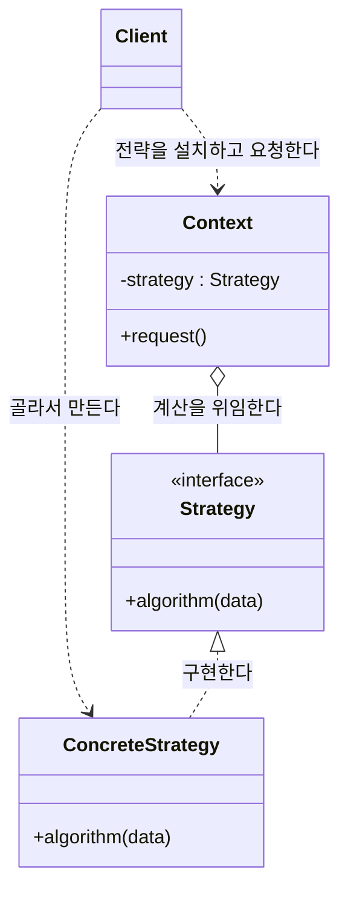
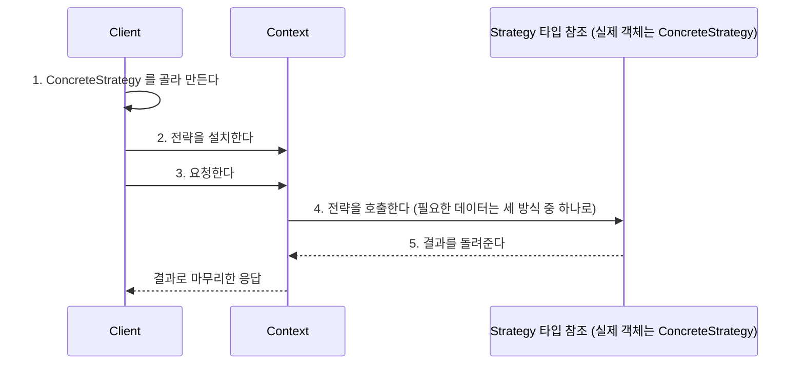

# Strategy — 바뀌는 계산은 객체로 떼어 내고, 고르는 일은 바깥에 맡기기

## 한눈에 보는 개요

온라인 상점의 결제 코드를 하나 떠올려 봅시다. `Checkout.total()` 은 상품 금액에 배송비를 더해 총액을 내는데, 배송비를 매기는 방법이 정액·일정 금액 이상 무료·무게별 요금으로 셋이에요. 세 방법을 `switch` 하나에 넣어 두면 방법이 늘 때마다 결제 클래스를 열어 `case` 를 더해야 합니다. 총액만 내면 되는 클래스가 배송비 규칙을 전부 알고 있는 셈이죠.

Strategy 가 두는 한 수는 **바뀌는 계산을 같은 모양의 객체로 떼어 내는 것**입니다. 결제 클래스는 받아 둔 객체에 배송비 계산을 맡기기만 하고, 어느 객체를 넣을지는 결제 클래스 바깥에서 정해요. 방법이 하나 늘면 클래스가 하나 늘 뿐 결제 클래스는 열지 않습니다.

```text
Before : 결제 클래스가 배송비 규칙을 모두 안고 있음

  Checkout.total(order)
    switch (plan)
      "flat"      → 3,000원
      "free-over" → 상품 금액 50,000원 이상이면 0원, 아니면 3,000원
      "weight"    → 무게를 kg 단위로 올림 × 1,500원
      새 방법      → 이 switch 를 열어 case 추가

After : 배송비 계산을 객체로 떼어 내고, 어느 객체를 쓸지는 바깥에서 넣어 줌

  바깥 코드 ── 고른 배송비 객체를 넣어 줌 ──▶ Checkout
                                              total(order)
                                                배송비 객체.fee(상품 금액, 무게)
                                                  ├─ FlatRate
                                                  ├─ FreeOverThreshold
                                                  ├─ ByWeight
                                                  └─ 새 방법 = 새 클래스 (Checkout 은 그대로)
```

이 글에서 원서는 GoF(Gang of Four, 저자 네 명을 함께 부르는 이름)가 1994년에 낸 책 *Design Patterns* 를 가리킵니다. 원서에 적힌 이 패턴의 다른 이름은 Policy 예요. 분류는 행위 패턴이고, 함께 쓰는 패턴은 Flyweight(여러 곳이 공유해도 되는 상태만 객체 안에 두고 쓰는 곳마다 다른 값은 호출할 때 넘겨받게 해서 객체 하나를 공유하는 구조 패턴)입니다. 생성할 때 정한 금액 같은 값만 필드에 두고 호출 사이에 새 값을 남기지 않는 배송비 객체라면 결제 객체 여럿이 하나를 같이 써도 되고, 주문마다 다른 값은 결제 객체가 호출할 때 넘겨주기 때문이에요. 이 글을 끝까지 읽으면 어떤 코드를 Strategy 라고 불러도 되는지 필수 조건 세 가지로 판정할 수 있고, 구조가 닮은 State(상태마다 행동을 별도 객체로 두는 패턴)·Template Method(상위 클래스가 계산 순서를 정하고 하위 클래스가 단계를 채우는 패턴) 코드와도 구분할 수 있게 됩니다.

## 패턴 자세히 들여다보기

### 등장하는 개념과 정의

원서가 참여자(participants)로 꼽는 역할은 Strategy·ConcreteStrategy·Context 셋입니다. 원서의 협력 설명에는 전략을 골라 넣는 Client 도 나오므로 넷을 정의해요. 역할마다 드는 예는 개요의 배송비 상황에서 가져왔습니다.

- **Strategy** — 같은 목적의 알고리즘들이 모두 따르는 연산을 선언합니다. Context 는 이 선언만 보고 호출하고, ConcreteStrategy 는 이 선언을 구현해요. 배송비 예에서는 상품 금액과 무게를 받아 배송비를 돌려주는 연산 `fee` 하나가 Strategy 입니다.
- **ConcreteStrategy** — Strategy 가 선언한 연산을 실제 알고리즘으로 구현합니다. 같은 Strategy 를 따르는 ConcreteStrategy 들이 알고리즘 군(family)을 이루고, 서로를 몰라도 각자 동작해요. Client 가 만들고 Context 가 호출합니다. 배송비 예에서는 정액 3,000원·50,000원 이상 무료·kg당 1,500원 계산이 각각 ConcreteStrategy 예요.
- **Context** — Client 의 요청을 받는 객체입니다. ConcreteStrategy 하나를 Strategy 타입 참조로 받아 두고, 요청을 처리하다 바뀌는 계산이 나오면 그 참조에 넘겨요. 이렇게 일을 넘기는 것을 위임이라 하고, 전략을 받아 두는 일을 이 글에서는 설치라고 부릅니다. 계산에 쓸 값을 인자로 넘길 수도 있고, 자기 자신을 넘겨 전략이 필요한 값을 묻게 할 수도 있어요. 배송비 예에서는 상품 금액에 배송비를 더해 총액을 내는 결제 객체가 Context 입니다.
- **Client** — ConcreteStrategy 군에서 하나를 골라 만들고, Context 에 설치한 뒤에는 Context 에게만 요청합니다. 원서의 참여자 목록에는 없고 협력 설명에만 나오는 역할이에요. 배송비 예에서는 요금제 설정을 읽어 어떤 배송비 객체를 넣을지 정하는 조립 코드가 Client 입니다.



그림에서 Context 의 화살표가 Strategy 로만 향하고 ConcreteStrategy 를 직접 가리키지 않는다는 점을 봐 두세요. ConcreteStrategy 를 아는 쪽은 그것을 만드는 Client 뿐입니다. 뒤에 나오는 최소 조건 2·3번이 바로 이 두 화살표를 코드에서 확인하는 조건이에요.

> 무엇을 계산할지는 Context 가, 어떻게 계산할지는 ConcreteStrategy 가, 어느 것을 쓸지는 Client 가 정한다.

### 동작 절차

원서의 협력 설명을 요청 하나가 처리되는 순서로 펼치면 다섯 단계가 됩니다. 2단계와 4단계에는 갈래가 있어요.



1. Client 가 ConcreteStrategy 군에서 하나를 골라 객체를 만듭니다. 이 일을 Client 가 맡는 이유는 요금제나 프로모션 같은 요구를 아는 쪽만 어떤 계산이 맞는지 판단할 수 있어서예요. 선택을 Context 가 하면 고르는 조건문이 Context 안에 남고, 방법이 늘 때마다 Context 를 고치게 됩니다.
2. Client 가 만든 객체를 Context 에 설치합니다. 생성자 인자나 setter(필드 값을 바꾸는 메서드)로 넘겨 두면 Context 는 Strategy 타입으로 받으니 어떤 ConcreteStrategy 가 들어왔는지 몰라도 돼요. 이렇게 미리 설치하는 방식에서는 이 단계가 3단계보다 늦으면 요청이 왔을 때 위임할 대상이 없습니다.
   - 갈래 2-1. 전략을 요청 메서드의 인자로 넘기는 방식도 있습니다. `list.sort(comparator)` 처럼 호출 한 번이 설치와 요청을 함께 하므로 2단계와 3단계가 한 호출로 합쳐져요.
   - 갈래 2-2. 전략이 없는 상태가 의미 있는 경우도 있습니다. 원서의 구현 쟁점 3은 Context 가 설치 여부를 확인해 전략이 없으면 기본 행위를 하도록 둘 수 있다고 적어요. 이렇게 두면 Client 는 기본 행위가 마음에 들지 않을 때만 전략을 설치하면 됩니다.
3. 설치가 끝나면 Client 는 Context 에게만 요청합니다. 전략 객체를 직접 부르면 Context 가 요청 앞뒤로 하는 계산(상품 금액에 배송비를 더하는 규칙)을 Client 마다 다시 써야 해요. Context 를 거치게 해야 그 규칙이 한 곳에 남습니다.
4. Context 는 요청을 처리하다가 바뀌는 계산 부분에서 설치된 전략을 호출합니다. Context 가 아는 것은 무엇을 계산할지(총액)까지이고 배송비를 어떻게 매길지는 모르기 때문이에요. 모르는 채로 호출할 수 있게 해 주는 장치가 Strategy 타입이고, 전략이 계산에 필요한 데이터를 얻는 방식은 원서 구현 쟁점 1이 세 가지로 듭니다.
   - 갈래 4-a. 값을 인자로 넘깁니다. `fee(subtotal, weightGrams)` 처럼 Context 가 값을 꺼내 넘기면 전략이 Context 를 몰라도 되니 둘 사이의 결합이 가장 느슨해요. 대신 어떤 전략은 받은 값을 쓰지 않게 됩니다.
   - 갈래 4-b. Context 자신을 넘깁니다. `fee(checkout)` 처럼 넘기고 전략이 필요한 값을 Context 에 물으면 전략마다 필요한 값만 가져갈 수 있어요. 대신 Context 가 전략용 조회 연산을 공개해야 하므로 둘이 더 단단히 묶입니다.
   - 갈래 4-c. 전략이 Context 참조를 미리 들고 있습니다. 전략을 만들거나 설치할 때 Context 를 넘겨 두면 호출할 때는 아무것도 넘기지 않고 전략이 그 참조로 필요한 값을 물어요. 4-b 와 같은 결합이 생기고, 전략 객체가 참조한 Context 하나에 묶입니다.
5. 전략이 결과를 돌려주면 Context 가 그 결과로 요청을 마무리합니다. 결과를 어떻게 쓰는지(배송비를 상품 금액에 더함)는 Context 의 규칙이라서, 이 일을 전략으로 옮기면 전략마다 같은 덧셈이 복제돼요.

잠깐, 확인 하나만 해 볼까요? 4-a 방식으로 `fee(상품 금액, 무게)` 를 넘길 때 50,000원 이상 무료 전략이 받고도 쓰지 않는 값은 무엇일까요?

무게입니다. 이 전략은 상품 금액만 기준 금액과 비교하니까요. 정액 전략은 두 값을 모두 쓰지 않습니다. 원서는 이것을 Strategy 와 Context 사이의 통신 부담이라는 대가로 꼽아요. 모든 전략이 같은 연산 모양을 공유하니 단순한 전략은 받은 정보를 버리게 되는 것이죠.

```text
전략                      넘겨받는 값            계산에 실제로 쓰는 값
정액 전략                  상품 금액 · 무게        없음
50,000원 이상 무료 전략     상품 금액 · 무게        상품 금액
무게별 전략                상품 금액 · 무게        무게
```

## 사용 목적

Strategy 를 꺼낼 때는 코드나 요구에서 보이는 단서가 있습니다. 세 가지를 차례로 봅시다.

**단서 1. 계산 메서드 안의 분기가 방법이 늘 때마다 자랍니다.** 배송비 방법을 하나 더하는 변경마다 같은 결제 클래스의 같은 메서드가 수정 목록에 오르면 신호예요. 원서는 연산 안의 여러 갈래 조건문으로 행동이 나뉘어 있는 클래스를 이 패턴의 적용 대상으로 꼽습니다.

```text
변경 이력                       수정된 곳
─────────────────────────────   ─────────────────────────────
무게별 배송비 추가               Checkout.total() 의 switch
50,000원 이상 무료 추가          Checkout.total() 의 switch
도서 산간 추가 요금 추가          Checkout.total() 의 switch
```

**단서 2. 계산 방법만 다른 하위 클래스가 생깁니다.** `FlatShippingCheckout`·`WeightShippingCheckout` 처럼 결제 클래스를 상속해 배송비 메서드만 바꾼 클래스들이 보이는 경우예요. 원서가 꼽는 적용 대상 중 하나가 행동만 다른 관련 클래스가 여럿인 상황인데, 이 모양은 바뀌는 곳이 하나 더 생기면 빠르게 불어납니다.

할인 방법까지 하위 클래스로 나누면 조합마다 클래스가 필요해요. 배송비 방법이 m개, 할인 방법이 n개일 때 두 방식이 만드는 타입 수를 인터페이스까지 넣어 세어 봅시다.

| 방식 | 전체 타입 수 | m = 3, n = 2 일 때 | 배송비 방법 하나를 더하면 늘어나는 수 |
| --- | --- | --- | --- |
| 하위 클래스로 조합 | 상위 클래스 1 + 조합 m × n | 1 + 6 = 7 | n (할인 방법마다 하나) |
| 계산을 객체로 떼어 냄 | 결제 클래스 1 + 인터페이스 2 + m + n | 1 + 2 + 5 = 8 | 1 |

전체 수만 보면 이 크기에서는 떼어 낸 쪽이 오히려 하나 많습니다. 차를 식으로 쓰면 (m × n + 1) − (m + n + 3) = mn − m − n − 2 이고, (m − 1)(n − 1) 을 펼친 mn − m − n + 1 에서 3 을 뺀 값과 같으니 차는 (m − 1)(n − 1) − 3 이에요. 그래서 하위 클래스 쪽이 더 많아지는 것은 (m − 1)(n − 1) 이 3 보다 클 때부터이고, m = n = 3 이면 10 대 9 가 됩니다. 단서가 되는 것은 총량보다 늘어나는 속도예요. 배송비 방법 하나를 더할 때 하위 클래스 쪽은 n 개, 떼어 낸 쪽은 1 개가 늘어서 차는 n − 1 만큼 벌어집니다. 할인 방법이 둘 이상이면 n − 1 ≥ 1 이니 방법을 더할 때마다 차가 커지고, 이 단서는 방법이 계속 늘어나는 코드에서 의미가 있어요. 바뀌는 곳이 배송비 하나뿐이면 하위 클래스 방식은 1 + m 개, 떼어 낸 방식은 1 + 1 + m 개라 떼어 낸 쪽이 늘 하나 많고 늘어나는 수도 1 대 1 로 같습니다. 그래서 타입 수로 보는 이 단서는 바뀌는 곳이 둘 이상일 때 힘을 얻어요.

**단서 3. 계산 하나만 쓰는 데이터가 결제 클래스에 있습니다.** 원서는 알고리즘이 쓰는 복잡한 자료구조를 알고리즘을 쓰는 쪽에 드러내고 싶지 않을 때도 이 패턴을 권합니다. 코드에서는 결제 클래스의 필드 중 `switch` 의 한 `case` 안에서만 읽히는 필드로 보여요.

```text
Checkout 의 필드      읽는 곳
────────────────      ─────────────────────────────────────────────
plan                  total() 의 switch 전체
freeThreshold         "free-over" case 에서만
zoneFeeTable          "zone" case 에서만   ← 권역별 요금 계산만 쓰는 데이터
```

비슷한 단서에서 다른 패턴을 골라야 하는 경우가 두 가지 있습니다. 바뀌는 단계를 상속과 재정의로 끼우는 구조가 맞으면 Template Method 를, 요청을 처리한 결과로 객체의 다음 행동 방식이 바뀌면 State 를 먼저 검토하세요. 둘과의 차이는 「비슷한 패턴·안티패턴과의 차이」에서 풉니다. 그리고 아래 상황에서는 Strategy 를 쓰면 얻는 것보다 잃는 것이 커요.

| 쓰지 말아야 할 상황 | 쓰면 잃는 것 |
| --- | --- |
| 방법이 두어 개뿐이고 바뀔 계획도 없음 | 새 클래스와 인터페이스가 생겨 프로그램이 필요 이상으로 복잡해짐([refactoring.guru Strategy](https://refactoring.guru/design-patterns/strategy)). 표 아래에서 코드로 비교함 |
| 방법 사이의 차이가 Client 에게 의미가 없음 | 원서는 Client 가 전략끼리 무엇이 다른지 알아야 고를 수 있다는 점을 대가로 꼽음. 고를 이유가 없으면 쓰이지 않는 선택지와 선택 코드만 남음 |
| 방법마다 필요한 데이터가 크게 다름 | 공통 연산이 모든 방법의 입력을 받느라 인자가 늘고 대부분의 전략이 대부분의 인자를 버림. 동작 절차의 확인 질문에서 본 통신 부담이 커진 모양. 표 아래에서 매개변수를 세어 봄 |

표의 첫 줄부터 코드로 봅시다. 배송비가 일반 3,000원과 당일 배송 5,000원 두 가지뿐이고, 변경 이력에 이 분기를 고친 커밋이 없는 상점이라고 해요. 같은 요구를 분기로 쓴 코드와 Strategy 로 옮긴 코드는 이렇게 달라집니다.

```text
분기로 쓴 코드
  Checkout.total() 안   long fee = sameDay ? 5_000 : 3_000;
  늘어난 타입 0개 · 분기 1곳

Strategy 로 옮긴 코드
  interface DeliveryFee { long fee(); }
  final class StandardFee implements DeliveryFee { public long fee() { return 3_000; } }
  final class SameDayFee implements DeliveryFee { public long fee() { return 5_000; } }
  Checkout 에 DeliveryFee 필드 1개와 그 값을 받는 생성자 인자 1개
  Client 에 sameDay ? new SameDayFee() : new StandardFee()
  늘어난 타입 3개 · 필드 1개 · 인자 1개 · 분기 1곳 (Checkout 에서 Client 로 옮겨 감)
```

옮긴 뒤에도 분기는 Client 의 선택 코드에 한 곳 그대로 남고, 타입 셋과 필드·인자가 더 생겼습니다. 얻은 것은 방법을 더할 때 `Checkout` 을 열지 않는다는 점인데, 방법이 늘지 않는 코드에서는 그 이득이 쓰일 자리가 없어요. 바뀔 계획은 앞으로의 일이라 코드에서 직접 볼 수 없으니, 대신 아래 세 곳을 확인해 모두 가운데 열에 해당하면 분기로 둡니다.

| 확인할 곳 | 분기로 둠 | Strategy 를 검토함 |
| --- | --- | --- |
| 같은 조건으로 가르는 분기의 수 | 한 메서드에만 있음 | 여러 메서드에 반복됨(단서 1) |
| 갈래의 크기와 갈래 전용 데이터 | 갈래가 한두 줄 식이고 갈래만 읽는 필드가 없음 | 갈래마다 긴 계산이나 갈래만 읽는 필드가 있음(단서 3) |
| 변경 이력 | 이 분기에 갈래를 더하거나 고친 커밋이 없음 | 갈래를 더한 커밋이 반복됨(단서 1) |

표의 두 번째 줄도 구체적으로 봅시다. 무게를 올림 나눗셈으로 계산하는 `ByWeight` 옆에, 무게에서 1,000g 씩 빼 가며 1,500원씩 더하는 `ByWeightStepwise` 를 하나 더 만들었다고 해요.

| 무게 | `ByWeight` (올림 kg × 1,500) | `ByWeightStepwise` (1,000g 씩 빼며 1,500 더하기) |
| --- | --- | --- |
| 0g | 0 | 0 |
| 1,000g | 1,500 | 1,500 |
| 1,001g | 3,000 | 3,000 |
| 2,300g | 4,500 | 4,500 |
| 5,100g | 9,000 | 9,000 |

두 계산이 모든 무게에서 같은 값을 내는 이유부터 따져 볼게요. 반복은 남은 무게가 0 보다 클 동안 돌기 때문에 반복 횟수 k 는 w − 1000k ≤ 0 을 처음 만족하는 수, 곧 w / 1000 이상인 가장 작은 정수입니다. 그 수가 올림한 kg 이라 두 요금은 늘 같아요(0g 부터 200,000g 까지 직접 계산해 확인). 원서는 같은 행동을 시간·공간 비용이 다른 구현으로 제공하는 것도 이 패턴의 쓰임으로 들지만, 이 차이를 가를 요구가 없다면 Client 는 둘 중 하나를 고를 이유가 없습니다.

코드에서는 Client 의 선택 코드를 보고 이 상황을 가릅니다. 두 전략으로 갈라지게 하는 입력(요금제 값·설정·요구)이 있는지 찾아보고, 그런 입력 없이 늘 같은 상수로 한쪽만 설치되고 있다면 교체 지점이 쓰이지 않는 것이에요. 이때는 인터페이스를 두지 말고 계산 하나로 두는 편이 읽기 쉽습니다. 표의 세 번째 줄은 구현마다 쓰는 매개변수를 세어 보면 드러나요.

| 연산이 `fee(subtotal, weightGrams, zone, memberGrade, couponCode)` 로 넓어졌을 때의 구현 | 계산에 쓰는 매개변수 |
| --- | --- |
| `FlatRate` | 없음 |
| `FreeOverThreshold` | `subtotal` |
| `ByWeight` | `weightGrams` |
| `ZoneRate` | `zone` |
| `MemberFree` | `memberGrade` |
| `CouponRate` | `subtotal` · `couponCode` |

배송 방법마다 필요한 값이 달라 연산이 다섯 매개변수로 넓어졌다고 해 봐요. 여섯 구현이 받는 값은 모두 6 × 5 = 30 개인데 계산에 쓰는 것은 0 + 1 + 1 + 1 + 1 + 2 = 6 개뿐이고, 매개변수를 하나 더 넓힐 때마다 여섯 구현의 시그니처를 모두 함께 고쳐야 합니다(구현 해설에서 실제로 컴파일해 봅니다). 코드에서는 이렇게 구현마다 쓰는 매개변수를 세어 대부분의 구현이 대부분을 버리는지 확인해요. 그렇다면 4-b·4-c 처럼 전략이 Context 에 필요한 값만 묻게 해 연산 모양을 좁히거나(대신 결합이 커짐), 이 계산들을 공통 연산 하나로 묶는 것 자체를 다시 검토합니다.

## 패턴의 경계

### 디자인 패턴을 충족하는 최소 조건

어떤 코드를 Strategy 라고 불러도 되는지 가르는 기준입니다. `[필수]` 가 하나라도 빠지면 Strategy 가 아니고, `[선택]` 은 갖추면 좋은 구조예요. 조건은 언어와 상관없이 코드에서 확인할 수 있는 모양(타입 선언·참조 보유·호출 방향·생성 위치)으로 적었고, 1번부터 차례로 적용합니다.

1. [필수] 교체할 알고리즘들이 같은 연산 모양을 따르고 계산 방법마다 따로 구현됩니다 — 같은 목적의 계산들이 이름·매개변수·반환 형태가 같은 연산을 구현하고, 그 연산 모양이 인터페이스·추상 클래스·trait(Rust 에서 타입이 구현할 연산을 선언하는 문법)·함수 타입 같은 선언이나 타입 매개변수가 요구하는 연산으로 코드에 드러나 있습니다. 계산 방법마다 그 연산을 구현한 별도 단위(클래스나 함수 값)가 있고, 한 구현의 연산 안에 계산 방법을 고르는 분기가 없습니다. 같은 클래스의 객체 여럿이 필드 값만 다르고 계산 코드는 같다면(`FlatRate(3_000)` 과 `FlatRate(5_000)`) 한 계산 방법을 매개변수로 나눈 것이라 이 조건을 만족합니다. 원서 구현 쟁점 2의 C++ 템플릿 전략처럼 공통 상위 클래스 없이 타입 매개변수가 연산을 요구하는 형태도 여기에 들어갑니다.
   - 이 조건이 빠지는 첫 모양은 계산 방법이 Context 안의 private 메서드 `flatFee()`·`weightFee()` 로만 있고 `switch` 가 그중 하나를 부르는 코드입니다. 메서드로 뽑았을 뿐 조건 분기라서, 방법을 하나 더하려면 Context 의 계산 코드에 새 `case` 를 더해야 해요.
   - 또 하나는 공통 인터페이스는 있지만 구현이 `AnyPlan(String plan)` 하나뿐이고, 그 `fee` 안에서 `switch (plan)` 으로 정액과 무게별을 고르는 코드입니다. 분기가 Context 에서 전략 클래스 안으로 옮겨 갔을 뿐이라 방법을 더하려면 `AnyPlan` 의 `switch` 를 고쳐야 해요.
2. [필수] Context 는 전략을 그 연산 모양으로만 보유하고 호출합니다 — Context 의 필드·생성자 인자·메서드 인자·타입 매개변수에 적힌 전략 타입이 1번의 공통 타입이거나 그 연산을 요구하는 타입 매개변수이고, 요청을 처리하는 메서드는 그 연산을 호출해 계산을 넘기며, 구체 전략 타입에 따라 갈라지는 코드(타입 검사나 다운캐스트, 곧 상위 타입으로 받은 값을 하위 타입으로 바꾸는 변환)가 Context 에 없습니다.
   - 이 조건이 빠지면 둘 중 하나가 됩니다. 필드가 `ByWeight policy` 처럼 구체 타입이면 다른 계산을 넣을 수 없어서 도우미 클래스 하나에 일을 넘기는 단순 위임에 그쳐요. `if (policy instanceof ByWeight)` 처럼 종류를 확인하면 1번에서 없앤 분기가 Context 로 돌아옵니다.
3. [필수] 어떤 전략을 쓸지는 Context 밖에서 정해지고 요청 처리가 그 선택을 바꾸지 않습니다 — ConcreteStrategy 를 고르고 만드는 코드(생성자 호출·함수 값 작성·타입 인자 지정)가 Client·설정·조립 코드처럼 Context 밖에 있고 Context 는 만들어진 전략을 받는 경로를 가집니다. 여러 전략 중 하나를 고르는 분기가 Context 안에 없고, 설치용 연산을 뺀 요청 처리 코드(Context 의 메서드와 ConcreteStrategy 의 연산 모두)가 Context 의 전략 참조에 다른 구현 객체를 넣거나 다음에 쓸 구현을 돌려주지 않습니다. 인자를 생략했을 때 쓸 기본 전략 하나를 Context 가 정해 두는 것은 고르는 분기가 아니므로 이 조건을 어기지 않습니다.
   - 이 조건이 빠지는 첫 모양은 Context 생성자가 요금제 문자열을 받아 `switch` 로 `new FlatRate(3_000)` 과 `new ByWeight(1_500)` 중 하나를 직접 고르는 코드입니다. 필드 타입은 공통 타입이어도 방법을 하나 더할 때마다 Context 의 그 `switch` 를 고쳐야 해요. 원서가 이 패턴으로 없애려던 조건문이 자리만 옮겨 Context 안에 남은 모양입니다.
   - 또 하나는 `state = state.pay(this)` 처럼 구현 객체가 다음 구현을 돌려주는 코드입니다. 첫 구현을 밖에서 받았더라도 무엇을 쓸지가 요청 처리 흐름 안에서 정해지니 이 조건이 빠지고, 구현들이 객체의 상태를 나타낸다면 State 쪽이에요. 비교 절에서 코드로 봅니다.
4. [선택] Context 에 전략을 다시 설치하는 연산이 있습니다 — setter 같은 연산으로 실행 중에 설치된 전략을 다른 전략으로 바꿀 수 있습니다. 이 연산이 없어도 1~3번을 만족하면 Strategy 입니다.
5. [선택] 여러 Context 가 공유하는 전략 객체는 호출 사이에 값을 남기지 않습니다 — 정적 필드나 싱글턴(인스턴스를 하나만 두고 함께 쓰는 방식)으로 한 ConcreteStrategy 인스턴스를 여러 Context 가 함께 참조한다면, 그 전략의 연산이 자기 필드나 필드가 가리키는 가변 객체에 값을 쓰지 않습니다. 생성할 때 정한 뒤 바뀌지 않는 필드(`FlatRate` 의 `amount` 처럼 원서 Flyweight 의 내재 상태에 해당하는 값)는 두어도 됩니다. 원서가 공유 전략에 붙인 조건이에요.
   - 예를 들어 공유된 `ByWeight` 가 직전 호출의 kg 값을 필드에 남겨 다음 계산에 쓰면, 한 결제 객체의 결과가 다른 결제 객체가 방금 계산한 주문에 따라 달라집니다.

1번이 맨 앞인 데는 이유가 있습니다. 1번만 빠지고 2·3번은 만족하는 코드가 실제로 있어서, 1번을 보지 않으면 그런 코드가 Strategy 로 통과해요. 1번의 두 번째 반례인 `AnyPlan` 을 코드로 봅시다.

```java no-compile
final class AnyPlan implements ShippingPolicy {
    private final String plan;

    AnyPlan(String plan) {
        this.plan = plan;
    }

    @Override
    public long fee(long subtotal, long weightGrams) {
        return switch (plan) {                    // 계산 방법을 고르는 분기가 구현 안에 있다
            case "flat" -> 3_000;
            case "weight" -> Math.ceilDiv(weightGrams, 1_000) * 1_500;
            default -> throw new IllegalArgumentException(plan);
        };
    }
}

// Checkout 은 구현 절과 같다: 필드는 ShippingPolicy, Client 가 new AnyPlan("weight") 를 만들어 넘긴다
```

`Checkout` 은 `ShippingPolicy` 타입으로 들고 타입 검사 없이 `fee` 를 부르니 2번을 만족하고, `new AnyPlan("weight")` 를 밖에서 만들어 넘기니 3번도 만족합니다. 32,000원·2,300g 주문을 넣으면 `"weight"` 로 36,500원, `"flat"` 으로 35,000원이 맞게 나와요(`Checkout` 을 붙여 직접 실행해 확인). 그런데 5kg 초과 요금 같은 방법을 더하려면 `AnyPlan.fee` 의 `switch` 에 `case` 를 더해야 하니, 원서가 이 패턴의 결과로 든 조건문 제거가 일어나지 않고 조건문이 자리만 옮긴 셈입니다.

| 코드 | 1번 | 2번 | 3번 | 판정 |
| --- | --- | --- | --- | --- |
| 구현 절의 `FlatRate`·`FreeOverThreshold`·`ByWeight` 와 `Checkout` | 만족 | 만족 | 만족 | Strategy |
| `AnyPlan` 하나와 `Checkout` | 빠짐 (구현 안에서 `switch`) | 만족 | 만족 | Strategy 아님 |
| `FlatRate(3_000)`·`FlatRate(5_000)` 두 객체와 `Checkout` | 만족 (필드 값만 다르고 계산 코드는 같음) | 만족 | 만족 | Strategy (한 방법을 매개변수로 나눔) |
| 필드가 `ByWeight` 인 `Checkout` | 전략 쪽만 보면 만족할 수 있음 | 빠짐 (구체 타입) | 만족할 수 있음 | Strategy 아님 |

`[필수]` 는 하나만 빠져도 판정이 끝나므로 1번부터 차례로 봅니다. 1번은 전략 쪽 코드만, 2번은 Context 의 선언과 호출만, 3번은 생성 위치와 요청 처리 흐름만 보면 되어서 앞 조건에서 멈추면 뒤는 읽지 않아도 돼요.

여기서 헷갈리기 쉬운 포인트는 4번 실행 중 교체가 필수처럼 보인다는 점입니다. refactoring.guru 의 Java 예제 페이지도 실제 일을 안쪽 객체에 맡기는 메서드와 그 객체를 바꾸는 setter 를 이 패턴을 알아보는 단서로 들어요([refactoring.guru — Strategy in Java](https://refactoring.guru/design-patterns/strategy/java/example)). 하지만 원서의 구현 쟁점 2는 컴파일할 때 전략을 고르고 실행 중에는 바꾸지 않는 C++ 템플릿 매개변수 방식도 Strategy 로 다룹니다. 그래서 이 가이드는 전략이 정해지는 때가 아니라 전략을 정하는 곳을 필수로 둡니다. 아래 세 설치 방식은 모두 1~3번을 만족해요.

| 설치 방식 | 전략이 정해지는 때 | 설치 뒤 다른 전략으로 교체 | 예 |
| --- | --- | --- | --- |
| 생성자 인자로 한 번 | 객체를 만들 때 | 불가 | Java `TreeMap(Comparator)` |
| setter 로 다시 설치 | 실행 중 아무 때 | 가능 (4번 충족) | 구현 절의 `changePolicy` |
| 타입 매개변수 | 컴파일할 때 | 다른 타입의 전략은 불가 | Rust `HashMap<K, V, S>` 의 `S` |

> 바깥에서 고르는 것은 필수, 실행 중에 바꾸는 것은 선택.

### 비슷한 패턴·안티패턴과의 차이

Strategy 와 구조가 닮았거나 같은 단서에서 떠오르는 대상 넷을 비교합니다. State 와 Template Method 는 개요에서 짧게 풀었어요. Command 는 요청 하나를 객체로 만들고, 호출하는 쪽은 그 객체의 실행 연산만 부르게 하는 패턴입니다. 원서의 대표 구현은 요청을 받을 객체와 동작을 묶어 두지만 받는 객체 없이 스스로 일을 다 하는 명령도 허용해요(GoF, 5장 Command). 나머지 하나는 분기를 메서드로 뽑아 놓고 Strategy 로 오해받는 코드예요. 표에 기준을 먼저 모으고, 대상마다 코드로 풀어 볼게요.

| 비교 대상 | 구분 기준 | Strategy 를 고르면 얻는 것 | 포기하는 것 |
| --- | --- | --- | --- |
| State | 구현 객체가 같은 계산의 대안인가, 객체가 오가는 상태인가. 코드에서는 요청을 처리한 결과로 다음 구현 객체가 정해지는 코드가 있는지부터 봄 | 요청 처리 흐름에 전이 코드가 없어, 전략을 더하거나 지울 때 보통 다른 전략 코드를 볼 일이 없음 | Strategy 자체는 상태 전이 모델을 주지 않음. 전이가 필요하면 Context 나 별도 상태 모델에 따로 둬야 함 |
| Template Method | 바뀌는 계산이 하위 클래스의 재정의로 들어오는가, 받은 객체의 연산 호출로 들어오는가 | 계산 조합마다 하위 클래스를 만들지 않음. 설치 연산을 두면 실행 중 교체도 가능(최소 조건 4번) | 하위 클래스 하나가 골격 안의 여러 단계를 함께 재정의하며 상위 클래스의 필드와 protected 연산을 바로 쓰던 방식 |
| Command | 구현 객체가 Context 의 요청 처리 중 한 단계를 같은 목적의 다른 방법으로 맡는가, 수행할 요청 하나를 객체로 담고 있는가 | Context 가 요청 처리 흐름과 넘길 데이터를 정하고 전략의 결과나 동작을 그 자리에서 이어받음 | 둘은 함께 쓸 수 있어 맡는 범위의 차이에 가까움. 요청을 객체로 만들어 큐·이력에 두는 일은 Strategy 가 해 주지 않으니 필요하면 Command 를 따로 둠 |
| 분기를 메서드로 뽑은 코드 (Strategy 로 오해받는 코드) | 새 계산 방법을 더할 때 Context 의 계산 코드에 새 방법의 이름(`case` 값·메서드 이름)을 더해야 하는가 | 새 방법이 새 클래스로 들어오고 방법마다 따로 테스트 | 한 곳에서 보이던 흐름이 여러 타입으로 나뉘고, 고르는 분기는 Client 쪽에 남음 |

**State 와의 차이.** 구분 기준은 구현 객체들이 같은 계산의 대안인지, 객체가 오가는 상태인지입니다. 코드에서는 요청을 처리한 결과로 다음에 쓸 구현 객체가 정해지는 코드가 있는지부터 봐요. 그런 코드는 최소 조건 3번이 빠진 신호이고, 그 구현들이 서로 다른 상태(받아들이는 요청과 반응이 다른 자리)를 나타내면 State 입니다.

두 패턴은 클래스 그림이 거의 같아서 코드의 한 곳을 봐야 갈립니다. State 로 주문의 결제 흐름을 짠 코드를 봅시다. 결제 대기 상태에서 결제 요청을 받으면 결제 완료 상태로 넘어가요.

```java no-compile
interface OrderState {
    OrderState pay(Order order);
}

final class AwaitingPayment implements OrderState {
    public OrderState pay(Order order) {
        order.charge();
        return new Paid();              // 다음 상태를 상태 객체가 정한다
    }
}

final class Order {
    private OrderState state = new AwaitingPayment();

    void pay() {
        state = state.pay(this);        // 요청을 처리한 결과로 필드가 바뀐다
    }
}
```

`Order.pay()` 는 요청을 처리하면서 `state` 필드에 새 객체를 넣습니다. `AwaitingPayment` 와 `Paid` 는 같은 계산을 다르게 하는 대안이 아니라, 결제 요청이 다시 왔을 때 반응이 달라야 하는 주문의 상태예요. 구현 절의 `Checkout.total()` 은 `policy` 를 읽기만 하고, `policy` 에 값을 넣는 코드는 Client 가 부르는 생성자와 `changePolicy` 뿐입니다.

여기서 헷갈리기 쉬운 포인트는 다음 객체를 누가 정하는지만 보고 가르려는 것입니다. 위 코드에서 상태 객체가 다음 상태를 돌려주지 않게 바꾸고 `Order.pay()` 안에서 `state = new Paid()` 로 전이를 정해도 원서는 여전히 State 로 봐요. 원서의 State 협력 설명이 다음 상태를 정하는 쪽으로 Context 와 상태 객체를 모두 허용하기 때문입니다(GoF, 5장 State). 전이를 누가 정하든 State 예요. 반대로 요청 결과에 따라 Context 가 다음 알고리즘을 고르기만 하고 그 구현들이 상태를 나타내지 않는다면 State 는 아닙니다. 원서는 이런 적응형 선택을 따로 다루지 않고, 이 가이드는 선택을 Context 밖에 두라는 3번에 따라 이 코드를 Strategy 로도 판정하지 않아요.

```text
                       Strategy (Checkout)          State (Order)
구현 객체가 나타내는 것  같은 계산의 대안               주문이 오가는 상태 (갈라지거나 되돌아가도 됨)
구현 객체를 바꾸는 곳    Client 의 설치 코드           요청 처리 흐름 안 (상태 객체 또는 Context)
구현 객체끼리           보통 서로 모름               다음 상태를 알 수도 있음 (Context 가 전이를 정하면 모름)
```

구현 객체끼리 서로를 아는지도 함께 봅니다. refactoring.guru 는 상태 객체는 서로를 알고 전이를 시작할 수 있지만 전략 객체는 서로를 거의 모른다고 구분해요([refactoring.guru — State](https://refactoring.guru/design-patterns/state)). Strategy 를 고르면 요청 처리 흐름에 전이 코드가 없어서, `ByWeight` 를 지우거나 새 정책을 더할 때 보통 다른 정책 코드는 볼 일이 없습니다. 대신 Strategy 자체는 상태 전이 모델을 주지 않아요. 도메인에 실제 상태 전이가 있다면 그 규칙을 Context 나 별도 상태 모델에 따로 둬야 하고, 그러지 않으면 Client 가 순서를 기억해 매번 알맞은 전략을 설치하게 되어 규칙이 Client 코드 여러 곳에 흩어집니다.

> 전략은 서로 모르는 대안이고, 상태는 요청에 따라 옮겨 가는 자리다.

**Template Method 와의 차이.** 구분 기준은 바뀌는 계산이 하위 클래스의 재정의로 들어오는지, 필드나 인자로 받은 객체의 연산 호출로 들어오는지입니다. 원서도 Template Method 는 상속으로 알고리즘의 일부를 바꾸고 Strategy 는 위임으로 알고리즘 전체를 바꾼다고 구분해요(GoF, 5장 Template Method).

```java no-compile
abstract class Checkout {
    final long total(Order order) {
        return order.subtotal() + shippingFee(order);   // 계산 순서는 상위 클래스가 고정
    }

    protected abstract long shippingFee(Order order);    // 이 한 단계만 하위 클래스가 채움
}

final class WeightShippingCheckout extends Checkout {
    protected long shippingFee(Order order) {
        return Math.ceilDiv(order.weightGrams(), 1_000) * 1_500;
    }
}
```

이 코드에서 무게별 배송비로 결제하는 객체는 만들어지는 순간 `WeightShippingCheckout` 으로 정해지고, 그 객체를 정액 배송비로 바꿀 방법이 없습니다. 클래스가 곧 계산 방법이니까요. Strategy 를 고르면 사용 목적의 단서 2에서 센 것처럼 계산 조합마다 하위 클래스를 만들지 않고, setter 같은 설치 연산을 두면(최소 조건 4번) 실행 중에 바꿀 수도 있어요. 계산 순서는 두 쪽 다 고정돼요. Template Method 는 상위 클래스의 `final` 메서드가, Strategy 는 구현 절의 `Checkout.total()` 처럼 Context 메서드가 순서를 정합니다. 달라지는 것은 끼우는 단위예요. 하위 클래스 하나가 골격 안의 여러 단계를 함께 재정의하면서 상위 클래스의 필드와 protected 연산(하위 클래스에서만 부를 수 있게 열어 둔 메서드)을 바로 쓰던 방식이 사라지고, 전략은 Context 가 부르는 연산 하나 단위로 끼워져 Context 가 넘긴 값이나 공개한 조회 연산으로만 데이터를 얻습니다. 동작 절차 4단계의 통신 부담을 떠안게 되는 거죠.

**Command 와의 차이.** 구분 기준은 구현 객체가 Context 의 요청 처리 중 한 단계를 같은 목적의 다른 방법으로 맡는지, 수행할 요청 하나를 객체로 담고 있는지입니다. 반환값은 기준이 아니에요. 앞쪽이면 구현 객체는 그 요청 처리 흐름 안에서 불리고, 돌려주는 값이 없어도 Strategy 입니다. 뒤쪽이면 요청 객체가 요청 하나를 대표하고, 호출하는 쪽(원서의 Invoker)은 그 일이 무엇인지 모른 채 실행 연산만 부릅니다. 원서의 대표 구현은 요청 객체가 받을 객체(Receiver)와 동작을 묶지만 받는 객체 없이 스스로 일을 다 하는 명령도 허용하므로, 필드 모양은 기준으로 쓰지 않아요(GoF, 5장 Command). refactoring.guru 도 두 패턴이 객체를 어떤 동작으로 매개변수화한다는 점은 같고 목적이 다르다고 봅니다. Command 는 연산 자체를 객체로 바꿔(연산의 매개변수가 객체의 필드가 됨) 실행 지연·큐잉·이력·원격 실행을 가능하게 하고, Strategy 는 같은 일을 하는 다른 방법을 바꿔 끼웁니다([refactoring.guru — Strategy](https://refactoring.guru/design-patterns/strategy)).

```text
Strategy : Context 의 요청 처리 중 한 단계를 같은 목적의 다른 방법으로 맡음
  checkout.total(order) 안에서       policy.fee(32000, 2300)               → 3000 또는 4500 을 돌려줌
  pool.execute(task) 가 거절될 때     handler.rejectedExecution(task, pool)  → 예외 · 그 자리 실행 · 버림 (void)

Command : 요청 하나를 대표하는 객체 (원서 예는 받을 객체 document 를 묶어 둠)
  new PasteCommand(document)         execute() 가 인자 없이 document.paste() 를 부름
  메뉴 항목은 무슨 명령인지 모른 채 execute() 만 부름 (바로 부르든 큐·이력에 두었다 부르든)
```

Strategy 를 고르면 Context 가 요청 처리 흐름과 넘길 데이터를 정하고 전략의 결과나 동작을 그 자리에서 이어받으므로, 데이터 흐름이 `total()` 한 메서드 안에서 보입니다. 두 패턴은 서로를 대신하는 선택지라기보다 맡는 범위가 달라서 함께 쓸 수 있어요. 요청 자체를 객체로 만들어 큐에 넣거나 이력으로 남기는 일은 Strategy 가 해 주지 않으니, 그런 요구가 있으면 Command 를 따로 둡니다.

**분기를 메서드로 뽑은 코드와의 차이.** 구분 기준은 새 계산 방법을 더할 때 Context 의 계산 코드에 새 방법의 이름(`case` 값·메서드 이름)을 더해야 하는지입니다. 같은 파일에 무엇이 들어 있는지는 기준이 아니에요. 새 이름을 더해야 하는 코드라면 계산을 메서드로 나눠 담았을 뿐 Strategy 가 아닙니다.

```java no-compile
final class Checkout {
    private final String plan;

    Checkout(String plan) {
        this.plan = plan;
    }

    long total(Order order) {
        long fee = switch (plan) {                 // 방법이 늘면 이 switch 를 고친다
            case "flat" -> flatFee();
            case "weight" -> weightFee(order.weightGrams());
            default -> throw new IllegalArgumentException(plan);
        };
        return order.subtotal() + fee;
    }

    private long flatFee() {
        return 3_000;
    }

    private long weightFee(long weightGrams) {
        return Math.ceilDiv(weightGrams, 1_000) * 1_500;
    }
}
```

최소 조건으로 보면 `flatFee`·`weightFee` 는 공통 연산 모양을 따르는 별도 단위가 아니라 한 클래스의 private 메서드라서 1번부터 빠집니다. 방법이 두어 개로 고정된 코드라면 이 모양이 오히려 읽기 쉽다는 점은 사용 목적의 표와 같아요. 방법이 계속 늘어나는 코드에서 Strategy 를 고르면 새 방법이 새 클래스로 들어오고, 방법마다 `Checkout` 없이 따로 테스트할 수 있습니다. 대신 한 곳에서 보이던 흐름이 여러 타입으로 나뉘어요. 요금제 문자열을 전략 객체로 바꾸는 분기도 사라지지는 않고, 구현 절의 `choosePolicy` 처럼 Client 쪽 한 곳으로 모일 뿐입니다.

## 구현 예시

### 상황 설정

온라인 상점의 결제 한 장면을 세 언어로 똑같이 구현합니다. 총액은 상품 금액에 배송비를 더한 값이고, 배송비를 매기는 방법이 바뀌는 부분이에요.

- 고정되는 것: 총액 공식(상품 금액 + 배송비), 주문 데이터의 모양(주문 이름·원 단위 상품 금액·그램 단위 무게), 배송비 연산의 모양(상품 금액과 무게를 받아 배송비를 돌려줌)
- 바뀌는 것: 배송비 계산 방법 셋(정액 3,000원 · 상품 금액 50,000원 이상이면 무료이고 아니면 3,000원 · 무게를 kg 단위로 올림해 kg당 1,500원)과 영업 중에 어느 방법을 쓸지
- 입력 범위: 금액과 무게는 0 이상의 정수이고, 입력뿐 아니라 배송비·총액 같은 중간값과 결과까지 세 언어의 수 타입(Java `long` · TypeScript `number` · Rust `u64`)이 모두 정확히 담는 크기만 씀. 세 언어의 결과가 같다는 말은 이 범위에서 한 말
- 시나리오: 주문 A(32,000원·2,300g)와 주문 B(58,000원·5,100g)를 받아, 정액 → 50,000원 이상 무료 → 무게별 순서로 전략을 바꿔 설치하며 두 주문의 총액을 한 줄씩 출력

```text
주문 A : 상품 32,000원 · 2,300g
  flat       배송비 3,000                               총액 35,000
  free-over  32,000 < 50,000 이라 배송비 3,000            총액 35,000
  weight     2,300g → 올림 3kg → 3 × 1,500 = 4,500       총액 36,500

주문 B : 상품 58,000원 · 5,100g
  flat       배송비 3,000                               총액 61,000
  free-over  58,000 ≥ 50,000 이라 배송비 0               총액 58,000
  weight     5,100g → 올림 6kg → 6 × 1,500 = 9,000       총액 67,000
```

예시 타입이 맡는 역할은 다음과 같습니다. Rust 판은 함수 이름만 snake_case(소문자 단어를 밑줄로 잇는 이름 규칙)로 바뀌어 `choose_policy`·`change_policy`·`print_totals` 가 돼요.

| 예시 타입·함수 | 역할 |
| --- | --- |
| `ShippingPolicy` | Strategy |
| `FlatRate` · `FreeOverThreshold` · `ByWeight` | ConcreteStrategy |
| `Checkout` (`total` · `changePolicy`) | Context |
| `choosePolicy` · `printTotals` 와 진입점(Java `ShippingApp.main` · TypeScript 최상위 코드 · Rust `main`) | Client. `choosePolicy` 는 Client 가 ConcreteStrategy 를 고르고 만드는 코드를 한 함수로 모은 것 |
| `Order` | 역할 없음. Context 가 전략에 넘길 값을 꺼내는 입력 데이터 |

### 구현

```java
import java.util.List;
import java.util.stream.Collectors;

interface ShippingPolicy {
    long fee(long subtotal, long weightGrams);
}

final class FlatRate implements ShippingPolicy {
    private final long amount;

    FlatRate(long amount) {
        this.amount = amount;
    }

    @Override
    public long fee(long subtotal, long weightGrams) {
        return amount;
    }
}

final class FreeOverThreshold implements ShippingPolicy {
    private final long threshold;
    private final long amount;

    FreeOverThreshold(long threshold, long amount) {
        this.threshold = threshold;
        this.amount = amount;
    }

    @Override
    public long fee(long subtotal, long weightGrams) {
        return subtotal >= threshold ? 0 : amount;
    }
}

final class ByWeight implements ShippingPolicy {
    private final long perKg;

    ByWeight(long perKg) {
        this.perKg = perKg;
    }

    @Override
    public long fee(long subtotal, long weightGrams) {
        return Math.ceilDiv(weightGrams, 1_000) * perKg;
    }
}

record Order(String id, long subtotal, long weightGrams) {
}

final class Checkout {
    private ShippingPolicy policy;

    Checkout(ShippingPolicy policy) {
        this.policy = policy;
    }

    void changePolicy(ShippingPolicy policy) {
        this.policy = policy;
    }

    long total(Order order) {
        return order.subtotal() + policy.fee(order.subtotal(), order.weightGrams());
    }
}

public class ShippingApp {
    static ShippingPolicy choosePolicy(String plan) {
        return switch (plan) {
            case "flat" -> new FlatRate(3_000);
            case "free-over" -> new FreeOverThreshold(50_000, 3_000);
            case "weight" -> new ByWeight(1_500);
            default -> throw new IllegalArgumentException("unknown plan: " + plan);
        };
    }

    static void printTotals(String plan, Checkout checkout, List<Order> orders) {
        String line = orders.stream()
                .map(order -> order.id() + "=" + checkout.total(order))
                .collect(Collectors.joining(" "));
        System.out.println(plan + ": " + line);
    }

    public static void main(String[] args) {
        List<Order> orders = List.of(
                new Order("A", 32_000, 2_300),
                new Order("B", 58_000, 5_100));

        Checkout checkout = new Checkout(choosePolicy("flat"));
        printTotals("flat", checkout, orders);

        checkout.changePolicy(choosePolicy("free-over"));
        printTotals("free-over", checkout, orders);

        checkout.changePolicy(choosePolicy("weight"));
        printTotals("weight", checkout, orders);
    }
}
```

```typescript
interface ShippingPolicy {
  fee(subtotal: number, weightGrams: number): number;
}

class FlatRate implements ShippingPolicy {
  constructor(private readonly amount: number) {}

  fee(subtotal: number, weightGrams: number): number {
    return this.amount;
  }
}

class FreeOverThreshold implements ShippingPolicy {
  constructor(
    private readonly threshold: number,
    private readonly amount: number,
  ) {}

  fee(subtotal: number, weightGrams: number): number {
    return subtotal >= this.threshold ? 0 : this.amount;
  }
}

class ByWeight implements ShippingPolicy {
  constructor(private readonly perKg: number) {}

  fee(subtotal: number, weightGrams: number): number {
    return Math.ceil(weightGrams / 1_000) * this.perKg;
  }
}

interface Order {
  readonly id: string;
  readonly subtotal: number;
  readonly weightGrams: number;
}

class Checkout {
  constructor(private policy: ShippingPolicy) {}

  changePolicy(policy: ShippingPolicy): void {
    this.policy = policy;
  }

  total(order: Order): number {
    return order.subtotal + this.policy.fee(order.subtotal, order.weightGrams);
  }
}

type Plan = "flat" | "free-over" | "weight";

function choosePolicy(plan: Plan): ShippingPolicy {
  switch (plan) {
    case "flat":
      return new FlatRate(3_000);
    case "free-over":
      return new FreeOverThreshold(50_000, 3_000);
    case "weight":
      return new ByWeight(1_500);
  }
}

function printTotals(plan: Plan, checkout: Checkout, orders: readonly Order[]): void {
  const line = orders.map((order) => `${order.id}=${checkout.total(order)}`).join(" ");
  console.log(`${plan}: ${line}`);
}

const orders: readonly Order[] = [
  { id: "A", subtotal: 32_000, weightGrams: 2_300 },
  { id: "B", subtotal: 58_000, weightGrams: 5_100 },
];

const checkout = new Checkout(choosePolicy("flat"));
printTotals("flat", checkout, orders);

checkout.changePolicy(choosePolicy("free-over"));
printTotals("free-over", checkout, orders);

checkout.changePolicy(choosePolicy("weight"));
printTotals("weight", checkout, orders);
```

```rust
trait ShippingPolicy {
    fn fee(&self, subtotal: u64, weight_grams: u64) -> u64;
}

struct FlatRate {
    amount: u64,
}

impl ShippingPolicy for FlatRate {
    fn fee(&self, _subtotal: u64, _weight_grams: u64) -> u64 {
        self.amount
    }
}

struct FreeOverThreshold {
    threshold: u64,
    amount: u64,
}

impl ShippingPolicy for FreeOverThreshold {
    fn fee(&self, subtotal: u64, _weight_grams: u64) -> u64 {
        if subtotal >= self.threshold {
            0
        } else {
            self.amount
        }
    }
}

struct ByWeight {
    per_kg: u64,
}

impl ShippingPolicy for ByWeight {
    fn fee(&self, _subtotal: u64, weight_grams: u64) -> u64 {
        weight_grams.div_ceil(1_000) * self.per_kg
    }
}

struct Order {
    id: &'static str,
    subtotal: u64,
    weight_grams: u64,
}

struct Checkout {
    policy: Box<dyn ShippingPolicy>,
}

impl Checkout {
    fn new(policy: Box<dyn ShippingPolicy>) -> Self {
        Checkout { policy }
    }

    fn change_policy(&mut self, policy: Box<dyn ShippingPolicy>) {
        self.policy = policy;
    }

    fn total(&self, order: &Order) -> u64 {
        order.subtotal + self.policy.fee(order.subtotal, order.weight_grams)
    }
}

fn choose_policy(plan: &str) -> Box<dyn ShippingPolicy> {
    match plan {
        "flat" => Box::new(FlatRate { amount: 3_000 }),
        "free-over" => Box::new(FreeOverThreshold {
            threshold: 50_000,
            amount: 3_000,
        }),
        "weight" => Box::new(ByWeight { per_kg: 1_500 }),
        other => panic!("unknown plan: {other}"),
    }
}

fn print_totals(plan: &str, checkout: &Checkout, orders: &[Order]) {
    let line: Vec<String> = orders
        .iter()
        .map(|order| format!("{}={}", order.id, checkout.total(order)))
        .collect();
    println!("{plan}: {}", line.join(" "));
}

fn main() {
    let orders = [
        Order { id: "A", subtotal: 32_000, weight_grams: 2_300 },
        Order { id: "B", subtotal: 58_000, weight_grams: 5_100 },
    ];

    let mut checkout = Checkout::new(choose_policy("flat"));
    print_totals("flat", &checkout, &orders);

    checkout.change_policy(choose_policy("free-over"));
    print_totals("free-over", &checkout, &orders);

    checkout.change_policy(choose_policy("weight"));
    print_totals("weight", &checkout, &orders);
}
```

세 프로그램을 실제로 실행한 출력입니다. Java 는 21.0.11 로, TypeScript 는 5.9.3 으로 컴파일해 Node.js 22.22.3 에서, Rust 는 1.95.0 으로 돌렸어요. 세 언어의 출력이 글자까지 같습니다.

| 출력 줄 (세 언어 동일) | 상황 설정의 손 계산 |
| --- | --- |
| `flat: A=35000 B=61000` | A 는 32,000 + 3,000 · B 는 58,000 + 3,000 |
| `free-over: A=35000 B=58000` | A 는 32,000 + 3,000 · B 는 58,000 + 0 |
| `weight: A=36500 B=67000` | A 는 32,000 + 4,500 · B 는 58,000 + 9,000 |

여기서 가장 중요한 줄은 셋입니다. 공통 연산을 선언한 줄, `Checkout` 이 전략을 들고 있는 필드 선언 줄, 그 참조로 계산을 넘기는 총액 계산 줄이에요.

| 언어 | 공통 연산 선언 줄 | 필드 선언 줄 | 총액 계산 줄 |
| --- | --- | --- | --- |
| Java | `long fee(long subtotal, long weightGrams);` | `private ShippingPolicy policy;` | `return order.subtotal() + policy.fee(order.subtotal(), order.weightGrams());` |
| TypeScript | `fee(subtotal: number, weightGrams: number): number;` | `constructor(private policy: ShippingPolicy) {}` | `return order.subtotal + this.policy.fee(order.subtotal, order.weightGrams);` |
| Rust | `fn fee(&self, subtotal: u64, weight_grams: u64) -> u64;` | `policy: Box<dyn ShippingPolicy>,` | `order.subtotal + self.policy.fee(order.subtotal, order.weight_grams)` |

공통 연산 선언 줄은 최소 조건 1번을, 필드 선언 줄은 2번의 보유 쪽을, 총액 계산 줄은 2번의 호출 쪽을 맡습니다. 필드 선언 타입이 공통 타입이라서 3번이 요구하는 받는 경로(생성자와 `changePolicy`)로 어떤 ConcreteStrategy 든 들어올 수 있어요. 먼저 필드 선언 타입만 바꿔 컴파일해 보면 이 줄이 맡은 일이 바로 보입니다.

| 선언 타입을 이렇게 바꾸면 | 직접 컴파일·실행한 결과 | 최소 조건으로 보면 |
| --- | --- | --- |
| Java `private ByWeight policy;` (생성자와 `changePolicy` 의 인자도 `ByWeight`) | `choosePolicy(...)` 를 넘기는 세 줄에서 `incompatible types: ShippingPolicy cannot be converted to ByWeight` | 2번이 빠짐. 무게별 요금 말고는 들어올 수 없는 단순 위임 |
| Java `private Object policy;` (인자도 `Object`) | 계산 줄에서 `cannot find symbol`. `Object` 에는 `fee` 가 없음 | 부르려면 `((ShippingPolicy) policy)` 처럼 공통 타입으로 캐스트하거나 종류별 `instanceof` 로 갈라야 함. 캐스트는 필드 타입이 하던 확인을 실행 시점으로 미룬 것이고, 종류별 분기는 2번을 어김 |
| Rust `policy: Box<ByWeight>,` (인자도 `Box<ByWeight>`) | `choose_policy(...)` 를 넘기는 세 곳에서 `mismatched types` | 2번이 빠짐 |
| TypeScript `private policy: any` | 컴파일은 통과. `fee` 가 없는 객체를 넣으면 실행 중 `TypeError: this.policy.fee is not a function` | 맞는 객체를 넣으면 실행 중 협력은 같지만, 들어오는 객체가 `fee` 를 가졌는지 코드 어디서도 확인하지 않음. 코드로 판정하는 이 가이드의 2번(공통 타입으로 보유)은 빠진 것으로 봄 |

새 방법을 더해도 `Checkout` 을 고치지 않는 이유도 이 줄들에서 나옵니다. 5kg 이하는 3,000원이고 넘으면 6,000원인 `WeightTier` 를 더한다고 해 봐요. 이 계산에 필요한 값은 무게뿐이라 지금의 `fee(상품 금액, 무게)` 모양에 들어맞고, `Checkout` 코드에 적힌 배송비 관련 이름(`ShippingPolicy` 와 `fee`)은 추가 전과 같습니다. 그래서 바뀌는 곳은 새 클래스와 Client 의 `choosePolicy` 뿐이에요. 배송 권역처럼 `fee` 가 받지 않는 값이 필요한 방법이라면 공통 연산 선언 줄과 총액 계산 줄을 함께 넓혀야 합니다. 이것은 계산 코드에 새 방법의 이름을 넣는 변경이 아니라 모든 전략이 따르는 공통 연산 모양을 넓히는 변경이라, 분기 코드로 돌아가는 것과는 달라요.

그럼 공통 연산 선언 줄과 총액 계산 줄도 바꿔 봅시다. 일부 구현의 연산 모양만 달라지게 바꾼 경우, 총액 계산 줄이 구체 타입에 기대게 바꾼 경우, 입력을 모든 구현과 함께 넓힌 경우를 차례로 컴파일하고 실행했어요.

| 바꾼 곳 | 직접 컴파일·실행한 결과 | 판정 |
| --- | --- | --- |
| Java 에서 `ByWeight` 의 연산만 `fee(long weightGrams)` 로 바꿈 | `ByWeight is not abstract and does not override abstract method fee(long,long) in ShippingPolicy` | 한 구현의 연산 모양만 달라져 1번이 빠짐. 컴파일러가 그 구현에서 막음 |
| Rust 에서 같은 변경 (`fn fee(&self, weight_grams: u64)`) | `error[E0050]`, trait 선언은 매개변수가 `&self` 포함 3개인데 구현은 2개 | 1번이 빠짐. 컴파일러가 막음 |
| TypeScript 에서 같은 변경 (`fee(weightGrams: number)`) | 컴파일 통과. 출력 `weight: A=80000 B=145000`. 첫 인자인 상품 금액 32,000 이 무게 자리로 들어가 32kg × 1,500 = 48,000 이 배송비가 됨 | 매개변수가 적은 메서드도 호환으로 통과하지만 뜻이 어긋나 1번이 빠짐. 같은 연산 모양이려면 매개변수의 개수와 순서마다의 뜻까지 같아야 함 |
| Java 에서 총액 계산 줄을 `((ByWeight) policy).fee(...)` 로 바꿈 | 컴파일 통과. 첫 출력 줄에서 `ClassCastException: class FlatRate cannot be cast to class ByWeight` | Context 가 구체 타입에 기대 2번이 빠짐 |
| Java 에서 입력을 넓힘. 공통 연산 선언 줄을 `fee(long subtotal, long weightGrams, String zone)` 로, `Order` 에 `zone` 을 더하고 총액 계산 줄이 `order.zone()` 을 넘김 | 세 구현을 고치기 전에는 `FlatRate`·`FreeOverThreshold`·`ByWeight` 모두 `does not override abstract method fee(long,long,String)`. 세 구현의 시그니처를 함께 고친 뒤에는 컴파일 통과, 출력 세 줄이 원래와 같음 | 1~3번 유지. 공통 연산 모양을 모든 구현과 함께 넓힌 정상 변경 |

두 종류의 변경은 바뀌는 범위에서 갈립니다. 입력을 넓히는 변경은 공통 연산 선언 줄 하나를 고친 뒤 모든 구현과 총액 계산 줄을 함께 맞추므로, 끝나면 구현들이 다시 같은 연산 모양을 따르고 `Checkout` 에 새 방법의 이름은 생기지 않아요. 일부 구현만 모양을 바꾸는 변경은 공통 선언과 어긋난 구현을 남깁니다. Java 와 Rust 에서는 컴파일러가 그 구현을 막지만, TypeScript 는 매개변수 이름을 보지 않고 매개변수가 적은 함수도 많은 쪽 자리에 넣을 수 있게 해서([TypeScript Handbook: Type Compatibility](https://www.typescriptlang.org/docs/handbook/type-compatibility.html)) 틀린 값이 조용히 나옵니다.

| 시점 | `checkout.policy` 가 가리키는 객체 | `Checkout.total()` 코드 |
| --- | --- | --- |
| Before | `FlatRate { amount: 3000 }` | 그대로 |
| `checkout.changePolicy(choosePolicy("free-over"))` 호출 | 참조 하나를 새 객체로 바꿔 넣음 | 그대로 |
| After | `FreeOverThreshold { threshold: 50000, amount: 3000 }` | 그대로이고 다음 호출부터 새 전략을 씀 |

`changePolicy` 가 바꾸는 것은 `policy` 참조 하나뿐입니다. 이 연산은 최소 조건 4번에 해당하는 선택 구조라서, `changePolicy` 를 지우고 정책마다 `Checkout` 을 새로 만들어도 1~3번은 그대로 만족해요. 반대로 `choosePolicy` 의 `switch` 를 `Checkout` 생성자 안으로 옮기면 3번이 빠집니다.

원서가 말한 통신 부담도 코드에 드러나 있어요. `FlatRate.fee` 는 받은 상품 금액과 무게를 둘 다 쓰지 않습니다. Rust 판의 매개변수 이름이 `_subtotal`·`_weight_grams` 인 이유가 그것이고, 밑줄을 떼고 컴파일하면 rustc(Rust 컴파일러) 1.95.0 이 쓰이지 않는 변수라는 경고를 냅니다(직접 컴파일해 확인).

| 언어 | 전략을 표현하는 관용 | 바꿔 써 본 줄 |
| --- | --- | --- |
| Java | 추상 메서드가 하나인 인터페이스라 람다(이름 없는 함수 식)가 ConcreteStrategy 가 될 수 있음 | `case "flat" -> (subtotal, weightGrams) -> 3_000;` |
| TypeScript | `implements` 없이도 `fee` 의 모양만 맞는 객체 리터럴이 들어감 | `checkout.changePolicy({ fee: (subtotal, weightGrams) => 3_000 });` |
| Rust | trait 객체는 실행 중 교체 가능(동적 디스패치), 제네릭은 전략 타입이 컴파일할 때 고정(정적 디스패치) | `Box<dyn ShippingPolicy>` 와 `struct Checkout<P: ShippingPolicy>` |

세 모양 모두 최소 조건 1번의 같은 연산 모양을 만족하므로 판정은 같아요. 표의 Java·TypeScript 줄은 구현 코드의 해당 줄만 바꿔 컴파일하고 실행해 확인했습니다. Java 컴파일러는 추상 메서드가 정확히 하나인 인터페이스를 `@FunctionalInterface` 표시가 없어도 함수형 인터페이스로 다룹니다([Java SE(Standard Edition) 21 FunctionalInterface 문서](https://docs.oracle.com/en/java/javase/21/docs/api/java.base/java/lang/FunctionalInterface.html)). TypeScript 는 타입 호환성을 선언이 아니라 멤버의 모양으로 판정해요([TypeScript Handbook: Type Compatibility](https://www.typescriptlang.org/docs/handbook/type-compatibility.html)). Rust 의 trait 객체는 실행 중에 부를 메서드를 찾는 동적 디스패치이고, 제네릭 trait 경계는 컴파일할 때 구체 타입별 코드를 만드는 정적 디스패치입니다([The Rust Programming Language 18.2절](https://doc.rust-lang.org/book/ch18-02-trait-objects.html)). 그래서 제네릭 판은 원서 구현 쟁점 2의 템플릿 매개변수 전략과 같은 선택이 됩니다.

### 실제 라이브러리에서

표준 라이브러리와 프레임워크에서 같은 구조를 찾아 역할을 대응시켜 봅니다. 앞의 두 행은 출처가 Strategy 라는 이름을 직접 쓰는 곳이고, 나머지 세 행은 공식 문서로 동작만 확인한 곳이라 Strategy 로 읽을 수 있는 구조라고만 적었어요.

| 사용처 | Strategy | ConcreteStrategy | Context · 설치 |
| --- | --- | --- | --- |
| Java SE 21 [`Comparator`](https://docs.oracle.com/en/java/javase/21/docs/api/java.base/java/util/Comparator.html) · [`List`](https://docs.oracle.com/en/java/javase/21/docs/api/java.base/java/util/List.html) · [`TreeMap`](https://docs.oracle.com/en/java/javase/21/docs/api/java.base/java/util/TreeMap.html) | `Comparator<T>` 의 `compare(a, b)` | 람다 또는 `Comparator` 구현 클래스 | `List.sort(Comparator)` 는 호출마다 인자로 받음 · `TreeMap(Comparator)` 는 생성자로 한 번 받고 바꾸는 연산이 없음 |
| Spring Framework 7.0.9 [`ResourceLoader`](https://docs.spring.io/spring-framework/docs/current/javadoc-api/org/springframework/core/io/ResourceLoader.html) | `ResourceLoader` 의 `getResource(String location)` | [`DefaultResourceLoader`](https://docs.spring.io/spring-framework/docs/current/javadoc-api/org/springframework/core/io/DefaultResourceLoader.html) · `FileSystemResourceLoader` · `ClassRelativeResourceLoader` | [`ResourceEditor`](https://docs.spring.io/spring-framework/docs/current/javadoc-api/org/springframework/core/io/ResourceEditor.html) 가 생성자 인자로 받아 위임 · 인자가 없는 생성자는 `DefaultResourceLoader` 사용 |
| Java SE 21 [`ThreadPoolExecutor`](https://docs.oracle.com/en/java/javase/21/docs/api/java.base/java/util/concurrent/ThreadPoolExecutor.html) | `RejectedExecutionHandler` 의 `rejectedExecution(Runnable, ThreadPoolExecutor)` | `AbortPolicy`(기본) · `CallerRunsPolicy` · `DiscardPolicy` · `DiscardOldestPolicy` | `ThreadPoolExecutor.execute` 가 작업을 거절할 때 호출 · 생성자 인자 또는 `setRejectedExecutionHandler` 로 설치 |
| JavaScript [`Array.prototype.sort`](https://developer.mozilla.org/en-US/docs/Web/JavaScript/Reference/Global_Objects/Array/sort) | 비교 함수의 모양 `(a, b) => number` | 넘기는 비교 함수 `compareFn` | `sort` 가 호출마다 받음 · 생략하면 기본 비교 |
| Rust 표준 라이브러리 [`HashMap<K, V, S>`](https://doc.rust-lang.org/std/collections/struct.HashMap.html) (문서 1.98.1 판) | 타입 매개변수 `S` 자리의 [`BuildHasher`](https://doc.rust-lang.org/std/hash/trait.BuildHasher.html) 와 그 `build_hasher()` | 기본값 `RandomState` 또는 다른 `BuildHasher` 구현 | `HashMap` · `with_hasher(hash_builder)` 로 맵마다 설치하고 타입은 컴파일할 때 고정 |

`Comparator` 행은 refactoring.guru 가 `Collections#sort()` 에서 호출되는 `Comparator#compare()` 를 Java 핵심 라이브러리의 Strategy 사례로 드는 곳이에요([refactoring.guru Strategy in Java 예제](https://refactoring.guru/design-patterns/strategy/java/example)). `ResourceLoader` 행은 Javadoc(Java 소스 주석에서 만들어 내는 라이브러리 설명 문서) 첫 문장이 스스로를 리소스를 읽어 오는 Strategy 인터페이스라고 소개하고, `ResourceEditor` Javadoc 도 실제 일을 `ResourceLoader` 에 위임하며 기본값으로 `DefaultResourceLoader` 를 쓴다고 적습니다.

표를 최소 조건과 맞춰 보면 짚을 곳이 셋 있습니다. `TreeMap` 은 생성자로만 비교기를 받고 바꾸는 연산이 없어서 4번이 없는 Strategy 이고, `ThreadPoolExecutor` 는 `setRejectedExecutionHandler` 로 4번까지 갖췄어요. 거절 핸들러를 받지 않는 `ThreadPoolExecutor` 생성자와 `ResourceLoader` 를 받지 않는 `ResourceEditor` 생성자가 기본 전략 하나(`AbortPolicy`·`DefaultResourceLoader`)를 쓰는 모양은 3번이 허용하는 기본값입니다. 또 `rejectedExecution` 은 값을 돌려주지 않고 예외를 던지거나 그 자리에서 실행하거나 버리는 동작을 하지만, 작업 거절을 처리한다는 한 단계를 같은 목적의 다른 방법으로 맡으니 비교 절의 기준으로도 Command 가 아니라 Strategy 쪽이에요.

```text
[1, 30, 4, 21, 100000].sort()                  → [1, 100000, 21, 30, 4]
[1, 30, 4, 21, 100000].sort((a, b) => a - b)   → [1, 4, 21, 30, 100000]
```

`Array.prototype.sort` 는 비교 함수를 생략하면 원소를 문자열로 바꿔 UTF-16(유니코드 문자를 16비트 단위로 적는 인코딩) 코드 단위 순서로 비교합니다([MDN(MDN Web Docs, 모질라가 운영하는 웹 기술 문서) Array.prototype.sort()](https://developer.mozilla.org/en-US/docs/Web/JavaScript/Reference/Global_Objects/Array/sort)). 위 첫 줄이 숫자 크기 순서가 아닌 이유가 이것이고, 전략이 없으면 기본 행위를 하는 원서 구현 쟁점 3과 같은 모양이에요. 두 줄은 Node.js 22.22.3 에서 실행해 결과를 확인했습니다.

`HashMap<K, V, S>` 는 문서가 해시 알고리즘을 맵마다 바꿀 수 있다고 적지만, 어떤 `S` 를 쓸지는 맵 타입의 일부라서 컴파일할 때 정해집니다. 원서 구현 쟁점 2의 템플릿 매개변수 전략과 같은 선택이고, 최소 조건 절의 설치 방식 표에서 세 번째 방식의 예로 든 것이 이 구조예요.

## 스스로 점검하기

1. 아래 `Archiver` 가 Strategy 인지 최소 조건 1~3번을 하나씩 적용해 판정해 보세요. 빠진 조건이 있다면 몇 번이고, `Archiver` 의 어느 줄을 어떻게 바꾸면 채워지나요? (`GzipCodec`·`ZstdCodec` 은 압축 라이브러리 호출을 대신하는 이름입니다.)

   ```java
   interface Compression {
       byte[] compress(byte[] data);
   }

   final class Gzip implements Compression {
       public byte[] compress(byte[] data) {
           return GzipCodec.encode(data);
       }
   }

   final class Zstd implements Compression {
       public byte[] compress(byte[] data) {
           return ZstdCodec.encode(data);
       }
   }

   final class Archiver {
       private final Compression compression;

       Archiver(String format) {
           this.compression = format.equals("zstd") ? new Zstd() : new Gzip();
       }

       byte[] pack(byte[] data) {
           return compression.compress(data);
       }
   }
   ```

2. 아래 `Lamp` 는 Strategy 와 State 중 어느 쪽인가요? 비교 절의 구분 기준으로 답해 보세요. 이어서 `Light.press` 가 다음 객체를 돌려주지 않게 고치고 `Lamp.press()` 안에서 `light = (light instanceof Off) ? new On() : new Off();` 로 전이를 정하면 판정이 바뀌는지도 적어 보세요.

   ```java
   interface Light {
       Light press(Lamp lamp);
   }

   final class Off implements Light {
       public Light press(Lamp lamp) {
           lamp.powerOn();
           return new On();
       }
   }

   final class On implements Light {
       public Light press(Lamp lamp) {
           lamp.powerOff();
           return new Off();
       }
   }

   final class Lamp {
       private Light light = new Off();

       void press() {
           light = light.press(this);
       }

       void powerOn() {
           System.out.println("on");
       }

       void powerOff() {
           System.out.println("off");
       }
   }
   ```

3. 구현 절의 코드에서 상품 금액을 더하는 일을 `Checkout.total()` 에서 빼고, 각 ConcreteStrategy 의 `fee` 가 총액을 돌려주도록 옮겼다고 해 봅시다. 연산의 모양은 그대로라서 세 언어 모두 컴파일은 통과합니다. 그다음 누군가 `FreeOverThreshold` 를 고치면서 무료 조건일 때 예전처럼 `0` 을 돌려주게 두면, `free-over` 줄에서 주문 B 의 출력은 몇 원이 되나요? 동작 절차 5단계에서 든 이유 중 무엇을 어긴 결과인지도 짚어 보세요.

## 참고 자료

웹 자료는 모두 2026-09-17 에 확인했습니다.

- Erich Gamma · Richard Helm · Ralph Johnson · John Vlissides, *Design Patterns: Elements of Reusable Object-Oriented Software*, Addison-Wesley, 1994. 5장 행위 패턴의 쪽 번호는 원서 표 1.1(Design pattern space)의 교차참조 표기를, Flyweight 쪽 번호는 원서 본문의 "패턴명 (시작 쪽)" 표기를 따랐고 종이책과 대조하지 않았습니다.
  - 5장 Behavioral Patterns, Strategy(315쪽부터) — 의도·다른 이름(Policy)·적용 대상·참여자·협력·결과(조건문 제거, Client 가 전략 차이를 알아야 함, 통신 부담, 공유 전략, 구현 선택지)·구현 쟁점 1~3(데이터 전달 세 방식 포함)·관련 패턴(Flyweight). 개요·정의·동작 절차·사용 목적·최소 조건의 근거
  - 5장 Behavioral Patterns, State(305쪽부터) — 다음 상태를 Context 와 상태 객체 중 어느 쪽이 정해도 된다는 협력 설명. State 비교의 근거
  - 5장 Behavioral Patterns, Template Method(325쪽부터) — 상속으로 알고리즘 일부를, 위임으로 전체를 바꾼다는 관련 패턴 설명. Template Method 비교의 근거
  - 5장 Behavioral Patterns, Command(233쪽부터) — 요청을 객체로 캡슐화한다는 의도, ConcreteCommand 가 Receiver 와 동작을 묶고 Invoker 가 실행을 요청한다는 참여자 설명(PasteCommand·Document·MenuItem 예), 받는 객체 없이 스스로 일을 다 하는 명령도 허용한다는 구현 쟁점. Command 비교의 근거
  - 4장 Structural Patterns, Flyweight(195쪽부터) — 공유되는 내재 상태와 사용하는 쪽이 넘기는 외재 상태의 구분. 개요의 Flyweight 설명 근거
- [refactoring.guru — Strategy](https://refactoring.guru/design-patterns/strategy) — 새 클래스와 인터페이스로 프로그램이 과하게 복잡해질 수 있다는 단점, Command 와의 구분(Command 는 연산의 매개변수가 객체의 필드가 됨)
- [refactoring.guru — State](https://refactoring.guru/design-patterns/state) — 상태 객체는 서로를 알고 전략 객체는 서로를 거의 모른다는 구분
- [refactoring.guru — Strategy in Java](https://refactoring.guru/design-patterns/strategy/java/example) — `Collections#sort()` 가 부르는 `Comparator#compare()` 사례, setter 를 식별 단서로 드는 설명
- [Java SE 21 — Comparator](https://docs.oracle.com/en/java/javase/21/docs/api/java.base/java/util/Comparator.html) — 정렬 메서드에 넘기는 비교 함수
- [Java SE 21 — List](https://docs.oracle.com/en/java/javase/21/docs/api/java.base/java/util/List.html) — `sort(Comparator)`
- [Java SE 21 — TreeMap](https://docs.oracle.com/en/java/javase/21/docs/api/java.base/java/util/TreeMap.html) — `TreeMap(Comparator)` 생성자, 비교기를 바꾸는 연산이 없음
- [Java SE 21 — ThreadPoolExecutor](https://docs.oracle.com/en/java/javase/21/docs/api/java.base/java/util/concurrent/ThreadPoolExecutor.html) — 네 가지 거절 정책과 기본값 `AbortPolicy`, `rejectedExecution` 호출, `setRejectedExecutionHandler`
- [Java SE 21 — FunctionalInterface](https://docs.oracle.com/en/java/javase/21/docs/api/java.base/java/lang/FunctionalInterface.html) — 표시가 없어도 추상 메서드가 하나인 인터페이스는 함수형 인터페이스로 다룸
- [Spring Framework 7.0.9 — ResourceLoader](https://docs.spring.io/spring-framework/docs/current/javadoc-api/org/springframework/core/io/ResourceLoader.html) — Strategy 인터페이스라는 자기 소개, `getResource(String location)`
- [Spring Framework 7.0.9 — DefaultResourceLoader](https://docs.spring.io/spring-framework/docs/current/javadoc-api/org/springframework/core/io/DefaultResourceLoader.html) — 기본 구현, 하위 클래스 목록, `ResourceEditor` 가 사용
- [Spring Framework 7.0.9 — ResourceEditor](https://docs.spring.io/spring-framework/docs/current/javadoc-api/org/springframework/core/io/ResourceEditor.html) — `ResourceLoader` 에 위임, 기본값 `DefaultResourceLoader`, `ResourceLoader` 를 받는 생성자
- [MDN — Array.prototype.sort()](https://developer.mozilla.org/en-US/docs/Web/JavaScript/Reference/Global_Objects/Array/sort) — 비교 함수를 생략하면 문자열의 UTF-16 코드 단위 순서로 비교, 예제 배열
- [TypeScript Handbook — Type Compatibility](https://www.typescriptlang.org/docs/handbook/type-compatibility.html) — 멤버 모양으로 판정하는 구조적 타이핑, 함수 비교에서 매개변수 이름은 보지 않고 매개변수가 적은 함수를 허용함
- [The Rust Programming Language — 18.2 Using Trait Objects](https://doc.rust-lang.org/book/ch18-02-trait-objects.html) — trait 객체의 동적 디스패치와 제네릭의 정적 디스패치
- [Rust std — HashMap](https://doc.rust-lang.org/std/collections/struct.HashMap.html) — 맵마다 해시 알고리즘 교체, `with_hasher`, 기본값 `RandomState`
- [Rust std — BuildHasher](https://doc.rust-lang.org/std/hash/trait.BuildHasher.html) — `build_hasher()` 로 `Hasher` 를 만드는 trait
