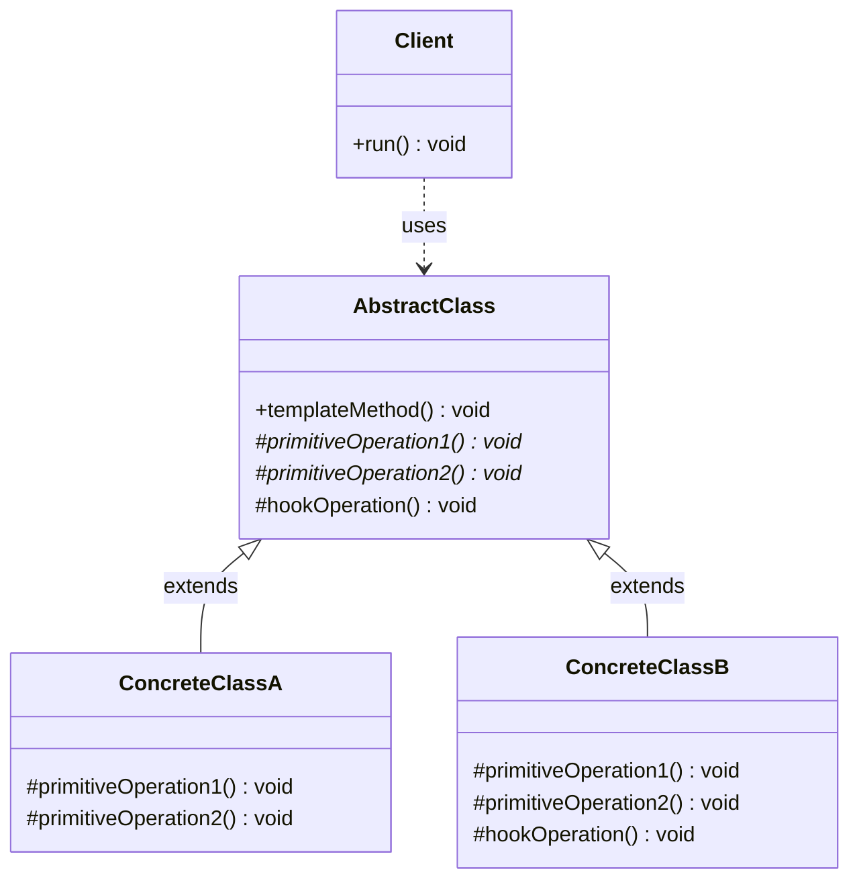

# 템플릿 메서드(Template Method) 디자인 패턴 가이드

> 한 줄 요약: 상위 클래스(Superclass)에서 알고리즘의 골격(skeleton)을 고정하고, 변하는 단계만 하위 클래스(Subclass)가 오버라이드하도록 위임하여 코드 중복을 제거하면서 확장 지점을 한정한다.
>
> 분류: 행위 패턴(Behavioral Pattern)
> 다른 이름(Aliases): 없음(GoF 원전에서 단독 명칭)

---

## 상세 설명

템플릿 메서드(Template Method) 패턴은 어떤 작업을 수행하는 알고리즘의 큰 흐름은 동일하지만, 그 안의 일부 단계(step)만 상황에 따라 달라지는 경우에 사용한다. 상위 클래스는 알고리즘의 전체 순서를 정의한 "템플릿 메서드(template method)"를 `final`로 제공하고, 그 메서드 내부에서 호출되는 개별 단계들을 `abstract` 또는 protected 메서드로 분리해 둔다. 하위 클래스는 알고리즘의 골격을 바꾸지 않은 채, 자신이 책임지는 단계만 구현하거나 재정의(override)한다.

이 패턴이 해결하려는 문제(Problem)는 "비슷한 알고리즘이 여러 클래스에 거의 복사·붙여넣기 수준으로 중복되는 상황"이다. 예를 들어 커피와 차를 만드는 절차는 "물을 끓이고 → 주재료를 우리고 → 컵에 따르고 → 첨가물을 넣는다"라는 공통 구조를 가지지만, 우려내는 재료와 첨가물만 다르다. 이런 경우 공통 흐름을 매번 다시 작성하면 변경에 취약해진다. 템플릿 메서드는 공통 흐름을 한곳에 모으고, 다른 부분만 서브클래스에서 끼워 넣게 한다.

해결책(Solution)의 핵심은 두 가지 메서드 종류를 구분하는 것이다. 첫째는 알고리즘의 골격을 표현하는 템플릿 메서드 자체로, 일반적으로 `final`로 선언해 오버라이드를 금지한다. 둘째는 그 안에서 호출되는 단계들로, 반드시 구현해야 하는 추상 메서드(primitive operation)와, 기본 구현이 있고 필요할 때만 재정의하는 훅 메서드(hook method)로 나뉜다. 훅 메서드는 알고리즘의 특정 시점에 끼어들 수 있는 선택적 확장 지점이다.

템플릿 메서드는 흔히 헐리우드 원칙(Hollywood Principle), 즉 "Don't call us, we'll call you"의 대표 예로 인용된다. 하위 클래스는 상위 클래스의 메서드를 호출하지 않는다. 대신 상위 클래스가 정해진 순서에 따라 하위 클래스의 메서드를 호출한다. 이러한 제어 흐름의 역전(inversion of control)은 프레임워크가 응용 코드를 호출하는 구조와 동일하며, JUnit, Servlet, `java.io.InputStream` 등 수많은 프레임워크/라이브러리의 기본 골격을 이룬다.

GoF가 정의한 원형은 상속(inheritance) 기반이다. 같은 의도를 함수형/합성(composition) 기반으로 푸는 변형이 전략(Strategy) 패턴이며, 두 패턴은 의도는 비슷하지만 구조와 결합도가 다르다. 또한 알고리즘 흐름 일부를 외부 객체에 위임한다는 점에서, 부분적으로 빌더(Builder)나 명령(Command)과도 결합되는 형태가 자주 나타난다.

---

## 디자인 패턴을 충족하는 최소 조건

이 섹션에서는 "어떤 코드가 진짜로 템플릿 메서드 패턴이라고 부를 수 있는가"의 기준을 명확히 한다.

1. **알고리즘 골격을 정의한 상위 클래스가 존재한다** — 추상 클래스(abstract class) 또는 그에 준하는 상위 타입이 알고리즘의 전체 단계와 호출 순서를 고정한 메서드를 보유한다. 이 메서드는 보통 `final`(또는 그에 준하는 봉인)로 선언되어 하위 클래스가 골격 자체를 바꿀 수 없어야 한다.
2. **변경 가능한 단계가 별도 메서드로 분리되어 있다** — 알고리즘 내부의 가변 단계는 추상 메서드(primitive operation) 또는 기본 구현이 있는 훅 메서드(hook method) 형태로 분리되어, 하위 클래스가 이들을 구현·재정의함으로써 동작을 바꾼다.
3. **제어 흐름이 상위→하위로 향한다(Hollywood Principle)** — 하위 클래스가 상위 클래스의 알고리즘을 호출해 조립하는 것이 아니라, 상위 클래스의 템플릿 메서드가 하위 클래스의 단계 메서드를 호출하는 구조여야 한다.
4. **최소 1개 이상의 구체 하위 클래스가 존재한다** — 알고리즘의 어떤 단계에도 차이가 없거나, 하위 클래스가 단 하나도 없다면 패턴을 적용할 동기가 없는 단순한 추상 클래스에 불과하다.

> 위 조건 중 하나라도 빠지면 본 패턴이라고 보기 어렵다. 특히 1번과 3번이 무너지면 단순한 상속을 통한 메서드 재정의일 뿐, 템플릿 메서드 패턴이 아니다.

### 흔히 오해하는 지점
- **전략(Strategy) 패턴과의 혼동(상속 vs 합성)**: 둘 다 "알고리즘의 일부를 갈아끼운다"는 의도를 공유하지만, 템플릿 메서드는 상속(inheritance) 기반으로 컴파일 타임에 변형이 고정되고, 전략은 합성(composition) 기반으로 런타임에 알고리즘 객체를 주입한다. 알고리즘 전체를 통째로 바꿔야 한다면 전략이, 알고리즘 골격은 유지하면서 일부 단계만 바꿔야 한다면 템플릿 메서드가 적합하다.
- **단순히 추상 메서드만 두면 템플릿 메서드인가**: 아니다. 상위 클래스가 그 추상 메서드들을 정해진 순서로 호출하는 "골격 메서드"를 함께 제공해야 패턴이 성립한다.
- **훅 메서드를 반드시 두어야 하는가**: 필수는 아니다. 훅 메서드 없이 추상 메서드만으로도 패턴은 성립한다. 다만 훅을 제공하면 하위 클래스가 알고리즘에 선택적으로 개입할 여지가 생긴다.
- **팩토리 메서드(Factory Method)와의 관계**: 팩토리 메서드는 템플릿 메서드의 특수한 경우로 볼 수 있다. 알고리즘 골격 안에서 객체 생성 단계만 하위 클래스에 위임하면 팩토리 메서드가 된다.

---

## 사례를 통한 예시

### 예시 1: 음료 제조 알고리즘(직접 작성)

**상황**: 카페에서 차(Tea)와 커피(Coffee)를 만드는 절차는 "물 끓이기 → 주재료 우리기 → 컵에 따르기 → (선택) 첨가물 넣기" 순서로 동일하다. 다만 우리는 재료와 첨가물 종류만 다르며, 손님이 첨가물을 원하지 않으면 마지막 단계는 건너뛰어야 한다.

```java
// 상위 추상 클래스 - 알고리즘 골격(skeleton) 정의
public abstract class CaffeineBeverage {

    // 템플릿 메서드(Template Method): final 로 골격을 고정한다.
    public final void prepare() {
        boilWater();
        brew();                  // 추상 메서드 (primitive operation)
        pourInCup();
        if (customerWantsCondiments()) {   // 훅(hook) 메서드를 통한 분기
            addCondiments();     // 추상 메서드
        }
    }

    // 공통 단계 - 상위 클래스에서 구현
    private void boilWater() {
        System.out.println("물을 끓인다");
    }

    private void pourInCup() {
        System.out.println("컵에 따른다");
    }

    // 하위 클래스가 반드시 구현해야 하는 단계
    protected abstract void brew();
    protected abstract void addCondiments();

    // 훅 메서드(hook): 기본 동작이 있고, 필요할 때만 override
    protected boolean customerWantsCondiments() {
        return true;
    }
}

// 구체 하위 클래스 1
public class Tea extends CaffeineBeverage {
    @Override
    protected void brew() {
        System.out.println("찻잎을 우려낸다");
    }

    @Override
    protected void addCondiments() {
        System.out.println("레몬을 추가한다");
    }
}

// 구체 하위 클래스 2 - 훅을 재정의해 알고리즘 흐름에 개입한다.
public class Coffee extends CaffeineBeverage {
    private final boolean wantsMilk;

    public Coffee(boolean wantsMilk) {
        this.wantsMilk = wantsMilk;
    }

    @Override
    protected void brew() {
        System.out.println("필터로 커피를 내린다");
    }

    @Override
    protected void addCondiments() {
        System.out.println("우유와 설탕을 추가한다");
    }

    @Override
    protected boolean customerWantsCondiments() {
        return wantsMilk; // 손님이 원치 않으면 마지막 단계를 건너뛴다.
    }
}

// 사용
public class Cafe {
    public static void main(String[] args) {
        new Tea().prepare();
        new Coffee(false).prepare();
    }
}
```

**해설**: `CaffeineBeverage`가 추상 클래스(AbstractClass) 역할이며, `prepare()`가 템플릿 메서드다. `prepare()` 안에서 호출되는 `brew()`/`addCondiments()`는 하위 클래스가 반드시 구현하는 primitive operation이고, `customerWantsCondiments()`는 기본값(`true`)이 있는 hook이다. `Coffee` 클래스가 hook을 재정의해 마지막 단계의 실행 여부를 제어하는 부분이 훅 메서드의 전형적 활용이다. 호출 흐름은 `Cafe → Tea.prepare() (상속) → CaffeineBeverage.prepare() → Tea.brew()` 순서이며, 골격 자체는 절대 하위 클래스가 흔들 수 없다.

### 예시 2: `javax.servlet.http.HttpServlet#service` (실제 프레임워크 사용 사례)

**상황**: Java EE / Jakarta EE의 서블릿 표준은 HTTP 요청을 처리하는 알고리즘 골격을 `HttpServlet`에 고정해두고, 개발자는 `doGet`, `doPost` 등 메서드 단위 단계만 구현하도록 강제한다.

```java
// 사용자 코드: 단계(doGet, doPost)만 구현한다.
public class HelloServlet extends HttpServlet {

    @Override
    protected void doGet(HttpServletRequest req, HttpServletResponse resp)
            throws IOException {
        resp.setContentType("text/plain;charset=UTF-8");
        resp.getWriter().write("Hello, " + req.getParameter("name"));
    }

    @Override
    protected void doPost(HttpServletRequest req, HttpServletResponse resp)
            throws IOException {
        // POST 요청 단계만 작성
        resp.getWriter().write("Created");
    }
}
```

`HttpServlet` 내부(개념적 의사 코드)는 다음과 같이 동작한다.

```java
// HttpServlet (요약) - 표준 라이브러리가 제공하는 골격
public abstract class HttpServlet extends GenericServlet {

    // 템플릿 메서드: HTTP 메서드별로 적절한 doXxx 를 호출한다.
    protected void service(HttpServletRequest req, HttpServletResponse resp)
            throws ServletException, IOException {
        String method = req.getMethod();
        if ("GET".equals(method))      doGet(req, resp);
        else if ("POST".equals(method)) doPost(req, resp);
        else if ("PUT".equals(method))  doPut(req, resp);
        else if ("DELETE".equals(method)) doDelete(req, resp);
        // ... (HEAD, OPTIONS, TRACE 등 생략)
    }

    // 훅 메서드: 기본 구현은 405 Method Not Allowed 를 반환한다.
    protected void doGet(HttpServletRequest req, HttpServletResponse resp)
            throws ServletException, IOException {
        resp.sendError(HttpServletResponse.SC_METHOD_NOT_ALLOWED);
    }
    // doPost, doPut, doDelete 등도 동일한 형태로 기본 405 응답
}
```

**해설**: `service()`가 템플릿 메서드이며, "요청 메서드를 보고 → 적절한 단계 메서드를 호출한다"라는 골격을 고정한다. `doGet`/`doPost` 등은 hook 메서드로, 기본 구현(405 응답)이 제공되며 개발자가 필요한 것만 재정의한다. 개발자가 `HttpServlet#service`를 직접 호출하지 않고 컨테이너(Tomcat 등)가 `service`를 호출한다는 점에서, 헐리우드 원칙("우리가 부를 테니 부르지 마라")이 그대로 적용된다. 이는 `java.io.InputStream`이 `read(byte[], int, int)`라는 추상 메서드를 기반으로 `read()`, `read(byte[])` 등의 골격을 제공하는 구조와 동일한 패턴이다.

---

## 어떨 때 사용하나

여러 클래스가 거의 같은 알고리즘을 약간씩 다르게 수행해 코드 중복이 누적되는 경우, 알고리즘의 전체 흐름은 변하지 않는데 일부 단계만 환경/도메인에 따라 분기되는 경우, 그리고 프레임워크처럼 "전체 흐름은 우리가 제어할 테니, 너희는 정해진 단계만 구현해라"라는 식의 확장 지점을 제공하고 싶을 때 템플릿 메서드 패턴을 도입한다.

특히 다음과 같은 신호(Symptom)가 보이면 검토 가치가 있다.

- 비슷한 메서드 두세 개가 도입부와 마무리는 거의 동일하고 중간만 다른 형태로 반복된다.
- 라이브러리/프레임워크의 사용자에게 알고리즘의 골격은 변경하지 못하게 하면서, 특정 hook 지점에서만 동작을 갈아끼우게 하고 싶다.
- 알고리즘의 단계 순서를 강제(예: 트랜잭션 시작 → 비즈니스 로직 → 트랜잭션 종료)하고 싶고, 일부 단계 구현만 도메인별로 다르게 두고 싶다.
- 테스트 시 알고리즘 골격은 그대로 두고 일부 단계만 가짜(stub)로 교체하고 싶다.

### 사용하면 안 되는 경우 (Anti-patterns)

- **알고리즘 전체가 통째로 바뀌어야 하는 경우**: 골격이 공유되지 않으면 템플릿 메서드의 이점이 사라진다. 이때는 전략(Strategy) 패턴이 적합하다.
- **변하는 단계가 너무 많아 추상 메서드가 10개 이상으로 늘어나는 경우**: 하위 클래스가 거의 모든 단계를 구현해야 한다면 상위 클래스가 골격을 제공한다고 보기 어렵다. 합성과 위임으로 재설계해야 한다.
- **런타임에 알고리즘 변형을 자유롭게 갈아끼워야 하는 경우**: 상속은 컴파일 타임에 고정되므로, 런타임에 동작을 바꿔야 한다면 전략 패턴 또는 함수형 콜백(`Consumer`, `Function`)이 더 적절하다.
- **상속 계층이 이미 다른 책임으로 사용되고 있는 경우**: Java는 단일 상속이므로, 템플릿 메서드를 위해 상속을 소비하면 다른 추상화를 잃는다.

---

## 장점과 단점, 한계점

### 장점
- **코드 중복 제거**: 알고리즘 골격을 상위 클래스에 한 번만 작성하면, 하위 클래스는 가변 단계만 채우므로 중복이 사라진다.
- **확장 지점의 한정과 일관성**: hook과 primitive operation으로 확장 가능한 지점이 명시되어, 하위 클래스가 임의로 알고리즘 흐름을 망가뜨릴 수 없다.
- **헐리우드 원칙(Hollywood Principle) 준수**: 상위 클래스가 하위 클래스의 단계를 호출하는 제어 흐름 역전이 자연스럽게 구현되어, 프레임워크 설계의 기본 골격으로 사용하기 적합하다.
- **의도의 명료성**: "이 알고리즘은 이 단계로 구성된다"는 의도가 상위 클래스의 템플릿 메서드 한 곳에 문서화된다.

### 단점
- **상속을 강제(forced inheritance)한다**: 기능을 확장하려면 반드시 상위 클래스를 상속해야 하므로, 단일 상속 언어(Java, C#)에서는 상속 슬롯을 소비한다.
- **하위 클래스가 상위 클래스의 변경에 강하게 결합된다**: 상위 클래스가 단계 메서드 이름·시그니처·호출 순서를 바꾸면 모든 하위 클래스가 영향을 받는다. 깨지기 쉬운 베이스 클래스 문제(fragile base class problem)가 발생한다.
- **흐름이 보이지 않는다**: 알고리즘의 일부가 상위 클래스에, 일부가 하위 클래스에 흩어져 있어 추적이 어려울 수 있다. 디버깅 시 호출 스택을 오가야 한다.
- **LSP(Liskov Substitution Principle) 위반 위험**: 하위 클래스가 primitive operation을 부주의하게 구현하면, 상위 클래스의 템플릿 메서드가 기대하는 사후 조건(postcondition)·불변식(invariant)을 깨뜨려 치환 가능성을 위반할 수 있다. 예를 들어 `addCondiments`에서 예외를 던지거나 부수효과를 일으키면 골격이 가정한 동작이 깨진다.

### 한계점
- **단일 상속 언어에서의 구조적 제약**: Java는 다중 상속이 없으므로, 이미 다른 추상화를 상속받은 클래스는 템플릿 메서드 골격을 추가로 상속받기 어렵다.
- **런타임 변형 불가**: 알고리즘 변형이 컴파일 타임에 클래스 단위로 고정되므로, 같은 인스턴스에서 동작을 동적으로 바꿀 수 없다.
- **테스트 시 골격 우회가 어렵다**: 템플릿 메서드를 `final`로 두면 알고리즘 전체를 대체하는 테스트 더블을 만들기 까다롭다. 단계별 메서드를 protected로 열어두는 등의 절충이 필요하다.
- **계층 폭증**: 작은 변형마다 새 하위 클래스를 만들어야 하므로, 변형 축이 2개 이상이면 클래스 수가 곱셈으로 증가한다(예: 음료 × 잔 크기 조합).

---

## 정보 표

| 항목 | 값 |
| --- | --- |
| 분류 | 행위 패턴(Behavioral) |
| 언어 의존성 | 언어 비의존적. 다만 상속과 메서드 오버라이드, `final`/봉인 메서드 같은 기능을 지원하는 객체지향 언어(Java, C#, C++, Kotlin 등)에서 자연스럽게 표현된다. |
| 활용성(1점~5점) | 별 4개 (4/5) — GoF 패턴 중 가장 빈번하게 등장하며, 거의 모든 OOP 프레임워크의 확장 지점(Servlet, JUnit, Spring, `InputStream` 등)이 이 구조를 채택한다. |
| 학습 난이도 | 하 — 상속과 추상 메서드만 이해하면 즉시 적용 가능하다. |
| 자주 함께 쓰이는 패턴 | 팩토리 메서드(Factory Method, 생성 단계를 위임), 전략(Strategy, 단계 자체를 객체로 분리할 때의 대안), 책임 연쇄(Chain of Responsibility, 단계별 처리 위임 시) |
| 대표 사용 사례 | `javax.servlet.http.HttpServlet#service`, `java.io.InputStream#read`, JUnit3의 `TestCase#runBare`, Spring의 `JdbcTemplate`/`AbstractApplicationContext#refresh` |

---

## Class Diagram



> 다이어그램에 등장하는 각 클래스가 패턴의 어떤 역할(Role)을 담당하는지 위 "상세 설명" 섹션과 1:1로 대응되어야 한다.

### 역할 설명
- **AbstractClass (추상 클래스)**: 알고리즘 골격을 표현하는 `templateMethod()`를 제공한다. 일반적으로 `final`로 선언해 하위 클래스가 골격 자체를 바꾸지 못하게 한다. 골격 내부에서 호출되는 `primitiveOperation1/2`는 추상 메서드이고, `hookOperation`은 기본 구현이 있는 훅 메서드다.
- **ConcreteClassA / ConcreteClassB (구체 클래스)**: `AbstractClass`를 상속해 primitive operation을 구현한다. 필요하면 hook도 재정의해 알고리즘의 특정 지점에 개입한다. `ConcreteClassB`처럼 hook을 재정의하는 클래스가 알고리즘 흐름을 한정적으로 변형한다.
- **Client (클라이언트)**: `AbstractClass` 타입을 통해 `templateMethod()`를 호출한다. 클라이언트는 어떤 구체 클래스가 주입되었는지 알 필요 없이 동일한 인터페이스로 알고리즘을 실행한다.

---

## 참고 자료
- 원전: Erich Gamma, Richard Helm, Ralph Johnson, John Vlissides, "Design Patterns: Elements of Reusable Object-Oriented Software" (Addison-Wesley, 1994), Template Method 항목.
- Eric Freeman, Elisabeth Robson, "Head First Design Patterns" 2nd Edition, O'Reilly, 2020. — 음료 제조 예시의 원형.
- Java EE / Jakarta EE 명세: `javax.servlet.http.HttpServlet` — `service()` / `doGet()` / `doPost()` 구조.
- Java 표준 라이브러리: `java.io.InputStream#read(byte[], int, int)`을 기반으로 한 read 메서드 골격.
- Refactoring.Guru, "Template Method" — https://refactoring.guru/design-patterns/template-method
- Robert C. Martin, "Agile Software Development, Principles, Patterns, and Practices" — Template Method와 LSP/OCP 관계 논의.
