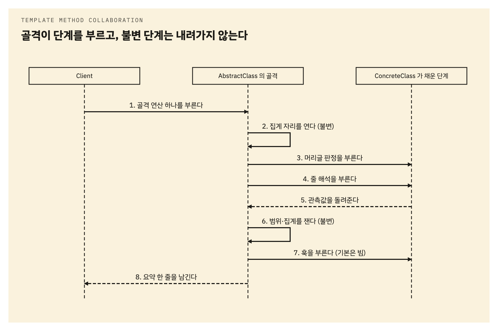
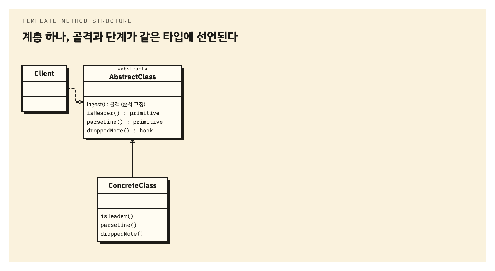

# Template Method — 순서는 위가 쥐고, 달라지는 한 칸만 아래로 내려보내기

## 한눈에 보는 개요

관측소에서 올라오는 일일 기상 파일을 적재하는 코드를 떠올려 봅시다. CSV 로 오는 관측소가 있고 고정폭 텍스트로 오는 관측소가 있어서, 적재기를 두 벌 써 두었어요. 두 벌을 나란히 놓고 보면 다른 줄은 몇 줄뿐입니다. 머리글을 알아보는 방법과 한 줄을 숫자로 바꾸는 방법만 다르고, 머리글을 건너뛰고 범위를 벗어난 값을 버리고 평균과 최고를 내는 부분은 글자까지 같아요. 그래서 "기온 60.0℃ 넘는 값은 버린다"는 규칙이 바뀌면 두 곳을 함께 고쳐야 하고, 한 곳을 빠뜨리면 같은 날 두 관측소의 평균이 서로 다른 기준으로 나옵니다. 그것도 오류 없이요.

Template Method 가 두는 한 수는 **순서를 상위 타입의 연산 하나에 모아 두고, 달라지는 칸만 이름을 붙여 아래로 내려보내는 것**입니다. 적재 절차는 한 곳에만 있고, 형식이 하나 늘면 그 형식이 채울 칸 두 개짜리 클래스가 하나 늘어요. 버림 규칙을 고칠 자리는 계속 한 곳입니다.

```text
Before : 적재기마다 절차 전체가 복제됨

  CsvIngest.ingest(lines)            FixedWidthIngest.ingest(lines)
    머리글 건너뛰기  (CSV 방식)        머리글 건너뛰기  (고정폭 방식)
    한 줄 해석      (CSV 방식)        한 줄 해석      (고정폭 방식)
    범위 벗어나면 버림  ← 복제           범위 벗어나면 버림  ← 복제
    합계·최고 갱신     ← 복제           합계·최고 갱신     ← 복제
    평균 내고 한 줄 출력 ← 복제           평균 내고 한 줄 출력 ← 복제

After : 순서는 한 곳, 달라지는 칸만 아래로

  ObservationIngest.ingest(lines)    ← 절차는 여기 한 곳, 재정의 금지
    isHeader(line)     ─┐
    parseLine(line)    ─┼─▶ CsvIngest  /  FixedWidthIngest  /  KeyValueIngest
    범위 벗어나면 버림     │              (이 칸들만 채운다)
    합계·최고 갱신        │
    droppedNote(n)     ─┘  ← 훅: 기본은 빈 문자열, 필요한 쪽만 채움
    평균 내고 한 줄 출력
```

이 패턴의 이름은 GoF(Gang of Four, 1994년에 나온 *Design Patterns* 의 저자 네 명을 함께 부르는 이름)가 붙인 것이고 다른 이름은 없습니다. 분류는 행위 패턴이고, 행위 패턴 열하나 가운데 **클래스 범위**로 묶이는 둘 중 하나예요(근거: GoF 원서 1장 표 1.1 Design pattern space). 클래스 범위라는 말은 바뀌는 부분을 객체 사이의 관계가 아니라 상속으로 떼어 내 컴파일할 때 고정한다는 뜻인데, 그 구분의 정의는 [참고 문서 「GoF 공통 어휘」의 클래스 패턴과 객체 패턴](../../reference/gof-vocabulary/gof-vocabulary-ref_v1.0.1.md)에 있습니다. 함께 쓰는 패턴은 Factory Method 예요. 골격의 한 단계가 "무엇을 쓸지"를 정해 객체를 돌려주면 그 단계가 곧 팩토리 메서드거든요(근거: GoF 원서 Template Method 절 Related Patterns). 이 글은 시나리오 셋을 따라갑니다. CSV 한 장이 요약 한 줄이 되는 길, 새 형식이 더해질 때 무엇이 안 바뀌는가, 골격을 아래에서 다시 쓰면 평균이 얼마나 틀리는가. 끝까지 읽으면 어떤 코드를 Template Method 라고 불러도 되는지 필수 조건 넷으로 판정할 수 있고, 구조가 닮은 Strategy·Factory Method 코드와도 구분할 수 있게 됩니다.

## 패턴 자세히 들여다보기

### 시나리오 1 — CSV 한 장이 요약 한 줄이 되는 길

ST-01 관측소의 2026-09-21 자 CSV 파일이 들어왔습니다. 머리글 한 줄과 관측 네 줄이에요. 기온은 0.1℃ 단위 정수로 적혀서 `184` 는 18.4℃ 이고, 세 번째 관측 줄의 `999` 는 99.9℃ 라 장비 오작동입니다. 나와야 하는 것은 요약 한 줄이고, 버린 줄을 뺀 평균 186 과 최고 203 이 그 줄에 들어갑니다. 이 장면에는 셋이 등장해요. 적재 절차를 담은 `ObservationIngest`(패턴에서 AbstractClass 라고 부르는 역할), CSV 라는 것만 다른 `CsvIngest`(ConcreteClass), 그리고 적재를 시작하는 진입점(Client)입니다. 이름은 여기서 한 구절씩만 소개하고 정식 정의는 개념 정리에서 해요.



1. 진입점이 `CsvIngest` 인스턴스를 만들어 적재를 요청합니다. 요청을 받는 연산은 `ObservationIngest` 가 선언한 `ingest` 하나예요. 이 일을 진입점이 맡는 이유는 어느 형식의 파일이 왔는지 아는 쪽이 실행을 시작하는 쪽뿐이라서입니다. 여기서 고르는 것은 **형식**이고, 적재 절차는 아직 아무도 고르지 않았다는 점을 봐 두세요.
2. `ingest` 가 집계 자리를 엽니다. 읽은 줄 수·남긴 수·버린 수·합계·최고를 0 으로 놓고 관측소 코드를 빈 값으로 둬요. 이 자리가 골격 안에 있는 이유는 다음 단계들이 그 값을 차례로 고쳐 나가기 때문입니다. 집계 자리를 형식별 코드로 옮기면 같은 다섯 변수가 형식 수만큼 생기고, 한 곳만 고칠 때 나머지가 조용히 어긋나요.
3. 골격이 줄을 하나 꺼내 `isHeader` 를 부릅니다. `CsvIngest` 가 채운 판정이 실행되어 `date,station,temp,humidity` 를 머리글로 알아보고, 골격은 그 줄을 세지 않고 넘어가요. 판정을 아래로 내린 이유는 머리글의 생김새가 형식마다 다르기 때문입니다. 골격이 직접 판정하려면 형식 이름으로 갈라야 하고, 그러면 형식이 늘 때마다 골격을 열어야 해요.
4. 다음 줄부터 골격이 읽은 줄 수를 세고 `parseLine` 을 부릅니다. `CsvIngest` 가 쉼표로 자른 뒤 관측소 코드와 두 정수를 꺼내요. 이 칸도 아래에 있는 이유는 줄의 생김새가 형식마다 다르기 때문이고, 부르는 자리와 부르는 차례는 여전히 골격이 쥡니다.
5. 해석 결과가 골격으로 올라옵니다. 골격이 받는 것은 `Reading` 하나뿐이고 원래 줄이 CSV 였는지 고정폭이었는지는 이 지점부터 흔적이 없어요. 형태를 맞춰 올려 보내는 것이 아래쪽 칸의 책임인 이유는, 위에 남은 단계들이 형식을 모른 채 돌아야 하기 때문입니다.
6. 골격이 범위를 재서 999 를 버립니다. 기온은 -600 이상 600 이하, 습도는 0 이상 100 이하라 세 번째 관측 줄만 걸려요. 그리고 남긴 줄의 기온을 합계에 더하고 최고를 갱신합니다. 이 단계가 아래로 내려가지 않는 이유는 버릴 값의 기준이 파일 형식과 아무 상관이 없어서예요. 내려보내면 형식마다 자기 기준을 갖게 되고, 그 순간 같은 날 두 관측소의 평균이 다른 잣대로 나옵니다.
7. 네 줄을 다 돌고 나서 골격이 `droppedNote` 를 부릅니다. `CsvIngest` 는 이 칸을 채우지 않아서 상위 타입이 준 기본 구현이 실행되고 빈 문자열이 돌아와요. 비어 있으면 골격은 경고 줄을 찍지 않습니다. 이 칸을 채우지 않아도 되게 만든 이유는 버린 줄에 덧붙일 말이 형식마다 있을 수도 없을 수도 있어서입니다. 반드시 채우게 하면 할 말이 없는 형식까지 빈 구현을 쓰게 돼요.
8. 골격이 평균 186 을 내고 요약 한 줄을 남긴 뒤 진입점으로 돌아옵니다. 평균을 골격이 내는 이유는 6단계에서 모은 합계와 남긴 수가 골격 안에 있기 때문이에요. 나누는 일만 아래로 내리면 그 값 둘을 인자로 넘겨야 하고, 형식마다 다르게 반올림할 여지가 생깁니다.

```text
단계   부르는 쪽 → 받는 쪽                넘기는 것         돌아오는 것
 1     진입점 → ObservationIngest 타입    줄 네 개 + 머리글  (8단계에서 요약)
 2     골격 → 골격                        —                 rows=0 kept=0 dropped=0
 3     골격 → CsvIngest.isHeader          "date,station,…"  true  (세지 않고 넘어감)
 4     골격 → CsvIngest.parseLine         "…,ST-01,184,63"  —
 5     CsvIngest → 골격                   —                 Reading(ST-01, 184, 63)
 6     골격 → 골격                        —                 999 버림 · sum 558 · max 203
 7     골격 → CsvIngest.droppedNote       dropped=1         ""  (기본 구현)
 8     골격 → 진입점                      —                 avg 186 · 요약 한 줄
```

잠깐, 확인 하나만 해 볼까요? 3~5단계에서 `CsvIngest` 가 한 일은 둘뿐인데, 그 둘이 몇 번째에 불릴지는 `CsvIngest` 코드 어디에 적혀 있을까요?

어디에도 없습니다. `CsvIngest` 는 두 칸의 **내용**만 갖고 있고 **차례**는 갖고 있지 않아요. 그래서 이 방향을 뒤집을 수가 없습니다. 골격이 아래를 부르지, 아래가 골격을 부르지 않거든요(근거: GoF 원서 Template Method 절 Consequences — 부모 클래스가 서브클래스의 연산을 호출하고 그 반대가 아닌 역전된 제어 구조). 이 성질에는 할리우드 원칙이라는 별명이 붙어 있어요. 뽑히기를 기다리는 쪽이 먼저 연락하지 않고 뽑는 쪽이 연락한다는 장면에서 온 이름인데, 여기서는 아래쪽이 흐름을 시작하지 않는다는 말입니다.

```text
무엇을 정하는가              정하는 쪽           시나리오 1 의 단계
어느 형식의 파일인가          Client              1
단계의 차례와 개수            AbstractClass       2 · 3 · 4 · 7
버릴 값의 기준과 집계 방법     AbstractClass       6 · 8
머리글을 알아보는 방법         ConcreteClass       3
한 줄을 숫자로 바꾸는 방법     ConcreteClass       4
버린 줄에 덧붙일 말           ConcreteClass (선택) 7
```

이 시나리오가 보여 준 것은 한 번의 호출 안에서 제어가 위에서 아래로만 내려갔다 온다는 점입니다. 아래로 내려간 것은 세 칸의 내용뿐이고(3·4·7단계), 그 사이의 모든 차례와 불변 단계는 위에 남았어요(2·6·8단계). 위 표의 이름 셋은 개념 정리에서 정식으로 정의합니다.

### 시나리오 2 — 키=값 형식 관측소가 더해질 때

ST-02 관측소가 새로 붙었는데 파일이 `date=2026-09-21;station=ST-02;temp=201;hum=58` 같은 키=값 줄로 옵니다. 머리글이 아예 없고 관측 세 줄뿐이에요. 나와야 하는 것은 요약 한 줄이고 평균 195, 최고 214, 버린 줄 0 입니다. 앞서 고정폭 형식이 들어왔을 때와 드는 품이 같은지도 함께 봅니다.

1. 개발자가 `KeyValueIngest` 를 새로 쓰고 `isHeader` 와 `parseLine` 두 칸만 채웁니다. 머리글이 없는 형식이라 `isHeader` 는 늘 거짓을 돌려주고, `parseLine` 은 세미콜론으로 자른 뒤 등호 왼쪽 이름을 보고 값을 꺼내요. 이 둘만 쓰면 되는 이유는 나머지 단계가 형식과 무관해서입니다. 시나리오 1 의 6·8단계에서 본 범위 검사와 집계는 새 형식에도 그대로 맞아요.
2. `droppedNote` 는 재정의하지 않습니다. 이 형식은 값이 줄마다 이름표를 달고 오므로 자리가 밀릴 일이 없고, 버린 줄이 생겨도 덧붙일 말이 없어요. 그래서 상위 타입의 기본 구현이 그대로 쓰이고 출력에 경고 줄이 붙지 않습니다.
3. `ObservationIngest` 는 한 줄도 바뀌지 않습니다. 골격에 적힌 이름은 자기가 선언한 세 칸과 집계 변수뿐이라 형식 이름이 들어갈 자리가 없어요. 조건문이 사라진 것이 아니라, 형식을 고르는 한 번의 선택이 진입점으로 옮겨 간 것입니다.
4. 진입점에 `new KeyValueIngest().ingest(...)` 한 줄이 늘고 출력에 한 줄이 붙습니다. 진입점이 이 줄을 갖는 이유는 시나리오 1 의 1단계와 같아요. 어느 형식이 왔는지 아는 쪽은 실행을 시작하는 쪽입니다.
5. 고정폭이 들어왔을 때와 품이 거의 같은데 한 군데가 다릅니다. 그때는 클래스 하나와 진입점 한 줄에 더해 `droppedNote` 까지 세 칸을 채웠어요. 고정폭은 열 위치가 한 칸만 밀려도 줄 전체가 어긋나서 버린 줄이 생기면 그 사실을 알려야 했거든요. 같은 골격 아래에서 채우는 칸의 수가 형식마다 다를 수 있다는 것이 선택 칸을 둔 이유입니다.

```text
변화              새로 채운 칸                        안 바뀐 곳
fixed 추가        isHeader · parseLine                ObservationIngest 전체
                  droppedNote (선택 칸)                CsvIngest
                  진입점 한 줄

kv 추가           isHeader · parseLine                ObservationIngest 전체
                  (droppedNote 는 기본 구현 그대로)     CsvIngest · FixedWidthIngest
                  진입점 한 줄
```

| 형식 | 읽은 줄 | 남긴 줄 | 버린 줄 | 평균(0.1℃) | 최고(0.1℃) | 경고 줄 |
| --- | --- | --- | --- | --- | --- | --- |
| csv (ST-01) | 4 | 3 | 1 | 186 | 203 | 없음 |
| fixed (ST-01) | 3 | 2 | 1 | 173 | 179 | 있음 |
| kv (ST-02) | 3 | 3 | 0 | 195 | 214 | 없음 |

csv 줄의 평균만 나누어떨어집니다. 남긴 세 값 184·171·203 의 합이 558 이라 3 으로 나누면 186 이 딱 떨어져요. fixed 줄은 179 와 168 의 합 347 을 2 로 나눈 173.5 이고, kv 줄은 586 을 3 으로 나눈 195.33… 입니다. 세 언어 모두 소수점 아래를 버려 173 과 195 를 쓰는데, 버리는 자리를 골격 안에 한 번만 둬서 언어가 달라도 값이 갈리지 않게 했어요. 위 표의 수치는 전부 구현 예시의 실행 출력에서 가져온 것입니다.

여기서 헷갈리기 쉬운 포인트는 아래로 내려보내는 칸이 반드시 **추상**이어야 한다고 믿는 것입니다. 그렇지 않아요. 상위 타입이 기본 구현을 준 칸도 아래로 내려보낸 칸이고, `droppedNote` 가 바로 그 모양입니다. 원전은 이런 칸을 훅이라고 부르고 기본 동작이 아무것도 하지 않는 경우가 흔하다고 봐요. 반드시 채워야 하는 칸과 채워도 되는 칸을 분명히 갈라 두는 것이 중요하다는 것도 같은 자리에서 말합니다(근거: GoF 원서 Template Method 절 Consequences — 템플릿 메서드가 부르는 연산의 종류에 훅 연산이 들어가고, 어느 것이 훅이고 어느 것이 추상인지 명시하는 것이 중요하다). 그 둘을 뒤섞으면 아래쪽을 쓰는 사람이 무엇을 반드시 채워야 하는지 알 수 없습니다.

```text
칸의 종류        상위 타입의 선언          아래가 안 채우면          이 예시의 칸
반드시 채울 칸    본문 없이 이름만          컴파일이 막음              isHeader · parseLine
채워도 되는 칸    기본 동작이 있는 본문      기본 동작이 실행됨          droppedNote
```

이 시나리오가 보여 준 것은 변화의 범위입니다. 새 형식이 들어올 때 새로 쓰는 것은 ConcreteClass 하나와 진입점 한 줄이고(1·4단계), 골격과 기존 적재기는 그대로예요(3단계). 그리고 그 ConcreteClass 가 채우는 칸의 수는 둘일 수도 셋일 수도 있습니다(2·5단계).

### 시나리오 3 — 골격을 아래에서 다시 쓰면 어느 단계에서 얼마가 틀리는가

같은 회사의 다른 팀은 CSV 적재기를 조금 다르게 짰습니다. 겉보기에는 시나리오 1 과 같아요. `ObservationIngest` 가 있고 `CsvIngest` 가 그것을 상속하는 모양까지 똑같습니다. 다른 것은 `CsvIngest` 가 `ingest` 를 자기 안에서 다시 구현했다는 점 하나예요. 그러면서 범위 검사만 빠뜨렸습니다. 아래 결과는 Java 21 · TypeScript 5.9.3 · rustc 1.95.0 으로 실제로 컴파일하고 실행한 것입니다.

1. `CsvIngest` 가 `ingest` 를 재정의하고 시나리오 1 의 6단계에서 범위를 재던 부분을 빼 버립니다. 이렇게 짜는 이유는 대개 편의예요. CSV 쪽만 급히 손보면 되는 것처럼 보이니까요. 그 대가로 불변 단계가 형식마다 갈립니다.
2. Java 는 여기서 멈춥니다. `javac` 이 `ingest(List<String>) in CsvIngest cannot override ingest(List<String>) in ObservationIngest` 를 내고 그 아래에 `overridden method is final` 을 덧붙여요. 오류는 한 건이고 다른 오류는 나오지 않습니다(직접 컴파일해 확인).
3. 진단의 원인이 정말 `final` 인지 확인하려면 골격 선언에서 `final` 한 낱말만 떼고 다시 돌려 보면 됩니다. 가시성도 인자도 그대로 두고 그 낱말만 뺐더니 오류가 사라지고 프로그램이 돌아가요. 그런데 출력이 `[csv] ST-01 rows 4 kept 4 dropped 0 avg 389 max 999` 입니다. 평균이 186 이 아니라 389 이고 최고가 203 이 아니라 999 예요. 장비 오작동 값이 그대로 섞인 건데 **컴파일도 실행도 아무 오류를 내지 않습니다**(직접 실행해 확인).
4. TypeScript 와 Rust 는 같은 편집을 막을 수단이 아예 없습니다. TypeScript 에는 메서드 재정의를 금지하는 수정자가 없고, Rust 의 trait 에는 기본 구현을 고정할 수단이 없어요. 두 언어 모두 그대로 컴파일되고 Java 에서 `final` 을 뗐을 때와 글자 하나까지 같은 389 를 냅니다(직접 실행해 확인). 그러니 Java 밖에서는 이 위반을 컴파일러에 맡길 수 없고 최소 조건으로 판정해야 합니다.
5. 되돌리는 길은 골격을 하나만 두는 것입니다. `CsvIngest` 의 `ingest` 를 지우고 채워야 할 칸만 남기면 6단계가 다시 골격 안으로 들어와 평균이 186 으로 돌아와요. 고칠 자리는 한 곳이고, 최소 조건에서는 4번이 이 자리를 봅니다.

```text
Before (시나리오 3)                          After (시나리오 1 의 모양)

  CsvIngest.ingest(lines)                     ObservationIngest.ingest(lines)
    머리글 건너뛰기                              머리글 건너뛰기
    한 줄 해석                                  한 줄 해석
    (범위 검사 없음)          ← 빠진 칸           범위 벗어나면 버림
    합계·최고 갱신                               합계·최고 갱신
    평균 내고 출력                               평균 내고 출력

  csv 출력                                     csv 출력
    kept 4 dropped 0                            kept 3 dropped 1
    avg 389  max 999   ← 오류 없이 틀림           avg 186  max 203
```

| 언어 | 골격 재정의를 막는 수단 | 그 편집의 결과 |
| --- | --- | --- |
| Java | 있음 (`final` 메서드) | 컴파일 오류 1건. `final` 만 떼면 통과하고 avg 389 |
| TypeScript | 없음 | 통과하고 avg 389 |
| Rust | 없음 (trait 기본 구현) | 통과하고 avg 389 |

이 시나리오가 보여 준 것은 골격이 둘이 되는 순간 불변 단계가 조용히 갈린다는 점입니다. 아래가 골격을 다시 쓰면 그 안에서 무엇을 빠뜨렸는지 위에서는 볼 수 없고(1단계), 세 언어 중 하나만 그 편집을 문법으로 막아 줍니다(2·4단계). 막아 주는 쪽에서도 낱말 하나면 빗장이 풀리고요(3단계). 그래서 최소 조건은 출력이 맞는지가 아니라 골격이 어디에 몇 개 있는지로 적혀 있습니다.

### 개념 정리

시나리오에 나온 역할 셋을 정식으로 정의합니다. 둘은 패턴의 참여자이고 Client 는 참여자 둘에 들지 않지만 적재를 시작하는 쪽이라 시나리오와 구현에 늘 나오므로 함께 정의해요(근거: GoF 원서 Template Method 절 Participants).

- **AbstractClass** — 알고리즘의 골격을 담은 연산을 구현하고, 아래가 채울 단계 연산을 선언합니다. 골격은 단계들을 부르는 차례를 정해 두고(시나리오 1 의 2~8단계), 형식과 무관한 불변 단계는 자기 안에 둬요(6·8단계). 골격이 부르는 것은 아래가 채운 단계만이 아니라 자기가 가진 다른 연산일 수도 있습니다. 관측 예에서는 `ingest`·`isHeader`·`parseLine`·`droppedNote` 를 가진 `ObservationIngest` 가 AbstractClass 입니다.
- **ConcreteClass** — AbstractClass 가 선언한 단계 연산을 채워 자기 몫의 일을 합니다(시나리오 1 의 3·4단계). 채우는 것은 칸의 내용뿐이고 차례는 갖지 않으며, 불변 단계의 구현은 AbstractClass 에 기댑니다(근거: GoF 원서 Template Method 절 Collaborations — ConcreteClass 는 알고리즘의 불변 단계 구현을 AbstractClass 에 의존한다). 관측 예에서는 `CsvIngest`·`FixedWidthIngest`·`KeyValueIngest` 가 각각 ConcreteClass 예요.
- **Client** — ConcreteClass 하나를 골라 만들고 AbstractClass 가 선언한 골격 연산을 부릅니다(시나리오 1 의 1단계). 단계를 직접 고르지는 않아요. 고르는 것은 파일 형식이고 단계는 그 선택에 딸려 옵니다. 관측 예에서는 형식별로 적재를 돌리는 진입점이 Client 입니다.



그림에서 계층이 **하나**라는 점을 봐 두세요. [Factory Method](../factory-method/factory-method-guide_v1.0.0.md) 나 [Bridge](../bridge/bridge-guide_v1.0.0.md) 처럼 짝을 이루는 두 계층이 없고, 골격 연산과 단계 연산이 같은 칸 안에 함께 선언되어 있습니다. Client 에서 나가는 점선도 AbstractClass 하나로만 향해요. ConcreteClass 칸에는 단계 연산만 있고 골격이 없는데, 그것이 최소 조건 1번과 4번이 코드에서 확인하는 모양입니다.

골격이 부르는 칸은 세 종류로 갈립니다. 이름이 셋 다 시나리오에 나왔으니 여기서 정리해 둘게요.

```text
칸의 종류               상위 타입에서의 모양        아래가 안 채우면        이 예시
골격(템플릿 메서드)      차례를 담은 완성된 본문      (채울 칸이 아님)        ingest
primitive 연산          본문 없는 선언              컴파일이 막음           isHeader · parseLine
훅(hook) 연산           기본 동작이 있는 본문        기본 동작이 실행됨       droppedNote
```

상속이 없는 언어에서는 ConcreteClass 자리에 무엇이 오는지 짚고 갈 필요가 있습니다. Rust 에는 클래스 상속이 없고, 대신 trait 이 기본 구현을 가진 제공 메서드와 본문 없는 필수 메서드를 함께 선언할 수 있어요. 이 글의 판정은 **그 모양이 원전의 Template Method 와 같은 자리에 선다**는 것이고, 근거는 셋입니다. 원전이 AbstractClass 에 요구하는 것은 데이터가 아니라 연산 둘입니다. 골격을 구현할 것과 아래가 채울 단계를 선언할 것인데(근거: GoF 원서 Template Method 절 Participants), trait 은 제공 메서드로 앞을, 필수 메서드로 뒤를 그대로 합니다. 제어 방향도 같아요. 골격이 단계를 부르고 그 반대가 아닙니다. trait 의 기본 구현이 같은 trait 의 필수 메서드를 부를 수 있다는 규칙이 그 자리를 받쳐 줍니다([The Rust Programming Language 10.2](https://doc.rust-lang.org/book/ch10-02-traits.html)). 남은 하나는 클래스 범위 분류가 말하는 컴파일 시점 고정인데, 이 성질도 그대로 남습니다. 어느 타입이 어느 trait 을 구현하는지는 컴파일할 때 정해지고 실행 중에 바꿀 수 없으니까요.

다만 원전과 갈리는 자리가 둘 있고, 둘 다 최소 조건에서는 `[선택]` 쪽입니다. 하나는 상위 타입이 **데이터**를 가질 수 없다는 점이에요. 구현 예시의 Java 판은 형식 이름을 `label` 필드로 들고 있는데(Java 12행), Rust 판에서는 그것이 필수 메서드 `label()` 이 되어 구현 타입 쪽으로 넘어갑니다(Rust 13행). 다른 하나는 시나리오 3 의 4단계에서 본 대로 골격을 봉인할 수단이 없다는 점입니다. 두 가지 모두 원전이 성립 요건이 아니라 구현할 때의 선택으로 다룬 자리라(근거: GoF 원서 Template Method 절 Implementation — C++ 접근 제어에서 템플릿 메서드를 재정의되지 않는 멤버로 두는 문제), 같은 자리라는 판정을 뒤집지 않아요.

> 아래로 내려보내는 것은 칸의 내용이지 차례가 아니다.

## 사용 목적

Template Method 를 꺼낼 때는 코드나 요구에서 보이는 단서가 있습니다. 셋을 차례로 봅시다.

**단서 1. 거의 같은 절차가 클래스 여럿에 복제돼 있고 다른 줄은 한두 곳뿐입니다.** 파일을 나란히 열어 놓고 봤을 때 여는 순서·닫는 순서·집계하는 순서가 같고 가운데 몇 줄만 다른 모양이에요(근거: GoF 원서 Template Method 절 Applicability — 서브클래스들의 공통 행위를 공통 클래스로 모아 코드 중복을 없앤다). 변경 이력을 보면 더 분명합니다. 규칙 하나를 고친 커밋이 늘 여러 파일을 한꺼번에 건드리고 있으면 그 절차가 복제된 것이에요.

```text
변경 이력                             수정된 곳
───────────────────────────────────   ──────────────────────────────────
기온 상한을 60.0℃ 로 조정              CsvIngest · FixedWidthIngest
습도 범위 검사 추가                     CsvIngest · FixedWidthIngest
평균을 버림으로 통일                    CsvIngest · FixedWidthIngest
```

**단서 2. 남이 쓸 절차를 주면서 정해진 자리에서만 끼어들게 하고 싶습니다.** 흐름은 우리가 쥐고 특정 지점만 열어 주고 싶을 때예요(근거: GoF 원서 Template Method 절 Applicability — 정해진 지점의 훅에서만 확장을 허용해 서브클래스의 확장을 통제한다). 코드에서는 "여기를 고치지 말라"는 주석이 붙은 메서드로 보이거나, 확장한 쪽이 순서를 잘못 조립해 생긴 버그 보고로 보입니다. 아래 「실제 라이브러리에서」의 `ThreadPoolExecutor` 훅이 그 모양이에요.

**단서 3. 확장한 쪽이 상위 연산을 재정의하면서 상위 호출을 자꾸 빠뜨립니다.** `super.onStart()` 를 부르고 자기 일을 하도록 문서에 적어 뒀는데 그 한 줄을 빠뜨린 코드가 계속 올라오는 상황이에요. 이때는 그 연산을 골격으로 바꾸고 안에서 훅을 부르게 하면 빠뜨릴 줄 자체가 없어집니다(근거: GoF 원서 Template Method 절 Consequences — 상속받은 연산을 호출하는 것을 잊기 쉬워서, 부모의 템플릿 메서드가 훅을 부르게 바꿔 부모가 확장 방식을 통제한다).

```text
Before                                  After
  class Child extends Parent {            class Parent {
    void onStart() {                        final void start() {
      super.onStart();  ← 잊기 쉬움           prepare();
      myWork();                              onStart();   ← 훅
    }                                        finish();
  }                                        }
                                           void onStart() { }
                                         }
```

비슷한 단서에서 다른 패턴을 골라야 하는 경우가 둘 있습니다. 바뀌는 부분이 절차의 한 칸이 아니라 계산 전체이고 실행 중에 갈아 끼워야 하면 Strategy 를, 아래가 채우는 칸이 값이 아니라 **앞으로 쓸 객체**를 돌려주면 Factory Method 를 함께 검토하세요. 둘과의 차이는 「비슷한 패턴·안티패턴과의 차이」에서 풉니다. 그리고 아래 상황에서는 Template Method 를 쓰면 얻는 것보다 잃는 것이 커요.

| 쓰지 말아야 할 상황 | 쓰면 잃는 것 |
| --- | --- |
| 나누는 기준이 둘 이상임 | 상속은 기준 하나만 나눕니다. 형식과 출력 방식처럼 기준이 둘이면 조합마다 클래스가 생겨요. 표 아래에서 수를 세어 봅니다 |
| 아래가 불변 단계를 억제해야 하는 경우가 잦음 | 골격이 정한 단계를 빈 구현으로 눌러 두는 하위 타입이 늘면 상위 타입으로 받은 객체가 골격이 약속한 대로 돌지 않습니다. 그러면 골격을 믿고 쓰던 호출 쪽이 형식마다 예외를 알아야 해요 |
| 실행 중에 절차를 통째로 바꿔야 함 | 클래스가 곧 절차라 객체를 만든 뒤에는 바꿀 수 없습니다. 바꾸려면 객체를 새로 만들어야 하고, 그 사이의 집계 상태는 버려집니다 |

첫 줄을 세어 봅시다. 형식이 f 가지이고 출력 방식이 o 가지일 때, 두 기준을 다 상속으로 나누면 잎 클래스가 f × o 개 필요합니다. 형식 3 · 출력 2 면 6 개이고, 형식이 하나 늘 때마다 2 개가 늘어요.

```text
형식 f · 출력 o     상속으로만 나눔        출력을 객체로 받음
   3 × 1            3                     3 + 1 = 4
   3 × 2            6                     3 + 2 = 5
   3 × 3            9                     3 + 3 = 6
   5 × 3           15                     5 + 3 = 8
형식 하나 추가       +o                    +1
```

오른쪽은 형식만 상속으로 나누고 출력 방식은 골격이 인자나 필드로 받은 객체에 맡기는 방식의 수예요. 늘어나는 속도가 o 대 1 이라 출력 방식이 많아질수록 차가 벌어집니다. 기준이 하나뿐이면 왼쪽이 손해가 아니에요. 구현 예시가 형식 하나만 기준으로 두고 출력 방식을 고정한 것도 그래서입니다. 세는 것은 클래스 수가 아니라 **서로 곱해지는 기준이 몇 개인가**예요.

## 패턴의 경계

### 디자인 패턴을 충족하는 최소 조건

어떤 코드를 Template Method 라고 불러도 되는지 가르는 기준입니다. `[필수]` 가 하나라도 빠지면 Template Method 가 아니고, `[선택]` 은 갖추면 좋은 구조예요. 조건은 언어와 상관없이 코드에서 확인할 수 있는 모양(타입 선언·호출 방향·본문의 위치)으로 적었고, 조건마다 그것을 보여 준 시나리오의 단계를 가리킵니다. 여기서 "상위 타입"은 골격을 가진 쪽, "하위 타입"은 그것을 상속하거나 구현해 단계를 채우는 쪽입니다.

1. [필수] 상위 타입에 단계들의 호출 차례를 고정한 연산이 있습니다 — 그 연산의 본문이 상위 타입 안에 완성돼 있고, 단계에 해당하는 호출들이 그 본문에 정해진 차례로 적혀 있습니다. 시나리오 1 의 2~8단계가 한 연산 안에서 차례로 일어난 자리예요 (근거: GoF 원서 Template Method 절 Intent — 한 연산 안에 알고리즘의 골격을 정의하고 일부 단계를 서브클래스로 미루며, 알고리즘의 구조를 바꾸지 않고 서브클래스가 특정 단계를 재정의하게 한다). 위 근거 괄호가 받쳐 주는 것은 **차례를 담은 연산이 상위 타입에 있다는 것까지**입니다. 그 연산의 이름이나 재정의 금지 여부는 여기서 오지 않아요.
   - 빠지면: 상위 타입이 채울 칸만 선언하고 차례는 부르는 쪽이 정하는 코드가 됩니다. 아래에 그 모양을 실었는데, 호출 순서를 Client 가 조립하므로 단계를 하나 빠뜨려도 아무도 모릅니다. 그건 골격이 없는 그냥 추상 클래스예요.
2. [필수] 차례 안의 일부 단계가 별도 연산으로 분리되고 하위 타입이 그 내용을 채웁니다 — 골격이 부르는 호출 가운데 적어도 하나가 상위 타입에서 본문 없이 선언되었거나 기본 본문만 가지고 있고, 그것을 채운 하위 타입이 하나 이상 있거나 채울 수 있게 열려 있습니다. 시나리오 1 의 3·4단계가 그 호출이고 시나리오 2 의 1단계가 새 하위 타입이 그 칸을 채운 자리입니다 (근거: GoF 원서 Template Method 절 Participants — AbstractClass 는 구체 서브클래스가 알고리즘의 단계를 구현하도록 추상 primitive 연산을 정의하고, ConcreteClass 는 서브클래스 특유의 단계를 수행하도록 그 연산을 구현한다 · 같은 절 Consequences — 템플릿 메서드가 부르는 연산의 종류에, 기본 행위를 주고 서브클래스가 필요하면 확장하는 훅 연산이 들어간다). 위 근거 괄호가 받쳐 주는 것은 **단계가 별도 연산으로 분리되어 하위 타입이 그것을 구현한다는 것과, 그 단계가 기본 본문을 가진 훅이어도 된다는 것까지**입니다. 그 연산이 반드시 추상이어야 하는지, 가시성을 어디까지 열지는 여기서 오지 않아요. 아직 채운 하위 타입이 없어도 채울 수 있게 열려 있으면 된다고 본 것은 원전이 아니라 이 가이드가 조건을 넓힌 자리인데, 넓히는 쪽이라 원전이 인정하는 코드를 밀어내지는 않습니다.
   - 빠지면: 골격이 모든 계산을 자기 안에서 끝내면 아래가 끼어들 자리가 없어 그냥 긴 메서드입니다. 그 칸이 하위 타입이 아니라 필드나 인자로 받은 **다른 객체**의 연산으로 들어오면 Strategy 쪽이에요. 시나리오 2 의 1단계에서 새 형식이 한 일이 하위 타입으로 들어오는지 객체로 들어오는지가 그 갈림입니다.
3. [필수] 제어가 골격에서 단계로 흐릅니다 — 단계 연산을 부르는 코드가 골격 안에 있고, 하위 타입이 채운 단계가 골격의 차례를 되짚어 부르지 않습니다. 시나리오 1 의 3·4·7단계가 전부 골격에서 나간 호출이에요 (근거: GoF 원서 Template Method 절 Consequences — 부모 클래스가 서브클래스의 연산을 호출하고 그 반대가 아닌 역전된 제어 구조). 위 근거 괄호가 받쳐 주는 것은 **호출의 방향이 위에서 아래라는 것까지**입니다. 하위 타입이 상위 타입의 다른 연산을 조회용으로 부르는 것까지 막지는 않아요.
   - 빠지면: 하위 타입이 상위 연산을 재정의하면서 `super.prepare(); 내_일(); super.finish();` 로 차례를 스스로 조립하면, 차례가 하위 타입 수만큼 생깁니다. 사용 목적의 단서 3 에서 본 대로 그 가운데 한 줄만 빠져도 조용히 다른 절차가 되고요.
4. [필수] 골격 안에 하위 타입이 채우지 않는 단계가 남아 있고, 판정하는 하위 타입이 그 골격을 다시 구현하지 않습니다 — 골격의 본문에 아래로 내려보내지 않은 계산이 하나 이상 있고, 그 계산을 담은 연산의 본문이 **그 하위 타입** 쪽에 중복해서 있지 않습니다. 이 조건은 상위 타입 하나가 아니라 **상위 타입과 하위 타입의 짝**을 봅니다. 같은 상위 타입 아래에서도 골격을 그대로 쓰는 하위 타입은 이 조건을 만족하고, 골격을 자기 안에 다시 구현한 하위 타입은 그 짝에서 빠져요. 시나리오 1 의 6·8단계가 내려보내지 않은 계산이에요 (근거: GoF 원서 Template Method 절 Applicability — 알고리즘의 불변 부분을 한 번 구현하고 달라질 수 있는 행위만 서브클래스에 맡긴다 · 같은 절 Collaborations — ConcreteClass 는 알고리즘의 불변 단계 구현을 AbstractClass 에 의존한다). 위 근거 괄호가 받쳐 주는 것은 **불변 부분이 상위 타입에 한 번 구현되어 하위 타입이 그것에 기댄다는 것까지**입니다. 그 불변 부분을 몇 줄 이상 둬야 하는지는 여기서 오지 않아요. 판정 단위를 짝으로 둔 것도 근거에서 옵니다. 뒤 문장의 주어가 상위 타입이 아니라 ConcreteClass 여서, 기대는 쪽이 누구인지를 하나씩 물어야 답이 나오거든요.
   - 빠지면: 시나리오 3 의 1~4단계입니다. 하위 타입이 골격을 다시 쓰면 불변 단계가 형식마다 갈려서, CSV 쪽 평균이 186 이 아니라 389 로 나오는데 Java 에서 `final` 을 떼면 컴파일도 실행도 통과합니다(직접 실행해 확인).
   - 빠지면: 또 하나는 골격이 내려보낸 칸 하나만 부르고 자기 계산이 없는 껍데기입니다. 그러면 하위 타입이 기댈 불변 단계가 없어서 상위 타입은 이름만 빌려주는 자리가 돼요. 비교 절의 「골격 없는 추상 클래스」가 그 모양입니다.
5. [선택] 골격 연산의 재정의가 막혀 있습니다 — 상위 타입의 골격 연산에 재정의 금지 표식이 붙어 하위 타입이 차례를 바꿀 수 없습니다. 시나리오 3 의 2단계에서 Java 가 이 표식으로 편집을 막은 자리예요 (근거: GoF 원서 Template Method 절 Implementation — 템플릿 메서드 자체는 재정의되면 안 되므로 재정의되지 않는 멤버 함수로 둘 수 있다). 시나리오 3 의 4단계에서 본 대로 이 수단이 없는 언어가 있어 필수로 올리지 않았습니다.
6. [선택] 반드시 채울 칸과 채워도 되는 칸이 선언에서 갈립니다 — 본문 없이 선언된 칸과 기본 본문을 가진 칸이 구분되어, 하위 타입을 쓰는 사람이 무엇을 반드시 채워야 하는지 선언만 보고 압니다. 시나리오 2 의 1·2단계가 그 두 종류를 나눠 쓴 자리입니다 (근거: GoF 원서 Template Method 절 Consequences — 어느 연산이 훅이고 어느 연산이 추상인지 명시하는 것이 중요하다).
7. [선택] 아래가 채우는 칸이 상위 타입의 하위 타입에서만 보입니다 — 단계 연산의 가시성이 골격과 하위 타입 쪽으로 제한되어 바깥에서 단계만 따로 부를 수 없습니다. 시나리오 1 의 1단계에서 진입점이 부른 것이 골격 하나뿐이었던 것이 이 모양이에요 (근거: GoF 원서 Template Method 절 Implementation — 템플릿 메서드가 부르는 primitive 연산을 protected 멤버로 선언해 템플릿 메서드만 부르게 한다).
8. [선택] 아래로 내려보내는 칸의 수가 적습니다 — 하위 타입 하나를 쓰기 위해 채워야 하는 칸이 손에 꼽을 만큼입니다. 시나리오 2 의 1단계에서 새 형식이 두 칸만 채운 자리예요 (근거: GoF 원서 Template Method 절 Implementation — 서브클래스가 재정의해야 하는 primitive 연산의 수를 줄이는 것이 설계 목표다).
9. [선택] 내려보낸 칸 하나가 앞으로 쓸 객체를 돌려줍니다 — 골격의 한 단계가 값이 아니라 객체를 만들어 돌려주고 골격은 그것을 추상 타입으로만 씁니다. 그 단계가 곧 팩토리 메서드입니다 (근거: GoF 원서 Template Method 절 Consequences — 템플릿 메서드가 부르는 연산의 종류에 팩토리 메서드가 들어간다). 이 예시에는 그런 칸이 없고, 시나리오 1 의 4단계가 돌려주는 것은 골격이 바로 읽어 쓰는 값 묶음이에요.

1번과 4번을 앞뒤로 묶어 둔 데는 이유가 있습니다. 둘은 같은 것을 양쪽에서 봅니다. 1번은 차례가 위에 있는지를 보고 4번은 그 위에 실제로 내용이 남아 있는지를 봐요. 1번만 보면 아래 코드가 통과합니다.

```java no-compile
abstract class ObservationIngest {
    // 차례를 담은 연산이 없다. 칸만 선언돼 있다.
    protected abstract boolean isHeader(String line);

    protected abstract Reading parseLine(String line);

    protected abstract void tally(Reading reading);
}

// Client 가 차례를 조립한다 — 범위 검사를 빠뜨려도 아무도 모른다
for (String line : lines) {
    if (ingest.isHeader(line)) continue;
    ingest.tally(ingest.parseLine(line));
}
```

이 코드는 칸이 셋이고 하위 타입이 그것을 채우며 제어도 위에서 아래로 갑니다. 그런데 차례가 `for` 문에 있으니 적재기를 쓰는 곳마다 그 `for` 문이 복제돼요. 시나리오 1 의 6단계가 통째로 빠져 있는데 컴파일은 통과합니다. 1번이 잡는 자리가 여기입니다. 반대로 아래 코드는 골격이 있지만 그 안에 상위 타입의 계산이 하나도 없습니다.

```java no-compile
abstract class ObservationIngest {
    final void ingest(List<String> lines) {
        report(lines);            // 내려보낸 칸 하나를 부르고 끝
    }

    protected abstract void report(List<String> lines);
}
```

`ingest` 는 조건 1 이 요구하는 모양을 갖추고 있습니다. 상위 타입 안에 본문이 완성돼 있고 단계 호출도 적혀 있으니까요. 그런데 그 본문에 상위 타입이 맡은 계산이 하나도 없어서 하위 타입이 기댈 불변 단계가 없습니다. 형식이 둘이면 범위 검사와 집계가 두 벌 생기고, 고칠 때 두 곳을 함께 고쳐야 해요. 개요의 Before 그림으로 돌아간 셈입니다. 4번이 잡는 자리가 여기입니다.

| 코드 | 1번 | 2번 | 3번 | 4번 | 판정 |
| --- | --- | --- | --- | --- | --- |
| 구현 절의 `ObservationIngest` 와 적재기 셋 | 충족 | 충족 | 충족 | 충족 | Template Method |
| 위 「차례가 `for` 문에 있는」 코드 | 빠짐 | 충족 | 빠짐 | 빠짐 | 아님 (그냥 추상 클래스) |
| 위 「칸 하나만 부르는 골격」 코드 | 충족 | 충족 | 충족 | 빠짐 | 아님 (위임 껍데기) |
| 시나리오 3 의 `CsvIngest` (골격을 다시 씀) | 충족 | 충족 | 충족 | 빠짐 | 아님 |
| 하위가 `super` 로 차례를 조립하는 코드 | 빠짐 | 충족 | 빠짐 | 빠짐 | 아님 |
| 골격이 받은 객체에 계산을 넘기는 `Checkout` | 충족 | 빠짐 | 충족 | 충족 | 아님 (Strategy) |
| Factory Method 편의 `PayrollRun` 과 마감 셋 | 충족 | 충족 | 충족 | 충족 | Template Method (동시에 Factory Method) |
| `java.io.InputStream` 과 `read()` 하나만 구현한 하위 스트림 | 충족 | 충족 | 충족 | 충족 | Template Method (5번은 미충족) |
| 같은 `InputStream` 과 그 골격을 다시 구현한 `BufferedInputStream` | 충족 | 충족 | 충족 | 빠짐 | 아님 (이 짝에서만) |
| `jakarta.servlet.http.HttpServlet` 과 doXXX 만 채운 서블릿 | 충족 | 충족 | 충족 | 충족 | Template Method |
| Rust `std::io::Read` 와 `read` 하나만 구현한 타입 | 충족 | 충족 | 충족 | 충족 | Template Method |
| 같은 `Read` 와 제공 메서드 일곱을 덮어쓴 바이트 슬라이스 구현 | 충족 | 충족 | 충족 | 빠짐 | 아님 (이 짝에서만) |

표의 아래쪽 여섯 줄이 이 조건들의 성격을 말해 줍니다. 먼저 Factory Method 편의 `PayrollRun` 은 네 조건을 전부 만족해요. 마감 절차를 `run` 이 고정하고, 명세서를 만드는 칸만 아래로 내려보내며, 합계와 출력은 위에 남아 있으니까요. 그래서 그 코드는 Template Method 이면서 동시에 Factory Method 입니다. 최소 조건이 가르는 것은 "이 코드를 Template Method 라고 불러도 되는가"이지 "이 코드를 그 이름으로만 불러야 하는가"가 아니에요. 원전이 이 패턴을 거의 모든 추상 클래스에서 찾을 수 있다고 본 것도 같은 이야기입니다(근거: GoF 원서 Template Method 절 Known Uses). 포개지는 경우를 어떻게 다루는지는 비교 절에서 풉니다.

그리고 표준 라이브러리 두 자리는 상위 타입이 같은데 줄이 둘씩입니다. 4번이 상위 타입 하나가 아니라 짝을 보기 때문이에요. `InputStream` 의 골격을 그대로 두고 `read()` 만 구현한 스트림은 4번을 만족하지만, [`BufferedInputStream`](https://docs.oracle.com/en/java/javase/21/docs/api/java.base/java/io/BufferedInputStream.html) 처럼 `read(byte[], int, int)` 를 자기 클래스에 다시 선언한 스트림은 그 짝에서 4번을 잃습니다. Rust 도 같아요. `read` 하나만 구현한 타입은 4번을 만족하고, 바이트 슬라이스의 구현처럼 제공 메서드 일곱(`read_buf`·`read_vectored`·`is_read_vectored`·`read_exact`·`read_buf_exact`·`read_to_end`·`read_to_string`)을 덮어쓴 구현은 잃습니다([Rust 표준 라이브러리 소스](https://doc.rust-lang.org/src/std/io/impls.rs.html)에서 확인). 두 경우 모두 골격 쪽 선언은 그대로라 상위 타입을 AbstractClass 라고 부르는 것은 맞고, 잃는 것은 그 하위 타입의 자리입니다. 시나리오 3 의 `CsvIngest` 가 표에서 탈락한 이유도 정확히 같아요.

```text
4번이 보는 것은 상위 타입 하나가 아니라 짝이다

  AbstractClass ─┬─ 골격을 그대로 쓰는 하위 타입    불변 단계를 위에 기댄다     → 충족
                 └─ 골격을 다시 구현한 하위 타입    불변 단계를 자기가 갖는다   → 빠짐

  두 갈래에서 상위 타입의 선언은 글자 하나 다르지 않다. 갈리는 것은 아래쪽이다.
```

여기서 헷갈리기 쉬운 포인트는 5번 재정의 금지가 필수처럼 보인다는 점입니다. 원전은 골격이 재정의되면 안 된다고 권하지만 그 자리는 구현 방법을 다루는 쪽이고, 실제로 표준 라이브러리에도 재정의할 수 있는 골격이 흔해요. `java.io.InputStream` 의 `read(byte[], int, int)` 가 그렇습니다. 문서가 아예 "서브클래스는 더 효율적인 구현을 제공하도록 권장된다"고 적어 두었거든요([Java SE 21 — InputStream](https://docs.oracle.com/en/java/javase/21/docs/api/java.base/java/io/InputStream.html)). 그리고 시나리오 3 의 4단계에서 본 대로 세 언어 중 둘은 그 표식 자체가 없습니다. 필수로 올리면 TypeScript 와 Rust 로 쓴 모든 Template Method 가 패턴이 아닌 쪽으로 밀려나요.

> 골격이 몇 개인지를 먼저 세고, 그다음에 그 안에 무엇이 남았는지를 본다.

### 비슷한 패턴·안티패턴과의 차이

Template Method 와 구조가 닮았거나 같은 단서에서 떠오르는 대상 넷을 비교합니다. Strategy 와 Factory Method 는 사용 목적에서 이름만 꺼냈고, 나머지 둘은 이 패턴으로 오해받는 상속 코드예요. 표에 기준을 먼저 모으고, 대상마다 코드로 풀어 볼게요.

| 비교 대상 | 구분 기준 | Template Method 를 고르면 얻는 것 | 포기하는 것 |
| --- | --- | --- | --- |
| Strategy | 바뀌는 계산이 하위 클래스의 재정의로 들어오는가, 필드나 인자로 받은 객체의 연산 호출로 들어오는가 | 절차의 한 칸만 열어 두고 나머지는 위에 고정. 하위 타입이 상위 타입의 데이터와 보호된 연산을 바로 쓸 수 있어 넘길 값이 적음 | 실행 중 교체. 나누는 기준이 둘 이상이면 조합마다 하위 클래스가 생김 |
| Factory Method | 서브클래스가 채우는 훅이 객체를 돌려주는가, 계산이나 동작을 수행하는가 | 훅이 그 자리에서 일을 끝내 제품 타입이 따로 서지 않음 | 만들 것을 아래에서 정하는 지점. 제품을 따로 떼어 시험할 수 없음 |
| 골격 없는 추상 클래스 | 상위 타입에 차례를 고정한 연산이 있고 그 안에 하위가 채우지 않는 계산이 남아 있는가, 채울 칸만 선언돼 있는가 | 차례와 불변 단계가 한 곳에 모여 고칠 자리가 하나 | 부르는 쪽이 단계를 골라 쓰는 자유 |
| `super` 로 차례를 조립하는 상속 확장 | 차례가 상위 타입의 골격에 적혀 있는가, 하위 타입의 재정의 안에 적혀 있는가 | 상위 호출을 빠뜨릴 줄 자체가 없음 | 하위 타입이 상위 단계 사이에 자유롭게 끼어들 여지 |

**Strategy 와의 차이.** 구분 기준은 바뀌는 계산이 하위 클래스의 재정의로 들어오는지, 필드나 인자로 받은 객체의 연산 호출로 들어오는지입니다. 앞은 상속으로 알고리즘의 일부를 바꾸고 뒤는 위임으로 알고리즘 전체를 바꿔요(근거: GoF 원서 Template Method 절 Related Patterns). 상속으로 맺는 관계와 객체로 맺는 관계가 어떻게 다른지는 [참고 문서 「GoF 공통 어휘」](../../reference/gof-vocabulary/gof-vocabulary-ref_v1.0.1.md)의 「위임」 항목, 그리고 「클래스 패턴과 객체 패턴」 항목에 있습니다.

```java no-compile
// Template Method — 바뀌는 칸이 하위 클래스의 재정의로 들어온다
abstract class ObservationIngest {
    final void ingest(List<String> lines) {
        for (String line : lines) {
            if (isHeader(line)) continue;      // 이 칸은 상속으로 들어온다
            record(parseLine(line));
        }
    }

    protected abstract Reading parseLine(String line);
}

// Strategy — 바뀌는 칸이 받아 둔 객체의 연산 호출로 들어온다
final class ObservationIngestWithParser {
    private final LineParser parser;           // 필드로 들고 있다

    ObservationIngestWithParser(LineParser parser) {
        this.parser = parser;
    }

    void ingest(List<String> lines) {
        for (String line : lines) {
            if (parser.isHeader(line)) continue;
            record(parser.parse(line));        // 넘겨받은 객체에 묻는다
        }
    }
}
```

두 코드가 갈리는 자리는 `parseLine` 앞에 무엇이 있느냐입니다. 위는 아무것도 없고(자기 메서드), 아래는 `parser` 가 있어요(받아 둔 객체). 시나리오 2 의 1단계에서 새 형식을 더할 때 우리가 한 일은 `ObservationIngest` 를 상속한 클래스를 쓰는 것이었는데, 아래 모양이었다면 `LineParser` 를 구현한 객체를 새로 만들어 생성자에 넣었을 거예요. 그 차이가 값을 주고받는 방식까지 바꿉니다. 위에서는 하위 클래스가 상위 클래스의 필드와 보호된 연산을 바로 쓸 수 있는데, 아래에서는 파서가 필요한 값을 전부 인자로 받아야 해요. 대신 아래는 실행 중에 `parser` 를 바꿔 끼울 수 있고 형식과 다른 기준을 곱할 때도 클래스가 늘지 않습니다. 사용 목적의 셈에서 오른쪽 열이 이 방식이었어요.

```text
                       Template Method            Strategy
바뀌는 칸의 주인        절차를 가진 클래스 자신       받아 둔 별도 객체
갈리는 방식             상속 (하위가 재정의)         합성 (다른 객체를 넣음)
정해지는 때             객체를 만들 때               실행 중 아무 때
칸이 데이터를 얻는 길    상위 타입의 필드·보호 연산     Context 가 넘긴 인자
```

**Factory Method 와의 차이.** 구분 기준은 서브클래스가 채우는 훅이 객체를 돌려주는지, 계산이나 동작을 수행하는지입니다. 이 기준은 **훅 하나**를 가리는 기준이지 클래스를 가리는 기준이 아니에요.

```java no-compile
abstract class ObservationIngest {
    final void ingest(List<String> lines) {        // 차례를 고정한 골격
        Sink sink = createSink();                  // 객체를 돌려주는 훅 — 팩토리 메서드
        for (String line : lines) {
            sink.write(parseLine(line));           // 값을 돌려주는 훅 — primitive 연산
        }
    }

    protected abstract Sink createSink();
    protected abstract Reading parseLine(String line);
}
```

같은 클래스에 훅이 둘 있는데 하나만 팩토리 메서드입니다. `createSink` 는 앞으로 쓸 객체를 정하고 `parseLine` 은 받은 줄을 그 자리에서 값으로 바꿔요. 시나리오 1 의 2단계에서 `ingest` 가 차례를 고정한 것은 Template Method 쪽 성질이고, `createSink` 가 어느 클래스를 쓸지 아래에서 정하는 것은 Factory Method 쪽 성질입니다. 이 기준은 [Factory Method 편](../factory-method/factory-method-guide_v1.0.0.md)이 반대 방향에서 쓰는 기준과 같은 것이에요.

이 둘은 배타적 선택지가 아닙니다. 위 코드는 최소 조건 넷을 전부 만족하므로 Template Method 이고, 동시에 `createSink` 를 놓고 보면 Factory Method 예요. 원전도 팩토리 메서드가 템플릿 메서드 안에서 불리는 것을 표준 구성으로 봅니다(근거: GoF 원서 Template Method 절 Related Patterns — 팩토리 메서드는 흔히 템플릿 메서드가 호출한다). 그래서 이 코드가 둘 중 무엇이냐고 물을 때는 무엇을 보고 있는지를 밝히면 됩니다. 차례를 담은 연산 전체를 보면 템플릿 메서드이고, 객체를 돌려주는 칸 하나를 보면 팩토리 메서드예요. 최소 조건의 9번이 그 칸을 `[선택]`으로 둔 것도 같은 이유입니다. 있으면 팩토리 메서드가 함께 서는 것이지, 없다고 템플릿 메서드가 아니게 되는 것이 아니거든요.

```text
무엇을 보는가                    부르는 이름           이 예시
차례를 담은 연산 하나             템플릿 메서드         ingest
객체를 돌려주는 칸 하나           팩토리 메서드         createSink
값·동작을 수행하는 칸 하나        primitive 연산       parseLine · isHeader
```

> 차례를 보면 템플릿 메서드, 돌려주는 것을 보면 팩토리 메서드.

**골격 없는 추상 클래스와의 차이.** 구분 기준은 상위 타입에 차례를 고정한 연산이 있고 그 안에 하위가 채우지 않는 계산이 남아 있는지, 채울 칸만 선언돼 있는지입니다. 최소 조건 절에서 본 두 반례가 각각 이 기준의 앞쪽과 뒤쪽에 걸려요. 차례가 `for` 문으로 흘러나간 코드는 앞쪽에서, 칸 하나만 부르는 껍데기는 뒤쪽에서 걸립니다. Template Method 를 고르면 차례와 불변 단계가 한 곳에 모여 고칠 자리가 하나가 되는 대신, 부르는 쪽이 단계를 골라 쓰던 자유를 잃어요. 단계 셋 가운데 둘만 쓰고 싶은 호출자는 골격을 통째로 부르거나 아무것도 못 부릅니다.

**`super` 로 차례를 조립하는 상속 확장과의 차이.** 구분 기준은 차례가 상위 타입의 골격에 적혀 있는지, 하위 타입의 재정의 안에 적혀 있는지입니다. 사용 목적의 단서 3 에 실은 Before 그림이 뒤쪽이에요.

```java no-compile
final class CsvIngest extends ObservationIngest {
    @Override
    void ingest(List<String> lines) {
        super.prepare();        // 차례가 여기 적혀 있다
        for (String line : lines) record(parseLine(line));
        super.finish();         // 이 한 줄을 빠뜨리면 조용히 다른 절차가 된다
    }
}
```

차례가 하위 타입 안으로 내려오면 하위 타입 수만큼 차례가 생깁니다. 시나리오 3 의 1단계가 이 모양의 극단이에요. 거기서는 `super` 호출마저 사라져 범위 검사가 통째로 빠졌고 평균이 186 에서 389 로 틀렸습니다. Template Method 를 고르면 상위 호출을 빠뜨릴 줄 자체가 없어지는 대신, 하위 타입이 상위 단계 사이에 자유롭게 끼어들 여지를 잃어요. 끼어들 자리는 상위 타입이 훅으로 열어 준 곳만 남습니다.

## 구현 예시

### 상황 설정

시나리오 1·2 의 기상 관측 파일 적재를 세 언어로 똑같이 구현합니다. 적재 절차는 고정이고, 형식마다 달라지는 두 칸이 바뀌는 부분이에요.

- 고정되는 것: 적재 절차(머리글을 건너뛰고 줄마다 해석해 범위 밖을 버린 뒤 평균과 최고를 내어 요약 한 줄을 남긴다), 관측값의 모양(관측소 코드·기온·습도), 버릴 값의 기준
- 바뀌는 것: 형식 셋과 그 형식의 두 칸. CSV 는 쉼표로 자르고 머리글이 `date,` 로 시작하며, 고정폭은 8·5·4·3 글자 자리로 자르고 머리글이 `DATE` 로 시작하고, 키=값 형식은 세미콜론으로 자른 뒤 등호 왼쪽 이름을 보며 머리글이 없습니다
- 기온은 0.1℃ 단위 정수이고 유효 범위는 -600 이상 600 이하, 습도는 정수이고 0 이상 100 이하입니다. 이 범위를 벗어난 줄은 버리고 버린 수만 셉니다
- 평균은 남긴 줄의 기온 합을 남긴 줄 수로 나눈 정수이고 소수점 아래는 버립니다. 입력에는 음수 기온이 없어서 세 언어의 나눗셈 결과가 갈리지 않습니다
- 파일은 메모리 안의 문자열 배열로 둡니다. 그리고 자르는 자리를 글자 수로 세는 고정폭 형식 때문에 입력은 전부 ASCII 로 고정했어요. 이유는 구현 해설에서 셋을 나란히 놓고 봅니다
- 진입점이 도는 순서: CSV(ST-01) → 고정폭(ST-01) → 키=값(ST-02) 순으로 적재를 돌리며 요약 줄을 출력합니다. 시나리오 3 의 반례는 정본 코드에 넣지 않고 구현 해설에서 따로 컴파일한 결과로 보입니다

예시 타입이 맡는 역할은 다음과 같습니다. Rust 판은 메서드 이름만 snake_case(소문자 단어를 밑줄로 잇는 이름 규칙)로 바뀌어 `is_header`·`parse_line`·`dropped_note` 가 됩니다.

| 예시 타입·함수 | 역할 |
| --- | --- |
| `ObservationIngest` (`ingest` · `isHeader` · `parseLine` · `droppedNote`) | AbstractClass. `ingest` 가 골격이고 나머지 셋이 아래로 내려보낸 칸 |
| `CsvIngest` · `FixedWidthIngest` · `KeyValueIngest` | ConcreteClass |
| 진입점(Java `ObservationApp.main` · TypeScript 최상위 코드 · Rust `main`) | Client |
| `Reading` | 역할 없음. 골격과 단계가 주고받는 값 묶음 |

손으로 낸 시나리오 1·2 의 값을 세 언어 구현이 실제로 내는지는 돌려 보면 압니다. 아래가 그 실행 출력이고, 가이드 폴더의 `code/expected-output.txt` 에 그대로 담긴 네 줄이에요. 이 글의 수치는 전부 이 출력에서 왔습니다.

```text
[csv] ST-01 rows 4 kept 3 dropped 1 avg 186 max 203
[fixed] ST-01 rows 3 kept 2 dropped 1 avg 173 max 179
[fixed] warn dropped 1 - check column offsets
[kv] ST-02 rows 3 kept 3 dropped 0 avg 195 max 214
```

### 구현

```java
import java.util.List;

record Reading(String station, int tempTenths, int humidity) {
}

abstract class ObservationIngest {
    private static final int TEMP_MIN = -600;
    private static final int TEMP_MAX = 600;
    private static final int HUM_MIN = 0;
    private static final int HUM_MAX = 100;

    private final String label;

    protected ObservationIngest(String label) {
        this.label = label;
    }

    final void ingest(List<String> lines) {
        int rows = 0;
        int kept = 0;
        int dropped = 0;
        int sum = 0;
        int max = 0;
        String station = "-";
        for (String line : lines) {
            if (isHeader(line)) {
                continue;
            }
            rows++;
            Reading reading = parseLine(line);
            if (reading.tempTenths() < TEMP_MIN || reading.tempTenths() > TEMP_MAX
                    || reading.humidity() < HUM_MIN || reading.humidity() > HUM_MAX) {
                dropped++;
                continue;
            }
            if (kept == 0) {
                station = reading.station();
                max = reading.tempTenths();
            }
            kept++;
            sum += reading.tempTenths();
            if (reading.tempTenths() > max) {
                max = reading.tempTenths();
            }
        }
        int avg = kept == 0 ? 0 : sum / kept;
        System.out.println("[" + label + "] " + station + " rows " + rows + " kept " + kept
                + " dropped " + dropped + " avg " + avg + " max " + max);
        String note = droppedNote(dropped);
        if (!note.isEmpty()) {
            System.out.println("[" + label + "] warn dropped " + dropped + " - " + note);
        }
    }

    protected abstract boolean isHeader(String line);

    protected abstract Reading parseLine(String line);

    protected String droppedNote(int dropped) {
        return "";
    }
}

final class CsvIngest extends ObservationIngest {
    CsvIngest() {
        super("csv");
    }

    @Override
    protected boolean isHeader(String line) {
        return line.startsWith("date,");
    }

    @Override
    protected Reading parseLine(String line) {
        String[] field = line.split(",");
        return new Reading(field[1], Integer.parseInt(field[2]), Integer.parseInt(field[3]));
    }
}

final class FixedWidthIngest extends ObservationIngest {
    FixedWidthIngest() {
        super("fixed");
    }

    @Override
    protected boolean isHeader(String line) {
        return line.startsWith("DATE");
    }

    @Override
    protected Reading parseLine(String line) {
        return new Reading(line.substring(8, 13).trim(),
                Integer.parseInt(line.substring(13, 17).trim()),
                Integer.parseInt(line.substring(17, 20).trim()));
    }

    @Override
    protected String droppedNote(int dropped) {
        return dropped == 0 ? "" : "check column offsets";
    }
}

final class KeyValueIngest extends ObservationIngest {
    KeyValueIngest() {
        super("kv");
    }

    @Override
    protected boolean isHeader(String line) {
        return false;
    }

    @Override
    protected Reading parseLine(String line) {
        String station = "-";
        int temp = 0;
        int humidity = 0;
        for (String pair : line.split(";")) {
            int eq = pair.indexOf('=');
            String key = pair.substring(0, eq);
            String value = pair.substring(eq + 1);
            switch (key) {
                case "station" -> station = value;
                case "temp" -> temp = Integer.parseInt(value);
                case "hum" -> humidity = Integer.parseInt(value);
                default -> {
                }
            }
        }
        return new Reading(station, temp, humidity);
    }
}

public final class ObservationApp {
    public static void main(String[] args) {
        new CsvIngest().ingest(List.of(
                "date,station,temp,humidity",
                "2026-09-21,ST-01,184,63",
                "2026-09-21,ST-01,171,66",
                "2026-09-21,ST-01,999,70",
                "2026-09-21,ST-01,203,58"));
        new FixedWidthIngest().ingest(List.of(
                "DATE    STATNTEMPHUM",
                "20260921ST-01 179061",
                "20260921ST-01 168064",
                "20260921ST-01 182140"));
        new KeyValueIngest().ingest(List.of(
                "date=2026-09-21;station=ST-02;temp=201;hum=58",
                "date=2026-09-21;station=ST-02;temp=214;hum=55",
                "date=2026-09-21;station=ST-02;temp=171;hum=61"));
    }
}
```

```typescript
interface Reading {
  readonly station: string;
  readonly tempTenths: number;
  readonly humidity: number;
}

abstract class ObservationIngest {
  private static readonly TEMP_MIN = -600;
  private static readonly TEMP_MAX = 600;
  private static readonly HUM_MIN = 0;
  private static readonly HUM_MAX = 100;

  protected constructor(private readonly label: string) {}

  ingest(lines: readonly string[]): void {
    let rows = 0;
    let kept = 0;
    let dropped = 0;
    let sum = 0;
    let max = 0;
    let station = "-";
    for (const line of lines) {
      if (this.isHeader(line)) {
        continue;
      }
      rows += 1;
      const reading = this.parseLine(line);
      if (
        reading.tempTenths < ObservationIngest.TEMP_MIN ||
        reading.tempTenths > ObservationIngest.TEMP_MAX ||
        reading.humidity < ObservationIngest.HUM_MIN ||
        reading.humidity > ObservationIngest.HUM_MAX
      ) {
        dropped += 1;
        continue;
      }
      if (kept === 0) {
        station = reading.station;
        max = reading.tempTenths;
      }
      kept += 1;
      sum += reading.tempTenths;
      if (reading.tempTenths > max) {
        max = reading.tempTenths;
      }
    }
    const avg = kept === 0 ? 0 : Math.trunc(sum / kept);
    console.log(
      `[${this.label}] ${station} rows ${rows} kept ${kept} dropped ${dropped} avg ${avg} max ${max}`,
    );
    const note = this.droppedNote(dropped);
    if (note !== "") {
      console.log(`[${this.label}] warn dropped ${dropped} - ${note}`);
    }
  }

  protected abstract isHeader(line: string): boolean;

  protected abstract parseLine(line: string): Reading;

  protected droppedNote(dropped: number): string {
    return "";
  }
}

class CsvIngest extends ObservationIngest {
  constructor() {
    super("csv");
  }

  protected isHeader(line: string): boolean {
    return line.startsWith("date,");
  }

  protected parseLine(line: string): Reading {
    const field = line.split(",");
    return {
      station: field[1] ?? "-",
      tempTenths: Number.parseInt(field[2] ?? "0", 10),
      humidity: Number.parseInt(field[3] ?? "0", 10),
    };
  }
}

class FixedWidthIngest extends ObservationIngest {
  constructor() {
    super("fixed");
  }

  protected isHeader(line: string): boolean {
    return line.startsWith("DATE");
  }

  protected parseLine(line: string): Reading {
    return {
      station: line.substring(8, 13).trim(),
      tempTenths: Number.parseInt(line.substring(13, 17).trim(), 10),
      humidity: Number.parseInt(line.substring(17, 20).trim(), 10),
    };
  }

  protected override droppedNote(dropped: number): string {
    return dropped === 0 ? "" : "check column offsets";
  }
}

class KeyValueIngest extends ObservationIngest {
  constructor() {
    super("kv");
  }

  protected isHeader(_line: string): boolean {
    return false;
  }

  protected parseLine(line: string): Reading {
    let station = "-";
    let temp = 0;
    let humidity = 0;
    for (const pair of line.split(";")) {
      const eq = pair.indexOf("=");
      const key = pair.substring(0, eq);
      const value = pair.substring(eq + 1);
      if (key === "station") {
        station = value;
      } else if (key === "temp") {
        temp = Number.parseInt(value, 10);
      } else if (key === "hum") {
        humidity = Number.parseInt(value, 10);
      }
    }
    return { station, tempTenths: temp, humidity };
  }
}

new CsvIngest().ingest([
  "date,station,temp,humidity",
  "2026-09-21,ST-01,184,63",
  "2026-09-21,ST-01,171,66",
  "2026-09-21,ST-01,999,70",
  "2026-09-21,ST-01,203,58",
]);
new FixedWidthIngest().ingest([
  "DATE    STATNTEMPHUM",
  "20260921ST-01 179061",
  "20260921ST-01 168064",
  "20260921ST-01 182140",
]);
new KeyValueIngest().ingest([
  "date=2026-09-21;station=ST-02;temp=201;hum=58",
  "date=2026-09-21;station=ST-02;temp=214;hum=55",
  "date=2026-09-21;station=ST-02;temp=171;hum=61",
]);
```

```rust
const TEMP_MIN: i32 = -600;
const TEMP_MAX: i32 = 600;
const HUM_MIN: i32 = 0;
const HUM_MAX: i32 = 100;

struct Reading {
    station: String,
    temp_tenths: i32,
    humidity: i32,
}

trait ObservationIngest {
    fn label(&self) -> &str;

    fn is_header(&self, line: &str) -> bool;

    fn parse_line(&self, line: &str) -> Reading;

    fn dropped_note(&self, _dropped: i32) -> String {
        String::new()
    }

    fn ingest(&self, lines: &[&str]) {
        let mut rows = 0;
        let mut kept = 0;
        let mut dropped = 0;
        let mut sum = 0;
        let mut max = 0;
        let mut station = String::from("-");
        for line in lines {
            if self.is_header(line) {
                continue;
            }
            rows += 1;
            let reading = self.parse_line(line);
            if reading.temp_tenths < TEMP_MIN
                || reading.temp_tenths > TEMP_MAX
                || reading.humidity < HUM_MIN
                || reading.humidity > HUM_MAX
            {
                dropped += 1;
                continue;
            }
            if kept == 0 {
                station = reading.station.clone();
                max = reading.temp_tenths;
            }
            kept += 1;
            sum += reading.temp_tenths;
            if reading.temp_tenths > max {
                max = reading.temp_tenths;
            }
        }
        let avg = if kept == 0 { 0 } else { sum / kept };
        println!(
            "[{}] {} rows {} kept {} dropped {} avg {} max {}",
            self.label(),
            station,
            rows,
            kept,
            dropped,
            avg,
            max
        );
        let note = self.dropped_note(dropped);
        if !note.is_empty() {
            println!("[{}] warn dropped {} - {}", self.label(), dropped, note);
        }
    }
}

struct CsvIngest;

impl ObservationIngest for CsvIngest {
    fn label(&self) -> &str {
        "csv"
    }

    fn is_header(&self, line: &str) -> bool {
        line.starts_with("date,")
    }

    fn parse_line(&self, line: &str) -> Reading {
        let field: Vec<&str> = line.split(',').collect();
        Reading {
            station: field[1].to_string(),
            temp_tenths: field[2].parse().unwrap(),
            humidity: field[3].parse().unwrap(),
        }
    }
}

struct FixedWidthIngest;

impl ObservationIngest for FixedWidthIngest {
    fn label(&self) -> &str {
        "fixed"
    }

    fn is_header(&self, line: &str) -> bool {
        line.starts_with("DATE")
    }

    fn parse_line(&self, line: &str) -> Reading {
        Reading {
            station: line[8..13].trim().to_string(),
            temp_tenths: line[13..17].trim().parse().unwrap(),
            humidity: line[17..20].trim().parse().unwrap(),
        }
    }

    fn dropped_note(&self, dropped: i32) -> String {
        if dropped == 0 {
            String::new()
        } else {
            String::from("check column offsets")
        }
    }
}

struct KeyValueIngest;

impl ObservationIngest for KeyValueIngest {
    fn label(&self) -> &str {
        "kv"
    }

    fn is_header(&self, _line: &str) -> bool {
        false
    }

    fn parse_line(&self, line: &str) -> Reading {
        let mut station = String::from("-");
        let mut temp = 0;
        let mut humidity = 0;
        for pair in line.split(';') {
            let eq = pair.find('=').unwrap();
            let key = &pair[..eq];
            let value = &pair[eq + 1..];
            match key {
                "station" => station = value.to_string(),
                "temp" => temp = value.parse().unwrap(),
                "hum" => humidity = value.parse().unwrap(),
                _ => {}
            }
        }
        Reading {
            station,
            temp_tenths: temp,
            humidity,
        }
    }
}

fn main() {
    CsvIngest.ingest(&[
        "date,station,temp,humidity",
        "2026-09-21,ST-01,184,63",
        "2026-09-21,ST-01,171,66",
        "2026-09-21,ST-01,999,70",
        "2026-09-21,ST-01,203,58",
    ]);
    FixedWidthIngest.ingest(&[
        "DATE    STATNTEMPHUM",
        "20260921ST-01 179061",
        "20260921ST-01 168064",
        "20260921ST-01 182140",
    ]);
    KeyValueIngest.ingest(&[
        "date=2026-09-21;station=ST-02;temp=201;hum=58",
        "date=2026-09-21;station=ST-02;temp=214;hum=55",
        "date=2026-09-21;station=ST-02;temp=171;hum=61",
    ]);
}
```

시나리오의 단계가 세 파일의 어느 줄인지부터 맞춰 봅시다.

| 시나리오 단계 | Java | TypeScript | Rust |
| --- | --- | --- | --- |
| 골격 연산의 선언 | 18행 | 15행 | 23행 |
| 1 의 1단계 — Client 가 ConcreteClass 를 만들어 부른다 | 136~152행 | 136~153행 | 155~174행 |
| 1 의 2단계 — 집계 자리를 연다 (불변) | 19~24행 | 16~21행 | 24~29행 |
| 1 의 3단계 — 머리글 판정을 부른다 | 26행 | 23행 | 31행 |
| 1 의 4단계 — 줄 해석을 부른다 | 30행 | 27행 | 35행 |
| 두 칸의 선언 | 55 · 57행 | 57 · 59행 | 15 · 17행 |
| 1 의 6단계 — 범위를 재고 집계한다 (불변) | 31~44행 | 28~45행 | 36~52행 |
| 1 의 7단계 — 훅을 부른다 | 49행 | 51행 | 65행 |
| 훅의 기본 구현 | 59~61행 | 61~63행 | 19~21행 |
| 1 의 8단계 — 평균을 내고 요약을 남긴다 | 46~48행 | 47~50행 | 54~64행 |
| 2 의 1단계 — 새 형식이 두 칸을 채운다 | 104~133행 | 107~134행 | 121~153행 |
| 2 의 5단계 — 고정폭만 훅까지 채운다 | 98~101행 | 102~104행 | 112~118행 |

여기서 가장 중요한 줄은 둘입니다. 골격 연산의 선언(Java 18 · TypeScript 15 · Rust 23)과 그 안의 범위 검사(Java 31 · TypeScript 28 · Rust 36)예요. 앞은 최소 조건 1번이고 뒤는 4번입니다. 시나리오 3 에서 건드린 것이 이 둘이고, 나머지 150 줄 남짓(Java 153 · TypeScript 153 · Rust 174 줄 가운데)이 그대로여도 패턴이 성립하지 않았어요.

언어마다 갈리는 자리는 셋입니다. **채워야 할 칸을 비워 두면 세 언어 모두 컴파일이 막혀요.** `CsvIngest` 에서 `parseLine` 재정의를 통째로 지우고 세 번 돌려 봤더니 아래 진단이 각각 한 건씩 나왔습니다(직접 컴파일해 확인). TypeScript 가 타입을 이름이 아니라 모양으로 맞추는 언어라 이 자리를 놓칠까 싶었는데, 추상 멤버는 상속 관계에서 검사하므로 그대로 막혔어요.

| 칸을 비웠을 때 | 진단 (오류 1건) |
| --- | --- |
| Java | `CsvIngest is not abstract and does not override abstract method parseLine(String) in ObservationIngest` |
| TypeScript | `Non-abstract class 'CsvIngest' does not implement inherited abstract member parseLine from class 'ObservationIngest'.` (TS2515) |
| Rust | `error[E0046]: not all trait items implemented, missing: parse_line` |

막는 것이 가시성이 아니라는 점도 확인했습니다. Java 와 TypeScript 에서 그 칸의 가시성만 공개 쪽으로 올려 다시 돌렸더니 진단이 글자까지 같았거든요(직접 컴파일해 확인). Rust 는 이 실험 자체가 성립하지 않습니다. trait 의 항목은 trait 자신의 가시성을 그대로 따라서 거기에 수정자를 붙이면 `error[E0449]: visibility qualifiers are not permitted here` 로 막히거든요(직접 컴파일해 확인). 세 언어 모두 막는 것은 본문 없는 선언입니다.

**반대로 골격 재정의를 막는 수단은 Java 에만 있습니다.** 시나리오 3 의 2~4단계가 그 실측이에요. Java 는 골격이 `final` 이라 멈추고, 그 낱말 하나만 떼면 오류가 사라집니다. TypeScript 에는 `final` 수정자가 없고([microsoft/TypeScript#8306](https://github.com/microsoft/TypeScript/issues/8306) · [#33446](https://github.com/microsoft/TypeScript/issues/33446) 둘 다 닫힌 제안입니다), 재정의할 때 `override` 키워드를 붙이든 빼든 통과합니다(직접 컴파일해 확인). Rust 의 trait 도 제공 메서드를 `impl` 쪽에서 덮어쓸 수 있고요. 그래서 최소 조건 5번이 `[선택]`입니다.

| 언어 | 골격 선언 줄 | 봉인 수단 | 그 수단을 뺀 뒤 같은 편집 |
| --- | --- | --- | --- |
| Java | 18행 `final void ingest` | `final` | 통과하고 csv 줄이 avg 389 |
| TypeScript | 15행 `ingest(lines)` | 없음 | 뺄 수단이 없어 처음부터 통과 |
| Rust | 23행 `fn ingest(&self, lines)` | 없음 | 뺄 수단이 없어 처음부터 통과 |

**남은 하나는 고정폭 형식의 글자 자리를 세는 단위입니다.** Java 와 TypeScript 는 UTF-16 코드 단위로, Rust 는 UTF-8 바이트로 셉니다(Java 93~95 · TypeScript 96~98 · Rust 106~108행). 지금 입력은 전부 ASCII 라 두 눈금이 같아서 세 언어가 같은 값을 내지만, 관측소 이름에 한글이 하나만 섞여도 같은 숫자가 다른 자리를 가리켜요. 고정폭 자르기를 쓰는 코드가 여러 언어로 포팅될 때 이 차이가 조용한 버그가 됩니다. 이 예시가 입력을 ASCII 로 고정한 이유예요.

| `"20260921ST-01 179061"` 에서 기온 칸 | 코드 | 세는 눈금 | 한글 한 글자의 길이 |
| --- | --- | --- | --- |
| Java · TypeScript | `substring(13, 17)` | UTF-16 코드 단위 | 1 |
| Rust | `&line[13..17]` | UTF-8 바이트 | 3 |

### 실제 라이브러리에서

표준 라이브러리와 프레임워크에서 같은 구조를 찾아 역할을 대응시켜 봅니다. 네 줄 모두 공식 문서로 연산의 존재와 동작을 확인했고, 문서가 패턴 이름을 직접 쓰는 곳은 첫 줄뿐이라 나머지는 구조로 읽은 대응이라는 점을 함께 적었어요.

| 사용처 | AbstractClass | 골격 | 아래로 내려보낸 칸 |
| --- | --- | --- | --- |
| Spring Framework [`AbstractApplicationContext`](https://docs.spring.io/spring-framework/docs/current/javadoc-api/org/springframework/context/support/AbstractApplicationContext.html) | 같은 클래스 | `refresh()` | `refreshBeanFactory()`(반드시 채움) · `onRefresh()` · `onClose()`(채워도 됨) |
| Java SE 21 [`InputStream`](https://docs.oracle.com/en/java/javase/21/docs/api/java.base/java/io/InputStream.html) | `InputStream` | `read(byte[], int, int)` | `read()`(반드시 채움) |
| Jakarta Servlet 6.0 [`HttpServlet`](https://jakarta.ee/specifications/servlet/6.0/apidocs/jakarta.servlet/jakarta/servlet/http/httpservlet) | `HttpServlet` | `service(HttpServletRequest, HttpServletResponse)` | `doGet` · `doPost` 등 doXXX(적어도 하나는 채움) |
| Rust [`std::io::Read`](https://doc.rust-lang.org/std/io/trait.Read.html) | trait `Read` | `read_to_end` 등 제공 메서드 14개 | 필수 메서드 `read` 하나 |

첫 줄만 문서가 패턴 이름을 직접 씁니다. 클래스 설명이 이 클래스가 Template Method 디자인 패턴을 쓰며 구체 서브클래스가 추상 메서드를 구현해야 한다고 적어 두었어요. 실제로 `refreshBeanFactory()` 는 `protected abstract` 이고 문서가 "서브클래스는 실제 설정 로드를 수행하도록 이 메서드를 구현해야 한다"고 적었으니 반드시 채울 칸이고, `onRefresh()` 와 `onClose()` 는 `protected` 에 본문이 있고 "컨텍스트별 작업을 더하려고 재정의할 수 있다"고 적혀 있으니 채워도 되는 칸입니다. 다만 이 문서는 뒤 둘도 "template method" 라고 부르는데, 이 글의 어휘로는 훅이에요. 원전은 차례를 담은 연산 쪽에 그 이름을 붙이니까요.

`InputStream` 행은 최소 조건 5번이 왜 `[선택]`인지 보여 줍니다. `read(byte[], int, int)` 의 구현 요구사항이 "이 메서드는 `read()` 를 반복해서 부른다"이니 골격이 맞는데, 바로 아래에 "서브클래스는 더 효율적인 구현을 제공하도록 권장된다"고 적혀 있어요. 골격을 일부러 열어 둔 것입니다. 열어 둔 대가는 시나리오 3 에서 본 것과 같아요. 재정의한 쪽이 끝 처리나 반환 규약을 빠뜨리면 호출하는 쪽에서는 알아볼 방법이 없습니다. 그래서 최소 조건 판정 표가 이 자리를 두 줄로 나눕니다. 골격을 그대로 두는 스트림과 다시 구현한 스트림은 4번에서 답이 갈려요. 참고로 `java.io` 안의 하위 스트림은 대부분 뒤쪽입니다.

```text
사용처                          골격이 재정의를 막는가    채워야 할 칸의 수
AbstractApplicationContext      막지 않음                1 (+ 훅 여럿)
InputStream.read(b, off, len)   막지 않음 (권장까지 함)   1
HttpServlet.service             막지 않음 (권장하지 않음)  1 이상 (doXXX 중)
std::io::Read                   막을 수단 없음            1
```

`HttpServlet` 행은 시나리오 2 의 5단계와 같은 모양입니다. `service` 가 HTTP 메서드를 보고 `doGet`·`doPost` 같은 칸으로 갈라 주고, 서브클래스는 그 가운데 필요한 것만 채워요. 문서도 서브클래스가 그중 적어도 하나를 재정의해야 한다고 적고, `service` 를 재정의할 이유는 거의 없다고 적습니다. 채울 칸이 여러 개인데 전부 채울 필요는 없는 모양이라 훅과 반드시 채울 칸의 중간처럼 보이는데, 본문이 이미 있다는 점에서는 훅 쪽이에요. 채우지 않은 doXXX 가 무엇을 돌려주는지는 이 문서가 적지 않습니다. 문서가 요구하는 것은 하나 이상을 재정의하라는 것까지예요.

`std::io::Read` 행은 개념 정리의 Rust 판정이 표준 라이브러리에 그대로 서 있는 자리입니다. 필수 메서드가 `read` 하나이고 제공 메서드가 열넷인데, 문서가 그 제공 메서드들이 `read()` 를 써서 정의되어 있어 구현하는 쪽은 메서드 하나만 채우면 된다고 적어요. 최소 조건으로 대 보면 제공 메서드가 차례를 갖고 있으니 1번, 필수 메서드가 본문 없는 칸이니 2번, 제공 메서드가 그 칸을 부르니 3번, 버퍼를 늘리고 끝을 판정하는 계산이 제공 메서드 안에 남아 있으니 4번이 섭니다.

## 스스로 점검하기

1. 아래 `ReportJob` 이 Template Method 인지 최소 조건 1~4번을 하나씩 적용해 판정해 보세요. 빠진 조건이 있다면 몇 번이고, 최소 조건 절의 두 반례 가운데 어느 쪽과 같은 모양인가요? 그리고 `MonthlyReportJob` 과 `WeeklyReportJob` 을 둘 다 만들었을 때 머리말 양식을 바꾸려면 몇 군데를 고쳐야 하는지도 세어 보세요.

   ```java
   abstract class ReportJob {
       final String render(List<String> rows) {
           return body(rows);
       }

       protected abstract String body(List<String> rows);
   }

   final class MonthlyReportJob extends ReportJob {
       protected String body(List<String> rows) {
           return "== 월간 ==\n" + String.join("\n", rows) + "\n-- 끝 --";
       }
   }
   ```

2. 아래 `BatchJob` 에는 아래로 내려보낸 칸이 둘 있습니다. 비교 절의 두 구분 기준(바뀌는 계산이 어떻게 들어오는가 · 훅이 무엇을 돌려주는가)을 각각 적용해서, 이 클래스를 무엇이라고 부를 수 있는지 모두 적어 보세요. 그리고 `openSink` 를 생성자 인자로 받게 바꾸면 어느 이름이 사라지고 어느 이름이 남는지도 적어 보세요.

   ```java
   abstract class BatchJob {
       final void run(List<String> rows) {
           Sink sink = openSink();
           for (String row : rows) {
               sink.write(transform(row));
           }
           sink.close();
       }

       protected abstract Sink openSink();

       protected abstract String transform(String row);
   }
   ```

3. 구현 절의 코드에서 시나리오 1 의 6단계를 8단계 뒤로 옮겼다고 해 봅시다. 범위 검사와 버림 세기를 요약 줄을 찍은 뒤의 두 번째 순회로 통째로 옮기는 것이죠. 반복문 안에 그대로 두고 출력 뒤로 내리면 해석한 값이 범위를 벗어나 세 언어 모두 컴파일을 막으니(Java `cannot find symbol` · TypeScript `TS2304` · Rust `error[E0425]`), 옮길 자리는 순회 하나를 새로 여는 쪽입니다. 그렇게 옮기면 세 언어 모두 컴파일을 통과해요. 그렇다면 csv 줄의 출력 여섯 숫자가 각각 어떻게 되고, 그 줄이 시나리오 3 의 3단계에서 본 줄과 같아지는지 달라지는지 적어 보세요. 이어서 이 편집이 최소 조건 1~4번 가운데 어느 것도 깨지 않는다는 점을 확인하고, 그렇다면 최소 조건이 잡아 주지 못하는 것이 무엇인지 한 줄로 적어 보세요. 마지막으로 같은 편집을 `CsvIngest` 안에서만 하려면 무엇을 먼저 해야 하는지, 그리고 세 언어 중 어디에서 그 앞단계가 막히는지도 적어 보세요.

## 참고 자료

웹 자료는 모두 2026-09-28 에 확인했습니다.

- Erich Gamma · Richard Helm · Ralph Johnson · John Vlissides, *Design Patterns: Elements of Reusable Object-Oriented Software*, Addison-Wesley, 1994. 쪽 번호는 원서 표 1.1(Design pattern space)의 교차참조 표기를 따른 것이고, 장 번호와 함께 종이책 판면과 대조하지는 않았습니다.
  - 5장 행위 패턴, Template Method(325쪽부터) — 의도(Intent)·적용 대상(Applicability: 불변 부분을 한 번 구현, 공통 행위 추출, 훅으로 확장 통제)·참여자(Participants)·협력(Collaborations)·결과(Consequences: 역전된 제어 구조와 할리우드 원칙, 템플릿 메서드가 부르는 연산 다섯 종류, 훅과 추상 연산의 구분, 상위 호출을 잊는 문제)·구현(C++ 접근 제어, primitive 연산 수 줄이기, 명명 규칙)·알려진 사용처(Known Uses)·관련 패턴(Related Patterns: 팩토리 메서드가 템플릿 메서드 안에서 불림, Strategy 와의 상속 대 위임 대비). 개요·시나리오 1~3·개념 정리·사용 목적·최소 조건·비교 절의 근거
  - 1장 서론, 표 1.1(Design pattern space) — 행위 패턴 가운데 Interpreter 와 Template Method 만 클래스 범위라는 분류와, 클래스 패턴이 상속으로 맺어져 컴파일 시점에 고정된다는 서술. 개요의 분류 한 줄과 개념 정리의 Rust 판정 근거
- [참고 문서 「GoF 공통 어휘」](../../reference/gof-vocabulary/gof-vocabulary-ref_v1.0.1.md) — 개요의 클래스 패턴과 객체 패턴, Strategy 비교의 위임
- [Factory Method 편](../factory-method/factory-method-guide_v1.0.0.md) — Factory Method 비교에서 쓴 구분 기준의 반대 방향, 그리고 최소 조건 판정 표의 `PayrollRun` 행
- [Bridge 편](../bridge/bridge-guide_v1.0.0.md) — 개념 정리에서 짝을 이루는 두 계층의 예로 이름만 꺼낸 자리
- [The Rust Programming Language 10.2](https://doc.rust-lang.org/book/ch10-02-traits.html) — trait 의 기본 구현이 같은 trait 의 다른 메서드를 부를 수 있다는 규칙. 개념 정리의 Rust 판정 근거
- [Rust std — std::io::Read](https://doc.rust-lang.org/std/io/trait.Read.html) — 필수 메서드 `read` 하나와 제공 메서드 14개, 제공 메서드가 `read()` 로 정의된다는 서술. 「실제 라이브러리에서」 표 4행의 근거
- [Java SE 21 — BufferedInputStream](https://docs.oracle.com/en/java/javase/21/docs/api/java.base/java/io/BufferedInputStream.html) — 이 스트림이 `read(byte[], int, int)` 를 자기 클래스에 다시 선언한다는 것. 최소 조건 판정 표에서 골격을 다시 구현한 짝의 근거
- [Rust 표준 라이브러리 소스 — std::io::impls](https://doc.rust-lang.org/src/std/io/impls.rs.html) — 바이트 슬라이스의 `Read` 구현이 제공 메서드 일곱을 덮어쓴다는 것. 같은 표의 근거
- [Java SE 21 — InputStream](https://docs.oracle.com/en/java/javase/21/docs/api/java.base/java/io/InputStream.html) — `read(b, off, len)` 이 `read()` 를 반복 호출한다는 구현 요구사항과 서브클래스에 더 효율적인 구현을 권장한다는 서술. 최소 조건 5번을 `[선택]`으로 둔 근거
- [Spring Framework API — AbstractApplicationContext](https://docs.spring.io/spring-framework/docs/current/javadoc-api/org/springframework/context/support/AbstractApplicationContext.html) — 이 클래스가 Template Method 패턴을 쓴다는 클래스 설명, `refreshBeanFactory()` 가 추상이라는 선언, `onRefresh()`·`onClose()` 의 설명. 「실제 라이브러리에서」 표 1행의 근거
- [Jakarta Servlet 6.0 — HttpServlet](https://jakarta.ee/specifications/servlet/6.0/apidocs/jakarta.servlet/jakarta/servlet/http/httpservlet) — `service` 가 doXXX 로 디스패치한다는 설명, 서브클래스가 doXXX 중 적어도 하나를 재정의해야 한다는 서술, `service` 를 재정의할 이유가 거의 없다는 서술. 「실제 라이브러리에서」 표 3행의 근거
- [Java SE 21 — ThreadPoolExecutor](https://docs.oracle.com/en/java/javase/21/docs/api/java.base/java/util/concurrent/ThreadPoolExecutor.html) — `beforeExecute`·`afterExecute`·`terminated` 를 훅 메서드로 문서화한 절. 사용 목적 단서 2 의 근거
- [microsoft/TypeScript#8306](https://github.com/microsoft/TypeScript/issues/8306) · [microsoft/TypeScript#33446](https://github.com/microsoft/TypeScript/issues/33446) — final 클래스·final 메서드 제안이 둘 다 닫혔다는 기록. 구현 해설의 TypeScript 서술 근거
- [Refactoring.Guru — Template Method](https://refactoring.guru/design-patterns/template-method) — 단계 수가 늘 때의 유지보수 부담과 하위 타입이 기본 단계를 억제할 때의 위험. 사용 목적의 「쓰지 말아야 할 상황」 표 2·3행의 배경
