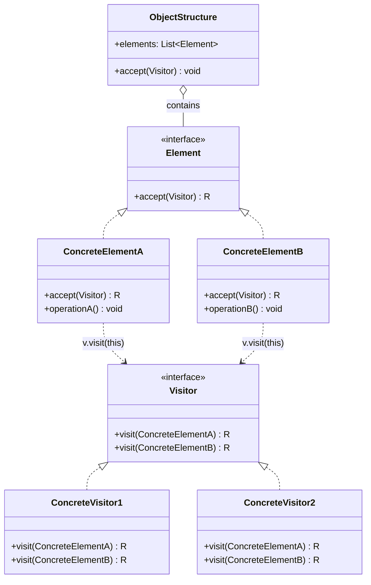

# 방문자(Visitor) 디자인 패턴 가이드

> 한 줄 요약: 객체 구조(Object Structure)의 요소(Element)들에 대해 수행할 연산(Operation)을 별도의 방문자(Visitor) 객체로 분리하여, 요소 클래스를 수정하지 않고도 새로운 연산을 추가할 수 있게 하는 패턴이다.
>
> 분류: 행위 패턴(Behavioral Pattern)
> 다른 이름(Aliases): 없음 (GoF의 정식 명칭은 Visitor 단독)

---

## 상세 설명

방문자(Visitor) 패턴은 GoF가 분류한 행위 패턴 중에서도 가장 형식적인 구조를 가진 패턴 중 하나이다. 이 패턴의 의도(Intent)는 "어떤 객체 구조의 요소들에 대해 수행할 연산을, 그 요소 클래스를 바꾸지 않고도 새로 정의할 수 있게 하는 것"이다. 즉 데이터 구조(Element 계층)와 그 위에서 동작하는 연산(Operation)을 분리한다.

해결하고자 하는 문제(Problem)는 다음과 같다. 컴파일러의 추상 구문 트리(Abstract Syntax Tree, AST), HTML/XML 문서 모델(DOM), 파일 시스템과 같이 여러 종류의 노드(Element)로 구성된 객체 구조가 있을 때, 노드마다 다른 동작을 가지는 연산(예: 타입 검사, 코드 생성, 출력, 최적화)이 끊임없이 늘어난다. 이를 각 노드 클래스의 메서드로 추가하면 새로운 연산이 추가될 때마다 모든 Element 클래스를 수정해야 하고, 서로 무관한 책임(출력, 평가, 검증 등)이 한 클래스 안에 뒤섞인다.

해결책(Solution)으로 Visitor 패턴은 각 연산을 하나의 Visitor 클래스로 외부에 추출한다. Visitor는 Element의 구체 타입마다 `visit(ConcreteElementA)`, `visit(ConcreteElementB)` 같은 오버로드된 메서드를 가지며, Element는 자기 자신을 인자로 넘기는 `accept(Visitor v)` 메서드만 가진다. 호출 흐름은 `element.accept(visitor) → visitor.visit(this)` 두 단계로 이루어지며, 이 과정에서 "실행할 메서드"가 *Element의 구체 타입*과 *Visitor의 구체 타입* 양쪽에 모두 의존해 결정된다. 이를 더블 디스패치(Double Dispatch)라고 부른다.

대부분의 객체지향 언어(Java, C++, C# 등)는 메서드 호출 시 *수신자(this)*의 동적 타입만으로 메서드를 선택하는 싱글 디스패치(Single Dispatch)를 사용한다. 따라서 `visitor.visit(element)` 한 번의 호출로는 element의 정적 타입(보통 Element 인터페이스)만 보고 메서드가 선택되어 의도한 오버로드가 호출되지 않는다. Visitor 패턴은 "element 쪽에서 한 번 더 가상 호출(virtual call)을 일으키는" `accept` 단계를 끼워 넣어, 두 객체의 실제 타입 조합에 따라 실행할 메서드를 결정하는 효과를 얻는다. 이 accept/visit 쌍이 Visitor 패턴의 본질이다.

역사적으로 Visitor는 컴파일러의 AST 처리에서 가장 자주 등장한다. Java 표준에는 `javax.lang.model.element.ElementVisitor`, `com.sun.source.util.TreeVisitor`가 있고, 바이트코드 조작 라이브러리인 ASM의 `ClassVisitor`/`MethodVisitor`, Eclipse JDT의 `ASTVisitor` 등이 모두 이 패턴의 변형이다. 함수형 언어에서는 동등한 표현이 대수적 데이터 타입(ADT) + 패턴 매칭으로 자연스럽게 해결되며, 그 점이 Visitor가 "객체지향 언어가 패턴 매칭을 흉내내기 위한 우회로"라고 평가되는 이유이기도 하다.

---

## 디자인 패턴을 충족하는 최소 조건

이 섹션에서는 "어떤 코드가 진짜로 Visitor 패턴이라고 부를 수 있는가"의 기준을 명확히 한다.

1. **Element 계층과 accept 메서드의 존재** — 방문 대상이 되는 요소 계층(Element hierarchy)이 있고, 모든 ConcreteElement는 `accept(Visitor v)` 메서드를 노출해야 한다. 외부에서 Visitor가 Element를 임의로 캐스팅(instanceof + cast)해 처리한다면 그것은 Visitor 패턴이 아니라 단순한 타입 분기다.
2. **Visitor 인터페이스의 타입별 오버로드** — Visitor는 ConcreteElement의 *구체 타입마다* 별도의 `visit(ConcreteElementX)` 메서드를 정의해야 한다. `visit(Element e)` 한 개만 두고 내부에서 다시 타입 분기를 한다면 더블 디스패치가 성립하지 않으므로 패턴이 깨진다.
3. **더블 디스패치(Double Dispatch) 성립** — `element.accept(visitor)`는 반드시 내부에서 `visitor.visit(this)`로 자기 자신을 다시 넘겨야 한다. 이 호출이 "수신자(visitor) + 인자(this)"의 두 동적 타입에 따라 메서드를 선택하도록 만든다. accept 안에서 this의 타입을 다시 검사한다면 효과가 사라진다.
4. **연산은 Visitor 쪽에, 데이터는 Element 쪽에 위치** — 평가/출력/검증 등 *연산 단위*는 ConcreteVisitor 클래스 하나로 응집되어 있어야 하고, Element는 자신의 데이터와 자식 구조만 노출하면 된다. 연산이 다시 Element 안에 들어가 있다면 단순 다형성일 뿐 Visitor가 아니다.

> 위 조건 중 하나라도 빠지면 본 패턴이라고 보기 어렵다. 특히 1·2·3은 동시에 만족해야 하며, 어느 하나라도 깨지면 그것은 "이름만 Visitor"인 변형이거나 단순 Strategy/Switch 분기에 가깝다.

### 흔히 오해하는 지점
- **instanceof 분기를 Visitor라고 부르는 경우** — 외부에서 `if (e instanceof Add) ... else if (e instanceof Mul) ...`로 처리하는 코드는 데이터/연산 분리는 이뤘으나 더블 디스패치가 없다. 이는 Visitor가 아니라 타입 스위치(Type Switch)다.
- **accept 없이 Visitor만 만든 경우** — Visitor 인터페이스만 정의하고 Element에 accept를 두지 않으면, Visitor가 Element의 자식들을 어떻게 재귀적으로 순회할지에 대한 책임이 흐려지고 결국 호출 측이 타입 분기를 떠안게 된다.
- **Strategy 패턴과의 혼동** — Strategy는 *하나의 동작*을 교체하는 패턴이고, Visitor는 *여러 타입의 요소*에 걸친 동작 집합을 외부 객체로 분리하는 패턴이다. ConcreteVisitor가 단 한 가지 visit 메서드만 가진다면 사실상 Strategy다.
- **"새 연산 추가가 쉬우니 항상 좋다"는 오해** — Visitor는 *연산 추가*에는 강하지만 *Element 종류 추가*에는 매우 약하다. 새 ConcreteElement가 생기면 모든 Visitor 인터페이스와 구현체를 수정해야 한다. 이 트레이드오프(Expression Problem)를 모르고 도입하면 오히려 유지보수가 악화된다.

---

## 사례를 통한 예시

### 예시 1: 산술식 AST의 평가(Evaluate)와 출력(Print)

**상황**: 간단한 산술식 `(1 + 2) * 3`을 나타내는 AST가 있다. 같은 트리에 대해 "값을 계산"하는 연산과 "사람이 읽을 수 있는 문자열로 출력"하는 연산을 모두 지원해야 하며, 앞으로 다른 연산(타입 검사, 최적화)도 추가될 수 있다. 연산을 늘릴 때마다 Num/Add/Mul 클래스를 건드리고 싶지 않다.

```java
// Element 계층
interface Expr {
    <R> R accept(ExprVisitor<R> v);
}

final class Num implements Expr {
    final int value;
    Num(int value) { this.value = value; }
    @Override public <R> R accept(ExprVisitor<R> v) { return v.visit(this); }
}

final class Add implements Expr {
    final Expr left, right;
    Add(Expr left, Expr right) { this.left = left; this.right = right; }
    @Override public <R> R accept(ExprVisitor<R> v) { return v.visit(this); }
}

final class Mul implements Expr {
    final Expr left, right;
    Mul(Expr left, Expr right) { this.left = left; this.right = right; }
    @Override public <R> R accept(ExprVisitor<R> v) { return v.visit(this); }
}

// Visitor 인터페이스: ConcreteElement마다 오버로드
interface ExprVisitor<R> {
    R visit(Num n);
    R visit(Add a);
    R visit(Mul m);
}

// ConcreteVisitor 1: 식의 값을 계산
final class EvalVisitor implements ExprVisitor<Integer> {
    @Override public Integer visit(Num n) { return n.value; }
    @Override public Integer visit(Add a) { return a.left.accept(this) + a.right.accept(this); }
    @Override public Integer visit(Mul m) { return m.left.accept(this) * m.right.accept(this); }
}

// ConcreteVisitor 2: 식을 문자열로 출력
final class PrintVisitor implements ExprVisitor<String> {
    @Override public String visit(Num n) { return Integer.toString(n.value); }
    @Override public String visit(Add a) { return "(" + a.left.accept(this) + " + " + a.right.accept(this) + ")"; }
    @Override public String visit(Mul m) { return "(" + m.left.accept(this) + " * " + m.right.accept(this) + ")"; }
}

public class VisitorDemo {
    public static void main(String[] args) {
        Expr tree = new Mul(new Add(new Num(1), new Num(2)), new Num(3));
        System.out.println(tree.accept(new PrintVisitor())); // ((1 + 2) * 3)
        System.out.println(tree.accept(new EvalVisitor()));  // 9
    }
}
```

**해설**:
- `Expr`는 **Element(요소)** 인터페이스이고, `Num`/`Add`/`Mul`은 **ConcreteElement**다.
- `ExprVisitor<R>`는 **Visitor** 인터페이스이며, ConcreteElement 타입마다 `visit` 오버로드를 가진다.
- `EvalVisitor`, `PrintVisitor`는 **ConcreteVisitor**로, 각각 "평가"와 "출력"이라는 연산 단위로 응집되어 있다.
- 더블 디스패치가 발생하는 지점은 `tree.accept(visitor)`이다. `tree`의 동적 타입(`Mul`)이 자신의 `accept`를 선택하고, 그 안의 `v.visit(this)`에서 `this`의 정적 타입(`Mul`)이 컴파일 시 결정되어 `Visitor`의 올바른 오버로드가 호출된다. 결과적으로 "Mul × PrintVisitor"의 조합으로 실행할 메서드가 결정된다.
- 새로운 연산(예: 상수 폴딩, 타입 검사)을 추가하려면 `ExprVisitor` 구현체 클래스만 하나 더 만들면 되고, `Num`/`Add`/`Mul`은 손대지 않는다.

### 예시 2: ASM의 ClassVisitor — 바이트코드 처리

**상황**: JVM 바이트코드 조작 라이브러리인 ASM은 클래스 파일을 읽어 그 안의 클래스/필드/메서드/명령어를 순서대로 방문(visit)하면서 콜백을 호출한다. 사용자는 `ClassVisitor`를 상속하여 원하는 연산(분석, 로깅, 변환)을 정의한다. 이는 GoF의 정통 Visitor와는 구조가 약간 다르지만, 같은 "데이터 구조 순회 + 외부 연산 주입"이라는 본질을 공유하는 대표적 실전 사용 사례다.

```java
import org.objectweb.asm.ClassReader;
import org.objectweb.asm.ClassVisitor;
import org.objectweb.asm.MethodVisitor;
import org.objectweb.asm.Opcodes;

// ConcreteVisitor: 클래스에 정의된 메서드 이름을 모두 출력
public class MethodNamePrinter extends ClassVisitor {
    public MethodNamePrinter() {
        super(Opcodes.ASM9);
    }

    @Override
    public void visit(int version, int access, String name,
                      String signature, String superName, String[] interfaces) {
        System.out.println("class " + name);
        super.visit(version, access, name, signature, superName, interfaces);
    }

    @Override
    public MethodVisitor visitMethod(int access, String name, String descriptor,
                                     String signature, String[] exceptions) {
        System.out.println("  method " + name + descriptor);
        return super.visitMethod(access, name, descriptor, signature, exceptions);
    }

    public static void main(String[] args) throws Exception {
        ClassReader cr = new ClassReader("java.util.ArrayList");
        cr.accept(new MethodNamePrinter(), 0);
    }
}
```

**해설**:
- `ClassReader.accept(ClassVisitor)`가 Element(클래스 파일)의 `accept`에 해당한다. ClassReader는 내부적으로 바이트코드를 파싱하면서 만나는 요소(클래스 헤더, 필드, 메서드, 어노테이션, 명령어)마다 ClassVisitor의 `visit*` 콜백을 호출한다.
- `ClassVisitor`는 Visitor 역할로, `visit`, `visitField`, `visitMethod`, `visitAnnotation` 등 **요소 종류별로 분리된 오버로드 메서드**를 노출한다. 이는 GoF Visitor의 "ConcreteElement마다 visit 오버로드"와 동일한 설계 원칙이다.
- 사용자는 ClassVisitor를 서브클래싱해 ConcreteVisitor를 만들고, 자신의 연산(이름 출력, 로깅, 코드 변환)을 정의한다. 클래스 파일 포맷 자체(Element 계층)는 사용자가 수정할 필요가 없다.
- 비슷한 패턴이 `javax.lang.model.element.ElementVisitor<R, P>`에도 있다. Java 컴파일러 API의 어노테이션 처리기에서 `TypeElement`, `VariableElement`, `ExecutableElement` 등을 방문할 때 `visitType`, `visitVariable`, `visitExecutable`을 오버로드하는 식으로 사용하며, 이는 정통 Visitor 구조에 매우 가깝다.

---

## 어떨 때 사용하나

객체 구조가 비교적 안정적이고(Element 종류가 자주 늘지 않고), 그 구조 위에서 동작하는 연산이 자주 추가되는 상황에서 Visitor를 고려한다. 컴파일러의 AST, 문서 트리(HTML/XML DOM), 파일 시스템 트리, 그래프 분석 알고리즘처럼 *데이터 형태는 고정*이고 *처리 알고리즘만 늘어나는* 도메인이 전형적이다. 또한 한 요소 클래스 안에 평가·출력·검증·최적화 등 무관한 책임이 누적되어 단일 책임 원칙(SRP)을 위반하기 시작했을 때, Visitor로 연산을 분리하면 응집도가 크게 개선된다.

구체적인 신호(Symptom)는 다음과 같다.

- 동일한 객체 트리(혹은 컬렉션)를 다양한 알고리즘이 순회하고 있고, 알고리즘이 늘어날 때마다 노드 클래스를 수정하고 있을 때.
- 노드 클래스 안에 `print()`, `evaluate()`, `validate()`, `optimize()` 같은 서로 무관한 메서드가 점점 쌓여 가독성이 떨어질 때.
- 외부에서 `instanceof` 체인 또는 큰 `switch` 문으로 노드 타입을 분기 처리하는 코드가 반복적으로 등장할 때 — 이는 더블 디스패치로 정리할 수 있는 강한 신호다.
- 연산이 노드의 *조합 결과*에 의존해야 할 때(예: 자식 노드들의 평가 결과를 모아 부모 노드 결과를 만든다). 누산기 역할의 ConcreteVisitor가 자연스럽게 들어맞는다.

### 사용하면 안 되는 경우 (Anti-patterns)

- **Element 계층이 자주 바뀌는 경우**: 새 ConcreteElement가 추가될 때마다 모든 Visitor 인터페이스와 구현체를 수정해야 한다. 도메인 모델이 아직 불안정하다면 Visitor 도입은 시기상조다.
- **요소 종류가 1~2개에 불과한 경우**: 더블 디스패치의 비용(클래스 수 증가, accept 보일러플레이트)에 비해 얻는 이득이 거의 없다. 단순 다형성 메서드로 충분하다.
- **Element 내부의 private 상태에 강하게 의존해야 하는 연산**: Visitor는 Element 외부에서 동작하므로 캡슐화를 깨고 getter를 다수 노출하게 된다. 이는 Element의 캡슐화 약화 비용으로 작용한다.
- **함수형 언어나 패턴 매칭이 지원되는 언어**: Scala의 `match`, Kotlin의 `sealed class` + `when`, Java 21+의 `switch` 패턴 매칭은 더 적은 코드로 같은 효과를 낸다. 굳이 Visitor의 보일러플레이트를 도입할 이유가 약하다.
- **단순 컬렉션 순회**: `for-each`, `Stream`, Iterator로 충분한 경우에 Visitor를 쓰는 것은 과한 설계다. Visitor는 *이질적인 타입의 요소 집합*을 대상으로 할 때 빛난다.

---

## 장점과 단점, 한계점

### 장점
- **새로운 연산 추가가 쉽다(OCP 충족, 연산 축)**: ConcreteVisitor 클래스 하나만 추가하면 되고, Element 계층은 닫힌 상태(closed for modification)로 유지된다. 컴파일러에 새 분석 패스(pass)를 붙이는 작업이 가장 좋은 예다.
- **관련 연산의 응집(Cohesion)**: 평가, 출력, 검증 같은 한 가지 연산이 *하나의 ConcreteVisitor 클래스* 안에 모인다. 노드 클래스에 분산되어 있던 동작이 한곳으로 모여 가독성과 유지보수성이 향상된다.
- **이종 객체 구조 순회에 강함**: Element 인터페이스만 공유하면 서로 다른 ConcreteElement(예: 파일 vs 디렉터리, 숫자 노드 vs 연산자 노드)에 대해 타입 안전한 분기 처리가 가능하다. instanceof/cast 없이 컴파일 타임에 타입별 처리를 강제할 수 있다.
- **누산기·문맥 전달이 자연스럽다**: ConcreteVisitor가 상태(field)를 가지므로, 순회 도중 누적되는 결과나 환경(scope, 심볼 테이블)을 자연스럽게 들고 다닐 수 있다.

### 단점
- **Element 계층 변경에 매우 약하다(Expression Problem의 한쪽)**: 새 ConcreteElement를 추가하면 `Visitor` 인터페이스에 `visit(NewElement)` 메서드를 추가해야 하고, 기존 모든 ConcreteVisitor가 이를 구현하도록 강제된다. 이는 OCP를 *요소 축*에서는 정면으로 위반한다.
- **보일러플레이트가 많다**: 모든 ConcreteElement가 거의 동일한 `accept(Visitor v) { return v.visit(this); }`를 반복적으로 가져야 한다. 클래스 수와 메서드 수가 증가한다.
- **캡슐화 약화 우려**: Visitor가 Element 외부에서 동작하므로, Element의 내부 상태를 처리하려면 getter나 public 필드를 통해 노출해야 한다. 이는 정보 은닉 원칙과 충돌할 수 있다.
- **이해 비용이 높다**: 더블 디스패치 개념과 accept/visit의 흐름은 처음 보는 개발자에게 직관적이지 않아, 코드 리뷰와 온보딩 비용이 늘어난다.

### 한계점
- **재귀적 순회 제어가 분산된다**: 자식 노드를 누가(Element vs Visitor) 방문할지에 따라 *내부 반복자(internal iterator)*형과 *외부 반복자(external iterator)*형으로 갈리는데, 어느 쪽이든 한 가지 규칙으로 통일해 두지 않으면 ConcreteVisitor마다 다른 순회 방식이 섞여 혼란을 유발한다.
- **순환 의존성**: Visitor 인터페이스는 모든 ConcreteElement 타입을 알아야 하고, ConcreteElement는 Visitor 인터페이스를 알아야 한다. 두 계층이 양방향으로 묶이므로 패키지 분리가 까다롭다.
- **반환 타입의 유연성 부족**: 정통 GoF 형태에서는 visit 메서드의 반환 타입이 고정되어 있다. 제네릭 Visitor(`Visitor<R>`)로 어느 정도 완화할 수 있으나, 연산마다 반환 타입이 크게 다르면 여러 Visitor 인터페이스로 쪼개야 한다.
- **테스트는 비교적 쉬우나 모킹은 까다롭다**: ConcreteVisitor 자체는 순수 함수에 가깝게 작성할 수 있어 테스트가 쉽다. 다만 Element의 자식 구조를 모킹하려면 트리 전체를 빌더로 구성해야 하므로 셋업 비용이 든다.

---

## 정보 표

| 항목 | 값 |
| --- | --- |
| 분류 | 행위 패턴(Behavioral Pattern) |
| 언어 의존성 | 언어 비의존적이나, 메서드 오버로딩과 정적 타입 시스템을 가진 언어(Java, C++, C#, Kotlin 등)에서 더블 디스패치를 자연스럽게 구현할 수 있다. 동적 타입 언어(JavaScript, Python)에서는 수동 디스패치(`type(e).__name__` 분기 등)가 필요하다. |
| 활용성(1점~5점) | ★★★☆☆ (3/5) — 컴파일러·AST·DOM 같은 도메인에서는 사실상 표준이지만, 일반 비즈니스 로직에서는 보일러플레이트와 Element 변경 비용 때문에 채택률이 낮다. |
| 학습 난이도 | 상 — 더블 디스패치와 Expression Problem 개념 이해가 선행되어야 한다. |
| 자주 함께 쓰이는 패턴 | Composite(Element 트리 구조), Iterator(외부 반복자 형태로 결합), Interpreter(AST와 함께 등장), Strategy(연산을 객체로 분리한다는 점에서 유사) |
| 대표 사용 사례 | Java `javax.lang.model.element.ElementVisitor`, Java `com.sun.source.util.TreeVisitor`(javac), ASM `ClassVisitor`/`MethodVisitor`, Eclipse JDT `ASTVisitor`, Roslyn `SyntaxVisitor`(C#) |

---

## Class Diagram



> 다이어그램에 등장하는 각 클래스가 패턴의 어떤 역할(Role)을 담당하는지 위 "상세 설명" 섹션과 1:1로 대응된다. 특히 `ConcreteElementA --> Visitor : v.visit(this)`로 표시된 점선이 더블 디스패치가 일어나는 지점이다.

### 역할 설명
- **Visitor (방문자 인터페이스)**: ConcreteElement의 타입별로 `visit(ConcreteElementA)`, `visit(ConcreteElementB)` 오버로드를 선언한다. 새로운 연산을 추가하고 싶을 때 구현하는 계약이다.
- **ConcreteVisitor1, ConcreteVisitor2 (구체 방문자)**: 평가(Eval), 출력(Print), 타입 검사 등 *하나의 연산 단위*를 응집해 구현한다. Element 계층을 수정하지 않고 ConcreteVisitor만 추가해 새 연산을 만든다.
- **Element (요소 인터페이스)**: `accept(Visitor v)` 메서드를 노출해 방문자를 받아들인다. accept 안에서 `v.visit(this)`를 호출하여 더블 디스패치를 성립시킨다.
- **ConcreteElementA, ConcreteElementB (구체 요소)**: 실제 데이터(노드)를 담는 클래스. accept 구현은 거의 동일하며(`v.visit(this)`) 자기 자신의 정적 타입에 맞는 visit 오버로드를 트리거한다.
- **ObjectStructure (객체 구조)**: Element들의 컬렉션 또는 트리. 외부에서 받은 Visitor를 자기 자신이 가진 모든 요소에 전파한다. 컴파일러의 경우 AST 루트가 이 역할을 겸한다.

---

## 참고 자료
- Gamma, Helm, Johnson, Vlissides, *Design Patterns: Elements of Reusable Object-Oriented Software*, Addison-Wesley, 1994 — Visitor 패턴 원전.
- Refactoring.Guru, "Visitor" — https://refactoring.guru/design-patterns/visitor
- Wikipedia, "Visitor pattern" — https://en.wikipedia.org/wiki/Visitor_pattern
- Wikipedia, "Double dispatch" — https://en.wikipedia.org/wiki/Double_dispatch
- Philip Wadler, "The Expression Problem", 1998 — Visitor의 트레이드오프를 이론적으로 정리한 글.
- Java API: `javax.lang.model.element.ElementVisitor` — https://docs.oracle.com/en/java/javase/21/docs/api/java.compiler/javax/lang/model/element/ElementVisitor.html
- ASM Framework, `ClassVisitor` — https://asm.ow2.io/javadoc/org/objectweb/asm/ClassVisitor.html
- Eclipse JDT, `ASTVisitor` — https://help.eclipse.org/latest/topic/org.eclipse.jdt.doc.isv/reference/api/org/eclipse/jdt/core/dom/ASTVisitor.html
