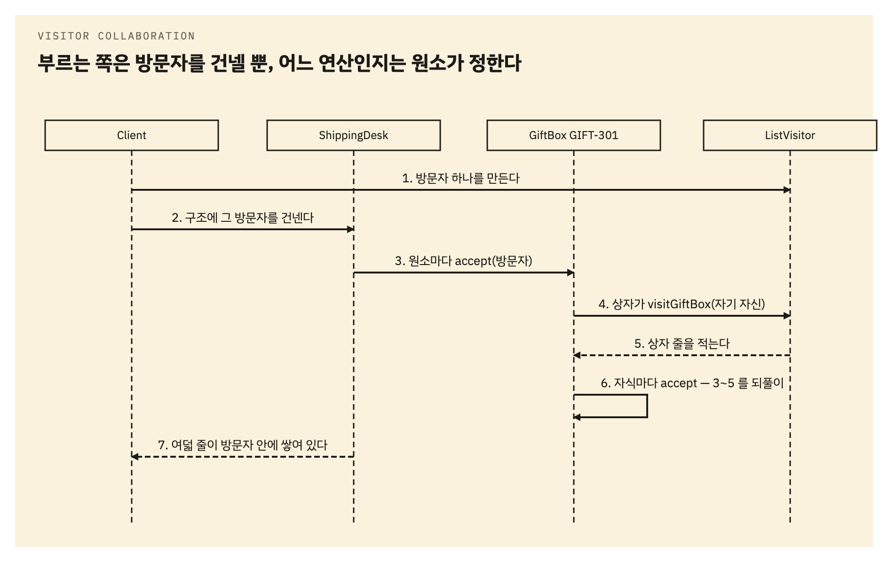
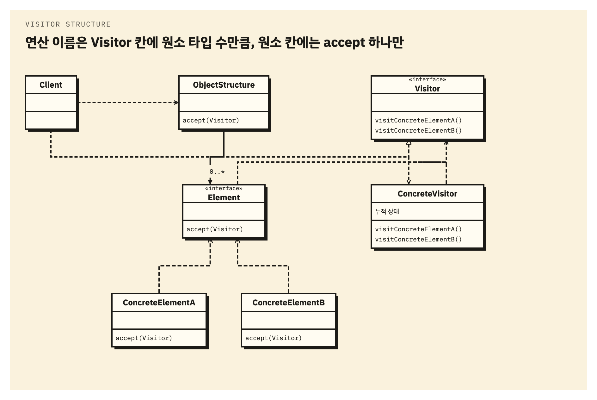

# Visitor — 타입마다 달라지는 일을 원소 밖 한 클래스에 모으고, 갈래는 원소가 고르게 하기

## 한눈에 보는 개요

온라인 상점의 배송 포장 코드를 떠올려 봅시다. 포장은 트리예요. 선물 상자 안에 머그컵이 있고, 작은 상자가 한 겹 더 있고, 감사 카드가 있고, 보냉 층으로 감싼 초콜릿이 있습니다. 데스크는 이 트리를 놓고 무게를 재고, 내용물 목록을 뽑고, 개수를 세고, 통관 서류를 씁니다. 연산이 이렇게 늘 때마다 상자 클래스·낱개 클래스·카드 클래스·보냉 층 클래스를 **전부** 열어 같은 이름의 메서드를 하나씩 더해야 해요. 포장을 담는 클래스가 통관 서류 쓰는 법까지 알고 있는 셈입니다.

Visitor 의 해법은 **연산 하나를 원소 밖의 클래스 하나로 통째로 옮기는 것**입니다. 그 클래스 안에 원소 타입마다 메서드가 하나씩 있어서, 「상자를 만나면 이렇게, 카드를 만나면 이렇게」가 한 파일에 모여요. 그리고 그 메서드 가운데 어느 것을 부를지는 **원소가 정합니다** — 원소가 방문자를 받아 자기 이름이 붙은 메서드를 부르죠. 그래서 부르는 쪽에는 타입을 가르는 분기가 남지 않습니다.

```text
Before : 연산이 노드 클래스마다 흩어져 있음

  Item      { weight, lines, count, customs }   ← 연산이 하나 늘면
  GiftCard  { weight, lines, count, customs }      이 네 클래스를
  GiftBox   { weight, lines, count, customs }      전부 연다
  ChilledWrap { weight, lines, count, customs }

After : 연산 하나 = 원소 밖 클래스 하나. 갈래는 원소가 고른다

  WeighVisitor  { Item, GiftCard, GiftBox, ChilledWrap }   ← 연산이 하나 늘면
  ListVisitor   { Item, GiftCard, GiftBox, ChilledWrap }      클래스 하나만 더한다
  CountVisitor  { Item, GiftCard, GiftBox, ChilledWrap }
                                                           대신 종류가 하나 늘면
  원소 쪽에 남는 것: accept(방문자) 하나씩                       이 셋을 전부 연다
```

분류는 행위 패턴이고, 함께 쓰는 패턴은 Composite 와 Iterator 예요. 원소를 담는 구조가 트리면 그 트리가 [Composite 편](../composite/composite-guide_v1.0.1.md)이 다루는 구조이고, 원소를 차례로 건네주는 일만 밖으로 뺀 것이 [Iterator 편](../iterator/iterator-guide_v1.0.1.md)의 순회자입니다. 이 글은 시나리오 셋을 따라갑니다. 목록 한 장이 포장 트리를 순회하는 길, 새 연산과 새 종류가 들어올 때 비용이 어떻게 뒤집히는가, 원소를 거치지 않고 방문자를 직접 부르면 어느 단계에서 무엇이 어긋나는가. 끝까지 읽으면 어떤 코드를 Visitor 라고 불러도 되는지 필수 조건 셋으로 판정할 수 있고, 이름만 `Visitor` 인 코드와도 구분할 수 있게 됩니다.

## 패턴 자세히 들여다보기

### 시나리오 1 — 내용물 목록 한 장이 포장 트리를 순회하는 길

배송 데스크에 주문 `GIFT-301` 하나가 올라와 있습니다. 포장재 120 g 짜리 선물 상자이고, 그 안에 머그컵 320 g, 포장재 45 g 짜리 작은 상자(그 안에 티백 60 g 과 엽서 15 g), 감사 카드 5 g, 냉매 250 g 짜리 보냉 층(그 안에 초콜릿 180 g)이 들어 있어요. 통관 담당자가 **내용물 목록**을 요구합니다. 나와야 하는 것은 실행 출력 2번 줄 아래의 여덟 줄이에요. 이 장면에는 다섯이 등장합니다. 목록을 요구하는 조립 코드 `Client`, 원소들을 가지고 있는 `ShippingDesk`(패턴에서는 ObjectStructure 라고 부르는 역할), 목록 줄을 쌓는 `ListVisitor`(ConcreteVisitor), 그 방문자들이 공통으로 따르는 연산 모양을 선언한 `ParcelVisitor`(Visitor), 그리고 방문자를 받는 연산 하나를 가진 `Parcel`(Element)과 그것을 구현한 네 클래스(ConcreteElement)예요. 이름은 여기서 한 번씩만 소개하고 정식 정의는 개념 정리에서 합니다.



1. Client 가 `ListVisitor` 를 하나 만듭니다. 연산 하나에 방문자 하나를 만드는 이유는 결과가 그 객체 안에 쌓이기 때문이에요. 목록 줄이 방문자의 필드에 모이니까, 같은 방문자를 두 번 쓰면 줄이 두 벌 쌓입니다. 그래서 실행 출력 4번 줄에서도 방문자를 매번 새로 만들어요.
2. Client 가 그 방문자를 `ShippingDesk` 에 건넵니다. Client 가 트리를 직접 순회하지 않는 이유는 순회하는 일과 원소마다 하는 일을 갈라 놓기 위해서예요. 순회를 Client 가 맡으면 방문자를 쓰는 곳마다 같은 순회 코드가 복제됩니다.
3. 데스크가 자기가 가진 원소마다 `accept(방문자)` 를 부릅니다. 데스크가 `visitGiftBox` 를 직접 부르지 않는 이유는 **데스크가 원소의 구체 타입을 모르기** 때문이에요. 데스크가 아는 것은 `Parcel` 이 약속한 연산 하나뿐이고, 그래서 데스크 코드에는 타입을 가르는 분기가 한 줄도 없습니다.
4. `GiftBox` 의 `accept` 가 `visitGiftBox(자기 자신)` 을 부릅니다. **이 단계가 이 패턴의 전부예요.** 어느 방문 연산을 부를지 고르는 일을 원소가 하기 때문에, 고르는 코드가 클래스마다 한 줄씩 나뉘어 들어가고 부르는 쪽에는 남지 않습니다. 자기 자신을 인자로 넘기는 것도 같은 단계에서 일어나요 — 방문자가 상자의 라벨과 포장재 무게를 읽어야 하니까요.
5. `ListVisitor.visitGiftBox` 가 `[box] GIFT-301 wrap 120 g` 한 줄을 자기 목록에 적습니다. 방문자가 상자의 공개 연산으로 라벨과 포장재 무게를 읽는 것이 이 단계인데, 여기에 대가가 하나 따라와요. **원소가 방문자에게 읽히려고 상태를 공개로 열어야 합니다.** 열지 않으면 방문자가 할 일이 없고, 열면 그 값이 방문자 말고 누구에게나 보여요.
6. `GiftBox.accept` 가 이어서 자식마다 `accept` 를 부릅니다. 3~5단계가 자식 트리에서 되풀이되고, 머그컵은 자식이 없어 4~5단계에서 끝나요. 순회를 상자가 맡는 이유는 그러지 않으면 방문자 셋이 저마다 같은 순회 코드를 갖게 되기 때문입니다.
7. 데스크가 돌아오면 여덟 줄이 `ListVisitor` 안에 쌓여 있습니다. Client 가 방문자에게 그 줄을 물어요. 목록이 데스크가 아니라 방문자 안에 있는 이유는 그것이 **이 연산의 결과**이지 포장 구조의 상태가 아니기 때문입니다.

이 시나리오가 보여 준 것은 **고르는 일의 위치**입니다. 목록을 뽑는 계산은 전부 `ListVisitor` 한 클래스에 있는데(5단계), 그 클래스의 어느 메서드가 실행될지는 방문자가 아니라 **원소**가 정했어요(4단계). 실행될 연산은 그래서 두 가지에 함께 달립니다 — 어떤 방문자를 건넸는가(1·2단계)와 어떤 원소에 이르렀는가(4단계). 그리고 순회는 구조가 맡았습니다(3·6단계). 이 셋이 나뉜 덕에 데스크에도 Client 에도 타입 분기가 없어요.

### 시나리오 2 — 새 연산이 올 때와 새 종류가 올 때, 비용이 어떻게 뒤집히는가

같은 데스크에 두 요구가 연달아 들어옵니다. 먼저 통관 담당자가 「내용물의 총 개수를 세 달라」고 해요 — 상자와 보냉 층은 포장이니 빼고, 낱개와 카드만 셉니다. `GIFT-301` 이면 머그컵·티백·엽서·감사 카드·초콜릿으로 **5** 가 나와야 하고, 그것이 실행 출력 3번 줄이에요. 그다음 물류팀이 「보냉 팩을 새 종류로 넣어 달라」고 합니다. 지금 코드에 없는 종류예요. 아래 진단은 `javac 21.0.11` 로 이 가이드의 Java 코드를 실제로 고쳐 컴파일해 받은 것이고, 무엇을 지우고 무엇을 넣었는지는 각 단계에 적었습니다.

1. 새 연산은 `CountVisitor` **클래스 하나**로 끝납니다. 본문 java 펜스 224~248행이 그 클래스예요. `ParcelVisitor` 도, `Parcel` 도, 원소 네 클래스도, `ShippingDesk` 도 한 글자도 안 바뀝니다. 실제로 확인해 봤어요 — 정본 끝에 방문자 클래스를 하나 새로 이어 붙이면 **javac 오류 0건**이고, 기존 타입은 어느 진단에도 지목되지 않습니다.
2. 안 열어도 되는 이유는 데스크가 아는 것이 `ParcelVisitor` 라는 연산 모양 하나뿐이기 때문이에요. 시나리오 1 의 3단계에서 데스크가 부른 것은 `parcel.accept(visitor)` 한 줄이고, 그 줄은 방문자가 무게를 재든 개수를 세든 똑같습니다. 데스크에 연산마다 메서드를 두었다면 여기서 데스크도 함께 열렸을 거예요.
3. 같은 요구를 **연산이 노드 클래스 안에 있는 구조**에 넣으면 비용이 다릅니다. [Composite 편](../composite/composite-guide_v1.0.1.md)의 예시 코드가 그 구조인데, 거기서 `interface Parcel` 안에 `int count();` 한 줄(과 앞의 빈 줄 하나)을 넣고 **다른 줄은 손대지 않은 채** 컴파일하면 **javac 오류 4건**이 납니다. 지목되는 것은 `Item`·`GiftCard`·`GiftBox`·`ChilledWrap` 넷 전부예요. 줄을 넣었으니 그 아래 줄 번호가 둘씩 늘어나서, 진단에 찍히는 자리는 원래 파일의 52·75·97·132행이 아니라 54·77·99·134행입니다.

```text
같은 요구, 두 구조

  연산이 노드 안에 있는 구조   Parcel 에 count() 선언 1줄  →  구현 클래스 4개를 전부 연다
                               열리는 타입 5개 (선언 1 + 구현 4) · javac 4건

  연산이 방문자에 모인 구조     CountVisitor 클래스 1개    →  기존 타입은 하나도 안 연다
                               열리는 타입 1개            · javac 0건
```

4. 이제 반대 방향입니다. 보냉 팩 `ColdPack` 을 새 종류로 더해 봅시다. 정본 끝에 `ColdPack` 클래스 하나를 이어 붙이고 그 `accept` 가 `visitor.visitColdPack(this)` 를 부르게 하면 **javac 오류 1건** — `visitColdPack` 이라는 이름이 `ParcelVisitor` 에 없다는 진단이에요. 여기서 멈추면 새 종류가 아예 컴파일되지 않습니다.
5. 그래서 `ParcelVisitor` 에 `void visitColdPack(ColdPack pack);` 한 줄(과 앞의 빈 줄 하나)을 더합니다. 그러면 **javac 오류 3건**이 나고, 지목되는 것은 `WeighVisitor`·`ListVisitor`·`CountVisitor` **전부**예요. 방문자 셋을 다 열어 보냉 팩을 만나면 무엇을 할지 각각 적어야 끝납니다. 이 대가를 치르는 이유는 `ParcelVisitor` 가 **원소 타입 집합 전체를 망라한다는 약속**이기 때문이에요. 망라하지 않으면 어떤 원소는 어느 방문자에서 조용히 빠지고, 그 사실을 아무도 알려 주지 않습니다.
6. 같은 요구를 3단계의 구조에 넣으면 비용이 또 뒤집힙니다. Composite 편 코드에 `ColdPack` 클래스 하나를 이어 붙이면 **javac 오류 0건**이에요. 그쪽은 새 종류가 클래스 하나로 끝납니다.

| 변화 | 연산이 방문자에 모인 구조(이 편) | 연산이 노드 안에 있는 구조(Composite 편) |
| --- | --- | --- |
| 새 **연산**(개수 세기) | 방문자 클래스 1개. 기존 타입 0개 · javac 0건 | `Parcel` 선언 + 구현 클래스 4개 = 타입 5개 · javac 4건 |
| 새 **종류**(보냉 팩) | `ColdPack` 1 + `ParcelVisitor` 선언 1 + 방문자 3 = 타입 5개 · javac 1건 → 3건 | `ColdPack` 클래스 1개 · javac 0건 |

여기서 헷갈리기 쉬운 포인트는 **이 패턴이 「확장에 열려 있다」고 뭉뚱그려 믿는 것**입니다. 위 표가 그렇지 않다는 증거예요. 열려 있는 것은 **연산이 느는 방향 한쪽**이고, 종류가 느는 방향은 오히려 비용이 더 큽니다. 그리고 그 비용을 컴파일러가 알려 준다는 점이 중요해요 — 4·5단계의 진단 넷은 「고칠 곳이 여기 있다」는 목록입니다. 뒤에서 볼 `instanceof` 판은 같은 자리에서 진단이 하나도 안 나요.

이 시나리오가 보여 준 것은 비용이 방향마다 다르다는 사실과, 그 방향을 컴파일러가 세어 준다는 점입니다. 새 연산은 클래스 하나였고(1단계), 그때 기존 타입은 하나도 안 열렸어요(2단계). 새 종류는 방문자 전부였고(5단계), 그 전부를 진단이 지목했습니다. 어느 쪽이 자주 늘어나는지를 보고 고르라는 말이 여기서 숫자로 나옵니다. [Composite 편](../composite/composite-guide_v1.0.1.md)의 마지막 자가점검 문제가 독자에게 세어 보라고 시킨 값이 바로 이 표예요 — 그 편에서 열어야 했던 타입 다섯이 이 편에서는 클래스 하나가 되고, 그 대신 보냉 팩을 더할 때 비용이 반대로 뒤집힙니다.

### 시나리오 3 — 원소를 거치지 않으면 어느 단계에서 무엇이 어긋나는가

같은 코드를 네 사람이 각자 다르게 손봅니다. 한 사람은 방문 연산의 이름을 전부 같게 만들고, 한 사람은 거기에 더해 원소를 건너뛰어 방문자를 직접 부르고, 한 사람은 그래서 막힌 자리를 오버로드 하나로 메우고, 한 사람은 방문 연산 넷을 하나로 합쳐 `instanceof` 로 가릅니다. 첫 사람은 규칙을 어긴 것이 아니라 **선택지를 바꾼 것**이라 아무 데서도 어긋나지 않아요. 넷을 차례로 따라가 봅시다. 아래 진단은 `javac 21.0.11` · `tsc 5.9.3` · `rustc 1.95.0` 으로 이 가이드의 코드를 실제로 고쳐 컴파일해 받았습니다.

1. 첫 사람이 방문 연산 이름 넷을 전부 `visit` 로 바꿉니다. 고친 곳은 이름이 나오는 자리 전부예요 — `ParcelVisitor` 의 선언 4곳, 방문자 셋의 구현 12곳, 원소 네 클래스의 `accept` 안 호출 4곳입니다. 그 밖의 줄은 그대로 뒀어요. 이 편집으로 **javac 오류 0건**이고 실행 출력이 정본과 한 글자도 다르지 않습니다. 부르는 자리가 `accept` 안이라 `this` 의 정적 타입이 이미 구체 타입이고, 그래서 자바가 컴파일 때 맞는 오버로드를 고를 수 있거든요. 이름을 나누느냐 겹치느냐는 이 패턴이 요구하는 것이 아니라 고르는 것이라는 뜻입니다.
2. 둘째 사람이 거기에 더해 `ShippingDesk.accept` 의 본문 한 줄 `parcel.accept(visitor);` 를 `visitor.visit(parcel);` 로 바꿉니다. 원소를 거치지 않고 방문자를 바로 부르겠다는 거예요. **javac 오류 1건**이 납니다 — `no suitable method found for visit(Parcel)`. `parcels` 목록의 원소 선언 타입이 `Parcel` 이라 그 타입에 맞는 오버로드가 없어서예요. 고르는 일이 컴파일 시점으로 올라오면 **선언 타입밖에 볼 것이 없습니다.**
3. 셋째 사람이 막힌 자리를 메우려고 `ParcelVisitor` 에 `void visit(Parcel other);` 를 하나 더 선언하고 방문자 셋에 그 구현을 넣습니다. 무게와 개수 쪽은 본문을 비워 두고, 목록 쪽만 `[?] unknown` 한 줄을 적게 뒀어요. 이제 **javac 오류 0건**이고 프로그램이 실행됩니다. 그런데 결과가 이래요.

```text
정본                              3단계 편집본
────────────────────────────      ────────────────────────────
1) total weight: 995 g            1) total weight: 0 g
2) contents list: (여덟 줄)        2) contents list: [?] unknown 한 줄
3) contents count: 5              3) contents count: 0
4) 1315 g, count 6                4) 0 g, count 0
```

왜 이렇게 되는지 한 단계씩 봅시다. 오버로드는 컴파일 때 **선언 타입**으로 고릅니다. `parcels` 의 원소 선언 타입은 `Parcel` 이고요. `visit(Item)`·`visit(GiftBox)` 는 `Parcel` 을 받을 수 없고 `visit(Parcel)` 만 받을 수 있으니, 컴파일러는 언제나 `visit(Parcel)` 로 고정합니다. 실행 중에 그 자리에 무엇이 들어오든 고른 결과는 이미 정해져 있어요. 게다가 원소를 거치지 않으니 `GiftBox.accept` 안의 자식 순회(시나리오 1 의 6단계)도 함께 사라져서, 방문된 것은 맨 위 상자 하나뿐입니다. **컴파일도 되고 실행도 되는데 답만 틀려요.** 이것이 4단계를 없앴을 때 일어나는 일입니다.

4. 넷째 사람은 방향을 바꿔서, 방문 연산 넷을 `void visit(Parcel parcel)` 하나로 합치고 그 안에서 `instanceof` 로 가릅니다. 원소의 `accept` 는 그대로 두고 `visitor.visit(this)` 를 부르게 해요. **javac 오류 0건**이고 실행 출력이 정본과 **한 글자도 다르지 않습니다**(995 g · 여덟 줄 · 5). 여기까지는 멀쩡해 보이죠. 그런데 시나리오 2 의 4단계를 여기에 넣어 `ColdPack` 클래스를 이어 붙이면 **javac 오류 0건**이에요. 정본이라면 1건과 3건으로 방문자 셋을 지목했을 자리인데, 아무도 안 막습니다. 보냉 팩은 무게에서도 목록에서도 개수에서도 조용히 빠져요.

```text
새 종류 ColdPack 을 더했을 때 누가 막는가

  정본(방문 연산 넷)        javac 1건 → 방문자 인터페이스에 선언 추가 → javac 3건
                            = 「여기, 여기, 여기를 고쳐라」는 목록

  instanceof 판(연산 하나)  javac 0건
                            = 아무 말도 없고, 보냉 팩이 세 연산에서 모두 빠진다
```

5. 세 언어를 대 보면 1단계의 편집이 Java 에서만 가능합니다. 같은 편집을 Rust 에 하면 **18건**이 납니다(요약 줄 `aborting due to …` 는 빼고 `^error[` 로 센 값이고, 내역은 `E0201` 9건 · `E0428` 3건 · `E0308` 3건 · `E0046` 3건이에요). TypeScript 에 하면 `TS2393 Duplicate function implementation` 과 `TS2416`·`TS2345` 가 나고요. 두 언어 모두 한 타입 안에 같은 이름의 메서드를 둘 이상 둘 수 없어서예요. 그래서 이 가이드는 세 언어에서 같은 모양이 나오도록 **이름을 나누는 쪽**을 기본으로 삼았습니다.

이 시나리오가 보여 준 것은 어긋나는 자리가 **`accept` 한 단계**에 몰려 있다는 점입니다. 이름을 겹쳐도 어긋나지 않고(1단계), 원소를 거치지 않으면 컴파일이 막히거나(2단계) 답이 조용히 틀립니다(3단계). 그리고 연산을 하나로 합쳐 안에서 가르면 오늘은 맞지만 내일 새 종류가 왔을 때 아무도 알려 주지 않아요(4단계). 첫 사람의 편집만 무해했던 이유는 그것이 이름의 문제였고 나머지 셋은 **누가 고르는가의 문제**였기 때문입니다. 자리는 한 줄입니다.

### 개념 정리

시나리오에 나온 역할을 하나씩 정의합니다. 역할 이름으로 적고, 이 가이드의 예시 타입이 어느 역할인지는 「상황 설정」에서 맞춰요.

- **Visitor** — 원소 타입마다 방문 연산을 하나씩 **선언**하는 역할입니다. 연산의 이름과 받는 타입이 「누가 이 요청을 보냈는가」를 가리키므로, 방문자는 자기가 지금 어떤 구체 타입을 보고 있는지 알고 그 타입의 연산으로 값을 읽을 수 있어요. 협력 상대는 ConcreteElement(자기 연산을 불러 주는 쪽)와 ConcreteVisitor(그 연산을 구현하는 쪽)입니다. 시나리오 2 의 5단계에서 보듯 이 목록이 곧 **원소 타입 집합 전체를 망라한다는 약속**이라, 원소 타입이 하나 늘면 이 역할이 먼저 바뀝니다.
- **ConcreteVisitor** — Visitor 가 선언한 연산을 전부 구현하는 역할이에요. 연산 하나가 곧 「그 원소 타입에서 이 알고리즘이 하는 일」의 한 조각이고, 조각들을 묶는 문맥과 순회 중에 쌓이는 결과를 이 객체가 가지고 있습니다. 시나리오 1 의 5·7단계에서 목록 줄이 쌓인 곳이 여기예요. 협력 상대는 Client(만들어 건네는 쪽)와 ConcreteElement(값을 읽히는 쪽)입니다.
- **Element** — 방문자를 인자로 받는 연산 하나를 정의하는 역할입니다. 이 역할이 하는 일은 그 연산을 **선언**하는 것뿐이고, 무엇을 부를지는 아래의 ConcreteElement 가 정해요. 협력 상대는 ObjectStructure(이 타입으로 원소를 담는 쪽)입니다.
- **ConcreteElement** — 그 연산을 구현하는 역할이에요. 구현의 내용은 「자기 타입에 대응하는 방문 연산을 자신을 인자로 넘기며 부른다」 한 줄입니다. 시나리오 1 의 4단계가 이 자리이고, 시나리오 3 이 없애 본 것도 이 한 줄이에요. 협력 상대는 Visitor(부르는 대상)입니다.
- **ObjectStructure** — 원소들을 열거할 수 있는 역할입니다. 방문자가 원소들을 방문하게 하는 진입점을 둘 수도 있어요 — 시나리오 1 의 2·3단계에서 데스크가 그 진입점이었습니다. 이 역할은 트리(Composite)일 수도 있고 목록이나 집합 같은 평범한 컬렉션일 수도 있어요. 이 가이드의 예시에서는 데스크가 목록을 가지고, 그 안의 상자가 트리를 이룹니다.
- **Client** — 어떤 연산을 할지 정해 ConcreteVisitor 를 만들고 구조에 건네는 쪽이에요. 시나리오 1 의 1·2단계가 그 일이고, 결과를 방문자에게 되묻는 7단계도 이쪽입니다. 원전의 역할 목록에 따로 올라 있지는 않지만 협력의 시작과 끝이 여기라서 함께 정의합니다.



그림에서 눈여겨볼 자리는 둘입니다.

- **연산 이름이 적힌 칸**은 `Visitor` 와 `ConcreteVisitor` 이고, 원소 칸에는 `accept(Visitor)` 하나뿐이에요. 같은 자리에 연산 이름이 `ConcreteElement` 칸으로 옮겨 적히면 그 그림은 이 패턴이 아니라 시나리오 2 의 3단계가 말한 그쪽 구조입니다.
- **`Element` 에서 `Visitor` 로 나가는 점선**은 원소가 방문자를 받아서 부른다는 뜻이에요. 이 화살표의 방향이 뒤집히면 고르는 일이 부르는 쪽으로 넘어가 시나리오 3 의 2단계가 됩니다.

> 연산 이름은 방문자 칸에, 원소 칸에는 accept 하나. 방향이 뒤집히면 분기가 부르는 쪽으로 돌아온다.

한 가지 더 짚어 둘 것이 있어요. 시나리오 1 의 6단계에서 순회를 상자가 맡았는데, **이것은 이 패턴이 정한 것이 아니라 이 가이드가 고른 것**입니다. 순회는 셋 중 아무나 맡을 수 있어요.

```text
누가 순회를 맡는가              치르는 대가

  구조가 맡는다 (이 가이드)     방문자 셋이 순회 코드를 안 갖는다
    GiftBox.accept 안의 반복문   대신 방문자가 자기 깊이를 모른다 — 목록이 평평해진다

  방문자가 맡는다               방문자가 깊이·순서를 마음대로 정한다
    visitGiftBox 안의 반복문     대신 방문자가 늘 때마다 같은 순회 코드가 복제된다

  순회자가 맡는다               순서를 밖에서 갈아 끼운다
    Iterator 가 원소를 건넨다     대신 원소를 건네받은 뒤 갈래를 고르는 일이 남는다
```

이 가이드의 목록이 들여쓰기 없이 평평한 것(실행 출력 2번 줄 아래)이 위 도식 맨 윗줄의 대가입니다. 그 대가는 여기서 치러졌어요. 상자가 순회를 맡고 있으니 방문자는 자기가 몇 번째 겹에 있는지 알 길이 없어요. 들여쓰기를 넣고 싶으면 순회를 방문자로 옮기거나, 진입할 때와 빠져나올 때를 따로 알리는 연산을 `Parcel` 에 더해야 합니다. 후자가 [Composite 편](../composite/composite-guide_v1.0.1.md)의 목록이 들여쓰기를 가질 수 있었던 이유이기도 해요 — 그쪽은 연산이 노드 안에 있어서 재귀 호출이 곧 깊이였거든요.

## 사용 목적

Visitor 가 필요할 때는 코드나 요구에서 보이는 단서가 있습니다. 셋을 차례로 봅시다.

**단서 1. 같은 모양의 타입 분기가 여러 곳에 복제돼 있습니다.** 무게를 재는 함수에도, 목록을 뽑는 함수에도, 개수를 세는 함수에도 똑같이 `if (p instanceof Item) … else if (p instanceof GiftBox) …` 가 들어 있는 경우예요. 이것이 단서인 이유는 그 분기들이 **같은 타입 목록을 저마다 가지고 있기** 때문입니다. 종류가 하나 늘면 그 목록을 가진 곳을 전부 찾아 갈래를 하나씩 보태야 하고, 한 곳을 빠뜨려도 컴파일러가 말해 주지 않아요. 시나리오 3 의 4단계가 그 모양이었습니다.

```text
같은 타입 목록을 저마다 가진 함수들

  weigh(p)      Item? GiftCard? GiftBox? ChilledWrap?
  lines(p)      Item? GiftCard? GiftBox? ChilledWrap?
  count(p)      Item? GiftCard? GiftBox? ChilledWrap?
                └──────────── 종류가 하나 늘면 세 곳을 다 찾아야 하고,
                              빠뜨려도 아무도 안 막는다
```

**단서 2. 핵심 클래스에 자기 일과 상관없는 메서드가 쌓여 있습니다.** 포장 구조를 담는 것이 일인 클래스가 통관 서류 형식·회계 코드·CSV 내보내기까지 알고 있는 경우예요. 확인하는 방법은 그 클래스의 메서드 목록을 놓고 「이 메서드를 부르는 쪽이 서로 겹치는가」를 보는 것입니다. 겹치지 않는 묶음이 여럿이면 그 클래스는 서로 무관한 일을 함께 맡고 있는 거예요. 그 무관한 묶음을 각각 방문자 하나로 들어내는 것이 이 패턴이 겨냥하는 자리입니다.

```text
GiftBox 의 메서드           부르는 쪽
────────────────────────    ─────────────────────────────
weightInGrams()             배송 요금 계산
lines()                     통관 신고
customsCode()               통관 신고
accountingKey()             정산 배치        ← 배송·통관과 안 겹친다
exportCsv()                 관리자 화면       ← 어느 쪽과도 안 겹친다
```

**단서 3. 구조를 여러 애플리케이션이 나눠 쓰는데 연산은 한 곳에서만 필요합니다.** 포장 트리 정의는 배송·통관·정산 셋이 함께 쓰는데 통관 서류 계산은 통관에서만 쓰는 경우예요. 이것이 단서인 이유는 연산을 원소 클래스에 두면 **쓰지 않는 쪽까지 그 코드를 함께 배포**하게 되기 때문입니다. 방문자로 빼 두면 필요한 쪽이 자기 방문자만 배포하면 돼요.

그리고 세 단서가 다 보여도 **원소 타입이 자주 늘어나면 비용이 이득보다 큽니다.** 시나리오 2 의 5단계에서 새 종류 하나가 방문자 셋을 열게 했는데, 방문자가 열이면 열을 엽니다. 아래 상황에서는 이 패턴을 쓰면 얻는 것보다 잃는 것이 커요.

| 쓰지 말아야 할 상황 | 쓰면 잃는 것 |
| --- | --- |
| 원소 종류가 자주 늘거나 바뀜 | 종류 하나마다 방문자 전부를 엽니다(시나리오 2 의 5단계). 연산을 원소 클래스에 두면 그 자리가 클래스 하나로 끝나요 |
| 원소가 전부 같은 타입이고 종류별로 달라질 일이 없음 | 방문 연산이 하나뿐인 방문자가 남습니다. 갈래가 없으니 타입 하나와 인터페이스 하나가 이유 없이 늘어요 |
| 방문자가 읽어야 하는 값이 원소의 감추고 싶은 내부임 | 캡슐화를 내줍니다. 방문자가 일하려면 원소가 그 값을 공개로 열어야 하고(시나리오 1 의 5단계), 한번 열면 방문자 말고 누구에게나 보여요 |
| 연산이 하나뿐이고 늘 계획이 없음 | `accept` 한 줄과 방문자 인터페이스가 이득 없이 생깁니다. 그 연산을 원소 클래스의 메서드로 두면 파일 하나가 줄어요 |

비슷한 단서에서 다른 패턴을 고르게 되는 경우가 둘 있습니다. 원소들이 전부 같은 타입이고 차례로 건네주기만 하면 되는 일이면 Iterator 를, 노드 집합 자체가 언어의 문법이고 각 노드가 자기를 해석하는 것이 설계의 뜻이면 Interpreter 를 먼저 검토하세요. 차이는 다음 절에서 풉니다.

## 패턴의 경계

### 디자인 패턴을 충족하는 최소 조건

어떤 코드를 Visitor 라고 불러도 되는지 가르는 기준입니다. `[필수]` 가 하나라도 빠지면 Visitor 가 아니고, `[선택]` 은 갖추면 좋은 구조예요. 조건은 언어와 상관없이 코드에서 확인할 수 있는 모양(타입 선언·참조 보유·호출 방향·생성 위치)으로 적었고, 조건마다 그것을 보여 준 시나리오의 단계를 가리킵니다.

1. [필수] 방문 대상 구체 타입이 둘 이상이고, 방문자 타입에 그 타입마다 방문 연산이 하나씩 있습니다 — 방문 대상 구체 타입마다 그 타입을 받는 방문 연산이 **적어도 하나씩** 방문자 타입에 선언돼 있고, 한 방문 연산 안에서 다시 구체 타입을 가르는 코드가 없습니다. 상위 타입을 받는 연산이나 기본 처리용 연산이 그 위에 더 있어도 이 조건은 그대로 만족해요 — 구체 타입마다의 자리가 비지 않았으면 됩니다. 그리고 **방문자 타입은 그 연산 목록을 선언하는 타입**이고, 원소가 받는 연산(2번)의 인자 타입이 바로 그 타입입니다 — 특정 계산 클래스 하나가 그 자리에 박혀 있으면 이 조건은 빠져요. 연산 이름을 타입마다 다르게 두든 같은 이름을 겹쳐 두든 상관없습니다. 받는 타입이 서로 다르면 되고, 어느 쪽을 고를지는 조건 5번에 있어요 — 원전이 두 방식을 다 인정한 자리라 이 허용은 요구를 더하는 것이 아니라 빼는 것입니다. 시나리오 2 의 5단계에서 새 종류 하나가 이 집합을 늘려 방문자 전부를 열게 한 자리가 이 조건이에요 (근거: GoF Visitor 절 Applicability — 서로 다른 인터페이스를 가진 여러 클래스의 객체를 담은 구조에서 그 구체 클래스에 따라 달라지는 연산을 수행하려 할 때 쓴다 · Participants — Visitor 는 구조 안의 ConcreteElement 클래스마다 방문 연산을 하나씩 선언하고, 그 연산의 이름과 시그니처가 요청을 보낸 클래스를 식별해 방문자가 방문 중인 원소의 구체 클래스를 알게 한다).
   - 빠지면: 방문 연산이 `visit(Parcel)` 하나이고 그 안에서 `instanceof` 로 가르는 코드가 됩니다. 시나리오 3 의 4단계가 이 자리예요 — 출력은 정본과 한 글자도 다르지 않은데, 새 종류를 더했을 때 컴파일러가 아무 데도 막지 않아 그 종류가 세 연산에서 모두 조용히 빠집니다.
   - 빠지면: 방문자 자리에 **구체 계산 클래스 하나가 박힌 코드**가 됩니다. 원소가 `accept(WeighVisitor)` 를 받고 `WeighVisitor` 가 인터페이스 없이 클래스 하나면 지금까지의 조건이 전부 만족하는데(직접 컴파일해 확인 — javac 0건에 실행도 됩니다), **3번이 약속한 「새 방문자 하나만 생긴다」가 거짓이 됩니다.** 개수를 세는 방문자를 클래스 하나로 더해 보면 `incompatible types: CountVisitor cannot be converted to WeighVisitor` 로 javac 1건이 나고, 고치려면 `Parcel` 과 원소 클래스들의 `accept` 시그니처까지 **원소 쪽 타입 셋**을 엽니다. 방문자 쪽을 선언과 구현으로 갈라 두어야 그 비용이 사라져요.
   - 빠지면: 방문 대상 타입이 하나뿐이면 방문 연산도 하나뿐이고, 그러면 **같은 일을 하는 여러 방법 중 하나를 갈아 끼우는 구조**, 곧 Strategy 입니다. 가를 타입이 없으니 `accept` 도 그냥 위임 한 줄이 돼요. 비교 절에서 코드로 봅니다.
   - 위 근거 괄호가 받쳐 주는 것은 원전이 **「여러 클래스의 객체를 담은 구조」**라고 적은 데까지입니다. 그 최소를 **둘**로 읽은 것은 이 가이드예요.
2. [필수] 원소가 방문자를 인자로 받는 연산을 갖고, **방문이 그 연산을 거쳐 일어납니다** — 원소 타입에 방문자 타입을 인자로 받는 연산이 선언돼 있고, 1번 집합에 든 구체 타입마다 그 연산의 구현이 자기 타입에 짝지어진 방문 연산 **하나만** 부르며 자기 자신을 인자로 건넵니다. 그리고 **부르는 쪽은 그 연산을 부를 뿐, 어느 방문 연산인지를 고르지 않습니다** — 원소의 연산을 직접 부르든 그 연산으로 곧장 넘기는 보조 연산을 거치든 상관없고, 고르는 일이 원소 밖에 있는지만 봅니다. 방문 연산을 고르는 코드가 원소 밖에 따로 있으면 이 조건은 빠져요. 시나리오 1 의 3·4단계가 이 자리예요 (근거: GoF Visitor 절 Participants — Element 는 방문자를 인자로 받는 Accept 연산을 정의하고 ConcreteElement 가 그것을 구현한다 · Collaborations — 클라이언트는 객체 구조를 순회하며 각 원소를 방문자로 방문하고, 원소는 방문될 때 **자기가** 자기 클래스에 대응하는 Visitor 연산을 부르며 방문자가 필요하면 자기 상태에 접근할 수 있도록 자신을 그 연산의 인자로 넘긴다).
   - 빠지면: **원소의 그 연산이 멀쩡히 있는데도 아무도 부르지 않는 코드**가 됩니다. 네 클래스의 `accept` 를 한 글자도 안 고친 채 `ShippingDesk` 만 `parcel.accept(visitor)` 대신 `instanceof` 로 방문 연산을 직접 골라 부르게 바꾸면, **javac 0건**이고 실행 출력이 정본과 한 글자도 다르지 않아요(직접 컴파일·실행해 확인). 그런데 고르는 일은 데스크로 넘어갔고 `accept` 는 실행되지 않는 코드입니다. 새 종류를 더하면 그 `instanceof` 사슬이 아무 말 없이 지나쳐요. 조건 4번(구조가 진입점을 제공한다)은 `[선택]` 이라 이 자리를 막지 못하므로, **막는 것은 이 조건의 뒷문장**입니다.
   - 빠지면: 고르는 일이 부르는 쪽으로 넘어갑니다. 시나리오 3 의 2·3단계가 그 자리예요 — 이름을 겹쳐 두었으면 `no suitable method found for visit(Parcel)` 로 컴파일이 막히고(javac 1건), 그것을 메우려고 상위 타입을 받는 연산을 하나 더 두면 컴파일은 되지만 언제나 그것만 불려 총 무게가 995 g 이 아니라 0 g 으로 나옵니다.
   - 위 근거 괄호가 받쳐 주는 것은 **「원소가 방문자를 받는 연산을 갖고, 방문될 때 *원소가* 자기 클래스에 대응하는 방문 연산을 자신을 넘기며 부른다」까지**입니다. 뒷문장(부르는 쪽이 고르지 않는다)이 여기서 나와요 — 원전 협력 절에서 그 연산을 부르는 주어가 원소이기 때문입니다. 이 구조를 이르는 **「이중 디스패치」라는 이름**과 「그 연산이 이중 디스패치 연산이고 **그것이 이 패턴의 핵심이다**」라는 말은 원전에서 구현을 다루는 절에 있어요 — 요구가 아니라 **요점을 선언한 문장**이라 근거로 써도 되는 자리입니다(같은 절이 순회 책임은 「세 자리 가운데 아무 데나 둘 수 있다」로 **선택지로** 적어, 원전이 한 절 안에서 자격을 스스로 갈라 놓았어요). 그래도 **조건 문면은 이름이 아니라 코드에서 보이는 모양으로 적었습니다** — 이름으로 적으면 같은 구조를 다른 이름으로 부르는 코드를 놓치니까요. 이름 쪽은 비교 절에서 풀어요.
3. [필수] 연산의 계산 코드가 원소 클래스 밖 방문자 타입에 모여 있습니다 — 그 연산이 하는 계산이 방문 연산의 구현 안에 있고, 원소 클래스에는 그 연산의 이름이 없습니다. 그래서 같은 구조 위에 연산을 하나 추가할 때 새 방문자 타입 하나만 생기고 원소 클래스는 열리지 않아요. 시나리오 2 의 1·2단계가 이 자리입니다 (근거: GoF Visitor 절 Intent — 연산이 작용하는 원소들의 클래스를 바꾸지 않고 그 구조 위에 새 연산을 정의할 수 있게 한다 · Consequences — 새 방문자를 더하는 것만으로 구조 위의 새 연산을 정의할 수 있고, 같은 기능을 여러 클래스에 흩뿌려 두었다면 새 연산마다 그 클래스들을 전부 고쳐야 한다).
   - 이 조건이 보는 것은 **그 연산**이 어디 있는가까지입니다. 원소가 다른 연산을 갖는 것 자체는 문제가 되지 않아요 — 이 가이드의 `GiftBox` 도 자식을 더하는 연산을 갖고 있고, 그것은 구조를 짓는 일이지 방문자가 하는 계산이 아닙니다. 방문자가 일하려면 원소가 값을 공개로 열어야 한다는 대가는 시나리오 1 의 5단계에 있어요.
   - 빠지면: 연산이 노드 클래스 안에 있는 구조가 됩니다. 시나리오 2 의 3단계가 그 자리예요 — 연산 하나를 더하는 데 선언 1개와 구현 클래스 4개, 합해 타입 다섯을 열고 javac 진단 4건을 받습니다.
4. [선택] ObjectStructure 가 원소를 열거하고 방문의 진입점을 제공합니다 — 원소들을 담은 타입이 그것들을 차례로 순회할 수 있고, 방문자 하나를 받아 원소마다 2번의 연산을 불러 주는 진입점을 갖습니다. 시나리오 1 의 2·3단계가 그 진입점이에요 (근거: GoF Visitor 절 Participants — ObjectStructure 는 원소를 열거할 수 있고, 방문자가 원소들을 방문하게 하는 고수준 인터페이스를 제공**할 수도 있다**. "할 수도 있다" 인 자리라 필수로 올리지 않았다).
5. [선택] 방문 연산의 이름을 원소 타입마다 다르게 둡니다 — 같은 이름을 겹쳐 두는 대신 `visitItem`·`visitGiftBox` 처럼 이름으로 가릅니다. 시나리오 3 의 1단계가 이 선택을 뒤집어 본 자리예요 (근거: 이 가이드의 정책 — 원전은 이름을 나누는 쪽과 겹치는 쪽을 둘 다 인정하고 장단점을 적어 두었을 뿐이며, 이 가이드는 세 언어 가운데 Java 만 이름 겹침을 허용해서 세 판본이 같은 모양이 되도록 이름 구분을 골랐다).
6. [선택] 순회 책임을 구조가 집니다 — 원소를 순회하는 코드가 방문자가 아니라 구조 쪽(묶음 원소의 2번 연산 구현이나 ObjectStructure)에 있습니다. 시나리오 1 의 6단계가 그 자리이고, 대가로는 목록이 평평해지는 것을 치릅니다 (근거: 이 가이드의 정책 — 원전은 구조·반복자·방문자 셋을 순회 책임의 선택지로 들고 어느 쪽도 요구하지 않으므로, 방문자마다 순회 코드가 복제되지 않는 쪽을 예제 정책으로 골랐다).
7. [선택] 방문자가 순회 중에 결과를 누적합니다 — 방문 연산이 값을 돌려주는 대신 방문자 자신의 필드에 쌓고, 부르는 쪽이 순회가 끝난 뒤 그 값을 묻습니다. 시나리오 1 의 5·7단계가 이 모양이에요 (근거: GoF Visitor 절 Consequences — 방문자는 구조를 방문하며 상태를 누적할 수 있고, 방문자가 없으면 그 상태가 순회 연산의 추가 인자나 전역 변수가 된다. 얻는 것으로 적힌 자리라 필수로 올리지 않았다).

`[필수]` 는 하나만 빠져도 판정이 끝나므로 1번부터 차례로 봅니다. 1번은 방문자 타입의 연산 목록만, 2번은 원소 쪽 연산의 선언과 그 본문 한 줄만, 3번은 계산 코드가 어느 타입 안에 있는지만 보면 되어서 앞 조건에서 멈추면 뒤는 읽지 않아도 돼요. 세 조건을 같은 코드들에 실제로 적용해 봅시다.

| 코드 | 1번 | 2번 | 3번 | 판정 |
| --- | --- | --- | --- | --- |
| 구현 절의 정본 (`Item`·`GiftCard`·`GiftBox`·`ChilledWrap` + 방문자 셋) | 만족 | 만족 | 만족 | Visitor |
| 시나리오 3 의 1단계 (이름을 전부 `visit` 로 겹친 판) | 만족 (받는 타입이 서로 다름) | 만족 | 만족 | Visitor |
| 시나리오 3 의 3단계 (상위 타입을 받는 연산을 더한 판) | 만족 | 빠짐 (원소를 거치지 않음) | 만족 | Visitor 아님 |
| 시나리오 3 의 4단계 (`visit(Parcel)` 하나 + `instanceof`) | 빠짐 (연산 안에서 가름) | 만족 | 만족 | Visitor 아님 |
| `accept` 는 그대로 두고 **데스크가 `instanceof` 로 방문 연산을 직접 고르는 판** | 만족 | 빠짐 (부르는 쪽이 고름) | 만족 | Visitor 아님 |
| 방문자가 인터페이스 없이 **구체 클래스 하나**인 판 | 빠짐 (선언하는 타입이 없음) | 만족 | 만족 | Visitor 아님 |
| 시나리오 2 의 3단계 (연산이 노드 안에 있는 판) | 빠짐 (방문자 타입 없음) | 빠짐 | 빠짐 | Visitor 아님 |
| 원소 타입이 하나뿐이고 방문 연산도 하나인 판 | 빠짐 (둘 이상이 아님) | 만족 | 만족 | Visitor 아님 (Strategy) |

표의 세 번째 줄과 다섯 번째 줄이 가장 헷갈리는 자리예요. 둘 다 1번과 3번은 멀쩡한데 2번 하나가 빠집니다. 앞쪽은 답이 조용히 틀리고, 뒤쪽은 **답까지 정확히 맞아요** — 출력이 정본과 한 글자도 다르지 않습니다. 그래서 2번을 「원소에 그 연산이 있는가」로만 읽으면 뒤쪽이 통과해 버려요. 조건 문면이 「방문이 그 연산을 거쳐 일어난다」까지 요구하는 이유가 여기 있습니다. 마지막 줄은 조건이 모두 만족하는 것처럼 보이지만 1번이 요구하는 **개수**를 채우지 못해요. 셋을 다음 절에서 코드로 풉니다.

### 비슷한 패턴·안티패턴과의 차이

Visitor 와 같은 구조 위에 놓이거나 같은 단서에서 떠오르는 대상 여섯을 비교합니다. 먼저 같은 트리에서 역할을 나눠 갖는 Composite 와 Iterator, 그다음 방문 연산이 하나로 줄었을 때 구분해야 하는 Strategy, 같은 AST 위에 함께 놓이는 Interpreter, 이 패턴을 대신할 수 있는 언어의 망라적 패턴 매칭, 마지막으로 이름에 `Visitor` 가 붙었지만 이 패턴이 아닌 순회 이벤트 콜백이에요.

**이 절이 무엇을 가르는지 먼저 밝혀 둡니다.** 아래 구분 기준들은 「지금 이 설계가 어느 패턴 쪽인가」를 가르는 물음이고, 「그 패턴이 제대로 성립하는가」는 보지 않습니다. 후자는 앞 절의 조건표가 봐요. 그래서 두 자리가 다른 말을 하는 것처럼 보이면 조건표가 앞섭니다 — 예를 들어 어떤 원소의 `accept` 가 **다른 타입의** 방문 연산을 부르는 코드는 아래 기준으로는 여전히 Visitor 쪽으로 보이지만, 조건 2번이 요구하는 「자기 타입에 대응하는」을 만족하지 못해 Visitor 가 아닙니다.

| 비교 대상 | 구분 기준 (코드에서 보는 것) | Visitor 를 고르면 얻는 것 | 포기하는 것 |
| --- | --- | --- | --- |
| Composite | 연산이 **노드 클래스 안**에 있는가 바깥 한곳에 모여 있는가 | 새 **연산**이 방문자 클래스 하나로 끝남(시나리오 2 의 1단계) | 새 **종류**의 비용이 작아지는 것. 방문자를 매번 전부 열어야 함(시나리오 2 의 5단계) |
| Iterator | 원소들이 **공통 타입 하나**로 다뤄지는가, 원소의 **구체 타입마다 할 일이 달라지는가** | 타입마다 다른 연산을 골라 주는 일을 구조가 대신함 | 순회 순서를 밖에서 갈아 끼우는 일. 순회 코드가 구조 안에 박힘 |
| Strategy | 연산 집합이 **원소 타입 여럿**에 걸쳐 있는가, 한 가지 일의 **대안들**인가 | 타입마다 달라지는 일 전체를 한 클래스에 모음 | 갈아 끼우는 단순함. 타입이 인터페이스 하나와 `accept` 넷만큼 늘어남 |
| Interpreter | 노드 집합이 **언어의 문법**을 나타내고 각 노드가 자기를 해석하는가 | 해석 방식이 늘어도 문법 클래스를 안 엶 | 노드 하나만 보면 그 노드가 무슨 뜻인지 알던 것. 뜻이 방문자로 흩어짐 |
| 망라적 패턴 매칭 (타입 스위치) | 타입을 가르는 일이 **원소 쪽**에서 일어나는가, **부르는 쪽**에서 일어나는가 | 원소 타입 집합을 인터페이스가 강제함. 언어가 봉인 계층을 안 줘도 됨 | 한 화면에서 갈래를 다 보는 읽기 쉬움. `accept` 한 줄이 클래스마다 붙음 |
| 순회 이벤트 콜백 (이 패턴으로 오해받는 코드) | 연산이 **원소 타입**마다 있는가, **순회 이벤트**마다 있는가 | 원소 타입이 늘면 방문자 인터페이스가 그것을 강제함 | 순회 도중의 자리(진입·이탈·실패)를 구분해 받는 일. 그 구분은 방문 연산 이름에 없음 |

**Composite 와의 차이.** 구분 기준은 연산이 노드 클래스 안에 있는지, 바깥 한곳에 모여 있는지입니다. [Composite 편](../composite/composite-guide_v1.0.1.md)이 이 기준을 자기 쪽에서 적었고, 이 글은 같은 기준을 반대 방향에서 받아요. 시나리오 2 가 그 차이를 숫자로 보여 줬습니다. 새 연산은 이쪽이 클래스 하나(1단계)이고 저쪽이 타입 다섯(3단계)이며, 새 종류는 이쪽이 타입 다섯(5단계)이고 저쪽이 클래스 하나(6단계)예요. 두 패턴은 같은 트리 위에서 역할을 나눠 갖는 사이라 함께 쓸 수도 있고요(근거: GoF Visitor 절 Related Patterns — Composite 가 정의한 객체 구조 위에 연산을 적용하는 데 방문자를 쓸 수 있다). Visitor 를 고르면 연산이 느는 방향의 비용이 작아지고, 종류가 느는 방향에서 비용을 줄일 기회를 포기합니다.

```text
무엇이 한곳에 모여 있는가

  Composite : 종류별로 모임      GiftBox { weight, lines }   종류 추가 = 클래스 1개
                                 Item    { weight, lines }   연산 추가 = 클래스 전부
  Visitor   : 연산별로 모임      WeighVisitor { GiftBox, Item }   연산 추가 = 클래스 1개
                                 ListVisitor  { GiftBox, Item }   종류 추가 = 방문자 전부
```

**Iterator 와의 차이.** 구분 기준은 원소들이 공통 타입 하나로 다뤄지는지, 원소의 구체 타입마다 할 일이 달라지는지입니다. [Iterator 편](../iterator/iterator-guide_v1.0.1.md)이 이 물음을 다루면서 「둘 중 하나를 고르라는 것이 아니라 Iterator 만으로 끝나는 일인지를 가린다」고 적었는데, 이 글은 그 물음에 **달라지는 쪽의 답**을 냅니다. 원소 타입마다 할 일이 다를 때 순회자는 원소를 건네줄 뿐이고, 건네받은 쪽에 타입을 가르는 분기가 남아요. 그 분기를 원소 쪽으로 옮겨 각 타입이 자기에게 맞는 연산을 부르게 하는 것이 시나리오 1 의 4단계입니다. 원전이 두 패턴을 견주며 적은 것도 같은 자리입니다. 순회자는 원소들이 공통 부모 타입을 가질 것을 요구하지만 방문자는 상속으로 이어지지 않은 타입들도 방문할 수 있습니다(근거: GoF Visitor 절 Consequences — 순회자는 서로 다른 타입의 원소로 된 구조를 가로질러 일할 수 없고 모든 원소가 공통 부모 타입을 가져야 하지만, 방문자에는 그 제약이 없어 상속 관계가 전혀 없는 타입들도 방문 연산에 올릴 수 있다). Visitor 를 고르면 타입마다 다른 연산을 골라 주는 일을 구조가 대신해 주고, 순회 순서를 밖에서 갈아 끼우는 일을 포기합니다. 시나리오 1 의 6단계에서 순회 코드가 상자 안에 들어갔으니까요.

```text
원소가 공통 타입 하나      Iterator 만으로 끝난다
  Item (낱개만 담은 데스크)  cursor.next() 를 받아 그대로 쓴다

원소 타입마다 할 일이 다름  Iterator 는 건네주고, 갈래는 Visitor 가 맡는다
  Item                     순회자가 차례로 건넨다  →  방문자가 타입별 연산을 고른다
  GiftCard
  GiftBox
```

**Strategy 와의 차이.** 구분 기준은 연산 집합이 원소 타입 여럿에 걸쳐 있는지, 한 가지 일의 대안들인지입니다. 이 쌍이 조건표에서 가장 헷갈리는 자리예요 — 방문 대상 타입이 하나뿐인 「방문자」는 조건 2번과 3번을 그대로 만족하거든요. 코드로 봅시다.

```java no-compile
// 방문 대상 타입이 Item 하나뿐인 「방문자」
interface ParcelVisitor {
    void visitItem(Item item);          // 방문 연산이 하나뿐이다
}

final class Item implements Parcel {
    @Override
    public void accept(ParcelVisitor visitor) {
        visitor.visitItem(this);        // 조건 2번을 만족한다 — 자기 연산을 자기가 부른다
    }
}

final class WeighVisitor implements ParcelVisitor { /* 계산은 여기 있다 — 조건 3번도 만족 */ }
final class CountVisitor implements ParcelVisitor { /* 새 연산 = 새 클래스 — 역시 만족 */ }
```

조건 2번은 만족합니다. `Item.accept` 가 자기 타입에 짝지어진 연산을 자신을 넘기며 부르니까요. 조건 3번도 만족해요. 계산은 방문자 안에 있고 새 연산은 클래스 하나입니다. 그런데 `accept` 가 하는 일을 보세요. 고를 것이 하나뿐이라 그 줄은 **그냥 위임**이고, `WeighVisitor` 와 `CountVisitor` 는 같은 자리에 갈아 끼우는 두 계산일 뿐이에요. 이것이 Strategy 입니다(근거: GoF Strategy 절 Intent — 알고리즘군을 각각 캡슐화해 서로 바꿔 쓸 수 있게 한다). 그래서 조건 1번이 **둘 이상**을 요구하는 거예요. Visitor 를 고르면 타입마다 달라지는 일 전체를 한 클래스에 모을 수 있고, 갈아 끼우는 단순함을 포기해요. 인터페이스 하나와 원소마다의 `accept` 한 줄이 늘어나니까요.

> 갈래가 없으면 방문자가 아니라 전략이다. 방문 연산의 개수를 먼저 세라.

**Interpreter 와의 차이.** 구분 기준은 노드 집합이 언어의 문법을 나타내고 각 노드가 자기를 해석하는지입니다. Interpreter 쪽에서는 클래스 계층이 곧 문법 규칙이고, 노드 하나를 열면 그 규칙이 무슨 뜻인지가 그 안에 적혀 있어요. Visitor 쪽에서는 노드가 무엇을 나타내든 상관없고, 뜻을 계산하는 코드가 노드 밖 방문자에 모입니다. 원전은 두 패턴을 서로 가리켜 두었어요. Visitor 쪽에서는 해석하는 일에 방문자를 쓸 수 있다고 적고, Interpreter 쪽에서는 각 노드의 행위를 방문자 한 클래스에 모아 둘 수 있다고 적습니다(근거: GoF Visitor 절 Related Patterns 는 해석을 수행하는 데 방문자를 적용할 수 있다고 적고, GoF Interpreter 절 Related Patterns 는 방문자를 써서 추상 구문 트리 각 노드의 행위를 한 클래스에 유지할 수 있다고 적는다).

```text
같은 AST, 두 배치

  Interpreter 만        AddNode  { interpret }      해석 방식이 하나면 짧다
                        NumNode  { interpret }      새 해석 방식 = 문법 클래스를 전부 연다

  Interpreter + Visitor AddNode  { accept }         문법은 노드가, 뜻은 방문자가
                        NumNode  { accept }         새 해석 방식 = 방문자 1개
                        EvalVisitor · TypeVisitor   새 문법 규칙 = 방문자 전부
```

그래서 이 둘은 배타적이지 않습니다. 같은 트리 위에 문법 계층과 방문자가 함께 놓이는 구성이 성립하고, 그때 **판정은 두 번 일어나요** — 노드 계층이 문법을 나타내는가는 Interpreter 쪽 기준이 보고, 그 위의 연산이 방문자에 모였는가는 이 편의 조건 1~3번이 봅니다. 한 코드가 둘 다일 수 있어요. Visitor 를 고르면 해석 방식이 늘어도 문법 클래스를 안 열고, 노드 하나만 열어 그 뜻을 읽던 것을 포기합니다.

**망라적 패턴 매칭과의 차이.** 구분 기준은 타입을 가르는 일이 원소 쪽에서 일어나는지, 부르는 쪽에서 일어나는지입니다. 앞의 두 기준으로는 이 쌍이 구분되지 않아요 — 패턴 매칭으로 쓴 코드도 연산이 노드 밖 한곳에 모여 있고(Composite 기준), 원소의 구체 타입마다 할 일이 달라집니다(Iterator 기준). **그 둘은 「연산이 어디에 모이는가」를 묻는 기준이지 「누가 타입을 고르는가」를 묻는 기준이 아니거든요.** 그래서 이 쌍에는 물음이 하나 더 필요합니다.

```java no-compile
// 부르는 쪽이 가른다 — 봉인 계층 + 패턴 switch
sealed interface Parcel permits Item, GiftCard, GiftBox, ChilledWrap {}

static int weigh(Parcel p) {
    return switch (p) {                       // 갈래가 이 한 메서드 안에 있다
        case Item i -> i.grams();
        case GiftCard c -> c.grams();
        case GiftBox b -> b.wrapGrams();
        case ChilledWrap w -> w.coolantGrams();
    };                                        // Parcel 에 accept 가 없다
}
```

```java no-compile
// 원소가 가른다 — 이 가이드의 정본
public void accept(ParcelVisitor visitor) {
    visitor.visitGiftBox(this);               // 갈래가 클래스마다 한 줄씩 나뉘어 있다
}
```

앞의 코드는 이 가이드의 조건으로는 Visitor 가 아닙니다. 조건 1번이 빠져요. 연산이 `weigh` 하나이고 갈래가 그 안에 있습니다. 조건 2번도 빠지고요 — `Parcel` 에 방문자를 받는 연산이 없습니다. 그렇다고 이 코드가 나쁜 것은 아니에요. 봉인 계층 위의 패턴 `switch` 는 갈래를 빠뜨리면 컴파일이 막히므로, 시나리오 3 의 4단계가 보인 `instanceof` 판과 달리 **새 종류가 왔을 때 조용히 빠지지 않습니다**([JEP 441: Pattern Matching for switch](https://openjdk.org/jeps/441)). 대가를 치르는 자리가 다를 뿐이에요.

| 새 종류 `ColdPack` 이 왔을 때 | 컴파일러가 막는가 | 열어야 하는 자리 |
| --- | --- | --- |
| 이 가이드의 정본(방문 연산 넷) | 막음 — javac 1건 → 선언 추가 후 3건 | `ColdPack` 1 + 방문자 인터페이스 1 + 방문자 3 |
| 봉인 계층 + 패턴 `switch` | 막음 — 망라성 검사에 걸림 | `ColdPack` 1 + `permits` 절 1 + `switch` 전부 |
| `visit(Parcel)` 하나 + `instanceof`(시나리오 3 의 4단계) | **안 막음 — javac 0건** | 아무 데도 안 지목됨. 세 연산에서 조용히 빠짐 |

여기서 헷갈리기 쉬운 포인트는 **「같은 트레이드오프를 가지면 같은 패턴」이라고 보는 것**입니다. 위 표의 첫 두 줄은 치르는 대가가 거의 같아요. 새 종류 하나에 갈래를 가진 자리 전부를 엽니다. 그래도 둘은 다른 코드입니다. 분기가 원소 쪽에 있으면 원소 타입 집합을 방문자 인터페이스의 연산 목록이 강제하고, 부르는 쪽에 있으면 타입 검사기가 강제해요. 뒤엣것을 갖추는 수단은 언어마다 다른데, 이 가이드가 쓰는 세 언어는 셋 다 수단이 있어요 — 직접 실행해 확인했습니다.

| 부르는 쪽에서 가르는 판 | 새 종류를 더하면 |
| --- | --- |
| Java — 봉인 계층 + 패턴 `switch` | javac 1건 `the switch expression does not cover all possible input values` |
| TypeScript — 유니온 타입 + `never` 단언 | `TS2322 Type 'ColdPack' is not assignable to type 'never'` |
| TypeScript — 유니온 타입에 `never` 단언을 빠뜨림 | `TS2366 Function lacks ending return statement` — **망라성 검사가 아니라 반환 타입이 막은 것**입니다. 반환 타입을 `number \| undefined` 로 넓히면 이 진단이 사라져요 |

그러니 패턴 매칭 쪽 쌍의 차이는 「어느 쪽이 안전한가」가 아니라 **「분기가 어느 코드에 적히는가」**입니다. Visitor 를 고르면 원소 타입 집합이 방문자 인터페이스의 연산 목록 한 곳에 적히고 그것을 구현하는 모든 방문자가 그 목록에 묶입니다. 대신 갈래를 한 화면에서 다 보는 읽기 쉬움을 포기해요 — 이 가이드의 정본에서 무게 계산은 `WeighVisitor` 안에 네 메서드로 흩어져 있습니다.

**순회 이벤트 콜백과의 차이.** 구분 기준은 연산이 원소 타입마다 있는지, 순회 이벤트마다 있는지입니다. 이름에 `Visitor` 가 붙었다고 이 패턴인 것은 아니에요. 표준 라이브러리의 [`java.nio.file.FileVisitor`](https://docs.oracle.com/en/java/javase/21/docs/api/java.base/java/nio/file/FileVisitor.html) 가 그 예입니다. 연산이 넷인데 나누는 기준이 원소의 타입이 아니라 순회가 지금 어디에 있는가예요.

```text
FileVisitor 의 연산 넷            언제 불리는가

  preVisitDirectory(dir, attrs)   디렉터리에 들어가기 전
  visitFile(file, attrs)          그 안의 파일마다
  visitFileFailed(file, exc)      읽지 못한 파일마다
  postVisitDirectory(dir, exc)    그 안을 다 순회한 뒤

  방문 대상 타입은 하나다(경로 하나를 나타내는 타입). 파일과 디렉터리는 서로 다른 타입이 아니다.
```

그래서 조건 1번이 빠집니다. 그 조건이 요구하는 것은 방문 대상 구체 타입마다 그 타입을 받는 연산이 하나씩 있는 것인데, 여기 연산 넷은 원소 타입이 아니라 순회 이벤트와 1:1로 맞아요. 방문 대상 타입은 하나뿐이고요. 조건 2번도 빠져요. 경로 타입에는 방문자를 받는 연산이 없고, 넷을 골라 부르는 쪽은 원소가 아니라 `Files.walkFileTree` 입니다. [Javadoc](https://docs.oracle.com/en/java/javase/21/docs/api/java.base/java/nio/file/Files.html) 도 이 인터페이스의 구현을 그 메서드에 **건네준다**고 적어요. 그러니 이 가이드의 조건으로 판정하면 `FileVisitor` 는 Visitor 가 아니라 **구조가 순회하면서 되부르는 콜백**입니다. 원전도 이 모양을 알고 있었어요. 순회 책임을 반복자에 두는 변형을 논하면서, 안쪽 반복자는 이 패턴의 두 단계 호출을 일으키지 않는다고 적습니다. 원소에 방문자를 넘겨 부르는 것이 아니라 방문자에 원소를 넘겨 부르기 때문이에요(근거: GoF Visitor 절 Implementation — 순회 책임을 구조·반복자·방문자 셋 중 어디에 둘지 논하면서, 내부 반복자는 원소에 방문자를 인자로 주어 부르는 대신 방문자에 원소를 인자로 주어 부르므로 더블 디스패치를 일으키지 않는다고 적는다. 바로 뒤에 단서가 붙는데, 방문자 쪽 연산이 되돌지 않고 원소의 연산을 부르기만 하면 내부 반복자와 이 패턴을 함께 쓰기는 쉽다고 덧붙인다. 그 배치에서는 부르는 쪽이 결국 원소의 연산을 부르므로 조건 2번과 부딪치지 않는다). Visitor 를 고르면 원소 타입이 늘 때 방문자 인터페이스가 그것을 강제하고, 순회 도중의 자리를 구분해 받는 일을 포기합니다. 시나리오 1 의 6단계에서 본 대로 이 가이드의 방문자는 자기가 몇 번째 겹에 있는지 모르니까요.

## 구현 예시

### 상황 설정

시나리오가 쓴 배송 포장 도메인을 그대로 코드 크기로 고정합니다. 변하는 것은 **연산**이에요 — 무게·목록·개수 셋을 싣고, 넷째가 와도 원소 클래스가 안 열리는 것을 보입니다. 고정된 것은 **원소 종류 넷**이고요. 외부 시스템은 없고 전부 메모리 안에서 실행됩니다.

| 예시 타입 | 역할 |
| --- | --- |
| `ParcelVisitor` | Visitor |
| `WeighVisitor` · `ListVisitor` · `CountVisitor` | ConcreteVisitor |
| `Parcel` | Element |
| `Item` · `GiftCard` · `GiftBox` · `ChilledWrap` | ConcreteElement |
| `ShippingDesk` | ObjectStructure |
| `main` 안의 조립 코드 | Client |

받는 것은 주문 `GIFT-301` 의 포장 트리 하나와, 뒤에 데스크에 더해지는 머그컵 하나입니다. 내는 것은 아래 네 묶음이에요. 이 출력은 세 언어에서 글자 단위로 같고, `code/expected-output.txt` 와도 같습니다.

```text
1) total weight: 995 g
2) contents list:
[box] GIFT-301 wrap 120 g
[item] mug 320 g
[box] extras wrap 45 g
[item] tea bags 60 g
[item] postcard 15 g
[card] thank-you 5 g
[cold] coolant 250 g
[item] chocolate 180 g
3) contents count: 5
4) desk with two parcels: 1315 g, count 6
```

1번 줄의 995 는 120 + 320 + 45 + 60 + 15 + 5 + 250 + 180 이고, 3번 줄의 5 는 낱개 넷과 카드 하나예요. 상자 둘과 보냉 층 하나는 포장이라 안 셉니다. 4번 줄은 데스크에 머그컵 하나를 더한 뒤 같은 방문자 종류를 **새 인스턴스로** 다시 실행한 것이라 995 + 320 = 1315, 5 + 1 = 6 입니다. 그 머그컵은 1번 줄의 것과 다른 인스턴스예요 — 한 객체를 두 구조에 넣으면 방문자가 그 객체를 두 번 만나 값이 겹칩니다.

### 구현

```java
import java.util.ArrayList;
import java.util.List;

public class ParcelVisitorApp {
    public static void main(String[] args) {
        GiftBox extras = new GiftBox("extras", 45);
        extras.add(new Item("tea bags", 60));
        extras.add(new Item("postcard", 15));

        GiftBox gift = new GiftBox("GIFT-301", 120);
        gift.add(new Item("mug", 320));
        gift.add(extras);
        gift.add(new GiftCard("thank-you", 5));
        gift.add(new ChilledWrap(250, new Item("chocolate", 180)));

        ShippingDesk desk = new ShippingDesk();
        desk.add(gift);

        WeighVisitor weigh = new WeighVisitor();
        desk.accept(weigh);
        System.out.println("1) total weight: " + weigh.grams() + " g");

        ListVisitor list = new ListVisitor();
        desk.accept(list);
        System.out.println("2) contents list:");
        for (String line : list.lines()) {
            System.out.println(line);
        }

        CountVisitor count = new CountVisitor();
        desk.accept(count);
        System.out.println("3) contents count: " + count.items());

        desk.add(new Item("mug", 320));
        WeighVisitor bothWeigh = new WeighVisitor();
        CountVisitor bothCount = new CountVisitor();
        desk.accept(bothWeigh);
        desk.accept(bothCount);
        System.out.println("4) desk with two parcels: " + bothWeigh.grams() + " g, count " + bothCount.items());
    }
}

interface ParcelVisitor {
    void visitItem(Item item);

    void visitGiftCard(GiftCard card);

    void visitGiftBox(GiftBox box);

    void visitChilledWrap(ChilledWrap wrap);
}

interface Parcel {
    void accept(ParcelVisitor visitor);
}

final class Item implements Parcel {
    private final String name;
    private final int grams;

    Item(String name, int grams) {
        this.name = name;
        this.grams = grams;
    }

    String name() {
        return name;
    }

    int grams() {
        return grams;
    }

    @Override
    public void accept(ParcelVisitor visitor) {
        visitor.visitItem(this);
    }
}

final class GiftCard implements Parcel {
    private final String message;
    private final int grams;

    GiftCard(String message, int grams) {
        this.message = message;
        this.grams = grams;
    }

    String message() {
        return message;
    }

    int grams() {
        return grams;
    }

    @Override
    public void accept(ParcelVisitor visitor) {
        visitor.visitGiftCard(this);
    }
}

final class GiftBox implements Parcel {
    private final String label;
    private final int wrapGrams;
    private final List<Parcel> children = new ArrayList<>();

    GiftBox(String label, int wrapGrams) {
        this.label = label;
        this.wrapGrams = wrapGrams;
    }

    void add(Parcel child) {
        children.add(child);
    }

    String label() {
        return label;
    }

    int wrapGrams() {
        return wrapGrams;
    }

    @Override
    public void accept(ParcelVisitor visitor) {
        visitor.visitGiftBox(this);
        for (Parcel child : children) {
            child.accept(visitor);
        }
    }
}

final class ChilledWrap implements Parcel {
    private final int coolantGrams;
    private final Parcel inner;

    ChilledWrap(int coolantGrams, Parcel inner) {
        this.coolantGrams = coolantGrams;
        this.inner = inner;
    }

    int coolantGrams() {
        return coolantGrams;
    }

    @Override
    public void accept(ParcelVisitor visitor) {
        visitor.visitChilledWrap(this);
        inner.accept(visitor);
    }
}

final class ShippingDesk {
    private final List<Parcel> parcels = new ArrayList<>();

    void add(Parcel parcel) {
        parcels.add(parcel);
    }

    void accept(ParcelVisitor visitor) {
        for (Parcel parcel : parcels) {
            parcel.accept(visitor);
        }
    }
}

final class WeighVisitor implements ParcelVisitor {
    private int total = 0;

    int grams() {
        return total;
    }

    @Override
    public void visitItem(Item item) {
        total += item.grams();
    }

    @Override
    public void visitGiftCard(GiftCard card) {
        total += card.grams();
    }

    @Override
    public void visitGiftBox(GiftBox box) {
        total += box.wrapGrams();
    }

    @Override
    public void visitChilledWrap(ChilledWrap wrap) {
        total += wrap.coolantGrams();
    }
}

final class ListVisitor implements ParcelVisitor {
    private final List<String> lines = new ArrayList<>();

    List<String> lines() {
        return lines;
    }

    @Override
    public void visitItem(Item item) {
        lines.add("[item] " + item.name() + " " + item.grams() + " g");
    }

    @Override
    public void visitGiftCard(GiftCard card) {
        lines.add("[card] " + card.message() + " " + card.grams() + " g");
    }

    @Override
    public void visitGiftBox(GiftBox box) {
        lines.add("[box] " + box.label() + " wrap " + box.wrapGrams() + " g");
    }

    @Override
    public void visitChilledWrap(ChilledWrap wrap) {
        lines.add("[cold] coolant " + wrap.coolantGrams() + " g");
    }
}

final class CountVisitor implements ParcelVisitor {
    private int items = 0;

    int items() {
        return items;
    }

    @Override
    public void visitItem(Item item) {
        items += 1;
    }

    @Override
    public void visitGiftCard(GiftCard card) {
        items += 1;
    }

    @Override
    public void visitGiftBox(GiftBox box) {
    }

    @Override
    public void visitChilledWrap(ChilledWrap wrap) {
    }
}
```

```typescript
interface ParcelVisitor {
  visitItem(item: Item): void;
  visitGiftCard(card: GiftCard): void;
  visitGiftBox(box: GiftBox): void;
  visitChilledWrap(wrap: ChilledWrap): void;
}

interface Parcel {
  accept(visitor: ParcelVisitor): void;
}

class Item implements Parcel {
  constructor(
    readonly name: string,
    readonly grams: number,
  ) {}

  accept(visitor: ParcelVisitor): void {
    visitor.visitItem(this);
  }
}

class GiftCard implements Parcel {
  constructor(
    readonly message: string,
    readonly grams: number,
  ) {}

  accept(visitor: ParcelVisitor): void {
    visitor.visitGiftCard(this);
  }
}

class GiftBox implements Parcel {
  private readonly children: Parcel[] = [];

  constructor(
    readonly label: string,
    readonly wrapGrams: number,
  ) {}

  add(child: Parcel): void {
    this.children.push(child);
  }

  accept(visitor: ParcelVisitor): void {
    visitor.visitGiftBox(this);
    for (const child of this.children) {
      child.accept(visitor);
    }
  }
}

class ChilledWrap implements Parcel {
  constructor(
    readonly coolantGrams: number,
    private readonly inner: Parcel,
  ) {}

  accept(visitor: ParcelVisitor): void {
    visitor.visitChilledWrap(this);
    this.inner.accept(visitor);
  }
}

class ShippingDesk {
  private readonly parcels: Parcel[] = [];

  add(parcel: Parcel): void {
    this.parcels.push(parcel);
  }

  accept(visitor: ParcelVisitor): void {
    for (const parcel of this.parcels) {
      parcel.accept(visitor);
    }
  }
}

class WeighVisitor implements ParcelVisitor {
  private total = 0;

  grams(): number {
    return this.total;
  }

  visitItem(item: Item): void {
    this.total += item.grams;
  }

  visitGiftCard(card: GiftCard): void {
    this.total += card.grams;
  }

  visitGiftBox(box: GiftBox): void {
    this.total += box.wrapGrams;
  }

  visitChilledWrap(wrap: ChilledWrap): void {
    this.total += wrap.coolantGrams;
  }
}

class ListVisitor implements ParcelVisitor {
  private readonly collected: string[] = [];

  lines(): string[] {
    return this.collected;
  }

  visitItem(item: Item): void {
    this.collected.push(`[item] ${item.name} ${item.grams} g`);
  }

  visitGiftCard(card: GiftCard): void {
    this.collected.push(`[card] ${card.message} ${card.grams} g`);
  }

  visitGiftBox(box: GiftBox): void {
    this.collected.push(`[box] ${box.label} wrap ${box.wrapGrams} g`);
  }

  visitChilledWrap(wrap: ChilledWrap): void {
    this.collected.push(`[cold] coolant ${wrap.coolantGrams} g`);
  }
}

class CountVisitor implements ParcelVisitor {
  private total = 0;

  items(): number {
    return this.total;
  }

  visitItem(_item: Item): void {
    this.total += 1;
  }

  visitGiftCard(_card: GiftCard): void {
    this.total += 1;
  }

  visitGiftBox(_box: GiftBox): void {}

  visitChilledWrap(_wrap: ChilledWrap): void {}
}

const extras = new GiftBox("extras", 45);
extras.add(new Item("tea bags", 60));
extras.add(new Item("postcard", 15));

const gift = new GiftBox("GIFT-301", 120);
gift.add(new Item("mug", 320));
gift.add(extras);
gift.add(new GiftCard("thank-you", 5));
gift.add(new ChilledWrap(250, new Item("chocolate", 180)));

const desk = new ShippingDesk();
desk.add(gift);

const weigh = new WeighVisitor();
desk.accept(weigh);
console.log(`1) total weight: ${weigh.grams()} g`);

const list = new ListVisitor();
desk.accept(list);
console.log("2) contents list:");
for (const line of list.lines()) {
  console.log(line);
}

const count = new CountVisitor();
desk.accept(count);
console.log(`3) contents count: ${count.items()}`);

desk.add(new Item("mug", 320));
const bothWeigh = new WeighVisitor();
const bothCount = new CountVisitor();
desk.accept(bothWeigh);
desk.accept(bothCount);
console.log(`4) desk with two parcels: ${bothWeigh.grams()} g, count ${bothCount.items()}`);
```

```rust
trait ParcelVisitor {
    fn visit_item(&mut self, item: &Item);
    fn visit_gift_card(&mut self, card: &GiftCard);
    fn visit_gift_box(&mut self, gift_box: &GiftBox);
    fn visit_chilled_wrap(&mut self, wrap: &ChilledWrap);
}

trait Parcel {
    fn accept(&self, visitor: &mut dyn ParcelVisitor);
}

struct Item {
    name: String,
    grams: u32,
}

impl Item {
    fn new(name: &str, grams: u32) -> Self {
        Item { name: name.to_string(), grams }
    }
}

impl Parcel for Item {
    fn accept(&self, visitor: &mut dyn ParcelVisitor) {
        visitor.visit_item(self);
    }
}

struct GiftCard {
    message: String,
    grams: u32,
}

impl GiftCard {
    fn new(message: &str, grams: u32) -> Self {
        GiftCard { message: message.to_string(), grams }
    }
}

impl Parcel for GiftCard {
    fn accept(&self, visitor: &mut dyn ParcelVisitor) {
        visitor.visit_gift_card(self);
    }
}

struct GiftBox {
    label: String,
    wrap_grams: u32,
    children: Vec<Box<dyn Parcel>>,
}

impl GiftBox {
    fn new(label: &str, wrap_grams: u32) -> Self {
        GiftBox { label: label.to_string(), wrap_grams, children: Vec::new() }
    }

    fn add(&mut self, child: Box<dyn Parcel>) {
        self.children.push(child);
    }
}

impl Parcel for GiftBox {
    fn accept(&self, visitor: &mut dyn ParcelVisitor) {
        visitor.visit_gift_box(self);
        for child in &self.children {
            child.accept(visitor);
        }
    }
}

struct ChilledWrap {
    coolant_grams: u32,
    inner: Box<dyn Parcel>,
}

impl ChilledWrap {
    fn new(coolant_grams: u32, inner: Box<dyn Parcel>) -> Self {
        ChilledWrap { coolant_grams, inner }
    }
}

impl Parcel for ChilledWrap {
    fn accept(&self, visitor: &mut dyn ParcelVisitor) {
        visitor.visit_chilled_wrap(self);
        self.inner.accept(visitor);
    }
}

struct ShippingDesk {
    parcels: Vec<Box<dyn Parcel>>,
}

impl ShippingDesk {
    fn new() -> Self {
        ShippingDesk { parcels: Vec::new() }
    }

    fn add(&mut self, parcel: Box<dyn Parcel>) {
        self.parcels.push(parcel);
    }

    fn accept(&self, visitor: &mut dyn ParcelVisitor) {
        for parcel in &self.parcels {
            parcel.accept(visitor);
        }
    }
}

struct WeighVisitor {
    total: u32,
}

impl WeighVisitor {
    fn new() -> Self {
        WeighVisitor { total: 0 }
    }

    fn grams(&self) -> u32 {
        self.total
    }
}

impl ParcelVisitor for WeighVisitor {
    fn visit_item(&mut self, item: &Item) {
        self.total += item.grams;
    }

    fn visit_gift_card(&mut self, card: &GiftCard) {
        self.total += card.grams;
    }

    fn visit_gift_box(&mut self, gift_box: &GiftBox) {
        self.total += gift_box.wrap_grams;
    }

    fn visit_chilled_wrap(&mut self, wrap: &ChilledWrap) {
        self.total += wrap.coolant_grams;
    }
}

struct ListVisitor {
    collected: Vec<String>,
}

impl ListVisitor {
    fn new() -> Self {
        ListVisitor { collected: Vec::new() }
    }

    fn lines(&self) -> &[String] {
        &self.collected
    }
}

impl ParcelVisitor for ListVisitor {
    fn visit_item(&mut self, item: &Item) {
        self.collected.push(format!("[item] {} {} g", item.name, item.grams));
    }

    fn visit_gift_card(&mut self, card: &GiftCard) {
        self.collected.push(format!("[card] {} {} g", card.message, card.grams));
    }

    fn visit_gift_box(&mut self, gift_box: &GiftBox) {
        self.collected.push(format!("[box] {} wrap {} g", gift_box.label, gift_box.wrap_grams));
    }

    fn visit_chilled_wrap(&mut self, wrap: &ChilledWrap) {
        self.collected.push(format!("[cold] coolant {} g", wrap.coolant_grams));
    }
}

struct CountVisitor {
    total: u32,
}

impl CountVisitor {
    fn new() -> Self {
        CountVisitor { total: 0 }
    }

    fn items(&self) -> u32 {
        self.total
    }
}

impl ParcelVisitor for CountVisitor {
    fn visit_item(&mut self, _item: &Item) {
        self.total += 1;
    }

    fn visit_gift_card(&mut self, _card: &GiftCard) {
        self.total += 1;
    }

    fn visit_gift_box(&mut self, _gift_box: &GiftBox) {}

    fn visit_chilled_wrap(&mut self, _wrap: &ChilledWrap) {}
}

fn main() {
    let mut extras = GiftBox::new("extras", 45);
    extras.add(Box::new(Item::new("tea bags", 60)));
    extras.add(Box::new(Item::new("postcard", 15)));

    let mut gift = GiftBox::new("GIFT-301", 120);
    gift.add(Box::new(Item::new("mug", 320)));
    gift.add(Box::new(extras));
    gift.add(Box::new(GiftCard::new("thank-you", 5)));
    gift.add(Box::new(ChilledWrap::new(250, Box::new(Item::new("chocolate", 180)))));

    let mut desk = ShippingDesk::new();
    desk.add(Box::new(gift));

    let mut weigh = WeighVisitor::new();
    desk.accept(&mut weigh);
    println!("1) total weight: {} g", weigh.grams());

    let mut list = ListVisitor::new();
    desk.accept(&mut list);
    println!("2) contents list:");
    for line in list.lines() {
        println!("{}", line);
    }

    let mut count = CountVisitor::new();
    desk.accept(&mut count);
    println!("3) contents count: {}", count.items());

    desk.add(Box::new(Item::new("mug", 320)));
    let mut both_weigh = WeighVisitor::new();
    let mut both_count = CountVisitor::new();
    desk.accept(&mut both_weigh);
    desk.accept(&mut both_count);
    println!("4) desk with two parcels: {} g, count {}", both_weigh.grams(), both_count.items());
}
```

시나리오 1 의 단계를 코드 줄로 짚어 봅시다. 1단계(방문자를 만든다)는 Java 23행 · TypeScript 165행 · Rust 219행이고, 2단계(구조에 건넨다)는 Java 24행 · TypeScript 166행 · Rust 220행이에요. 3단계(원소마다 `accept`)는 `ShippingDesk` 안에 있습니다 — Java 161~164행 · TypeScript 73~77행 · Rust 102~106행이고, 세 언어 모두 그 반복문 안에 타입을 가르는 코드가 없어요. 4단계, 그러니까 이 패턴의 전부인 줄은 Java 127행 · TypeScript 47행 · Rust 64행입니다.

| 언어 | 가장 중요한 줄 |
| --- | --- |
| Java 127행 | `visitor.visitGiftBox(this);` |
| TypeScript 47행 | `visitor.visitGiftBox(this);` |
| Rust 64행 | `visitor.visit_gift_box(self);` |

**이 한 줄이 왜 중요한지**는 시나리오 3 이 보여 줬어요. 이 줄이 있으면 `this` 의 정적 타입이 이미 `GiftBox` 라서 어느 연산인지가 그 자리에서 정해지고, 이 줄을 건너뛰면 부르는 쪽에는 `Parcel` 밖에 없어 고를 수가 없습니다. 5단계(방문자가 줄을 적는다)는 `ListVisitor` 의 대응 메서드입니다. Java 214~216행 · TypeScript 119~121행 · Rust 164~166행입니다. 6단계(자식마다 `accept`)는 바로 아래 줄에 붙어 있어요 — Java 128~130행 · TypeScript 48~50행 · Rust 65~67행이고, `ChilledWrap` 은 자식이 하나라 반복문 대신 한 줄입니다(Java 150행 · TypeScript 62행 · Rust 85행). 시나리오 2 의 1단계가 말한 「클래스 하나」는 Java 224~248행 · TypeScript 128~146행 · Rust 173~199행이고, 그 범위를 통째로 들어내도 나머지 코드는 서로를 부르지 않아요.

언어 차이는 셋인데, 셋 다 실행해서 확인했습니다.

- **이름을 나눈 것은 Java 에서만 선택이고 나머지 둘에서는 강제입니다.** Java 는 같은 이름에 다른 타입을 겹쳐 둘 수 있어서 시나리오 3 의 1단계 편집이 통과해요. Rust 에 같은 편집을 하면 18건이 나는데, 이름이 겹친 것을 지적하는 `E0201` 9건과 `E0428` 3건에 더해 그 여파로 `E0308` 3건과 `E0046` 3건이 딸려 옵니다. TypeScript 는 `TS2393 Duplicate function implementation` 이 나고요.
- **TypeScript 에서 방문자를 묶어 주는 것은 `implements` 표기가 아니라 방문자를 받는 자리의 선언된 매개변수 타입입니다.** 세 방문자에서 `implements ParcelVisitor` 를 떼도 그대로 통과해요(tsc 0건). 거기서 `CountVisitor` 의 `visitChilledWrap` 한 메서드를 지우면 `desk.accept(...)` 를 부르는 세 자리에서 `TS2345` 가 납니다. 표기를 그대로 둔 채 같은 메서드를 지우면 클래스 선언 자리의 `TS2420` 이 하나 더 붙어 넷이 되고요. 표기가 하는 일은 진단이 나는 자리를 하나 늘리는 것이지 막는 것이 아니에요.
- **Rust 는 `Rc` 나 `RefCell` 없이 구현됩니다.** 방문자가 결과를 쌓으려면 `&mut self` 가 필요하고 원소는 `&self` 로 읽히기만 하니 빌림이 겹치지 않아요(Rust 9행·24행). 방문 중에 원소를 고치려면 그때 가서 `&mut` 원소를 받는 방문자 trait 을 따로 두어야 합니다.

### 실제 라이브러리에서

Java 표준 라이브러리의 `java.compiler` 모듈에 이 패턴이 그대로 들어 있습니다. 둘 다 원소 쪽에 `accept` 가 있고, 방문자 쪽에 원소 타입마다 연산이 하나씩 있어요.

| 실제 타입 | 역할 | 조건 확인 |
| --- | --- | --- |
| [`javax.lang.model.element.ElementVisitor<R,P>`](https://docs.oracle.com/en/java/javase/21/docs/api/java.compiler/javax/lang/model/element/ElementVisitor.html) | Visitor | `visitPackage`·`visitType`·`visitVariable`·`visitExecutable`·`visitTypeParameter`·`visitModule`·`visitRecordComponent` — 원소 하위 타입마다 하나씩 (조건 1번) |
| [`javax.lang.model.element.Element`](https://docs.oracle.com/en/java/javase/21/docs/api/java.compiler/javax/lang/model/element/Element.html) 의 `accept(ElementVisitor<R,P>, P)` | Element | 방문자를 인자로 받는 연산 (조건 2번) |
| `TypeElement` · `ExecutableElement` 등 하위 인터페이스의 구현 | ConcreteElement | |
| `SimpleElementVisitor14` 같은 추상 방문자 | ConcreteVisitor 의 기본 구현 어댑터 | |
| [`javax.lang.model.type.TypeVisitor<R,P>`](https://docs.oracle.com/en/java/javase/21/docs/api/java.compiler/javax/lang/model/type/TypeVisitor.html) 와 [`TypeMirror.accept(TypeVisitor<R,P>, P)`](https://docs.oracle.com/en/java/javase/21/docs/api/java.compiler/javax/lang/model/type/TypeMirror.html) | 같은 짝의 타입 쪽 판본 | |

`ElementVisitor` 의 Javadoc 첫 문장이 스스로를 「visitor 디자인 패턴 스타일의 프로그램 원소 방문자」라고 적습니다. 그런데 그 문서에서 더 볼 만한 것은 그 아래 붙은 경고예요. 자바 언어에 새 구조가 생기면 이 인터페이스에 메서드가 **더해질 수 있고 실제로 더해진 적이 있어서**, 이 인터페이스를 직접 구현한 방문자는 다음 판본과 소스 호환이 되지 않을 수 있으니 대신 어댑터 추상 클래스를 상속하라고 권합니다. 시나리오 2 의 5단계가 말한 비용이 표준 라이브러리에서 실제로 나타난 기록이에요 — 원소 타입이 늘면 방문자가 전부 열립니다. 이름에 붙은 `14` 같은 숫자가 그 판올림의 흔적이고, 어댑터를 두는 것이 원전이 「예외적이지만 기본 구현을 물려줄 수 있다」고 적어 둔 완화책입니다.

## 스스로 점검하기

1. 아래 코드를 최소 조건 1~3번으로 판정해 보세요. Visitor 인가요? 아니라면 몇 번이 빠지고, 그 조건이 빠졌을 때 무엇이 되나요?

   ```java
   interface Shape {
       void accept(ShapeOp op);
   }

   interface ShapeOp {
       void apply(Shape shape);
   }

   final class Circle implements Shape {
       private final double r;

       Circle(double r) {
           this.r = r;
       }

       double radius() {
           return r;
       }

       @Override
       public void accept(ShapeOp op) {
           op.apply(this);
       }
   }

   final class Square implements Shape {
       private final double side;

       Square(double side) {
           this.side = side;
       }

       double side() {
           return side;
       }

       @Override
       public void accept(ShapeOp op) {
           op.apply(this);
       }
   }

   final class AreaOp implements ShapeOp {
       private double total = 0;

       @Override
       public void apply(Shape shape) {
           if (shape instanceof Circle c) {
               total += Math.PI * c.radius() * c.radius();
           } else if (shape instanceof Square q) {
               total += q.side() * q.side();
           }
       }
   }
   ```

2. 어떤 팀이 로그 파일을 차례로 읽으며 줄마다 일을 하는 코드를 짜고 클래스 이름을 `LogVisitor` 라고 붙였습니다. 이 클래스에는 `onLineStart`·`onLine`·`onLineFailed`·`onFileEnd` 네 메서드가 있고, 파일을 읽는 쪽이 읽는 도중에 이 넷을 알맞게 불러 줍니다. 줄 객체에는 방문자를 받는 연산이 없어요. 이것은 Visitor 인가요? 비교 절의 어느 구분 기준이 이 판정을 내나요? 그리고 이 코드가 Visitor 가 되려면 무엇이 더 있어야 하는지 두 가지를 적어 보세요.

3. 구현 절의 `GiftBox.accept` 에서 두 줄의 순서를 바꿔, 자식마다 `accept` 를 먼저 부른 뒤 마지막에 `visitor.visitGiftBox(this)` 를 부른다고 해 봅시다. 실행 출력 네 묶음 가운데 무엇이 달라지고 무엇은 그대로인가요? 그리고 같은 자리에서 순서가 **값까지** 바꾸게 되는 경우를 하나 만들어 보세요 — 어떤 방문자면 그렇게 되는지, 왜 무게와 개수는 그렇지 않은지 단계로 적어 주세요.

4. `ChilledWrap.accept` 가 실수로 `visitor.visitGiftBox(this)` 를 부르게 됐다고 합시다(보냉 층도 뭔가를 감싸니 상자와 비슷하다고 본 거예요). 컴파일하면 무슨 일이 일어나고, 그것을 막은 것은 무엇인가요? 그다음, 같은 실수를 **컴파일러가 못 잡는** 모양으로 만들려면 방문자 인터페이스를 어떻게 바꿔야 하는지 적어 보세요. 그렇게 바꾼 코드는 최소 조건 몇 번이 빠지고, 비교 절의 어느 문단이 그 자리를 미리 짚어 두었나요?

## 참고 자료

웹 자료는 모두 2026-09-28 에 확인했습니다.

- Erich Gamma · Richard Helm · Ralph Johnson · John Vlissides, *Design Patterns: Elements of Reusable Object-Oriented Software*, Addison-Wesley, 1994.
  - 5장 Behavioral Patterns, Visitor(331쪽부터) — 의도(Intent: 객체 구조의 원소들에 수행할 연산을 표현하며, 연산이 작용하는 원소 클래스를 바꾸지 않고 새 연산을 정의하게 한다)·적용 대상(Applicability)·참여자(Participants: Visitor·ConcreteVisitor·Element·ConcreteElement·ObjectStructure)·협력(Collaborations)·결과(Consequences: 새 연산 추가가 쉽고 관련 연산이 모이며 상태를 누적할 수 있고 계층을 가로질러 방문할 수 있지만, 새 ConcreteElement 추가가 어렵고 캡슐화가 약해질 수 있다)·구현(Implementation: 이중 디스패치, 순회 책임의 세 선택지, 연산 이름을 나눌지 겹칠지)·관련 패턴(Related Patterns: Composite·Interpreter). 개요·시나리오 1~3·개념 정리·최소 조건 1~7번·Composite·Iterator·Interpreter 비교의 근거
  - 5장 Behavioral Patterns, Interpreter(243쪽부터) — 관련 패턴(Related Patterns)에서 방문자로 추상 구문 트리 각 노드의 행위를 한 클래스에 유지할 수 있다는 서술. Interpreter 비교 절의 근거
  - 5장 Behavioral Patterns, Strategy(315쪽부터) — 의도(Intent: 알고리즘군을 각각 캡슐화해 서로 바꿔 쓸 수 있게 한다). Strategy 비교 절에서 방문 연산이 하나뿐인 코드의 귀속을 가른 근거
- [Composite 가이드](../composite/composite-guide_v1.0.1.md) — 같은 쌍을 반대 방향에서 다룬 편. 시나리오 2 의 3·6단계에서 연산이 노드 안에 있는 구조의 비용을 실측할 때 그 편의 예시 코드를 대상으로 삼았고, 비교 절의 구분 기준과 대조 도식도 그 편에서 받았다
- [Iterator 가이드](../iterator/iterator-guide_v1.0.1.md) — 「원소들이 공통 타입 하나로 다뤄지는가, 구체 타입마다 할 일이 달라지는가」라는 물음을 다룬 편. 이 글의 Iterator 비교 절은 그 물음의 달라지는 쪽을 맡는다
- [Java SE 21 — `javax.lang.model.element.ElementVisitor`](https://docs.oracle.com/en/java/javase/21/docs/api/java.compiler/javax/lang/model/element/ElementVisitor.html) — 「visitor 디자인 패턴 스타일」이라는 첫 문장, 원소 하위 타입마다의 `visitXxx` 목록, 그리고 미래 판본에서 메서드가 더해져 직접 구현한 방문자가 소스 호환이 되지 않을 수 있다는 경고. 실제 라이브러리 절의 역할 매핑과 시나리오 2 의 5단계가 말한 비용의 실사례
- [Java SE 21 — `javax.lang.model.element.Element`](https://docs.oracle.com/en/java/javase/21/docs/api/java.compiler/javax/lang/model/element/Element.html) — `accept(ElementVisitor<R,P>, P)` 선언. 조건 2번이 표준 라이브러리에서 어떻게 성립하는지의 근거
- [Java SE 21 — `javax.lang.model.type.TypeVisitor`](https://docs.oracle.com/en/java/javase/21/docs/api/java.compiler/javax/lang/model/type/TypeVisitor.html) · [`TypeMirror`](https://docs.oracle.com/en/java/javase/21/docs/api/java.compiler/javax/lang/model/type/TypeMirror.html) — `TypeMirror.accept(TypeVisitor<R,P>, P)` 와 「타입에 방문자를 적용한다」는 설명. 같은 짝의 두 번째 사례
- [Java SE 21 — `java.nio.file.FileVisitor`](https://docs.oracle.com/en/java/javase/21/docs/api/java.base/java/nio/file/FileVisitor.html) — 연산 넷이 원소 타입이 아니라 순회 이벤트(디렉터리 진입·파일·실패·디렉터리 이탈)와 맞는다는 선언. 비교 절 「순회 이벤트 콜백」이 조건 1번에서 빠진다는 판정의 근거
- [Java SE 21 — `java.nio.file.Files`](https://docs.oracle.com/en/java/javase/21/docs/api/java.base/java/nio/file/Files.html) — `walkFileTree` 가 방문자 구현을 인자로 받아 파일 트리를 순회한다는 규정. 같은 절에서 조건 2번이 빠지는 이유(부르는 쪽이 원소가 아니다)의 근거
- [JEP 441: Pattern Matching for switch](https://openjdk.org/jeps/441) — 봉인 계층 위의 패턴 `switch` 가 망라적이어야 한다는 규정. 비교 절에서 「부르는 쪽이 가르는 판」이 컴파일 때 막히는 이유의 근거
- [TypeScript Handbook — More on Functions](https://www.typescriptlang.org/docs/handbook/2/functions.html) — 메서드 오버로드는 시그니처를 여럿 선언하고 구현을 하나만 두며 구현 시그니처가 밖에서 보이지 않는다는 규정. 시나리오 3 의 5단계에서 이름을 겹치는 편집이 TypeScript 에서 막히는 이유의 근거
- [TypeScript Handbook — Narrowing](https://www.typescriptlang.org/docs/handbook/2/narrowing.html) — 판별 유니온과 `never` 를 쓴 망라성 검사. 비교 절의 「부르는 쪽에서 가르는 판」 표에서 TypeScript 쪽 수단의 근거
