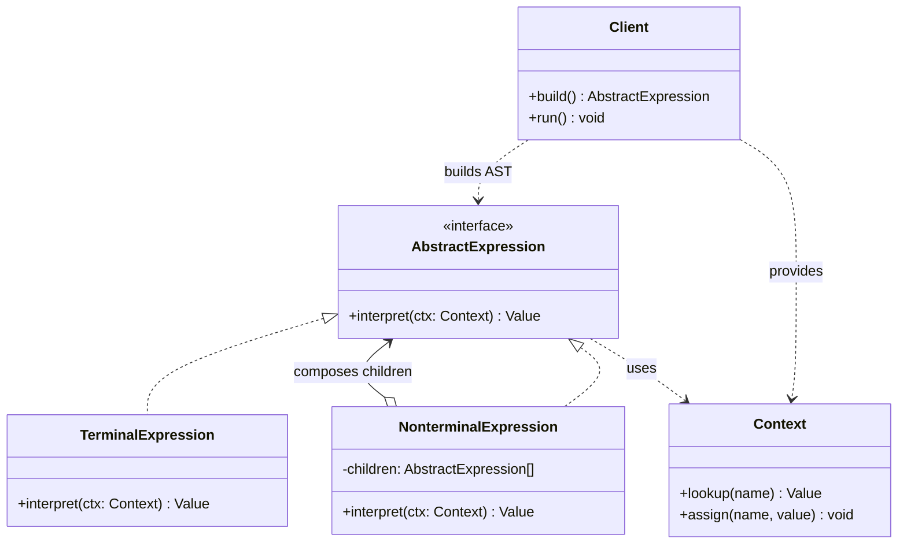

# 인터프리터(Interpreter) 디자인 패턴 가이드

> 한 줄 요약: 특정 도메인 언어(DSL)의 문법을 클래스 계층(AST)으로 표현하고, 각 노드의 `interpret()` 호출로 문장을 평가하는 패턴.
>
> 분류: 행위 패턴(Behavioral Pattern)
> 다른 이름(Aliases): 없음(GoF 원전에서는 별칭을 두지 않음)

---

## 상세 설명

인터프리터(Interpreter) 패턴은 자주 등장하는 문제를 간단한 언어(Language)로 표현할 수 있을 때, 그 언어의 문장(Sentence)을 표현하는 방법과 해석(Interpret)하는 방법을 객체 지향적으로 정의하는 행위 패턴이다. 핵심 아이디어는 "문법 규칙(Grammar Rule) 하나 = 클래스 하나"로 매핑하여, 문장을 추상 구문 트리(Abstract Syntax Tree, AST)로 구성하고 트리를 재귀적으로 평가(Evaluate)하는 것이다.

해결하고자 하는 문제(Problem)는 다음과 같다. 어떤 도메인에서 반복적으로 동일한 종류의 표현식 — 예를 들어 검색 필터 조건, 단위 변환식, 권한 규칙(Rule), 간단한 계산식 — 을 처리해야 한다. 매번 문자열 파싱과 분기문(switch/if)으로 처리하면 규칙이 늘어날수록 코드가 폭발적으로 복잡해진다. 또한 동일한 문법을 다른 방식으로도 처리하고 싶을 때(예: 평가, 출력, 최적화) 분기문 기반 코드는 재사용이 어렵다.

인터프리터 패턴이 제안하는 해결책(Solution)은 다음과 같다. (1) 언어의 문법을 BNF나 EBNF로 정의하고, (2) 각 문법 규칙에 대응하는 표현식(Expression) 클래스를 만든다. 단말 기호(Terminal)는 `TerminalExpression`, 비단말 기호(Non-terminal)는 `NonterminalExpression`이 된다. (3) 모든 표현식은 공통 추상 인터페이스 `AbstractExpression`을 구현하며 `interpret(Context)` 메서드를 제공한다. (4) 문장을 파싱하여 표현식 객체들로 이루어진 AST를 생성하고, 루트 노드의 `interpret()`을 호출하면 트리 전체가 재귀적으로 평가된다.

이 패턴은 본격적인 컴파일러나 파서 제너레이터(ANTLR, Yacc 등)와는 의도가 다르다. 인터프리터 패턴은 "문법이 단순하고 안정적이며, 표현식 트리가 이미 만들어져 있다고 가정"한 상태에서 평가 단계만 객체 지향적으로 풀어내는 데 초점이 있다. 파싱(Parsing) 자체는 패턴 외부의 관심사로 다루며, 일반적으로 손수 작성한 간단한 파서가 함께 따라온다. GoF 원전에서도 정규 표현식(Regular Expression) 매처(Matcher)를 인터프리터 패턴의 대표 예시로 든다.

---

## 디자인 패턴을 충족하는 최소 조건

이 섹션에서는 "어떤 코드가 진짜로 인터프리터 패턴이라고 부를 수 있는가"의 기준을 명확히 한다.

1. **공통 추상 표현식(AbstractExpression)이 존재한다** — 모든 노드가 동일한 인터페이스(`interpret(Context)` 또는 `evaluate()`)를 통해 다형적으로 호출 가능해야 한다. 단순히 switch-case로 노드 종류를 분기 처리하면 인터프리터 패턴이 아니다.
2. **문법 규칙과 클래스가 1:1로 대응된다** — 언어의 각 문법 규칙(Grammar Rule)이 클래스 하나로 표현되어야 한다. 단말 기호(예: 숫자 리터럴, 변수)는 `TerminalExpression`, 비단말 기호(예: 덧셈, AND)는 `NonterminalExpression`으로 구분된다.
3. **AST를 재귀적으로 평가한다** — `NonterminalExpression`은 자식 표현식들을 보유하고, `interpret()` 내부에서 자식들의 `interpret()`을 재귀 호출하여 결과를 합성한다. 평가 로직이 트리 구조를 따라 분산되어 있어야 한다.
4. **컨텍스트(Context)를 통해 전역/공유 정보를 주고받는다** — 변수 바인딩, 입력 스트림, 누적 결과 등 평가 중에 필요한 상태는 `Context` 객체에 담아 각 노드에 전달한다. (단순 식이면 컨텍스트가 생략될 수도 있으나, 변수가 등장하는 순간 필요해진다.)

> 위 조건 중 하나라도 빠지면 본 패턴이라고 보기 어렵다. 특히 1번(공통 인터페이스)과 3번(재귀 평가)이 인터프리터 패턴의 정체성이다.

### 흔히 오해하는 지점
- **본격 컴파일러/파서와 혼동**: ANTLR, JavaCC, Yacc 같은 파서 제너레이터는 인터프리터 패턴의 적용 사례가 아니다. 이들은 LL/LR 알고리즘으로 문법을 분석하는 도구이며, 생성된 코드의 평가 단계가 인터프리터 패턴 형태일 수는 있지만 패턴 자체와 도구는 별개의 개념이다.
- **단순 평가 함수와 혼동**: `if (op == "+") return a + b; else if (op == "*") return a * b;`처럼 거대한 switch로 처리하는 함수는 표현식이 데이터 구조로 분리되어 있지 않으므로 인터프리터 패턴이 아니다.
- **방문자(Visitor) 패턴과 혼동**: 두 패턴은 모두 트리 구조를 다루지만, 인터프리터는 "각 노드가 자기 평가 로직을 보유"하고 방문자는 "외부 방문자가 모든 노드 처리를 담당"한다. 평가 외에도 출력·최적화 같은 여러 연산을 추가할 가능성이 높으면 방문자 쪽이 적합하다.
- **Strategy 패턴과 혼동**: Strategy는 단일 알고리즘을 갈아끼우는 패턴이고, 인터프리터는 트리를 구성해 합성된 의미를 만들어낸다. 구조가 트리 형태인지 여부로 판별한다.

---

## 사례를 통한 예시

### 예시 1: 사칙연산 인터프리터(Arithmetic Expression Interpreter)

**상황**: 사용자가 입력한 후위 표기식(Postfix, 예: `5 1 2 + 4 * + 3 -`)을 계산해야 한다. 식의 종류(숫자, 더하기, 빼기, 곱하기)별로 클래스를 분리하고 AST로 평가한다.

```java
import java.util.Deque;
import java.util.ArrayDeque;

// AbstractExpression
interface Expression {
    int interpret();
}

// TerminalExpression: 숫자 리터럴
class NumberExpression implements Expression {
    private final int value;
    public NumberExpression(int value) { this.value = value; }
    @Override public int interpret() { return value; }
}

// NonterminalExpression: 이항 연산 공통 부모
abstract class BinaryExpression implements Expression {
    protected final Expression left;
    protected final Expression right;
    protected BinaryExpression(Expression left, Expression right) {
        this.left = left;
        this.right = right;
    }
}

class AddExpression extends BinaryExpression {
    public AddExpression(Expression l, Expression r) { super(l, r); }
    @Override public int interpret() { return left.interpret() + right.interpret(); }
}

class SubtractExpression extends BinaryExpression {
    public SubtractExpression(Expression l, Expression r) { super(l, r); }
    @Override public int interpret() { return left.interpret() - right.interpret(); }
}

class MultiplyExpression extends BinaryExpression {
    public MultiplyExpression(Expression l, Expression r) { super(l, r); }
    @Override public int interpret() { return left.interpret() * right.interpret(); }
}

// Client: 후위 표기식을 AST로 파싱
public class ArithmeticInterpreterDemo {
    public static Expression parse(String postfix) {
        Deque<Expression> stack = new ArrayDeque<>();
        for (String token : postfix.split("\\s+")) {
            switch (token) {
                case "+": {
                    Expression r = stack.pop(), l = stack.pop();
                    stack.push(new AddExpression(l, r));
                    break;
                }
                case "-": {
                    Expression r = stack.pop(), l = stack.pop();
                    stack.push(new SubtractExpression(l, r));
                    break;
                }
                case "*": {
                    Expression r = stack.pop(), l = stack.pop();
                    stack.push(new MultiplyExpression(l, r));
                    break;
                }
                default:
                    stack.push(new NumberExpression(Integer.parseInt(token)));
            }
        }
        return stack.pop();
    }

    public static void main(String[] args) {
        // (5 + (1 + 2) * 4) - 3 = 14
        Expression ast = parse("5 1 2 + 4 * + 3 -");
        System.out.println(ast.interpret()); // 14
    }
}
```

**해설**: `Expression` 인터페이스가 `AbstractExpression` 역할을, `NumberExpression`이 `TerminalExpression` 역할을, `AddExpression`/`SubtractExpression`/`MultiplyExpression`이 `NonterminalExpression` 역할을 한다. `parse()`는 패턴 외부의 책임(파서)이며 AST를 만드는 데만 쓰인다. 새로운 연산자(예: 나눗셈, 거듭제곱)를 추가하려면 `Expression` 구현체를 한 개 추가하는 것으로 끝난다 — 이것이 인터프리터 패턴의 확장 방식이다.

### 예시 2: Boolean 표현식 인터프리터(변수 컨텍스트 사용)

**상황**: 권한 규칙(Rule)을 `A AND (B OR NOT C)` 같은 불(boolean) 식으로 표현하고, 사용자별 컨텍스트에 따라 평가한다.

```java
import java.util.Map;
import java.util.HashMap;

// Context: 변수 이름 → boolean 값 바인딩
class BooleanContext {
    private final Map<String, Boolean> bindings = new HashMap<>();
    public void assign(String var, boolean value) { bindings.put(var, value); }
    public boolean lookup(String var) {
        if (!bindings.containsKey(var)) throw new IllegalStateException("Unbound: " + var);
        return bindings.get(var);
    }
}

interface BoolExpression {
    boolean interpret(BooleanContext ctx);
}

// TerminalExpression: 변수 참조
class VariableExpression implements BoolExpression {
    private final String name;
    public VariableExpression(String name) { this.name = name; }
    @Override public boolean interpret(BooleanContext ctx) { return ctx.lookup(name); }
}

// NonterminalExpression: AND, OR, NOT
class AndExpression implements BoolExpression {
    private final BoolExpression left, right;
    public AndExpression(BoolExpression l, BoolExpression r) { this.left = l; this.right = r; }
    @Override public boolean interpret(BooleanContext ctx) {
        return left.interpret(ctx) && right.interpret(ctx);
    }
}

class OrExpression implements BoolExpression {
    private final BoolExpression left, right;
    public OrExpression(BoolExpression l, BoolExpression r) { this.left = l; this.right = r; }
    @Override public boolean interpret(BooleanContext ctx) {
        return left.interpret(ctx) || right.interpret(ctx);
    }
}

class NotExpression implements BoolExpression {
    private final BoolExpression expr;
    public NotExpression(BoolExpression e) { this.expr = e; }
    @Override public boolean interpret(BooleanContext ctx) { return !expr.interpret(ctx); }
}

public class BoolInterpreterDemo {
    public static void main(String[] args) {
        // 규칙: isAdmin AND (isOwner OR NOT isReadOnly)
        BoolExpression rule = new AndExpression(
            new VariableExpression("isAdmin"),
            new OrExpression(
                new VariableExpression("isOwner"),
                new NotExpression(new VariableExpression("isReadOnly"))
            )
        );

        BooleanContext ctx = new BooleanContext();
        ctx.assign("isAdmin", true);
        ctx.assign("isOwner", false);
        ctx.assign("isReadOnly", true);

        System.out.println(rule.interpret(ctx)); // false
    }
}
```

**해설**: `BooleanContext`가 패턴의 `Context` 역할을 정확히 수행하며, 변수 바인딩을 모든 노드가 공유한다. `VariableExpression`이 단말, `AndExpression`/`OrExpression`/`NotExpression`이 비단말이다. 동일한 트리를 다른 컨텍스트로 여러 번 평가할 수 있어 규칙은 한 번만 빌드해두고 요청마다 재사용 가능하다.

### 예시 3: `java.util.regex.Pattern` (표준 라이브러리에서의 사용)

**상황**: 정규 표현식(Regular Expression)은 GoF 원전이 직접 거론한 인터프리터 패턴의 사례이다. Java 표준 라이브러리의 `java.util.regex.Pattern`은 정규식 문자열을 내부적으로 작은 노드들의 트리로 컴파일한 뒤 매칭(평가)한다.

```java
import java.util.regex.Pattern;
import java.util.regex.Matcher;

public class RegexInterpreterDemo {
    public static void main(String[] args) {
        // 1. "문법"을 표현하는 문자열로부터 AST(내부 Node 트리)를 빌드
        Pattern pattern = Pattern.compile("^(\\d{4})-(\\d{2})-(\\d{2})$");

        // 2. 동일한 트리를 여러 입력에 대해 반복 평가
        Matcher m = pattern.matcher("2026-05-29");
        if (m.matches()) {
            System.out.println("year = " + m.group(1)); // 2026
            System.out.println("month = " + m.group(2)); // 05
            System.out.println("day = " + m.group(3));   // 29
        }
    }
}
```

**해설**: `Pattern.compile()`이 정규식 문법을 파싱해 내부 `Node` 서브클래스들(예: `CharProperty`, `GroupHead`, `Curly` 등)로 이루어진 트리를 만든다. 각 노드는 공통 메서드 `match(Matcher, int, CharSequence)`를 가지며 자식 노드의 `match()`를 재귀 호출한다 — 이것이 정확히 인터프리터 패턴의 구조이다. `Matcher`가 컨텍스트(Context) 역할을 수행하여 입력 위치, 그룹 캡처 결과 등 평가 중 상태를 보관한다. 단, JDK 내부 구현은 성능을 위해 패턴의 순수 형태에서 일부 벗어난 최적화를 포함한다.

---

## 어떨 때 사용하나

다음과 같은 신호(Symptom)가 보일 때 이 패턴 도입을 고려한다.

- 도메인에서 반복적으로 등장하는 작은 표현식·규칙·필터가 있고, 이를 데이터로 다루며 평가·저장·재실행하고 싶을 때(예: 권한 규칙, 검색 쿼리, 가격 정책, 이벤트 트리거 조건).
- 문법이 단순하고(연산자 수가 한 자릿수 수준) 거의 변하지 않으며, 표현식 트리의 깊이가 깊지 않을 때.
- 비프로그래머 사용자에게 식을 작성할 수 있는 인터페이스(예: 규칙 빌더 UI)를 제공하고 싶고, UI에서 만든 객체 트리를 그대로 평가하면 되는 경우.
- 같은 식을 여러 컨텍스트에서 반복 평가해야 하고(컴파일 한 번, 평가 여러 번), 매번 문자열 파싱 비용을 피하고 싶을 때.

### 사용하면 안 되는 경우 (Anti-patterns)

- **문법이 본격적으로 복잡한 경우**: 우선순위·결합성·예외 처리·타입 시스템 등이 얽힌 본격 DSL은 ANTLR, JavaCC, Xtext 같은 도구를 쓰는 것이 압도적으로 유리하다. 인터프리터 패턴으로 직접 구현하면 클래스 수가 폭발하고 유지보수가 불가능해진다.
- **성능이 핵심인 평가**: 트리 노드마다 가상 호출(virtual dispatch)이 일어나 캐시 친화성이 떨어진다. 고성능이 필요하면 바이트코드 컴파일, JIT, 혹은 표현식을 평탄화한 평가기로 대체한다(예: Java의 `MethodHandle`, Spring SpEL의 compiled mode).
- **식이 한두 가지뿐인 경우**: 단순 switch 함수로 충분한데 굳이 클래스 계층을 만드는 것은 과한 추상화다.
- **문법이 자주 바뀌는 경우**: 문법 변경마다 클래스 추가/수정이 강제되어 변경 비용이 크다. 데이터 기반 규칙 엔진(Drools 등)이 더 적합할 수 있다.

---

## 장점과 단점, 한계점

### 장점
- **문법과 코드의 1:1 매핑**: 문법 규칙이 클래스로 직접 표현되므로 코드만 보고도 문법을 역추적할 수 있다. 신규 진입자가 도메인 언어를 파악하기 좋다.
- **확장 용이성(개방-폐쇄 원칙)**: 새로운 연산자·문법 요소를 추가하려면 `AbstractExpression`을 구현한 클래스 하나를 만들면 된다. 기존 노드 코드를 수정할 필요가 없다.
- **트리 재사용**: AST를 한 번 만들고 다른 컨텍스트로 여러 번 평가할 수 있다. 동일한 규칙을 사용자·요청·시점마다 다시 적용하는 시나리오에 강하다.
- **트리에 다른 연산 결합 가능**: 같은 AST 위에 출력(pretty print), 최적화, 검증 등 추가 처리를 얹기 쉽다. 특히 방문자(Visitor) 패턴과 잘 결합된다.

### 단점
- **클래스 폭발(Class Explosion)**: 문법 규칙 하나당 클래스 하나가 필요하므로, 규칙이 수십 개 단위로 늘어나면 코드베이스가 빠르게 비대해진다. 유지보수성이 급격히 떨어지는 주된 원인이다.
- **성능 저하**: 모든 평가가 작은 객체들의 가상 메서드 호출 체인으로 이루어진다. JIT가 어느 정도 풀어주긴 하지만, 깊은 트리를 반복 평가하는 워크로드에서는 평탄화된 평가기나 컴파일 방식에 비해 명확히 느리다.
- **파싱은 패턴 밖**: 인터프리터 패턴 자체는 평가만 다룬다. 문자열 입력을 AST로 만드는 파서는 따로 작성해야 하며, 이 부분에서 버그·복잡도가 누적된다.

### 한계점
- **복잡한 문법에서 무너진다**: 우선순위·연관성·문맥 의존 문법(context-sensitive grammar) 등을 다루기 시작하면 클래스 계층만으로는 표현이 어색해진다. 본격 DSL은 파서 제너레이터 사용이 사실상 표준이다.
- **동적 변경 어려움**: 문법을 런타임에 바꿔야 한다면(예: 사용자가 새로운 키워드를 정의) 클래스 기반 인터프리터는 적합하지 않다.
- **테스트 표면적이 넓다**: 노드 종류와 조합 수만큼 단위 테스트가 늘어나며, 트리 변형에 따른 회귀 테스트 비용도 무시할 수 없다.

---

## 정보 표

| 항목 | 값 |
| --- | --- |
| 분류 | 행위 패턴(Behavioral) |
| 언어 의존성 | 언어 비의존적. 단, 다형성(polymorphism)과 재귀를 자연스럽게 지원하는 객체 지향 언어에서 가장 깔끔하게 표현된다. |
| 활용성(1점~5점) | ★★☆☆☆ (2/5) — 개념은 학습 가치가 크지만, 실무에서 본격 DSL은 ANTLR·SpEL·JEXL 같은 도구로 처리하는 것이 보편적이고 단순 규칙은 함수형 람다나 데이터 기반 엔진으로 풀 때가 더 많다. |
| 학습 난이도 | 중 — AST와 재귀 평가 개념만 이해하면 구조 자체는 어렵지 않으나, 적절한 적용 범위 판단이 어렵다. |
| 자주 함께 쓰이는 패턴 | 컴포지트(Composite, AST 구조), 방문자(Visitor, 다중 연산), 반복자(Iterator, 트리 순회), 플라이웨이트(Flyweight, 단말 노드 공유) |
| 대표 사용 사례 | `java.util.regex.Pattern`, Spring SpEL의 표현식 트리, 검색 쿼리 DSL, 권한·라우팅 규칙 엔진의 단순 표현식 평가기 |

---

## Class Diagram



> 다이어그램에 등장하는 각 클래스가 패턴의 어떤 역할(Role)을 담당하는지 위 "상세 설명" 섹션과 1:1로 대응되어야 한다.

### 역할 설명
- **AbstractExpression**: 모든 노드가 공통으로 구현하는 인터페이스. `interpret(Context)`를 통해 다형적으로 평가된다.
- **TerminalExpression**: 문법의 단말 기호(숫자 리터럴, 변수 참조 등)에 대응. 자식 표현식을 갖지 않으며 컨텍스트나 자신의 필드에서 즉시 값을 산출한다.
- **NonterminalExpression**: 문법의 비단말 기호(연산자, 결합 규칙)에 대응. 한 개 이상의 자식 `AbstractExpression`을 보유하고, `interpret()` 내부에서 자식들을 재귀 호출하여 결과를 합성한다.
- **Context**: 평가 도중 필요한 공유 정보(변수 바인딩, 입력 위치, 누적 결과 등)를 담는 객체. 노드 간 결합도를 낮추는 역할도 겸한다.
- **Client**: 문장을 파싱하거나 직접 객체를 조립해 AST를 빌드하고, 루트의 `interpret()`을 호출해 평가를 시작한다. 파싱 자체는 패턴 외부 책임이다.

---

## 참고 자료
- Erich Gamma, Richard Helm, Ralph Johnson, John Vlissides, "Design Patterns: Elements of Reusable Object-Oriented Software", Addison-Wesley, 1994 — Interpreter 항목.
- Refactoring.Guru, "Interpreter" — https://refactoring.guru/design-patterns/interpreter
- Oracle JDK 소스, `java.util.regex.Pattern` 및 내부 `Node` 계층 — Pattern 클래스가 정규식 노드 트리를 어떻게 구성·평가하는지 살펴볼 수 있는 표준 사례.
- Martin Fowler, "Domain-Specific Languages", Addison-Wesley, 2010 — 인터프리터 패턴의 한계와 외부/내부 DSL, 파서 제너레이터(ANTLR 등)와의 비교가 상세히 다뤄진다.
- Joshua Kerievsky, "Refactoring to Patterns", Addison-Wesley, 2004 — "Replace Conditional Dispatcher with Command/Interpreter" 항목.
