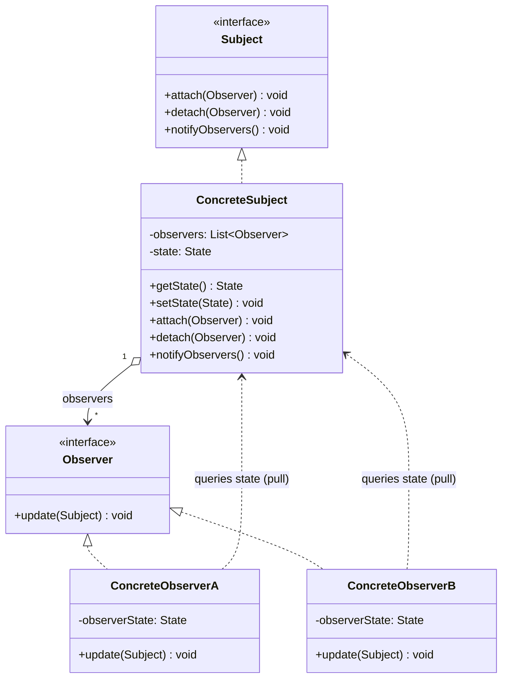

# 옵저버(Observer) 디자인 패턴 가이드

> 한 줄 요약: 한 객체(Subject)의 상태 변화를 그에 의존하는 다수의 객체(Observer)에게 자동으로 통보하여 일대다(1:N) 의존 관계를 느슨하게 묶는 패턴.
>
> 분류: 행위 패턴(Behavioral Pattern)
> 다른 이름(Aliases): 발행-구독(Publish-Subscribe), 종속자(Dependents)

---

## 상세 설명

옵저버(Observer) 패턴은 어떤 객체의 상태가 변할 때 그 객체에 의존하는 다른 객체들이 자동으로 갱신될 수 있도록 일대다(One-to-Many) 의존 관계를 정의하는 행위 패턴이다. 상태를 가진 객체를 주체(Subject) 또는 발행자(Publisher), 그 상태 변화를 통보받는 객체를 옵저버(Observer) 또는 구독자(Subscriber)라고 부른다. 주체는 자신을 구독하고 있는 옵저버 목록을 보유하며, 상태가 변할 때마다 등록된 모든 옵저버에게 `notify` 호출을 수행한다.

이 패턴이 해결하는 문제(Problem)는 "관심사가 다른 여러 객체가 동일한 데이터 변화에 반응해야 하지만, 데이터를 가진 객체가 그것을 사용하는 모든 객체를 직접 알 필요는 없도록 분리하고 싶다"는 요구이다. 만약 주체가 옵저버의 구체 클래스를 직접 참조한다면, 새로운 옵저버를 추가할 때마다 주체 코드를 수정해야 하고 양방향 강결합이 발생한다. 옵저버 패턴은 주체가 옵저버의 추상 인터페이스(Observer)에만 의존하도록 만들어 이 결합을 끊는다.

해결 방식(Solution)은 (1) 옵저버가 구현해야 할 공통 인터페이스를 정의하고, (2) 주체가 그 인터페이스 타입의 컬렉션을 보유하면서 등록(`attach`/`subscribe`)·해제(`detach`/`unsubscribe`)·통보(`notify`) 메서드를 제공하는 것이다. 통보 방식에는 두 가지가 있다. **Push 모델**은 주체가 변경된 데이터를 인자에 담아 옵저버에게 직접 전달하는 방식으로, 옵저버 구현이 단순하지만 주체가 옵저버에게 필요한 데이터 형태를 가정해야 한다. **Pull 모델**은 주체가 "변했다"는 사실만 알리고 옵저버가 필요할 때 주체에게서 데이터를 조회하는 방식으로, 유연하지만 옵저버가 주체의 인터페이스에 더 깊이 의존하게 된다.

GoF 원전(1994)에서 정의된 고전적 형태 이외에도, 옵저버 패턴은 이벤트 리스너(Event Listener), 콜백 기반의 발행-구독(Publish-Subscribe), 반응형 스트림(Reactive Streams, `java.util.concurrent.Flow`), 데이터 바인딩(Data Binding) 등의 형태로 다양하게 변형되어 사용된다. 자바 표준 라이브러리에 존재하던 `java.util.Observer`/`java.util.Observable`은 형 안전성과 멀티스레딩 측면의 한계로 Java 9부터 deprecated 되었고, 현재는 `java.beans.PropertyChangeListener`나 `Flow.Subscriber` 등을 대안으로 사용한다.

---

## 디자인 패턴을 충족하는 최소 조건

이 섹션에서는 "어떤 코드가 진짜로 옵저버 패턴이라고 부를 수 있는가"의 기준을 명확히 한다.

1. **옵저버 추상화 존재** — 주체(Subject)는 옵저버의 구체 타입이 아니라 공통 인터페이스(Observer 또는 Listener)에만 의존해야 한다. 주체가 특정 옵저버 클래스를 직접 `new` 하거나 캐스팅하는 구조는 패턴이라 보기 어렵다.
2. **동적 구독/해제(Subscribe/Unsubscribe)** — 런타임에 옵저버를 등록(`attach`)하고 해제(`detach`)할 수 있는 API가 제공되어야 한다. 컴파일 타임에 고정된 호출 관계는 옵저버가 아니라 단순 위임이다.
3. **1:N 통보(Broadcast)** — 하나의 상태 변화가 다수의 옵저버에게 자동으로 전파되어야 한다. 항상 1:1 관계라면 단순 콜백이지 옵저버가 아니다.
4. **느슨한 결합(Loose Coupling)** — 옵저버는 자신이 어떤 주체를 구독하는지는 알 수 있어도, 같은 주체를 구독하는 다른 옵저버의 존재나 종류를 알 필요가 없다.

> 위 조건 중 하나라도 빠지면 옵저버 패턴이라기보다 변형 패턴(단순 콜백, 이벤트 디스패처, 메시지 큐 등)으로 분류된다.

### 흔히 오해하는 지점

- **단순 콜백과의 구분**: 함수 하나를 인자로 받아 한 번 호출하는 콜백(Callback)은 1:1 위임이며 옵저버가 아니다. 옵저버는 반드시 다수의 구독자를 동시에 보유할 수 있어야 하며, 동일한 이벤트에 대해 등록된 모든 구독자가 통보된다.
- **Pub/Sub 메시지 브로커와의 구분**: Kafka, RabbitMQ 같은 메시지 브로커 기반 발행-구독은 발행자와 구독자가 서로의 존재를 전혀 모르고 중간 브로커(Topic/Channel)를 통해 비동기적으로 통신한다. 반면 GoF 옵저버는 주체가 자신의 옵저버 목록을 직접 보유하며 동일 프로세스 내에서 동기적으로 통보하는 것이 기본이다. 둘은 의도와 결합도 수준이 다르다.
- **데이터 바인딩과의 구분**: 양방향 데이터 바인딩은 옵저버를 내부적으로 사용할 수 있지만, "양쪽이 서로의 상태를 동기화"하는 것이 목적이므로 한쪽이 일방적으로 통보하는 옵저버 본래의 의도와는 결이 다르다.
- **`Observable`이라는 이름만 보고 옵저버라고 부르는 경우**: RxJava의 `Observable`은 옵저버 패턴을 확장한 반응형 스트림으로, 백프레셔(Backpressure)·조합자(Operator) 등 GoF 옵저버에 없는 개념이 핵심이다. 이름이 같다고 동일 패턴은 아니다.

---

## 사례를 통한 예시

### 예시 1: 주식 시세 옵저버 (직접 작성)

**상황**: 주식 시세(Stock Price)가 변할 때마다 콘솔 출력기, 모바일 알림, 평균 가격 분석기 등 여러 구독자가 자동으로 갱신되어야 한다. 새로운 종류의 구독자가 추가되더라도 시세 발행 측 코드는 수정하지 않아야 한다.

```java
import java.util.ArrayList;
import java.util.List;

// Observer 인터페이스
interface StockObserver {
    void update(String ticker, double price);
}

// Subject 인터페이스
interface StockSubject {
    void attach(StockObserver o);
    void detach(StockObserver o);
    void notifyObservers();
}

// ConcreteSubject
class StockTicker implements StockSubject {
    private final List<StockObserver> observers = new ArrayList<>();
    private String ticker;
    private double price;

    @Override public void attach(StockObserver o) { observers.add(o); }
    @Override public void detach(StockObserver o) { observers.remove(o); }

    @Override
    public void notifyObservers() {
        // 동시 수정 방지를 위해 스냅샷을 만들고 통보(Push 모델)
        for (StockObserver o : new ArrayList<>(observers)) {
            o.update(ticker, price);
        }
    }

    public void setPrice(String ticker, double price) {
        this.ticker = ticker;
        this.price = price;
        notifyObservers();
    }
}

// ConcreteObserver 1: 콘솔 출력
class ConsolePrinter implements StockObserver {
    @Override
    public void update(String ticker, double price) {
        System.out.printf("[Console] %s = %.2f%n", ticker, price);
    }
}

// ConcreteObserver 2: 임계가 알림
class PriceAlert implements StockObserver {
    private final double threshold;
    public PriceAlert(double threshold) { this.threshold = threshold; }
    @Override
    public void update(String ticker, double price) {
        if (price >= threshold) {
            System.out.printf("[Alert] %s breached %.2f (now %.2f)%n",
                              ticker, threshold, price);
        }
    }
}

public class ObserverDemo {
    public static void main(String[] args) {
        StockTicker ticker = new StockTicker();
        StockObserver printer = new ConsolePrinter();
        StockObserver alert  = new PriceAlert(100.0);

        ticker.attach(printer);
        ticker.attach(alert);

        ticker.setPrice("AAPL", 95.0);   // Console만 반응
        ticker.setPrice("AAPL", 101.5);  // Console + Alert 모두 반응

        ticker.detach(alert);
        ticker.setPrice("AAPL", 110.0);  // Console만 반응
    }
}
```

**해설**: `StockSubject`는 GoF 다이어그램의 **Subject** 역할, `StockTicker`는 **ConcreteSubject**, `StockObserver`는 **Observer** 인터페이스, `ConsolePrinter`/`PriceAlert`는 **ConcreteObserver**에 해당한다. 발행 측 `StockTicker`는 옵저버의 구체 클래스를 전혀 모른 채 `StockObserver` 인터페이스에만 의존하므로, 새 옵저버를 추가해도 `StockTicker`를 수정할 필요가 없다(개방-폐쇄 원칙, Open-Closed Principle). `notifyObservers` 안에서 컬렉션의 복사본을 순회하는 이유는, 옵저버가 통보 중에 자기 자신을 `detach` 하더라도 `ConcurrentModificationException`을 피하기 위해서이다.

### 예시 2: `java.beans.PropertyChangeListener` (실제 표준 라이브러리)

**상황**: `java.util.Observer`/`java.util.Observable`은 Java 9에서 deprecated 되었다(JDK-8154801). 그 사유는 ① 통보되는 데이터가 `Object`라서 형 안전성이 떨어지고, ② 직렬화 호환성과 멀티스레드 안전성 보장이 빈약하며, ③ `Observable`이 클래스라서 상속을 강제해 단일 상속 슬롯을 잡아먹는다는 점이었다. 공식 대안으로 안내되는 것 중 하나가 `java.beans.PropertyChangeSupport` 기반의 `PropertyChangeListener`이다.

```java
import java.beans.PropertyChangeEvent;
import java.beans.PropertyChangeListener;
import java.beans.PropertyChangeSupport;

class Account {
    private final PropertyChangeSupport support = new PropertyChangeSupport(this);
    private long balance;

    public void addPropertyChangeListener(PropertyChangeListener l) {
        support.addPropertyChangeListener(l);
    }
    public void removePropertyChangeListener(PropertyChangeListener l) {
        support.removePropertyChangeListener(l);
    }

    public void setBalance(long newBalance) {
        long old = this.balance;
        this.balance = newBalance;
        // 속성 이름, 이전 값, 새 값을 push 모델로 통보
        support.firePropertyChange("balance", old, newBalance);
    }
}

public class PropertyChangeDemo {
    public static void main(String[] args) {
        Account account = new Account();

        PropertyChangeListener auditor = (PropertyChangeEvent e) ->
            System.out.printf("[Audit] %s: %s -> %s%n",
                e.getPropertyName(), e.getOldValue(), e.getNewValue());

        PropertyChangeListener overdraftWatcher = (PropertyChangeEvent e) -> {
            if ("balance".equals(e.getPropertyName())
                && ((Long) e.getNewValue()) < 0) {
                System.out.println("[Warn] Overdraft!");
            }
        };

        account.addPropertyChangeListener(auditor);
        account.addPropertyChangeListener(overdraftWatcher);

        account.setBalance(1000);
        account.setBalance(-200);
    }
}
```

**해설**: `PropertyChangeSupport`는 옵저버 목록 관리와 통보 로직을 캡슐화한 헬퍼이다. `Account`는 직접 옵저버 컬렉션을 관리하지 않고 위임(Delegation)으로 옵저버 패턴을 구현하면서, 외부에는 `addPropertyChangeListener`/`removePropertyChangeListener` API만 노출한다. 통보 데이터(`PropertyChangeEvent`)에는 속성 이름·이전 값·새 값이 모두 담기는 push 모델이며, 동일한 속성에 대해 다수의 리스너가 독립적으로 반응한다. 더 현대적인 대안으로는 비동기·백프레셔를 지원하는 `java.util.concurrent.Flow.Publisher`/`Flow.Subscriber`(JDK 9+, Reactive Streams 표준)가 있으며, 이 또한 옵저버 패턴의 한 변형이다.

---

## 어떨 때 사용하나

다음과 같은 신호(Symptom)가 보일 때 옵저버 패턴 도입을 고려한다.

- 한 객체의 상태가 변했을 때 그 사실을 알아야 하는 객체가 둘 이상이고, 앞으로 더 늘어날 가능성이 있을 때.
- 데이터를 생산하는 쪽(주체)과 그것을 소비하는 쪽(옵저버)이 서로의 구체 클래스를 알 필요가 없을 만큼 관심사가 분리되어 있을 때. 예를 들어 모델(Model)의 변화에 뷰(View)가 자동으로 반응해야 하는 MVC 구조.
- GUI 이벤트 처리, 도메인 이벤트(Domain Event) 발행, 모델-뷰 동기화, 캐시 무효화 알림처럼 "어떤 일이 일어났음"을 다수의 소비자에게 전파하는 시나리오.
- 동일한 데이터 흐름에 새로운 반응 로직을 자주 추가해야 하지만, 기존 발행 코드는 안정적으로 유지되어야 할 때(개방-폐쇄 원칙 보존).

### 사용하면 안 되는 경우 (Anti-patterns)

- **반응자가 항상 1명뿐이고 앞으로도 그럴 때**: 옵저버 컬렉션을 도입하는 비용보다 단순 콜백/위임이 더 명확하다.
- **통보 순서가 비즈니스적으로 결정적이어야 할 때**: 옵저버 패턴은 통보 순서에 대해 어떤 보장도 하지 않는다. 순서가 정답에 영향을 준다면 명시적 워크플로우(예: Chain of Responsibility, Pipeline)나 큐 기반 처리가 더 적합하다.
- **트랜잭션·재시도·영속성·내결함성이 요구되는 분산 이벤트 처리**: 이는 메시지 브로커(Kafka, RabbitMQ) 또는 이벤트 소싱(Event Sourcing)의 영역이다. 인프로세스 옵저버는 통보 도중 옵저버가 던진 예외, 프로세스 종료 등에 무방비하다.
- **순환 의존이 생기는 경우**: 옵저버 A가 갱신되면서 다른 주체 B를 변경하고, 그 변경이 다시 A에게 통보되어 무한 루프가 형성되는 구조라면 패턴 적용 자체를 재검토해야 한다.

---

## 장점과 단점, 한계점

### 장점

- **느슨한 결합(Loose Coupling)**: 주체는 옵저버 인터페이스에만 의존하므로, 옵저버를 자유롭게 추가·교체·제거해도 주체 코드는 그대로다.
- **개방-폐쇄 원칙(Open-Closed Principle) 부합**: 새로운 종류의 반응 로직을 추가할 때 기존 주체와 기존 옵저버를 수정하지 않고 새 옵저버 클래스만 작성하면 된다.
- **런타임 구성 가능성**: 옵저버 등록·해제가 런타임에 일어나므로, 실행 도중 구독 관계를 동적으로 바꿀 수 있다(예: 사용자가 알림 설정을 켜고 끄는 경우).
- **방송 의미론(Broadcast Semantics)**: 동일한 이벤트를 다수의 소비자가 각자 다른 방식으로 처리할 수 있다.

### 단점

- **예측하기 어려운 통보 순서**: 옵저버들이 등록 순서대로 호출되는지, 어떤 옵저버가 다른 옵저버보다 먼저 반응했는지가 코드만 봐서는 명확하지 않다. 옵저버 사이에 암묵적 순서 의존이 생기면 디버깅이 어려워진다.
- **연쇄 통보(Cascading Update)**: 한 옵저버가 다른 주체를 갱신하고 그것이 또 다른 옵저버를 깨우는 식으로 통보가 연쇄되면 성능 저하나 무한 루프, 스택 오버플로우가 발생할 수 있다.
- **디버깅 난이도**: 호출 경로가 직접적인 메서드 호출 그래프로 나타나지 않고 등록/통보를 통한 간접 경로이기 때문에, 어디서 누가 통보를 보냈는지 추적하기 어렵다.
- **옵저버 측 예외의 전파**: 한 옵저버가 통보 중 예외를 던지면 뒤따르는 옵저버에게 통보가 누락될 수 있다. 예외 격리(try/catch)를 발행 측에서 책임져야 한다.

### 한계점

- **메모리 누수(Memory Leak, Lapsed Listener Problem)**: 옵저버가 `detach` 되지 않고 주체에 강한 참조로 남아 있으면 GC 대상이 되지 못한다. 안드로이드의 Activity 생명주기와 옵저버가 어긋날 때 자주 발생하며, 약한 참조(`WeakReference`) 기반 구독 또는 명시적 해제 규약으로 완화해야 한다.
- **통보 순서 보장 없음**: 컬렉션 구현이 `List`이면 등록 순서대로지만, `Set`이거나 멀티스레드 환경에서 동시 변경되면 순서가 흐트러진다. GoF 명세는 순서를 규정하지 않으므로 의존하면 위험하다.
- **동시성(Concurrency)**: 통보 중에 다른 스레드가 `attach`/`detach`를 호출하면 `ConcurrentModificationException`이 발생할 수 있다. `CopyOnWriteArrayList`나 스냅샷 순회로 대응한다.
- **Push vs Pull 트레이드오프**: Push 모델은 옵저버가 사용하지 않는 데이터까지 전달하여 결합과 트래픽이 늘고, Pull 모델은 옵저버가 주체의 조회 API에 더 깊이 의존하게 된다. 두 모델 모두 만능이 아니다.

---

## 정보 표

| 항목 | 값 |
| --- | --- |
| 분류 | 행위 패턴(Behavioral) |
| 언어 의존성 | 언어 비의존적(인터페이스/람다/이벤트 기능 중 하나만 있으면 구현 가능) |
| 활용성(1점~5점) | ★★★★★ (5/5) — GUI 이벤트·MVC·반응형 프로그래밍·도메인 이벤트 등 사실상 모든 이벤트 기반 시스템의 토대 |
| 학습 난이도 | 중 (개념은 단순하지만 메모리 누수·통보 순서·동시성 등 운영상 함정이 많음) |
| 자주 함께 쓰이는 패턴 | 중재자(Mediator), 싱글톤(Singleton, 이벤트 버스), 커맨드(Command), MVC/MVP/MVVM |
| 대표 사용 사례 | Swing/JavaFX 이벤트 리스너, `java.beans.PropertyChangeListener`, `java.util.concurrent.Flow`, RxJava/Reactor, Node.js `EventEmitter`, DOM `addEventListener` |

---

## Class Diagram



> 다이어그램에 등장하는 각 클래스가 패턴의 어떤 역할(Role)을 담당하는지 위 "상세 설명" 섹션과 1:1로 대응되어야 한다.

### 역할 설명
- **Subject (주체 인터페이스)**: 옵저버를 등록·해제·통보하기 위한 공통 API를 정의한다. 구체 주체가 어떤 클래스든 외부는 이 추상 타입만 알아야 한다.
- **ConcreteSubject (구체 주체)**: 실제 상태(State)를 보유하고, 상태가 변하면 등록된 옵저버 목록을 순회하며 `update`를 호출한다. push 모델이라면 변경 데이터를 인자로 전달하고, pull 모델이라면 자기 자신만 넘기고 옵저버가 `getState`를 호출해 가져간다.
- **Observer (옵저버 인터페이스)**: 주체로부터 통보받기 위한 단일 메서드(`update`)를 선언한다. 구체 옵저버들은 이 인터페이스로만 주체에게 보인다.
- **ConcreteObserverA / ConcreteObserverB (구체 옵저버)**: 통보를 받아 각자의 방식으로 반응한다. 서로의 존재를 알지 못하며, 같은 주체에 등록되어 있다는 사실 외에는 어떤 결합도 갖지 않는다.

---

## 참고 자료
- Gamma, Helm, Johnson, Vlissides (GoF), "Design Patterns: Elements of Reusable Object-Oriented Software", Addison-Wesley, 1994 — Observer 항목.
- Oracle, "Deprecation of `java.util.Observer` and `java.util.Observable`" (JDK-8154801), Java 9 Release Notes.
- Oracle Java SE API Docs, `java.beans.PropertyChangeSupport`, `java.beans.PropertyChangeListener`.
- Oracle Java SE API Docs, `java.util.concurrent.Flow` (Reactive Streams in JDK 9+).
- Refactoring.Guru, "Observer" — https://refactoring.guru/design-patterns/observer
- Erich Gamma et al., "Lapsed Listener Problem" — 옵저버 메모리 누수에 대한 고전적 논의.
- ReactiveX 공식 문서, "Observable" — 옵저버 패턴의 반응형 확장 사례.
