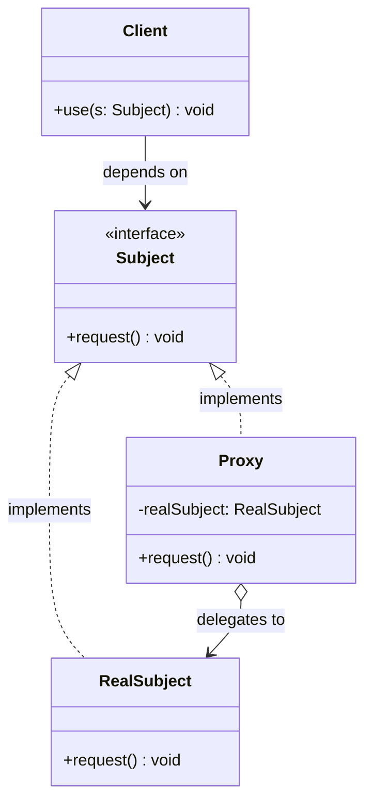

# 프록시(Proxy) 디자인 패턴 가이드

> 한 줄 요약: 실제 객체(Real Subject)에 대한 접근을 제어하거나 보강하기 위해, 동일한 인터페이스를 구현한 대리자(Proxy) 객체를 사이에 두어 호출을 중계하는 패턴이다.
>
> 분류: 구조 패턴(Structural Pattern)
> 다른 이름(Aliases): Surrogate

---

## 상세 설명

프록시(Proxy) 패턴은 실제 작업을 수행하는 객체(Real Subject)와 그 객체를 사용하는 클라이언트(Client) 사이에 동일한 인터페이스(Subject)를 구현한 대리자(Proxy)를 두는 구조 패턴이다. 클라이언트는 자신이 다루는 객체가 실제 객체인지 프록시인지 구분하지 못한 채 같은 방식으로 호출하지만, 프록시는 그 호출을 가로채(intercept) 지연 생성, 권한 검사, 원격 통신, 참조 카운팅 등 부가 작업을 수행한 뒤 실제 객체에게 위임(delegate)한다.

이 패턴이 해결하고자 하는 문제(Problem)는 "어떤 객체를 직접 사용하는 것이 비싸거나, 위험하거나, 불가능한 상황"이다. 예컨대 큰 이미지를 생성자에서 곧바로 디스크에서 읽으면 화면을 그리기도 전에 메모리를 낭비하고, 네트워크 너머의 객체는 그냥 메서드 호출만으로는 접근할 수 없으며, 모든 호출자에게 동일한 권한을 주면 보안이 깨진다. 해결책(Solution)으로 프록시는 같은 인터페이스를 노출하면서 내부에서 "정말 필요할 때"만 실제 객체를 만들고, "허용된 경우에만" 호출을 전달하며, "원격 통신을 추상화"하여 클라이언트 코드를 바꾸지 않고도 이 모든 정책을 적용한다.

GoF는 프록시를 의도(Intent)에 따라 네 가지 변형으로 정리한다.

- **가상 프록시(Virtual Proxy)**: 실제 객체의 생성 비용이 클 때, 필요해지는 시점까지 생성을 미루는 지연 로딩(Lazy Loading)용 프록시. 예: 이미지 뷰어가 썸네일만 먼저 그리고 실제 비트맵은 사용자가 이미지를 열 때 로드.
- **보호 프록시(Protection Proxy)**: 호출자에 따라 메서드 호출을 허용/차단하는 접근 제어용 프록시. 예: 관리자 전용 메서드 앞에서 권한을 검사.
- **원격 프록시(Remote Proxy)**: 다른 주소 공간(다른 프로세스, 다른 머신)에 있는 실제 객체에 대한 로컬 대리자. 클라이언트는 메서드 호출처럼 보이지만 내부적으로는 RPC/RMI가 일어남. 예: Java RMI의 Stub, gRPC 클라이언트.
- **스마트 참조(Smart Reference) 프록시**: 객체에 대한 접근을 추적해서 참조 카운팅, 잠금, 캐싱, 로깅 같은 부가 행위를 더하는 프록시. 예: C++의 `shared_ptr`, ORM의 트랜잭션/세션 관리 프록시.

핵심 용어는 다음과 같다. **Subject**는 클라이언트가 의존하는 공통 인터페이스, **RealSubject**는 실제 일을 수행하는 구체 객체, **Proxy**는 Subject를 구현하면서 RealSubject에 대한 참조를 보유하고 호출을 중계하는 객체다. Proxy와 RealSubject가 동일한 Subject를 구현한다는 점이 패턴의 본질이며, 그래서 클라이언트 코드는 둘을 구분 없이 사용할 수 있다.

---

## 디자인 패턴을 충족하는 최소 조건

이 섹션에서는 "어떤 코드가 진짜로 프록시 패턴이라고 부를 수 있는가"의 기준을 명확히 한다.

1. **공통 인터페이스(Subject)의 존재** — 프록시(Proxy)와 실제 객체(RealSubject)가 동일한 인터페이스(또는 추상 클래스)를 구현해야 한다. 그래야 클라이언트가 둘을 같은 타입으로 다룰 수 있다.
2. **클라이언트 투명성(Transparency)** — 클라이언트는 자신이 프록시를 다루는지 실제 객체를 다루는지 알 필요가 없어야 한다. 두 객체는 호출 측면에서 치환 가능(Liskov 치환)해야 한다.
3. **실제 객체에 대한 위임(Delegation) 또는 대체(Substitution) 의도** — 프록시는 호출을 받았을 때 결국 RealSubject에게 위임하거나(가상/원격/스마트), 정책에 따라 차단/대체한다(보호). 즉 호출의 "최종 목적지"가 RealSubject임을 알고 있어야 한다.
4. **접근 제어(Access Control)라는 명확한 의도** — 단순히 인터페이스만 같은 것이 아니라, "왜 사이에 끼어드는가"가 분명해야 한다. 지연 생성, 권한 검사, 원격 호출 추상화, 참조 추적 중 적어도 하나의 목적이 있어야 한다.

> 위 조건 중 하나라도 빠지면 본 패턴이라고 보기 어렵다. 특히 1번(공통 인터페이스)이 깨지면 그것은 단순한 래퍼(Wrapper)이지 프록시가 아니며, 4번(의도)이 모호하면 데코레이터(Decorator)와 구분이 되지 않는다.

### 흔히 오해하는 지점

- **데코레이터(Decorator)와의 혼동**: 둘 다 동일한 인터페이스를 구현해 다른 객체를 감싼다는 구조는 같다. 차이는 **의도**에 있다. 데코레이터는 "기능을 동적으로 추가"하는 것이 목적이고 보통 여러 겹으로 중첩되며 어떤 데코레이터가 끼는지는 사용 시점에 결정된다. 프록시는 "접근을 제어"하는 것이 목적이고 RealSubject와의 관계는 보통 1:1이며 프록시가 RealSubject의 생명주기(Lifecycle)까지 책임지는 경우가 많다.
- **어댑터(Adapter)와의 혼동**: 어댑터는 "서로 다른 인터페이스를 호환되게 변환"하는 것이 목적이라 Subject와 Adaptee의 타입이 다르다. 프록시는 Proxy와 RealSubject가 **같은 인터페이스**를 가진다. 인터페이스를 바꾸는 순간 그것은 어댑터다.
- **퍼사드(Facade)와의 혼동**: 퍼사드는 여러 하위 객체들을 단순화한 새로운 진입점을 제공한다. 프록시는 단일 객체를 1:1로 대리한다.
- **"단순히 메서드를 감싸기만 했으니 프록시"**라는 오해: 의도(접근 제어)가 없고 인터페이스 일치도 없다면 그것은 그냥 위임(Delegation)일 뿐이다.

---

## 사례를 통한 예시

### 예시 1: 가상 프록시(Virtual Proxy) — 이미지 지연 로딩

**상황**: 문서 편집기가 페이지 안에 들어 있는 큰 이미지(`HighResImage`)들을 모두 즉시 메모리에 올리면 시작이 느려진다. 사용자가 실제로 그 이미지를 화면에 그리려고 할 때까지 디스크 I/O를 미루고 싶다.

```java
// Subject: 클라이언트가 의존하는 공통 인터페이스
public interface Image {
    void display();
}

// RealSubject: 실제로 무거운 작업을 수행하는 객체
public class HighResImage implements Image {
    private final String filename;
    private byte[] pixels; // 무거운 자원

    public HighResImage(String filename) {
        this.filename = filename;
        loadFromDisk(); // 생성 시점에 디스크에서 로드 (비쌈)
    }

    private void loadFromDisk() {
        System.out.println("[HighResImage] '" + filename + "' 디스크에서 로드");
        this.pixels = new byte[1024 * 1024]; // 1MB 가정
    }

    @Override
    public void display() {
        System.out.println("[HighResImage] '" + filename + "' 화면에 렌더링");
    }
}

// Proxy: RealSubject와 같은 인터페이스를 구현하면서 생성을 지연
public class ImageProxy implements Image {
    private final String filename;
    private HighResImage realImage; // null 상태로 시작

    public ImageProxy(String filename) {
        this.filename = filename; // 디스크 I/O 없음, 즉시 반환
    }

    @Override
    public void display() {
        if (realImage == null) {           // 최초 호출 시점에만 생성
            realImage = new HighResImage(filename);
        }
        realImage.display();               // 이후 호출은 그대로 위임
    }
}

// Client: Proxy인지 RealSubject인지 구분하지 않는다
public class Editor {
    public static void main(String[] args) {
        Image cover = new ImageProxy("cover.png");   // 아직 로드 안 함
        Image chart = new ImageProxy("chart.png");   // 아직 로드 안 함

        System.out.println("문서 열림. 첫 페이지만 렌더링.");
        cover.display();  // 이 시점에 cover.png 만 로드
        cover.display();  // 두 번째 호출은 캐시된 realImage 재사용
        // chart.png는 끝까지 메모리에 올라오지 않음
    }
}
```

**해설**: `Image` 인터페이스가 **Subject**, `HighResImage`가 **RealSubject**, `ImageProxy`가 **Proxy** 역할이다. 클라이언트(`Editor`)는 `Image` 타입에만 의존하므로 프록시가 끼어든 사실을 모른다. 프록시는 `display()` 첫 호출 시까지 `HighResImage`의 생성(=디스크 로드)을 미루고, 한 번 생성한 뒤에는 동일한 인스턴스를 재사용한다. 이것이 전형적인 **가상 프록시(Virtual Proxy)**이며, 동시에 두 번째 호출부터는 결과를 재사용하므로 가벼운 **스마트 참조(Smart Reference)**의 성격도 함께 띤다.

### 예시 2: 동적 프록시(Dynamic Proxy) — `java.lang.reflect.Proxy`

**상황**: 모든 서비스 메서드 앞뒤에 권한 검사와 호출 로그를 끼우고 싶다. 서비스 구현체마다 일일이 프록시 클래스를 손으로 작성하지 않고, 런타임에 자동으로 만들고 싶다.

```java
import java.lang.reflect.InvocationHandler;
import java.lang.reflect.Method;
import java.lang.reflect.Proxy;

// Subject
public interface UserService {
    void deleteUser(String userId);
    String findUser(String userId);
}

// RealSubject
public class UserServiceImpl implements UserService {
    @Override
    public void deleteUser(String userId) {
        System.out.println("[Real] " + userId + " 삭제 수행");
    }
    @Override
    public String findUser(String userId) {
        return "User(" + userId + ")";
    }
}

// InvocationHandler — 동적 프록시의 본체.
// 보호 프록시(Protection Proxy) + 로깅(Smart Reference) 동시 적용
public class SecurityHandler implements InvocationHandler {
    private final Object target;          // RealSubject 참조
    private final String currentRole;     // 현재 호출자 권한

    public SecurityHandler(Object target, String currentRole) {
        this.target = target;
        this.currentRole = currentRole;
    }

    @Override
    public Object invoke(Object proxy, Method method, Object[] args) throws Throwable {
        // 1) 접근 제어: deleteUser는 ADMIN만 허용
        if (method.getName().equals("deleteUser") && !"ADMIN".equals(currentRole)) {
            throw new SecurityException("권한 없음: " + currentRole);
        }
        // 2) 로깅(스마트 참조)
        System.out.println("[Proxy] -> " + method.getName());
        long t0 = System.nanoTime();
        try {
            return method.invoke(target, args);   // RealSubject로 위임
        } finally {
            System.out.println("[Proxy] <- " + method.getName()
                + " (" + (System.nanoTime() - t0) + "ns)");
        }
    }
}

// Client
public class Demo {
    public static void main(String[] args) {
        UserService real = new UserServiceImpl();

        UserService userProxy = (UserService) Proxy.newProxyInstance(
            UserService.class.getClassLoader(),
            new Class<?>[] { UserService.class },
            new SecurityHandler(real, "USER")
        );

        System.out.println(userProxy.findUser("u-1")); // 통과 + 로깅
        try {
            userProxy.deleteUser("u-1");               // SecurityException
        } catch (SecurityException e) {
            System.out.println("거절: " + e.getMessage());
        }
    }
}
```

**해설**: `java.lang.reflect.Proxy`는 JDK가 제공하는 **동적 프록시(Dynamic Proxy)** 메커니즘으로, 지정한 인터페이스 집합을 구현하는 프록시 클래스를 런타임에 생성한다. 본 예시의 `SecurityHandler`는 호출자 역할에 따라 메서드를 차단하므로 **보호 프록시(Protection Proxy)**이고, 동시에 호출 시간을 측정하므로 **스마트 참조(Smart Reference)** 역할도 한다. Spring AOP의 JDK Dynamic Proxy 기반 트랜잭션/시큐리티 프록시, MyBatis Mapper 프록시, Hibernate Lazy Loading 프록시, Java RMI의 Stub(원격 프록시)이 모두 같은 원리로 동작한다.

---

## 어떨 때 사용하나

다음과 같은 신호(Symptom)가 보일 때 프록시 패턴 도입을 고려한다.

- 생성 비용이 큰 객체(대용량 파일, DB 커넥션, 외부 리소스 핸들)가 있고, 그 객체가 항상 쓰이는 것은 아닐 때(→ 가상 프록시).
- 권한·요금·정책 등 호출자에 따라 허용 여부가 달라지는 객체가 있고, 모든 호출 지점에 if-else를 흩뿌리고 싶지 않을 때(→ 보호 프록시).
- 원격 시스템(다른 프로세스/머신)의 객체를 로컬 객체처럼 다루고 싶을 때(→ 원격 프록시, RMI/gRPC/REST 클라이언트 SDK).
- 객체에 대한 접근을 추적해 참조 카운팅, 캐싱, 잠금, 로깅, 메트릭, 트랜잭션 같은 횡단 관심사(Cross-cutting Concerns)를 끼우고 싶을 때(→ 스마트 참조 프록시, Spring AOP가 대표적).
- 기존 코드를 수정하지 않고 동작을 보강해야 할 때(클라이언트가 사용하는 인터페이스만 유지하면 본문 클래스를 건드리지 않을 수 있다).

### 사용하면 안 되는 경우 (Anti-patterns)

- **부가 기능을 자유롭게 조합·중첩**해야 하는 상황: 그건 데코레이터(Decorator)의 문제다. 프록시로 풀면 프록시가 점점 다목적이 되어 의도가 흐려진다.
- **인터페이스 변환**이 진짜 목적인 경우: 어댑터(Adapter)를 써야 한다.
- 객체 생성 비용이 사실은 크지 않은데 막연한 "혹시 모르니까"로 가상 프록시를 두는 경우: 코드만 늘고 지연 로딩의 함정(예: 트랜잭션 밖에서 호출되어 터지는 LazyInitializationException)만 추가된다.
- 핫 패스(Hot Path)에서 호출이 매우 빈번한데 프록시가 매 호출마다 큰 비용(예: 리플렉션, 직렬화)을 추가하는 경우: 지연 시간이 누적되어 시스템 전체 성능이 나빠진다.
- 호출 흐름을 디버깅하기 어려운 환경에서 동적 프록시를 남용하는 경우: 스택 트레이스가 자동 생성 클래스로 가득 차 원인 추적이 힘들어진다.

---

## 장점과 단점, 한계점

### 장점
- **개방-폐쇄 원칙(OCP) 친화적**: RealSubject 코드를 변경하지 않고도 접근 제어, 지연 로딩, 로깅 등의 정책을 끼울 수 있다.
- **클라이언트 투명성**: 클라이언트는 Subject 인터페이스에만 의존하므로 프록시가 끼었다는 사실을 모르고도 동작한다. 테스트/리팩토링이 안전하다.
- **자원 절약과 성능 최적화**: 가상 프록시로 필요할 때만 자원을 만들고, 스마트 프록시로 캐싱·연결 재사용·참조 추적이 가능하다.
- **횡단 관심사의 분리**: 보안, 트랜잭션, 로깅 같은 공통 관심사를 비즈니스 로직에서 떼어낼 수 있다. Spring AOP가 이 장점을 극대화한 사례다.

### 단점
- **간접 호출로 인한 지연**: 모든 호출이 한 번 더 분기되며, 동적 프록시는 리플렉션 비용까지 더해진다.
- **클래스 수 증가와 복잡도**: 인터페이스마다 프록시가 늘어나면 구조 파악이 어려워진다.
- **응답 시점이 달라질 수 있음**: 가상 프록시는 "객체 생성"과 "메서드 호출" 시점이 분리되어, 예외 발생 위치가 클라이언트의 기대와 어긋날 수 있다(예: 생성자에서 던질 예외가 첫 호출 시점에 터짐).
- **디버깅 난이도 상승**: 동적 프록시가 끼면 스택 트레이스에 `$Proxy0.invoke` 같은 합성 클래스가 등장한다.

### 한계점
- **인터페이스 기반 동적 프록시의 한계**: `java.lang.reflect.Proxy`는 인터페이스만 프록시할 수 있다. 구체 클래스를 프록시하려면 CGLIB, ByteBuddy 같은 바이트코드 라이브러리가 필요하며, `final` 클래스/메서드는 그조차도 프록시되지 않는다.
- **자기 호출(Self-invocation) 문제**: 프록시는 외부에서 들어오는 호출만 가로채므로, RealSubject가 `this.someMethod()`로 자기 자신을 부르면 프록시를 우회한다. Spring AOP에서 트랜잭션이 적용 안 되는 전형적인 함정이다.
- **동시성 안전성은 별도 보장**: 가상 프록시의 지연 초기화는 멀티스레드 환경에서 동기화 없이는 안전하지 않다. `synchronized`, `volatile`, 혹은 holder idiom이 필요하다.
- **원격 프록시의 추상화 누수**: 로컬 호출처럼 보이지만 네트워크 장애·타임아웃·직렬화 오류가 발생할 수 있어, 클라이언트는 결국 원격이라는 사실을 의식해야 하는 순간이 온다.

---

## 정보 표

| 항목 | 값 |
| --- | --- |
| 분류 | 구조 패턴(Structural Pattern) |
| 언어 의존성 | 언어 비의존적(개념). 단 동적 프록시(Dynamic Proxy) 구현은 언어 기능에 의존 — Java는 `java.lang.reflect.Proxy`/CGLIB, C#은 `DispatchProxy`/Castle, Python은 `__getattr__`, JavaScript는 `Proxy` 객체 |
| 활용성(1점~5점) | 5/5 — Spring AOP, Hibernate Lazy Loading, RMI/gRPC Stub, ORM 세션, JDK Dynamic Proxy 등 현업 프레임워크 대부분이 내부적으로 사용 |
| 학습 난이도 | 중 — 정적 프록시 자체는 쉬우나, 동적 프록시·자기 호출 문제·지연 초기화의 동시성까지 다루면 난도가 올라간다 |
| 자주 함께 쓰이는 패턴 | Decorator(구조 유사, 의도 차이), Adapter(인터페이스 변환), Facade(다수 객체 단순화), Singleton(프록시가 단일 인스턴스로 운영되는 경우), Flyweight(스마트 프록시가 공유 캐시 관리) |
| 대표 사용 사례 | Spring AOP의 트랜잭션·시큐리티 프록시, Hibernate/JPA의 지연 로딩 프록시, Java RMI Stub, MyBatis Mapper, ES6 `Proxy`로 만든 반응형 시스템(Vue 3) |

---

## Class Diagram



> 다이어그램에 등장하는 각 클래스가 패턴의 어떤 역할(Role)을 담당하는지 위 "상세 설명" 섹션과 1:1로 대응되어야 한다.

### 역할 설명
- **Subject (주체 인터페이스)**: 클라이언트가 의존하는 공통 인터페이스. RealSubject와 Proxy가 동일한 메시지를 받을 수 있도록 한다. 이 타입이 있어야 클라이언트 투명성이 성립한다.
- **RealSubject (실제 주체)**: 실제 비즈니스 로직을 수행하는 객체. 무거운 자원, 민감한 데이터, 또는 원격 자원을 보유한다. 프록시 패턴은 이 객체에 대한 직접 접근을 통제하는 것이 목적이다.
- **Proxy (대리자)**: Subject를 구현하고 RealSubject에 대한 참조를 보유한다. 호출이 들어오면 사전 조건(권한·캐시·생성 여부)을 점검한 뒤 RealSubject에 위임하거나 결과를 직접 반환한다. 가상/보호/원격/스마트 변형마다 이 안의 정책이 달라진다.
- **Client (클라이언트)**: Subject 타입만 알고 있고, 자신이 다루는 것이 RealSubject인지 Proxy인지 모른다. 이 무지(無知)가 패턴의 본질이다.

---

## 참고 자료
- 원전: Erich Gamma, Richard Helm, Ralph Johnson, John Vlissides, "Design Patterns: Elements of Reusable Object-Oriented Software" (1994), Proxy 패턴(p.207).
- Refactoring.Guru, "Proxy Pattern" — https://refactoring.guru/design-patterns/proxy
- Java Platform SE Docs, "java.lang.reflect.Proxy" — https://docs.oracle.com/javase/8/docs/api/java/lang/reflect/Proxy.html
- Spring Framework Reference, "Aspect Oriented Programming with Spring" — https://docs.spring.io/spring-framework/reference/core/aop.html
- Joshua Bloch, "Effective Java" (3rd ed.), Item 22 (Use interfaces only to define types) 및 동적 프록시 관련 논의.
- Baeldung, "Dynamic Proxies in Java" — https://www.baeldung.com/java-dynamic-proxies
