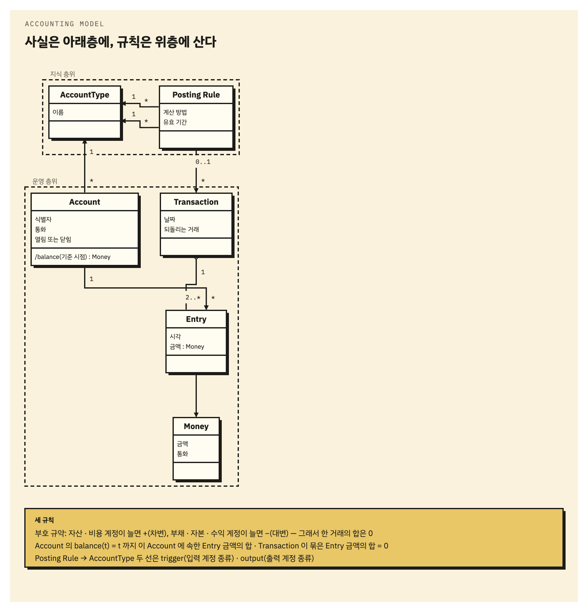

# 복식부기와 회계 모델 — 한 사건은 둘 이상의 계정에 합이 0 이 되게 적히고, 잔액은 그 기록을 더한 값입니다

## 이 문서가 답하는 것

[Account 가이드](../../ddd-analysis-pattern-guide/account/account-guide_v1.1.1.md)는 「개념 정리」에서 Account · Entry · Transaction · Money · AccountType 을 세우고, 「시나리오 1」과 「시나리오 2」에서 전기와 역분개로 4월 거래를 따라가요. 차변과 대변의 부호 규약 같은 회계 기초는 그 글이 이미 아는 것으로 두고 이 문서로 넘깁니다 — 「한눈에 보는 개요」가 여기를 링크하고, 시나리오 1 의 확인 문답도 수익 잔액이 음수인 이유를 여기로 보내요. 여기서는 그 전제를 원서 없이 세웁니다. 왜 모든 사건이 둘 이상의 계정에 적히는지, 부호를 왜 그렇게 정하면 합이 늘 0 인지, 틀린 기록을 왜 고치지 않고 되돌리는지, 규칙과 사실을 왜 다른 층에 두는지를 가이드와 같은 4월 거래 값으로 답합니다.

다루지 않는 것도 정해 둘게요. Account 패턴이 성립하는 조건과 코드는 가이드에 있고, Entry 를 누가 소유하는가 같은 aggregate 경계는 [회계 배경 확정안](../../research/accounting-context.md)이 정합니다. 여기서는 개념만 풉니다.

## 개념

### 복식부기의 기초

복식부기(double-entry bookkeeping)는 돈이 오간 사건 하나를 둘 이상의 계정에 합이 0 이 되게 적는 기록법이에요. 계정이 둘이면 같은 크기에 부호만 반대죠. 계정(account)은 현금 · 매출 · 임대료처럼 돈이 머무는 자리 하나를 말합니다(정의는 아래 「Account」). 한 사건을 한 줄로만 적으면 돈이 어디서 왔는지가 사라지고, 두 줄로 적으면 온 곳과 간 곳이 짝을 이뤄요. Fowler 는 이 발상을 회계사에게 돈은 만들어지지 않고 옮겨질 뿐이라는 말로 요약하고, 복식부기가 있는 이유를 돈이 새는 곳을 찾고 막는 것이라고 적었습니다([eaaDev Accounting Transaction](https://martinfowler.com/eaaDev/AccountingTransaction.html)).

부호 규약은 이렇습니다. 계정을 **자산 · 비용** 무리와 **부채 · 자본 · 수익** 무리로 나누고, 앞 무리가 늘면 +(차변, debit), 뒤 무리가 늘면 −(대변, credit)로 적어요. 회계 교재는 같은 규칙을 왼쪽과 오른쪽으로 말합니다. 차변은 왼쪽이고 대변은 오른쪽이며, 자산과 비용은 차변 쪽에서 늘고 부채 · 자본 · 수익은 대변 쪽에서 늘어요([OpenStax 3.5](https://openstax.org/books/principles-financial-accounting/pages/3-5-use-journal-entries-to-record-transactions-and-post-to-t-accounts)). hledger 도 양수 금액을 차변, 음수를 대변으로 읽고, 그 결과로 수익 · 부채 · 자본 잔액이 음수로 나오는 것이 정상이라고 적습니다([hledger manual](https://hledger.org/hledger.html)).

```text
4/1 매출 100,000 원이 현금으로 들어왔다

  계정    무리    늘었나    부호 규약          기록
  현금    자산    늘었다    자산이 늘면 +      +100,000
  매출    수익    늘었다    수익이 늘면 −      −100,000
                                        합          0
```

왜 합이 0 인가는 교재의 규칙 하나에서 그대로 나옵니다. 교재는 한 기록의 차변 금액 합과 대변 금액 합이 같아야 한다고 정해요([OpenStax 3.5](https://openstax.org/books/principles-financial-accounting/pages/3-5-use-journal-entries-to-record-transactions-and-post-to-t-accounts)). 차변을 +, 대변을 −로 적으면 그 등식은 부호 붙은 금액의 합이 0 이라는 말과 같습니다. 위 예에서 현금과 매출을 둘 다 +로 적으면 합이 200,000 이 되고, 100,000 원이 어디선가 생겨난 것처럼 보여요. 반대 부호로 적어야 돈이 매출에서 현금으로 옮겨 갔다는 사실이 남습니다.

> 기억법 — 차변은 왼쪽 · 플러스 · 짧은 말(debit), 대변은 오른쪽 · 마이너스 · 긴 말(credit). 자산과 비용이 늘면 +, 나머지가 늘면 −.

### Money

Money 는 금액과 통화를 묶은 값이에요. 100,000 이라는 수만으로는 원인지 달러인지 알 수 없어서, 회계 기록의 금액은 언제나 통화를 달고 다닙니다. Fowler 는 이 값을 단위를 가진 수량(Quantity)의 한 종류로 둡니다(근거: [apchap6.pdf](https://martinfowler.com/apsupp/apchap6.pdf) 그림 6.1 의 `amount: Quantity`). 통화가 다른 금액은 환율을 거치지 않고는 더하지 않아요. 달러를 엔에 그냥 더하는 일을 피하라는 것이 Money 를 값 하나로 만드는 이유입니다(『Patterns of Enterprise Application Architecture』(PoEAA) 카탈로그의 [Money](https://martinfowler.com/eaaCatalog/money.html)). 통화를 무시하면 100,000 원과 50 달러가 100,050 으로 더해지는데, 그 수는 어떤 통화로도 읽을 수 없는 값이에요.

통화가 둘 이상 섞이면 합계는 수 하나가 아니라 통화별 묶음이 됩니다. Fowler 는 이 묶음을 Money Bag 이라 부르고, 여러 통화를 받는 계정의 요약 계산에 쓰라고 적었어요([eaaDev Account](https://martinfowler.com/eaaDev/Account.html)).

```text
더할 수 있는 것과 없는 것

  100,000 KRW + 30,000 KRW = 130,000 KRW                같은 통화 → 수 하나
  100,000 KRW + 50 USD     = { KRW 100,000 · USD 50 }    다른 통화 → 통화별 묶음(Money Bag)
```

### Account

Account(계정)는 Entry 를 모으는 기준이자, 모은 것의 합인 잔액(balance)에 답하는 것이에요. Fowler 의 의도문은 관련된 회계 Entry 를 모으고 요약 동작을 제공하는 것이고, 본질은 둘이라고 적습니다 — Entry 모음을 유지하는 것과 그 모음에 대한 요약 정보를 내는 것([eaaDev Account](https://martinfowler.com/eaaDev/Account.html)). 그래서 어느 시점의 잔액이든 저장된 숫자가 아니라 그 시점까지의 Entry 금액을 더해 얻어요(근거: [apchap6.pdf](https://martinfowler.com/apsupp/apchap6.pdf) 그림 6.1 의 제약 `balance = sum(entries.amount)`). 통화나 열림 · 닫힘처럼 Entry 하나가 아니라 묶음 전체에 걸리는 사실도 Account 가 들고 있습니다. eaaDev 의 코드는 계정마다 통화 하나를 두고 Entry 를 받을 때 통화가 같은지 확인해요(같은 글).

이 구분이 왜 필요한가는 잔액 숫자 하나만 두는 모델과 대 보면 드러납니다. Fowler 는 현재 값만 필요하면 필드로 충분하고, 현재 값과 과거 값만 필요하면 Temporal Property(시점을 받아 그때의 값을 돌려주는 속성)로 충분하며, 변경 한 건 한 건까지 필요할 때 Account 를 쓰라고 적었어요(같은 글). 감사에서 4/5 마감 때 현금이 얼마였는지 물으면 필드는 답할 재료가 없고, Account 는 4/5 까지의 Entry 를 더해 답합니다.

```text
현금 계정의 Entry (가이드의 4월 거래)

  4/1  +100,000     4/5  −30,000     4/6  +30,000     4/6  −25,000
  ──────────────────────────────────────────────────────────────────
  balance(4/5) = +100,000 − 30,000                     = 70,000 KRW
  balance(4/6) = +100,000 − 30,000 + 30,000 − 25,000   = 75,000 KRW
```

### Entry

Entry(항목)는 한 계정에 적힌 금액 한 줄이에요. 어느 Account 에 언제 얼마(Money)가 적혔는지를 담고, Fowler 의 의도문은 이것을 금액의 할당 한 건이라고 적습니다([eaaDev Accounting Entry](https://martinfowler.com/eaaDev/AccountingEntry.html)). Account 하나에 Entry 가 여럿 속하고, Entry 하나는 정확히 한 Account 에 속해요(근거: [apchap6.pdf](https://martinfowler.com/apsupp/apchap6.pdf) 그림 6.1 · 6.2 의 Account `1` — Entry `*`). 금액 · 계정 · 시각이 모두 같은 Entry 둘도 서로 다른 사실입니다. 같은 날 같은 금액을 두 번 받았으면 기록도 두 건이어야 잔액이 맞아요.

Entry 를 사실 한 건으로 따로 두는 이유는 확정 뒤에 바뀌지 않게 하려는 데 있습니다. Fowler 는 Entry 가 열린(open) 상태에서는 고칠 수 있고 확정(booked)된 뒤에는 고칠 수 없게 하는 규칙이 흔하다고 적어요(같은 글). 확정된 줄이 바뀌면 그 줄을 더해 낸 과거 잔액이 함께 바뀝니다. 그래서 정정은 새 Entry 로 해요(「역분개」).

```text
Entry 한 줄이 담는 것                      Account 1 — Entry *

  4/1  현금  +100,000 KRW    ← 계정 · 시각 · 금액
  4/5  현금   −30,000 KRW
  4/1  매출  −100,000 KRW    ← 4/1 현금 줄의 짝. 어느 사건의 짝인지는 Transaction 이 말한다
```

### Transaction

Transaction(거래)은 Entry 둘 이상을 한 사건으로 묶고, 묶인 Entry 금액의 합이 0 임을 보장하는 것이에요. Fowler 의 의도문은 둘 이상의 Entry 를 묶어 그 합이 0 이 되게 하는 것이고, 복식부기에서 모든 출금은 입금으로 균형이 맞아야 한다고 적습니다([eaaDev Accounting Transaction](https://martinfowler.com/eaaDev/AccountingTransaction.html)). Transaction 하나에 Entry 가 둘 이상 속하고, Entry 는 한 Transaction 에 속해요(근거: [apchap6.pdf](https://martinfowler.com/apsupp/apchap6.pdf) 그림 6.2 의 Transaction `1` — Entry `2`(두 다리) · 그림 6.3 의 Entry `2..*` · 제약은 둘 다 `Sum(entries.amount) = 0`). 다리가 정확히 둘인 거래(two-legged)와 다리 수에 제한이 없는 거래(multi-legged)의 차이는 이 다중도뿐입니다(같은 글). 규칙은 같고 다리 수만 달라요.

이 묶음이 왜 Account 와 별도로 필요할까요? 합이 0 이라는 규칙은 두 계정에 걸친 규칙이라서 계정 하나만 보는 Account 는 판정할 수 없어요. 현금에 −30,000 만 적히고 임대료 쪽 +30,000 이 빠지면 현금 계정만 보는 쪽에서는 아무 이상이 없고, 돈은 그냥 사라집니다. 한 사건의 Entry 를 한 묶음으로 만들고 그 합을 검사하는 자리가 있어야 그 누락이 잡혀요. Fowler 는 Account 와 Transaction 이 모두 선택이라 Transaction 없이 Entry 만 쓰는 시스템도 있다고 적었지만([eaaDev Patterns for Accounting](https://martinfowler.com/eaaDev/AccountingNarrative.html)), 복식부기를 쓰기로 했다면 이 묶음이 곧 복식부기입니다. Transaction 을 두지 않는 시스템에서는 Transaction 쪽 다중도가 0..1 이 되고, Account 가이드의 도식이 그렇게 그린 이유가 그것이에요.

```text
합이 0 인 묶음 (전기됨)                    합이 0 이 아닌 묶음 (거절됨)

  T2 4/5  임대료 +30,000                     임대료 +30,000
          현금   −30,000                     현금   −25,000
          ──────────────                     ──────────────
          합          0                      합     +5,000    ← 5,000 이 어디선가 생겨났다

  다리가 셋인 거래 (급여 지급)
  급여(비용) +1,000,000  ·  현금(자산) −900,000  ·  예수금(부채) −100,000   → 합 0
```

### 원장(ledger)과 전기(posting)

원장(ledger)은 확정된 거래가 쌓이는 장부이고, 전기(posting)는 조립한 거래를 그 장부에 확정해 넣는 행위예요. 회계 교재는 총계정원장(general ledger)을 각 계정과 그 잔액의 기록으로, 전기를 분개장(거래를 처음 적는 곳)에서 원장으로 옮기는 과정으로 정의합니다([OpenStax 3.5](https://openstax.org/books/principles-financial-accounting/pages/3-5-use-journal-entries-to-record-transactions-and-post-to-t-accounts)). 회계 모델에서 이 구분이 필요한 이유는 두 상태를 갈라야 하기 때문이에요. 조립 중인 거래는 다리를 더하거나 고칠 수 있고, 전기된 거래는 그럴 수 없습니다. Fowler 의 코드도 합이 0 일 때만 전기를 허용하고, 전기된 뒤에 다리를 더하려 하면 예외를 던져요([eaaDev Accounting Transaction](https://martinfowler.com/eaaDev/AccountingTransaction.html)).

여기서 헷갈리기 쉬운 포인트는 posting 이라는 낱말이 두 뜻으로 쓰인다는 것입니다. hledger 에서 posting 은 어느 계정에 금액을 더하거나 빼는 한 줄, 즉 이 문서의 Entry 에 해당하는 명사예요([hledger manual](https://hledger.org/hledger.html)). 교재와 이 문서의 전기는 확정하는 행위입니다. 가이드의 전기 순번은 이 행위의 순서예요.

```text
Before — 조립 중 (원장 밖)                 After — 전기됨 (원장 안)

  T2  임대료 +30,000                        T2 4/5  임대료 +30,000
      현금   −30,000                                현금   −30,000
  합이 0 인가?        → 예                  이후 이 두 줄은 고치지도 지우지도 않는다
  계정이 열려 있나?   → 예                  잔액 계산의 재료가 된다
```

### 역분개(reversal)

역분개(reversal)는 틀린 기록을 고치지 않고, 부호를 뒤집은 기록을 새로 더해 그 효과를 지운 뒤 올바른 기록을 다시 적는 정정법이에요. Fowler 는 정정 방식 셋을 나란히 놓습니다. 잘못된 거래를 지우고 다시 만드는 Replacement 는 단순하지만 이력을 잃고, 잘못된 거래를 두고 반대 Entry 를 전기하는 Reversal 은 이력을 지키지만 서로 상쇄되는 Entry 가 늘어나며, 차이만 전기하는 Difference 는 거래 수가 적지만 구현이 복잡하다고 적었어요([eaaDev Patterns for Accounting](https://martinfowler.com/eaaDev/AccountingNarrative.html) · [eaaDev Reversal Adjustment](https://martinfowler.com/eaaDev/ReversalAdjustment.html)).

왜 고치지 않는가는 과거 시점의 보고를 다시 만들 수 있어야 하기 때문입니다. 4/5 마감 보고서에 현금 70,000 을 냈다면, 4/6 에 임대료가 25,000 이었음을 알게 된 뒤에도 4/5 기준 계산은 70,000 이 나와야 해요. T2 의 −30,000 을 −25,000 으로 고쳐 쓰면 4/5 잔액이 75,000 으로 바뀌고, 보고서와 지금 계산이 어긋나는데 어느 쪽이 맞는지 보여 줄 기록이 남지 않습니다. 대가는 Entry 수예요. 정정을 마치면 원래 줄 하나당 세 줄이 남는다고 Fowler 도 적었습니다(같은 글).

```text
Before — T2 만 있을 때              After — 역분개 T3 와 올바른 T4 를 더한 뒤

  4/5 T2  임대료 +30,000              4/5 T2  임대료 +30,000   (그대로 둔다)
          현금   −30,000                      현금   −30,000
                                      4/6 T3  임대료 −30,000   T2 의 부호를 뒤집음
                                              현금   +30,000
                                      4/6 T4  임대료 +25,000   올바른 금액
                                              현금   −25,000
  현금 balance(4/5) = 70,000          현금 balance(4/5) = 70,000   (변하지 않음)
                                      현금 balance(4/6) = 70,000 + 30,000 − 25,000 = 75,000
```

잠깐, 확인 하나만 해 볼까요? 위 표에서 임대료 계정의 4/6 잔액은 얼마일까요? 임대료에 적힌 세 줄만 더하면 됩니다.

```text
임대료:  +30,000 (T2)   −30,000 (T3)   +25,000 (T4)   → balance(4/6) = 25,000 KRW
```

### AccountType

AccountType(계정 종류)은 자산 · 부채 · 자본 · 수익 · 비용처럼 계정을 나누는 분류예요. 「복식부기의 기초」의 부호 규약은 계정 하나의 사실이 아니라 종류에 붙은 지식이라서 AccountType 이 아는 것이고, Account 는 자기 AccountType 하나를 가리킵니다(근거: [apchap6.pdf](https://martinfowler.com/apsupp/apchap6.pdf) 그림 6.20 의 Account Type `1` — Employee Account `*`, 그림 6.28 의 Asset · Liability · Income · Expense Account 분류). 이 분류를 Account 와 따로 두는 이유는 같은 종류의 계정이 같은 규칙을 나눠 쓰기 때문이에요. 현금 · 보통예금 · 외상매출금은 모두 자산이라 늘 때 + 로 적는데, 그 규칙을 계정마다 다시 적으면 계정 수만큼 사본이 생기고 하나만 어긋나도 거래의 합이 0 에서 벗어납니다. 보통예금 계정을 새로 여는 일은 자산이라는 종류를 하나 더 가리키는 일이라 AccountType 을 건드리지 않아요.

```text
AccountType(종류)    자산(늘면 +)              수익(늘면 −)     비용(늘면 +)
                       ▲         ▲               ▲                ▲
Account(계정)        현금      보통예금           매출             임대료
                               ↑ 새로 열어도 자산이라는 종류는 그대로
```

### 지식 층위(knowledge level)와 운영 층위(operational level)

운영 층위(operational level)는 매일 생기는 사실이에요. 현금 계정과 4/1 의 Entry 와 T2 가 여기 살아요. 지식 층위(knowledge level)는 그 사실을 해석하는 타입과 규칙이고, 이 문서에서는 **AccountType** 과 **Posting Rule** 이 여기 삽니다(근거: [apchap6.pdf](https://martinfowler.com/apsupp/apchap6.pdf) 그림 6.20 의 knowledge · operational 구분선). Evans 는 이 층을 다른 객체 무리가 어떻게 행동해야 하는지 기술하는 객체 무리라고 정의하고, 기본 모델의 구조와 행동을 기술하고 제약하는 별도 객체 집합을 만들어 두 층으로 갈라 두라고 적으며 그 출처로 Fowler 1997 을 겁니다([Domain-Driven Design(DDD) Reference](https://www.domainlanguage.com/wp-content/uploads/2016/05/DDD_Reference_2015-03.pdf) 「Knowledge Level」).

왜 나누는가는 변화의 속도가 다르기 때문이에요. 규칙이 바뀌어도 이미 적힌 사실은 바뀌지 않고, 사실이 아무리 쌓여도 규칙은 늘어나지 않습니다. 세금을 매기는 규칙의 세율을 바꾸는 일은 지식 층위의 일이라 이미 전기된 Entry 하나 고치지 않고, 5월 거래가 쌓이는 일은 운영 층위의 일이라 규칙을 건드리지 않아요. 둘을 한 층에 섞으면 규칙 하나를 바꿀 때 사실을 다시 쓰거나, 사실 하나를 더할 때 규칙 코드를 고치게 됩니다.

```text
지식 층위   AccountType: 자산 · 수익 · 비용           Posting Rule: 매출의 10% 를 세금으로
            ──────────── 참조는 아래에서 위로 · 위는 아래를 모른다 ────────────
운영 층위   Account: 현금 · 매출 · 임대료             Transaction T1 … T4 와 그 Entry
```

### Posting Rule

Posting Rule(전기 규칙)은 어떤 계정에 Entry 가 생겼을 때 어떤 계산으로 다른 계정에 Entry 를 만들지를 정한 규칙이에요. 규칙은 입력이 되는 계정 종류(trigger)와 출력이 되는 계정 종류(output)를 가리키고, 계산 방법을 가집니다(근거: [apchap6.pdf](https://martinfowler.com/apsupp/apchap6.pdf) 그림 6.7 의 trigger · output Account 와 multiplier, 그림 6.20 의 Account Type 수준 규칙, 그림 6.27 의 Posting Rule `0..1` creator — Transaction `*`). 후속 글에서 Fowler 는 규칙을 청구할 금액을 계산해 주어진 계정에 청구하는 특수한 코드 조각이라 부르고, 사건 하나를 처리하면 회계 거래의 집합이 나온다고 적어요([eaaDev Agreement Dispatcher](https://martinfowler.com/eaaDev/AgreementDispatcher.html) · [eaaDev Patterns for Accounting](https://martinfowler.com/eaaDev/AccountingNarrative.html)).

규칙을 객체로 독립시키는 이유는 규칙이 바뀌기 때문이에요. 규칙이 코드의 분기문에 있으면 세율 하나를 바꿀 때 코드를 고치고 배포해야 하고, 옛 사건을 옛 규칙으로 처리할 방법이 없습니다. Fowler 의 예는 이렇습니다. 운송료를 3월 14일에 10 달러에서 15 달러로 올린 회사가 3월 22일에 3월 7일자 운송 사건을 받으면, 처리하는 날의 규칙이 아니라 3월 7일에 유효했던 규칙(10 달러)으로 처리해야 해요(같은 글). 그래서 규칙은 유효 기간을 갖고, 사건이 일어난 시점으로 규칙을 고릅니다.

```text
규칙(가정): 매출 계정에 Entry 가 생기면 그 금액의 10% 를 세금비용과 미지급세금에 적는다

  입력(trigger)   매출(수익)  −100,000     ← T1 의 Entry
        │  × 10%
        ▼
  출력(output)    T5  세금비용(비용)   +10,000
                      미지급세금(부채) −10,000     합 0 — 규칙의 출력도 균형 잡힌 Transaction
```

## 개념 사이의 관계



아래층부터 읽어 볼게요. Account 하나에 Entry 가 여럿 속하고, Entry 하나는 정확히 한 Account 에 속합니다. Transaction 하나가 Entry 를 둘 이상 묶고 그 합은 0 이에요. 그래서 Entry 는 Account 와 Transaction 양쪽에 걸려 있고, 같은 한 줄이 계정에서는 잔액의 재료, 거래에서는 균형의 재료가 됩니다. 누가 Entry 를 소유하는지는 이 그림이 정하지 않아요. 그건 배경 확정안의 몫입니다. Entry 의 금액은 통화를 가진 Money 이고, 한 Account 안의 Entry 는 통화가 같습니다. Transaction 의 되돌리는 거래 속성은 「역분개」의 T3 가 T2 를 가리키는 자리이고, 거래가 이 층에 들어오는 절차가 「원장과 전기」예요.

위층으로 올라가면 Account 마다 자기 AccountType 하나를 가리키고, 참조는 운영 층위에서 지식 층위로만 올라갑니다. 위층은 아래층의 개별 사실을 몰라요. Posting Rule 하나는 AccountType 을 두 역할로 가리킵니다. 입력 계정 종류(trigger)와 출력 계정 종류(output)인데, 그림의 두 선이 그 두 역할이에요. 규칙 하나가 Transaction 을 여럿 만들고, Transaction 쪽이 0..1 인 것은 사람이 직접 적은 거래에는 만든 규칙이 없기 때문입니다. 「복식부기의 기초」의 부호 규약은 칸이 아니라 AccountType 이 아는 지식이라 위층에 속하고, 그림의 콜아웃에 적혀 있어요.

```text
관계               다중도                       방향과 뜻
Account — Entry     1 — *                        Entry 는 한 Account 에 속한다 · balance(t) = t 까지의 Entry 합
Transaction — Entry 1 — 2..*                     한 거래가 둘 이상을 묶는다 · 합 = 0
Entry — Money       금액이 Money                  통화가 다른 금액은 더하지 않는다
Account — AccountType   * — 1                    운영 → 지식으로만 참조
Posting Rule — AccountType   * — 1 (trigger) · * — 1 (output)   규칙이 입력 · 출력 계정 종류를 가리킨다
Posting Rule — Transaction   0..1 — *            규칙이 거래를 만든다 · 사람이 적은 거래는 creator 없음
```

## 가이드로 돌아가기

- [Account 가이드](../../ddd-analysis-pattern-guide/account/account-guide_v1.1.1.md) 「개념 정리」 — Account · Entry · Transaction · Money · AccountType 의 정의와 관계 도식, 계정 종류가 매일 생기는 사실이 아니라 사실을 해석하는 규칙 쪽이라는 서술(이 문서의 「Account」 「Entry」 「Transaction」 「Money」 「AccountType」 「지식 층위와 운영 층위」).
- 같은 가이드 「시나리오 1」 — 합이 0 인 거래를 원장에 전기해 확정하는 4단계와 Entry 를 더해 4/5 잔액을 내는 5단계(「원장과 전기」). 매출 잔액이 음수로 나오는 이유를 묻는 확인 문답은 이 문서의 「복식부기의 기초」로 넘어옵니다.
- 같은 가이드 「시나리오 2」 — T2 를 한 글자도 고치지 않고 T3 · T4 를 더해 되돌리는 정정(「역분개」).
- 같은 가이드 「비슷한 패턴·안티패턴과의 차이」 — Transaction 이 Account 의 대체가 아니라 짝인 이유(「Transaction」).
- [Transaction 가이드](../../ddd-analysis-pattern-guide/transaction/transaction-guide_v1.0.1.md) 「개념 정리」 — Posting Rule 항목이 규칙과 사실을 다른 층에 두는 이유를 이 문서로 넘깁니다(「지식 층위와 운영 층위」 「Posting Rule」). 「한눈에 보는 개요」와 시나리오 셋이 값을 쓰기 전에 기대는 부호 규약 · 전기 · 역분개도 여기에 있어요(「복식부기의 기초」 「원장과 전기」 「역분개」).
- [Posting Rule 가이드](../../ddd-analysis-pattern-guide/posting-rule/posting-rule-guide_v1.0.1.md) 「한눈에 보는 개요」와 시나리오 셋 — 규칙이 만든 거래가 원장에 들어가는 값들이 부호 규약과 전기, 그리고 규칙이 사실 위 다른 층에 앉는다는 것을 이미 아는 것으로 두고 이 문서로 넘깁니다(「복식부기의 기초」 「원장과 전기」 「지식 층위와 운영 층위」 「Posting Rule」).
- [Knowledge Level 가이드](../../ddd-analysis-pattern-guide/knowledge-level/knowledge-level-guide_v1.0.1.md) 「비슷한 패턴·안티패턴과의 차이」 — Posting Rule 문단이 기대는 사전 지식이 계정 종류와 전기 규칙을 지식 층위에 두는 회계 쪽 배치입니다(「AccountType」 「지식 층위와 운영 층위」 「Posting Rule」).

## 참고 자료

- Martin Fowler, 『Analysis Patterns: Reusable Object Models』, Addison-Wesley, 1997 — Chapter 6 「Inventory and Accounting」 §6.1 Account, §6.2 Transactions, §6.5 Posting Rules. 장·절 번호는 [Pearson 목차 PDF](https://www.pearson.de/media/muster/toc/toc_9780134271439.pdf)로 확인했고 쪽은 확인 안 함 — 개념 이름과 원전 위치
- [UML Diagrams for Chapter 6 (apchap6.pdf)](https://martinfowler.com/apsupp/apchap6.pdf) — 그림 6.1(Account `1` — Entry `*`, `balance = sum(entries.amount)`, `amount: Quantity`), 그림 6.2(Transaction `1` — Entry `2`, two-legged) · 6.3(Entry `2..*`, multi-legged), 둘 다 `Sum(entries.amount) = 0`, 그림 6.7(Posting Rule 의 trigger · output Account, multiplier), 그림 6.20(knowledge · operational 구분선, Account Type 수준의 Posting Rule), 그림 6.27(Posting Rule `0..1` creator — Transaction `*`), 그림 6.28(Asset · Liability · Income · Expense Account 분류). 머리말은 accounting.pdf 가 이 장을 대체한다고 적음 — 「Money」 「Account」 「Entry」 「Transaction」 「AccountType」 「지식 층위와 운영 층위」 「Posting Rule」의 근거 괄호와 관계 도식
- [Account (eaaDev, 2005-01-22)](https://martinfowler.com/eaaDev/Account.html) — 의도문, 두 본질, 계정당 통화 하나와 Money Bag, 필드 · Temporal Property · Account 의 선택 기준 — 「Money」 「Account」
- [Accounting Entry (eaaDev, 2005-01-22)](https://martinfowler.com/eaaDev/AccountingEntry.html) — 의도문, open 에서는 변경 · booked 뒤에는 불변 — 「Entry」
- [Accounting Transaction (eaaDev, 2005-01-22)](https://martinfowler.com/eaaDev/AccountingTransaction.html) — 의도문, 출금은 입금과 균형, 돈은 옮겨질 뿐, 새는 곳 찾기, two-legged 와 multi-legged 의 차이는 다중도, 합이 0 일 때만 전기 — 「복식부기의 기초」 「Transaction」 「원장과 전기」
- [Patterns for Accounting (eaaDev, 2006-01-24)](https://martinfowler.com/eaaDev/AccountingNarrative.html) — Account 와 Transaction 은 선택, 정정 방식 셋, 사건 처리가 거래 집합을 만듦 — 「Transaction」 「역분개」 「Posting Rule」
- [Reversal Adjustment (eaaDev, 2006-01-02)](https://martinfowler.com/eaaDev/ReversalAdjustment.html) — 불변 Entry 의 정정, 원래 한 줄당 세 줄 — 「역분개」
- [Agreement Dispatcher (eaaDev, 2005-03-11)](https://martinfowler.com/eaaDev/AgreementDispatcher.html) — 규칙은 금액을 계산해 계정에 청구하는 코드 조각, 3월 7일 사건은 3월 7일 규칙으로 — 「Posting Rule」
- [Money (PoEAA 카탈로그)](https://martinfowler.com/eaaCatalog/money.html) — 금전 값의 표현, 달러를 엔에 그냥 더하지 않기 — 「Money」
- [hledger manual](https://hledger.org/hledger.html) — 양수 = 차변 · 음수 = 대변, 수익 · 부채 · 자본 잔액이 음수로 보이는 것이 정상, 기억법, posting 의 정의 — 「복식부기의 기초」 「원장과 전기」
- [OpenStax, Principles of Accounting Vol. 1, 3.5 Use Journal Entries to Record Transactions and Post to T-Accounts](https://openstax.org/books/principles-financial-accounting/pages/3-5-use-journal-entries-to-record-transactions-and-post-to-t-accounts) — 차변은 왼쪽 · 대변은 오른쪽, 계정 종류별로 늘어나는 쪽, 차변 합 = 대변 합, 분개장 · 총계정원장 · 전기의 정의 — 「복식부기의 기초」 「원장과 전기」
- [Domain-Driven Design Reference (Evans, 2015)](https://www.domainlanguage.com/wp-content/uploads/2016/05/DDD_Reference_2015-03.pdf) — 51쪽 「Knowledge Level」의 정의와 해법, 출처로 Fowler 1997 — 「지식 층위와 운영 층위」
- [회계 배경 확정안](../../research/accounting-context.md) — Entry 의 소유와 aggregate 경계는 여기서 정함 — 「이 문서가 답하는 것」 「개념 사이의 관계」
