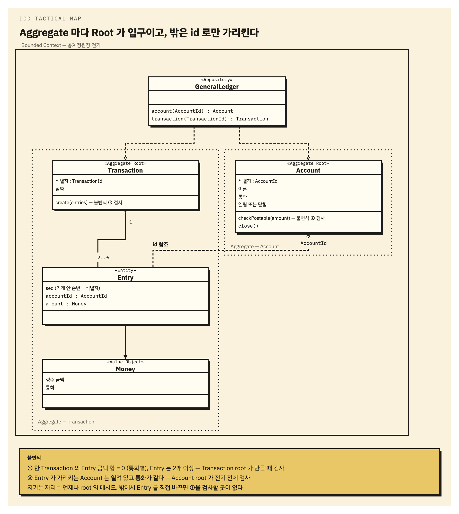

# DDD 전술 용어 — 상황 설정 표의 여덟 낱말을 원서 없이 읽는 법

## 이 문서가 답하는 것

분석 패턴 가이드는 「구현 예시」의 「상황 설정」 절에 표 하나를 싣습니다. 행 이름이 bounded context · 불변식의 위치 · root·entity·VO 배정 · 타 aggregate 참조 방식이고, Account 가이드는 총계정원장(General Ledger, 모든 계정의 거래를 모아 두는 장부)의 계정과 거래를, Quantity 가이드는 빵집 재고의 보유량을 그 표에 채워요. 표를 읽으려면 DDD(Domain-Driven Design, 도메인 주도 설계)의 전술 용어 여덟 개를 알아야 하는데, 그것은 두 가이드의 주제 밖이라 여기서 풉니다. 이 문서를 읽고 나면 그 표의 네 행이 각각 무엇을 정하는지, 그 자리가 왜 그 자리인지를 원서 없이 읽을 수 있어요.

다루지 않는 것도 정해 둡니다. Account 나 Quantity 가 패턴으로 성립하는 조건, 비슷한 패턴과의 차이, 세 언어 구현 코드는 각 가이드에 있고 여기에는 없어요.

```text
가이드 「상황 설정」 표의 행            이 문서의 개념
──────────────────────────────    ───────────────────────────────────────────────
bounded context                →   Bounded Context
불변식의 위치                   →   불변식 · Aggregate Root
root·entity·VO 배정             →   Aggregate · Aggregate Root · Entity · Value Object
타 aggregate 참조 방식           →   id 참조 · Repository
```

## 개념

### Bounded Context

한 모델의 낱말과 규칙이 같은 뜻으로 통하는 범위예요. 큰 시스템에는 모델이 여럿 생기기 마련이고, 그 모델들의 코드를 한데 섞으면 같은 낱말이 다른 뜻으로 쓰여 어긋납니다. 그래서 모델이 적용되는 범위를 먼저 그어 두고, 그 안에서만 낱말을 정해요([DDD Reference (Evans)](https://www.domainlanguage.com/wp-content/uploads/2016/05/DDD_Reference_2015-03.pdf) Bounded Context · [BoundedContext (Fowler)](https://martinfowler.com/bliki/BoundedContext.html)). 하나로 합치지 않는 이유는 합칠 수 없어서예요. 전기 회사에서 "계량기" 한 낱말이 부서마다 전력망과 장소의 접속 · 전력망과 고객의 접속 · 물리 장치 자체로 갈렸다는 Fowler 의 사례처럼, 부서마다 다른 뜻을 한 클래스에 넣으면 어느 쪽 규칙도 온전히 지킬 수 없습니다.

두 가이드가 쓰는 낱말로 보면 이렇습니다.

```text
낱말        총계정원장 전기 컨텍스트 (Account 가이드)          빵집 재고 컨텍스트 (Quantity 가이드)
─────────   ────────────────────────────────────────────    ─────────────────────────────────────────
계정        돈이 오간 기록(Entry)이 모이는 이름표               없음 — 재고에는 계정이 없다
수량        Money: 정수 최소 단위 + 통화, 통화가 다르면 못 더함   Quantity: 수치 + 단위, kg 와 g 는 비율로 맞춰 더함
"음수 금지"  이 컨텍스트의 규칙이 아님 (결제 승인 쪽의 규칙)       보유량은 음수가 될 수 없음 (재고 root 의 규칙)
```

같은 "수량" 이라도 원장에서는 통화가 다르면 더할 수 없고, 재고에서는 kg 와 g 를 비율로 맞춰 더합니다. 상황 설정 표의 첫 행이 한 줄뿐인 이유가 이것이에요. 그 아래 세 행의 규칙은 전부 그 한 줄이 정한 범위 안에서만 참입니다.

### Aggregate

함께 바뀌어야 일관된 객체들을 하나로 묶은 것이고, 변경과 저장의 단위예요. 묶는 이유는 규칙 때문입니다. "한 거래의 Entry 금액 합은 0" 같은 규칙은 Entry(계정 하나에 금액 하나가 오간 기록) 하나만 봐서는 지킬 수 없고 여럿을 한꺼번에 봐야 하는데, 그 여럿이 서로 다른 트랜잭션에서 따로 저장되면 검사할 순간이 없어요. 그래서 그 규칙이 걸리는 객체들을 한 경계 안에 넣고, 경계 안은 한 트랜잭션에서 함께 바꿉니다([DDD Reference (Evans)](https://www.domainlanguage.com/wp-content/uploads/2016/05/DDD_Reference_2015-03.pdf) Aggregates · [Effective Aggregate Design Part I (Vernon)](https://www.dddcommunity.org/wp-content/uploads/files/pdf_articles/Vernon_2011_1.pdf) 규칙 「Model True Invariants In Consistency Boundaries」). 경계는 규칙이 정하는 것이지 객체 그래프의 편의가 정하는 것이 아니에요.

```text
거래 T2 = 임대료 +30,000 · 현금 -30,000   (합 0)

Entry 둘을 따로 저장하면                          Transaction aggregate 로 묶으면
  Entry #1 임대료 +30,000   저장 성공               Transaction.create([#1, #2])
  Entry #2 현금   -30,000   저장 실패                ├─ 합 = +30,000 - 30,000 = 0   → 통과
  → 합이 +30,000 인 상태가 그대로 확정된다             └─ 둘을 한 번에 저장한다
    합 0 을 검사할 순간이 아예 없었다                     절반만 남는 상태가 생기지 않는다
```

묶음이 크면 대가도 큽니다. Vernon 의 사례에서 Product 하나가 backlog item · release · sprint 를 전부 소유하자, 두 사용자가 서로 관계없는 항목을 하나씩 더했는데 한 사람의 저장이 버전 충돌로 거부됐어요. 둘 다 같은 aggregate 를 고쳤기 때문입니다([Vernon Part I](https://www.dddcommunity.org/wp-content/uploads/files/pdf_articles/Vernon_2011_1.pdf) 규칙 「Design Small Aggregates」). 그래서 묶음에는 진짜 규칙이 걸리는 것만 넣고 나머지는 따로 둡니다. Account 가이드에서 Account 가 Entry 목록을 갖지 않는 것이 이 판단이에요. 잔액은 규칙이 아니라 파생값이라서 같은 트랜잭션에서 맞출 이유가 없거든요.

> 기억법 — 한 트랜잭션에서 같이 지켜야 하는 규칙이 있는 것만 한 묶음에 넣는다.

### Aggregate Root

묶음 안의 entity(식별자로 구별되는 객체 — 정의는 아래 Entity 절) 하나를 골라 밖에서 닿는 유일한 입구로 삼은 것이에요(이하 root). 밖의 객체는 root 만 참조하고, 안쪽 객체(child)는 root 의 메서드를 거쳐서만 바뀝니다. 불변식을 지키는 책임도 root 에 있어요([DDD Reference (Evans)](https://www.domainlanguage.com/wp-content/uploads/2016/05/DDD_Reference_2015-03.pdf) Aggregates · [DDD_Aggregate (Fowler)](https://martinfowler.com/bliki/DDD_Aggregate.html)). 입구를 하나로 두는 이유는 검사 지점을 하나로 두기 위해서입니다. 규칙을 검사하는 자리가 root 의 메서드 한 곳이면 어느 화면에서 부르든 같은 검사를 지나요.

밖에서 child 를 직접 바꾸면 무엇이 어긋나는지 Quantity 가이드의 수치로 봅시다. 재고 root `IngredientStock` 의 `consume` 은 뺄셈 결과가 음수인지 검사한 뒤에야 보유량을 바꿔요.

```text
root 를 거칠 때                              child(보유량 Quantity)를 밖에서 직접 바꿀 때
  보유 0 g, consume(1 g)                       보유 0 g
  ├─ 0 g - 1 g = -1 g → 음수                    onHandValue = Quantity(-99, g)   ← 검사가 없다
  └─ 거부, 보유량은 0 g 그대로                    보유량 -99 g 이 그대로 저장된다
```

오른쪽은 Quantity 가이드의 TypeScript 구현이 실제로 실행해 확인한 우회예요. `private` 이 컴파일 시점까지만 막아서 실행 중에는 필드에 닿을 수 있었습니다. root 경유는 언어가 대신 지켜 주는 것이 아니라 설계가 지키는 규칙이고, 그래서 가이드 구현은 aggregate 안의 값 변경을 root 의 메서드로만 둡니다.

### Entity

식별자로 같음을 판단하는 객체예요. 속성이 바뀌어도, 속성이 같은 다른 객체가 있어도, 식별자가 같으면 같은 것이고 다르면 다른 것입니다. 이 구분이 필요한 이유는 속성으로 같음을 판단하면 다른 사실 둘이 하나로 합쳐지기 때문이에요([DDD Reference (Evans)](https://www.domainlanguage.com/wp-content/uploads/2016/05/DDD_Reference_2015-03.pdf) Entities — 속성이 같아도 서로 다른 객체로 구별해야 하고, 잘못 합치면 데이터가 손상된다).

```text
가상의 상황 — 4/1 현금 계정에 매출 +100,000 이 두 번 기록됐다 (손님 둘, 같은 날·금액·계정. 가이드의 T1 이 두 번 일어난 셈)

값이 같으면 하나로 보는 컬렉션에 넣으면       식별자(거래 id + seq)로 구별하면
  두 기록이 한 건으로 합쳐진다                  (T1, 1) 과 (T9, 1) 은 다른 Entry   ← T9 는 가상의 두 번째 거래
  → 잔액 100,000                               → 잔액 200,000, 실제 입금과 같다
```

Account 가이드의 Entry 가 entity 인 이유가 이것이에요. 금액·계정·날짜가 같은 두 Entry 도 다른 사실이라 식별자가 필요합니다. 그 식별자는 거래 id 와 거래 안 순번 `seq` 의 쌍이고, root 인 Transaction 이 만들 때 붙여 줘요.

### Value Object

값으로 같음을 판단하고, 식별자가 없으며, 만든 뒤에 바뀌지 않는 객체예요(이하 VO). 100,000 원짜리 Money 둘은 서로 구별할 이유가 없으니 식별자를 붙이지 않고 값이 같으면 같은 것으로 봅니다([DDD Reference (Evans)](https://www.domainlanguage.com/wp-content/uploads/2016/05/DDD_Reference_2015-03.pdf) Value Objects · [ValueObject (Fowler)](https://martinfowler.com/bliki/ValueObject.html)). 불변으로 두는 이유는 공유 때문이에요. 같은 값 객체를 두 곳이 가리키고 있을 때 한쪽이 그 자리에서 값을 고치면 다른 쪽까지 바뀝니다(Fowler 는 이것을 aliasing bug 라고 불러요). 연산마다 새 값을 만들어 돌려주면 이 일이 생기지 않아요.

```text
레시피 aggregate 의 1회분 Quantity(50, g) 을 재고의 consume 이 같은 객체로 받았다 (보유 300 g, 2회분 사용)

제자리에서 바꾸는 값이라면                          불변 값이라면
  consume 이 받은 객체의 수치를 제자리에서 줄인다      consume 은 300 g - 50 g × 2 = 200 g 을 새로 만들어
  → 레시피의 1회분 50 g 자체가 바뀐다                 자기 보유량으로 교체한다
    다음 배치가 다른 양을 쓴다                        → 레시피의 50 g 은 그대로다 (가이드 출력: 보유 200 g)
```

여기서 헷갈리기 쉬운 포인트는 같은 개념이 늘 같은 분류가 아니라는 것입니다. 우편 주소는 많은 경우 값 동등성을 가진 단순한 문자열 구조로 다루면 되지만, 정교한 지도 시스템이 주소를 계층 모델에 연결한다면 참조가 더 맞아요(Fowler 의 예). Entry 도 같습니다. Entry 자체는 어느 배정에서도 식별자를 가진 entity 로 남지만, Account 가 그 Entry 들을 요약한 VO(잔액·예약액)나 투영한 VO 목록을 갖는 배정이 있어요. 같은 사실을 Transaction 쪽은 entity 로 들고, Account 쪽은 그것의 요약 VO 로 드는 것이죠. Account 가이드의 「상황이 달라지면」 표가 그 배정들(④-a · ④-b)을 이 가이드의 배정과 나란히 놓았어요. 그래서 가이드는 개념을 정리하는 절에서 분류를 매기지 않고 상황 설정 표에서 매깁니다. 분류는 개념이 아니라 그 가이드의 상황이 정해요.

### id 참조

다른 aggregate 를 가리킬 때 객체가 아니라 식별자 값만 드는 방식이에요. Entry 는 `Account` 객체 대신 `AccountId` 를 들고, 재고는 재료 카탈로그 객체 대신 `IngredientId` 를 듭니다([Effective Aggregate Design Part II (Vernon)](https://www.dddcommunity.org/wp-content/uploads/files/pdf_articles/Vernon_2011_2.pdf) 규칙 「Reference Other Aggregates By Identity」). 객체 참조를 피하는 이유는 참조가 있으면 고칠 수 있기 때문이에요. 참조를 들지 않으면 다른 aggregate 를 고칠 수도 없습니다. 경계 하나를 지키려고 세운 규칙이 참조 하나 때문에 지켜지지 않게 되는 것이죠.

```text
Entry 가 Account 객체를 들 때 — Account 가이드의 시간표
(저장소가 거래를 저장할 때 참조를 따라 객체 그래프를 함께 저장한다는 전제)

  09:00  요청 A  현금 Account(열림)를 읽어 거래 T8 의 Entry 에 넣음
  09:01  요청 B  현금 Account 를 닫고 저장                         → 저장소의 현금: 닫힘
  09:02  요청 A  T8 저장. Entry 에 든 현금 Account(열림)도 함께 저장   → 저장소의 현금: 열림
  결과   아무도 다시 열지 않았는데 닫힌 계정이 열려 있다

Entry 가 AccountId 를 들 때
  09:02  요청 A  저장 직전에 저장소에서 현금 Account 를 새로 읽음 → 닫힘이라 거절
                T8 저장은 Transaction 하나만 쓴다. 현금 Account 는 건드리지 않는다
```

id 참조를 쓰면 다른 aggregate 가 필요할 때 저장소에서 다시 읽는 코드가 됩니다. 읽은 사본을 들고 있다가 함께 저장하는 길이 기본으로 생기지 않아요. 대신 다시 읽은 값이 최신인지는 id 참조가 보장하지 않으니, 그 몫은 저장·동시성 정책이 집니다.

### 불변식

항상 참이어야 하는 업무 규칙이에요(invariant). Vernon 의 예로 `c = a + b` 가 불변식이면 a 가 2 이고 b 가 3 일 때 c 는 5 여야 하고, 다른 값이면 시스템이 규칙을 어긴 것입니다([Vernon Part I](https://www.dddcommunity.org/wp-content/uploads/files/pdf_articles/Vernon_2011_1.pdf) 규칙 「Model True Invariants In Consistency Boundaries」). 상황 설정 표가 "불변식의 위치" 를 묻는 이유는 규칙마다 지킬 수 있는 자리가 다르기 때문이에요. 누가(어느 root 가) 언제(어느 메서드에서) 검사하는지를 정해야 그 규칙이 실제로 지켜집니다. 아래 표의 위 두 줄과 마지막 줄은 [회계 배경 확정안](../../research/accounting-context.md)의 I1 · I5 · I4 이고(계정 줄의 통화 조건은 I5 에 Account 가이드가 더한 것), 보유량 줄은 Quantity 가이드의 root 몫이에요.

```text
규칙                                  어느 root 가        어느 메서드에서              언제
───────────────────────────────────   ────────────────   ─────────────────────────   ─────────────────
한 거래의 Entry 금액 합 = 0            Transaction        create(entries)             만들 때 · 동기
Entry 의 계정은 열려 있고 통화가 같다    Account            checkPostable(amount)       전기 직전 · 동기
보유량은 음수가 되지 않는다             IngredientStock    consume(quantity)           빼기 전 · 동기
잔액 = 그 계정의 Entry 합              root 아님           읽기 모델이 이벤트로 반영      나중에 · 결과적
```

마지막 줄이 이 표의 요점이에요. 읽기 모델은 조회를 위해 aggregate 밖에 계산해 둔 값이고, 전기가 끝났음을 알리는 이벤트를 받아 갱신됩니다. 잔액 규칙까지 root 안에서 동기로 지키려면 전기(posting, 거래를 장부에 적는 것) 한 번이 Transaction 과 Account 두 aggregate 를 한 트랜잭션에서 고쳐야 합니다. 이 컨텍스트에는 잔액을 그 순간에 맞춰야 할 규칙이 없으니 경계 밖에서 조금 늦게 맞추는 쪽을 골랐어요([Vernon Part II](https://www.dddcommunity.org/wp-content/uploads/files/pdf_articles/Vernon_2011_2.pdf) 규칙 「Use Eventual Consistency Outside the Boundary」 — aggregate 사이에 걸친 규칙은 늘 최신일 것을 기대하지 않는다는 원칙의 인용, 근거: Evans, 『Domain-Driven Design』 128쪽). 경계 안은 동기로, 경계 사이는 나중에. 이 구분이 표의 "동기 / 결과적" 표기입니다.

잠깐, 확인 하나만 해 볼까요? "보유량은 음수가 되지 않는다" 를 root 가 아니라 Quantity 값 자신이 지키게 하면 어떻게 될까요? 값이 음수를 거부하면 300 g - 400 g 같은 뺄셈 자체가 실패해서, root 가 "얼마나 모자란가" 를 판정할 결과값을 받지 못해요. 그래서 Quantity 가이드는 값은 음수를 담을 수 있게 두고, 음수 검사는 root 의 `consume` 에 두었습니다. 규칙의 자리를 정하는 기준은 "누가 그 규칙을 판정할 정보를 갖고 있는가" 예요.

### Repository

aggregate 를 식별자로 찾아오고 저장하는 창구예요. aggregate root 종류마다 하나씩 두고, 그 root 들이 메모리 컬렉션에 다 들어 있는 것처럼 보이게 합니다([DDD Reference (Evans)](https://www.domainlanguage.com/wp-content/uploads/2016/05/DDD_Reference_2015-03.pdf) Repositories). 필요한 이유는 id 참조와 짝이기 때문이에요. 다른 aggregate 를 id 로만 들면 실제 객체가 필요할 때 어딘가에서 id 로 찾아와야 하는데 그 자리가 Repository 입니다. 찾아오는 시점은 aggregate 안이 아니라 aggregate 를 부르기 전이에요. 서비스가 먼저 찾아 넘기고 aggregate 는 받은 것으로만 일합니다([Vernon Part II](https://www.dddcommunity.org/wp-content/uploads/files/pdf_articles/Vernon_2011_2.pdf) 「Model Navigation」).

```text
Account 가이드의 전기 흐름 — GeneralLedger 가 저장소와 전기 서비스를 메모리로 흉내 낸다

  post(T8)
   ├─ ledger.account(entry.accountId)    ← id 로 Account root 를 찾아온다 (Repository)
   ├─ account.checkPostable(amount)      ← 찾아온 root 의 메서드가 불변식을 검사한다
   └─ 저장: Transaction T8 하나만          ← Account 는 읽기만 하고 저장하지 않는다
```

가이드 코드의 `ledger.account(id)` · `ledger.transaction(id)` 가 이 조회예요. 여기서 헷갈리기 쉬운 포인트는 Repository 가 도메인 규칙을 지키는 자리가 아니라는 것입니다. 저장소는 규칙을 모릅니다. 규칙은 찾아온 root 의 메서드가 지키고, 저장소는 찾아오고 저장하는 일만 해요. 저장소가 aggregate 내부 객체를 골라 꺼내 주기 시작하면 root 가 검사할 기회를 잃습니다.

## 개념 사이의 관계



도식은 Account 가이드의 배정을 그대로 그린 것이에요. 관계를 다중도와 방향까지 말로 적으면 이렇습니다.

- Bounded Context 하나가 Aggregate 여럿을 담습니다. 그림에는 Transaction 과 Account 둘이 있고, Repository 는 Aggregate 밖 · Bounded Context 안에 있어요.
- Aggregate 하나에 Aggregate Root 가 정확히 하나 있습니다. Root 는 Entity 이고 child Entity 를 여럿 가질 수 있어요. Transaction 이 Entry 를 2개 이상 가지고, Account aggregate 는 Root 하나뿐입니다.
- Entity 는 Value Object 를 값으로 품습니다. Entry 가 Money 를, Account 가 통화를 가져요. Value Object 는 어느 쪽에서도 가리켜지지 않고 값으로 복사되어 다닙니다.
- Aggregate 사이의 선은 id 참조 하나뿐이에요. Entry 가 `AccountId` 로 Account 를 가리키고(점선), 반대 방향 참조는 없습니다.
- 불변식은 Root 의 메서드에 붙어 있어요. ① 은 Transaction 의 `create`, ② 는 Account 의 `checkPostable` 이고, 둘 다 자기 묶음 안의 것만 검사합니다.
- Repository 는 Root 를 id 로 찾아옵니다(점선). 찾아오는 대상이 Root 뿐이라는 점이 Aggregate Root 의 정의와 맞물리는 자리예요.

## 가이드로 돌아가기

- [Account 가이드 「상황 설정」](../../ddd-analysis-pattern-guide/account/account-guide_v1.1.1.md#상황-설정) — 표의 네 행이 이 문서의 Bounded Context · 불변식 · Aggregate Root · Entity · Value Object · id 참조를 그대로 써요. 그 가이드는 여덟 낱말의 정의를 이 문서로 넘기고 표 앞에는 읽기 모델 · 도메인 이벤트 · Factory · 도메인 서비스 넷만 펴 두었으니, 표로 가기 전에 여기를 한 번 지나오시면 됩니다. 표 아래의 시간표가 id 참조 절의 예이고, `GeneralLedger` 가 Repository 의 예입니다.
- [Account 가이드 「상황이 달라지면」](../../ddd-analysis-pattern-guide/account/account-guide_v1.1.1.md#상황이-달라지면) — Entry 소속 네 가지 표. Entry 는 entity 로 남고 Account 가 그 Entry 들의 요약 VO(④-a)나 투영 VO 목록(④-b)을 갖는 배정이 Value Object 절의 예예요.
- [Quantity 가이드 「상황 설정」](../../ddd-analysis-pattern-guide/quantity/quantity-guide_v1.1.1.md#상황-설정) — 불변식을 값 객체 몫과 root 몫으로 가르는 행이 불변식 절 표의 보유량 줄이고, `IngredientId` 가 id 참조 절의 또 다른 예예요.
- [Quantity 가이드 「구현」](../../ddd-analysis-pattern-guide/quantity/quantity-guide_v1.1.1.md#구현) — 값을 불변으로 지키는 장치를 언어별로 견준 표의 TypeScript 행, 그 -99 g 우회가 Aggregate Root 절의 예입니다.
- 「상황 설정」 표를 같은 자리에서 쓰는 편이 아홉 더 있습니다. Repository 까지 여덟 낱말을 쓰는 쪽은 [Party](../../ddd-analysis-pattern-guide/party/party-guide_v1.0.1.md#상황-설정) · [Accountability](../../ddd-analysis-pattern-guide/accountability/accountability-guide_v1.0.1.md#상황-설정) · [Posting Rule](../../ddd-analysis-pattern-guide/posting-rule/posting-rule-guide_v1.0.1.md#상황-설정) · [Transaction](../../ddd-analysis-pattern-guide/transaction/transaction-guide_v1.0.1.md#상황-설정) 넷이고, Repository 를 뺀 일곱만 쓰는 쪽은 [Knowledge Level](../../ddd-analysis-pattern-guide/knowledge-level/knowledge-level-guide_v1.0.1.md#상황-설정) · [Measurement](../../ddd-analysis-pattern-guide/measurement/measurement-guide_v1.0.1.md#상황-설정) · [Observation](../../ddd-analysis-pattern-guide/observation/observation-guide_v1.0.1.md#상황-설정) · [Range](../../ddd-analysis-pattern-guide/range/range-guide_v1.0.1.md#상황-설정) · [Temporal Property](../../ddd-analysis-pattern-guide/temporal-property/temporal-property-guide_v1.0.1.md#상황-설정) 다섯이에요. 아홉 편 모두 표 앞에서 그 낱말들의 정의를 이 문서로 넘깁니다. Temporal Property 는 인사·급여를 배경으로 쓰는 유일한 편이라, 같은 여덟 낱말이 회계 밖 도메인에서 어떻게 배정되는지 견주어 볼 자리입니다.

## 참고 자료

- Eric Evans, 『Domain-Driven Design: Tackling Complexity in the Heart of Software』, Addison-Wesley, 2003 — 5장 「A Model Expressed in Software」(Entities · Value Objects), 6장 「The Life Cycle of a Domain Object」(Aggregates · Repositories), 14장 「Maintaining Model Integrity」(Bounded Context), 128쪽(aggregate 사이에 걸친 규칙은 늘 최신일 것을 기대하지 않는다 — Vernon Part II 의 인용으로 확인). 원서 본문은 직접 열지 못했고, 장 구성은 출판사(InformIT) 상품 페이지의 목차로, 정의는 아래 저자 요약본으로 확인했습니다.
- [Eric Evans, Domain-Driven Design Reference (2015)](https://www.domainlanguage.com/wp-content/uploads/2016/05/DDD_Reference_2015-03.pdf) — Bounded Context(2쪽) · Entities(11쪽) · Value Objects(12쪽) · Aggregates(16쪽 — 외부 참조는 root 만, 불변식 책임은 root, 경계 안은 동기·경계 사이는 비동기) · Repositories(17쪽). 여덟 개념 중 여섯의 정의.
- [Vaughn Vernon, Effective Aggregate Design Part I (2011)](https://www.dddcommunity.org/wp-content/uploads/files/pdf_articles/Vernon_2011_1.pdf) — Bill 과 Joe 의 버전 충돌 사례(2쪽), 규칙 「Model True Invariants In Consistency Boundaries」(3쪽, 불변식 정의 c = a + b · 트랜잭션 하나에 aggregate 인스턴스 하나), 「Design Small Aggregates」(4쪽). Aggregate 절과 불변식 절.
- [Vaughn Vernon, Effective Aggregate Design Part II (2011)](https://www.dddcommunity.org/wp-content/uploads/files/pdf_articles/Vernon_2011_2.pdf) — 참조를 들지 않으면 다른 aggregate 를 고칠 수 없다(7쪽), 규칙 「Reference Other Aggregates By Identity」와 「Model Navigation」(8쪽), 「Use Eventual Consistency Outside the Boundary」(8~9쪽). id 참조 절 · Repository 절 · 불변식 절의 결과적 일관성.
- [Martin Fowler, DDD_Aggregate (bliki, 2013-04-23)](https://martinfowler.com/bliki/DDD_Aggregate.html) — 주문과 주문 항목 예, 밖에서는 root 만 참조, 트랜잭션은 aggregate 경계를 넘지 않음. Aggregate Root 절.
- [Martin Fowler, ValueObject (bliki, 2016-11-14)](https://martinfowler.com/bliki/ValueObject.html) — 값으로 같음 판단, 불변과 aliasing bug, 주소가 맥락에 따라 값도 참조도 되는 예. Value Object 절.
- [Martin Fowler, BoundedContext (bliki, 2014-01-15)](https://martinfowler.com/bliki/BoundedContext.html) — 전기 회사의 "계량기" 가 부서마다 다른 뜻인 사례, 큰 시스템의 모델 통일이 성립하지 않는 이유. Bounded Context 절.
- [회계 배경 확정안](../../research/accounting-context.md) — 총계정원장 컨텍스트의 불변식 I1 · I4 · I5 와 배정 · 참조 방식. 불변식 절의 표와 도식이 따르는 결정.
