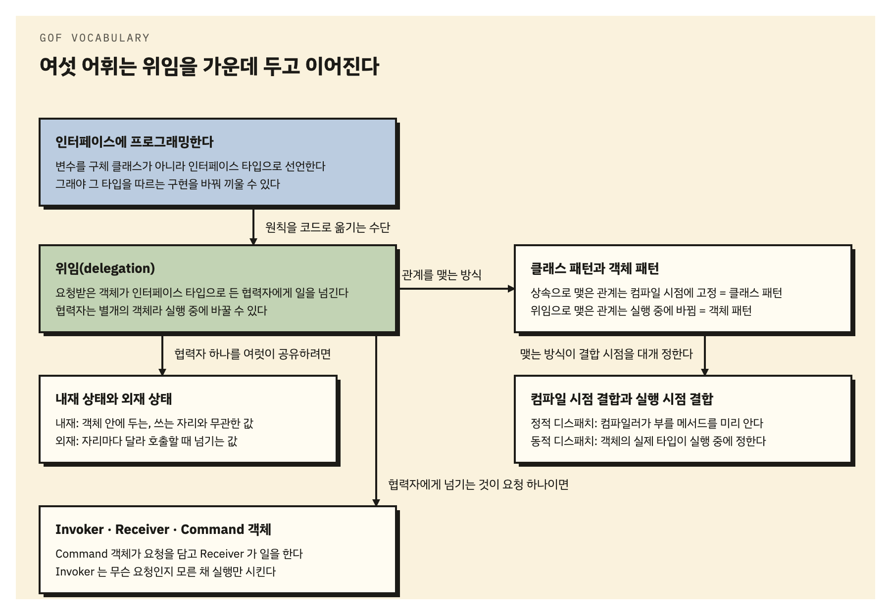

# GoF 공통 어휘 — 패턴 이름보다 먼저 서야 하는 여섯 낱말

## 이 문서가 답하는 것

Strategy 가이드는 비교 절에서 State·Command·Template Method 를, 최소 조건 절에서 Flyweight 와 타입 매개변수 방식을 끌어다 씁니다. 그 자리들은 원서(GoF(Gang of Four, 저자 네 명을 함께 부르는 이름)가 1994년에 낸 *Design Patterns*)가 여러 패턴에 걸쳐 쓰는 어휘를 전제로 적혀 있어요. 인터페이스에 프로그래밍한다는 원칙, 위임, 클래스 패턴과 객체 패턴, 컴파일 시점 결합과 실행 시점 결합, 내재 상태와 외재 상태, 그리고 Invoker · Receiver · Command 객체라는 세 역할이 그것입니다. 이 문서는 그 여섯을 원서를 펴지 않아도 서게 정의하고, 정의마다 값이나 코드로 된 예를 하나씩 붙여요.

패턴이 성립하는 조건과 패턴끼리의 비교, 구현 코드는 다루지 않습니다 — 그것은 각 가이드에 있어요.

## 개념

### 인터페이스에 프로그래밍한다

변수·필드·매개변수의 타입을 구체 클래스가 아니라 인터페이스(Java `interface`·추상 클래스·Rust trait 처럼 연산의 모양만 선언한 타입)로 적고, 그 인터페이스가 약속한 연산만 부르는 것을 말합니다. 원서가 첫 번째 설계 원칙으로 세운 문장이고, 변수를 특정 구체 클래스의 인스턴스로 선언하지 말고 추상 클래스가 정한 인터페이스에만 기대라는 뜻이에요(근거: GoF 1장 §1.6 "Program to an interface, not an implementation"). 이 원칙이 필요한 이유는 하나입니다. 쓰는 쪽이 구체 클래스 이름을 알고 있으면 다른 구현으로 바꿀 때 쓰는 쪽 코드도 함께 열어야 하고, 인터페이스만 알고 있으면 그 인터페이스를 따르는 것은 무엇이든 들어올 수 있어요.

```java
List<String> names = new ArrayList<>();   // 타입은 인터페이스, 값은 구현
names.add("a");
names = new LinkedList<>();               // 구현을 바꿔도 names 를 쓰는 코드는 그대로
```

반대로 `ArrayList<String> names` 로 선언하고 `names.ensureCapacity(100)` 처럼 `ArrayList` 에만 있는 연산을 부르는 코드에서는 교체가 두 번 막힙니다. 선언을 그대로 둔 채 `names = new LinkedList<>()` 를 넣으면 대입문이 `incompatible types: cannot infer type arguments for LinkedList<>` 로 막혀요. 선언을 `List<String>` 으로 고치면 대입은 통과하지만 이번에는 `ensureCapacity` 줄이 `cannot find symbol: method ensureCapacity(int)` 로 막힙니다 — `List` 인터페이스에는 그 연산이 없으니까요(두 경우 모두 javac 21.0.11 로 직접 컴파일해 확인). 구체 클래스에 기댄 줄 하나가 교체를 막는 셈이죠.

여기서 헷갈리기 쉬운 포인트는 "인터페이스를 따른다"의 판정이 언어마다 다르다는 점입니다. Java 와 Rust 는 `implements`·`impl Shape for` 처럼 이름을 걸어야 따르는 것이고, TypeScript 는 선언 없이도 멤버의 모양이 맞으면 그 타입에 대입할 수 있어요. 타입 호환을 이름이 아니라 구조로 판정하기 때문입니다([TypeScript Handbook — Type Compatibility](https://www.typescriptlang.org/docs/handbook/type-compatibility.html)).

```typescript
interface Shape {
  area(): number;
}

class Square {
  constructor(private readonly side: number) {}

  area(): number {
    return this.side * this.side;
  }
}

const s: Shape = new Square(2);   // implements 없이도 멤버 모양이 맞아 대입된다 (tsc 5.9.3 · strict 통과, 출력 4)
```

### 위임(delegation)

요청을 받은 객체가 그 일을 자기 안에 든 다른 객체에게 넘겨 처리하는 것입니다. 원서는 두 객체가 요청 하나를 나눠 처리하는 것으로 정의하고, 하위 클래스가 상위 클래스에 요청을 미루는 것과 닮았다고 견줍니다(근거: GoF 1장 §1.6 Delegation). 닮았지만 다른 점이 이 어휘를 따로 두는 이유예요. 상속에서 미루는 상대는 자기 자신의 일부(상위 클래스)라 바꿀 수 없는데, 위임에서 넘기는 상대는 별개의 객체라 실행 중에 다른 객체로 갈아 끼울 수 있습니다. 대신 상속이면 저절로 물려받았을 연산을 위임에서는 하나하나 손으로 넘겨야 하고, 넘겨받은 객체가 자기를 알아야 하면 자신을 인자로 건네야 해요.

```java
final class Window {
    private Shape shape;                 // 인터페이스 타입으로 든 협력자

    Window(Shape shape) {
        this.shape = shape;
    }

    double area() {
        return shape.area();             // 요청을 협력자에게 넘긴다 — 위임
    }

    void reshape(Shape next) {
        this.shape = next;               // 협력자를 실행 중에 바꾼다
    }
}
```

이 모양이 원서에 실린 예입니다. 창(Window)이 사각형이라는 이유로 `Rectangle` 을 상속하는 대신 `Rectangle` 인스턴스를 들고 사각형 관련 동작을 거기에 넘기면, 실행 중에 그 인스턴스를 `Circle` 로 바꾸는 것만으로 창이 둥근 창이 됩니다. 둘이 같은 타입(`Shape`)을 따른다는 전제에서요(근거: GoF 1장 §1.6 Delegation 의 Window·Rectangle 예). 위 코드에 가로 4 · 세로 3 사각형을 넣고 `area()` 를 부르면 12.0 이, `reshape(new Circle(1))` 뒤에 다시 부르면 3.141592653589793 이 나와요(javac 21.0.11 로 컴파일해 실행). 대가도 있습니다. 동적이고 매개변수가 많은 소프트웨어는 정적인 것보다 이해하기 어렵다는 점이에요(근거: GoF 1장 §1.6 Delegation).

> 상속은 물려받고, 위임은 넘긴다 — 넘기는 상대는 바꿀 수 있다.

### 클래스 패턴과 객체 패턴

원서가 패턴 스물세 개를 나누는 두 번째 기준으로, 패턴이 다루는 관계가 클래스 사이인지 객체 사이인지를 가릅니다. 클래스 패턴은 클래스와 그 하위 클래스 사이의 관계를 다루고, 그 관계는 상속으로 맺어지므로 컴파일 시점에 고정돼요. 객체 패턴은 객체 사이의 관계를 다루고, 그 관계는 실행 중에 바꿀 수 있어 더 동적입니다(근거: GoF 1장 §1.5 Organizing the Catalog, 표 1.1). 구분을 두는 까닭은 때에 있어요. 바뀌는 부분을 떼어 낸다는 목적이 같아도 어느 쪽으로 떼어 냈느냐에 따라 바꿀 수 있는 때가 달라집니다. 상속으로 떼면 객체를 만들 때 이미 정해지고, 객체로 떼면 만들어진 뒤에도 바꿀 수 있어요.

```text
클래스 패턴의 관계                          객체 패턴의 관계
class FileLogger extends Logger            class Logger { Sink sink; }

어느 Logger 인지는 new 할 때 정해진다        logger.sink = new NetworkSink() 로 실행 중 교체
바꾸려면 다른 클래스의 객체를 새로 만든다      같은 객체가 그대로 남고 협력자만 바뀐다
```

원서가 분류표에서 클래스 패턴으로 두는 것은 넷뿐입니다 — Factory Method · Adapter(클래스형) · Interpreter · Template Method. 나머지 열아홉은 전부 객체 패턴이고, Adapter 는 두 형태가 있어 양쪽에 다 들어가요(근거: GoF 1장 §1.5 표 1.1). 그래서 같은 행위 패턴이라도 Template Method 는 상속으로, Strategy·State·Command 는 객체 관계로 바뀌는 부분을 떼어 낸 것으로 분류됩니다.

> 클래스 패턴은 컴파일러가 관계를 정하고, 객체 패턴은 대입문이 관계를 정한다.

### 컴파일 시점 결합과 실행 시점 결합

결합(binding)은 호출문 하나가 어느 메서드 본문으로 이어지는지가 정해지는 일이고, 그것이 정해지는 때로 둘을 가릅니다. 컴파일 시점 결합은 컴파일러가 부를 메서드를 이미 알고 코드를 내는 것으로, 정적 디스패치(static dispatch)라고도 불러요. 실행 시점 결합은 컴파일러가 알 수 없어 실행 중에 대상 객체의 실제 타입을 보고 찾는 것으로, 동적 디스패치(dynamic dispatch)라고 합니다([The Rust Programming Language 18.2](https://doc.rust-lang.org/book/ch18-02-trait-objects.html) 의 정의를 언어 일반으로 옮김). 앞 개념과 따로 두는 이유는 둘이 같은 구분이 아니어서예요. 상속이면 컴파일 시점, 객체 관계면 실행 시점이 대개 맞지만, 타입 매개변수(제네릭·C++ 템플릿)는 객체를 합성하면서도 컴파일 시점에 결합합니다. 원서는 이것을 상속·합성에 이은 세 번째 방법으로 두고, 상속과 마찬가지로 실행 중에는 바꿀 수 없다고 정리해요(근거: GoF 1장 §1.6 Inheritance versus Parameterized Types).

| 언어 | 컴파일 시점 결합 | 실행 시점 결합 |
| --- | --- | --- |
| Java | `static` 메서드 호출과 `super.` 호출. 재정의가 허용되지 않아 컴파일 시점에 고른 선언이 그대로 불림([JLS(Java Language Specification) SE(Standard Edition) 21, 15.12.3 · 15.12.4.4](https://docs.oracle.com/javase/specs/jls/se21/html/jls-15.html)) | 인터페이스 호출과 가상 호출. JVM(Java Virtual Machine, 자바 가상 머신)은 변수의 타입이 아니라 변수가 가리키는 객체의 메서드를 부름([The Java Tutorials — Polymorphism](https://docs.oracle.com/javase/tutorial/java/IandI/polymorphism.html)). 제네릭 `<S extends Shape>` 로 받아도 컴파일러가 `S` 마다 코드를 따로 만들지 않음 — 타입 변수는 컴파일하면서 그 경계 타입으로 지워짐([JLS SE 21, 4.6 Type Erasure](https://docs.oracle.com/javase/specs/jls/se21/html/jls-4.html)) |
| TypeScript | 없음. 타입 주석은 컴파일할 때 검사만 받고 지워져 실행 동작을 바꾸지 않음([TypeScript Handbook — The Basics](https://www.typescriptlang.org/docs/handbook/2/basic-types.html)) | 모든 메서드 호출. 실행은 JavaScript 라 객체가 그 순간 가진 메서드를 찾음. 컴파일 시점 검사는 앞 절의 구조적 호환으로 함 |
| Rust | 제네릭 `fn f<S: Shape>(s: &S)`. 단형화(monomorphization)로 구체 타입마다 코드를 따로 만들어 정적 디스패치. 타입 매개변수 하나는 한 번에 한 구체 타입만 대신함(Rust Book 18.2) | trait 객체 `&dyn Shape` · `Box<dyn Shape>`. 실행 중 trait 객체 안의 포인터로 메서드를 찾고 그 조회 비용이 있음(Rust Book 18.2). trait 객체로 쓸 수 있는 trait 은 dyn compatible 규칙을 지킨 것뿐([Rust Reference — Dyn compatibility](https://doc.rust-lang.org/reference/items/traits.html#dyn-compatibility)) |

```rust
fn area_static<S: Shape>(s: &S) -> f64 {   // 단형화: S 마다 함수가 따로 만들어진다
    s.area()
}

fn area_dynamic(s: &dyn Shape) -> f64 {     // 실행 중 trait 객체 안의 포인터로 메서드를 찾는다
    s.area()
}
```

잠깐, 확인 하나만 해 볼까요? `Vec<Box<dyn Shape>>` 에는 `Square` 와 `Circle` 을 섞어 넣을 수 있는데, `fn total<S: Shape>(shapes: &Vec<S>)` 에 `vec![Square(2.0), Circle(1.0)]` 을 넘기면 어떻게 될까요?

컴파일이 되지 않습니다. rustc 1.95.0 은 두 번째 원소에서 `expected Square, found Circle`(E0308) 로 멈춰요. 타입 매개변수 `S` 는 한 번에 한 구체 타입만 대신하고, trait 객체는 실행 중에 여러 구체 타입이 그 자리를 채울 수 있기 때문입니다(Rust Book 18.2). 그래서 제네릭으로 받은 협력자는 실행 중에 다른 타입으로 바꿀 수 없어요.

> 제네릭은 합성처럼 보여도 결합은 상속처럼 컴파일 시점이다.

### 내재 상태와 외재 상태

객체 하나를 여러 자리에서 동시에 같이 쓰려 할 때, 그 객체가 다루는 정보를 둘로 가른 이름입니다. 내재 상태(intrinsic state)는 객체 안에 저장되는 정보로, 그 객체가 쓰이는 자리(맥락)와 무관하기 때문에 공유할 수 있어요. 외재 상태(extrinsic state)는 쓰이는 자리에 따라 달라지는 정보라 공유할 수 없고, 쓰는 쪽이 연산을 부를 때마다 넘겨줍니다(근거: GoF 4장 Flyweight, Motivation). Flyweight 의 어휘이지만, Strategy 의 공유 전략 조건처럼 객체 하나를 여러 자리가 같이 쓰는 조건을 말할 때 이 구분을 써요. 구분이 필요한 이유는 수에 있습니다. 상태를 가르지 않으면 쓰이는 자리마다 객체가 하나씩 필요하고, 자리마다 다른 값을 밖으로 빼내면 적은 수의 객체로 많은 자리를 감당할 수 있어요.

```text
글자 'a' 객체 (공유 · 1개)               쓰는 자리 (많음 · 호출마다 외재 상태를 넘긴다)
  내재 상태: 글자 코드 'a'     ◀────  draw(x=12, y=40, font=고딕 10pt)    3행 7열의 a
                             ◀────  draw(x=90, y=40, font=고딕 10pt)    3행 20열의 a
                             ◀────  draw(x=12, y=64, font=명조 12pt)    4행 7열의 a
```

문서 편집기의 글자 객체가 원서에 실린 예입니다. 글자 코드는 내재 상태이고 위치와 글꼴은 외재 상태라서, 같은 글자는 객체 하나를 두고 그릴 때마다 위치·글꼴을 넘겨요. 이렇게 가른 편집기 하나가 180,000자 문서에 글자 객체 480개만 할당했다는 수치가 남아 있습니다(근거: GoF 4장 Flyweight, Motivation 과 Known Uses 의 InterViews Doc). 위 그림의 좌표와 글꼴은 설명용으로 고른 값이에요.

여기서 헷갈리기 쉬운 포인트는 외재 상태를 잠깐 필드에 넣어 두는 것입니다. 공유 객체가 직전 호출의 `x` 를 필드에 남기고 다음 호출에서 그 값을 쓰면, 3행 20열의 a 를 그리는 호출이 3행 7열의 `x` 를 보게 돼요. 필드에 들어가는 순간 그 값은 내재 상태처럼 취급되는데 실제로는 자리마다 다른 값이라서, 공유하는 모든 자리가 마지막 호출의 값을 보게 됩니다.

> 호출마다 달라지는 값이면 외재, 객체를 만들 때 정해져 바뀌지 않으면 내재.

### Invoker · Receiver · Command 객체

요청 하나를 객체로 만들었을 때 생기는 세 역할입니다. Command 객체는 실행 연산 하나(`execute`)를 약속한 인터페이스를 따르고, 어느 객체에게 무슨 연산을 시킬지를 안에 묶어 둬요. Receiver 는 그 연산을 실제로 수행할 줄 아는 객체이고 어떤 클래스든 될 수 있습니다. Invoker 는 Command 객체를 들고 있다가 `execute` 를 불러 요청을 발동시키는 쪽으로, 어떤 Command 인지도 그 뒤에 어느 Receiver 가 있는지도 모릅니다. Command 객체를 만들어 Receiver 를 묶어 주는 쪽은 Client 라 부르고, 세 역할에는 넣지 않아요(근거: GoF 5장 Command, Participants·Collaborations). 역할을 셋으로 가르는 이유는 부르는 쪽과 수행할 줄 아는 쪽을 떼어 놓기 위해서예요. 그러면 요청을 만들어 두었다가 나중에 실행하거나 큐(queue, 먼저 넣은 것을 먼저 꺼내는 대기열)에 넣거나 기록으로 남길 수 있습니다. 요청이 객체라서 다른 객체처럼 들고 다닐 수 있으니까요.

```text
Client 가 만들 때 :  command = new PasteCommand(document)      Command 객체가 Receiver 를 안에 묶는다
Invoker 가 부를 때:  menuItem 이 눌리면 command.execute()       무슨 명령인지 모른 채 실행만 시킨다
Command 가 할 때  :  execute() { document.paste(); }           Receiver 의 연산을 부른다
```

편집기 예로 읽으면 메뉴 항목이 Invoker, `PasteCommand` 가 Command 객체, `Document` 가 Receiver 예요. 메뉴 항목은 자기가 든 것이 붙여넣기인지 열기인지 모르고 `execute` 만 부르므로, 같은 메뉴 항목 클래스에 다른 Command 객체를 넣으면 다른 일을 하게 됩니다(근거: GoF 5장 Command, Motivation). Receiver 가 반드시 별개 객체여야 하는 것은 아니에요. 원서는 Receiver 없이 명령 객체가 스스로 일을 다 하는 모양도 허용합니다(근거: GoF 5장 Command, Implementation 1 "How intelligent should a command be?").

## 개념 사이의 관계



여섯 어휘는 위임을 가운데 두고 이어집니다. 인터페이스에 프로그래밍한다는 원칙 하나 위에 위임이 서고, 위임은 그 원칙을 코드로 옮기는 수단이에요. 협력자를 인터페이스 타입으로 들어야 바꿔 끼울 수 있으니까요. 관계를 맺는 방식은 둘이라서, 위임(합성)으로 맺은 관계를 다루는 패턴이 객체 패턴이고 상속으로 맺은 관계를 다루는 패턴이 클래스 패턴입니다. 맺는 방식은 결합 시점을 대개 정합니다 — 상속이면 컴파일 시점, 객체 관계면 실행 시점. 다만 타입 매개변수는 객체를 합성하면서도 컴파일 시점에 결합하는 예외라서, 두 구분을 같은 것으로 보면 안 돼요.

나머지 둘은 위임에서 갈라져 나온 갈래입니다. 위임받는 객체 하나를 여러 요청 객체가 같이 쓰려면 그 객체의 상태를 내재와 외재로 갈라야 하고, 위임받는 것이 요청 하나이면 역할이 Invoker · Receiver · Command 객체 셋으로 갈립니다.

| 관계 | 방향과 다중도 |
| --- | --- |
| 인터페이스에 프로그래밍한다 → 위임(delegation) | 원칙 하나 위에 수단 하나. 협력자 필드가 인터페이스 타입이 아니면 위임은 성립해도 교체는 안 됨 |
| 위임(delegation) → 클래스 패턴과 객체 패턴 | 관계를 맺는 방식이 위임이면 객체 패턴, 상속이면 클래스 패턴. 패턴 하나는 한쪽에 들고 Adapter 만 양쪽 |
| 클래스 패턴과 객체 패턴 → 컴파일 시점 결합과 실행 시점 결합 | 대개 클래스 패턴은 컴파일 시점, 객체 패턴은 실행 시점. 타입 매개변수가 예외 |
| 위임(delegation) → 내재 상태와 외재 상태 | 공유 객체 1 : 쓰는 자리 여럿. 자리마다 다른 값은 전부 외재로 빼야 공유가 됨 |
| 위임(delegation) → Invoker · Receiver · Command 객체 | Invoker 1 : Command 객체 여럿(한 번에 하나를 들 수도), Command 객체 1 : Receiver 0 또는 1 |

잠깐, 확인 하나만 해 볼까요? 앞 절의 `Window` 가 `Shape` 를 들고 `area()` 를 넘기는 코드는 어느 어휘에 해당하고, Rust 에서 `struct Window<S: Shape> { shape: S }` 로 바꾸면 무엇이 달라질까요?

앞은 위임이고 객체 관계라서 실행 중에 `reshape` 로 협력자를 바꿀 수 있어요. 제네릭으로 바꾸면 관계는 여전히 합성(위임)이지만 `S` 가 컴파일 시점에 한 타입으로 정해지므로, 결합 시점만 컴파일 시점으로 옮겨 갑니다. 클래스 패턴이 된 것은 아니에요 — 상속을 쓴 게 아니니까요.

## 가이드로 돌아가기

- [Strategy 가이드 「한눈에 보는 개요」](../../design-pattern-guide/strategy/strategy-guide_v1.1.0.md#한눈에-보는-개요) — 함께 쓰는 패턴으로 Flyweight 를 들면서, 배송비 객체가 생성할 때 정한 금액만 필드에 두고 호출 사이에 새 값을 남기지 않으면 결제 객체 여럿이 하나를 같이 써도 된다는 조건을 거는 자리 → 내재 상태와 외재 상태
- [Strategy 가이드 「개념 정리」](../../design-pattern-guide/strategy/strategy-guide_v1.1.0.md#개념-정리) — Context 항목이 일을 넘기는 것을 위임, 전략을 Strategy 타입으로만 드는 것을 인터페이스에 프로그래밍한다는 원칙이라 적고 두 말의 정의를 이 문서에 맡기는 자리 → 위임(delegation) · 인터페이스에 프로그래밍한다
- [Strategy 가이드 「디자인 패턴을 충족하는 최소 조건」](../../design-pattern-guide/strategy/strategy-guide_v1.1.0.md#디자인-패턴을-충족하는-최소-조건) — 1번의 컴파일 시점에 전략이 고정되는 변형과 설치 방식 표의 타입 매개변수 줄 → 컴파일 시점 결합과 실행 시점 결합 · 2번의 다운캐스트·타입 검사 금지 → 인터페이스에 프로그래밍한다 · 2번이 빠진 모양인 도우미 클래스 하나에 일을 넘기는 단순 위임 → 위임(delegation) · 6번이 공유 전략에 두어도 되는 값과 안 되는 값을 가르는 어휘라 적은 자리 → 내재 상태와 외재 상태
- [Strategy 가이드 「비슷한 패턴·안티패턴과의 차이」](../../design-pattern-guide/strategy/strategy-guide_v1.1.0.md#비슷한-패턴안티패턴과의-차이) — Template Method 비교의 상속으로 일부를, 위임으로 전체를 바꾼다는 구분과 상속으로 맺는 관계·객체로 맺는 관계의 대비 → 위임(delegation) · 클래스 패턴과 객체 패턴 · Command 비교가 세 역할과 Receiver 없이 명령이 스스로 일을 다 하는 모양을 이 문서에 맡기는 자리 → Invoker · Receiver · Command 객체
- [Strategy 가이드 「구현」](../../design-pattern-guide/strategy/strategy-guide_v1.1.0.md#구현) — 세 언어 관용 표 아래 해설이 Rust 의 trait 객체와 제네릭이 갈리는 지점을 결합 시점이라 적고 동적 디스패치·정적 디스패치의 정의를 이 문서에 맡기는 자리 → 컴파일 시점 결합과 실행 시점 결합
- [Strategy 가이드 「실제 라이브러리에서」](../../design-pattern-guide/strategy/strategy-guide_v1.1.0.md#실제-라이브러리에서) — `HashMap<K, V, S>` 에서 어떤 `S` 를 쓸지가 맵 타입의 일부라서 컴파일할 때 정해진다는 설명 → 컴파일 시점 결합과 실행 시점 결합

아래 열다섯 편도 같은 낱말들을 이 문서에 맡깁니다.

- [Factory Method 가이드](../../design-pattern-guide/factory-method/factory-method-guide_v1.0.0.md) — 「한눈에 보는 개요」와 Abstract Factory 비교 → 클래스 패턴과 객체 패턴 / 시나리오 1 의 4단계와 구현 해설 → 컴파일 시점 결합과 실행 시점 결합(정적·동적 디스패치)
- [Abstract Factory 가이드](../../design-pattern-guide/abstract-factory/abstract-factory-guide_v1.0.0.md) — 시나리오 1 의 확인 질문과 「개념 정리」 → 인터페이스에 프로그래밍한다 · 위임 / Factory Method 비교 → 클래스 패턴과 객체 패턴 / 구현 해설 → 컴파일 시점 결합과 실행 시점 결합
- [Builder 가이드](../../design-pattern-guide/builder/builder-guide_v1.0.0.md) — 「개념 정리」에서 제품을 넘겨 처리를 맡기는 관계를 부르는 이름 → 위임(delegation)
- [Prototype 가이드](../../design-pattern-guide/prototype/prototype-guide_v1.0.0.md) — 「개념 정리」에서 계층이 하나라는 말을 풀 때 → 클래스 패턴과 객체 패턴
- [Singleton 가이드](../../design-pattern-guide/singleton/singleton-guide_v1.0.0.md) — 「한눈에 보는 개요」가 이 패턴이 객체 범위인 이유를 풀 때 → 클래스 패턴과 객체 패턴 / Flyweight 비교가 공유 단위가 키별로 갈리는 자리를 짚을 때 → 내재 상태와 외재 상태
- [Bridge 가이드](../../design-pattern-guide/bridge/bridge-guide_v1.0.0.md) — 「개념 정리」 → 위임 / 구현 해설 → 컴파일 시점 결합과 실행 시점 결합
- [Facade 가이드](../../design-pattern-guide/facade/facade-guide_v1.0.0.md) — 「개념 정리」의 Facade 항목이 일을 넘기는 방식을 부를 때 → 위임(delegation)
- [Flyweight 가이드](../../design-pattern-guide/flyweight/flyweight-guide_v1.0.0.md) — 「한눈에 보는 개요」와 「개념 정리」가 두 낱말의 정의를 맡기는 자리 → 내재 상태와 외재 상태
- [Proxy 가이드](../../design-pattern-guide/proxy/proxy-guide_v1.0.0.md) — 「한눈에 보는 개요」가 이 패턴이 객체 범위인 이유를 풀 때 → 클래스 패턴과 객체 패턴
- [Chain of Responsibility 가이드](../../design-pattern-guide/chain-of-responsibility/chain-of-responsibility-guide_v1.0.0.md) — 「한눈에 보는 개요」 → 위임 / Mediator·Command 비교 → Invoker · Receiver · Command 객체 / 구현 해설 → 컴파일 시점 결합과 실행 시점 결합
- [Command 가이드](../../design-pattern-guide/command/command-guide_v1.0.0.md) — 「개념 정리」 → 인터페이스에 프로그래밍한다 · 위임 / 구현 해설 → 컴파일 시점 결합과 실행 시점 결합
- [Iterator 가이드](../../design-pattern-guide/iterator/iterator-guide_v1.0.0.md) — 「실제 라이브러리에서」 표가 `iterator()` 와 `into_iter()` 의 결합 시점을 가를 때 → 컴파일 시점 결합과 실행 시점 결합
- [Observer 가이드](../../design-pattern-guide/observer/observer-guide_v1.0.0.md) — 「개념 정리」 → 인터페이스에 프로그래밍한다 · 위임 / Command 비교 → Invoker · Receiver · Command 객체 / 구현 해설 → 컴파일 시점 결합과 실행 시점 결합
- [State 가이드](../../design-pattern-guide/state/state-guide_v1.0.0.md) — 「개념 정리」 → 위임 · 인터페이스에 프로그래밍한다 / 「한눈에 보는 개요」와 최소 조건 8번 → 내재 상태와 외재 상태
- [Template Method 가이드](../../design-pattern-guide/template-method/template-method-guide_v1.0.0.md) — 「한눈에 보는 개요」 → 클래스 패턴과 객체 패턴 / Strategy 비교 → 위임

## 참고 자료

웹 자료는 모두 2026-09-21 에 확인했습니다. 원서 쪽 번호는 원서 표 1.1(Design pattern space)의 교차참조 표기를 옮긴 것이고 종이책과 대조하지 않았습니다.

- Erich Gamma · Richard Helm · Ralph Johnson · John Vlissides, *Design Patterns: Elements of Reusable Object-Oriented Software*, Addison-Wesley, 1994.
  - 1장 Introduction, §1.5 Organizing the Catalog(표 1.1 Design pattern space) — 클래스 패턴·객체 패턴의 정의와 스물세 패턴의 분류. 「클래스 패턴과 객체 패턴」의 근거
  - 1장 §1.6 How Design Patterns Solve Design Problems — Program to an interface, not an implementation · Inheritance versus Composition · Delegation(Window·Rectangle·Circle 예와 대가) · Inheritance versus Parameterized Types. 「인터페이스에 프로그래밍한다」·「위임(delegation)」·「컴파일 시점 결합과 실행 시점 결합」의 근거
  - 4장 Structural Patterns, Flyweight(195쪽부터) — Motivation 의 내재·외재 상태 정의와 글자 객체 예, Known Uses 의 180,000자·480객체. 「내재 상태와 외재 상태」의 근거
  - 5장 Behavioral Patterns, Command(233쪽부터) — Participants·Collaborations, Motivation 의 MenuItem·PasteCommand·Document, Implementation 1. 「Invoker · Receiver · Command 객체」의 근거
- [The Rust Programming Language — 18.2 Using Trait Objects](https://doc.rust-lang.org/book/ch18-02-trait-objects.html) — 단형화와 정적 디스패치, trait 객체의 동적 디스패치와 조회 비용, 타입 매개변수는 한 번에 한 구체 타입만 대신함
- [The Rust Reference — Traits, Dyn compatibility](https://doc.rust-lang.org/reference/items/traits.html#dyn-compatibility) — trait 객체로 쓸 수 있는 trait 의 조건
- [TypeScript Handbook — Type Compatibility](https://www.typescriptlang.org/docs/handbook/type-compatibility.html) — 구조적 서브타이핑, `implements` 없이도 멤버 모양으로 호환
- [TypeScript Handbook — The Basics](https://www.typescriptlang.org/docs/handbook/2/basic-types.html) — Erased Types, 타입 주석은 지워지고 실행 동작을 바꾸지 않음
- [The Java Tutorials — Polymorphism](https://docs.oracle.com/javase/tutorial/java/IandI/polymorphism.html) — JVM 은 변수 타입이 아니라 가리키는 객체의 메서드를 부름(virtual method invocation)
- [JLS SE 21 — Chapter 15, §15.12.3 · §15.12.4.4](https://docs.oracle.com/javase/specs/jls/se21/html/jls-15.html) — 호출 모드(static · super · interface · virtual)와 실행 시점 메서드 탐색
- [JLS SE 21 — Chapter 4, §4.6 Type Erasure](https://docs.oracle.com/javase/specs/jls/se21/html/jls-4.html) — 타입 변수는 왼쪽 경계의 소거로 지워짐
