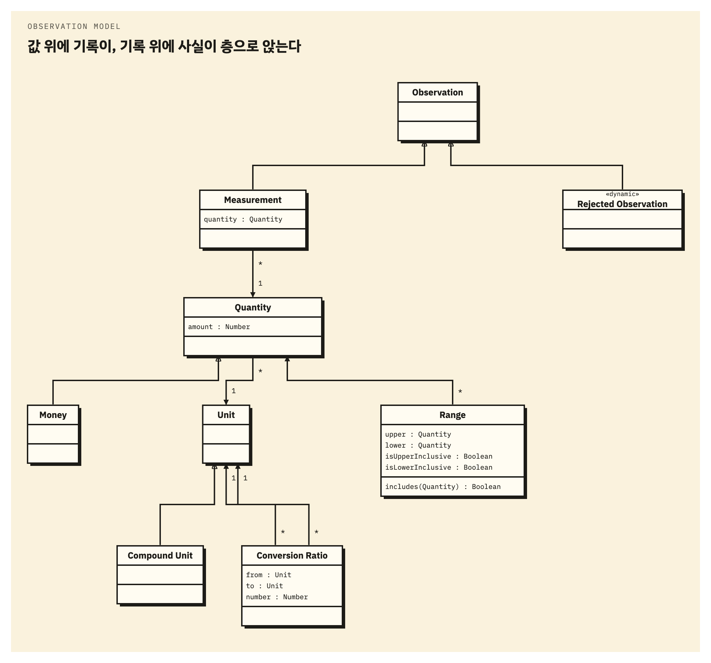

# 수량·측정·관측 모델 — 값 위에 기록이, 기록 위에 사실이 앉는 세 층

## 이 문서가 답하는 것

Quantity 가이드의 「개념 정리」 절은 Unit · Conversion Ratio · Compound Unit · Money 를 한 문단씩만 소개합니다. 「비슷한 패턴·안티패턴과의 차이」 절은 Measurement 를 누구를 · 무엇을 · 얼마 세 조각으로 쪼갠 도식 하나로만 그리고, 잰 시각과 적은 시각을 따로 두는 문제와 잘못 잰 값을 지우지 않고 거부 표시로 남기는 방식은 이름만 부른 채 이 문서로 넘겨요. 그 이름들이 무엇이고 서로 어떻게 놓이는지를 원서 없이 읽히게 푸는 것이 이 문서예요. 원서는 안 펴도 됩니다. 다 읽으면 0.3 kg 같은 값 하나가 단위 · 환산 · 기록 · 사실의 어느 층에 놓이는지 그림 한 장으로 짚을 수 있게 됩니다. Range 는 끝점에 Quantity 를 둘 수 있어서 이 그림에 같이 넣었고, Range · Measurement · Observation 가이드가 나오면 그 가이드들도 같은 자리를 여기로 보냅니다.

여기서 다루지 않는 것도 정해 둘게요. 어떤 코드가 패턴을 갖춘 것인지 가르는 최소 조건, 비슷한 패턴과의 비교표, 세 언어 구현과 aggregate 경계는 각 가이드에 있습니다.

```text
값     Quantity       62.5 kg                       수치 + 단위
기록   Measurement    김OO · 몸무게 · 62.5 kg         누구를 · 무엇을 · 얼마
사실   Observation    위 기록 + 잰 날 · 적은 날 · 거부 여부
```

## 개념

### Quantity

Quantity 는 수치(amount)와 단위(unit)를 한 값으로 묶은 것입니다. 0.3 이라는 수 하나만 있으면 kg 인지 g 인지 알 길이 없어서, 그 수를 받는 쪽마다 단위를 짐작해야 해요. 짐작이 어긋나는 순간 계산이 조용히 틀립니다. 그래서 단위를 필드 이름이나 주석이 아니라 값 안에 둡니다. Fowler 의 한 줄 요약은 "차원이 있는 값을 수치와 단위 둘 다로 나타내라" 입니다([Quantity, eaaDev](https://martinfowler.com/eaaDev/Quantity.html)). (근거: Fowler *Analysis Patterns* 3장 §3.1 — Figure 3.1 의 `height : Number` 를 Figure 3.2 가 `amount : Number` 와 `units : Unit` 을 가진 Quantity 로 바꿉니다)

```text
Before — 수치만 있을 때                After — 값(Quantity)일 때
  onHandKg = 0.3                        onHand = Quantity(0.3, kg)
  레시피 사용량 100  (g 인데 표시가 없다)     use    = Quantity(100, g)
  0.3 − 100 = −99.7                     0.3 kg 과 100 g → 단위가 다르다는 것을 값이 먼저 안다
```

수치와 단위가 붙어 있어야 두 값이 만났을 때 단위가 같은지를 값이 먼저 확인할 수 있어요. 그다음에 거부할지 환산할지는 Quantity 가이드가 정합니다.

### Unit

Unit 은 수치를 무엇으로 셌는가, 곧 재는 기준입니다. kg · g · mg 는 모두 질량을 재는 단위이고 L 은 부피를 재는 단위예요. 이 구분이 필요한 이유는 환산 때문입니다. 같은 것(질량)을 재는 단위끼리는 kg 1 이 g 1000 이라는 고정된 비율이 있지만, 질량 단위와 부피 단위 사이에는 그런 비율이 없어요. 우유 1 L 가 몇 g 인지는 단위가 아니라 우유의 밀도에 달려 있으니까요. SI(국제단위계)는 질량의 기본 단위를 kg 으로 두고, 접두어 kilo(k)를 10³ 배, milli(m)를 10⁻³ 배로 정합니다([SI base units](https://www.bipm.org/en/measurement-units/si-base-units) · [SI prefixes](https://www.bipm.org/en/measurement-units/si-prefixes)).

```text
무엇을 재는가   단위             사이의 비율
질량          kg · g · mg      kg 1 = g 1000 = mg 1 000 000    고정
부피          L · mL           L 1 = mL 1000                   고정
질량 ↔ 부피    kg ↔ L           없음. 밀도(재료)에 따라 다르다
```

### Conversion Ratio

Conversion Ratio 는 from 단위 1 이 to 단위로 얼마인지를 수(number)로 적은 것입니다. 방향이 있어요. kg → g 비율의 number 가 1000 이면 kg 에서 g 로 갈 때는 곱하고, g 에서 kg 로 올 때는 나눕니다. 비율을 계산하는 코드마다 1000 으로 적어 두면 어디는 곱하고 어디는 나누는 실수를 값이 막아 줄 수 없어요. 그래서 비율을 모델의 객체로 두고 양 끝 단위를 명시합니다. (근거: Fowler *Analysis Patterns* 3장 §3.2 — Figure 3.3 이 Unit 과 Conversion Ratio 를 from · to 두 연관으로 잇고, Conversion Ratio 에 `number : Number` 를 둡니다)

```text
kg ──(from)── [kg → g : 1000] ──(to)── g ──(from)── [g → mg : 1000] ──(to)── mg

  0.3 kg → g  :  0.3 × 1000 = 300 g       from → to 는 곱한다
  200 g → kg  :  200 ÷ 1000 = 0.2 kg      to → from 은 나눈다
```

다중도를 말로 적으면 이렇습니다. 비율 하나는 from 단위 하나와 to 단위 하나만 가져요. 반대로 Unit 하나는 from 쪽으로도 여러 비율에, to 쪽으로도 여러 비율에 걸립니다. 위 그림의 g 가 그래요. kg → g 비율에서는 to 쪽이고 g → mg 비율에서는 from 쪽입니다.

> from 에서 to 로 갈 때 곱한다. 거꾸로 오면 나눈다.

### Compound Unit

Compound Unit 은 m/s² 처럼 단위 여러 개에 지수를 붙여 곱한 단위이고, Unit 의 한 종류입니다. 나누기는 음수 지수예요. m/s² 는 m¹ · s⁻² 입니다. 이 종류가 따로 필요한 이유는 Quantity 끼리 곱하거나 나누면 어느 단위 목록에도 없던 단위가 생기기 때문이에요. 이스트를 하루 100 g 씩 쓴다면 사용 속도의 단위는 g/일 이고, 이건 g 도 아니고 일도 아닌 새 단위입니다. (근거: Fowler *Analysis Patterns* 3장 §3.3 — Figure 3.4 가 Compound Unit 을 Unit 의 하위 타입으로 두고 지수(power)를 가진 단위 참조 1..\* 개로 구성합니다. 제약은 참조가 둘 이상이거나, 하나뿐이면 지수가 0 보다 작거나 1 보다 커야 한다는 것입니다)

```text
m/s²  = m¹ · s⁻²     참조 둘              → Compound Unit
m²    = m²           참조 하나, 지수 2     → Compound Unit
g/일  = g¹ · 일⁻¹     참조 둘              → Compound Unit
m     = m¹           참조 하나, 지수 1     → 그냥 Unit. 합성으로 세지 않는다
```

### Money

Money 는 단위 자리에 통화(KRW · USD)가 오는 Quantity 입니다. Fowler 의 JAOO 1999 컨퍼런스 튜토리얼 슬라이드가 "Money is a kind of quantity" 라고 적고, eaaDev 의 Quantity 글도 Money 를 Quantity 의 특수한 경우로 둡니다([튜토리얼 슬라이드](http://jaoo.dk/jaoo1999/schedule/MartinFowlerAnalysisPatterns.pdf) · [Quantity, eaaDev](https://martinfowler.com/eaaDev/Quantity.html)). 일반화로 보는 이유는 규칙이 같기 때문이에요. 수치와 통화를 한 값으로 묶고, 통화가 다른 금액끼리의 덧셈을 값이 막고, 통화 사이를 옮기려면 비율(환율)이 필요합니다. 그러면서도 두 가지가 달라서 따로 이름을 가져요. 하나는 환율이 kg → g 비율과 달리 시점마다 바뀐다는 것이고, 다른 하나는 통화마다 최소 단위(원 · 센트)가 있어서 계산 결과를 흔히 그 단위로 반올림한다는 것입니다. PoEAA(Patterns of Enterprise Application Architecture)의 Money 요약이 드는 문제도 그 둘이에요. 달러에 엔을 그대로 더하는 것, 반올림 때문에 잔돈을 잃는 것([Money, PoEAA 요약](https://martinfowler.com/eaaCatalog/money.html)).

```text
Quantity(0.3, kg)       단위 kg       kg → g 비율 1000 은 고정
Money(10000, KRW)       단위 KRW      KRW → USD 비율(환율)은 시점마다 다르다

10,000 원을 셋으로 나누면  3,333.33… 원   → 원 단위로 맞춰야 한다
3,333 원 × 3 = 9,999 원                  → 남는 1 원을 누가 받는지 규칙이 필요하다
```

### Measurement

Measurement 는 값 하나를 대상과 항목에 묶은 기록입니다. Quantity(62.5, kg) 는 단위까지 갖춘 완전한 값이지만, 누구의 몸무게인지 아니면 밀가루 무게인지는 값 안에 없어요. 그래서 기록에는 자리가 셋 있어요. 누구를 쟀는가(대상), 무엇을 쟀는가(현상 유형 Phenomenon Type), 얼마인가(Quantity)입니다. 현상 유형은 몸무게 · 키 · 혈당 같은 측정 항목이고, 대상은 원서 그림에서 Person 이에요. 이렇게 나누는 이유는 항목이 늘기 때문이에요. 사람마다 키 · 몸무게 · 혈당을 필드로 두면 검사 항목이 수십, 수백 개로 늘 때마다 필드가 늘어납니다. 항목을 Phenomenon Type 이라는 데이터로 빼면 새 항목은 필드가 아니라 행 하나예요. 튜토리얼 슬라이드가 "속성이 수십, 수백 개면 어쩔 것인가" 라고 묻고 Measurement 로 답하는 자리가 이것입니다([JAOO 1999 슬라이드](http://jaoo.dk/jaoo1999/schedule/MartinFowlerAnalysisPatterns.pdf)). (근거: Fowler *Analysis Patterns* 3장 §3.4 — Figure 3.6 에서 Measurement 는 Person 1 · Phenomenon Type 1 에 연결되고 `quantity : Quantity` 를 가집니다)

```text
Quantity       62.5 kg                          얼마인가 (값)
Measurement    김OO · 몸무게 · 62.5 kg            누구를 · 무엇을 · 얼마
                 │      │         └─ Quantity
                 │      └─ Phenomenon Type (항목)
                 └─ 대상
```

다중도는 이렇습니다. 대상 하나에 Measurement 가 여럿, 항목 하나에 Measurement 가 여럿이고, Measurement 하나는 대상 하나 · 항목 하나 · Quantity 하나를 가져요. 여기서 헷갈리기 쉬운 포인트는 Measurement 를 Quantity 의 다른 종류로 보는 것입니다. Measurement 는 Quantity 를 품는 기록이지 Quantity 의 한 종류가 아니에요.

### Observation

Observation 은 대상에 대한 사실 하나를 나타내는 상위 개념이고, Measurement 는 그 한 종류입니다. 사실에는 수치로 적히지 않는 것도 있어요. 혈액형이 A 라는 것, 성별이 남성이라는 것은 대상과 항목(혈액형 · 성별)은 있는데 Quantity 가 없습니다. 이런 사실은 값 자리에 범주가 오는 관측이고, 원서 이름으로 Category Observation 이에요. 둘을 Observation 아래 나란히 두는 이유는 이 사람에 대해 기록된 사실 전부를 한 구조로 다루기 위해서입니다. 시각과 거부 처리를 Observation 에 붙이면 수치 관측과 범주 관측이 그것을 함께 물려받아요. (근거: Fowler *Analysis Patterns* 3장 §3.5 — Figure 3.7 에서 Observation 이 Person 1 · Phenomenon Type 1 에 연결되고, Measurement(`quantity : Quantity`)와 Category Observation(Category 1)이 그 하위 타입입니다. 범주 예 "Martin Fowler is blood group O" 는 JAOO 1999 슬라이드)

```text
Observation                대상 · 항목 · 값
 ├─ Measurement            김OO · 몸무게 · 62.5 kg      값이 Quantity
 └─ Category Observation   김OO · 혈액형 · A            값이 범주
```

관측에는 시각이 둘 붙습니다. 사실이 유효한 시각(applicability)과 그 사실을 기록한 시각(recording time)이에요. 9월 1일에 잰 몸무게를 9월 3일에 입력했다면 앞이 9월 1일이고 뒤가 9월 3일입니다. 둘을 따로 두는 이유는 9월 2일에 우리가 알던 몸무게가 무엇이었는지 물을 때 드러납니다. 기록 시각이 없으면 9월 2일에 내린 결정이 어떤 정보 위에서 내려졌는지 다시 확인할 수 없습니다. (근거: Fowler *Analysis Patterns* 3장 §3.8 Dual Time Record — Figure 3.11 이 Observation 에 recording time 과 applicability 두 Time Record 를 붙이고, Time Record 는 시점(Timepoint) 또는 기간(Time Period)입니다)

```text
                9/1 잰 날          9/2                  9/3 입력한 날
                applicability      그때 알던 값은?        recording time
몸무게 62.5 kg    유효 시작          아직 기록 전(없음)      기록됨
```

### Range

Range 는 하한(lower)과 상한(upper), 그리고 각 끝을 포함하는지(isLowerInclusive · isUpperInclusive)를 한 값으로 묶은 것입니다. 끝점은 크기 비교가 되는 값이면 되고, 원서 그림은 그 타입을 Magnitude 라 부릅니다. 이 문서는 Quantity 를 따라가는 자리라 끝점을 Quantity 로 그렸어요. 두 값을 따로 들지 않고 하나의 객체로 두는 이유는 포함 판정 때문입니다. 끝점이 두 필드로 흩어져 있으면 어떤 값이 안에 드는지 묻는 코드마다 부등식을 다시 쓰고, 어디는 `<` 어디는 `<=` 로 갈려요. Range 가 `includes` 를 제공하면 포함 규칙이 한 곳에만 있습니다. Fowler 는 범위를 값 쌍으로 다루는 대신 하나의 객체로 나타내고 includes 를 두라고 적고, 실수 범위에서 6 초과를 표현하려고 하한을 6.0000000000001 로 두는 대신 포함 여부 표시를 쓰라고 적습니다([Range, eaaDev](https://martinfowler.com/eaaDev/Range.html)). (근거: Fowler *Analysis Patterns* 4장 §4.3 — Figure 4.20 의 Range 가 `upper` · `lower` · `isUpperInclusive` · `isLowerInclusive` 와 `includes()` · `overlaps()` · `abuts()` 를 가집니다. 예 "6m < x ≤ 15m" 는 JAOO 1999 슬라이드)

```text
Range(lower 6 m 미포함, upper 15 m 포함)      6 m < x ≤ 15 m

includes(6 m)   → false    하한과 같은데 미포함
includes(10 m)  → true
includes(15 m)  → true     상한과 같고 포함
```

### Rejected Observation

Rejected Observation 은 틀렸다고 판정된 관측입니다. 지우지 않고 거부됐다는 표시가 붙은 종류로 바꿔 남겨요. 지우지 않는 이유는 그 관측이 이미 쓰였을 수 있기 때문입니다. 수축기 혈압 120 mmHg 를 1200 mmHg 로 잘못 입력했고 의사가 그 값을 보고 처방을 바꿨다면, 값을 지우는 순간 그 처방이 왜 나왔는지 설명할 길이 없어요. 거부 표시가 남아 있으면 그때는 이 값이 있었고 나중에 거부됐다는 사실을 그대로 읽을 수 있습니다. (근거: Fowler *Analysis Patterns* 3장 §3.9 — Figure 3.12 가 Rejected Observation 을 Observation 의 하위 타입으로 두고 그 일반화에 «dynamic» 표기를 붙입니다. 이 문서는 그 표기를 관측이 나중에 이 종류로 옮겨 간다는 뜻으로 읽었습니다)

```text
지우는 방식    9/3 혈압 1200 mmHg ──삭제──▶ (없음)                  처방의 근거가 사라진다
거부하는 방식  9/3 혈압 1200 mmHg ──거부──▶ Rejected Observation    "그때는 이 값이 있었다" 가 남는다
                                          9/4 혈압 120 mmHg        새 관측이 따로 생긴다
```

## 개념 사이의 관계



그림은 위에서 아래로 사실 · 기록 · 값 · 단위의 층입니다. 선 하나하나를 말로 옮기면 이렇습니다.

- Measurement 는 Observation 의 한 종류이고, Rejected Observation 도 Observation 의 한 종류예요. 다만 Rejected 쪽에는 «dynamic» 표기가 붙어 있어서, 처음부터 그 종류로 태어나는 것이 아니라 관측이 나중에 그 종류로 옮겨 가는 것으로 읽습니다.
- Measurement 하나는 Quantity 하나를 품고, 같은 값(62.5 kg)을 품는 Measurement 는 여럿일 수 있습니다.
- Money 는 Quantity 의 한 종류입니다.
- Quantity 여럿이 Unit 하나를 가리킵니다. 0.3 kg 과 2.5 kg 은 같은 kg 을 가리켜요.
- Conversion Ratio 하나는 from Unit 하나와 to Unit 하나를 가리키고, 반대로 Unit 하나는 from 쪽으로도 to 쪽으로도 여러 비율에 걸립니다. 그래서 선이 둘이에요.
- Compound Unit 은 Unit 의 한 종류입니다.
- Range 는 이 문서의 그림에서는 upper 와 lower 로 Quantity 하나씩을 듭니다. 그림의 선 하나가 그 둘을 대신하고, 둘이라는 것은 칸 안의 속성 두 줄이 말해요.

```text
층      칸              들어오는 선(한 종류)                      나가는 선(가리킨다)
사실    Observation     ◁── Measurement · Rejected Observation
기록    Measurement                                              ──▶ Quantity 1  (quantity)
값      Quantity        ◁── Money                                ──▶ Unit 1      (units)
                        ◀── Range  (upper 1 · lower 1)
단위    Unit            ◁── Compound Unit
                        ◀── Conversion Ratio  (from 1 · to 1)
```

그림에 없는 이름도 있어요. 대상(Person)과 항목(Phenomenon Type), Category Observation, 두 시각을 담는 Time Record 는 본문에서 말로만 풀었습니다. 이 그림은 Quantity 에서 출발해 위로 올라가는 길만 그렸기 때문이에요.

잠깐, 확인 하나만 해 볼까요? 62.5 kg 이라는 값은 그림의 어느 칸일까요? Quantity 칸이에요. "김OO 의 몸무게 62.5 kg" 이 되는 순간 Measurement 칸으로 올라가고, 그 기록이 나중에 오타로 판정되면 Rejected Observation 이 됩니다. 값 자체(62.5 kg)는 그대로예요.

## 가이드로 돌아가기

- [Quantity 가이드 「개념 정리」](../../ddd-analysis-pattern-guide/quantity/quantity-guide_v1.2.0.md#개념-정리) — Quantity · Unit · Conversion Ratio · Compound Unit · Money 의 정의와 그 절의 도식이 이 문서의 앞 다섯 개념을 씁니다.
- [Quantity 가이드 「비슷한 패턴·안티패턴과의 차이」](../../ddd-analysis-pattern-guide/quantity/quantity-guide_v1.2.0.md#비슷한-패턴안티패턴과의-차이) — Measurement 와의 차이가 이 문서의 「Measurement」를, 그 문단이 잰 시각 · 적은 시각과 거부 표시를 넘기는 자리가 「Observation」 · 「Rejected Observation」을, Money 와의 차이가 「Money」를 씁니다.
- [Measurement 가이드 「개념 정리」](../../ddd-analysis-pattern-guide/measurement/measurement-guide_v1.1.0.md#개념-정리) — Observation 항목이 잰 시각 · 적은 시각이 왜 그 층에 붙는지를 이 문서의 「Observation」으로, Rejected Observation 항목이 값을 지우지 않는 이유를 「Rejected Observation」으로 넘깁니다. 「한눈에 보는 개요」는 이웃 개념들이 놓이는 자리를 「개념 사이의 관계」에서 받아요.
- [Observation 가이드 「개념 정리」](../../ddd-analysis-pattern-guide/observation/observation-guide_v1.1.0.md#개념-정리) — 거부한 관측을 지우지 않는 이유를 이 문서의 「Rejected Observation」으로 보냅니다. 「한눈에 보는 개요」는 Quantity · Measurement · Observation 의 층 관계를 「개념 사이의 관계」에서 받아요.
- [Range 가이드 「개념 정리」](../../ddd-analysis-pattern-guide/range/range-guide_v1.1.0.md#개념-정리) — Quantity 항목이 끝점에 오는 값의 정의와 단위 환산을 이 문서의 「Quantity」 · 「Unit」 · 「Conversion Ratio」로 넘깁니다. 「한눈에 보는 개요」는 Range 가 Quantity 위에 놓이는 자리를 「Range」와 「개념 사이의 관계」에서 받아요.


## 참고 자료

- Martin Fowler, *Analysis Patterns: Reusable Object Models*, Addison-Wesley, 1997 — Chapter 3 「Observations and Measurements」 §3.1 Quantity · §3.2 Conversion Ratio · §3.3 Compound Units · §3.4 Measurement · §3.5 Observation · §3.8 Dual Time Record · §3.9 Rejected Observation, Chapter 4 「Observations for Corporate Finance」 §4.3 Range. 이 글의 원전으로, 개념마다 붙은 근거 괄호가 여기를 가리킵니다.
- [Analysis Patterns 목차 (Pearson PDF)](https://www.pearson.de/media/muster/toc/toc_9780134271439.pdf) — 3장 · 4장의 절 번호와 제목 확인.
- [UML Diagrams for Chapter 3 (apchap3.pdf)](https://martinfowler.com/apsupp/apchap3.pdf) — Figure 3.1 · 3.2(Quantity 속성), 3.3(Conversion Ratio 의 from · to 연관과 다중도), 3.4(Compound Unit 의 구성과 제약), 3.6(Measurement 의 Person · Phenomenon Type 연관), 3.7(Observation 의 하위 타입), 3.11(두 Time Record), 3.12(Rejected Observation 의 «dynamic» 표기).
- [UML Diagrams for Chapter 4 (apchap4.pdf)](https://martinfowler.com/apsupp/apchap4.pdf) — Figure 4.20(Range 의 속성 · 연산).
- [Analysis Patterns 튜토리얼 슬라이드 (Fowler, JAOO 1999)](http://jaoo.dk/jaoo1999/schedule/MartinFowlerAnalysisPatterns.pdf) — "Money is a kind of quantity", "What if there are tens or hundreds of attributes?", 범주 예 "blood group O", Range 예 "6m < x ≤ 15m".
- [Quantity (Fowler, eaaDev 초안, 2004-05-10)](https://martinfowler.com/eaaDev/Quantity.html) — "Represent dimensioned values with both their amount and their unit", Money 가 Quantity 의 특수한 경우라는 서술과 환율이 계속 바뀐다는 서술.
- [Range (Fowler, eaaDev 초안, 2004-03-07)](https://martinfowler.com/eaaDev/Range.html) — 값 쌍 대신 객체 하나로 범위를 나타낸다는 서술, includes, 실수 범위의 6.0000000000001 논의.
- [Money (PoEAA, *Patterns of Enterprise Application Architecture* 요약 페이지)](https://martinfowler.com/eaaCatalog/money.html) — 통화가 다른 금액의 합산 문제와 반올림으로 잔돈을 잃는 문제.
- [BIPM: SI base units](https://www.bipm.org/en/measurement-units/si-base-units) · [BIPM: SI prefixes](https://www.bipm.org/en/measurement-units/si-prefixes) — 질량의 기본 단위가 kg 이라는 것, kilo 가 10³ 배 · milli 가 10⁻³ 배라는 것. Unit 절의 비율표가 여기서 왔습니다.
