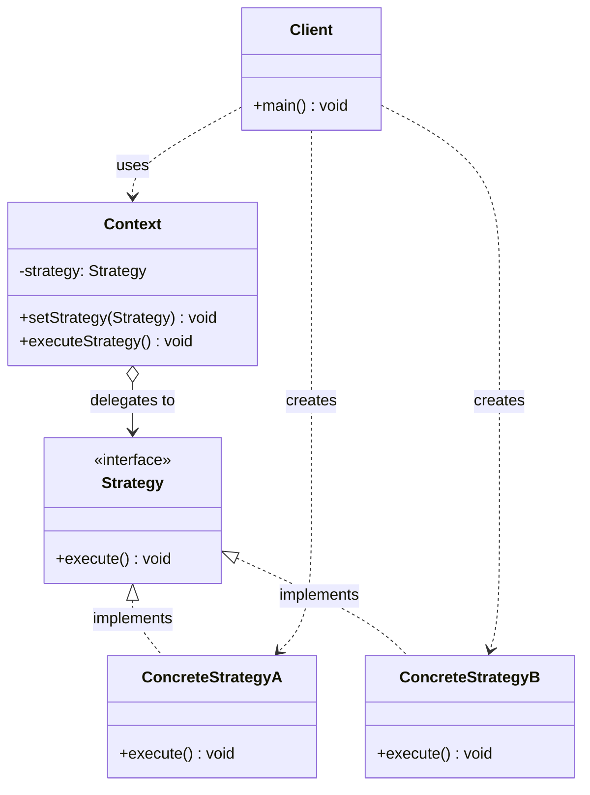

# 전략(Strategy) 디자인 패턴 가이드

> 한 줄 요약: 동일한 목적을 가진 알고리즘군을 각각 별도의 객체로 캡슐화하여, 클라이언트가 사용하는 알고리즘을 런타임에 자유롭게 교체할 수 있도록 만드는 행위 패턴이다.
>
> 분류: 행위 패턴(Behavioral Pattern)
> 다른 이름(Aliases): 정책 패턴(Policy)

---

## 상세 설명

전략(Strategy) 패턴은 GoF가 정의한 23개 디자인 패턴 중 행위(Behavioral) 범주에 속하는 패턴으로, "같은 목적을 달성하는 여러 알고리즘이 존재할 때, 그 알고리즘들을 각각 독립된 객체로 추상화하고 서로 교체 가능하게 만들자"는 의도(Intent)에서 출발한다. 클라이언트는 알고리즘의 구체 구현에 직접 의존하지 않고, 추상화된 인터페이스(Strategy Interface)에만 의존한다.

이 패턴이 해결하고자 하는 핵심 문제(Problem)는 다음과 같다. 하나의 컨텍스트(Context)가 어떤 작업을 수행하는데, 그 작업의 세부 알고리즘이 상황에 따라 달라져야 한다고 하자. 가장 단순한 접근은 `if/else`나 `switch` 분기로 조건마다 다른 코드를 실행하는 것이다. 그러나 이 방식은 (1) 컨텍스트 클래스가 모든 알고리즘 변형을 알고 있어야 하고, (2) 알고리즘이 추가될 때마다 분기문이 늘어나며, (3) 알고리즘과 컨텍스트가 강하게 결합(tight coupling)되어 단위 테스트나 재사용이 어렵다는 단점이 있다. 개방-폐쇄 원칙(Open-Closed Principle)을 위반하게 되는 전형적인 구조다.

전략 패턴이 제안하는 해결책(Solution)은 알고리즘들을 공통 인터페이스를 구현하는 별도의 클래스로 분리하고, 컨텍스트는 그 인터페이스 타입의 참조만 보유하도록 하는 것이다. 컨텍스트는 자신이 위임받은 전략(Strategy) 객체에게 작업을 위임(delegate)할 뿐, 어떤 구체 전략이 동작하는지는 알 필요가 없다. 새로운 알고리즘이 필요하면 인터페이스를 구현하는 새 클래스를 추가하면 되므로 컨텍스트 코드를 손대지 않아도 된다.

전략 패턴을 구성하는 핵심 용어는 세 가지다. 첫째, 전략 인터페이스(Strategy)는 모든 구체 알고리즘이 공통으로 따라야 하는 시그니처를 선언한다. 둘째, 구체 전략(Concrete Strategy)은 그 인터페이스를 구현한 실제 알고리즘이다. 셋째, 컨텍스트(Context)는 전략을 보유·사용하는 클래스이며, 외부에서 전략을 주입받아(setter나 생성자) 자신의 동작을 위임한다.

역사적으로 전략 패턴은 GoF 책(1994)에서 정식화되었지만, 그 이전부터 콜백(callback), 함수 포인터, 정책 클래스(C++ policy-based design) 같은 형태로 광범위하게 쓰여 왔다. 함수형 언어나 1급 함수를 지원하는 언어(예: Java 8+ Lambda, JavaScript)에서는 전략 객체를 단일 함수(혹은 함수형 인터페이스)로 단순화하는 변형이 자연스럽게 활용된다. `java.util.Comparator`가 대표적인 예다.

---

## 디자인 패턴을 충족하는 최소 조건

이 섹션에서는 "어떤 코드가 진짜로 전략 패턴이라고 부를 수 있는가"의 기준을 명확히 한다.

1. **공통 인터페이스(또는 추상 타입)의 존재** — 교체 대상이 되는 알고리즘들이 모두 동일한 인터페이스(혹은 추상 클래스, 함수형 시그니처)를 구현해야 한다. 클라이언트는 이 추상 타입에만 의존한다.
2. **알고리즘의 객체화** — 각 알고리즘이 독립된 객체(혹은 1급 함수)로 캡슐화되어 있어야 한다. 같은 클래스 내부의 분기문이 단지 메서드로 추출된 것만으로는 전략 패턴이 아니다.
3. **런타임 교체 가능성(Interchangeability)** — 컨텍스트가 보유한 전략 객체를 런타임에 다른 전략 객체로 바꿔 끼울 수 있어야 한다. 보통 생성자 주입, setter, 또는 메서드 인자 형태로 주입된다.
4. **위임(Delegation) 관계** — 컨텍스트는 알고리즘을 직접 구현하지 않고, 보유한 전략 객체에 위임한다. 즉 컨텍스트는 "무엇을 할지"는 알지만 "어떻게 할지"는 모른다.

> 위 조건 중 하나라도 빠지면 본 패턴이라고 보기 어렵다. 특히 1번과 3번이 동시에 만족되지 않으면 단순한 다형성 활용이거나, 절차적 분기를 객체로 흉내 낸 위장(weak) 전략 패턴으로 분류된다.

### 흔히 오해하는 지점

- **State 패턴과의 혼동** — 전략(Strategy)과 상태(State)는 구조적으로 거의 동일한 UML을 갖지만, 의도(Intent)가 다르다. 전략은 "같은 목적의 알고리즘 중 하나를 외부에서 선택"하는 것이 목적이고, 상태는 "객체의 내부 상태에 따라 행동이 자동으로 달라지는 것"이 목적이다. 전략 객체들은 서로의 존재를 모르지만, 상태 객체들은 보통 다음 상태로의 전이(transition)를 알고 있다. 또 전략은 클라이언트가 명시적으로 어떤 전략을 쓸지 결정하지만, 상태는 컨텍스트의 상태 변화에 따라 암묵적으로 결정된다.
- **단순 if/else 함수 추출과의 구분** — 알고리즘을 메서드로 잘게 쪼개고 `if (type == "A") doA(); else doB();`로 호출하는 것은 전략 패턴이 아니다. 새 알고리즘이 추가될 때 컨텍스트의 분기문을 고쳐야 한다면, 이는 개방-폐쇄 원칙을 어기는 분기 코드일 뿐이다. 전략 패턴이 되려면 분기 자체가 사라지고, 객체 주입으로 대체되어야 한다.
- **Template Method와의 혼동** — Template Method는 상속(Inheritance) 기반으로 알고리즘의 골격을 부모가 정의하고 일부 단계만 자식이 오버라이드하는 구조다. 전략 패턴은 합성(Composition) 기반으로 알고리즘 전체를 통째로 교체한다. "상속 vs 합성"이 가장 중요한 차이점이다.
- **모든 다형성을 전략으로 부르는 오류** — 다형성(polymorphism)을 활용한 코드라고 해서 전부 전략 패턴은 아니다. 전략은 "교체 가능한 알고리즘"이라는 의도가 명확히 드러나야 한다.

---

## 사례를 통한 예시

### 예시 1: 할인 정책(Discount Policy)을 런타임에 교체하기

**상황**: 쇼핑몰 결제 시스템에서 주문 금액에 적용할 할인 정책이 여러 가지(정액 할인, 정률 할인, VIP 할인 등) 있고, 사용자 등급이나 프로모션에 따라 런타임에 정책을 바꿔야 한다.

```java
// 전략 인터페이스(Strategy)
public interface DiscountStrategy {
    int applyDiscount(int originalPrice);
}

// 구체 전략 1: 정액 할인(Flat Discount)
public class FlatDiscountStrategy implements DiscountStrategy {
    private final int amount;

    public FlatDiscountStrategy(int amount) {
        this.amount = amount;
    }

    @Override
    public int applyDiscount(int originalPrice) {
        return Math.max(0, originalPrice - amount);
    }
}

// 구체 전략 2: 정률 할인(Percentage Discount)
public class PercentageDiscountStrategy implements DiscountStrategy {
    private final double rate; // 0.0 ~ 1.0

    public PercentageDiscountStrategy(double rate) {
        this.rate = rate;
    }

    @Override
    public int applyDiscount(int originalPrice) {
        return (int) (originalPrice * (1.0 - rate));
    }
}

// 구체 전략 3: 할인 없음(Null Object 형태)
public class NoDiscountStrategy implements DiscountStrategy {
    @Override
    public int applyDiscount(int originalPrice) {
        return originalPrice;
    }
}

// 컨텍스트(Context)
public class Order {
    private final int price;
    private DiscountStrategy discountStrategy;

    public Order(int price) {
        this.price = price;
        this.discountStrategy = new NoDiscountStrategy(); // 기본값
    }

    public void setDiscountStrategy(DiscountStrategy strategy) {
        this.discountStrategy = strategy;
    }

    public int calculateFinalPrice() {
        return discountStrategy.applyDiscount(price);
    }
}

// 클라이언트 사용 예시
public class Client {
    public static void main(String[] args) {
        Order order = new Order(10_000);

        order.setDiscountStrategy(new FlatDiscountStrategy(1_500));
        System.out.println(order.calculateFinalPrice()); // 8500

        order.setDiscountStrategy(new PercentageDiscountStrategy(0.2));
        System.out.println(order.calculateFinalPrice()); // 8000
    }
}
```

**해설**: `DiscountStrategy`가 전략 인터페이스, `FlatDiscountStrategy`·`PercentageDiscountStrategy`·`NoDiscountStrategy`가 구체 전략, `Order`가 컨텍스트다. `Order`는 할인이 "어떻게" 계산되는지 전혀 모른 채 `discountStrategy.applyDiscount(...)`로 위임한다. 새로운 할인 정책(예: 회원 등급별 차등 할인)이 추가되어도 `Order` 클래스는 수정할 필요가 없다. 분기문 대신 객체 주입으로 알고리즘을 선택하는 것이 핵심이다.

### 예시 2: 정렬 알고리즘 직접 구현 — `SortContext`

**상황**: 동일한 입력 데이터에 대해 정렬 방식(오름차순/내림차순/문자열 길이순 등)을 런타임에 선택해야 한다.

```java
import java.util.Arrays;

// 전략 인터페이스
public interface SortStrategy {
    void sort(Integer[] data);
}

// 구체 전략 1: 오름차순(Ascending)
public class AscendingSort implements SortStrategy {
    @Override
    public void sort(Integer[] data) {
        Arrays.sort(data);
    }
}

// 구체 전략 2: 내림차순(Descending)
public class DescendingSort implements SortStrategy {
    @Override
    public void sort(Integer[] data) {
        Arrays.sort(data, (a, b) -> b - a);
    }
}

// 컨텍스트
public class SortContext {
    private SortStrategy strategy;

    public SortContext(SortStrategy strategy) {
        this.strategy = strategy;
    }

    public void setStrategy(SortStrategy strategy) {
        this.strategy = strategy;
    }

    public void executeSort(Integer[] data) {
        strategy.sort(data);
    }
}

public class SortClient {
    public static void main(String[] args) {
        Integer[] data = {3, 1, 4, 1, 5, 9, 2, 6};
        SortContext ctx = new SortContext(new AscendingSort());
        ctx.executeSort(data);
        System.out.println(Arrays.toString(data)); // [1, 1, 2, 3, 4, 5, 6, 9]

        ctx.setStrategy(new DescendingSort());
        ctx.executeSort(data);
        System.out.println(Arrays.toString(data)); // [9, 6, 5, 4, 3, 2, 1, 1]
    }
}
```

**해설**: 정렬 알고리즘 자체를 캡슐화한 가장 전형적인 전략 패턴 예시다. `SortContext`는 어떻게 정렬되는지 모르며, 단지 주입받은 `SortStrategy`에 위임한다.

### 예시 3: 실제 라이브러리 사례 — `java.util.Comparator`

`java.util.Comparator<T>`는 자바 표준 라이브러리에서 가장 광범위하게 사용되는 전략 패턴 구현체다. `Comparator`는 두 객체를 비교하는 알고리즘 하나를 캡슐화하는 함수형 인터페이스이며, `Collections.sort`, `List.sort`, `Arrays.sort`, `TreeSet`, `Stream.sorted` 등이 모두 `Comparator`를 전략으로 받아 정렬 방식을 위임한다.

```java
import java.util.Arrays;
import java.util.Comparator;
import java.util.List;

public class ComparatorStrategyExample {
    public static void main(String[] args) {
        List<String> words = Arrays.asList("banana", "fig", "apple", "cherry");

        // 전략 1: 알파벳 순(자연 순서)
        Comparator<String> alphabetical = Comparator.naturalOrder();
        words.sort(alphabetical);
        System.out.println(words); // [apple, banana, cherry, fig]

        // 전략 2: 길이 순
        Comparator<String> byLength = Comparator.comparingInt(String::length);
        words.sort(byLength);
        System.out.println(words); // [fig, apple, banana, cherry]

        // 전략 3: 길이 내림차순 + 알파벳 순(체이닝)
        Comparator<String> composite = Comparator
                .comparingInt(String::length).reversed()
                .thenComparing(Comparator.naturalOrder());
        words.sort(composite);
        System.out.println(words);
    }
}
```

**해설**: `List.sort(Comparator)`가 컨텍스트 역할을 하고, `Comparator`의 각 구현체(또는 람다)가 구체 전략이다. `List`는 정렬을 직접 수행하지 않고 비교 알고리즘을 `Comparator`에 위임한다. Java 8 이후로는 람다와 `Comparator.comparing`/`thenComparing` 같은 정적 팩토리·결합 메서드로 전략을 함수형으로 합성할 수 있어, 전략 패턴이 1급 함수 형태로 진화한 전형적인 사례를 보여준다.

---

## 어떨 때 사용하나

다음과 같은 신호(Symptom)가 보일 때 전략 패턴 도입을 고려한다.

- 하나의 클래스 안에 같은 목적을 달리 수행하는 알고리즘들이 `if/else` 또는 `switch`로 늘어서 있고, 새로운 변형이 자주 추가된다.
- 알고리즘별로 사용하는 자료구조·헬퍼·임시 상태가 달라서, 한 클래스에 다 욱여넣으면 메서드/필드가 비대해지고 관련 없는 코드가 섞인다.
- 런타임에 사용자 입력, 설정 파일, 환경 변수, A/B 테스트 등에 따라 동작 방식을 바꿔야 한다.
- 알고리즘 각각을 독립적으로 단위 테스트하고 싶다(컨텍스트 없이 전략만 따로 테스트 가능).
- 알고리즘이 도메인 정책(business policy)을 표현하고 있어, 정책 변경의 영향 범위를 한 클래스로 한정하고 싶다.
- 같은 인터페이스로 묶이는 알고리즘들이 외부 라이브러리·플러그인으로 제공될 가능성이 있다.

### 사용하면 안 되는 경우 (Anti-patterns)

- **알고리즘이 단 한 가지이고, 향후에도 늘어날 가능성이 거의 없는 경우** — 추상화 비용만 늘고 얻는 것이 없다. YAGNI(You Aren't Gonna Need It) 원칙에 따라 그냥 메서드로 둔다.
- **알고리즘들 사이의 차이가 한두 줄에 불과한 경우** — 인터페이스, 구체 클래스, 주입 코드까지 만드는 것은 과한 추상화다. 람다나 함수 파라미터로 충분하다.
- **알고리즘이 컨텍스트의 내부 상태에 강하게 의존해 거의 분리할 수 없는 경우** — 전략 객체가 컨텍스트의 private 필드를 모두 알아야 한다면, 사실상 같은 클래스로 묶이는 게 맞고 강제로 분리하면 캡슐화가 깨진다.
- **상태 전이가 본질인 경우** — 객체의 내부 상태에 따라 행동이 자동으로 바뀌어야 한다면 State 패턴이 더 적합하다.
- **알고리즘의 골격은 같고 일부 단계만 다른 경우** — 이 경우 Template Method가 더 자연스럽다.

---

## 장점과 단점, 한계점

### 장점
- **개방-폐쇄 원칙(OCP) 준수**: 새 알고리즘을 추가할 때 기존 컨텍스트 코드를 수정하지 않고 새 전략 클래스를 추가하기만 하면 된다.
- **분기문 제거로 인한 가독성 향상**: 거대한 `if/else`·`switch` 블록이 다형성으로 대체되어, 컨텍스트 코드가 알고리즘 선택의 부담에서 해방된다.
- **알고리즘의 독립적 재사용·테스트**: 각 전략은 컨텍스트 없이도 단독으로 인스턴스화·테스트할 수 있어 단위 테스트가 쉬워진다.
- **런타임 유연성**: 동일 객체의 동작을 실행 도중에 바꿀 수 있어, 사용자 설정·실험·플러그인 같은 동적 시나리오에 강하다.
- **합성 기반 설계**: 상속에 의존하지 않고 합성(Composition)으로 행위를 조립하므로, 다중 상속의 함정이나 깊은 상속 계층의 취약성을 피한다.

### 단점
- **클래스 수 증가**: 알고리즘 변형마다 클래스가 늘어나, 작은 프로젝트에서는 오히려 코드베이스가 비대해 보일 수 있다.
- **클라이언트가 전략을 알아야 한다**: 어떤 전략을 주입할지 결정하는 책임이 클라이언트로 옮겨가므로, 클라이언트가 모든 구체 전략의 특성을 이해해야 하는 부담이 생긴다.
- **컨텍스트-전략 간 통신 오버헤드**: 전략이 컨텍스트의 데이터에 접근해야 할 때, 인자로 넘기거나 컨텍스트를 통째로 넘겨야 하는 등 인터페이스가 지저분해질 수 있다.
- **간단한 분기에 적용하면 과설계**: 분기 두세 개를 굳이 전략으로 만들면 오히려 코드 흐름을 따라가기 어렵다.

### 한계점
- **언어가 1급 함수를 지원하면 더 가볍게 표현 가능**: Java 8 이후 람다, Kotlin·Scala의 함수 타입, Python·JavaScript의 일급 함수가 있는 환경에서는 전체 인터페이스+구체 클래스 구조가 과해 보일 수 있고, 함수 파라미터 한 줄로 같은 효과를 낼 수 있다. 즉 "객체로서의 전략"이 항상 최적은 아니다.
- **공유 상태가 있는 경우 동시성 주의**: 여러 컨텍스트가 같은 전략 인스턴스를 공유하면, 전략이 내부 상태를 가질 경우 스레드 안전성 문제가 발생할 수 있다. 가능하면 전략을 무상태(stateless)로 설계해야 한다.
- **전략 선택 로직 자체는 어딘가에 남는다**: 분기문을 컨텍스트에서 없앴어도, "어떤 전략을 만들까"를 결정하는 코드(팩토리, DI 설정, 매핑 테이블)는 어딘가에 존재한다. 그 책임을 어디에 둘지가 새로운 설계 문제로 옮겨간다.
- **인터페이스의 일관성 강제**: 모든 전략이 동일한 시그니처를 따라야 하므로, 일부 전략에만 특수한 파라미터가 필요한 경우 인터페이스가 어색해지거나 옵션 객체를 도입해야 한다.

---

## 정보 표

| 항목 | 값 |
| --- | --- |
| 분류 | 행위 패턴(Behavioral) |
| 언어 의존성 | 언어 비의존적. 단, 1급 함수/람다를 지원하는 언어(Java 8+, Kotlin, JavaScript 등)에서는 함수형으로 간결하게 표현할 수 있다. |
| 활용성(1점~5점) | 5/5 — 표준 라이브러리(`Comparator`, `LayoutManager`)와 실무 도메인 정책(결제·할인·인증 정책 등) 양쪽에서 가장 빈번하게 등장하는 행위 패턴 중 하나다. |
| 학습 난이도 | 하 — 인터페이스와 합성만 이해하면 구조가 단순하고 직관적이다. |
| 자주 함께 쓰이는 패턴 | Factory Method(전략 인스턴스 생성), Template Method(알고리즘 골격 vs 알고리즘 전체 교체), State(구조는 같지만 의도가 다른 대조 패턴), Decorator(전략을 합성하거나 래핑) |
| 대표 사용 사례 | `java.util.Comparator`, `javax.swing.LayoutManager`, Spring Security의 `AuthenticationProvider`, 결제/할인/배송비 정책, 압축·암호화 알고리즘 선택 |

---

## Class Diagram



> 다이어그램에 등장하는 각 클래스가 패턴의 어떤 역할(Role)을 담당하는지 위 "상세 설명" 섹션과 1:1로 대응되어야 한다.

### 역할 설명
- **Context(컨텍스트)**: 전략(Strategy) 객체에 대한 참조를 보유하며, 외부 요청을 받아 보유 중인 전략에 작업을 위임한다. 알고리즘의 세부 구현은 모르고, "무엇을 위임할지"만 안다. 예시의 `Order`, `SortContext`, `List.sort`가 이 역할이다.
- **Strategy(전략 인터페이스)**: 모든 구체 전략이 따라야 하는 공통 시그니처를 선언하는 추상 타입이다. Context는 오직 이 타입에만 의존한다. 예시의 `DiscountStrategy`, `SortStrategy`, `java.util.Comparator`가 이 역할이다.
- **ConcreteStrategyA / ConcreteStrategyB(구체 전략)**: 전략 인터페이스를 구현한 실제 알고리즘이다. 서로의 존재를 모르며, 각각 독립적으로 테스트·교체될 수 있다. 예시의 `FlatDiscountStrategy`, `PercentageDiscountStrategy`, `AscendingSort` 등이 이 역할이다.
- **Client(클라이언트)**: 어떤 구체 전략을 사용할지 결정하고, 그 전략을 Context에 주입(생성자 또는 setter)한다. 전략 선택의 책임은 클라이언트에게 있다.

---

## 참고 자료
- Erich Gamma, Richard Helm, Ralph Johnson, John Vlissides, *Design Patterns: Elements of Reusable Object-Oriented Software* (GoF, 1994) — Strategy 패턴 정식 정의.
- Refactoring.Guru, "Strategy" — https://refactoring.guru/design-patterns/strategy
- Joshua Bloch, *Effective Java* (3rd Edition) — Item 42·44 (함수 객체와 표준 함수형 인터페이스, 람다와 전략 패턴의 관계).
- Oracle Java Documentation, `java.util.Comparator` — https://docs.oracle.com/en/java/javase/17/docs/api/java.base/java/util/Comparator.html
- Oracle Java Documentation, `java.awt.LayoutManager` / `javax.swing` 레이아웃 매니저 — 컨테이너의 자식 배치 알고리즘을 전략으로 위임하는 대표 사례.
- Robert C. Martin, *Agile Software Development: Principles, Patterns, and Practices* — OCP와 전략 패턴의 관계.
