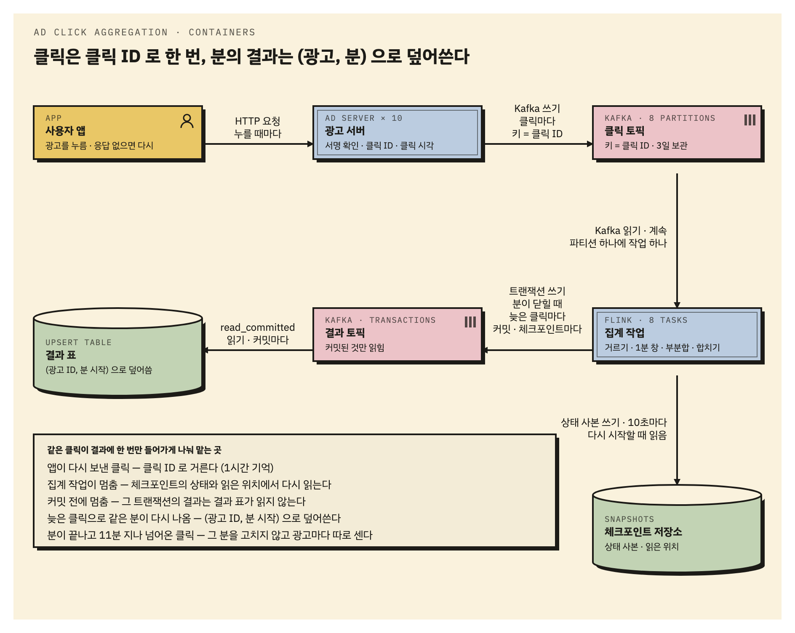
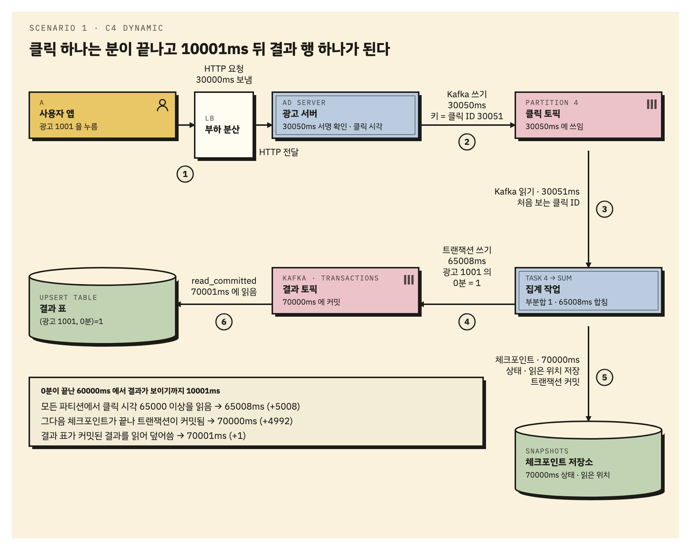
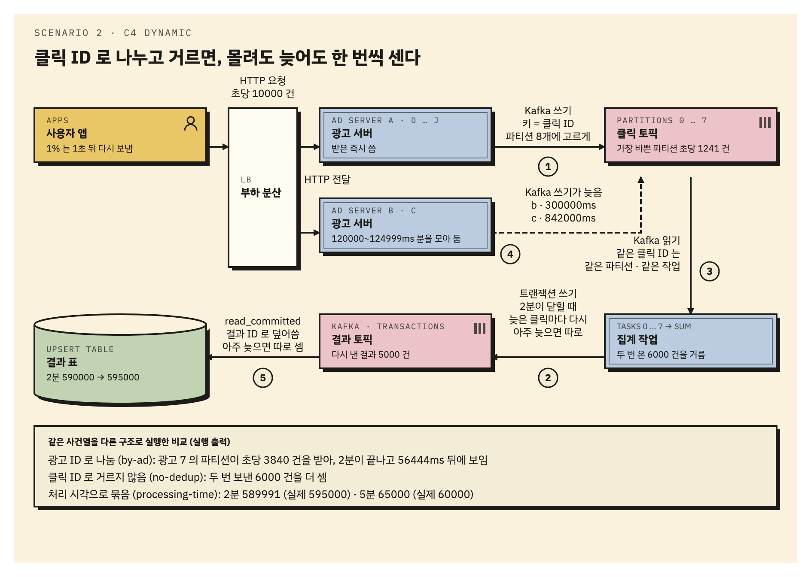
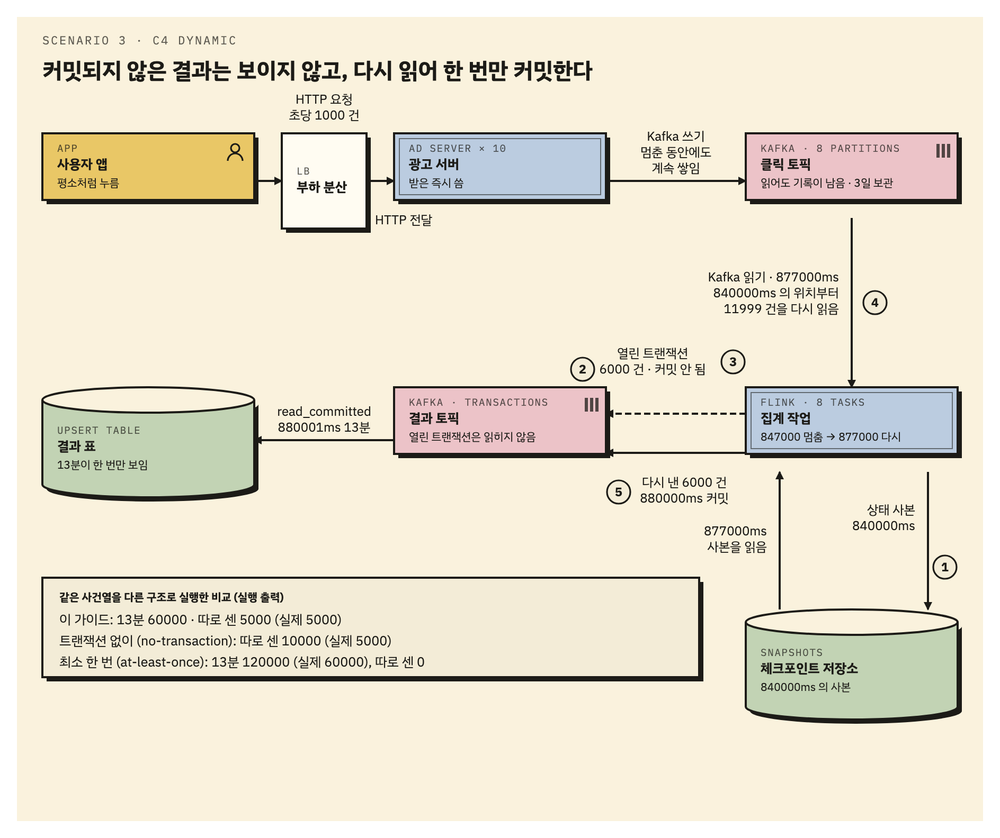

# 광고 클릭 집계 — 클릭 ID 로 한 번만 받아 클릭 ID 로 나눠 세고, 분마다의 결과는 체크포인트에 커밋해 (광고 ID, 분 시작) 으로 덮어쓴다

## 문제와 요구사항

광고 네트워크가 사용자가 광고를 누를 때마다 광고주에게 돈을 받는다고 해 봅시다. 광고주는 광고마다 1분 단위 클릭 수를 보고, 예산 쪽은 그 수를 보고 예산이 바닥난 광고를 멈춰요. 그래서 이 수는 많아도 적어도 안 됩니다. 많으면 광고주에게 더 청구하고, 적으면 받을 돈을 잃어요. 가장 먼저 떠오르는 구조는 클릭이 올 때마다 데이터베이스에서 그 광고의 행에 1 을 더하는 것입니다. 이 구조는 세 곳에서 어긋나요. 응답을 못 받은 앱이 같은 클릭을 다시 보내면 1 이 두 번 더해집니다. 피크에 한 광고로 몰린 클릭은 행 하나에 초당 3천 번의 쓰기가 되고(규모 추정 [2]), 늦게 넘어온 클릭은 일어난 분이 아니라 도착한 분에 더해져요.

```text
클릭마다 행에 1 더하기                          이 글
  클릭 ──▶ 광고 7 의 행 += 1                     클릭 ──▶ 광고 서버: 클릭 ID 를 붙여 클릭 토픽에 씀 (키 = 클릭 ID)
  다시 보낸 클릭 ──▶ += 1 (두 번 셈)                    ──▶ 집계 작업: 클릭 ID 로 거르고, 클릭 시각의 1분 창에서 셈
  늦게 온 클릭 ──▶ 도착한 분에 += 1                       ──▶ 결과 토픽: 체크포인트마다 트랜잭션으로 커밋
  광고 7 의 행 하나에 초당 3000 번 쓰기                    ──▶ 결과 표: 커밋된 것만 읽어 (광고 ID, 분 시작) 행을 덮어씀
                                                광고 7 로 몰린 클릭은 클릭 ID 로 나뉘어 작업 8개가 부분합을 냄
```

그림의 이름을 먼저 소개합니다. 광고 서버는 광고를 내보내고 클릭 요청을 받는 서버예요. 클릭 ID(identifier, 식별자)는 클릭 하나를 알아보는 값으로, 이 글은 광고를 내보낼 때 광고 서버가 만들어 둔 노출 ID 를 그대로 씁니다. Kafka 는 기록을 순서대로 쌓아 두고 여러 소비자가 각자 읽게 하는 분산 로그이고, 토픽은 그 안의 기록 묶음 하나예요. 토픽은 다시 파티션(기록이 따로 쌓이는 칸)으로 나뉩니다. 집계 작업은 Flink(기록의 흐름을 받아 상태를 가진 채 계속 계산하는 스트림 처리 엔진)로 실행하는 작업으로, 클릭을 1분 창(정해진 시간 구간)마다 셉니다. 집계 작업 안에서 파티션을 하나씩 맡는 병렬 실행 단위는 그냥 「작업」이라고 부르고, 작업마다 따로 센 수를 부분합이라고 불러요. 체크포인트는 그 작업의 상태와 각 파티션을 어디까지 읽었는지를 함께 저장해 둔 사본이고, 트랜잭션은 여러 기록을 한꺼번에 쓰거나 하나도 쓰지 않는 묶음이고, 그 묶음을 확정해 읽을 수 있게 하는 일을 커밋이라고 해요. 결과 표는 광고주 · 예산 쪽이 조회하는 분 단위 수의 표입니다. 끝까지 읽으면 클릭 하나가 결과 행 하나가 되기까지 어느 상자를 어떤 순서로 지나는지 실행 출력으로 확인할 수 있어요. 같은 클릭이 두 번 오거나, 한 광고로 몰리거나, 늦게 넘어오거나, 집계 작업이 멈출 때 무엇이 수를 한 번으로 지키는지도 확인할 수 있고, 요구 수치가 바뀌면 어느 구조로 옮길지 판단할 수 있게 됩니다.

기능 요구는 아래 셋이고, 비기능 요구는 그 뒤의 표처럼 수치로 고정합니다. 근거 칸의 인용은 리서치 노트에서 원문과 글자 그대로 대조한 것이고, 링크는 참고 자료에 다시 모았어요.

1. 사용자가 광고를 누르면 그 클릭은 광고 서버가 받은 시각이 속한 분의 그 광고 수에 한 번 들어갑니다. 앱이 같은 클릭을 다시 보내도, 같은 노출에서 여러 번 눌러도 한 번이에요. 과금 대상은 노출 뒤 30분 안에 누른 클릭이고, 그보다 늦은 클릭은 광고 서버가 받지 않아요(이 가이드의 가정 — 광고 정책).
2. 광고주와 예산 쪽은 광고마다 분 단위 클릭 수를 조회합니다. 시간 · 하루 단위 수는 분 단위 수를 더해 얻어요.
3. 광고 서버가 늦게 넘긴 클릭도 버리지 않습니다. 정해진 시간 안이면 제 분의 수에 들어가고, 그 분의 수가 확정된 뒤에 넘어오면 광고마다 따로 세어 하루 정산으로 넘겨요.

| 항목 | 수치 | 근거 |
| --- | --- | --- |
| 1. 클릭 처리량 | 피크에 초당 1만 건, 평소에 초당 1천 건 | 이 가이드의 가정 — 교육용 분석인 Hello Interview 가 광고 클릭 집계를 설계하며 정한 조건(「We are going to design for a system that has 10M active ads and a peak of 10k clicks per second.」)과, 평균을 피크의 10분의 1 로 어림한 같은 글의 방법을 빌렸어요([Hello Interview 광고 클릭 집계 분석](https://www.hellointerview.com/learn/system-design/problem-breakdowns/ad-click-aggregator), 2차 자료). Delivery Hero 는 광고 측정 파이프라인이 피크에 초당 2만 건의 메시지를 처리한다고 적어요(「The pipeline sustains 20,000 messages per second at peak」, [AWS(Amazon Web Services) 블로그의 Delivery Hero 글](https://aws.amazon.com/blogs/big-data/how-delivery-hero-rebuilt-real-time-ad-measurement-with-apache-flink/)). 실제 광고 파이프라인 하나와 같은 자릿수라 이 값으로 잡았습니다 |
| 2. 광고 수 | 활성 광고 1천만 개 | 이 가이드의 가정 — 같은 Hello Interview 분석의 조건이에요. 분마다 결과 행이 몇 개까지 나올 수 있는지와 상태 크기의 상한을 정하는 값이라 함께 빌렸어요 |
| 3. 한 광고에 몰림 | 피크 클릭의 30%(초당 3천 건)가 광고 하나로 와도 4행과 7행을 지킴 | 이 가이드의 가정 — 큰 행사의 광고 하나가 그 시간대 클릭의 큰 몫을 받는 경우의 상한으로 잡았어요. 한 광고에 몰리는 비율을 밝힌 공개 자료는 찾지 못했습니다 |
| 4. 결과 지연 | 분이 끝난 뒤 30초 안에 그 분의 광고별 클릭 수가 조회됨. 집계 작업이 멈추지 않았고, 광고 서버가 클릭을 받은 뒤 5초 안에 넘긴 경우 | 이 가이드의 가정 — 예산이 바닥난 광고를 그다음 분의 절반이 지나기 전에 멈출 수 있게 잡은 값이에요. 5초는 광고 서버가 평소 클릭을 넘기는 데 걸리는 시간의 가정입니다(규모 추정의 입력) |
| 5. 늦게 넘어온 클릭 | 그 분이 끝나고 10분 안에 넘어온 클릭은 그 분의 수에 들어가고, 넘어온 뒤 30초 안에 조회되는 수에 반영됨 | 이 가이드의 가정 — 그 분의 수에 넣어 주는 늦음의 한도로, 광고주가 보는 분 단위 수가 그 분이 끝나고 10분쯤이면 거의 다 채워지게 잡았어요. 광고 서버는 Kafka 쓰기가 막히면 30분까지 클릭을 모아 두었다 넘기는데(기술 상세 설명의 광고 서버), 그 가운데 10분보다 늦게 넘어온 클릭도 잃지 않아요. 11분이 지나 넘어온 것은 6행대로 따로 셉니다 |
| 6. 아주 늦은 클릭 | 그 분이 끝나고 11분이 지나 넘어온 클릭은 그 분의 수를 바꾸지 않고, 버리지도 않고 광고마다 따로 셈. 10분과 11분 사이에 넘어온 클릭은 어느 쪽에 들어가도 됨 | 11분은 5행이 끝나는 때를 분 단위로 올린 확정 시각이에요. 5행은 분이 끝나고 10분 안에 넘어온 클릭을 넘어온 뒤 30초 안에 반영하라는 것이라, 늦어도 10분 30초에 끝납니다. 그래서 10분과 11분 사이에 넘어온 클릭을 그 분에 넣을지는 5행이 요구하지 않고, 이 행이 요구하는 것은 11분이 지나면 그 분의 수가 바뀌지 않고 그 뒤의 클릭은 따로 세는 것뿐이에요(이 가이드의 가정). Google 은 클릭과 검색 질의를 붙이는 시스템 Photon 의 요구로 「Google loses money for every click which is not processed by Photon.」를 적어요([Photon 논문](https://research.google/pubs/pub41318/)). 과금이라 잃은 클릭은 그대로 매출 손실입니다 |
| 7. 정확도 | 그 분에 광고 서버가 받은 서로 다른 클릭은 그 분의 수와 따로 센 수 가운데 한 곳에 한 번씩 들어감(10분 안이면 그 분, 11분이 지나면 따로, 5 · 6행). 더 바뀌지 않게 된 분(분이 끝나고 11분 뒤)의 광고별 수는 그 분에 넣은 클릭 수와, 따로 센 수는 따로 센 클릭 수와 같음, 허용 오차 0. 같은 클릭은 몇 번 와도, 집계 작업이 몇 번 다시 시작해도 한 번 | Photon 은 「Photon must guarantee that a single click is never processed twice, since this leads to double-charging the advertisers.」를, Uber 는 광고 이벤트 처리의 요구로 「We can’t afford to overcount events.」를 적어요([Uber 광고 이벤트 처리 글](https://www.uber.com/blog/real-time-exactly-once-ad-event-processing/)). 둘 다 요구이고 달성한 정확도 수치가 아닙니다. 많이 세면 광고주에게 더 청구하고 적게 세면 6행의 손실이라 허용 오차를 두지 않아요 |
| 8. 멈춘 뒤 회복 | 집계 작업이 멈췄다 다시 시작하면, 그때까지 조회되지 않던 분의 수가 다시 시작한 뒤 30초 안에 조회되고 7행은 그대로 | 이 가이드의 가정 — 멈춘 시간은 막지 못해도, 다시 뜬 뒤에는 4행과 같은 30초 안에 따라잡아야 예산 쪽이 옛 수로 움직이는 시간이 멈춘 시간 + 30초에서 끝나요. 이 구조가 이 행을 지키는 멈춤의 길이는 요구가 아니라 계산과 변형 실행으로 구해 전환점 7 에 둡니다 |

일부러 다루지 않는 것도 적어 둡니다.

- 부정 클릭(봇 · 클릭 농장)을 가려내는 일은 다루지 않습니다. 노출 ID 의 서명은 위조한 ID 만 막아요.
- 노출 수 집계와 전환 귀속은 다루지 않습니다. 전환 귀속은 클릭 뒤에 일어난 구매를 어느 광고 몫으로 셀지 정하는 일로, Uber 글에서는 Attribution 작업이 맡아요.
- 광고 서버에 도착하기 전에 사라진 클릭과, 광고 서버가 모아 둔 클릭을 디스크째 잃는 경우는 다루지 않습니다. 광고 서버가 받은 클릭부터 셉니다.
- 작업을 두 벌 띄워 멈춤을 없애는 일은 범위 밖이에요. Uber 는 두 리전(서로 떨어진 데이터 센터 묶음)에서 작업을 실행한다고 적지만(Uber 광고 이벤트 처리 글) 이 글은 한 벌만 봅니다.
- 결과 표의 이력 보관, 시간 · 하루 표 만들기, 예산 쪽이 광고를 멈추는 일은 다루지 않습니다.

## 규모 추정

식에 쓰는 이름을 먼저 짚어 둡니다. 파티션은 Kafka 토픽을 나눈 칸이고, 기록마다 붙은 키의 해시(값을 정해진 범위의 수로 바꾸는 계산)가 어느 파티션에 쓸지를 정해요. 작업(task)은 Flink 가 파티션 하나를 맡겨 실행하는 병렬 실행 단위입니다. 워터마크는 작업이 「이 시각보다 이른 클릭은 이제 다 왔다」고 보는 선이고, 그 선이 분의 끝을 지나야 그 분의 수를 냅니다(시나리오 1 의 4단계). 작업 하나가 초당 처리하는 클릭 수는 재지 않은 가정이에요. 이 글은 피크 초당 1만 건을 작업 8개로 나누고 1.6배의 여유를 둔 값으로 초당 2천 건을 잡았습니다.

```text
(입력)  피크 초당 10,000 건 · 평소 초당 1,000 건(요구 1행) · 활성 광고 10,000,000 개(요구 2행) · 한 광고 30%(요구 3행, 이 글의 광고 7)
        결과 지연 30초(요구 4행) · 늦게 넘어온 클릭을 제 분에 넣는 범위 10분(요구 5행)
        광고 서버가 평소 클릭을 넘기는 데 걸리는 시간 5초 · Kafka 쓰기가 막혀도 30분까지 모아 두었다 넘김(가정 — 광고 서버가 견디는 막힘)
        과금 대상은 노출 뒤 30분 안의 클릭(가정 — 광고 정책) → 클릭 ID 를 기억하는 시간 1시간(계산 — 30분 + 30분)
        파티션 · 작업 8개, 작업 하나가 처리하는 클릭 초당 2,000 건(가정 — 10,000 ÷ 8 × 1.6)
        클릭 ID 를 기억하는 데 한 건 32바이트 · 원시 클릭 한 건 100바이트 · Kafka 복제 3벌(가정)
        피크가 이어지는 시간 60초 · 피크가 끝나면 광고 7 로 몰리지 않음(가정 — 시나리오 2 와 같음) · 클릭 토픽 보관 3일(가정 — Uber 의 값을 빌림)
        결과 표가 커밋된 결과를 반영하는 데 1ms(가정 — 실행의 값)

[1] 하루 클릭                    평소 1,000 건/초 × 86,400 초 = 86,400,000 건
                                (피크가 하루 내내 이어지면 10,000 × 86,400 = 864,000,000 건이 상한)
[2] 클릭마다 행에 1 더하기        초당 10,000 번 쓰기, 그 가운데 광고 하나의 행에 10,000 × 30% = 3,000 번
[3] 클릭 ID 기억 (1시간)          10,000 건/초 × 3,600 초 = 36,000,000 개 × 32 B = 1,152,000,000 B ≈ 1.15 GB
                                작업 8개로 나누면 하나에 1.15 GB ÷ 8 ≈ 144 MB (피크가 한 시간 내내 이어진다고 둔 상한)
[4] 광고 ID 로 나누면             광고 7 을 맡은 작업 = 3,000 + 7,000 ÷ 8 = 3,875 건/초 > 2,000
                                쌓이는 속도 3,875 − 2,000 = 1,875 건/초, 피크 60초면 1,875 × 60 = 112,500 건
                                피크 뒤 다 읽는 데 112,500 ÷ (2,000 − 1,000 ÷ 8) = 60초 → 결과 지연 30초를 넘음
    클릭 ID 로 나누면             작업마다 10,000 ÷ 8 = 1,250 건/초 < 2,000
    결론이 바뀌는 처리량           작업 하나가 3,875 건/초 이상 = 가정의 3,875 ÷ 2,000 ≈ 1.94 배 이상
    결론이 바뀌는 몫 s            10,000 × s + 10,000 × (1 − s) ÷ 8 ≤ 2,000 → s ≤ 750 ÷ 8,750 ≈ 8.6%
[5] 결과가 보이는 때              분 끝 + 5초(워터마크) + 다음 체크포인트까지 최대 10초 + 1ms ≈ 최대 15초
                                체크포인트 하나를 놓쳐도 5 + 20 = 25초 → 30초 안 (간격 10초를 고른 이유)
                                체크포인트 2분(Uber 의 값)이면 최대 5 + 120 = 125초
[6] 늦은 클릭을 받는 창            분이 끝나고 10분 동안 창을 남겨 둠 → 한 작업에 열린 1분 창
                                = 남겨 두는 10개 + 지금 분 1개 + 워터마크가 늦는 5초 동안 하나 더 = 최대 12개
                                부분합 행 ≤ 그 분의 클릭 수 = 10,000 × 60 = 600,000 행 (피크 분 하나)
[7] 클릭 토픽 보관 (3일)           86,400,000 건/일 × 3일 × 100 B × 3벌 = 77,760,000,000 B ≈ 77.8 GB
```

이 계산에서 빠지는 구조와 정해지는 설정이 있어요. [2] 는 클릭마다 행에 1 을 더하는 구조(대안 비교의 A)를 뺍니다. 행 하나에 초당 3천 번 쓰기가 몰리고, 다시 보낸 클릭을 거를 자리도 없어요. [5] 는 결과를 5분마다 배치로 내는 구조(B)와 Uber 의 2분 체크포인트를 이 요구에서 뺍니다. 둘 다 결과가 보이기까지 30초를 넘기 때문이에요. 그래서 체크포인트 간격은 30초에서 워터마크 5초를 뺀 25초 안에 두 번 들어가는 10초로 정했습니다. [3] 은 한 시간 동안의 클릭 ID 가 작업 하나에 최대 144MB 라서 작업의 상태 안에 둘 수 있다는 것을 보여요. Hello Interview 처럼 바깥 캐시에 두지 않아도 된다는 판단의 근거입니다(판단).

[4] 는 가정에 가장 크게 기대는 결론이에요. 광고 ID 로 파티션을 고르면 광고 7 의 작업이 처리량을 넘어 기록이 쌓이고, 그 작업 하나가 모든 광고의 결과를 늦춥니다(시나리오 2 의 1단계). 그런데 작업 하나의 처리량이 가정의 1.94배 이상이면 이 결론은 바뀌어요. 같은 계산을 몫으로 바꿔 보면 작업 수 8 과 여유 1.6 에서 한 광고의 몫이 약 8.6% 를 넘을 때부터 그 작업이 처리량을 넘습니다(계산). 처리량의 절댓값보다 「작업 수와 여유에 비해 한 광고의 몫이 얼마나 큰가」가 결론을 정한다는 뜻이에요. 그래서 실제로 재야 할 값은 작업 하나의 처리량과 가장 많이 클릭되는 광고의 몫, 둘입니다.

## 시스템 개념도



클릭이 지나는 주된 길은 이렇습니다. 사용자 앱이 광고를 누르면 HTTP(브라우저 · 앱과 서버가 주고받는 요청과 응답의 규약) 요청이 광고 서버로 가고, 광고 서버는 클릭 ID 를 키로 클릭 토픽에 써요. 집계 작업은 파티션마다 작업 하나가 읽어 클릭 ID 로 거르고, 클릭 시각이 속한 1분 창에서 광고마다 부분합을 냅니다. 모든 작업의 워터마크가 그 분이 끝난 시각을 지나면 부분합을 합친 결과를 결과 토픽에 열린 트랜잭션으로 써요. 10초마다 체크포인트가 끝날 때 그 트랜잭션을 커밋합니다. 결과 표는 커밋된 결과만 읽어 (광고 ID, 분 시작) 행을 덮어씁니다.

## 시나리오로 따라가기

### 시나리오 1 — 새 광고 1001 을 누른 클릭 하나가 파티션 4 를 맡은 작업에서 부분합 1 이 되고, 0분이 끝나고 10001ms 뒤 결과 행 (광고 1001, 0분)=1 로 보인다

평소처럼 초당 1천 건의 클릭이 다른 광고들로 들어오는 중이에요. 30000ms 에 A 가 이번에 처음 내보낸 광고 1001 을 누릅니다. 다른 부하도 장애도 없어요. 앱과 광고 서버 사이는 한 방향 50ms 이고, 집계 작업은 파티션 8개를 작업 8개가 하나씩 맡습니다(모두 가정). 이 글에서 n분은 n × 60000ms 에 시작하는 1분 창이라, 0분은 0 ~ 59999ms 예요. 나와야 하는 것은 결과 표의 (광고 1001, 0분) 행 하나와 그 값 1 이고, 0분이 끝난 뒤 30초 안에 보여야 합니다(요구 4행).



1. 30000ms 에 A 의 앱이 광고와 함께 받아 둔 서명된 노출 ID 를 실어 HTTP 요청을 보냅니다. 요청은 앞단의 부하 분산(요청을 여러 서버에 나눠 주는 장치)을 거쳐 30050ms 에 광고 서버에 도착해요. 앱이 ID 를 새로 만들지 않고 받아 둔 노출 ID 를 보내는 이유는, 응답을 못 받아 다시 보낼 때도 같은 ID 가 가게 하려는 것입니다. 다시 보낸 클릭이 어떻게 걸러지는지는 시나리오 2 의 3단계에서 봐요.
2. 광고 서버는 노출 ID 의 서명을 확인한 뒤 그 ID 를 클릭 ID 30051 로 삼고, 받은 시각 30050 을 클릭 시각으로 붙여요. 그리고 클릭 ID 를 키로 클릭 토픽에 쓰고, 키의 해시가 파티션 4 를 고릅니다. 클릭 시각을 광고 서버가 붙이는 이유는 앱의 시계를 믿을 수 없기 때문이에요(판단). 클릭 ID 를 키로 쓰는 이유는 같은 클릭이 몇 번 오든 같은 파티션과 같은 작업으로 가게 하려는 것입니다. 광고 ID 를 키로 쓰면 무엇이 어긋나는지는 시나리오 2 의 1단계에서 봐요.
3. 30051ms 에 파티션 4 를 맡은 작업 4 가 이 기록을 읽습니다. 클릭 ID 30051 은 처음 보는 ID 라 기억해 두고, 클릭 시각 30050 이 속한 0분 창에서 광고 1001 의 부분합을 1 로 만들어요. 창을 작업이 읽은 시각이 아니라 클릭 시각으로 고르는 이유는, 늦게 넘어온 클릭도 일어난 분에 넣으려는 것입니다(시나리오 2 의 4단계).
4. 작업마다 지금까지 읽은 가장 큰 클릭 시각에서 5초를 뺀 값을 워터마크(이 시각보다 이른 클릭은 이제 다 왔다고 보는 선)로 둡니다. 다른 광고의 클릭이 계속 들어오므로, 65006ms 에 작업 4 의 워터마크가 60005 가 되어 0분의 끝을 지나요. 65008ms 에는 가장 늦은 작업도 워터마크가 0분의 끝을 지나요. 이때 합치는 단계가 작업마다 낸 부분합을 더해 (광고 1001, 0분)=1 을 결과 토픽에 열린 트랜잭션으로 넣습니다. 가장 늦은 작업을 기다리는 이유는 그 작업에 아직 0분의 클릭이 남아 있을 수 있기 때문이에요. 클릭이 하나도 들어오지 않으면 워터마크가 앞으로 가지 않아 창이 닫히지 않습니다. 그래서 이 시나리오는 평소 트래픽이 있는 상황에서 따라갔어요.
5. 70000ms 에 체크포인트가 시작되고, 이 모형에서는 여덟 작업이 그 직전까지 쓰인 기록을 모두 읽자 바로 끝납니다. 작업의 상태와 파티션마다 읽은 위치가 체크포인트 저장소에 저장되고, 같은 순간 트랜잭션이 커밋돼 0분의 결과 1001 행이 결과 토픽에서 읽힐 수 있게 돼요. 결과를 곧바로 보이지 않고 체크포인트 때 커밋하는 이유는, 체크포인트 전에 작업이 멈췄을 때 다시 처리할 결과가 미리 보이지 않게 하려는 것입니다(시나리오 3).
6. 70001ms 에 결과 표가 커밋된 것만 읽는 설정(`read_committed`)으로 결과 토픽을 읽고 (광고 1001, 0분) 행을 1 로 씁니다. 0분이 끝나고 10001ms 뒤라 요구 4행의 30초 안이에요. 같은 행을 더하지 않고 덮어쓰는 이유는 같은 분의 결과가 늦은 클릭 때문에 다시 오기 때문입니다(시나리오 2 의 4단계).

```text
t=30000ms A app: clicks ad 1001 and sends the signed impression id that came with the ad
t=30050ms ad server: signature ok, click id=30051, click time=30050, writes it to partition 4
t=30051ms task 4: click id=30051 is new, partial (ad 1001, minute 0)=1
t=65006ms task 4: watermark 60005 passed the end of minute 0, its partials for minute 0 are ready
t=65008ms sum: every task passed minute 0, (ad 1001, minute 0)=1 goes into the open transaction
t=70000ms checkpoint: all 8 tasks reached the barrier, state and offsets saved, 1001 outputs committed
t=70001ms result table: (ad 1001, minute 0)=1 is visible, 10001ms after minute 0 ended
```

잠깐, 확인 하나만 해 볼까요? 0분이 끝나고 결과가 보이기까지 10001ms 는 어디서 나왔을까요? 출력의 시각을 차례로 빼 보면 됩니다.

```text
60000ms   0분이 끝남
65008ms   여덟 파티션 모두에서 클릭 시각 65000 이상을 읽음     +5008   워터마크 5초 + 가장 늦은 파티션까지 8ms
70000ms   그다음 체크포인트가 끝나 트랜잭션이 커밋됨           +4992   체크포인트 간격 10초 가운데 남은 시간
70001ms   결과 표가 읽어 덮어씀                              +1
합계      5008 + 4992 + 1 = 10001ms    (요구 4행의 30초 안)
```

이 시나리오가 보여 준 것은 클릭 하나가 지나는 순서와 그 순서의 이유입니다. 결과가 늦어지는 자리는 둘뿐이에요. 하나는 워터마크의 5초이고, 다른 하나는 체크포인트까지 기다리는 시간이에요. 이것이 결과 지연 행의 첫 근거입니다. 그리고 1001 행이 함께 커밋된 것이 「분의 결과는 한 묶음으로 보인다」는 것을 보여요. 0분의 결과 행 1001 개가 같은 순간에 보였습니다.

### 시나리오 2 — 피크 1분에 클릭의 30% 가 광고 7 로 몰려도 클릭 ID 로 나눈 가장 바쁜 파티션이 초당 1241 건이라 2분이 끝나고 10001ms 뒤에 보이고, 두 번 온 6000 건은 걸러지며, 늦게 넘어온 b 의 5000 건은 2분을 덮어쓰고 c 의 5000 건은 따로 세어진다

120000ms 부터 1분 동안, 즉 2분에 초당 1만 건이 들어오고(요구 1행) 그 가운데 약 30% 가 광고 7 로 갑니다(요구 3행). 피크에는 응답이 늦어 앱 100곳 가운데 한 곳꼴로 같은 클릭을 1초 뒤 다시 보내요. 광고 서버 열 대 가운데 b 와 c 는 피크의 첫 5초(120000 ~ 124999ms) 동안 Kafka 쓰기가 시간 초과로 막혀, 받은 클릭을 모아 둡니다. b 는 300000ms(2분이 끝나고 2분 뒤)에, c 는 842000ms(11분 2초 뒤)에 모아 둔 것을 넘겨요(모두 가정). 같은 사건열을 광고 ID 를 키로 쓰는 구조(by-ad), 클릭 ID 로 거르지 않는 구조(no-dedup), 창을 처리 시각으로 묶는 구조(processing-time)로도 실행해 견줍니다. 나와야 하는 것은 2분의 결과가 30초 안에 보이는 것(4행), 두 번 온 클릭이 한 번만 세어지는 것(7행), b 의 클릭이 2분에 들어가 30초 안에 반영되는 것(5행), c 의 클릭이 2분을 고치지 않고 따로 세어지는 것(6행)입니다.



1. 광고 서버 a 와 d ~ j 는 받은 클릭을 곧바로 클릭 ID 를 키로 써서, 피크의 클릭이 파티션 8개로 고르게 나뉘어요. 가장 바쁜 파티션도 피크 1분 동안 초당 평균 1241 건이라, 작업 하나의 처리량 초당 2000 건(가정) 안입니다. 광고 ID 를 키로 쓰면(`by-ad`) 광고 7 의 클릭이 모두 한 파티션으로 가요. 그 파티션이 초당 3840 건을 받고, 작업이 따라가지 못해 기록이 쌓여 2분의 결과가 2분이 끝나고 56444ms 뒤에야 보였습니다. 합치는 단계는 가장 늦은 작업의 워터마크를 기다리므로 광고 7 만이 아니라 모든 광고의 2분 결과가 함께 늦어요. 이 모형에서는 체크포인트도 그 작업이 체크포인트 자리(시작할 때의 파티션 끝)까지 읽어야 끝나서 커밋이 같이 늦어집니다. 문서대로 지금 읽은 위치를 자리로 잡은 변형 실행(바꾼 것: `trigger` 의 `barrier[k]` 를 `job[POS + k]` 로, 출력이 멈추지 않게 `commit` 의 b 알림(b 의 클릭이 보인 때를 찍는 출력 줄) 조건 `t > B_AT` 를 `t >= B_AT` 로 바꿈)에서도 2분은 끝나고 60001ms 뒤에 보여 30초를 넘었어요.
2. 작업마다 자기가 받은 광고 7 의 클릭으로 부분합을 내고, 합치는 단계는 2분이 닫힐 때 그 부분합 8개를 더해 광고 7 의 2분 수 177383 을 냅니다. 합치는 단계가 받는 것은 클릭 17만여 건이 아니라 작업마다 하나, 모두 숫자 8개예요. 2분의 결과는 끝나고 10001ms 뒤에 보여 요구 4행 안입니다. 클릭 수는 더하기라서 나눠 센 부분합을 더해도 한곳에서 센 것과 같아요. 그래서 키를 나눠도 정확도는 그대로입니다.
3. 다시 보낸 6000 건은 처음 것과 클릭 ID 가 같아 같은 파티션으로 가고, 작업이 이미 기억해 둔 ID 라 버립니다(`dropped-duplicates=6000`). 다시 보낸 클릭은 광고 서버가 받은 시각이 1초 늦어요. 그래서 179000ms 이후에 처음 온 클릭의 재전송 100 건(계산 — 1초 × 초당 1만 건 × 1%)은 클릭 시각이 3분에 속하지만, 창이 아니라 클릭 ID 로 거르니 함께 걸러졌습니다. 클릭 ID 로 거르지 않으면(`no-dedup`) 6000 건을 더 세요(`over=6000`). 앱이 다시 보낸 요청은 광고 서버가 Kafka 에 따로 쓴 두 기록이라, Kafka 프로듀서(기록을 쓰는 쪽)의 멱등(같은 일을 여러 번 해도 한 번 한 것과 같은 성질) 기능으로는 걸러지지 않습니다(판단 — 기술 상세 설명의 광고 서버).
4. 300000ms 에 b 가 모아 둔 5000 건을 넘깁니다. 2분이 끝나고 120000ms 뒤라 작업들의 워터마크는 이미 2분의 끝을 지났지만, 허용 지연(창이 닫힌 뒤에도 늦은 클릭을 받아 주는 시간) 10분 안이라 2분 창에 들어가요. 늦은 클릭이 하나 들어올 때마다 그 광고의 2분 수를 다시 내고(`results-sent-again=5000`), 결과 표는 그 행을 결과 ID (광고 ID, 2분 시작) 로 덮어씁니다. 2분의 합계가 590000 에서 595000 이 됐고, b 가 넘긴 지 316ms 뒤에 보였어요(요구 5행의 30초 안). 316ms 로 짧았던 것은 이 모형이 체크포인트 자리를 시작할 때의 파티션 끝으로 잡아, 300000ms 에 시작한 체크포인트가 b 의 기록까지 읽고 끝났기 때문이에요. 문서대로 지금 읽은 위치를 자리로 잡은 변형 실행(바꾼 것: `trigger` 의 `barrier[k]` 를 `job[POS + k]` 로, 출력이 멈추지 않게 `commit` 의 b 알림 조건 `t > B_AT` 를 `t >= B_AT` 로 바꿈, b 의 클릭이 결과 표에 다 반영된 첫 커밋 시각을 찍는 줄을 더함)에서는 다음 체크포인트까지 기다려 b 가 넘긴 지 10001ms 뒤에 보였고, 이것도 5행의 30초 안입니다. 창을 처리 시각으로 묶으면(`processing-time`) b 의 5000 건은 작업이 읽은 5분에 들어가, 2분은 589991(실제 595000)이고 5분은 65000(실제 60000)이었어요.
5. 842000ms 에 c 가 모아 둔 5000 건을 넘깁니다. 2분이 끝나고 662000ms 뒤라 허용 지연 10분을 넘었어요. 작업은 이 클릭을 2분 창에 넣지 않고 사이드 출력(창에 들어가지 못한 늦은 기록을 따로 내보내는 출구)으로 보내, 결과 표 옆의 늦은 클릭 표에서 광고마다 따로 셉니다(`counted-separately=5000 of 5000`). 2분의 수는 595000 그대로예요. 2분을 고치지 않는 이유는 요구 6 · 7행이 정한 대로 분이 끝나고 11분 뒤에는 광고주가 보는 수가 더 바뀌지 않아야 하기 때문입니다.

```text
guide: held-by-b-and-c=10000 dropped-duplicates=6000 busiest-partition-per-second=1241 ad-7=177383 from 8 partials minute-2-visible-after=10001ms
by-ad: busiest-partition-per-second=3840 minute-2-visible-after=56444ms minute-3-visible-after=10001ms
no-dedup: over=6000 under=0 counted-separately=0 of 0
t=300000ms ad server b: writes 5000 clicks held since minute 2, 120000ms after it ended
guide: minute-2 590000 -> 595000 results-sent-again=5000
t=300316ms result table: minute 2 with b's clicks is visible, 316ms after b wrote them
processing-time: minute-2=589991 of 595000 minute-5=65000 of 60000
t=842000ms ad server c: writes 5000 clicks held since minute 2, 662000ms after it ended
guide: minute-2=595000 of 595000 over=0 under=0 counted-separately=5000 of 5000
```

`held-by-b-and-c=10000` 은 b · c 가 모아 둔 클릭 수이고, 2분이 처음 닫힐 때의 합계 590000 은 2분의 클릭 60만 건에서 이 1만 건을 뺀 값이에요(계산). `of` 뒤의 수는 모형이 클릭을 만들 때 따로 세어 둔 정답입니다. 광고 ID 로 나눈 구조와 이 가이드의 차이를 파티션 하나의 부하로 다시 보면 이렇습니다.

```text
피크 1분 (2분)              광고 ID 로 나눔 (by-ad)                  클릭 ID 로 나눔 (guide)
광고 7 의 클릭              모두 한 파티션                            8개 파티션에 고르게
가장 바쁜 파티션             초당 3840 건 > 처리량 2000 → 기록이 쌓임    초당 1241 건 < 2000
합치는 단계가 받는 것        광고 7 은 작업 하나의 수                    작업마다 부분합 하나, 8개
2분이 보이기까지             56444ms (모든 광고가 함께 늦음)            10001ms
```

이 시나리오가 보여 준 것은 부하를 받는 곳과 바뀌지 않는 것입니다. 초당 1만 건은 파티션 8개가 나눠 받고, 광고 7 로 몰린 30% 도 클릭 ID 의 해시를 따라 나뉘어요. 이것이 처리량 행과 한 광고에 몰림 행의 근거입니다. 두 번 온 6000 건이 걸러진 것과 b · c 의 1만 건이 하나도 빠지지 않은 것(`over=0 under=0`, 따로 센 것 5000 of 5000)은 정확도 행으로, b 의 클릭이 316ms 뒤에 반영된 것은 늦게 넘어온 클릭 행으로 가요. 버린 세 구조의 실행 근거는 by-ad 의 56444ms, no-dedup 의 `over=6000`, processing-time 의 2분 589991 입니다.

### 시나리오 3 — 집계 작업이 체크포인트 7초 뒤인 847000ms 에 멈추면 열린 트랜잭션의 6000 건은 결과 표에 보이지 않고, 840000ms 의 체크포인트에서 다시 읽어 13분의 수가 다시 시작한 뒤 3001ms 에 한 번만 보인다

평소처럼 초당 1천 건이 들어오는 중이에요. 840000ms 에 체크포인트가 끝나고, 842000ms 에 c 가 모아 둔 5000 건이 넘어옵니다(시나리오 2 의 5단계). 845008ms 에는 13분(780000 ~ 839999ms)이 닫혀요. 847000ms 에 집계 작업 전체가 멈추고, 30초 뒤 877000ms 에 다시 시작합니다(가정). 클릭은 멈춘 동안에도 클릭 토픽에 계속 쌓여요. 같은 사건열을 결과를 트랜잭션 없이 곧바로 내는 구조(no-transaction)와, 거르기도 트랜잭션도 없이 허용 지연 0 으로 세어 받는 쪽이 더하는 구조(at-least-once)로도 실행합니다. 나와야 하는 것은 둘이에요. 수가 멈추지 않은 경우와 같아야 하고(7행), 다시 시작한 뒤 30초 안에 13분이 보여야 합니다(8행).



1. 840000ms 에 체크포인트가 끝나, 작업 여덟의 상태(기억한 클릭 ID · 부분합 · 워터마크)와 파티션마다 읽은 위치가 체크포인트 저장소에 저장됩니다. 상태와 읽은 위치를 같은 순간에 저장하는 이유는, 다시 시작할 때 「여기까지 읽고 이만큼 셌다」가 서로 맞아야 하기 때문이에요. 읽은 위치만 앞서 있으면 그사이 클릭을 잃어요. 상태만 앞서 있으면 기억한 클릭 ID 가 다시 읽은 클릭을 이미 본 것으로 버려, 커밋되지 않았던 출력을 다시 내지 못하고 역시 잃습니다(판단).
2. 842000ms 부터 c 의 5000 건이 따로 셀 출력으로, 845008ms 에 13분의 결과 1000 행이 같은 열린 트랜잭션에 들어가요. 아직 커밋 전이라 결과 표는 이 6000 건을 읽지 않습니다.
3. 847000ms 에 집계 작업이 멈춥니다. 열린 트랜잭션은 끝내 커밋되지 않고, `read_committed` 로 읽는 결과 표에는 나타나지 않아요. 결과 표가 커밋된 것만 읽게 둔 이유가 이 단계입니다. 커밋 전의 결과는 다시 시작한 작업이 처음부터 다시 낼 것이라, 미리 읽으면 같은 출력이 두 번 반영돼요(6단계의 no-transaction).
4. 877000ms 에 다시 시작한 작업은 840000ms 체크포인트의 상태를 넣고, 파티션마다 저장된 읽은 위치부터 다시 읽습니다. 체크포인트 뒤에 처음 본 클릭 ID 는 넣은 상태에 없으므로, 다시 읽은 11999 건이 처음처럼 셈에 들어가요. 멈추기 직전 1ms 에 쓰인 기록 하나는 멈출 때 아직 읽기 전이라 12000(계산 — 840000 ~ 846999ms 의 7000 건 + c 의 5000 건)이 아닌 11999 입니다. c 의 5000 건도 다시 따로 세어져요. 클릭 토픽이 읽은 기록을 지우지 않고 남겨 두기 때문에 이렇게 다시 읽을 수 있습니다(Kafka 4.4 설계 문서).
5. 877628ms 에 13분이 다시 닫혀 1000 행이 새 트랜잭션에 들어가고, 880000ms 의 체크포인트에서 커밋돼 880001ms 에 결과 표에 보여요. 13분이 다시 닫히는 것은 넣은 840000ms 의 상태가 13분을 닫기 전의 것이라, 다시 읽은 클릭으로 워터마크가 13분의 끝을 다시 지나기 때문이에요. 13분이 끝나고 40001ms, 다시 시작한 뒤 3001ms 입니다(요구 8행의 30초 안). 이 모형에서 체크포인트는 시작할 때 파티션 끝까지 읽어야 끝나요. 다시 읽을 기록 약 4만 2천 건(계산 — 840000 ~ 876999ms 에 쓰인 37000 건과 c 가 넘긴 5000 건)이 초당 16000 건(계산 — 작업 8개 × 초당 2000 건, 가정)으로 약 2.6초에 다 읽혀, 다시 시작한 뒤 첫 체크포인트(880000ms)가 시작하자마자 끝났습니다. 문서대로 지금 읽은 위치를 자리로 잡은 변형 실행(바꾼 것: `trigger` 의 `barrier[k]` 를 `job[POS + k]` 로, 출력이 멈추지 않게 `commit` 의 b 알림 조건 `t > B_AT` 를 `t >= B_AT` 로 바꿈)에서도 13분은 다시 시작하고 3001ms 뒤에 보였습니다. 수는 멈추지 않은 경우와 같아요(`over=0 under=0`, 따로 센 것 5000 of 5000). 커밋되지 않은 출력은 버려졌고, 다시 읽은 클릭은 넣은 상태에 없는 ID 라 한 번씩만 다시 세어졌기 때문입니다.
6. 같은 사건열을 트랜잭션 없이 실행하면(`no-transaction`) 결과가 커밋을 기다리지 않아 13분이 끝나고 5009ms 뒤에 보입니다. 다시 낸 13분의 결과는 결과 ID 로 덮어써 수가 그대로였어요. 하지만 따로 센 수는 더하는 출력이라, c 의 5000 건이 멈추기 전과 다시 시작한 뒤에 한 번씩 더해져 10000 이 됐습니다. 최소 한 번 실행(`at-least-once`)에서는 13분이 120000(실제 60000)으로 두 번 더해졌고, 2분은 595900(실제 595000), 따로 센 수는 0(실제 5000)이었어요.

```text
t=840000ms checkpoint: all 8 tasks reached the barrier, state and offsets saved, 0 outputs committed
t=845008ms sum: minute 13 fires, 1000 results go into the open transaction
t=847000ms job: stops, 6000 outputs in the open transaction (5000 separate counts) are never committed
t=877000ms job: restarts from the checkpoint at 840000ms, reads 11999 records again from the saved offsets
t=877628ms sum: minute 13 fires, 1000 results go into the open transaction
t=880000ms checkpoint: all 8 tasks reached the barrier, state and offsets saved, 6000 outputs committed
t=880001ms result table: minute 13 is visible, 40001ms after it ended and 3001ms after the restart
guide: replayed=11999 minute-13-visible-after=40001ms over=0 under=0 counted-separately=5000 of 5000
no-transaction: minute-13-visible-after=5009ms over=0 under=0 counted-separately=10000 of 5000
at-least-once: minute-2=595900 of 595000 minute-13=120000 of 60000 over=61829 under=829 counted-separately=0 of 5000
```

at-least-once 의 2분 595900 은 제때 온 590000 에, 재전송 가운데 클릭 시각이 2분에 든 5900 건(계산 — 6000 건에서 3분으로 넘어간 100 건을 뺌)이 더해진 값이에요. b 의 5000 건은 허용 지연이 0 이라 버려졌습니다. `over` 와 `under` 는 (분, 광고) 칸마다 정답보다 많은 만큼과 적은 만큼을 따로 더한 값이라, 한 칸에서 재전송과 버려진 클릭이 겹치면 서로 상쇄돼요. 그래서 `over=61829` 는 13분의 60000 과 2분 · 3분 칸들의 차이가 섞인 값입니다. 멈춘 작업의 상태를 시간 순서로 보면 이렇습니다.

```text
시각        집계 작업                결과 토픽 (열린 트랜잭션)           결과 표가 본 13분
840000ms    체크포인트 끝 (사본 저장)  비어 있음                          없음
842000ms    c 의 5000 건을 따로 셈    따로 센 수 5000                    없음
845008ms    13분 닫힘                 + 13분의 결과 1000 행              없음
847000ms    멈춤                      6000 건, 커밋되지 않고 버려짐        없음
877000ms    840000ms 사본으로 시작     새 트랜잭션                        없음
877628ms    13분 다시 닫힘             따로 센 수 5000 + 결과 1000 행       없음
880000ms    체크포인트 끝 → 커밋       비어 있음                          60000 (한 번)
```

> 커밋하지 않은 결과는 없던 일로, 다시 낸 결과는 같은 자리에 덮어쓴다.

정합성이 걸린 문제라 틀린 값이 남는 길도 봐야 합니다. 트랜잭션 없이 내면 따로 센 수가 10000 으로 남고, 최소 한 번 구조에서는 13분이 120000 으로 남아요. 둘 다 다음 체크포인트가 지나도 고쳐지지 않는 틀린 값입니다. 이 시나리오가 보여 준 것은 정확도 행과 멈춘 뒤 회복 행의 근거예요. 다시 시작한 뒤 3001ms 에 13분이 보였고, 멈추지 않은 경우와 수가 같았습니다. 13분이 끝나고 40001ms 가 걸린 것은 결과 지연 행의 범위 밖(집계 작업이 멈춘 경우)이에요.

## 기술 상세 설명

### 구성 요소 — 사용자 앱

광고가 보이는 모바일 앱이나 웹 페이지입니다. 광고를 받을 때 광고 서버가 만든 노출 ID 와 그 서명을 함께 받아 두고, 사용자가 누르면 그것을 실어 HTTP 요청을 보내요. 노출 ID 는 광고가 한 번 보일 때마다 새로 만드는 값이라, 같은 광고라도 사용자와 자리마다 달라요. 교육용 분석인 Hello Interview 는 노출 ID 를 이렇게 쓰자고 제안합니다(「This impression ID would be sent to the browser along with the ad and will serve as an idempotency key.」, Hello Interview 광고 클릭 집계 분석, 2차 자료). 멱등 키(같은 요청을 여러 번 보내도 한 번만 처리되게 붙이는 값)의 생각은 이웃한 [결제 · 송금 중복 방지 가이드](../payment-idempotency/payment-idempotency-guide_v1.0.0.md)가 요청 하나의 재시도로 다뤘어요. 이 글은 그 생각을 클릭의 흐름 전체로 넓힙니다.

맡는 일은 시나리오 1 의 1단계에서 클릭을 보내는 것, 시나리오 2 의 3단계에서 응답이 늦으면 같은 노출 ID 로 다시 보내는 것이에요. 앱의 요청은 아래처럼 네 값을 싣고, 그 가운데 서명은 HMAC(Hash-based Message Authentication Code, 비밀 키와 해시로 만드는 서명값)이에요.

```text
GET /click?imp=30051&ad=1001&iat=…&sig=9f3a…     ← 광고와 함께 받아 둔 값을 그대로
         │        │       │      └ 서명: 광고 서버만 아는 비밀 키로 (노출 ID, 광고 ID, 발급 시각) 에 만든 HMAC
         │        │       └ 노출 ID 를 발급한 시각. 30분이 지났으면 광고 서버가 받지 않음 (가정)
         │        └ 광고 ID
         └ 노출 ID = 이 글의 클릭 ID
응답이 1초 안에 없으면 같은 줄을 한 번 더 보냄 (가정) → 클릭 ID 가 같아 집계 작업이 거름
```

HMAC 으로 노출 ID 와 광고 ID 를 함께 서명하면, 키가 없는 쪽은 서로 다른 노출 ID 를 지어내 클릭을 부풀릴 수 없어요. Hello Interview 가 위조한 노출 ID 를 막으려고 제안한 방법입니다(Hello Interview 광고 클릭 집계 분석). 같은 자리에 올 수 있는 다른 방법은 둘이에요. 앱이 클릭마다 ID 를 만들면 위조를 막을 수 없고, 광고 서버가 요청을 받을 때마다 새 ID 를 붙이면 다시 보낸 요청이 다른 ID 를 받아 거를 수 없어요. 뒤의 것이 시나리오 2 의 `no-dedup` 이 보인 6000 건과 같은 결과가 됩니다(판단 — 모형은 거르기를 끄는 것으로 이 경우를 흉내 냄). 노출 ID 를 쓰면 같은 노출에서 여러 번 누른 것도 한 번이 되는데, 이 글은 그것을 기능 요구 1 로 정했어요. 과금 대상을 노출 뒤 30분 안의 클릭으로 둔 가정(기능 요구 1)은 서명에 발급 시각을 넣어 지킵니다. 발급 뒤 30분이 지난 노출 ID 의 클릭은 광고 서버가 받지 않아요. 그러면 같은 노출 ID 의 클릭은 발급 뒤 30분 안에 광고 서버에 오고, 광고 서버가 모아 두는 30분을 더하면 첫 기록 뒤 1시간 안에 모두 넘어옵니다(계산). 집계 작업이 클릭 ID 를 1시간 기억하는 것은 이 계산에서 나와요.

| 설정값 · 한계 | 값 | 이유 · 보장하지 않는 것 |
| --- | --- | --- |
| 클릭 ID | 노출 ID 그대로 | 다시 보내도 같은 값. 노출 하나에 과금 클릭 하나 |
| 서명 | (노출 ID, 광고 ID, 발급 시각) 의 HMAC | 위조한 ID 를 막음. 진짜 노출 ID 를 사람이 계속 누르는 부정 클릭은 막지 않음(다루지 않는 것) |
| 노출 ID 의 유효 시간 | 발급 뒤 30분 | 과금 대상을 노출 뒤 30분 안의 클릭으로 둔 가정(기능 요구 1). 지나면 광고 서버가 받지 않음 |
| 다시 보내는 때 | 응답이 1초 안에 없을 때 한 번 | 가정. 실행에서는 피크의 1% 가 1초 뒤 다시 보냄 |
| 앱과 광고 서버 사이 | 한 방향 50ms | 실행의 가정. 결과 지연에는 거의 들어가지 않음(시나리오 1 의 확인 질문) |

### 구성 요소 — 광고 서버

광고를 내보내고 클릭 요청을 받는 서버 열 대입니다(이 글의 설정). 클릭 요청이 오면 서명과 노출 ID 의 유효 시간을 확인하고, 노출 ID 를 클릭 ID 로 삼고, 받은 시각을 클릭 시각으로 붙여 클릭 토픽에 써요. Kafka 쓰기가 막히면 받은 클릭을 로컬 디스크에 모아 두었다가 쓰기가 풀리면 넘깁니다(가정 — 광고 서버가 견디는 Kafka 쓰기 막힘을 30분까지로 봄).

맡는 일은 시나리오 1 의 1 · 2단계, 시나리오 2 의 1 · 4 · 5단계예요. 기록 하나는 아래처럼 생겼고, 키가 파티션을 고릅니다.

```text
키      = 클릭 ID 30051        → 해시가 파티션 4 를 고름, 같은 클릭 ID 는 언제나 같은 파티션
값      = 광고 ID 1001 · 클릭 시각 30050 (광고 서버가 받은 ms)
같은 클릭을 다시 받으면 → 키가 같으니 같은 파티션 4 에 기록이 하나 더 쌓이고, 작업 4 가 거름
```

클릭 시각을 광고 서버가 붙이는 이유는 사용자 기기의 시계를 믿을 수 없기 때문이에요(판단). Photon 도 이벤트를 만든 서버가 그 자리에서 ID 를 정하는데, 그 ID 의 세 필드 가운데 하나가 시각입니다(「An event_id consists of three fields: ServerIP, ProcessID and Timestamp.」, Photon 논문). 키를 클릭 ID 로 고른 이유는 Kafka 가 같은 키를 같은 파티션에 보내기 때문이에요(「For example if the key chosen was a user id then all data for a given user would be sent to the same partition.」, [Kafka 4.4 설계 문서](https://kafka.apache.org/44/design/design/)). 같은 클릭의 모든 기록이 한 파티션, 한 작업으로 가서 거르기가 작업 안에서 끝나요. 같은 자리에 올 수 있는 다른 키는 광고 ID 입니다. 광고마다 수를 한 작업에서 셀 수 있지만, 시나리오 2 의 `by-ad` 처럼 한 광고에 몰린 클릭이 한 작업을 넘쳐요.

Kafka 의 멱등 프로듀서는 범위가 다릅니다. Kafka 문서는 이 기능을 「the Kafka producer also supports an idempotent delivery option which guarantees that resending will not result in duplicate entries in the log.」라고 적고(Kafka 4.4 설계 문서), 기본으로 켜져 있다고 적어요(「Idempotence is enabled by default if no conflicting configurations are set.」, [Kafka 4.4 프로듀서 설정](https://kafka.apache.org/44/configuration/producer-configs/)). 이것은 프로듀서가 같은 쓰기를 브로커(Kafka 서버)에 다시 보낼 때 로그에 두 번 쓰이지 않게 하는 것입니다. 앱이 다시 보내 광고 서버가 새로 쓴 기록은 별개의 쓰기라 걸러지지 않는다는 것이 이 글의 판단이에요. 그래서 거르기는 클릭 ID 로 집계 작업이 맡습니다.

```text
다시 보내는 자리                            클릭 토픽에 남는 것                          거르는 곳
앱 → 광고 서버 (응답을 못 받음)              기록 둘 — 클릭 ID 는 같고 클릭 시각은 다름      집계 작업이 클릭 ID 로
광고 서버 → 브로커 (쓰기 응답을 못 받음)       기록 하나                                   멱등 프로듀서 (Kafka 기본값)
```

요청을 광고 서버들에 나누는 일은 앞단의 부하 분산이 맡아요. 배포 세부라 개념도에는 그리지 않았고, 세 경로 그림에만 「부하 분산」으로 그렸습니다. 어느 광고 서버가 받든 결과가 같은 이유는 클릭 ID 가 앱이 보낸 노출 ID 에서 오고, 파티션이 그 클릭 ID 로 정해지기 때문이에요. 실행은 부하 분산을 흉내 내지 않고 클릭 번호를 10 으로 나눈 나머지로 광고 서버를 정합니다.

| 설정값 · 한계 | 값 | 이유 · 보장하지 않는 것 |
| --- | --- | --- |
| 키 | 클릭 ID | 같은 클릭은 같은 파티션. 광고 ID 로 바꾸면 한 광고가 한 작업에 몰림(시나리오 2 의 by-ad) |
| 클릭 시각 | 광고 서버가 받은 ms | 앱의 시계를 쓰지 않음. 광고 서버끼리의 시계 차이는 워터마크 5초 안이라고 가정(판단) |
| Kafka 쓰기가 막힐 때 | 디스크에 모아 두었다가 넘김, 30분까지 | 가정 — 광고 서버가 견디는 막힘의 길이. 넘어온 클릭은 그 분이 끝나고 10분 안이면 요구 5행대로 그 분에, 11분이 지나면 6행대로 따로 셈(그 사이의 실제 경계는 집계 작업 설정값 표의 사이드 출력 행). 모아 둔 디스크를 잃는 경우는 다루지 않는 것 |
| 멱등 프로듀서 | 켬 (기본값) | 프로듀서의 재전송만 거름. 앱의 재전송은 거르지 못함(판단) |

### 구성 요소 — 클릭 토픽

Kafka 4.4 의 토픽 하나로, 광고 서버가 쓴 클릭 기록을 파티션 8개에 나눠 쌓아 둡니다. 파티션 안의 기록마다 오프셋(파티션 안에서 0 부터 하나씩 커지는 기록 번호)이 붙고, 읽는 쪽은 자기가 어느 오프셋까지 읽었는지만 기억해요. 읽어도 기록은 지워지지 않고 보관 기간 동안 남습니다(「instead of attempting to delete messages as soon as they are consumed, we can retain messages for a relatively long period (say a week).」, Kafka 4.4 설계 문서).

맡는 일은 시나리오 1 의 2 · 3단계에서 클릭을 받아 작업에 내주는 것, 시나리오 3 의 4단계에서 다시 시작한 작업이 저장된 오프셋부터 다시 읽게 하는 것이에요. 시나리오 3 을 파티션 하나의 오프셋으로 보면 아래와 같습니다.

```text
파티션 k:  … │ 840000ms 전까지 쓰인 기록 │ 840000 ~ 846998ms 의 기록 │ 846999 ~ 876999ms │ …
                                      ▲ 체크포인트에 저장된 오프셋     (멈추기 전에 한 번 읽음)    (읽기 전에 멈춤 · 멈춘 동안 쌓임)
다시 시작 (877000ms) ──▶ 저장된 오프셋부터 다시 읽음: 앞의 칸(여덟 파티션을 합해 11999 건)은 두 번째로, 뒤의 칸은 처음으로
```

Flink 문서는 끝에서 끝까지 정확히 한 번을 얻으려면 소스(기록을 읽어 들이는 쪽)가 다시 읽을 수 있어야 한다고 적어요(「your sources must be replayable, and」, [Flink 2.3 장애 허용 문서](https://nightlies.apache.org/flink/flink-docs-release-2.3/docs/learn-flink/fault_tolerance/)). 시나리오 3 이 그 덕분이에요. 같은 자리에 올 수 있는 다른 방법은 광고 서버가 집계 작업에 곧바로 보내는 것인데, 그러면 작업이 멈춘 동안의 클릭과 체크포인트 뒤에 받은 클릭을 다시 받을 곳이 없어요(판단). Hello Interview 가 함께 든 Kinesis(AWS 의 관리형 스트림 서비스)도 읽은 기록을 남겨 두는 로그라 이 성질로는 Kafka 와 갈리지 않습니다(판단). Delivery Hero 글은 Kinesis 의 보관을 「Kinesis Data Streams retains the source stream for up to 7 days.」라고 적어요(AWS 블로그의 Delivery Hero 글). 이 글이 Kafka 를 고른 것은 결과 토픽에도 같은 Kafka 의 트랜잭션과 `read_committed` 를 쓰기 때문이에요(판단). Uber 와 Delivery Hero 의 파이프라인도 각각 Kafka 와 Kinesis 를 썼다는 것은 선례일 뿐입니다.

| 설정값 · 한계 | 값 | 이유 · 보장하지 않는 것 |
| --- | --- | --- |
| 파티션 | 8 | 작업 8개와 하나씩 맞춤. 늘리면 같은 클릭 ID 가 다른 파티션으로 갈 수 있어, 늘리는 동안 거르기가 작업 사이에 갈라짐(판단) |
| 보관 | 3일 | Uber 가 「We have a 3 day retention period on our Kafka topics」라고 적은 값을 빌림(Uber 광고 이벤트 처리 글). 다시 처리와 보정에 쓸 여유. 크기는 규모 추정 [7] 의 약 77.8 GB(계산) |
| 순서 | 파티션 안에서만 | Kafka 문서는 「Kafka guarantees that any consumer of a given topic-partition will always read that partition’s events in exactly the same order as they were written.」라고 적음([Kafka 4.4 소개](https://kafka.apache.org/44/getting-started/introduction/)). 파티션 사이의 순서는 기대하지 않고(판단), 워터마크는 작업마다 따로 두고 가장 늦은 것을 씀 |
| 복제 | 3벌 | 가정. 브로커가 멈추는 경우는 실행 밖 |

### 구성 요소 — 집계 작업

Flink 2.3 으로 실행하는 스트림 처리 작업이고, 작업(task) 8개가 파티션을 하나씩 맡습니다. 각 작업은 읽은 클릭을 클릭 ID 로 거르고, 클릭 시각이 속한 1분 텀블링 창(겹치지 않고 이어 붙는 같은 길이의 창)에서 광고마다 부분합을 내요. 합치는 단계는 모든 작업의 워터마크가 그 분의 끝을 지나면 부분합을 광고마다 더해 결과를 냅니다. 창 크기 1분은 Uber 가 고른 값이에요(「we put the events into a Tumbling window of one minute in length.」, Uber 광고 이벤트 처리 글). Uber 는 그 이유로 의존하는 쪽이 받아들일 만큼 작고, 1시간 · 6시간으로 올려 합칠 수 있으며, 데이터베이스에 쓰기가 몰리지 않을 만큼 크다는 셋을 듭니다.

맡는 일은 시나리오 1 의 3 ~ 5단계, 시나리오 2 의 1 ~ 5단계, 시나리오 3 의 1 · 4 · 5단계예요. 클릭 하나가 작업 안에서 지나는 판단은 아래 순서입니다.

```text
클릭 (클릭 ID, 광고, 클릭 시각 T) 을 읽음                                      (process)
├─ 클릭 ID 를 이미 기억함?            → 버림 (두 번 오지 않게)
├─ 기억해 둠. 창 = T 가 속한 분, 워터마크 = 지금까지 가장 큰 클릭 시각 − 5초
├─ 워터마크 ≥ 창 끝 + 10분?           → 창에 넣지 않고 광고마다 따로 셈 (사이드 출력)
├─ 그 창의 (광고) 부분합 += 1
└─ 그 창이 이미 닫혔음?               → 그 광고의 합을 다시 내 같은 결과 ID 로 덮어쓰게 함
여덟 작업의 워터마크 가운데 가장 늦은 것 ≥ 창 끝 → 그 창을 닫고 광고마다 부분합 8개를 더해 냄   (emit · fire)
```

**클릭 ID 거르기.** 작업은 클릭 ID 를 1시간 기억합니다(계산 — 노출 ID 의 유효 시간 30분과 광고 서버가 모아 두는 30분을 더하면 같은 클릭 ID 의 기록은 첫 기록 뒤 1시간 안에 모두 넘어옴). 같은 클릭은 같은 파티션으로 오므로(광고 서버의 키) 기억은 작업마다 따로 두면 돼요. Uber 도 Flink 의 키 상태(키마다 따로 두는 상태)로 이미 본 이벤트를 기억한다고 적습니다(「We leverage Flink’s keyed state in the deduplication mapper function to keep track of previously seen events.」, Uber 광고 이벤트 처리 글). 거르는 데 쓰는 키와 기억 기간은 Uber 글에 없어요. Hello Interview 는 Flink 에서는 집계 창을 넘어서는 중복을 거르기 어렵다며(「We won't be able to do this easily in Flink because we need to dedup across aggregation windows.」) 스트림에 넣기 전에 캐시로 거르자고 합니다. 이 글은 기억을 창이 아니라 클릭 ID 에 묶어서 창의 경계를 넘는 재전송도 거르고(시나리오 2 의 3단계의 100 건), 그 크기는 작업 하나에 최대 144MB 라 작업 상태에 둡니다(규모 추정 [3], 판단).

**워터마크와 창.** Flink 문서는 이벤트 시각을 기록이 만들어진 기기에서 일어난 시각으로 정의해요(「Event time is the time that each individual event occurred on its producing device.」, [Flink 2.3 시간 개념 문서](https://nightlies.apache.org/flink/flink-docs-release-2.3/docs/concepts/time/)). 이 글에서는 광고 서버가 받은 시각입니다. 워터마크는 지금까지 본 가장 큰 시각에서 정해진 범위를 뺀 값으로 내는 방식으로 정했어요. Flink 의 워터마크 생성 문서가 이 방식(bounded out-of-orderness)을 예로 듭니다([Flink 2.3 워터마크 생성 문서](https://nightlies.apache.org/flink/flink-docs-release-2.3/docs/dev/datastream/event-time/generating_watermarks/)). 입력이 여럿인 연산자(작업 안에서 기록을 처리하는 한 단계)의 시각은 입력들의 시각 가운데 가장 작은 값이에요(「Such an operator’s current event time is the minimum of its input streams’ event times.」, Flink 2.3 시간 개념 문서). 그래서 합치는 단계는 가장 늦은 작업을 기다리고, 시나리오 2 의 `by-ad` 에서 작업 하나가 늦자 모든 광고가 늦었어요. 클릭이 끊긴 파티션이 있으면 워터마크가 앞으로 가지 않아요. 그래서 실제 배포에서는 비어 있는 입력을 유휴로 표시하는 설정을 함께 둡니다. 문서의 설명은 「To deal with this, you can use a WatermarkStrategy that will detect idleness and mark an input as idle.」예요(Flink 2.3 워터마크 생성 문서). 실행에서는 늘 클릭이 있어 이 경우가 생기지 않았어요.

```text
작업 0 ──▶ 워터마크 w0 ─┐
작업 1 ──▶ 워터마크 w1 ─┤
  …                     ├──▶ 합치는 단계의 시각 = w0 … w7 가운데 가장 작은 값 ──▶ 분의 끝을 지나면 그 분을 닫음
작업 7 ──▶ 워터마크 w7 ─┘
한 작업이 늦으면 (by-ad 의 광고 7 작업) 모든 광고의 모든 분이 그 작업을 기다림
```

**허용 지연과 사이드 출력.** Flink 의 허용 지연은 기본값이 0 이라 워터마크 뒤에 온 기록을 버립니다. 문서의 두 문장은 「By default, the allowed lateness is set to 0.」 와 「That is, elements that arrive behind the watermark will be dropped.」 입니다([Flink 2.3 창 문서](https://nightlies.apache.org/flink/flink-docs-release-2.3/docs/dev/datastream/operators/windows/)). 그래서 이 글은 허용 지연을 10분으로 둬요(요구 5행). 허용 지연 안에 온 늦은 기록은 창에 들어가고, 트리거(창의 결과를 언제 낼지 정하는 규칙)에 따라 창이 다시 발화할 수 있다고 문서가 적습니다(「Depending on the trigger used, a late but not dropped element may cause the window to fire again.」, Flink 2.3 창 문서). 그보다 늦은 기록은 사이드 출력으로 따로 받을 수 있다고 같은 문서가 설명해요. 같은 분의 결과가 여러 번 나오므로 결과 표가 덮어써야 한다는 것은 이 동작에서 이 글이 끌어낸 판단입니다.

**부분합과 합치기.** 한 광고에 몰린 클릭을 두 단계로 세는 방법은 Flink 의 Table/SQL(SQL 은 데이터베이스 질의 언어) 쪽 문서가 공식으로 설명합니다(「Local-Global is proposed to solve data skew problem by dividing a group aggregation into two stages」 · 「The global aggregation will only receive the reduced accumulators instead of large number of raw inputs.」, [Flink 2.3 성능 조정 문서](https://nightlies.apache.org/flink/flink-docs-release-2.3/docs/dev/table/tuning/)). 같은 키는 같은 병렬 작업으로 간다는 것도 Flink 창 문서에 있어요(「All elements referring to the same key will be sent to the same parallel task.」, Flink 2.3 창 문서). DataStream API(Flink 의 저수준 API, 곧 Application Programming Interface)에서 키를 나눠 두 단계로 합치는 공식 설명은 찾지 못했습니다. 이 글은 첫 단계를 클릭 ID 로 이미 나뉜 작업에 맡겼어요. Hello Interview 는 광고 ID 뒤에 무작위 숫자를 붙여 키를 나누자고 하는데(「One popular approach is to update the partition key by appending a random number to the AdId.」), 클릭 ID 로 나누면 같은 클릭이 언제나 같은 부분합으로 가서 다시 처리해도 같은 칸을 고칩니다(판단).

```text
광고 ID 로 한 작업에서 셈 (by-ad)                  클릭 ID 로 나눠 부분합을 내고 합침 (guide)
광고 7 의 2분 클릭 ──▶ 작업 하나가 모두 셈           광고 7 의 2분 클릭 ──▶ 클릭 ID 해시 ──▶ 작업 0 … 7 이 각자 부분합
그 작업이 초당 3840 건을 받음                       합치는 단계 ──▶ 부분합 8개를 더함 = 177383
```

**체크포인트.** Flink 의 체크포인트는 기본으로 꺼져 있어 켜야 해요(「By default, checkpointing is disabled.」, [Flink 2.3 체크포인트 설정 문서](https://nightlies.apache.org/flink/flink-docs-release-2.3/docs/dev/datastream/fault-tolerance/checkpointing/)). Flink 의 상태 처리 문서에 따르면 체크포인트 표시(barrier)는 소스에서 기록 사이에 끼워져 함께 이동하며, 기록을 이번 사본에 넣을 것과 다음 사본에 넣을 것으로 나눕니다. 입력이 여럿인 연산자는 표시가 먼저 온 입력을 멈춰 두고 나머지 입력의 표시를 기다리며, 장애가 나면 마지막으로 끝난 체크포인트의 상태와 위치에서 다시 읽어요([Flink 2.3 상태 처리 문서](https://nightlies.apache.org/flink/flink-docs-release-2.3/docs/concepts/stateful-stream-processing/)). 시나리오 3 의 다시 시작이 이 동작이에요. 표시를 끼우는 자리는 소스가 지금 읽은 위치입니다. 장애 허용 문서는 「it has all of the sources record their offsets and insert numbered checkpoint barriers into their streams.」라고 적고(Flink 2.3 장애 허용 문서), Kafka 커넥터 문서도 스냅숏(체크포인트 때 저장하는 상태 사본)에 「current consuming offset of the partition」을 담는다고 적어요([Flink 2.3 Kafka 커넥터 문서](https://nightlies.apache.org/flink/flink-docs-release-2.3/docs/connectors/datastream/kafka/)). 이 글의 모형은 이 자리를 체크포인트가 시작할 때 파티션의 끝으로 잡아요. 그래서 시나리오 2 `by-ad` 에서 커밋이 함께 늦어진 것은 이 모형에서 생긴 일입니다(상황 설정, 체크포인트 행).

```text
파티션 0 … 7 ──[기록 … 표시 n … 기록]──▶ 작업 0 … 7 ──▶ 합치는 단계
                                         표시 n 이 먼저 온 입력은 멈춰 두고, 여덟 입력 모두에서 표시 n 이 오기를 기다림
모두 오면 → 상태 사본 n 저장 → 체크포인트 n 끝 → 트랜잭션 n 커밋
장애가 나면 → 마지막으로 끝난 사본 n 을 넣고, 표시 n 의 자리(오프셋)부터 다시 읽음
```

같은 자리에 올 수 있는 다른 기술은 Kafka Streams(Kafka 에 딸린 스트림 처리 라이브러리)입니다. 문서는 그 보장을 「it guarantees that for any record read from the source Kafka topics, its processing results will be reflected exactly once in the output Kafka topic as well as in the state stores for stateful operations.」라고 적어요([Kafka 4.4 Kafka Streams 핵심 개념](https://kafka.apache.org/44/streams/core-concepts/)). 늦은 기록을 기다리는 유예 기간(Kafka 4.4 Kafka Streams 핵심 개념)과 텀블링 창도 있습니다(「Since tumbling windows never overlap, a data record will belong to one and only one window.」, [Kafka 4.4 Kafka Streams DSL(연산자를 이어 적는 고수준 API) 문서](https://kafka.apache.org/44/streams/developer-guide/dsl-api/)). 결과를 Kafka 토픽에 쓰는 이 구조는 Kafka Streams 로도 만들 수 있다는 것이 이 글의 판단입니다. 가르는 성질을 공개 수치로 확인하지는 못했어요. 이 글이 Flink 를 고른 것은 두 단계 집계를 공식 문서가 Table/SQL 쪽에서 설명하고(Flink 2.3 성능 조정 문서), Kafka 밖의 저장소에도 두 단계 커밋(참여하는 쪽이 모두 준비를 마친 뒤 한꺼번에 확정하는 절차)으로 쓰는 싱크(결과를 내보내는 쪽)의 틀이 있기 때문입니다([Flink 2.3 싱크 문서](https://nightlies.apache.org/flink/flink-docs-release-2.3/docs/internals/sinks/), 판단). Uber 와 Delivery Hero 가 Flink 를 쓴 것은 선례예요.

체크포인트 자리를 보고받고 끝났다는 확인을 받는 체크포인트 조정자는 Flink 의 JobManager(작업 전체를 조정하는 관리 프로세스)예요. Flink 상태 처리 문서는 소스가 체크포인트 자리를 체크포인트 조정자(JobManager)에게 알리고, 싱크가 표시를 다 받으면 그 조정자에게 확인을 보낸다고 적어요. 멈춘 작업을 다시 띄우는 일은 같은 문서가 「the system」을 주어로 적어, 이 글은 그 일을 맡는 프로세스를 정하지 않습니다. JobManager 는 집계 작업을 이루는 Flink 클러스터 안의 프로세스예요. 그래서 따로 상자를 두지 않고 집계 작업 상자에 포함했어요. 시나리오 3 의 경로 그림에서도 집계 작업 상자의 「멈춤 → 다시」로 나타냈습니다.

| 설정값 · 한계 | 값 | 이유 · 보장하지 않는 것 |
| --- | --- | --- |
| 작업 | 8개, 하나가 초당 2000 건 | 처리량은 재지 않은 가정. 가정의 1.94배 이상이면 광고 ID 로 나눠도 됨(규모 추정 [4]. 2배(`CAP = 4`)에서 변형 실행으로 확인 — 전환점 3) |
| 워터마크 | 가장 큰 클릭 시각 − 5초 | 입력 가정(평소 5초 안에 넘어옴)에서 정함. 넘으면 4행 대신 5행으로 처리됨 |
| 창 | 1분 텀블링, 클릭 시각 기준 | 기능 요구 2 의 분 단위 |
| 허용 지연 | 10분 | 요구 5행. 창 상태를 12개 분까지 둠(규모 추정 [6]) |
| 사이드 출력 | 워터마크가 창 끝 + 10분을 지난 뒤 읽은 클릭을 광고마다 셈 | 요구 6행. 워터마크는 넘어온 시각보다 5초쯤 뒤라 실제 경계는 분이 끝나고 10분 5초 남짓(계산)이고, 요구 5 · 6행 사이의 1분 안이에요. 경계 안에 넣은 클릭도 다음 체크포인트(10초 안)에 반영돼 11분 전에 확정됨(계산). 그 분의 수는 바꾸지 않음 |
| 클릭 ID 기억 | 1시간 | 계산 — 노출 ID 의 유효 시간 30분 + 광고 서버가 모아 두는 30분(둘 다 가정). 첫 기록보다 1시간 넘게 늦게 넘어온 같은 클릭 ID 는 두 번 셀 수 있음(입력 가정 밖) |
| 체크포인트 | 10초마다, 정확히 한 번 모드 | 30초 − 5초 안에 두 번 들어가는 간격(규모 추정 [5]). 상태를 쓰는 데 드는 시간은 실행 밖 |
| 멈춘 뒤 따라잡기 | 작업 8개가 초당 16000 건까지 읽음 | 요구 8행을 지키는 멈춤은 평소 약 5분, 피크 도중 약 17초까지(계산 — 전환점 7). 이 모형의 체크포인트 자리로는 약 7분 40초 · 약 27.5초(계산). 그보다 길면 다시 시작한 뒤 30초를 넘을 수 있음 |

### 구성 요소 — 체크포인트 저장소

체크포인트의 사본을 쓰는 분산 저장소예요. HDFS(Hadoop 분산 파일 시스템)나 S3(AWS 의 객체 저장소) 같은 곳입니다. 사본에는 작업마다의 상태(기억한 클릭 ID · 부분합 · 워터마크)와 파티션마다 읽은 오프셋이 함께 들어가요. Flink 상태 처리 문서는 상태를 기본으로 JobManager 의 메모리에 두지만 실제 운영에서는 믿을 수 있는 분산 저장소를 설정하라고 적습니다(Flink 2.3 상태 처리 문서). Delivery Hero 도 체크포인트를 S3 에 둔다고 적어요(AWS 블로그의 Delivery Hero 글).

맡는 일은 시나리오 1 의 5단계와 시나리오 3 의 1단계에서 사본을 받는 것, 시나리오 3 의 4단계에서 다시 시작한 작업에 마지막 사본을 내주는 것이에요.

```text
체크포인트 840000ms 의 사본 하나
├─ 파티션 0 ~ 7 의 오프셋 (이 모형에서는 840000ms 직전까지 쓰인 기록의 끝)
├─ 작업 0 ~ 7 의 기억한 클릭 ID (1시간 분량, 작업 하나에 최대 약 144 MB — 규모 추정 [3])
├─ 작업 0 ~ 7 의 열린 창의 부분합 (최대 12개 분)
└─ 작업 0 ~ 7 의 가장 큰 클릭 시각 (워터마크)
다시 시작 → 이 사본 하나를 통째로 넣고 오프셋부터 다시 읽음
```

같은 자리에 올 수 있는 다른 방법은 작업의 메모리에만 두는 것이에요. 작업이 멈추면 메모리가 함께 사라지므로, 다시 시작할 사본이 작업 밖에 있어야 합니다(판단). 사본을 10초마다 쓰는 일의 크기는 기억한 클릭 ID 가 대부분이고, 바뀐 부분만 쓰는 방식은 Delivery Hero 글이 Flink 의 상태를 S3 에 「incrementally」 체크포인트한다고 적는 데까지만 확인했어요(실제 사례).

| 설정값 · 한계 | 값 | 이유 · 보장하지 않는 것 |
| --- | --- | --- |
| 쓰는 때 | 체크포인트마다, 10초 | 집계 작업의 설정 |
| 크기 | 클릭 ID 약 1.15 GB + 부분합 | 규모 추정 [3] · [6] 의 계산 |
| 쓰는 사본 | 마지막으로 끝난 체크포인트 하나 | 끝나지 않은 체크포인트는 쓰지 않음(Flink 2.3 상태 처리 문서) |
| 저장소가 멈출 때 | 체크포인트가 끝나지 않아 커밋도 멈춤 | 결과가 보이지 않음(판단, 실행 밖). 트랜잭션 시간 한도와 함께 봐야 함(결과 토픽) |

### 구성 요소 — 결과 토픽

집계 작업이 낸 결과를 받는 Kafka 4.4 토픽입니다. 집계 작업은 이 토픽에 트랜잭션으로 써요. Kafka 문서는 트랜잭션을 「the producer supports the ability to send messages atomically to multiple topic partitions using transactions, so that either all messages are successfully written or none of them are.」라고 설명합니다(Kafka 4.4 설계 문서). 읽는 쪽이 `read_committed` 로 읽으면 커밋된 트랜잭션의 기록만 받아요(「in "read_committed" isolation level, the consumer will only return messages from transactions which were committed (and any messages which were not part of a transaction).」, Kafka 4.4 설계 문서). 소비자(기록을 읽는 쪽)의 기본값은 `read_uncommitted` 라서 따로 설정해야 합니다([Kafka 4.4 컨슈머 설정](https://kafka.apache.org/44/configuration/consumer-configs/)).

맡는 일은 시나리오 1 의 4 ~ 6단계, 시나리오 2 의 2 · 4 · 5단계, 시나리오 3 의 2 ~ 5단계예요. Flink 의 Kafka 싱크는 정확히 한 번 모드에서 체크포인트 때 트랜잭션을 커밋합니다(「In this mode, the KafkaSink will write all messages in a Kafka transaction that will be committed to Kafka on a checkpoint.」, [Flink 2.3 Kafka 커넥터 문서](https://nightlies.apache.org/flink/flink-docs-release-2.3/docs/connectors/datastream/kafka/)). 같은 문서는 그 대가로 기록이 보이는 때가 체크포인트까지 늦어진다고 적어요(「However, this delays record visibility effectively until a checkpoint is written, so adjust the checkpoint duration accordingly.」). 시나리오 1 의 +4992ms 가 이 기다림입니다.

```text
체크포인트 n 시작 ─── (작업들이 표시까지 읽음) ─── 체크포인트 n 끝 ──▶ 트랜잭션 n 커밋 ──▶ 결과 표가 읽음
        │ 그사이 낸 결과는 트랜잭션 n 에 열린 채 쌓임
        └ 체크포인트 n 이 끝나기 전에 멈추면 → 트랜잭션 n 은 커밋되지 않음 → 다시 시작한 작업이 같은 결과를 다시 냄
```

같은 자리에 올 수 있는 다른 방법은 트랜잭션 없이 결과를 곧바로 쓰는 것이에요. 다시 처리한 결과는 결과 표가 그 행을 결과 ID 로 덮어써 받아 냅니다. Flink 문서도 끝에서 끝까지 정확히 한 번에 싱크가 「your sinks must be transactional (or idempotent)」이어야 한다고 적어, 트랜잭션과 멱등 가운데 하나를 갖추는 두 길을 함께 조건으로 듭니다(Flink 2.3 장애 허용 문서). 이 둘을 가르는 것은 덮어쓸 수 없는 출력이에요. 시나리오 3 의 `no-transaction` 에서 결과 행은 덮어써 맞았지만, 광고마다 더하는 따로 센 수는 10000(실제 5000)이 됐습니다. 트랜잭션은 출력의 모양과 상관없이 커밋 전의 출력을 보이지 않게 하므로, 따로 센 수처럼 더하는 출력도 한 번만 반영돼요. 이 차이는 대안 비교에서 다시 숫자로 풉니다. Kafka 문서는 Kafka 밖의 시스템까지의 정확히 한 번은 「Exactly-once delivery for other destination systems generally requires cooperation with such systems, but Kafka provides the primitives which makes implementing this feasible」라고 적어요(Kafka 4.4 설계 문서). 커밋된 것만 읽고 그 행을 결과 ID 로 덮어쓰는 결과 표가 이 글이 그 협조를 만든 방법입니다.

| 설정값 · 한계 | 값 | 이유 · 보장하지 않는 것 |
| --- | --- | --- |
| 쓰기 | 트랜잭션, 체크포인트마다 커밋 | 커밋 전에 멈추면 그 결과는 보이지 않음(시나리오 3) |
| 읽기 | `read_committed` | 읽는 쪽 모두가 설정해야 함 — KafkaProducer 문서도 「the consumers must be configured to read only committed messages as well.」라고 적음([Kafka 4.4 KafkaProducer 문서](https://kafka.apache.org/44/javadoc/org/apache/kafka/clients/producer/KafkaProducer.html)) |
| 트랜잭션 시간 한도 | 가장 긴 체크포인트 소요 시간 + 가장 긴 다시 시작 시간보다 충분히 길게 | Flink 문서는 한도를 「maximum checkpoint duration + maximum restart duration」보다 크게 두라고 하고, 짧으면 「or data loss may happen when Kafka expires an uncommitted transaction.」라고 적음(Flink 2.3 Kafka 커넥터 문서). 실제 값은 이 글이 정하지 않음 |
| 키 | 결과 ID (광고 ID, 분 시작) | 같은 결과 ID 가 같은 파티션으로 가게. 결과 표의 조건(아래) |

### 구성 요소 — 결과 표

광고주 · 예산 쪽이 조회하는 분 단위 클릭 수의 표예요. OLAP(많은 행을 모아 빠르게 집계 조회하는 분석용 저장소)의 upsert(같은 키가 있으면 고치고 없으면 넣는 쓰기) 표를 예로 듭니다. 행의 키는 결과 ID (광고 ID, 분 시작) 이고, 같은 결과 ID 가 다시 오면 덮어써요. 옆에는 허용 지연 10분보다 늦은 클릭을 광고마다 더하는 늦은 클릭 표를 둡니다.

맡는 일은 시나리오 1 의 6단계, 시나리오 2 의 4 · 5단계, 시나리오 3 의 5단계에서 커밋된 결과를 반영하는 것이에요. 2분의 광고 7 행이 늦은 클릭으로 어떻게 바뀌는지 보면 덮어쓰기가 왜 필요한지 보입니다.

```text
결과 ID (광고 7, 120000)            덮어쓰는 표 (이 가이드)        더하는 표
2분이 처음 닫힘   → 177383          177383                       177383
b 의 늦은 클릭 1 → 177384           177384                       177383 + 177384 = 354767
b 의 늦은 클릭 2 → 177385           177385                       354767 + 177385 = 532152
…                                  끝까지 마지막 값               다시 낼 때마다 앞의 수가 다시 더해짐
```

위 표의 177384 · 177385 는 덮어쓰기를 설명하려고 177383 에 1 씩 더한 값(계산)이에요. 실제로 2분 전체를 더하는 표로 실행하면 합계가 275849568(실제 595000)이 됐습니다(변형 실행, 바꾼 것: Java 판 생성자의 `overwrite` 를 GUIDE 모드에서도 false 로).

결과 ID 를 (광고 ID, 분 시작) 으로 정한 것은 이 가이드의 선택입니다. Uber 는 집계 결과마다 무작위 고유 식별자를 만든다고 적어요(「At this step, we also generate a random unique identifier (record UUID) for every aggregated result.」, Uber 광고 이벤트 처리 글). UUID(Universally Unique Identifier)는 겹치지 않게 만드는 식별자예요. Uber 가 무작위여도 되는 이유로 든 것은 트랜잭션입니다. 커밋되지 않은 결과는 읽히지 않고, 복구 뒤 새 UUID 로 한 번 커밋된다는 거예요. 이 글은 결과 ID 를 결정적으로 만들어, 늦은 클릭으로 같은 분이 다시 나올 때도 같은 행을 고치게 했어요. Uber 는 Pinot(실시간 분석용 OLAP 저장소)에서 같은 식별자를 두 번 넣지 않으려고 upsert 를 쓴다고 적습니다(「In Pinot, we leverage the upsert feature to ensure that we never duplicate records with the same identifier.」). 결정적인 결과 ID 를 쓴 것은 Uber 의 방식이 아니라 이 글의 판단이에요.

```text
                          Uber 의 Aggregation 작업                       이 가이드
결과 ID                    결과마다 무작위 UUID                            (광고 ID, 분 시작) — 결정적
멈췄다 다시 낸 결과          커밋되지 않은 것은 버려지고 새 UUID 로 한 번 커밋    같은 결과 ID 로 다시 나와 같은 행을 덮어씀
늦은 클릭으로 다시 낸 결과    글에 없음                                       같은 결과 ID 로 다시 나와 같은 행을 덮어씀
```

같은 자리에 올 수 있는 저장소를 둘 견줍니다. Apache Pinot 은 넣을 때 upsert 를 합니다(「Pinot provides native upsert support during ingestion.」, [Pinot upsert 문서](https://docs.pinot.apache.org/basics/data-import/upsert)). 대신 입력 스트림을 기본 키로 나눠 넣어야 하고(「An important requirement for the Pinot upsert table is to partition the input stream by the primary key.」), 조회와 넣기가 겹치면 수가 잠깐 어긋날 수 있다고 같은 문서가 적어요(「the query may occasionally return a count slightly above or below 1 million.」). ClickHouse(열 단위로 저장하는 OLAP 데이터베이스)의 ReplacingMergeTree 는 합칠 때만 중복을 거르고(「Data deduplication occurs only during a merge.」), 그래서 중복이 없다는 것을 보장하지 않습니다(「it does not guarantee the absence of duplicates.」, [ClickHouse ReplacingMergeTree 문서](https://clickhouse.com/docs/engines/table-engines/mergetree-family/replacingmergetree)). 넣을 때 덮어쓰는 표는 과금 조회가 마지막 값을 바로 보지만, 합칠 때 덮어쓰는 표는 조회 때 따로 맞춰야 해요(판단). 이 글은 저장소를 하나로 정하지 않고 「넣을 때 결과 ID 로 덮어쓰는 표」를 조건으로 둡니다.

| 설정값 · 한계 | 값 | 이유 · 보장하지 않는 것 |
| --- | --- | --- |
| 키 | 결과 ID (광고 ID, 분 시작) | 같은 분이 다시 나오면 같은 행을 덮어씀. 결과 토픽도 이 키로 나눔(Pinot 의 조건) |
| 읽는 것 | 결과 토픽의 커밋된 것만 | 커밋 전의 결과를 반영하지 않음(시나리오 3) |
| 늦은 클릭 표 | 광고마다 더함 | 더하는 출력이라 트랜잭션이 있어야 한 번(시나리오 3 의 no-transaction 에서 10000) |
| 조회와 넣기가 겹칠 때 | 잠깐 어긋날 수 있음 | Pinot upsert 문서의 설명. 확정 값은 분이 끝나고 11분 뒤의 값(요구 7행) |
| 덮어쓰는 때 | 넣을 때 | 합칠 때 덮어쓰는 저장소면 조회 때 맞춰야 함(전환점 5) |

## 대안 비교

### 후보 구조 비교

후보는 여섯입니다. 기준은 이 문제에 걸리는 넷으로 맞췄어요. 같은 클릭이 결과에 한 번만 들어가는가(요구 7행), 잃는 클릭이 없는가(5 · 6행), 결과가 보이기까지의 시간(4행), 한 광고에 몰릴 때 한 작업이 넘치는가(3행)를 봅니다. AWS Well-Architected 의 여섯 기둥(운영 우수성 · 보안 · 신뢰성 · 성능 효율 · 비용 최적화 · 지속 가능성)으로 빠진 기준을 점검하면, 신뢰성은 정확도와 멈춘 뒤 회복이, 성능은 지연과 몰림이 맡아요. 운영 우수성은 따로 운영할 것(Kafka 트랜잭션 · 체크포인트 저장소 · 배치)의 수로 봅니다. 보안은 노출 ID 서명까지만 다루고, 비용과 지속 가능성은 규모 추정의 크기가 대신해요(판단).

| 후보 | 같은 클릭 · 다시 처리 | 결과가 보이는 때 | 한 광고에 몰릴 때 | 이 글의 근거 | 얻는 것 | 포기하는 것 |
| --- | --- | --- | --- | --- | --- | --- |
| A. 클릭마다 데이터베이스 행에 1 더하기 | 다시 보내면 두 번 | 바로 | 행 하나에 초당 3000 번 쓰기 | 계산 — 규모 추정 [2] | 구조가 단순 | 7행 · 3행 |
| B. 원시 클릭을 쌓고 5분마다 배치로 셈 | 배치에서 클릭 ID 로 거름 | 배치 주기 뒤, 5분 넘게 | 배치가 나눠 셈 | 계산 — 5분 > 30초(4행) | 다시 계산하기 쉬움 | 4행 |
| C. 스트림 집계, 최소 한 번 (거르기 · 트랜잭션 없음, 허용 지연 0, 받는 쪽이 더함) | 두 번 · 잃음 | 창이 닫힌 직후 | 키를 나눌 수 있음 | 모형 — `at-least-once`: 13분 120000(60000), 2분 595900(595000), 따로 센 수 0(5000) | 설정이 가장 적고 가장 빨리 보임 | 7행 · 6행 · 5행 |
| D. 클릭 ID 거르기 + 클릭 시각 창 + 클릭 ID 로 나눈 부분합 + 체크포인트 커밋 + 결과 ID 덮어쓰기 (이 가이드) | 한 번 | 분 끝 + 5초 + 다음 체크포인트까지 | 클릭 ID 로 나눠 부분합 8개 | 모형 — `guide`: `over=0 under=0`, 따로 센 수 5000(5000), 가장 늦은 분도 끝나고 10002ms 뒤(13분 제외) | 7행을 지키며 4행 안 | 체크포인트까지의 기다림, Kafka 트랜잭션 · 체크포인트 저장소의 운영 |
| D′. D 에서 트랜잭션만 뺌 (결과 ID 덮어쓰기만) | 결과 행은 한 번, 더하는 출력은 두 번 | 창이 닫힌 직후 | D 와 같음 | 모형 — `no-transaction`: 13분이 끝나고 5009ms 뒤, 따로 센 수 10000(5000) | 결과가 이 모형에서 약 5초 빨리 보임 | 덮어쓸 수 없는 출력마다 따로 고쳐야 함 |
| E. 스트림 + 배치 보정 (두 갈래) | 배치가 맞춤 | 스트림 값은 바로, 확정은 배치 뒤 | 두 갈래 모두 | 판단 — 모형에 없음 | 틀린 값을 나중에 고침 | 같은 계산을 두 벌 유지 |

D 에서 한 가지씩 뺀 실행도 같은 사건열로 했어요. 광고 ID 로 나누면(`by-ad`) 2분이 끝나고 56444ms 뒤에 보였고, 클릭 ID 로 거르지 않으면(`no-dedup`) `over=6000`, 처리 시각으로 묶으면(`processing-time`) 2분이 589991(595000)이었습니다. 결과 표가 덮어쓰지 않고 더하면 2분이 275849568 이 됐어요(변형 실행, 바꾼 것: Java 판 생성자의 `overwrite` 를 GUIDE 모드에서도 false 로).

공개 사례 가운데 같은 회사가 구조를 바꾼 기록은 Delivery Hero 에 있어요. 옛 시스템은 클릭을 일어난 시각이 아니라 처리한 시각으로 묶었습니다(「The pipeline bucketed events by the time it processed them rather than the time they occurred」, AWS 블로그의 Delivery Hero 글). Flink 로 다시 만든 뒤 평균 지연이 61분에서 1.2초로 줄었다고 적어요(「The average gap between when an event was published and when it was recorded dropped from 61 minutes to 1.2 seconds.」). 이 문장은 지연을 발행부터 기록까지로 재고, 옛 시스템을 설명한 절은 같은 61분을 일어난 때부터 기록까지의 간격으로 적습니다. 옛 시스템에서 무엇이 아팠는지가 곧 후보를 가르는 기준이 됩니다. 처리 시각으로 묶으면 처리가 늦어진 만큼 다른 분으로 셉니다. 이 글의 `processing-time` 실행에서도 b 의 5000 건이 5분으로 갔어요.

```text
Delivery Hero 옛 시스템                        Delivery Hero 새 시스템 (AWS 블로그 공저 글)
처리한 시각으로 묶음                             Flink 로 다시 만듦 (창 설정은 글에 없음) · 30시간 거르기
발행부터 기록까지 평균 61분                       평균 1.2초
이 글의 processing-time 에 해당                  이 글의 D 가운데 거르기
```

여기서 헷갈리기 쉬운 포인트는 D 와 D′ 입니다. 둘 다 결과 ID 로 덮어쓰므로, 같은 분의 결과가 다시 나와도 결과 행은 같아요. 시나리오 3 의 사건열에서 두 실행의 13분 수는 똑같이 정답과 같았습니다. 그래서 「덮어쓰면 트랜잭션은 필요 없다」고 생각하기 쉬워요. 차이는 두 군데입니다. 하나는 보이는 때예요. D′ 는 결과를 커밋까지 기다리지 않아 13분이 끝나고 5009ms 뒤에 보였고, D 는 40001ms 뒤였어요(다시 시작하고는 3001ms 뒤). 다른 하나는 결과 행이 아닌 출력입니다. 광고마다 더하는 따로 센 수가 D′ 에서는 10000 으로 두 번 반영됐어요. 멈추기 전에 이미 보인 5000 위에 다시 처리한 5000 이 더해졌기 때문이에요. D 는 커밋 전의 5000 을 버려서 5000 이었어요.

```text
                     D (이 가이드)                        D′ (트랜잭션 없이 덮어쓰기만)
결과 행 (13분)        60000, 한 번 보임                      60000, 멈추기 전에 보이고 다시 낸 값으로 덮어씀
따로 센 수 (더하기)     5000                                  10000 (멈추기 전 5000 + 다시 처리 5000)
13분이 보인 때         13분 끝 + 40001ms (다시 시작 + 3001)    13분 끝 + 5009ms
평소 분이 보인 때       분 끝 + 10001 ~ 10002ms                 분 끝 + 5002 ~ 5014ms (변형 실행, 바꾼 것: no-transaction 실행에 분마다 보인 시각을 찍는 줄을 더함)
고쳐야 할 것           없음                                   더하는 출력마다 덮어쓰는 모양으로 바꾸기
```

D′ 로도 따로 센 수를 맞출 수는 있어요. 늦은 클릭을 광고마다 더하지 않고 클릭 ID 마다 한 행으로 덮어쓰거나, 작업이 광고마다의 누적값을 상태로 두고 그 값으로 덮어쓰면 됩니다(판단). 그러면 출력이 하나 늘 때마다 그 출력을 덮어쓰는 모양으로 바꿔야 해요. 트랜잭션은 그 일을 출력마다 하지 않게 해 주는 대신 결과를 이 모형에서 5초쯤(일반으로는 최대 10초) 늦게 보여 줍니다. 이 문제에서는 그 5초가 요구 4행의 30초 안이라 D 를 골랐어요.

### 결정

```text
맥락: 피크에 초당 1만 건, 평소에 초당 1천 건(요구 표 1행),
      활성 광고 1천만 개(2행),
      피크 클릭의 30%(초당 3천 건)가 광고 하나로 와도 4행과 7행을 지킴(3행),
      분이 끝난 뒤 30초 안에 그 분의 광고별 클릭 수가 조회됨.
        집계 작업이 멈추지 않았고, 광고 서버가 클릭을 받은 뒤 5초 안에 넘긴 경우(4행),
      그 분이 끝나고 10분 안에 넘어온 클릭은 그 분의 수에 들어가고, 넘어온 뒤 30초 안에 조회되는 수에 반영됨(5행),
      그 분이 끝나고 11분이 지나 넘어온 클릭은 그 분의 수를 바꾸지 않고, 버리지도 않고 광고마다 따로 셈.
        10분과 11분 사이에 넘어온 클릭은 어느 쪽에 들어가도 됨(6행),
      그 분에 받은 서로 다른 클릭은 그 분의 수와 따로 센 수 가운데 한 곳에 한 번씩 들어가고, 더 바뀌지 않게 된 분(분이 끝나고 11분 뒤)의
        광고별 수와 따로 센 수가 각각 넣은 클릭 수와 같음, 허용 오차 0. 같은 클릭은 몇 번 와도, 집계 작업이 몇 번 다시 시작해도 한 번(7행),
      집계 작업이 멈췄다 다시 시작하면, 그때까지 조회되지 않던 분의 수가
        다시 시작한 뒤 30초 안에 조회되고 7행은 그대로(8행).
      규모 추정 [2] 가 클릭마다 행에 더하는 구조를, [5] 가 5분 배치와 2분 체크포인트를 빼고,
      [4] 는 가정한 처리량에서 광고 ID 로 나누는 것을 뺀다.
결정: D — 광고 서버가 발급 뒤 30분 안의 노출 ID 를 클릭 ID 로 삼아 클릭 시각과 함께 클릭 토픽에 쓰고(키 = 클릭 ID, 파티션 8개),
      집계 작업은 클릭 ID 를 1시간 기억해 거른 뒤 클릭 시각 1분 창에서 작업마다 부분합을 내고,
      모든 작업의 워터마크(가장 큰 클릭 시각 − 5초)가 분의 끝을 지나면 부분합을 합쳐 결과 토픽에 트랜잭션으로 쓴다.
      허용 지연은 10분이고, 그보다 늦은 클릭은 사이드 출력으로 광고마다 따로 센다.
      체크포인트는 10초마다이고 그때 트랜잭션을 커밋한다. 결과 표는 read_committed 로 읽어 (광고 ID, 분 시작) 으로 덮어쓴다.
결과: 얻는 것 — 두 번 온 6000 건을 거름(시나리오 2), 광고 7 로 30% 가 몰려도 가장 바쁜 파티션 초당 1241 건(시나리오 2),
      평소 분은 끝나고 최대 10002ms 뒤에 보임(13분 제외), 늦은 클릭 5000 건이 2분에 반영되고 5000 건은 따로 셈(시나리오 2),
      분이 끝나고 약 10분 5초(허용 지연 10분 + 워터마크 5초, 계산)까지 넘어온 클릭은 그 분에 넣고 11분 전에 확정함,
      체크포인트 7초 뒤에 멈춰도 수가 같고 다시 시작한 뒤 3001ms 에 보임(시나리오 3).
      포기하는 것 — 결과가 체크포인트까지 기다림(이 모형에서 D′ 보다 약 5초 늦음), 멈춘 동안의 분은 다시 시작할 때까지 보이지 않음,
        평소 약 5분 · 피크 도중 약 17초보다 오래 멈추면 다시 시작한 뒤 30초 안에 따라잡지 못할 수 있음
        (8행, 계산 — 전환점 7. 이 모형의 체크포인트 자리로는 약 7분 40초 · 약 27.5초).
      새로 생기는 일 — 체크포인트 저장소와 Kafka 트랜잭션의 운영, 트랜잭션 시간 한도를 가장 긴 체크포인트 소요 시간과 다시 시작 시간의 합보다 길게 두기,
      작업마다의 처리량과 가장 많이 클릭되는 광고의 몫 감시(규모 추정 [4]), 워터마크가 분의 끝을 지나기까지의 시간 감시,
      늦은 클릭 표의 하루 정산 넘기기.
      버린 안의 근거 — 모형으로 가른 것과 계산 · 판단을 나눈다.
        A (행에 1 더하기): 계산 — 행 하나에 초당 3000 번 쓰기(규모 추정 [2]), 다시 보낸 클릭을 거를 자리가 없음. 모형에 없음.
        B (5분 배치): 계산 — 결과가 5분 넘게 늦어 4행의 30초를 넘음. 모형에 없음.
        C (최소 한 번): 모형 — at-least-once 에서 13분 120000(60000), 2분 595900(595000), 따로 센 수 0(5000).
        D′ (트랜잭션 없이 덮어쓰기만): 모형 — no-transaction 에서 따로 센 수 10000(5000).
            결과가 이 모형에서 5초 빨리 보이는 이점이 4행 안에서는 필요 없다는 것과, 더하는 출력을 바꾸면 맞출 수 있다는 것은 판단.
        E (두 갈래): 판단 — 같은 계산을 두 벌 유지해야 함. 모형에 없음.
        D 에서 광고 ID 로 나눔: 모형 — by-ad 에서 2분이 끝나고 56444ms 뒤에 보임. 처리량 가정이 1.94배 틀리면 바뀜(계산. 2배에서 변형 실행으로 확인).
        D 에서 거르기를 뺌: 모형 — no-dedup 에서 over=6000.
        D 에서 처리 시각으로 묶음: 모형 — processing-time 에서 2분 589991(595000).
        D 에서 덮어쓰기를 뺌(더하는 표): 변형 실행 — 2분 275849568(595000).
```

### 전환점

이 구조가 최적이 아니게 되는 조건은 일곱입니다.

1. 가장 많이 클릭되는 광고의 몫이 작을 때(요구 3행이 바뀔 때). 작업 8개와 여유 1.6 에서 한 광고의 몫이 약 8.6% 아래면 광고 ID 로 나눠도 그 작업이 처리량을 넘지 않아요(계산, 규모 추정 [4]). 그러면 클릭 ID 로 나눈 부분합 대신 광고마다 한 작업에서 세도 됩니다. 피크가 1분이면 넘쳐도 그 뒤에 따라잡으므로 문턱이 더 높아요. 변형 실행(바꾼 것: Java 판 `generate` 의 `below(10) < 3` 을 `below(10) < 1` 로, 광고 7 의 몫 10%)에서 `by-ad: busiest-partition-per-second=2104 minute-2-visible-after=10001ms` 였어요. `< 2`(몫 20%)로 바꾼 변형 실행에서는 `by-ad: busiest-partition-per-second=2970 minute-2-visible-after=30408ms` 로 30초를 넘었습니다.
2. 결과가 15초보다 빨리 보여야 할 때(요구 4행이 바뀔 때). 체크포인트 간격을 줄이면 커밋은 빨라지지만 체크포인트마다 상태를 쓰는 일이 늘어요. D′ 로 옮기면 체크포인트를 기다리지 않습니다(`no-transaction` 에서 13분이 끝나고 5009ms 뒤). 이때는 따로 센 수처럼 더하는 출력을 덮어쓰는 모양으로 바꿔야 해요. Kafka Streams 는 정확히 한 번 모드에서 커밋 간격의 기본값이 100ms 입니다(「if processing.guarantee is set to exactly_once_v2, the default value is 100, otherwise the default value is 30000」, [Kafka 4.4 Kafka Streams 설정](https://kafka.apache.org/44/configuration/kafka-streams-configs/)). 결과를 Kafka 토픽으로만 내면 이쪽도 후보예요(판단). 반대로 체크포인트를 Uber 의 2분으로 늘린 변형 실행(바꾼 것: `EVERY = 10_000` 을 `120_000` 으로)에서는 2분이 `minute-2-visible-after=60001ms`, 13분을 뺀 분 가운데 가장 늦은 것이 `visible-after-max=120001ms` 였어요.
3. 작업 하나의 처리량이 가정의 1.94배 이상으로 재어질 때. 광고 ID 로 나눠도 광고 7 의 파티션을 따라갑니다. 변형 실행(바꾼 것: `CAP = 2` 를 `CAP = 4` 로, 작업 하나가 초당 4000 건)에서 `by-ad: busiest-partition-per-second=3840 minute-2-visible-after=10001ms` 였어요.
4. 피크가 작업 8개의 처리량을 넘을 때(요구 1행이 바뀔 때). 작업 8개는 초당 8 × 2000 = 16000 건까지예요(계산). 넘으면 파티션과 작업을 함께 늘립니다. 파티션을 늘리는 동안 같은 클릭 ID 가 다른 파티션으로 갈 수 있어, 그 사이 거르기가 작업 사이에 갈라지지 않게 하는 절차가 필요해요(판단).
5. 결과 표가 넣을 때 덮어쓰지 못하는 저장소일 때. ClickHouse 의 ReplacingMergeTree 처럼 합칠 때만 거르면 과금 조회가 같은 결과 ID 의 옛 값과 새 값을 함께 볼 수 있어요(ClickHouse ReplacingMergeTree 문서). 조회 때 마지막 값만 고르게 하거나, 넣을 때 덮어쓰는 저장소로 옮깁니다(판단).
6. 분 단위 조회가 필요 없고 하루 정산만 남을 때(요구 4행이 없어질 때). 결과 지연의 요구가 사라지면 B(배치)가 더 단순해요. 다시 계산하기 쉽고 Kafka 트랜잭션과 체크포인트 저장소를 운영하지 않아도 됩니다(판단).
7. 집계 작업이 따라잡을 수 있는 길이보다 오래 멈출 수 있을 때(요구 8행을 지키는 범위). 문서대로면 표시는 지금 읽은 자리에 끼워지므로, 체크포인트는 Kafka 에 쌓인 기록을 기다리지 않고 10초마다 끝나요(판단 — 기술 상세 설명의 체크포인트). 그래서 멈춘 동안 끝난 분은 작업이 그 분의 끝 + 5초까지의 기록을 다 읽은 뒤 다음 체크포인트(최대 10초 뒤)에 보입니다. 가장 나쁜 때는 다시 시작한 시각에 끝난 분이고, 그 분까지 읽을 기록은 마지막 체크포인트부터 쌓인 멈춘 시간 + 최대 15초 분량이에요(멈추기 전의 체크포인트 간격 10초와 워터마크 5초). 30초 안에 보이려면 이것을 20초 안에 읽어야 해서, 경계는 20초 × 16000 ÷ 유입에서 15초를 뺀 값입니다(계산). 평소 트래픽에서는 약 5분(320 − 15 = 305초), 피크(재전송을 더해 초당 약 10100 건)가 이어지는 동안에는 약 17초(31.7 − 15 ≈ 16.7초)예요. 문서대로 체크포인트 자리를 지금 읽은 위치로 잡은 변형 실행(바꾼 것: `trigger` 의 `barrier[k]` 를 `job[POS + k]` 로, 출력이 멈추지 않게 `commit` 의 b 알림 조건 `t > B_AT` 를 `t >= B_AT` 로 바꿈, `STOP_AT` · `DOWN` · 배열 크기도 바꾸고, 평소 쪽은 `MINUTES` 를 32 로 · 실행 끝 시각을 1400010ms 로 늘리고, 분마다의 보인 시각을 찍는 줄을 더함)으로 확인했어요. 평소 트래픽에서 850000ms 에 멈춘 4분 50초는 가장 늦은 분이 다시 시작하고 20001ms 뒤에, 5분 50초는 30001ms 뒤에 보였습니다. 피크 도중(`PEAK_TO` 를 600000 으로 늘림)에는 404000ms 에 멈춘 16초가 20001ms 뒤, 400000ms 에 멈춘 20초가 30001ms 뒤였어요. 이 모형은 체크포인트 자리를 시작할 때의 파티션 끝으로 잡아서(상황 설정의 체크포인트 행), 다시 시작한 뒤 첫 체크포인트가 쌓인 기록을 다 읽어야 끝나고 그동안 끝난 분이 한꺼번에 보여요. 이 모형에서 경계는 30초 × 16000 ÷ 유입에서 20초(멈추기 전과 다시 시작한 뒤에 체크포인트 간격 하나씩)를 뺀 값으로, 평소 약 7분 40초 · 피크 약 27.5초예요(계산). 체크포인트 직전에 멈추게 한 변형 실행(바꾼 것: `STOP_AT` · `DOWN` · 배열 크기를 바꾸고, 평소 쪽은 `MINUTES` 를 32 로 · 실행 끝 시각을 1400010ms 로 늘리고, 분마다의 보인 시각을 찍는 줄을 더함)에서 평소(`STOP_AT` 을 850000 으로) 7분 20초는 29066ms 뒤, 7분 50초는 30941ms 뒤였어요. 피크 도중(`PEAK_TO` 를 600000 으로 늘리고 `STOP_AT` 을 400000 으로)에는 20초가 25251ms 뒤, 30초가 31564ms 뒤였습니다. 15분 멈추면(바꾼 것: `DOWN = 30_000` 을 `900_000` 으로, 시간에 맞춰 `MINUTES` · 배열 크기 · 실행 끝 시각을 늘리고 분마다의 보인 시각을 찍는 줄을 더함) 13 ~ 28분이 이 모형에서는 모두 다시 시작하고 57191ms 뒤에 한꺼번에 보였어요. 같은 변형에 `trigger` 의 자리와 출력용 b 알림 조건까지 바꾸면 다시 시작하고 3001 ~ 63001ms 뒤에 차례로 보여, 둘 다 8행을 넘습니다. 작업을 늘려 따라잡는 속도를 올리거나, D′ 처럼 결과가 커밋을 기다리지 않게 합니다.

## 구현 코드

### 상황 설정

시나리오 1 ~ 3 과 그 비교 실행을 한 프로그램에서 차례로 재현합니다. 클릭의 속도는 줄이지 않았어요. 평소 초당 1천 건, 2분(120000 ~ 179999ms)에는 초당 1만 건을 1ms 마다 실제로 만들고, 클릭마다 파티션에 쓰고, 작업 8개가 1ms 에 2건씩 읽습니다. 줄인 것은 셋이에요. 광고는 1천만 개가 아니라 1000 개(1 ~ 1000)와 시나리오 1 의 새 광고 1001 이고, 시간은 15분 남짓이며, 클릭 ID 를 1시간 뒤 잊는 일은 15분 안에 일어나지 않아 넣지 않았어요. 광고 수는 행 개수와 부분합 상태의 크기(규모 추정 [6])에만 걸려요. 결과 표에 행을 쓰는 부하는 모형 밖이에요. 작업이 넘치는지와 수가 맞는지는 클릭 속도, 한 광고가 받는 몫, 클릭 ID 로 정해집니다. 그래서 광고를 줄여도 세 시나리오의 결론은 같아요.

| 실제 구성 요소 | 코드의 타입 | 대역이 흉내 내는 것 | 흉내 내지 않는 것 |
| --- | --- | --- | --- |
| 사용자 앱 | `APP` · `ARRIVE` · `RETRY` 사건 | A 의 클릭 하나(앱 → 광고 서버 50ms). 피크의 1% 가 1초 뒤 같은 클릭 ID 로 다시 보냄 | 화면, 노출, 서명 만들기와 확인 |
| 부하 분산 | 없음 — `generate` 에서 클릭 번호 % 10 | 광고 서버 열 대에 나눔 | 장치와 그 지연 |
| 광고 서버 | `generate` · `arrive` · `release` · `held` | 클릭 ID(클릭 번호) · 클릭 시각(받은 ms) · 키의 해시로 파티션 고르기. b · c 가 120000 ~ 124999ms 의 클릭을 모아 두었다 300000 · 842000ms 에 씀 | Kafka 쓰기 실패와 재시도, 멱등 프로듀서, 광고 서버의 시계 차이, 노출 ID 의 유효 시간 확인 |
| 클릭 토픽 | `parts`(파티션마다 `Rec` 목록) · `partition` | 키의 곱셈 해시로 파티션 8개. 쓴 다음 ms 부터 읽힘. 읽어도 남아 다시 읽을 수 있음 | 브로커, 복제, 보관 기간 |
| 집계 작업 | `read` · `process` · `emit` · `fire` · 상태 배열 `job` | 작업 8개가 1ms 에 2건씩 읽음(초당 2000 건). 클릭 ID 거르기(`seenAt`), 워터마크 = 가장 큰 클릭 시각 − 5초, 1분 창의 부분합(`part`), 가장 늦은 워터마크로 합침, 허용 지연 10분, 사이드 출력 | Flink 의 실행기와 작업 사이 전달(부분합은 합치는 단계가 바로 읽음), 키 그룹(Flink 가 키를 병렬 작업에 나눠 맡기는 묶음), 유휴 입력 표시 |
| 체크포인트 저장소 | `saved` | 마지막으로 끝난 체크포인트의 상태 배열 사본 하나 | 디스크, 복제, 사본을 쓰는 데 드는 시간 |
| 체크포인트 | `trigger` · `reached` · `commit` | 시작 때 파티션마다 끝 위치를 체크포인트 자리로 잡고, 모든 작업이 그 자리까지 읽으면 `job` 을 통째로 복사. 그 자리에 먼저 이른 작업은 다른 작업을 기다림(정렬) | 정렬하지 않는 체크포인트, 동시에 여러 체크포인트, 문서대로의 체크포인트 자리. Flink 는 소스가 지금 읽은 위치에 표시를 끼우지만(기술 상세 설명의 체크포인트) 이 모형은 시작할 때의 파티션 끝을 자리로 잡음. 그래서 이 모형에서는 다시 시작한 뒤 첫 체크포인트가 쌓인 기록을 다 읽어야 끝나 멈춘 동안의 분들이 한꺼번에 보이지만, 문서대로면 체크포인트마다 읽은 만큼씩 차례로 보임. 문서대로의 자리는 변형 실행(바꾼 것: `trigger` 의 `barrier[k]` 를 `job[POS + k]` 로. 출력 줄이 빠져 멈추지 않게 `commit` 의 b 알림 조건의 `t > B_AT` 를 `t >= B_AT` 로 바꿨고 이 알림 줄의 값은 쓰지 않음)으로 쟀음. b 의 클릭이 보이기까지는 그 클릭이 결과 표에 다 반영된 첫 커밋 시각을 찍는 줄을 더해 쟀음. 실행 출력과 달라진 것은 by-ad 의 2분 60001ms · b 의 클릭이 보이기까지 10001ms · 다시 읽은 기록 12000 건 · 13분을 뺀 가장 늦은 분 10001ms 이고, 수와 13분의 3001ms 는 같았음 |
| 결과 토픽 | `open` · `output` | 열린 트랜잭션의 출력 목록. 커밋 때 한꺼번에 결과 표로, 멈추면 버려짐 | 트랜잭션 시간 한도, 브로커 |
| 결과 표 | `table` · `lateTable` · `apply` | 커밋된 출력을 1ms 뒤 반영. 결과 ID (광고, 분 시작) 칸을 덮어씀. 늦은 클릭 표는 광고마다 더함 | 조회, 저장소의 넣기 지연, 조회와 넣기가 겹칠 때의 어긋남 |
| 정답 | `truth` · `lateTruth` | 만든 클릭을 (분, 광고) 와 늦은 클릭으로 한 번씩 센 값(다시 보낸 것은 빼고) | — |
| 시간 | `VirtualClock` | 1ms 마다의 `TICK` 과 나머지 사건을 (시각, 등록 순서)로 처리 | 실제 시계 |
| 무작위 | `below` (선형 합동 생성기 — 앞의 값으로 다음 값을 계산해 내는 의사 난수, 씨앗 2026) | 광고 고르기. 피크에는 열에 셋꼴로 광고 7 | 표준 난수 — 세 언어가 같은 수열을 내도록 직접 구현함 |

선형 합동 생성기는 앞의 값에 정해진 수를 곱하고 더한 뒤 정해진 수로 나눈 나머지를 다음 값으로 삼는 의사 난수 생성기예요. 여기서는 더하는 수를 0 으로 둔 형태(`x = x × 48271 mod 2147483647`)라 곱한 값이 2⁴⁷ 보다 작아요. 그래서 세 언어가 같은 수열을 냅니다. 파티션을 고르는 해시는 키에 2654435761 을 곱해 2³² 로 나눈 나머지의 위 3비트를 쓰는 곱셈 해시예요. 가상 시계가 일으키는 사건은 아래와 같고, 같은 시각이면 먼저 등록한 사건이 먼저입니다.

```text
시각                          사건                                                             시나리오
매 ms                         TICK: 클릭 만들기(평소 1건, 120000 ~ 179999ms 는 10건) → 작업 8개가 읽음 → 창 닫기 → 체크포인트 끝 확인   전체
30000ms · 30050ms             A 가 광고 1001 을 누름(APP) · 광고 서버가 받음(ARRIVE)               1
10000ms 마다                   체크포인트 시작(CHECKPOINT) — 끝나면 다음 10000ms 배수에 다시 등록    전체
120000 ~ 179999ms 의 1%        같은 클릭을 1초 뒤 다시 보냄(RETRY)                                  2
120000 ~ 124999ms              광고 서버 b · c 가 받은 클릭을 모아 둠                                2
300000ms · 842000ms            b · c 가 모아 둔 클릭을 씀(RELEASE)                                  2 · 3
847000ms · 877000ms            집계 작업이 멈춤(STOP) · 다시 시작(RESTART)                           3
```

비교 실행은 같은 사건열을 구조 하나씩 바꿔 실행합니다. `by-ad` 는 파티션 키를 광고 ID 로, `no-dedup` 은 거르기를 끄고, `processing-time` 은 창과 워터마크를 작업이 읽은 시각으로 바꿔요. `no-transaction` 은 출력을 커밋까지 기다리지 않고 곧바로 결과 표에 반영해요. `at-least-once` 는 거르기와 트랜잭션을 끄고 허용 지연을 0 으로 둡니다. 그 실행의 결과 표는 덮어쓰지 않고 더해요. 출력의 `t=` 줄은 이 가이드(guide) 실행의 일이고, `task k` 는 파티션 k 를 맡은 작업, `sum` 은 합치는 단계예요. `visible-after` 는 분이 끝나고 그 분 결과가 결과 표에 처음 보이기까지 걸린 시간이에요. `busiest-partition-per-second` 는 피크 1분 동안 가장 많이 받은 파티션이 초당 평균 몇 건을 받았는지입니다. `over` · `under` 는 결과가 보인 분의 (분, 광고) 칸마다 정답보다 많은 만큼과 적은 만큼의 합이고, `counted-separately=x of y` 는 따로 센 수 x 와 그 정답 y 예요. `of` 뒤의 수는 모두 정답입니다. 아래가 세 언어 구현의 실행 출력이고 가이드 폴더의 `code/expected-output.txt` 와 같은 30줄이에요. 이 글의 실행 수치는 변형 실행이라고 밝힌 자리를 빼면 전부 이 출력에서 왔습니다.

```text
-- scenario 1: A clicks ad 1001 at 30000ms while 1000 clicks per second flow into 8 partitions --
t=30000ms A app: clicks ad 1001 and sends the signed impression id that came with the ad
t=30050ms ad server: signature ok, click id=30051, click time=30050, writes it to partition 4
t=30051ms task 4: click id=30051 is new, partial (ad 1001, minute 0)=1
t=65006ms task 4: watermark 60005 passed the end of minute 0, its partials for minute 0 are ready
t=65008ms sum: every task passed minute 0, (ad 1001, minute 0)=1 goes into the open transaction
t=70000ms checkpoint: all 8 tasks reached the barrier, state and offsets saved, 1001 outputs committed
t=70001ms result table: (ad 1001, minute 0)=1 is visible, 10001ms after minute 0 ended
-- scenario 2: 10000 clicks per second in minute 2, 30% on ad 7, 1% sent twice, ad servers b and c hold 5s of clicks --
guide: held-by-b-and-c=10000 dropped-duplicates=6000 busiest-partition-per-second=1241 ad-7=177383 from 8 partials minute-2-visible-after=10001ms
by-ad: busiest-partition-per-second=3840 minute-2-visible-after=56444ms minute-3-visible-after=10001ms
no-dedup: over=6000 under=0 counted-separately=0 of 0
t=300000ms ad server b: writes 5000 clicks held since minute 2, 120000ms after it ended
guide: minute-2 590000 -> 595000 results-sent-again=5000
t=300316ms result table: minute 2 with b's clicks is visible, 316ms after b wrote them
processing-time: minute-2=589991 of 595000 minute-5=65000 of 60000
t=842000ms ad server c: writes 5000 clicks held since minute 2, 662000ms after it ended
guide: minute-2=595000 of 595000 over=0 under=0 counted-separately=5000 of 5000
-- scenario 3: the job stops at 847000ms, 7000ms after the checkpoint at 840000ms, and restarts 30000ms later --
t=840000ms checkpoint: all 8 tasks reached the barrier, state and offsets saved, 0 outputs committed
t=845008ms sum: minute 13 fires, 1000 results go into the open transaction
t=847000ms job: stops, 6000 outputs in the open transaction (5000 separate counts) are never committed
t=877000ms job: restarts from the checkpoint at 840000ms, reads 11999 records again from the saved offsets
t=877628ms sum: minute 13 fires, 1000 results go into the open transaction
t=880000ms checkpoint: all 8 tasks reached the barrier, state and offsets saved, 6000 outputs committed
t=880001ms result table: minute 13 is visible, 40001ms after it ended and 3001ms after the restart
guide: replayed=11999 minute-13-visible-after=40001ms over=0 under=0 counted-separately=5000 of 5000
no-transaction: minute-13-visible-after=5009ms over=0 under=0 counted-separately=10000 of 5000
at-least-once: minute-2=595900 of 595000 minute-13=120000 of 60000 over=61829 under=829 counted-separately=0 of 5000
all minutes: guide visible-after-max=10002ms except minute 13, over=0 under=0 counted-separately=5000 of 5000
```

### 구현

```java
import java.util.ArrayList;
import java.util.Arrays;
import java.util.Comparator;
import java.util.PriorityQueue;
import java.util.stream.IntStream;

enum Kind { TICK, APP, ARRIVE, RETRY, RELEASE, CHECKPOINT, STOP, RESTART }
enum Mode { GUIDE, BY_AD, NO_DEDUP, PROCESSING_TIME, NO_TRANSACTION, AT_LEAST_ONCE }
record Ev(long at, long seq, Kind kind, int a, int b) {}
record Rec(int id, int ad, long time, long writtenAt) {}
record Out(int cell, int value, boolean late) {}

final class VirtualClock {
    private final PriorityQueue<Ev> queue =
            new PriorityQueue<>(Comparator.comparingLong(Ev::at).thenComparingLong(Ev::seq));
    private long seq = 0;
    void schedule(long at, Kind kind, int a, int b) { queue.add(new Ev(at, seq++, kind, a, b)); }
    Ev next() { return queue.poll(); }
}

public final class AdClickAggregation {
    static final int PARTS = 8, ADS = 1_002, MINUTES = 16, CELLS = MINUTES * ADS, CAP = 2, HOT = 7, NEW_AD = 1_001;
    static final int POS = 0, MAXT = PARTS, FIRE = 2 * PARTS, COUNT = FIRE + 1, PART = COUNT + 1, SIZE = PART + PARTS * CELLS;
    static final long MINUTE = 60_000, BOUND = 5_000, LATENESS = 600_000, EVERY = 10_000, DOWN = 30_000, APP_NET = 50;
    static final long PEAK_FROM = 120_000, PEAK_TO = 180_000, B_AT = 300_000, C_AT = 842_000, STOP_AT = 847_000;

    final Mode mode;
    final boolean dedup, transaction, overwrite;
    final long lateness;
    final VirtualClock clock = new VirtualClock();
    final ArrayList<ArrayList<Rec>> parts = new ArrayList<>(), held = new ArrayList<>();
    final ArrayList<Out> open = new ArrayList<>();
    final ArrayList<ArrayList<String>> notes = new ArrayList<>();
    final int[] seenAt = new int[1_500_000], table = new int[CELLS], truth = new int[CELLS], lateTable = new int[ADS], lateTruth = new int[ADS];
    final int[] peakWrites = new int[PARTS], barrier = new int[PARTS];
    final long[] visibleAt = new long[MINUTES];
    int[] job = new int[SIZE], saved = job.clone();
    long seed = 2_026, dropped, resent, replayed, beforeB;
    int lastId, follow, hotPartials, hotFirst;
    boolean running = true, pending;

    AdClickAggregation(Mode mode) {
        this.mode = mode;
        dedup = mode != Mode.NO_DEDUP && mode != Mode.AT_LEAST_ONCE;
        transaction = mode != Mode.NO_TRANSACTION && mode != Mode.AT_LEAST_ONCE;
        overwrite = mode != Mode.AT_LEAST_ONCE;
        lateness = mode == Mode.AT_LEAST_ONCE ? 0 : LATENESS;
        for (int k = 0; k < PARTS; k++) parts.add(new ArrayList<>());
        for (int i = 0; i < 3; i++) notes.add(new ArrayList<>());
        for (int i = 0; i < 2; i++) held.add(new ArrayList<>());
        clock.schedule(30_000, Kind.APP, 0, 0);
        clock.schedule(30_000 + APP_NET, Kind.ARRIVE, 0, 0);
        clock.schedule(B_AT, Kind.RELEASE, 0, 0);
        clock.schedule(C_AT, Kind.RELEASE, 1, 0);
        clock.schedule(STOP_AT, Kind.STOP, 0, 0);
        clock.schedule(STOP_AT + DOWN, Kind.RESTART, 0, 0);
        clock.schedule(EVERY, Kind.CHECKPOINT, 0, 0);
        clock.schedule(0, Kind.TICK, 0, 0);
    }

    static int cell(long time, int ad) { return (int) (time / MINUTE) * ADS + ad; }
    static int partition(long key) { return (int) ((key * 2_654_435_761L) % 4_294_967_296L >>> 29); }
    static int part(int k, int c) { return PART + k * CELLS + c; }
    int total(int c) { return IntStream.range(0, PARTS).map(k -> job[part(k, c)]).sum(); }
    long watermark(int k, long now) { return mode == Mode.PROCESSING_TIME ? now : job[MAXT + k] - BOUND; }
    void note(int s, long at, String what) { if (mode == Mode.GUIDE) notes.get(s).add("t=" + at + "ms " + what); }

    long below(int n) {
        seed = seed * 48_271 % 2_147_483_647;
        return seed % n;
    }

    static AdClickAggregation run(Mode mode, long until) {
        AdClickAggregation s = new AdClickAggregation(mode);
        for (Ev e = s.clock.next(); e != null && e.at() <= until; e = s.clock.next()) s.handle(e);
        return s;
    }

    void handle(Ev e) {
        long t = e.at();
        switch (e.kind()) {
            case TICK -> tick(t);
            case APP -> note(0, t, "A app: clicks ad " + NEW_AD + " and sends the signed impression id that came with the ad");
            case ARRIVE -> arrive(t);
            case RETRY -> write(e.a(), e.b(), t, t);
            case RELEASE -> release(t, e.a());
            case CHECKPOINT -> trigger();
            case STOP -> stop(t);
            case RESTART -> restart(t);
        }
    }

    void tick(long t) {
        boolean peak = t >= PEAK_FROM && t < PEAK_TO;
        for (int i = 0; i < (peak ? 10 : 1); i++) generate(t, peak);
        if (running) {
            for (int k = 0; k < PARTS; k++) read(k, t);
            emit(t);
            if (pending && reached()) commit(t);
        }
        clock.schedule(t + 1, Kind.TICK, 0, 0);
    }

    void generate(long t, boolean peak) {
        int id = ++lastId;
        int ad = peak && below(10) < 3 ? HOT : 1 + (int) below(1_000);
        if (t >= PEAK_FROM && t < PEAK_FROM + 5_000 && (id % 10 == 1 || id % 10 == 2)) {
            held.get(id % 10 - 1).add(new Rec(id, ad, t, 0));
            return;
        }
        truth[cell(t, ad)]++;
        write(id, ad, t, t);
        if (peak && id % 100 == 0) clock.schedule(t + 1_000, Kind.RETRY, id, ad);
    }

    void write(int id, int ad, long time, long now) {
        int k = partition(mode == Mode.BY_AD ? ad : id);
        parts.get(k).add(new Rec(id, ad, time, now));
        if (now >= PEAK_FROM && now < PEAK_TO) peakWrites[k]++;
    }

    void arrive(long t) {
        follow = ++lastId;
        truth[cell(t, NEW_AD)]++;
        write(follow, NEW_AD, t, t);
        note(0, t, "ad server: signature ok, click id=" + follow + ", click time=" + t + ", writes it to partition " + partition(follow));
    }

    void release(long t, int which) {
        if (which == 0) beforeB = sum(table, 2);
        for (Rec r : held.get(which)) {
            if (t - (r.time() / MINUTE + 1) * MINUTE > LATENESS) lateTruth[r.ad()]++;
            else truth[cell(r.time(), r.ad())]++;
            write(r.id(), r.ad(), r.time(), t);
        }
        note(1, t, "ad server " + (which == 0 ? "b" : "c") + ": writes " + held.get(which).size() + " clicks held since minute 2, " + (t - PEAK_TO) + "ms after it ended");
    }

    void read(int k, long t) {
        ArrayList<Rec> p = parts.get(k);
        int limit = pending ? barrier[k] : p.size();
        for (int n = 0; n < CAP && job[POS + k] < limit && p.get(job[POS + k]).writtenAt() < t; n++) process(k, job[POS + k]++, t);
    }

    void process(int k, int at, long t) {
        Rec r = parts.get(k).get(at);
        if (dedup && seenAt[r.id()] != 0) {
            dropped++;
            return;
        }
        job[COUNT]++;
        if (dedup) seenAt[r.id()] = job[COUNT];
        long time = mode == Mode.PROCESSING_TIME ? t : r.time();
        int w = (int) (time / MINUTE);
        long wm = watermark(k, t);
        job[MAXT + k] = (int) Math.max(job[MAXT + k], time);
        if (k == partition(follow) && wm < MINUTE && watermark(k, t) >= MINUTE) note(0, t, "task " + k + ": watermark " + watermark(k, t) + " passed the end of minute 0, its partials for minute 0 are ready");
        if (wm >= (w + 1) * MINUTE + lateness) {
            if (lateness > 0) output(t, r.ad(), 1, true);
            return;
        }
        int c = cell(time, r.ad());
        job[part(k, c)]++;
        if (r.id() == follow) note(0, t, "task " + k + ": click id=" + r.id() + " is new, partial (ad " + r.ad() + ", minute " + w + ")=" + job[part(k, c)]);
        if (w >= job[FIRE]) return;
        resent++;
        output(t, c, total(c), false);
    }

    void emit(long t) {
        long low = IntStream.range(0, PARTS).mapToLong(k -> watermark(k, t)).min().getAsLong();
        while (job[FIRE] < MINUTES && (job[FIRE] + 1) * MINUTE <= low) fire(t, job[FIRE]++);
    }

    void fire(long t, int w) {
        int rows = 0;
        for (int c = w * ADS; c < (w + 1) * ADS; c++) {
            int sum = total(c);
            if (c == cell(PEAK_FROM, HOT)) hotPartials = (int) IntStream.range(0, PARTS).filter(k -> job[part(k, cell(PEAK_FROM, HOT))] > 0).count();
            if (c == cell(PEAK_FROM, HOT)) hotFirst = sum;
            if (sum == 0) continue;
            output(t, c, sum, false);
            rows++;
        }
        if (w == 0) note(0, t, "sum: every task passed minute 0, (ad " + NEW_AD + ", minute 0)=" + total(cell(0, NEW_AD)) + " goes into the open transaction");
        if (w == 13) note(2, t, "sum: minute 13 fires, " + rows + " results go into the open transaction");
    }

    void output(long t, int c, int value, boolean late) {
        if (transaction) open.add(new Out(c, value, late));
        else apply(t + 1, new Out(c, value, late));
    }

    void apply(long at, Out o) {
        if (o.late()) lateTable[o.cell()] += o.value();
        else table[o.cell()] = overwrite ? o.value() : table[o.cell()] + o.value();
        int w = o.cell() / ADS;
        if (o.late()) return;
        if (o.cell() == cell(0, NEW_AD)) note(0, at, "result table: (ad " + NEW_AD + ", minute 0)=" + o.value() + " is visible, " + (at - MINUTE) + "ms after minute 0 ended");
        if (visibleAt[w] != 0) return;
        visibleAt[w] = at;
        if (w == 13) note(2, at, "result table: minute 13 is visible, " + after(13) + "ms after it ended and " + (at - STOP_AT - DOWN) + "ms after the restart");
    }

    void trigger() {
        for (int k = 0; k < PARTS; k++) barrier[k] = parts.get(k).size();
        pending = running;
    }

    boolean reached() { return IntStream.range(0, PARTS).allMatch(k -> job[POS + k] >= barrier[k]); }

    void commit(long t) {
        pending = false;
        saved = job.clone();
        int s = t == 70_000 ? 0 : t == 840_000 || t > STOP_AT && t < STOP_AT + DOWN + EVERY ? 2 : -1;
        if (s >= 0) note(s, t, "checkpoint: all " + PARTS + " tasks reached the barrier, state and offsets saved, " + open.size() + " outputs committed");
        if (t > B_AT && t < B_AT + EVERY) note(1, t + 1, "result table: minute 2 with b's clicks is visible, " + (t + 1 - B_AT) + "ms after b wrote them");
        for (Out o : open) apply(t + 1, o);
        open.clear();
        clock.schedule((t / EVERY + 1) * EVERY, Kind.CHECKPOINT, 0, 0);
    }

    void stop(long t) {
        running = false;
        pending = false;
        note(2, t, "job: stops, " + open.size() + " outputs in the open transaction (" + open.stream().filter(Out::late).count() + " separate counts) are never committed");
        open.clear();
    }

    void restart(long t) {
        for (int k = 0; k < PARTS; k++) replayed += job[POS + k] - saved[POS + k];
        for (int id = 0; id < seenAt.length; id++) if (seenAt[id] > saved[COUNT]) seenAt[id] = 0;
        job = saved.clone();
        running = true;
        clock.schedule((t / EVERY + 1) * EVERY, Kind.CHECKPOINT, 0, 0);
        note(2, t, "job: restarts from the checkpoint at 840000ms, reads " + replayed + " records again from the saved offsets");
    }

    String check() {
        long over = IntStream.range(0, CELLS).filter(c -> visibleAt[c / ADS] != 0).map(c -> Math.max(0, table[c] - truth[c])).sum();
        long under = IntStream.range(0, CELLS).filter(c -> visibleAt[c / ADS] != 0).map(c -> Math.max(0, truth[c] - table[c])).sum();
        return "over=" + over + " under=" + under + " counted-separately=" + sum(lateTable, 0) + " of " + sum(lateTruth, 0);
    }

    static long sum(int[] a, int w) { return Arrays.stream(a, w * ADS, (w + 1) * ADS).asLongStream().sum(); }
    String minute(int w) { return "minute-" + w + "=" + sum(table, w) + " of " + sum(truth, w); }
    long after(int w) { return visibleAt[w] - (w + 1) * MINUTE; }
    int busiest() { return Arrays.stream(peakWrites).max().getAsInt() / 60; }

    public static void main(String[] args) {
        AdClickAggregation g = run(Mode.GUIDE, 910_010);
        AdClickAggregation byAd = run(Mode.BY_AD, 300_000);
        AdClickAggregation noDedup = run(Mode.NO_DEDUP, 260_000);
        AdClickAggregation proc = run(Mode.PROCESSING_TIME, 910_010);
        AdClickAggregation noTx = run(Mode.NO_TRANSACTION, 910_010);
        AdClickAggregation alo = run(Mode.AT_LEAST_ONCE, 910_010);
        long worst = IntStream.range(0, MINUTES).filter(w -> w != 13 && g.visibleAt[w] != 0).mapToLong(g::after).max().getAsLong();
        System.out.println("-- scenario 1: A clicks ad 1001 at 30000ms while 1000 clicks per second flow into 8 partitions --");
        g.notes.get(0).forEach(System.out::println);
        System.out.println("-- scenario 2: 10000 clicks per second in minute 2, 30% on ad 7, 1% sent twice, ad servers b and c hold 5s of clicks --");
        System.out.println("guide: held-by-b-and-c=" + (g.held.get(0).size() + g.held.get(1).size()) + " dropped-duplicates=" + g.dropped + " busiest-partition-per-second=" + g.busiest() + " ad-7=" + g.hotFirst + " from " + g.hotPartials + " partials minute-2-visible-after=" + g.after(2) + "ms");
        System.out.println("by-ad: busiest-partition-per-second=" + byAd.busiest() + " minute-2-visible-after=" + byAd.after(2) + "ms minute-3-visible-after=" + byAd.after(3) + "ms");
        System.out.println("no-dedup: " + noDedup.check());
        System.out.println(g.notes.get(1).get(0));
        System.out.println("guide: minute-2 " + g.beforeB + " -> " + sum(g.table, 2) + " results-sent-again=" + g.resent);
        System.out.println(g.notes.get(1).get(1));
        System.out.println("processing-time: " + proc.minute(2) + " " + proc.minute(5));
        System.out.println(g.notes.get(1).get(2));
        System.out.println("guide: " + g.minute(2) + " " + g.check());
        System.out.println("-- scenario 3: the job stops at 847000ms, 7000ms after the checkpoint at 840000ms, and restarts 30000ms later --");
        g.notes.get(2).forEach(System.out::println);
        System.out.println("guide: replayed=" + g.replayed + " minute-13-visible-after=" + g.after(13) + "ms " + g.check());
        System.out.println("no-transaction: minute-13-visible-after=" + noTx.after(13) + "ms " + noTx.check());
        System.out.println("at-least-once: " + alo.minute(2) + " " + alo.minute(13) + " " + alo.check());
        System.out.println("all minutes: guide visible-after-max=" + worst + "ms except minute 13, " + g.check());
    }
}
```

```typescript
enum Kind { TICK, APP, ARRIVE, RETRY, RELEASE, CHECKPOINT, STOP, RESTART }
enum Mode { GUIDE, BY_AD, NO_DEDUP, PROCESSING_TIME, NO_TRANSACTION, AT_LEAST_ONCE }
interface Ev { at: number; seq: number; kind: Kind; a: number; b: number }
interface Rec { id: number; ad: number; time: number; writtenAt: number }
interface Out { cell: number; value: number; late: boolean }

class VirtualClock {
  private queue: Ev[] = [];
  private seq = 0;
  schedule(at: number, kind: Kind, a: number, b: number): void {
    let i = this.queue.length;
    while (i > 0 && this.queue[i - 1]!.at > at) i--;
    this.queue.splice(i, 0, { at, seq: this.seq++, kind, a, b });
  }
  next(): Ev | undefined { return this.queue.shift(); }
}

const PARTS = 8, ADS = 1_002, MINUTES = 16, CELLS = MINUTES * ADS, CAP = 2, HOT = 7, NEW_AD = 1_001;
const POS = 0, MAXT = PARTS, FIRE = 2 * PARTS, COUNT = FIRE + 1, PART = COUNT + 1, SIZE = PART + PARTS * CELLS;
const MINUTE = 60_000, BOUND = 5_000, LATENESS = 600_000, EVERY = 10_000, DOWN = 30_000, APP_NET = 50;
const PEAK_FROM = 120_000, PEAK_TO = 180_000, B_AT = 300_000, C_AT = 842_000, STOP_AT = 847_000;
const KEYS = [...Array(PARTS).keys()];

function cell(time: number, ad: number): number { return Math.floor(time / MINUTE) * ADS + ad; }
function partition(key: number): number { return Math.floor(((key * 2_654_435_761) % 4_294_967_296) / 536_870_912); }
function part(k: number, c: number): number { return PART + k * CELLS + c; }
function sum(a: Int32Array, w: number): number { return a.subarray(w * ADS, (w + 1) * ADS).reduce((x, y) => x + y, 0); }

class AdClickAggregation {
  readonly clock = new VirtualClock();
  readonly parts: Rec[][] = KEYS.map(() => []);
  readonly held: Rec[][] = [[], []];
  open: Out[] = [];
  readonly notes: string[][] = [[], [], []];
  readonly seenAt = new Int32Array(1_500_000);
  readonly table = new Int32Array(CELLS);
  readonly truth = new Int32Array(CELLS);
  readonly lateTable = new Int32Array(ADS);
  readonly lateTruth = new Int32Array(ADS);
  readonly peakWrites = new Int32Array(PARTS);
  readonly barrier = new Int32Array(PARTS);
  readonly visibleAt = new Array<number>(MINUTES).fill(0);
  job = new Int32Array(SIZE);
  saved = this.job.slice();
  readonly n = { seed: 2_026, dropped: 0, resent: 0, replayed: 0, beforeB: 0, lastId: 0, follow: 0, hotPartials: 0, hotFirst: 0 };
  running = true;
  pending = false;

  constructor(readonly mode: Mode) {
    this.clock.schedule(30_000, Kind.APP, 0, 0);
    this.clock.schedule(30_000 + APP_NET, Kind.ARRIVE, 0, 0);
    this.clock.schedule(B_AT, Kind.RELEASE, 0, 0);
    this.clock.schedule(C_AT, Kind.RELEASE, 1, 0);
    this.clock.schedule(STOP_AT, Kind.STOP, 0, 0);
    this.clock.schedule(STOP_AT + DOWN, Kind.RESTART, 0, 0);
    this.clock.schedule(EVERY, Kind.CHECKPOINT, 0, 0);
    this.clock.schedule(0, Kind.TICK, 0, 0);
  }

  get dedup(): boolean { return this.mode !== Mode.NO_DEDUP && this.mode !== Mode.AT_LEAST_ONCE; }
  get transaction(): boolean { return this.mode !== Mode.NO_TRANSACTION && this.mode !== Mode.AT_LEAST_ONCE; }
  get overwrite(): boolean { return this.mode !== Mode.AT_LEAST_ONCE; }
  get lateness(): number { return this.mode === Mode.AT_LEAST_ONCE ? 0 : LATENESS; }
  total(c: number): number { return KEYS.reduce((s, k) => s + this.job[part(k, c)]!, 0); }
  watermark(k: number, now: number): number { return this.mode === Mode.PROCESSING_TIME ? now : this.job[MAXT + k]! - BOUND; }
  note(s: number, at: number, what: string): void { if (this.mode === Mode.GUIDE) this.notes[s]!.push("t=" + at + "ms " + what); }

  below(n: number): number {
    this.n.seed = (this.n.seed * 48_271) % 2_147_483_647;
    return this.n.seed % n;
  }

  static run(mode: Mode, until: number): AdClickAggregation {
    const s = new AdClickAggregation(mode);
    for (let e = s.clock.next(); e !== undefined && e.at <= until; e = s.clock.next()) s.handle(e);
    return s;
  }

  handle(e: Ev): void {
    const t = e.at;
    switch (e.kind) {
      case Kind.TICK: return this.tick(t);
      case Kind.APP: return this.note(0, t, "A app: clicks ad " + NEW_AD + " and sends the signed impression id that came with the ad");
      case Kind.ARRIVE: return this.arrive(t);
      case Kind.RETRY: return this.write(e.a, e.b, t, t);
      case Kind.RELEASE: return this.release(t, e.a);
      case Kind.CHECKPOINT: return this.trigger();
      case Kind.STOP: return this.stop(t);
      case Kind.RESTART: return this.restart(t);
    }
  }

  tick(t: number): void {
    const peak = t >= PEAK_FROM && t < PEAK_TO;
    for (let i = 0; i < (peak ? 10 : 1); i++) this.generate(t, peak);
    if (this.running) {
      for (let k = 0; k < PARTS; k++) this.read(k, t);
      this.emit(t);
      if (this.pending && this.reached()) this.commit(t);
    }
    this.clock.schedule(t + 1, Kind.TICK, 0, 0);
  }

  generate(t: number, peak: boolean): void {
    const id = ++this.n.lastId;
    const ad = peak && this.below(10) < 3 ? HOT : 1 + this.below(1_000);
    if (t >= PEAK_FROM && t < PEAK_FROM + 5_000 && (id % 10 === 1 || id % 10 === 2)) {
      this.held[(id % 10) - 1]!.push({ id, ad, time: t, writtenAt: 0 });
      return;
    }
    this.truth[cell(t, ad)]!++;
    this.write(id, ad, t, t);
    if (peak && id % 100 === 0) this.clock.schedule(t + 1_000, Kind.RETRY, id, ad);
  }

  write(id: number, ad: number, time: number, now: number): void {
    const k = partition(this.mode === Mode.BY_AD ? ad : id);
    this.parts[k]!.push({ id, ad, time, writtenAt: now });
    if (now >= PEAK_FROM && now < PEAK_TO) this.peakWrites[k]!++;
  }

  arrive(t: number): void {
    this.n.follow = ++this.n.lastId;
    this.truth[cell(t, NEW_AD)]!++;
    this.write(this.n.follow, NEW_AD, t, t);
    this.note(0, t, "ad server: signature ok, click id=" + this.n.follow + ", click time=" + t + ", writes it to partition " + partition(this.n.follow));
  }

  release(t: number, which: number): void {
    if (which === 0) this.n.beforeB = sum(this.table, 2);
    for (const r of this.held[which]!) {
      if (t - (Math.floor(r.time / MINUTE) + 1) * MINUTE > LATENESS) this.lateTruth[r.ad]!++;
      else this.truth[cell(r.time, r.ad)]!++;
      this.write(r.id, r.ad, r.time, t);
    }
    this.note(1, t, "ad server " + (which === 0 ? "b" : "c") + ": writes " + this.held[which]!.length + " clicks held since minute 2, " + (t - PEAK_TO) + "ms after it ended");
  }

  read(k: number, t: number): void {
    const p = this.parts[k]!;
    const limit = this.pending ? this.barrier[k]! : p.length;
    for (let n = 0; n < CAP && this.job[POS + k]! < limit && p[this.job[POS + k]!]!.writtenAt < t; n++) this.process(k, this.job[POS + k]!++, t);
  }

  process(k: number, at: number, t: number): void {
    const r = this.parts[k]![at]!;
    if (this.dedup && this.seenAt[r.id] !== 0) {
      this.n.dropped++;
      return;
    }
    this.job[COUNT]!++;
    if (this.dedup) this.seenAt[r.id] = this.job[COUNT]!;
    const time = this.mode === Mode.PROCESSING_TIME ? t : r.time;
    const w = Math.floor(time / MINUTE);
    const wm = this.watermark(k, t);
    this.job[MAXT + k] = Math.max(this.job[MAXT + k]!, time);
    if (k === partition(this.n.follow) && wm < MINUTE && this.watermark(k, t) >= MINUTE) this.note(0, t, "task " + k + ": watermark " + this.watermark(k, t) + " passed the end of minute 0, its partials for minute 0 are ready");
    if (wm >= (w + 1) * MINUTE + this.lateness) {
      if (this.lateness > 0) this.output(t, r.ad, 1, true);
      return;
    }
    const c = cell(time, r.ad);
    this.job[part(k, c)]!++;
    if (r.id === this.n.follow) this.note(0, t, "task " + k + ": click id=" + r.id + " is new, partial (ad " + r.ad + ", minute " + w + ")=" + this.job[part(k, c)]);
    if (w >= this.job[FIRE]!) return;
    this.n.resent++;
    this.output(t, c, this.total(c), false);
  }

  emit(t: number): void {
    const low = Math.min(...KEYS.map((k) => this.watermark(k, t)));
    while (this.job[FIRE]! < MINUTES && (this.job[FIRE]! + 1) * MINUTE <= low) this.fire(t, this.job[FIRE]!++);
  }

  fire(t: number, w: number): void {
    let rows = 0;
    const hot = cell(PEAK_FROM, HOT);
    for (let c = w * ADS; c < (w + 1) * ADS; c++) {
      const sum = this.total(c);
      if (c === hot) this.n.hotPartials = KEYS.filter((k) => this.job[part(k, hot)]! > 0).length;
      if (c === hot) this.n.hotFirst = sum;
      if (sum === 0) continue;
      this.output(t, c, sum, false);
      rows++;
    }
    if (w === 0) this.note(0, t, "sum: every task passed minute 0, (ad " + NEW_AD + ", minute 0)=" + this.total(cell(0, NEW_AD)) + " goes into the open transaction");
    if (w === 13) this.note(2, t, "sum: minute 13 fires, " + rows + " results go into the open transaction");
  }

  output(t: number, c: number, value: number, late: boolean): void {
    if (this.transaction) this.open.push({ cell: c, value, late });
    else this.apply(t + 1, { cell: c, value, late });
  }

  apply(at: number, o: Out): void {
    if (o.late) this.lateTable[o.cell]! += o.value;
    else this.table[o.cell] = this.overwrite ? o.value : this.table[o.cell]! + o.value;
    const w = Math.floor(o.cell / ADS);
    if (o.late) return;
    if (o.cell === cell(0, NEW_AD)) this.note(0, at, "result table: (ad " + NEW_AD + ", minute 0)=" + o.value + " is visible, " + (at - MINUTE) + "ms after minute 0 ended");
    if (this.visibleAt[w] !== 0) return;
    this.visibleAt[w] = at;
    if (w === 13) this.note(2, at, "result table: minute 13 is visible, " + this.after(13) + "ms after it ended and " + (at - STOP_AT - DOWN) + "ms after the restart");
  }

  trigger(): void {
    for (let k = 0; k < PARTS; k++) this.barrier[k] = this.parts[k]!.length;
    this.pending = this.running;
  }

  reached(): boolean { return KEYS.every((k) => this.job[POS + k]! >= this.barrier[k]!); }

  commit(t: number): void {
    this.pending = false;
    this.saved = this.job.slice();
    const s = t === 70_000 ? 0 : t === 840_000 || (t > STOP_AT && t < STOP_AT + DOWN + EVERY) ? 2 : -1;
    if (s >= 0) this.note(s, t, "checkpoint: all " + PARTS + " tasks reached the barrier, state and offsets saved, " + this.open.length + " outputs committed");
    if (t > B_AT && t < B_AT + EVERY) this.note(1, t + 1, "result table: minute 2 with b's clicks is visible, " + (t + 1 - B_AT) + "ms after b wrote them");
    for (const o of this.open) this.apply(t + 1, o);
    this.open = [];
    this.clock.schedule((Math.floor(t / EVERY) + 1) * EVERY, Kind.CHECKPOINT, 0, 0);
  }

  stop(t: number): void {
    this.running = false;
    this.pending = false;
    this.note(2, t, "job: stops, " + this.open.length + " outputs in the open transaction (" + this.open.filter((o) => o.late).length + " separate counts) are never committed");
    this.open = [];
  }

  restart(t: number): void {
    for (let k = 0; k < PARTS; k++) this.n.replayed += this.job[POS + k]! - this.saved[POS + k]!;
    for (let id = 0; id < this.seenAt.length; id++) if (this.seenAt[id]! > this.saved[COUNT]!) this.seenAt[id] = 0;
    this.job = this.saved.slice();
    this.running = true;
    this.clock.schedule((Math.floor(t / EVERY) + 1) * EVERY, Kind.CHECKPOINT, 0, 0);
    this.note(2, t, "job: restarts from the checkpoint at 840000ms, reads " + this.n.replayed + " records again from the saved offsets");
  }

  check(): string {
    const cells = [...Array(CELLS).keys()].filter((c) => this.visibleAt[Math.floor(c / ADS)] !== 0);
    const over = cells.reduce((s, c) => s + Math.max(0, this.table[c]! - this.truth[c]!), 0);
    const under = cells.reduce((s, c) => s + Math.max(0, this.truth[c]! - this.table[c]!), 0);
    return "over=" + over + " under=" + under + " counted-separately=" + sum(this.lateTable, 0) + " of " + sum(this.lateTruth, 0);
  }

  minute(w: number): string { return "minute-" + w + "=" + sum(this.table, w) + " of " + sum(this.truth, w); }
  after(w: number): number { return this.visibleAt[w]! - (w + 1) * MINUTE; }
  busiest(): number { return Math.floor(Math.max(...this.peakWrites) / 60); }
}

const g = AdClickAggregation.run(Mode.GUIDE, 910_010);
const byAd = AdClickAggregation.run(Mode.BY_AD, 300_000);
const noDedup = AdClickAggregation.run(Mode.NO_DEDUP, 260_000);
const proc = AdClickAggregation.run(Mode.PROCESSING_TIME, 910_010);
const noTx = AdClickAggregation.run(Mode.NO_TRANSACTION, 910_010);
const alo = AdClickAggregation.run(Mode.AT_LEAST_ONCE, 910_010);
const worst = Math.max(...[...Array(MINUTES).keys()].filter((w) => w !== 13 && g.visibleAt[w] !== 0).map((w) => g.after(w)));
console.log("-- scenario 1: A clicks ad 1001 at 30000ms while 1000 clicks per second flow into 8 partitions --");
g.notes[0]!.forEach((line) => console.log(line));
console.log("-- scenario 2: 10000 clicks per second in minute 2, 30% on ad 7, 1% sent twice, ad servers b and c hold 5s of clicks --");
console.log("guide: held-by-b-and-c=" + (g.held[0]!.length + g.held[1]!.length) + " dropped-duplicates=" + g.n.dropped + " busiest-partition-per-second=" + g.busiest() + " ad-7=" + g.n.hotFirst + " from " + g.n.hotPartials + " partials minute-2-visible-after=" + g.after(2) + "ms");
console.log("by-ad: busiest-partition-per-second=" + byAd.busiest() + " minute-2-visible-after=" + byAd.after(2) + "ms minute-3-visible-after=" + byAd.after(3) + "ms");
console.log("no-dedup: " + noDedup.check());
console.log(g.notes[1]![0]);
console.log("guide: minute-2 " + g.n.beforeB + " -> " + sum(g.table, 2) + " results-sent-again=" + g.n.resent);
console.log(g.notes[1]![1]);
console.log("processing-time: " + proc.minute(2) + " " + proc.minute(5));
console.log(g.notes[1]![2]);
console.log("guide: " + g.minute(2) + " " + g.check());
console.log("-- scenario 3: the job stops at 847000ms, 7000ms after the checkpoint at 840000ms, and restarts 30000ms later --");
g.notes[2]!.forEach((line) => console.log(line));
console.log("guide: replayed=" + g.n.replayed + " minute-13-visible-after=" + g.after(13) + "ms " + g.check());
console.log("no-transaction: minute-13-visible-after=" + noTx.after(13) + "ms " + noTx.check());
console.log("at-least-once: " + alo.minute(2) + " " + alo.minute(13) + " " + alo.check());
console.log("all minutes: guide visible-after-max=" + worst + "ms except minute 13, " + g.check());
```

```rust
use std::cmp::Reverse;
use std::collections::BinaryHeap;

#[derive(PartialEq, Eq, PartialOrd, Ord, Clone, Copy)] enum Kind { Tick, App, Arrive, Retry, Release, Checkpoint, Stop, Restart }
#[derive(PartialEq, Eq, Clone, Copy, Default)] enum Mode { #[default] Guide, ByAd, NoDedup, ProcessingTime, NoTransaction, AtLeastOnce }
#[derive(PartialEq, Eq, PartialOrd, Ord)] struct Ev { at: i64, seq: u64, kind: Kind, a: usize, b: usize }
#[derive(Clone, Copy)] struct Rec { id: usize, ad: usize, time: i64, written_at: i64 }
#[derive(Clone, Copy)] struct Out { cell: usize, value: i32, late: bool }

#[derive(Default)]
struct VirtualClock { queue: BinaryHeap<Reverse<Ev>>, seq: u64 }

impl VirtualClock {
    fn schedule(&mut self, at: i64, kind: Kind, a: usize, b: usize) {
        self.queue.push(Reverse(Ev { at, seq: self.seq, kind, a, b }));
        self.seq += 1;
    }
    fn next(&mut self) -> Option<Ev> { self.queue.pop().map(|Reverse(e)| e) }
}

const PARTS: usize = 8;
const ADS: usize = 1_002;
const MINUTES: usize = 16;
const CELLS: usize = MINUTES * ADS;
const CAP: usize = 2;
const HOT: usize = 7;
const NEW_AD: usize = 1_001;
const POS: usize = 0;
const MAXT: usize = PARTS;
const FIRE: usize = 2 * PARTS;
const COUNT: usize = FIRE + 1;
const PART: usize = COUNT + 1;
const MINUTE: i64 = 60_000;
const BOUND: i64 = 5_000;
const LATENESS: i64 = 600_000;
const EVERY: i64 = 10_000;
const DOWN: i64 = 30_000;
const APP_NET: i64 = 50;
const PEAK_FROM: i64 = 120_000;
const PEAK_TO: i64 = 180_000;
const B_AT: i64 = 300_000;
const C_AT: i64 = 842_000;
const STOP_AT: i64 = 847_000;

fn cell(time: i64, ad: usize) -> usize { (time / MINUTE) as usize * ADS + ad }
fn partition(key: usize) -> usize { ((key as u64 * 2_654_435_761) % 4_294_967_296 >> 29) as usize }
fn part(k: usize, c: usize) -> usize { PART + k * CELLS + c }
fn sum(a: &[i32], w: usize) -> i64 { a[w * ADS..(w + 1) * ADS].iter().map(|&x| x as i64).sum() }

#[derive(Default)]
struct AdClickAggregation {
    mode: Mode, dedup: bool, transaction: bool, overwrite: bool, lateness: i64, clock: VirtualClock,
    parts: Vec<Vec<Rec>>, held: Vec<Vec<Rec>>, open: Vec<Out>, notes: Vec<Vec<String>>,
    seen_at: Vec<i32>, table: Vec<i32>, truth: Vec<i32>, late_table: Vec<i32>, late_truth: Vec<i32>,
    peak_writes: Vec<i32>, barrier: Vec<usize>, visible_at: Vec<i64>, job: Vec<i32>, saved: Vec<i32>,
    seed: i64, dropped: i64, resent: i64, replayed: i64, before_b: i64,
    last_id: usize, follow: usize, hot_partials: usize, hot_first: i32, running: bool, pending: bool,
}

impl AdClickAggregation {
    fn new(mode: Mode) -> Self {
        let mut s = AdClickAggregation {
            mode, dedup: mode != Mode::NoDedup && mode != Mode::AtLeastOnce, transaction: mode != Mode::NoTransaction && mode != Mode::AtLeastOnce,
            overwrite: mode != Mode::AtLeastOnce, lateness: if mode == Mode::AtLeastOnce { 0 } else { LATENESS },
            parts: vec![Vec::new(); PARTS], held: vec![Vec::new(); 2], notes: vec![Vec::new(); 3], seen_at: vec![0; 1_500_000],
            table: vec![0; CELLS], truth: vec![0; CELLS], late_table: vec![0; ADS], late_truth: vec![0; ADS], peak_writes: vec![0; PARTS],
            barrier: vec![0; PARTS], visible_at: vec![0; MINUTES], job: vec![0; PART + PARTS * CELLS], seed: 2_026, running: true, ..Default::default()
        };
        let start = [(30_000, Kind::App, 0), (30_000 + APP_NET, Kind::Arrive, 0), (B_AT, Kind::Release, 0), (C_AT, Kind::Release, 1)];
        let rest = [(STOP_AT, Kind::Stop, 0), (STOP_AT + DOWN, Kind::Restart, 0), (EVERY, Kind::Checkpoint, 0), (0, Kind::Tick, 0)];
        for (at, kind, a) in start.into_iter().chain(rest) { s.clock.schedule(at, kind, a, 0); }
        s
    }

    fn total(&self, c: usize) -> i32 { (0..PARTS).map(|k| self.job[part(k, c)]).sum() }
    fn watermark(&self, k: usize, now: i64) -> i64 { if self.mode == Mode::ProcessingTime { now } else { self.job[MAXT + k] as i64 - BOUND } }
    fn note(&mut self, s: usize, at: i64, what: String) { if self.mode == Mode::Guide { self.notes[s].push(format!("t={}ms {}", at, what)); } }

    fn below(&mut self, n: i64) -> i64 {
        self.seed = self.seed * 48_271 % 2_147_483_647;
        self.seed % n
    }

    fn run(mode: Mode, until: i64) -> Self {
        let mut s = AdClickAggregation::new(mode);
        while let Some(e) = s.clock.next().filter(|e| e.at <= until) { s.handle(e); }
        s
    }

    fn handle(&mut self, e: Ev) {
        let t = e.at;
        match e.kind {
            Kind::Tick => self.tick(t),
            Kind::App => self.note(0, t, format!("A app: clicks ad {} and sends the signed impression id that came with the ad", NEW_AD)),
            Kind::Arrive => self.arrive(t),
            Kind::Retry => self.write(e.a, e.b, t, t),
            Kind::Release => self.release(t, e.a),
            Kind::Checkpoint => self.trigger(),
            Kind::Stop => self.stop(t),
            Kind::Restart => self.restart(t),
        }
    }

    fn tick(&mut self, t: i64) {
        let peak = t >= PEAK_FROM && t < PEAK_TO;
        for _ in 0..(if peak { 10 } else { 1 }) { self.generate(t, peak); }
        if self.running {
            for k in 0..PARTS { self.read(k, t); }
            self.emit(t);
            if self.pending && self.reached() { self.commit(t); }
        }
        self.clock.schedule(t + 1, Kind::Tick, 0, 0);
    }

    fn generate(&mut self, t: i64, peak: bool) {
        self.last_id += 1;
        let id = self.last_id;
        let ad = if peak && self.below(10) < 3 { HOT } else { 1 + self.below(1_000) as usize };
        if t >= PEAK_FROM && t < PEAK_FROM + 5_000 && (id % 10 == 1 || id % 10 == 2) {
            self.held[id % 10 - 1].push(Rec { id, ad, time: t, written_at: 0 });
            return;
        }
        self.truth[cell(t, ad)] += 1;
        self.write(id, ad, t, t);
        if peak && id % 100 == 0 { self.clock.schedule(t + 1_000, Kind::Retry, id, ad); }
    }

    fn write(&mut self, id: usize, ad: usize, time: i64, now: i64) {
        let k = partition(if self.mode == Mode::ByAd { ad } else { id });
        self.parts[k].push(Rec { id, ad, time, written_at: now });
        if now >= PEAK_FROM && now < PEAK_TO { self.peak_writes[k] += 1; }
    }

    fn arrive(&mut self, t: i64) {
        self.last_id += 1;
        self.follow = self.last_id;
        self.truth[cell(t, NEW_AD)] += 1;
        self.write(self.follow, NEW_AD, t, t);
        self.note(0, t, format!("ad server: signature ok, click id={}, click time={}, writes it to partition {}", self.follow, t, partition(self.follow)));
    }

    fn release(&mut self, t: i64, which: usize) {
        if which == 0 { self.before_b = sum(&self.table, 2); }
        for i in 0..self.held[which].len() {
            let r = self.held[which][i];
            if t - (r.time / MINUTE + 1) * MINUTE > LATENESS { self.late_truth[r.ad] += 1; } else { self.truth[cell(r.time, r.ad)] += 1; }
            self.write(r.id, r.ad, r.time, t);
        }
        self.note(1, t, format!("ad server {}: writes {} clicks held since minute 2, {}ms after it ended", ["b", "c"][which], self.held[which].len(), t - PEAK_TO));
    }

    fn read(&mut self, k: usize, t: i64) {
        let limit = if self.pending { self.barrier[k] } else { self.parts[k].len() };
        for _ in 0..CAP {
            let at = self.job[POS + k] as usize;
            if at >= limit || self.parts[k][at].written_at >= t { break; }
            self.job[POS + k] += 1;
            self.process(k, at, t);
        }
    }

    fn process(&mut self, k: usize, at: usize, t: i64) {
        let r = self.parts[k][at];
        if self.dedup && self.seen_at[r.id] != 0 {
            self.dropped += 1;
            return;
        }
        self.job[COUNT] += 1;
        if self.dedup { self.seen_at[r.id] = self.job[COUNT]; }
        let time = if self.mode == Mode::ProcessingTime { t } else { r.time };
        let w = (time / MINUTE) as usize;
        let wm = self.watermark(k, t);
        self.job[MAXT + k] = self.job[MAXT + k].max(time as i32);
        if k == partition(self.follow) && wm < MINUTE && self.watermark(k, t) >= MINUTE { self.note(0, t, format!("task {}: watermark {} passed the end of minute 0, its partials for minute 0 are ready", k, self.watermark(k, t))); }
        if wm >= (w as i64 + 1) * MINUTE + self.lateness {
            if self.lateness > 0 { self.output(t, r.ad, 1, true); }
            return;
        }
        let c = cell(time, r.ad);
        self.job[part(k, c)] += 1;
        if r.id == self.follow { self.note(0, t, format!("task {}: click id={} is new, partial (ad {}, minute {})={}", k, r.id, r.ad, w, self.job[part(k, c)])); }
        if w >= self.job[FIRE] as usize { return; }
        self.resent += 1;
        self.output(t, c, self.total(c), false);
    }

    fn emit(&mut self, t: i64) {
        let low = (0..PARTS).map(|k| self.watermark(k, t)).min().unwrap_or(i64::MAX);
        while (self.job[FIRE] as usize) < MINUTES && (self.job[FIRE] as i64 + 1) * MINUTE <= low {
            self.job[FIRE] += 1;
            self.fire(t, self.job[FIRE] as usize - 1);
        }
    }

    fn fire(&mut self, t: i64, w: usize) {
        let mut rows = 0;
        let hot = cell(PEAK_FROM, HOT);
        for c in w * ADS..(w + 1) * ADS {
            let sum = self.total(c);
            if c == hot { self.hot_partials = (0..PARTS).filter(|&k| self.job[part(k, hot)] > 0).count(); }
            if c == hot { self.hot_first = sum; }
            if sum == 0 { continue; }
            self.output(t, c, sum, false);
            rows += 1;
        }
        if w == 0 { self.note(0, t, format!("sum: every task passed minute 0, (ad {}, minute 0)={} goes into the open transaction", NEW_AD, self.total(cell(0, NEW_AD)))); }
        if w == 13 { self.note(2, t, format!("sum: minute 13 fires, {} results go into the open transaction", rows)); }
    }

    fn output(&mut self, t: i64, c: usize, value: i32, late: bool) {
        if self.transaction { self.open.push(Out { cell: c, value, late }); } else { self.apply(t + 1, Out { cell: c, value, late }); }
    }

    fn apply(&mut self, at: i64, o: Out) {
        if o.late { self.late_table[o.cell] += o.value; } else { self.table[o.cell] = if self.overwrite { o.value } else { self.table[o.cell] + o.value }; }
        let w = o.cell / ADS;
        if o.late { return; }
        if o.cell == cell(0, NEW_AD) { self.note(0, at, format!("result table: (ad {}, minute 0)={} is visible, {}ms after minute 0 ended", NEW_AD, o.value, at - MINUTE)); }
        if self.visible_at[w] != 0 { return; }
        self.visible_at[w] = at;
        if w == 13 { self.note(2, at, format!("result table: minute 13 is visible, {}ms after it ended and {}ms after the restart", self.after(13), at - STOP_AT - DOWN)); }
    }

    fn trigger(&mut self) {
        for k in 0..PARTS { self.barrier[k] = self.parts[k].len(); }
        self.pending = self.running;
    }

    fn reached(&self) -> bool { (0..PARTS).all(|k| self.job[POS + k] as usize >= self.barrier[k]) }

    fn commit(&mut self, t: i64) {
        self.pending = false;
        self.saved = self.job.clone();
        let s = if t == 70_000 { 0 } else if t == 840_000 || (t > STOP_AT && t < STOP_AT + DOWN + EVERY) { 2 } else { 9 };
        if s < 9 { self.note(s, t, format!("checkpoint: all {} tasks reached the barrier, state and offsets saved, {} outputs committed", PARTS, self.open.len())); }
        if t > B_AT && t < B_AT + EVERY { self.note(1, t + 1, format!("result table: minute 2 with b's clicks is visible, {}ms after b wrote them", t + 1 - B_AT)); }
        for o in std::mem::take(&mut self.open) { self.apply(t + 1, o); }
        self.clock.schedule((t / EVERY + 1) * EVERY, Kind::Checkpoint, 0, 0);
    }

    fn stop(&mut self, t: i64) {
        self.running = false;
        self.pending = false;
        self.note(2, t, format!("job: stops, {} outputs in the open transaction ({} separate counts) are never committed", self.open.len(), self.open.iter().filter(|o| o.late).count()));
        self.open.clear();
    }

    fn restart(&mut self, t: i64) {
        for k in 0..PARTS { self.replayed += (self.job[POS + k] - self.saved[POS + k]) as i64; }
        for id in 0..self.seen_at.len() { if self.seen_at[id] > self.saved[COUNT] { self.seen_at[id] = 0; } }
        self.job = self.saved.clone();
        self.running = true;
        self.clock.schedule((t / EVERY + 1) * EVERY, Kind::Checkpoint, 0, 0);
        self.note(2, t, format!("job: restarts from the checkpoint at 840000ms, reads {} records again from the saved offsets", self.replayed));
    }

    fn check(&self) -> String {
        let shown = |c: &usize| self.visible_at[c / ADS] != 0;
        let over: i64 = (0..CELLS).filter(shown).map(|c| (self.table[c] - self.truth[c]).max(0) as i64).sum();
        let under: i64 = (0..CELLS).filter(shown).map(|c| (self.truth[c] - self.table[c]).max(0) as i64).sum();
        format!("over={} under={} counted-separately={} of {}", over, under, sum(&self.late_table, 0), sum(&self.late_truth, 0))
    }

    fn minute(&self, w: usize) -> String { format!("minute-{}={} of {}", w, sum(&self.table, w), sum(&self.truth, w)) }
    fn after(&self, w: usize) -> i64 { self.visible_at[w] - (w as i64 + 1) * MINUTE }
    fn busiest(&self) -> i32 { self.peak_writes.iter().copied().max().unwrap_or(0) / 60 }
}

fn main() {
    let g = AdClickAggregation::run(Mode::Guide, 910_010);
    let by_ad = AdClickAggregation::run(Mode::ByAd, 300_000);
    let no_dedup = AdClickAggregation::run(Mode::NoDedup, 260_000);
    let proc = AdClickAggregation::run(Mode::ProcessingTime, 910_010);
    let no_tx = AdClickAggregation::run(Mode::NoTransaction, 910_010);
    let alo = AdClickAggregation::run(Mode::AtLeastOnce, 910_010);
    let worst = (0..MINUTES).filter(|&w| w != 13 && g.visible_at[w] != 0).map(|w| g.after(w)).max().unwrap_or(0);
    println!("-- scenario 1: A clicks ad 1001 at 30000ms while 1000 clicks per second flow into 8 partitions --");
    for line in &g.notes[0] { println!("{}", line); }
    println!("-- scenario 2: 10000 clicks per second in minute 2, 30% on ad 7, 1% sent twice, ad servers b and c hold 5s of clicks --");
    println!("guide: held-by-b-and-c={} dropped-duplicates={} busiest-partition-per-second={} ad-7={} from {} partials minute-2-visible-after={}ms", g.held[0].len() + g.held[1].len(), g.dropped, g.busiest(), g.hot_first, g.hot_partials, g.after(2));
    println!("by-ad: busiest-partition-per-second={} minute-2-visible-after={}ms minute-3-visible-after={}ms", by_ad.busiest(), by_ad.after(2), by_ad.after(3));
    println!("no-dedup: {}", no_dedup.check());
    println!("{}", g.notes[1][0]);
    println!("guide: minute-2 {} -> {} results-sent-again={}", g.before_b, sum(&g.table, 2), g.resent);
    println!("{}", g.notes[1][1]);
    println!("processing-time: {} {}", proc.minute(2), proc.minute(5));
    println!("{}", g.notes[1][2]);
    println!("guide: {} {}", g.minute(2), g.check());
    println!("-- scenario 3: the job stops at 847000ms, 7000ms after the checkpoint at 840000ms, and restarts 30000ms later --");
    for line in &g.notes[2] { println!("{}", line); }
    println!("guide: replayed={} minute-13-visible-after={}ms {}", g.replayed, g.after(13), g.check());
    println!("no-transaction: minute-13-visible-after={}ms {}", no_tx.after(13), no_tx.check());
    println!("at-least-once: {} {} {}", alo.minute(2), alo.minute(13), alo.check());
    println!("all minutes: guide visible-after-max={}ms except minute 13, {}", worst, g.check());
}
```

세 프로그램은 Java 21.0.11, TypeScript 5.9.3(Node.js 22.22.3 에서 실행), Rust 1.95.0 으로 실행했고 출력이 글자까지 같습니다. 줄 번호는 각 펜스의 첫 줄을 1 로 센 것이에요.

| 시나리오 단계 | Java | TypeScript | Rust |
| --- | --- | --- | --- |
| 시나리오 1 의 2단계 · 2 의 1단계 — 키의 해시로 파티션 고르기, `by-ad` 는 광고 ID | `write` 116 ~ 120행, 키 117행 · `partition` 62행 | 116 ~ 120행, 117행 · 25행 | 128 ~ 132행, 129행 · 46행 |
| 시나리오 1 의 3단계 · 2 의 3단계 — 클릭 ID 로 거르기, 기억해 두기 | `process` 147 ~ 152행 | 147 ~ 152행 | 164 ~ 169행 |
| 시나리오 1 의 4단계 — 클릭 시각의 창, 워터마크 | `process` 153 ~ 156행 · `watermark` 65행 · `emit` 170 ~ 173행 | 153 ~ 156행 · 65행 · 170 ~ 173행 | 170 ~ 173행 · 76행 · 187 ~ 193행 |
| 시나리오 1 의 4단계 · 2 의 2단계 — 부분합, 가장 늦은 워터마크로 합치기 | `process` 162 · 163행 · `fire` 175 ~ 187행 · `total` 64행 | 162 · 163행 · 175 ~ 188행 · 64행 | 179 · 180행 · 195 ~ 208행 · 75행 |
| 시나리오 1 의 5단계 · 3 의 1단계 — 체크포인트 자리, 정렬, 사본과 커밋 | `trigger` 205 ~ 208행 · `read` 141행 · `commit` 212 ~ 221행 | 206 ~ 209행 · 141행 · 213 ~ 222행 | 224 ~ 227행 · 153행 · 231 ~ 239행 |
| 시나리오 1 의 6단계 — 결과 ID 로 덮어쓰기 | `apply` 194 ~ 203행, 덮어쓰기 196행 | 195 ~ 204행, 197행 | 214 ~ 222행, 215행 |
| 시나리오 2 의 4 · 5단계 — 허용 지연, 다시 내기, 따로 세기 | `process` 158 ~ 161행 · 165 ~ 167행 | 158 ~ 161행 · 165 ~ 167행 | 175 ~ 178행 · 182 ~ 184행 |
| 시나리오 2 의 상황 — 피크, 광고 7, 재전송, b · c 가 모아 둠 | `generate` 104 ~ 114행 · `release` 129 ~ 137행 | 104 ~ 114행 · 129 ~ 137행 | 115 ~ 126행 · 142 ~ 150행 |
| 시나리오 3 의 2 · 3단계 — 열린 트랜잭션, 멈춤 | `output` 189 ~ 192행 · `stop` 223 ~ 228행 | 190 ~ 193행 · 224 ~ 229행 | 210 ~ 212행 · 241 ~ 246행 |
| 시나리오 3 의 4단계 — 사본으로 다시 시작, 체크포인트 뒤에 기억한 클릭 ID 지우기 | `restart` 230 ~ 237행, 지우기 232행 | 231 ~ 238행, 233행 | 248 ~ 255행, 250행 |
| 비교 실행의 스위치 — 거르기 · 트랜잭션 · 덮어쓰기 · 허용 지연 | 생성자 44 ~ 47행 | 60 ~ 63행 | 63 · 64행 |

여기서 가장 중요한 줄은 체크포인트가 끝날 때 상태를 복사하는 줄과 열린 트랜잭션을 반영하는 줄, 이 두 줄입니다.

| 언어 | 행 | 상태 사본 · 커밋 |
| --- | --- | --- |
| Java | 214 · 218 | `saved = job.clone();` · `for (Out o : open) apply(t + 1, o);` |
| TypeScript | 215 · 219 | `this.saved = this.job.slice();` · `for (const o of this.open) this.apply(t + 1, o);` |
| Rust | 233 · 237 | `self.saved = self.job.clone();` · `for o in std::mem::take(&mut self.open) { self.apply(t + 1, o); }` |

두 줄이 같은 `commit` 안에서 같은 시각에 실행되므로, 결과 표가 본 출력은 언제나 저장된 상태가 이미 센 클릭에서 나온 것이에요. 다시 시작하면 그 상태에서 출발하니 이미 보인 출력을 다시 내지 않습니다. 두 줄을 떼어 출력을 곧바로 반영하면 비교 실행 `no-transaction` 이 되고, 시나리오 3 에서 따로 센 수가 10000 이 됐어요. 짝이 되는 줄은 다시 시작할 때 체크포인트 뒤에 기억한 클릭 ID 를 지우는 Java 232행(TypeScript 233행, Rust 250행)입니다. 이 줄을 지운 변형 실행(바꾼 것: Java 판 232행을 지우고 분마다의 합을 찍는 줄을 더함)에서는 다시 읽은 11999 건이 모두 「이미 본 클릭」으로 버려졌어요(`dropped-duplicates=17999`). 다시 읽은 기록은 14분의 클릭과 c 의 5000 건이라, 14분이 53001(실제 60000)이 되고 따로 센 수가 0(실제 5000)이었습니다. 클릭 ID 를 기억한 순번(`COUNT`)도 상태 배열에 함께 넣어 두었기 때문에 이 비교가 됩니다.

언어 차이는 셋만 짚습니다. 사건 대기열은 Java 가 `PriorityQueue` 에 (시각, 등록 순서) 비교기를, Rust 가 `BinaryHeap<Reverse<Ev>>` 를 쓰고, TypeScript 는 표준 우선순위 큐가 없어 배열 끝에서부터 자리를 찾아 끼워 넣어요. 큰 배열은 TypeScript 가 `Int32Array` 로 두고 세는 값은 객체 `n` 하나에 모았으며, 모드마다 다른 설정은 생성자 대신 getter 네 개로 둡니다. Rust 는 빌림 규칙 때문에 열린 트랜잭션을 `std::mem::take` 로 꺼내 반영하고, 시작 사건 여덟 개를 배열 둘로 등록합니다.

## 요구 충족 확인

| 요구(요구 표의 행) | 충족을 보이는 자리 | 확인한 것 |
| --- | --- | --- |
| 1. 클릭 처리량 — 피크 초당 1만 건, 평소 1천 건 | 시나리오 2 의 1단계, 상황 설정 | 피크 1분에 클릭 60만 건을 1ms 마다 실제로 만들어 처리. `guide: ... busiest-partition-per-second=1241 ...` — 작업 하나의 처리량 2000 은 실행 밖 — 가정 |
| 2. 광고 수 — 활성 광고 1천만 개 | 규모 추정 [6] | 실행 밖 — 계산으로 보임. 실행은 광고 1000 개로 줄임(상황 설정). 분마다 부분합 ≤ 600000 행 |
| 3. 한 광고에 몰림 — 30% 가 광고 하나로 와도 4 · 7행 | 시나리오 2 의 1 · 2단계, 규모 추정 [4] | `guide: ... busiest-partition-per-second=1241 ad-7=177383 from 8 partials minute-2-visible-after=10001ms`. 비교 `by-ad: busiest-partition-per-second=3840 minute-2-visible-after=56444ms` |
| 4. 결과 지연 — 분이 끝난 뒤 30초 안 | 시나리오 1 의 1 ~ 6단계, 시나리오 2 의 2단계 | `t=70001ms result table: (ad 1001, minute 0)=1 is visible, 10001ms after minute 0 ended`, `all minutes: guide visible-after-max=10002ms except minute 13`. 13분은 집계 작업이 멈춘 경우라 8행에서 봄. 광고 서버가 5초 안에 넘긴다는 것은 실행 밖 — 입력 가정 |
| 5. 늦게 넘어온 클릭 — 10분 안이면 그 분에, 30초 안에 반영 | 시나리오 2 의 4단계 | `guide: minute-2 590000 -> 595000 results-sent-again=5000`, `t=300316ms result table: minute 2 with b's clicks is visible, 316ms after b wrote them`. 실행 밖 — 변형 실행(바꾼 것: `trigger` 의 `barrier[k]` 를 `job[POS + k]` 로, 출력이 멈추지 않게 `commit` 의 b 알림 조건 `t > B_AT` 를 `t >= B_AT` 로 바꿈, b 의 클릭이 결과 표에 다 반영된 첫 커밋 시각을 찍는 줄을 더함)에서 문서대로의 체크포인트 자리로는 10001ms. 비교 `processing-time: minute-2=589991 of 595000 minute-5=65000 of 60000` |
| 6. 아주 늦은 클릭 — 그 분을 바꾸지 않고 따로 셈 | 시나리오 2 의 5단계 | `guide: minute-2=595000 of 595000 over=0 under=0 counted-separately=5000 of 5000`. 비교 `at-least-once: ... counted-separately=0 of 5000` |
| 7. 정확도 — 허용 오차 0, 두 번 오거나 다시 시작해도 한 번 | 시나리오 2 의 3단계, 시나리오 3 의 4 · 5단계 | 분이 더 바뀌지 않게 된 뒤인 실행 끝의 값으로 봄. 842000ms 의 c 뒤로는 늦게 넘어오는 클릭이 없어 실행 끝의 값이 더 바뀌지 않음. `all minutes: ... over=0 under=0 counted-separately=5000 of 5000`, `guide: replayed=11999 ... over=0 under=0`. 비교 `no-dedup: over=6000`, `no-transaction: ... counted-separately=10000 of 5000`, `at-least-once: ... minute-13=120000 of 60000` |
| 8. 멈춘 뒤 회복 — 다시 시작한 뒤 30초 안 | 시나리오 3 의 4 · 5단계 | `t=880001ms result table: minute 13 is visible, 40001ms after it ended and 3001ms after the restart`. 실행 밖 — 변형 실행(바꾼 것: `trigger` 의 `barrier[k]` 를 `job[POS + k]` 로, 출력이 멈추지 않게 `commit` 의 b 알림 조건 `t > B_AT` 를 `t >= B_AT` 로 바꿈)에서 문서대로의 체크포인트 자리로도 3001ms. 지키는 조건은 멈춘 시간이 평소 트래픽에서 약 5분, 피크 도중 약 17초까지일 때 — 계산(20초 × 16000 ÷ 유입 − 15초). 이 모형의 체크포인트 자리로는 약 7분 40초 · 약 27.5초 — 계산(30초 × 16000 ÷ 유입 − 20초). 그보다 긴 멈춤은 실행 밖 — 같은 변형 실행에 `STOP_AT` · `DOWN` · `PEAK_TO` · 배열 크기를 바꾸고(평소 쪽은 `MINUTES` 를 32 로 · 실행 끝 시각을 1400010ms 로도 늘림) 분마다 보인 시각을 찍는 줄을 더해 평소 5분 50초 멈춤 30001ms, 피크 도중 20초 멈춤 30001ms 로 30초를 넘음 |

## 실제 사례

리서치 노트에서 원문과 대조한 출처로 확인한 사례만 싣습니다. 마지막 열이 이 가이드 구조의 어느 상자 · 단계에 해당하는지예요.

| 사례 | 확인한 것 | 이 가이드의 자리 |
| --- | --- | --- |
| Uber ([광고 이벤트 처리 글](https://www.uber.com/blog/real-time-exactly-once-ad-event-processing/)) | Flink 작업 셋과 Kafka, 키 상태로 이미 본 이벤트를 걸러 냄, 광고 ID 와 분 단위 시각을 합친 키로 1분 텀블링 창, 1분마다 커밋 전 상태로 보내고 2분마다 체크포인트 때 커밋, `read_committed` 로 읽음, 집계 결과마다 무작위 UUID 로 Hive(Hadoop 위의 데이터 웨어하우스)에서 거르고 Pinot 에서 upsert, Kafka 보관 3일, 두 리전. 광고 귀속이 100% 정확해야 한다는 것과 많이 세지 않는다는 것은 요구 | 집계 작업(거르기 · 창), 결과 토픽, 결과 표, 클릭 토픽의 보관, 요구 7행(많이 세지 않는다는 요구만 — 귀속은 다루지 않는 것). 결과 ID 를 결정적으로 만든 것은 이 가이드의 판단 |
| Google Photon ([논문](https://research.google/pubs/pub41318/)) | 클릭과 검색 질의를 붙이는 조인 시스템. 이벤트를 만든 서버가 `event_id`(서버 IP(인터넷 주소) · 프로세스 ID · 시각)를 정함, 출력하기 전에 ID 를 등록부에 먼저 등록, 출력에는 어느 때나 중복이 없고(최대 한 번) 정확히 한 번은 결국 이룸. 두 번 처리 금지와 잃으면 손해는 요구 | 광고 서버(클릭 시각을 서버가 붙임), 집계 작업의 거르기, 요구 6 · 7행. 시간 창 집계가 아니라 조인이라 창과 워터마크는 해당하지 않음 |
| Google Mesa ([논문](https://research.google/pubs/pub42851/)) | 광고 측정 데이터 저장소의 요구로 「It must not be possible to query the system in a state where only some of the updates have been applied.」 | 결과 토픽의 트랜잭션이 맞추는 성질과 같은 쪽의 요구. 클릭 집계 파이프라인의 설명은 아님 |
| Delivery Hero ([AWS 블로그 공저 글](https://aws.amazon.com/blogs/big-data/how-delivery-hero-rebuilt-real-time-ad-measurement-with-apache-flink/)) | 엔티티 · 광고 · 이벤트 · 고객 ID 를 합친 키로 30시간 동안 본 이벤트를 걸러 냄(상태 약 20 GB), 전송은 최소 한 번이고 과금은 effectively exactly-once(결과로 보면 정확히 한 번), 체크포인트를 S3 에, 옛 시스템은 처리 시각으로 묶음, 평균 지연 61분 → 1.2초, 피크 초당 2만 건, 별도 보정 작업 없음 | 집계 작업의 거르기, 체크포인트 저장소, 대안 비교의 처리 시각 · E, 요구 1행 |

이 사례들이 이 가이드의 선택을 대신 정당화하지는 않습니다. 클릭 ID 로 나눈 이유는 규모 추정 [4] 와 시나리오 2 의 `by-ad` 줄이, 거르기와 트랜잭션을 둔 이유는 시나리오 2 의 `no-dedup` 줄과 시나리오 3 의 `no-transaction` · `at-least-once` 줄이 따로 보여요. Delivery Hero 가 별도 보정 작업을 두지 않은 것은 그 회사가 고른 방식이에요. 워터마크로 늦은 이벤트를 제 창에 넣는다는 그 글의 문장은 Flink 가 할 수 있는 일을 설명한 것이라, 그 파이프라인에 설정한 값으로 읽지 않습니다.

## 스스로 점검하기

1. 광고 7 의 몫이 30% 가 아니라 10% 라면, 광고 ID 로 파티션을 고르는 구조(`by-ad`)로도 요구 4행을 지킬 수 있을까요? 피크가 1분이 아니라 10분 이어진다면 답이 같을까요?

   > 풀이 — 피크 1분이면 지킵니다. 변형 실행(바꾼 것: Java 판 `generate` 의 `below(10) < 3` 을 `below(10) < 1` 로)에서 `by-ad: busiest-partition-per-second=2104 minute-2-visible-after=10001ms` 였어요. 초당 2104 건은 처리량 2000 을 넘지만 1분 동안 쌓인 약 6000 건(계산 — 104 × 60)은 피크가 끝나고 몇 초 안에 다 읽혀, 워터마크의 5초 안에 따라잡습니다. 피크가 10분이면 같은 계산으로 약 6만 건이 쌓이고 다 읽는 데 약 33초가 걸려(계산 — 62400 ÷ 1875) 4행을 넘깁니다. 규모 추정 [4] 의 문턱 8.6% 보다 큰 몫은 피크가 길수록 결국 넘친다는 뜻이에요(전환점 1).

2. 시나리오 3 에서 집계 작업이 30초가 아니라 15분 동안 멈췄다가 다시 시작하면 요구 표의 어느 행을 지키지 못하나요? 이 모형에서는 왜 그 분들이 한꺼번에 보이나요?

   > 풀이 — 8행을 지키지 못합니다. 변형 실행(바꾼 것: `DOWN = 30_000` 을 `900_000` 으로, 시간에 맞춰 `MINUTES` · 배열 크기 · 실행 끝 시각을 늘리고 분마다의 보인 시각을 찍는 줄을 더함)에서 13분부터 28분까지 열여섯 분이 모두 다시 시작한 뒤 57191ms 에 보였어요. 이 모형의 다시 시작한 뒤 첫 체크포인트(시나리오 1 의 5단계와 같은 방식)는 시작할 때의 파티션 끝까지 모든 작업이 읽어야 끝나고, 쌓인 약 91만 건을 초당 16000 건으로 읽는 데 약 57초가 걸리기 때문입니다(계산 — 910000 ÷ 16000). 커밋이 그 체크포인트에서 한꺼번에 일어나니 그 분들이 함께 보여요. 문서대로 지금 읽은 위치를 자리로 잡으면(같은 변형에 `trigger` 의 `barrier[k]` 를 `job[POS + k]` 로 바꾸고 출력이 멈추지 않게 `commit` 의 b 알림 조건 `t > B_AT` 를 `t >= B_AT` 로 바꿈) 체크포인트가 10초마다 끝나, 그 분들이 다시 시작하고 3001 ~ 63001ms 뒤에 차례로 보였고 이것도 8행을 넘어요. 7행은 그대로였습니다(`over=0 under=0`). 8행을 지키는 멈춤은 문서대로면 평소 트래픽에서 약 5분 · 피크 도중 약 17초까지예요(계산. 이 모형에서는 약 7분 40초 · 약 27.5초). 그보다 길게 멈출 수 있으면 전환점 7 로 갑니다.

3. 체크포인트가 끝날 때 상태를 복사하는 줄과 열린 트랜잭션을 반영하는 줄의 순서를 바꿔, 출력을 낼 때마다 곧바로 결과 표에 반영하고 상태 사본은 그대로 체크포인트 때 만든다면 시나리오 3 에서 무엇이 조용히 틀리나요?

   > 풀이 — 따로 센 수가 두 배가 됩니다. 이것은 비교 실행 `no-transaction` 과 같은 동작이고, 시나리오 3 의 6단계에서 `counted-separately=10000 of 5000` 이었어요. 840000ms 의 사본 뒤에 낸 c 의 5000 건이 멈추기 전에 이미 결과 표에 더해졌는데, 다시 시작한 작업은 840000ms 의 상태에서 출발해 같은 5000 건을 또 냅니다. 결과 행(13분)은 결과 ID 로 덮어써 60000 그대로라, 결과 행만 보면 틀린 것이 보이지 않아요. 구현의 가장 중요한 두 줄이 같은 `commit` 안에 있어야 하는 이유입니다.

## 참고 자료

웹 자료는 리서치 노트를 쓴 2026-11-18 에 확인했고, 본문에 실은 수치와 인용은 같은 날 원문과 대조했습니다. 리서치 노트에 없던 것 열은 이 가이드를 쓴 2026-11-18 에 원문을 다시 열어 뜻을 확인했어요.

- Flink 창 문서 — 같은 키는 같은 병렬 작업으로 간다는 문장
- Flink 상태 처리 문서 — 체크포인트 표시 · 정렬 · 복구, 상태를 두는 곳, 체크포인트 조정자(JobManager)가 자리를 보고받고 확인을 받는다는 문장
- Flink 워터마크 생성 문서 — bounded out-of-orderness 방식
- Hello Interview 분석 — 평균을 피크의 10분의 1 로 어림하는 방법
- Kafka 4.4 설계 문서 — 읽은 기록을 곧바로 지우지 않고 오래 남겨 둔다는 문장
- AWS 블로그의 Delivery Hero 글 — Kinesis 가 원본 스트림을 7일까지 남겨 둔다는 문장
- AWS 블로그의 Delivery Hero 글 — 같은 61분을 발행부터 기록까지와 일어난 때부터 기록까지로 적은 두 문장
- Kafka 4.4 소개 — 파티션 하나는 쓴 순서대로 읽는다는 문장
- Flink 장애 허용 문서 — 소스가 자기 오프셋을 기록하고 그 자리에 표시를 끼운다는 문장
- Flink Kafka 커넥터 문서 — 스냅숏이 지금 읽는 오프셋을 담는다는 문장, 트랜잭션 시간 한도를 가장 긴 체크포인트 소요 시간 + 가장 긴 다시 시작 시간보다 크게 두라는 문장

#### 1차 자료 — 기업 엔지니어링 글 · 논문

- [Uber — Real-Time Exactly-Once Ad Event Processing with Apache Flink, Kafka, and Pinot](https://www.uber.com/blog/real-time-exactly-once-ad-event-processing/) — 절 Problem Statement(많이 세지 않는다는 요구) · Aggregation(1분 텀블링 창과 그 이유) · Data Cleansing(키 상태로 거르기) · Exactly-Once(무작위 레코드 UUID, 2분 체크포인트의 커밋, Pinot upsert) · Union and Load Job(3일 보관). 요구 7행 · 규모 추정 [5] · [7] · 집계 작업 · 결과 표 · 클릭 토픽 · 실제 사례. 게시일 2021-09-23
- [Google — Photon: Fault-tolerant and Scalable Joining of Continuous Data Streams](https://research.google/pubs/pub41318/) — §1.2 두 번 처리 금지 · 잃으면 손해, §3.1 `event_id` 의 세 필드, Abstract 출력의 최대 한 번과 결국 정확히 한 번. 요구 6 · 7행 · 광고 서버 · 실제 사례. 학회 SIGMOD '13(2013-06-22 ~ 27)에서 발표, 게시일 확인 안 함
- [Google — Mesa: Geo-Replicated, Near Real-Time, Scalable Data Warehousing](https://research.google/pubs/pub42851/) — §1 일부만 반영된 상태를 조회할 수 없어야 한다는 요구. 실제 사례. VLDB 2014, 게시일 확인 안 함(Vol. 7 No. 12)
- [AWS Big Data Blog — How Delivery Hero rebuilt real-time ad measurement with Apache Flink](https://aws.amazon.com/blogs/big-data/how-delivery-hero-rebuilt-real-time-ad-measurement-with-apache-flink/) — 절 Challenges with the legacy system(처리 시각으로 묶음) · Solution architecture(복합 키 · 30시간 · 약 20 GB · 과금 쪽의 effectively exactly-once · S3 의 체크포인트) · Processing latency(61분 → 1.2초) · System reliability(피크 초당 2만 건 · 별도 보정 없음 · Kinesis 의 7일 보관). AWS 블로그에 회사 엔지니어가 함께 쓴 글. 요구 1행 · 체크포인트 저장소 · 클릭 토픽 · 대안 비교 · 실제 사례. 리서치 노트 밖에서 이 가이드가 확인한 문장을 포함. 게시일 2026-09-24

#### 1차 자료 — 공식 문서

- [Apache Kafka 4.4 — Introduction](https://kafka.apache.org/44/getting-started/introduction/) — 절 Main Concepts and Terminology(파티션 하나의 기록은 쓴 순서대로 읽힘). 클릭 토픽. 리서치 노트 밖에서 이 가이드가 확인한 문장을 포함. 최종 수정 2026-10-22(페이지 표기)
- [Apache Kafka 4.4 — Design](https://kafka.apache.org/44/design/design/) — 절 The Producer(같은 키는 같은 파티션) · Message Delivery Semantics(멱등 프로듀서, 트랜잭션의 원자성, `read_committed`, 다른 시스템은 협조가 필요) · Persistence(읽은 기록을 곧바로 지우지 않고 남겨 둠). 광고 서버 · 클릭 토픽 · 결과 토픽 · 시나리오 3. 리서치 노트 밖에서 이 가이드가 확인한 문장을 포함. 최종 수정 2026-10-26(페이지 표기)
- [Apache Kafka 4.4 — Producer Configs](https://kafka.apache.org/44/configuration/producer-configs/) — `enable.idempotence` 의 기본값. 광고 서버. 최종 수정 2026-10-22(페이지 표기)
- [Apache Kafka 4.4 — Consumer Configs](https://kafka.apache.org/44/configuration/consumer-configs/) — `isolation.level` 의 기본값 `read_uncommitted`. 결과 토픽. 최종 수정 2026-10-22(페이지 표기)
- [Apache Kafka 4.4 — Kafka Streams Configs](https://kafka.apache.org/44/configuration/kafka-streams-configs/) — `commit.interval.ms` 의 기본값(정확히 한 번이면 100). 전환점 2. 최종 수정 2026-10-22(페이지 표기)
- [Apache Kafka 4.4 — KafkaProducer javadoc](https://kafka.apache.org/44/javadoc/org/apache/kafka/clients/producer/KafkaProducer.html) — 소비자도 커밋된 것만 읽도록 설정해야 함. 결과 토픽. 게시일 확인 안 함(4.4)
- [Apache Kafka 4.4 — Kafka Streams Core Concepts](https://kafka.apache.org/44/streams/core-concepts/) — 원천 토픽에서 출력 토픽 · 상태 저장소까지의 정확히 한 번, 절 Windowing 의 유예 기간. 집계 작업의 다른 기술. 최종 수정 2026-10-26(페이지 표기)
- [Apache Kafka 4.4 — Kafka Streams DSL API](https://kafka.apache.org/44/streams/developer-guide/dsl-api/) — 텀블링 창은 겹치지 않아 기록 하나가 창 하나에만 듦. 집계 작업의 다른 기술. 최종 수정 2026-10-26(페이지 표기)
- [Apache Flink 2.3 — Fault Tolerance via State Snapshots](https://nightlies.apache.org/flink/flink-docs-release-2.3/docs/learn-flink/fault_tolerance/) — 끝에서 끝까지 정확히 한 번의 조건(다시 읽을 수 있는 소스, 트랜잭션 또는 멱등 싱크), 절 How does State Snapshotting Work?(소스가 오프셋을 기록하고 표시를 끼움). 클릭 토픽 · 결과 토픽 · 집계 작업의 체크포인트. 리서치 노트 밖에서 이 가이드가 확인한 문장을 포함. v2.3.0, 게시일 확인 안 함
- [Apache Flink 2.3 — Stateful Stream Processing](https://nightlies.apache.org/flink/flink-docs-release-2.3/docs/concepts/stateful-stream-processing/) — 절 Barriers(표시, 정렬, 체크포인트 조정자), 절 Snapshotting Operator State(상태를 두는 곳), 절 Recovery(마지막으로 끝난 체크포인트에서 다시 읽기). 집계 작업 · 체크포인트 저장소. 리서치 노트 밖에서 이 가이드가 확인한 문장을 포함. v2.3.0, 게시일 확인 안 함
- [Apache Flink 2.3 — Checkpointing](https://nightlies.apache.org/flink/flink-docs-release-2.3/docs/dev/datastream/fault-tolerance/checkpointing/) — 체크포인트는 기본으로 꺼져 있음. 집계 작업. v2.3.0, 게시일 확인 안 함
- [Apache Flink 2.3 — Apache Kafka Connector](https://nightlies.apache.org/flink/flink-docs-release-2.3/docs/connectors/datastream/kafka/) — 절 Kafka Source > Behind the Scene > Source Split(스냅숏이 지금 읽는 오프셋을 담음) · Kafka Sink > Fault Tolerance(체크포인트에 커밋, 보이는 때가 늦어짐, 트랜잭션 시간 한도, 트랜잭션이 만료되면 데이터를 잃을 수 있음). 집계 작업의 체크포인트 · 결과 토픽. 리서치 노트 밖에서 이 가이드가 확인한 문장을 포함. v2.3.0, 게시일 확인 안 함
- [Apache Flink 2.3 — Data Sinks](https://nightlies.apache.org/flink/flink-docs-release-2.3/docs/internals/sinks/) — 두 단계 커밋으로 정확히 한 번을 지원하는 싱크의 틀. 집계 작업의 기술 선택. v2.3.0, 게시일 확인 안 함
- [Apache Flink 2.3 — Timely Stream Processing](https://nightlies.apache.org/flink/flink-docs-release-2.3/docs/concepts/time/) — 이벤트 시각의 정의, 입력이 여럿인 연산자의 시각은 가장 작은 값. 집계 작업. v2.3.0, 게시일 확인 안 함
- [Apache Flink 2.3 — Generating Watermarks](https://nightlies.apache.org/flink/flink-docs-release-2.3/docs/dev/datastream/event-time/generating_watermarks/) — bounded out-of-orderness 워터마크, 유휴 입력 표시. 집계 작업. 리서치 노트 밖에서 이 가이드가 확인한 문장을 포함. v2.3.0, 게시일 확인 안 함
- [Apache Flink 2.3 — Windows](https://nightlies.apache.org/flink/flink-docs-release-2.3/docs/dev/datastream/operators/windows/) — 같은 키는 같은 병렬 작업으로, 텀블링 창, 절 Allowed Lateness(기본값 0, 늦은 기록을 버림, 다시 발화), 사이드 출력. 집계 작업. 리서치 노트 밖에서 이 가이드가 확인한 문장을 포함. v2.3.0, 게시일 확인 안 함
- [Apache Flink 2.3 — Performance Tuning (Table API & SQL)](https://nightlies.apache.org/flink/flink-docs-release-2.3/docs/dev/table/tuning/) — 절 Local-Global Aggregation(두 단계 집계). 집계 작업의 부분합. v2.3.0, 게시일 확인 안 함
- [Apache Pinot — Stream Ingestion with Upsert](https://docs.pinot.apache.org/basics/data-import/upsert) — 넣을 때의 upsert, 기본 키로 나눠 넣어야 함, 조회와 겹칠 때 수가 잠깐 어긋남. 결과 표. 게시일 확인 안 함
- [ClickHouse — ReplacingMergeTree](https://clickhouse.com/docs/engines/table-engines/mergetree-family/replacingmergetree) — 합칠 때만 거르고 중복이 없다는 것을 보장하지 않음. 결과 표 · 전환점 5. 게시일 확인 안 함

#### 내부 문서

- [결제 · 송금 중복 방지 가이드](../payment-idempotency/payment-idempotency-guide_v1.0.0.md) — 요청 하나의 재시도를 멱등 키로 막는 이웃한 문제. 사용자 앱의 노출 ID. 게시일 2026-11-17(v1.0.0)

#### 2차 자료 — 교육용 분석

- [Hello Interview — Ad Click Aggregator](https://www.hellointerview.com/learn/system-design/problem-breakdowns/ad-click-aggregator) — 설계 조건(활성 광고 1천만 개 · 피크 초당 1만 건)과 평균을 피크의 10분의 1 로 어림하는 방법, 노출 ID 를 멱등 키로 쓰고 HMAC 으로 서명, Flink 에서 창을 넘는 중복 제거가 어렵다는 판단, 광고 ID 에 무작위 숫자를 붙여 키를 나누기, 5분 배치, 배치 보정 권고. 기업 운영 사실이 아님. 요구 1 · 2행 · 사용자 앱 · 집계 작업 · 대안 비교. 게시일 확인 안 함
