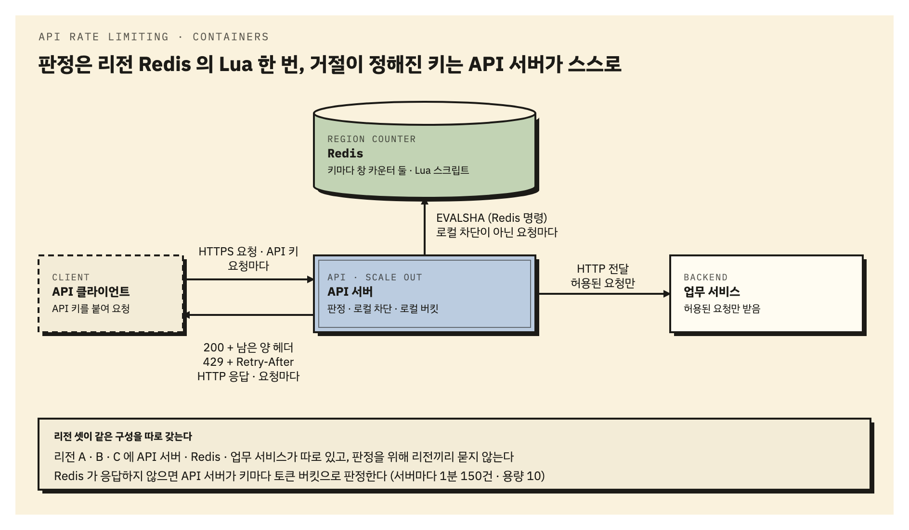
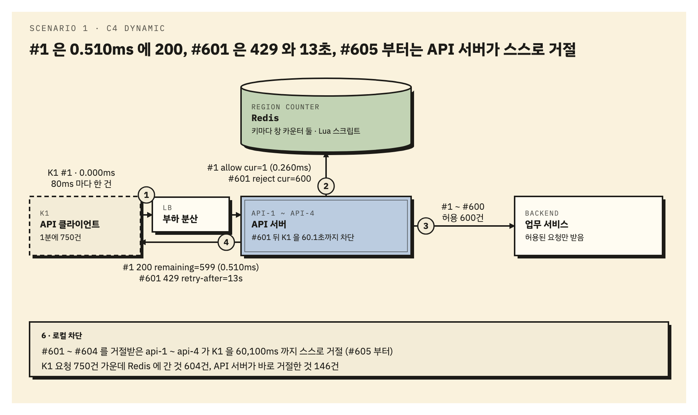
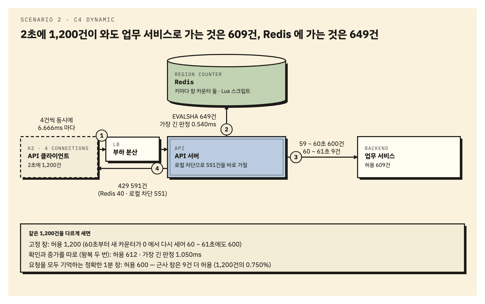
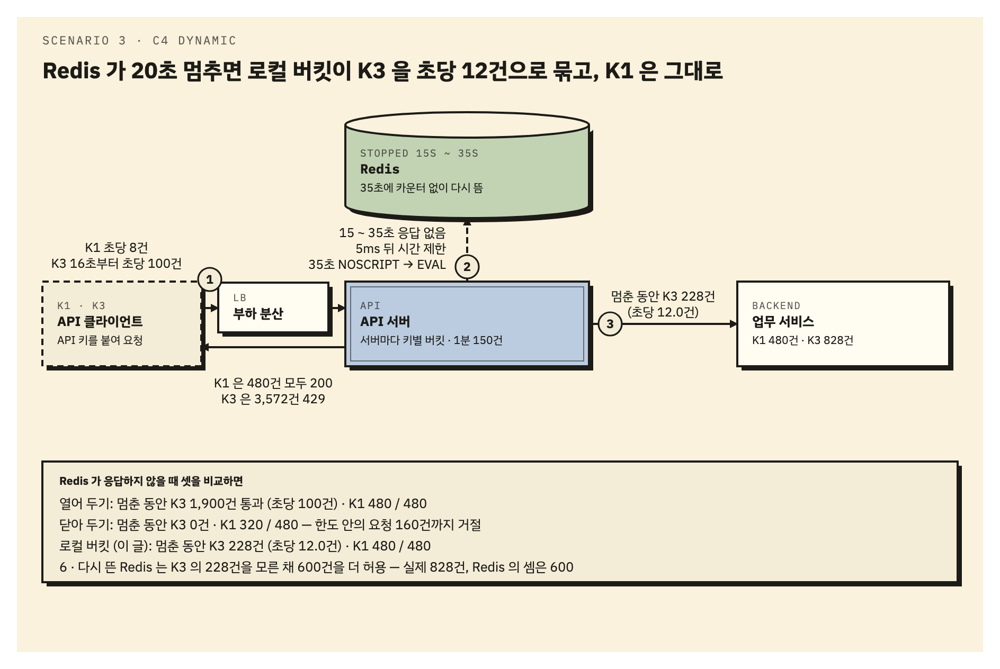

# API 처리율 제한 — 리전마다 Redis 에서 Lua 한 번으로 근사 창을 세고, Redis 가 멈추면 서버마다 토큰 버킷으로 열어 둔다

## 문제와 요구사항

결제 API(Application Programming Interface, 프로그램이 서비스를 부르는 창구)를 공개한 회사를 생각해 봅시다. 어느 날 한 고객사의 배치 스크립트가 재시도 반복문을 빠져나오지 못하고 API 키 하나로 초당 100건을 보내기 시작해요. 그 키의 요청이 업무 서비스에서 DB(데이터베이스) 연결을 차지하면, 같은 시간에 들어온 다른 고객 결제가 늦어집니다. 이 회사는 리전(데이터센터가 있는 지역) 셋에 업무 서비스와 그 DB 를 따로 두고 있다고 합시다. 그래서 처리율 제한이 지키려는 것은 리전 하나의 업무 서비스예요. 처리율 제한은 키마다 정해진 시간에 보낼 수 있는 요청 수를 세고, 넘으면 HTTP(웹의 요청 · 응답 규약) 429 로 거절하는 일이에요. 가장 먼저 떠오르는 구조는 API 서버마다 메모리에서 세는 것입니다. 그런데 부하 분산(요청을 여러 서버에 나눠 주는 장치)이 한 키의 요청을 서버 네 대에 고르게 나누면 서버마다 한도까지 허용해서 한도의 4배가 지나가요.

이 글은 리전마다 Redis 하나에 키별 카운터를 두고, API 서버가 요청마다 Lua 스크립트 한 번으로 판정하는 구조를 따라갑니다. Redis 는 데이터를 메모리에 두는 키-값 저장소이고, Lua 는 Redis 안에서 실행되는 작은 스크립트 언어예요. 끝까지 읽으면 세는 법 가운데 무엇을 왜 고르는지와 리전이 여럿일 때 한도를 어떻게 나누는지를 실행 출력으로 확인할 수 있습니다. Redis 가 멈췄을 때 무엇을 포기하는지, 요구 수치가 바뀌면 어느 구조로 옮기는지도 판단할 수 있게 돼요.

```text
서버마다 따로 세기 (API 서버 4대, 한도 600)           Redis 한 곳에서 함께 세기 (이 글, 리전마다)
  K1 의 요청 ─▶ api-1  600까지 허용                      K1 의 요청 ─▶ api-1 ~ api-4 ─▶ Redis 의 K1 카운터
             ─▶ api-2  600까지 허용                      601번째부터 429
             ─▶ api-3  600까지 허용
             ─▶ api-4  600까지 허용
  1분에 최대 2,400 건이 지나감 (한도의 4배)
```

기능 요구는 셋입니다.

1. 클라이언트는 요청에 API 키를 붙이고, 한도 안이면 정상 응답과 함께 한도와 남은 양을 응답 헤더로 받습니다.
2. 한도를 넘으면 429 와 함께 몇 초 뒤에 다시 보내면 되는지를 Retry-After 헤더로 받습니다.
3. 거절된 요청은 업무 서비스까지 가지 않습니다.

비기능 요구는 아래처럼 수치로 고정합니다. 근거 칸의 출처 수치는 리서치 노트에서 원문과 대조한 것이고, 링크는 참고 자료에 다시 모았어요.

| 항목 | 수치 | 근거 |
| --- | --- | --- |
| 한도 | API 키마다, 리전 하나에서 1분에 600건 | 이 가이드의 가정 — 공개 API 의 한도와 크기만 견주어 잡았습니다. 리전 하나에서 세는 이유는 5행입니다. GitHub REST API 는 인증한 사용자에게 1시간 5,000건을 허용하고([GitHub 문서](https://docs.github.com/en/rest/using-the-rest-api/rate-limits-for-the-rest-api)), Discord 는 봇마다 초당 50건을 허용합니다([Discord 문서](https://docs.discord.com/developers/topics/rate-limits)) |
| 요청 규모 | 전체 초당 10만 건, 리전 셋에 고르게 나뉨 | 이 가이드의 가정 |
| 판정 지연 | Redis 가 정상일 때 판정이 요청 하나에 더하는 시간 1ms 이내 | 이 가이드의 가정 — 같은 리전 안 왕복 한 번(한 방향 0.25ms 로 가정)과 Redis 처리 시간이 들어가는 크기 |
| 정확도 | 리전 하나에서, 요청을 모두 기억해 정확히 센 1분 창과 판정이 다른 요청이 전체의 1% 이내 | 이 가이드의 가정 — 비교 기준으로 Cloudflare 는 요청 4억 건을 분석해 잘못 허용되거나 잘못 제한된 요청이 0.003% 였다고 밝혔습니다([Cloudflare 글](https://blog.cloudflare.com/counting-things-a-lot-of-different-things/)) |
| 리전 하나가 한 키에서 받는 양 | 리전 하나의 업무 서비스가 한 API 키에서 받는 요청이 어느 60초를 잡아도 600건에, 근사로 세어 잘못 허용한 요청(4행)을 더한 양 이하 | 이 가이드의 가정 — 업무 서비스가 리전마다 따로 있다는 문제의 전제(첫 문단)에서 온 기준입니다. 리전 셋 합으로 600건을 지켜야 하는 경우(한도가 요금 계약의 단위일 때)는 전환점 1 에서 다룹니다 |
| 고장 — 한도 안 요청 | 리전 Redis 가 응답하지 않아도 한도 안의 요청은 거절하지 않음 | Stripe 는 처리율 제한 코드에 버그가 있거나 Redis 가 내려가도 요청이 영향을 받지 않게 하라고 권합니다([Stripe 글](https://stripe.com/blog/rate-limiters)). 권고이고, Stripe 가 운영한 결과를 적은 문장은 아닙니다 |
| 고장 — 폭주 | Redis 가 응답하지 않는 동안 한 키가 통과시키는 속도가 한도 속도(초당 10건)의 1.5배 이하 | 이 가이드의 가정 — 고장 중에도 폭주 키가 업무 서비스까지 그대로 가지 않게 하되, 잠깐 몰리는 것은 허용하는 여유 |
| 고장 — 판정 지연 | Redis 가 응답하지 않을 때 판정까지 5ms 이내 | 이 가이드의 가정 — API 서버가 Redis 의 답을 기다리는 시간 제한 |

일부러 다루지 않는 것도 적어 둡니다.

- 키마다 · 요금제마다 다른 한도와, 경로마다 따로 세는 한도는 다루지 않습니다. Discord 처럼 경로마다 버킷을 따로 두는 서비스도 있지만(Discord 문서) 이 글은 모든 키에 1분 600건 하나를 씁니다.
- 1분 안에서 요청이 몰리는 모양은 묶지 않습니다. 1초에 600건을 보내도 그 1분에 600건이면 허용해요. 몰림까지 묶어야 하는 경우는 전환점 2 에서 다룹니다.
- 처리 중인 요청 수를 묶는 제한과, 모든 키의 합으로 서버를 지키는 부하 차단(load shedding)은 범위 밖입니다. Stripe 는 이 둘을 요청 수 제한기와 따로 둡니다(Stripe 글).
- API 키 발급 · 인증과 봇 탐지도 다루지 않습니다.

## 규모 추정

세는 법 셋의 이름을 먼저 소개합니다. 고정 창은 1분마다 카운터를 새로 만들어 0 에서 다시 세는 방식이고, 슬라이딩 로그는 요청 시각을 모두 저장해 지난 60초 안의 수를 정확히 세는 방식이에요. 근사 창은 지난 1분 창의 수와 이번 1분 창의 수 두 개만으로 지난 60초를 어림합니다. 셋의 정식 설명은 기술 상세 설명의 Redis 항목에 있어요.

판정 한 번은 Redis 명령 EVALSHA 하나입니다. EVALSHA 는 Redis 가 스크립트 캐시에 받아 둔 Lua 스크립트를 SHA1 요약값(스크립트 본문에서 계산한 식별자)으로 불러 실행하는 명령이에요([Redis Lua 스크립트 문서](https://redis.io/docs/latest/develop/programmability/eval-intro/)). 비교 기준 수치도 하나 둡니다. Redis 공식 벤치마크 예시에서 파이프라인(응답을 기다리지 않고 명령을 이어 보내는 방식) 없는 SET(값 하나를 쓰는 명령)이 초당 180,180건이었어요([Redis 벤치마크 문서](https://redis.io/docs/latest/operate/oss_and_stack/management/optimization/benchmarks/)). 그 문서의 기계와 조건에서 잰 값이라 한도로 쓰지 않습니다. 아래에서 가정한 스크립트 한 번 10μs(마이크로초, 100만분의 1초)가 그와 같은 크기(1 ÷ 180,180 ≈ 5.5μs)라는 것만 확인해요.

```text
(입력)  R = 100,000 건/초(요구) · 리전 3(요구) · L = 600 건/분(요구)
        키 100만 개/시간(가정) · 카운터 하나 100바이트(가정) · 스크립트 한 번 10μs(가정) · 리전 사이 왕복 100ms(가정)

[1] 리전마다 요청            100,000 ÷ 3 ≈ 33,333 건/초
[2] 리전 Redis 의 일         요청 하나 = EVALSHA 하나 → 33,333 명령/초 × 10μs ≈ 0.33 초/초 (시간의 3분의 1)
[3] 근사 창의 저장량          100만 키 × 카운터 2개 × 100바이트 = 200MB (리전마다)
[4] 슬라이딩 로그라면          33,333 건/초 × 60초 ≈ 200만 시각 × 100바이트(시각 하나도 같게 가정) ≈ 200MB (리전마다) → [3] 과 같은 크기, 요청 속도에 비례
[5] 중앙 Redis 한 곳이면       다른 두 리전의 요청(전체의 3분의 2)이 판정마다 왕복 100ms → 판정 지연 1ms 의 100배
[6] 고정 창의 경계             창 끝 1초에 600 + 다음 창 첫 1초에 600 = 2초에 1,200 → 한도의 2배
[7] 리전마다 따로 세면          리전 셋에 나눠 보내는 키는 3 × 600 = 1,800 건/분
[8] 거절도 Redis 에 물으면      한도의 10배(6,000 건/분)로 보내는 키 하나 → 명령 6,000/분, 그 가운데 5,400 은 거절만 알려 줌
```

이 계산에서 빠지는 구조가 둘입니다. [5] 가 중앙 Redis 를 뺍니다. 세 리전에서 온 요청을 한 리전에 있는 Redis 에서 세면, 다른 두 리전에서 온 요청은 판정마다 왕복 100ms 를 기다려야 해요. 판정 지연 요구의 100배입니다. 그래서 세는 곳은 리전마다 둡니다. [6] 은 고정 창을 뺍니다. 창 경계 2초에 한도의 2배가 지나가기 때문이에요. [4] 로는 슬라이딩 로그를 빼지 못합니다. 로그의 메모리는 키 수가 아니라 요청 속도에 비례해서, 요구 2행의 속도에서는 [3] 과 같은 크기예요(계산). 로그를 고르지 않는 이유는 정확도 쪽에 있고, 시나리오 2 의 실행으로 봅니다.

[2] 는 리전마다 Redis 한 대로 시작할 수 있다는 판단의 근거입니다. 가정한 처리 시간으로 시간의 3분의 1 을 쓰니 여유가 있어요(판단 — 10μs 는 실측이 아니라 가정입니다). [8] 은 API 서버에 일을 하나 더 줍니다. 한 번 거절이 정해진 키는 그 시각까지 API 서버가 스스로 거절해야 Redis 가 폭주 키의 거절에 시간을 쓰지 않아요. 남는 것은 [7] 입니다. 리전마다 따로 세면 리전을 나눠 보내는 키가 리전 셋 합으로 1,800건까지 지나가요. 지킬 대상이 리전 하나의 업무 서비스라서(5행) 리전마다 600건씩이면 요구 안이고, 한도를 리전 셋 합으로 세는 구조와 무엇이 다른지는 대안 비교에서 실행으로 보입니다.

## 시스템 개념도



요청이 지나는 주된 길은 한 줄입니다. API 클라이언트의 HTTPS(암호화한 HTTP) 요청을 API 서버가 받아, 그 키가 로컬 차단 중이 아니면 리전 Redis 에 EVALSHA 를 보내요. Redis 가 Lua 스크립트로 판정하고 카운터를 올린 결과를 돌려주면, API 서버는 허용일 때 요청을 업무 서비스로 넘기고 남은 양 헤더를 붙여 답합니다. 거절이면 429 와 Retry-After 로 답하고 그 시각까지 그 키를 스스로 거절해요. 리전 셋은 같은 구성을 따로 갖고, 판정을 위해 서로 묻지 않습니다.

## 시나리오로 따라가기

### 시나리오 1 — K1 의 첫 요청은 0.510ms 만에 허용되고, 601번째 요청은 429 와 「13초 뒤」를 받는다

리전 A 에 API 서버 네 대(api-1 ~ api-4)가 있고, 고객 키 K1 이 0초부터 80ms 마다 요청을 하나씩 보냅니다(1분에 750건, 가정). 한도가 1분 600건이니 1분 안에 150건이 넘어요. API 서버와 Redis 사이는 한 방향 0.25ms, Redis 가 스크립트 한 번을 처리하는 시간은 10μs 로 둡니다(둘 다 가정). 나와야 하는 것은 처음 600건이 허용되고 601번째가 429 와 Retry-After 를 받는 것, 그리고 그 뒤 요청은 Redis 에 묻지 않고 거절되는 것입니다.



1. 0.000ms 에 K1 의 첫 요청이 부하 분산을 거쳐 api-1 에 들어옵니다. 부하 분산은 도착 순서대로 api-1 부터 api-4 까지 차례로 나눠요. 그래서 K1 의 요청은 서버마다 4분의 1씩 흩어지고, 한 서버의 메모리만으로는 K1 의 1분 합계를 알 수 없습니다. api-1 은 자기 차단 표에 K1 이 없는 것을 확인하고 판정을 모든 서버가 같이 쓰는 리전 Redis 에 맡깁니다.
2. api-1 이 보낸 EVALSHA 가 0.250ms 에 도착하고 스크립트는 0.260ms 에 끝납니다. 스크립트는 K1 의 지난 창 카운터(prev=0)와 이번 창 카운터를 읽어 어림 수를 셈하고, 한도 안이니 이번 창 카운터를 1 올려요(`redis lua -> allow prev=0 cur=1`). 읽기와 올리기를 스크립트 하나에 둔 이유는 Redis 가 스크립트를 원자적으로 실행하기 때문입니다(「Redis guarantees the script's atomic execution.」, Redis Lua 스크립트 문서). 두 왕복으로 나누면 그 사이에 다른 서버의 요청이 같은 수를 읽을 수 있어요(시나리오 2 의 6단계).
3. 0.510ms 에 api-1 이 200 과 `remaining=599` 를 답하고 요청을 업무 서비스로 넘깁니다. 남은 양은 스크립트가 돌려준 두 수로 API 서버가 셈하므로 왕복이 더 들지 않아요. 판정이 더한 시간은 왕복 0.5ms 에 스크립트 10μs 를 더한 0.510ms 입니다.
4. 47,920ms 에 600번째 요청이 api-4 에서 `remaining=0` 을 받고, 48,000ms 에 601번째 요청이 api-1 으로 옵니다. 스크립트가 cur=600 을 읽으니 한 건을 더하면 601 이 되어 한도를 넘어요. 그래서 카운터를 올리지 않고 거절을 돌려줍니다(`reject prev=0 cur=600`). 거절된 요청을 세지 않는 이유는 스스로 점검하기 3번에서 봅니다.
5. api-1 이 429 와 `retry-after=13s` 를 답합니다. 이번 창에는 지난 창의 수가 없어서(prev=0) 이번 창 안에서는 자리가 나지 않아요. 다음 창이 열리면 지난 창이 된 600건이 60초에 걸쳐 고르게 빠지는 것으로 어림되므로 0.1초마다 한 자리가 납니다. 첫 자리가 60.1초라 기다릴 시간은 12.1초입니다. RFC(Request for Comments, 인터넷 표준을 싣는 문서 번호 체계) 9110 은 Retry-After 를 HTTP 날짜나 정수 초로 적게 하므로([RFC 9110](https://www.rfc-editor.org/rfc/rfc9110.html)) 정수 초로 올려서 13초예요.
6. api-1 은 K1 을 60,100ms 까지 스스로 거절하도록 차단 표에 적습니다. 48,320ms 의 605번째 요청은 api-1 에서 Redis 에 가지 않고 429 를 받아요. 그 시각 전에는 Redis 에 물어도 거절이 나오기 때문입니다. 다른 요청이 허용되면 카운터가 늘 뿐이라서, 요청이 하나도 없을 때보다 어림 수가 빨리 줄 수는 없어요. api-2 ~ api-4 도 각자 한 번씩(602 ~ 604번째) 거절을 받은 뒤 같은 차단을 적습니다.

```text
t=0.000ms K1 #1 lb -> api-1, EVALSHA sent
t=0.260ms K1 #1 redis lua -> allow prev=0 cur=1
t=0.510ms K1 #1 api-1: 200 remaining=599, forward to backend
t=47920.000ms K1 #600 lb -> api-4, EVALSHA sent
t=47920.260ms K1 #600 redis lua -> allow prev=0 cur=600
t=47920.510ms K1 #600 api-4: 200 remaining=0, forward to backend
t=48000.000ms K1 #601 lb -> api-1, EVALSHA sent
t=48000.260ms K1 #601 redis lua -> reject prev=0 cur=600
t=48000.510ms K1 #601 api-1: 429 retry-after=13s, block K1 here until 60100.000ms
t=48320.000ms K1 #605 api-1: 429 from local block, no redis call
K1: sent=750 allowed=600 rejected=150 redis-calls=604 api-local-429=146 max-judge=0.510ms
```

잠깐, 확인 하나만 해 볼까요? Retry-After 를 이번 창이 끝날 때까지 남은 12초로 주면, 클라이언트가 60.000초에 다시 보낸 요청은 어떻게 될까요?

다시 거절됩니다. 60.000초는 다음 창이 막 열린 순간이라 지난 창 600건이 어림 수에 그대로 들어가고, 한 건을 더하면 601 이에요. 0.1초가 지나야 어림 수가 599 로 내려가 한 자리가 납니다. GitHub 처럼 창이 초기화되는 시각(`x-ratelimit-reset`)을 알려 주는 방식은 고정 창에는 맞지만 근사 창에는 맞지 않는 이유가 이것이에요(GitHub 문서).

```text
#601 (48.000초, 이번 창 0 ~ 60초)    prev = 0, cur = 600 → 600 + 1 > 600, 이번 창 안에는 자리가 없음
다음 창 (60 ~ 120초, e 는 지난 초)    어림 수 = 600 × (60 − e) ÷ 60 + 이번 창 수
60.000초 (e = 0)                     600 × 60 ÷ 60 + 0 + 1 = 601 > 600 → 거절
한 건이 들어갈 조건                    600 × (60 − e) ÷ 60 + 1 ≤ 600 → e ≥ 0.1초
기다릴 시간                            (60 − 48) + 0.1 = 12.1초 → 올려서 retry-after=13s
```

이 시나리오가 보여 준 것은 판정 하나가 Redis 스크립트 한 번으로 끝나 0.510ms 가 더해진다는 것입니다(판정 지연 행). 601번째 요청은 429 와 Retry-After 13초를 받았고(기능 요구 2), 그 13초는 근사 창에서 다음 자리가 나는 시각으로 셈한 값이에요. K1 의 750건 가운데 Redis 에 간 것은 604건이고, 거절이 정해진 뒤의 146건은 API 서버가 스스로 답했습니다.

### 시나리오 2 — 분 경계 2초에 1,200건이 몰려도 근사 창은 609건만 허용하고, 고정 창은 1,200건을 다 허용한다

키 K2 는 연결 넷으로 요청 4건을 동시에 보내는 스크립트입니다(가정). 59초부터 6.666ms 마다 4건씩 1초 동안 600건을 보내고, 60초부터 같은 방식으로 600건을 더 보내요. 2초에 1,200건이라 규모 추정 [6] 의 경계 몰림이고, 1분 한도의 속도(초당 10건)로 보면 60배입니다. 같은 1,200건을 세 가지로 셉니다. 이 글의 근사 창(Lua 한 번)과 고정 창, 그리고 읽기와 올리기를 왕복 둘로 나눈 근사 창이에요. 나와야 하는 것은 2초 동안 업무 서비스로 가는 요청이 한도 600건 근처에 머물고 판정 지연이 1ms 를 넘지 않는 것입니다.



1. 부하 분산이 동시에 온 4건을 api-1 ~ api-4 에 하나씩 나누고, 네 서버가 같은 순간에 EVALSHA 를 보냅니다. 스크립트가 실행되는 동안에는 서버의 다른 일이 모두 막히므로(Redis Lua 스크립트 문서) 네 스크립트는 하나씩 차례로 실행돼요. 그래서 네 요청은 cur 를 0 · 1 · 2 · 3 으로 차례로 읽고, 마지막 요청의 답이 가장 늦습니다. 그 값이 이 실행에서 가장 긴 판정 0.540ms 예요(`max-judge=0.540ms`).
2. 59초대의 600건은 모두 허용됩니다(`window0=600`). 이 창의 지난 창에는 요청이 없어서 cur 가 600 이 될 때까지 자리가 있기 때문이에요.
3. 60.000초에 새 창이 열리면 지난 창이 된 600건이 어림 수에 그대로 들어갑니다. 창이 막 열린 순간이라 어림 수가 600 이고, 한 건을 더하면 넘으니 네 요청이 모두 거절돼요. 네 서버는 각자 Retry-After 를 셈해 60.100초까지 K2 를 스스로 거절합니다.
4. 그 뒤로 어림 수는 0.1초에 1씩 줄어서 0.1초마다 한 건 정도만 허용됩니다. 60초부터 61초 사이에 허용된 것은 9건이에요(`window1=9`). 업무 서비스로 간 것은 2초에 609건이고, 429 591건 가운데 551건은 API 서버의 로컬 차단이 Redis 에 묻지 않고 답했습니다(`redis-calls=649 api-local-429=551`). 로컬 차단이 없으면 요청마다 EVALSHA 하나라 Redis 명령이 1,200건이에요(계산).
5. 같은 1,200건을 고정 창으로 세면 60초에 새 카운터가 0 에서 시작하므로 60초대의 600건도 모두 허용됩니다(`fixed-window: allowed=1200`). Cloudflare 가 고정 창의 문제로 적은 것이 이것이에요. 카운터가 정해진 간격마다 임의로 초기화된다는 것이고(Cloudflare 글), 59초대의 600건이 60초부터 보이지 않으니 지난 60초 동안 1,200건이 지나간 것을 알 수 없습니다.
6. 읽기와 올리기를 왕복 둘로 나누면 허용이 612건이 되고 판정이 1.050ms 로 늘어납니다(`two-step: allowed=612 ... max-judge=1.050ms`). 동시에 온 네 요청이 모두 첫 왕복에서 같은 cur 를 읽고, 둘째 왕복에서 넷 다 올리기 때문이에요. 어림 수가 한도 밑으로 내려간 순간마다 한 건이 아니라 네 건이 지나가서 60초대에 12건이 허용됐습니다.

```text
fixed-window: allowed=1200 window0=600 window1=600 redis-calls=1200 api-local-429=0 max-judge=0.540ms
sliding-lua: allowed=609 window0=600 window1=9 redis-calls=649 api-local-429=551 max-judge=0.540ms
exact-log: allowed=600; sliding-lua differs on 9 of 1200 (wrongly allowed 9, wrongly rejected 0) = 0.750%
two-step: allowed=612 window0=600 window1=12 redis-calls=1240 api-local-429=572 max-judge=1.050ms
```

근사 창이 허용한 609건은 정확한 값과 얼마나 다를까요? 요청 시각을 모두 기억하는 슬라이딩 로그로 같은 1,200건을 세면 600건만 허용됩니다(`exact-log: allowed=600`). 60초대의 요청이 보는 지난 60초에는 59초대의 600건이 모두 들어 있기 때문이에요. 근사 창은 그 600건이 지난 1분에 고르게 왔다고 어림합니다. 실제로는 59초대에 몰려 있던 요청을 0.1초마다 한 건씩 빠지는 것으로 보는 셈이고, 그 차이가 잘못 허용한 9건(1,200건의 0.750%)이에요. Cloudflare 도 이 방식이 지난 창 안에서 요청이 일정한 속도로 왔다고 가정한다고 적었습니다(Cloudflare 글).

```text
                         59초대 600건      60초대 600건      2초 합계     가장 긴 판정
고정 창                   600 허용          600 허용          1,200        0.540ms
근사 창 · 왕복 둘          600 허용           12 허용            612        1.050ms
근사 창 · Lua 한 번        600 허용            9 허용            609        0.540ms   ← 이 가이드
정확한 1분 창 (로그)       600 허용            0 허용            600        비교 기준
```

이 시나리오가 보여 준 것은 몰림을 받아 내는 곳과 그대로인 것입니다. 몰림은 API 서버의 로컬 차단(551건)과 Redis 의 근사 창이 받아 내고, 업무 서비스로 가는 양은 609건으로 한도 근처에 머물렀어요. 판정 지연은 몰림 속에서도 0.540ms 였습니다. 정확한 창과의 차이 0.750% 는 정확도 행으로 가요. 고정 창이 허용한 1,200건과 왕복 둘이 허용한 612건 · 1.050ms 는 Redis 항목과 대안 비교에서 근거로 씁니다.

### 시나리오 3 — 리전 A 의 Redis 가 20초 멈추면 로컬 버킷이 K3 을 초당 12건으로 묶고, 다시 뜬 Redis 는 그동안 허용한 228건을 모른다

같은 리전 A 에서 K1 은 0초부터 125ms 마다 요청을 보내 1분에 480건으로 한도 안에 있습니다. 폭주하는 키 K3 은 16초부터 10ms 마다, 곧 초당 100건을 보내요(한도 속도의 10배). Redis 는 15초에 멈추고 35초에 다시 뜨는데, 카운터와 스크립트 캐시가 비어 있는 채로 뜹니다(가정 — 이 글은 카운터를 디스크에 남기지 않는 설정으로 둡니다). API 서버는 Redis 의 답을 5ms 까지 기다리고, 그 안에 답이 없으면 고장으로 보고 판정해요. 같은 사건열을 고장 모드 셋으로 실행해 비교합니다. 나와야 하는 것은 K1 이 한 건도 거절되지 않고, Redis 가 멈춘 동안 K3 의 통과 속도가 초당 15건(한도 속도의 1.5배) 이하인 것이에요.



1. 15.000초에 Redis 가 멈춥니다. 그 뒤 EVALSHA 는 답을 받지 못하고, API 서버는 보낸 지 5ms 뒤에 시간 제한으로 판정을 넘겨받아요. 멈춘 20초 동안 이렇게 판정한 요청이 K1 160건과 K3 1,900건으로 모두 2,060건입니다(`fallbacks=2060`). 시간 제한이 없으면 요청이 Redis 의 답을 끝없이 기다리므로, 판정 지연이 5ms 로 늘어나는 것을 받아들입니다(`max-judge=5.000ms`).
2. 이 글의 고장 모드는 로컬 토큰 버킷입니다. 토큰 버킷은 일정한 속도로 토큰이 차는 통에서 요청마다 토큰 하나를 빼고, 통이 비면 거절하는 방식이에요. API 서버마다 키별 버킷을 하나씩 두고, 차는 속도는 한도를 서버 수로 나눈 1분 150건(초당 2.5건)으로, 통의 크기는 10건으로 둡니다. 서버 수로 나누는 이유는 부하 분산이 한 키의 요청을 네 서버에 고르게 나눠서 네 서버의 몫을 더하면 한도가 되기 때문입니다.
3. K1 의 요청은 서버마다 초당 2건쯤이라 버킷의 2.5건 안에 있어요. 멈춘 동안의 160건을 포함해 K1 의 480건이 모두 허용됩니다(`local: K1 allowed=480/480`). K3 은 서버마다 초당 25건쯤 오는데 버킷이 2.5건만 내주므로 멈춘 동안 허용된 K3 은 228건이에요(`K3-during-outage=228`). K3 이 보낸 19초로 나누면 228 ÷ 19 ≈ 초당 12.0건, 한도 속도의 1.2배입니다. 한도 속도를 넘는 몫은 처음 꽉 찬 통에서 나와요(서버 넷 × 10건 = 40건, 40 ÷ 19초 ≈ 초당 2.1건).
4. 같은 사건열을 다른 고장 모드로 실행하면 이렇습니다. 열어 두기(fail open, 고장이면 모두 허용)는 멈춘 동안 K3 1,900건을 모두 업무 서비스로 보내요(초당 100건). 닫아 두기(fail closed, 고장이면 모두 거절)는 K3 을 막지만 한도 안에 있던 K1 의 160건까지 거절합니다(`closed: K1 allowed=320/480`). 로컬 버킷은 그 사이에서 K1 은 그대로 두고 K3 만 한도 근처로 묶어요.
5. 35.000초에 Redis 가 다시 뜹니다. 스크립트 캐시가 비어 있어 첫 EVALSHA 는 NOSCRIPT(캐시에 그 스크립트가 없다는 오류)를 받고, API 서버는 스크립트 본문을 EVAL 로 다시 보내요. Redis 문서는 스크립트 캐시가 늘 휘발성(「always volatile」)이라 재시작 뒤에 비워질 수 있다고 적고, EVAL 로 실행한 스크립트는 캐시에 들어간다고 적습니다(Redis Lua 스크립트 문서). 그래서 EVAL 한 번 뒤로는 EVALSHA 가 다시 통해요.
6. 다시 뜬 Redis 에는 K3 의 카운터가 없습니다. 그래서 35초부터 K3 은 새 키처럼 600건을 더 허용받고, 그 뒤에 거절되어 로컬 차단에 들어가요. 이 창(0 ~ 60초)에 K3 이 실제로 통과시킨 것은 828건인데 Redis 의 셈은 600 입니다(`local: redis counts K3 at 600 for window 0, K3 actually got 828`). 로컬 버킷이 허용한 228건은 Redis 에 적히지 않기 때문이에요. 이 틀린 값은 다음 창(60 ~ 120초)의 어림 수에 지난 창 600 으로 들어가고, 120초에 그 창이 지나면 셈에서 빠집니다.

```text
open: K1 allowed=480/480 K3 allowed=2500/4400 K3-during-outage=1900 fallbacks=2060 redis-calls=926 api-local-429=1896 max-judge=5.000ms
closed: K1 allowed=320/480 K3 allowed=600/4400 K3-during-outage=0 fallbacks=2060 redis-calls=926 api-local-429=1896 max-judge=5.000ms
t=15000.000ms redis stops responding
t=35000.000ms redis restarts with no counters and an empty script cache
t=35000.510ms api-1: EVALSHA -> NOSCRIPT, resend the script with EVAL
local: K1 allowed=480/480 K3 allowed=828/4400 K3-during-outage=228 fallbacks=2060 redis-calls=926 api-local-429=1896 max-judge=5.000ms
local: redis counts K3 at 600 for window 0, K3 actually got 828
```

```text
Redis 가 멈춘 15 ~ 35초     열어 두기            닫아 두기            로컬 버킷 (이 가이드)
K1 (한도 안, 160건)          160건 허용           160건 거절           160건 허용
K3 (초당 100건, 1,900건)     1,900건 허용         0건 허용             228건 허용 (초당 12.0건)
판정 지연 (가장 긴)          5.000ms              5.000ms              5.000ms
그 창의 K3 합계              2,500건              600건                828건 (Redis 의 셈은 600)
```

이 시나리오가 보여 준 것은 로컬 버킷이 고장 행 셋을 함께 지킨다는 것입니다. K1 은 480건 모두 허용됐고(한도 안 요청 행), K3 은 초당 12.0건으로 1.5배 안이었어요(폭주 행). 판정 지연은 시간 제한 5ms 였습니다(고장 판정 지연 행). 대가는 틀린 값 하나예요. Redis 가 없는 동안 허용한 요청은 다시 뜬 Redis 가 모르므로 그 창에서 K3 은 한도 600 을 228건 넘었습니다. 열어 두기에서는 그 초과가 1,900건이 되고, 닫아 두기는 초과 대신 정상 고객의 요청을 거절해요.

## 기술 상세 설명

### 구성 요소 — API 클라이언트

API 를 부르는 고객의 프로그램입니다. 서버에서 실행되는 배치 작업일 수도 있고 모바일 앱일 수도 있어요. 요청마다 API 키를 헤더에 붙여 보내고, 우리가 만들지 않는 프로그램이라 무엇을 보내든 서버가 지켜야 합니다.

맡는 일은 시나리오 1 의 1단계에서 요청을 보내고 3 · 5단계의 응답을 받는 것입니다. 429 를 받으면 Retry-After 만큼 기다렸다가 다시 보내는 것이 클라이언트의 몫이에요. 이 글의 실행은 클라이언트가 Retry-After 를 지키지 않는다고 보고, 계속 오는 요청을 API 서버의 로컬 차단이 받아 냅니다(시나리오 1 의 6단계).

```http no-compile
GET /v1/payments HTTP/1.1
Authorization: Bearer <API 키>

HTTP/1.1 200 OK
x-ratelimit-limit: 600
x-ratelimit-remaining: 599

HTTP/1.1 429 Too Many Requests
Retry-After: 13
x-ratelimit-limit: 600
x-ratelimit-remaining: 0
```

응답 코드로 429 를 고른 이유는 그 뜻이 처리율 제한 하나로 정해져 있기 때문입니다. RFC 6585 는 429 를 정해진 시간 안에 요청을 너무 많이 보냈다는 뜻으로 정의하고(「too many requests in a given amount of time」, [RFC 6585](https://www.rfc-editor.org/rfc/rfc6585.html)), Retry-After 는 넣을 수 있다(MAY)고만 적어요. 같은 RFC 는 서버가 사용자를 어떻게 알아보고 요청을 어떻게 세는지 정하지 않아서 세는 법은 이 글이 정합니다. GitHub 는 한도를 넘으면 403 이나 429 를 돌려준다고 적어(「a `403` or `429` response」, GitHub 문서) 클라이언트가 두 코드를 다 살펴야 해요. 이 글은 429 하나만 써서 클라이언트가 처리율 제한을 다른 오류와 섞지 않게 합니다.

남은 시간을 알려 주는 방식으로는 GitHub 의 창 초기화 시각(`x-ratelimit-reset`)과 Retry-After 의 기다릴 초를 견줄 수 있어요. 고정 창은 초기화 시각에 한도가 통째로 돌아오지만, 근사 창에는 그런 시각이 없습니다. 시나리오 1 의 확인 질문에서 본 것처럼 다음 자리는 창 경계에서 0.1초 뒤였어요. 그래서 이 글은 기다릴 초를 알려 주는 Retry-After 를 씁니다. 남은 양 헤더를 표준으로 정하려는 IETF(인터넷 표준을 만드는 기구)의 초안이 있지만 2026-11-16 에 확인한 판은 -11(2026-05-23)이고 아직 RFC 가 아니에요([IETF 초안 -11](https://datatracker.ietf.org/doc/html/draft-ietf-httpapi-ratelimit-headers-11)). 헤더 이름은 GitHub 가 쓰는 소문자 이름을 따랐습니다(판단).

| 설정값 · 한계 | 값 | 이유 · 보장하지 않는 것 |
| --- | --- | --- |
| 남은 양 | `x-ratelimit-remaining`, 허용 응답마다 | 근사 창의 어림 수로 셈한 값이라 정확한 남은 양은 아님. 시나리오 1 의 3단계처럼 스크립트가 돌려준 두 수로 셈해 왕복이 더 들지 않음 |
| Retry-After | 기다릴 시간을 초 단위로 올림 | 시나리오 1 은 12.1초를 13초로 올림. 그 사이 같은 키의 다른 요청이 그 자리를 쓰면 13초 뒤에도 다시 거절될 수 있음(판단) |
| 429 의 캐시 | 저장하지 않음 | RFC 6585 는 429 를 「MUST NOT be stored by a cache」라고 적음 |

### 구성 요소 — API 서버

클라이언트의 요청을 받아 키를 확인하고, 처리율 판정을 한 뒤 업무 서비스로 넘기는 서버 프로그램입니다. 자기 상태가 거의 없어서 요청이 늘면 대수를 늘려 받아요. 예외는 둘인데, 키마다의 차단 시각과 고장 때 쓰는 키별 토큰 버킷을 자기 메모리에 둡니다.

맡는 일은 시나리오 1 의 1 · 3 ~ 6단계와 시나리오 2 의 3 · 4단계(로컬 차단), 시나리오 3 의 1 ~ 5단계(시간 제한 · 로컬 버킷 · NOSCRIPT 를 받으면 EVAL 로 다시 보내기)입니다. 판정 순서는 아래와 같아요.

```text
판정 순서        하는 일                                          결과에 따라
1 로컬 차단      이 서버의 차단 표에서 그 키의 차단 시각을 봄           지금보다 뒤 → 429 (Redis 에 묻지 않음) · 아니면 2 로
2 Redis 판정     EVALSHA 를 보내고 5ms 까지 기다림                      허용 → 3 · 거절 → 4 · 시간 제한 → 5 · NOSCRIPT → EVAL 로 다시 2
3 허용           남은 양을 셈해 헤더에 싣고 업무 서비스로 넘김
4 거절           Retry-After 를 셈해 429, 그 시각까지 차단 표에 적음
5 고장           이 서버의 키별 토큰 버킷에서 토큰 하나를 빼 봄          뺐으면 3 · 비었으면 429
```

판정을 API 서버 안에서 Redis 로 직접 보내는 방식과 견줄 것은 별도의 제한 서비스를 두는 방식입니다. Envoy(서비스 앞에서 요청을 중계하는 프록시)에서 전역 처리율 제한을 쓰면 Envoy 가 외부 제한 서비스를 gRPC(서비스 사이의 원격 호출 규약)로 부르고, 그 서비스의 참조 구현이 Redis 에 셉니다([Envoy 전역 처리율 제한 문서](https://www.envoyproxy.io/docs/envoy/latest/intro/arch_overview/other_features/global_rate_limiting)). 판정 한 번에 API 서버 → 제한 서비스 → Redis 로 네트워크를 두 번 건너므로 리전 안 왕복을 한 번 더 써요(판단 — 이 글의 모형에는 그 구조가 없어 재지 않았습니다). 대신 한도 설정을 서비스 하나에 모으는 이점이 있습니다. 이 글은 판정 지연 1ms 요구에 왕복 한 번(0.510ms)으로 들어가는 쪽을 골랐어요. 그 참조 구현이 Lyft 에서 2년 넘게 운영됐다는 것(「in production use at Lyft for over 2 years」, [envoyproxy/ratelimit](https://github.com/envoyproxy/ratelimit))은 선례이고 고른 이유는 아닙니다.

```text
판정 경로                          네트워크를 건너는 횟수     판정이 더하는 지연
API 서버 → Redis (이 가이드)          왕복 한 번                0.510ms (시나리오 1 의 3단계)
API 서버 → 제한 서비스 → Redis        왕복 두 번                재지 않음 — 리전 안 왕복 하나가 더 듦 (판단)
```

고장 때 판정을 로컬 버킷에 맡기는 이유는 시나리오 3 의 실행이 보여요. 열어 두기는 멈춘 동안 폭주 키를 초당 100건 그대로 보냈고, 닫아 두기는 한도 안의 K1 을 160건 거절했습니다. LaunchDarkly 는 Redis 를 부르지 못하면 모든 트래픽을 허용하던 중앙 제한기를 두고 「It fails dangerously」라고 적었어요([LaunchDarkly 글](https://launchdarkly.com/docs/blog/rate-limiters)). Envoy 의 제한 서비스 README 는 제한 서비스를 부르지 못하면 기본으로 허용하고 `failure_mode_deny` 로 거절하게 할 수 있다고 적어요(envoyproxy/ratelimit). [Envoy HTTP 처리율 제한 필터 문서](https://www.envoyproxy.io/docs/envoy/latest/configuration/http/http_filters/rate_limit_filter)에는 그 설정이 켜져 있으면 500 응답을 돌려준다는 문장이 있습니다. 로컬 처리율 제한은 토큰 버킷이고 기본으로 Envoy 프로세스마다 따로 센다고 [Envoy 로컬 처리율 제한 문서](https://www.envoyproxy.io/docs/envoy/latest/configuration/http/http_filters/local_rate_limit_filter)가 적어요. 로컬 제한을 전역 제한과 함께 써서 전역 서비스의 부하를 줄일 수 있다고 적은 것은 전역 처리율 제한 문서입니다. 이 글은 로컬 버킷을 평소에는 쓰지 않고 Redis 가 답하지 않을 때만 씁니다.

요청을 서버들에 나누는 일은 앞단의 부하 분산이 맡습니다. 배포 세부라 개념도에는 그리지 않았고 세 시나리오의 경로 그림에만 「부하 분산」으로 그렸어요. 이 글은 도착 순서대로 서버를 차례로 고르는 방식을 가정합니다. 한 키의 요청이 네 서버에 고르게 나뉜다는 것이 로컬 버킷의 속도를 한도 ÷ 서버 수로 잡는 근거예요(시나리오 3 의 2단계). 같은 키를 늘 같은 서버로 보내는 방식이면 한 서버가 그 키를 다 받으므로 버킷 속도를 한도 그대로 두어야 합니다(판단).

| 설정값 · 한계 | 값 | 이유 · 보장하지 않는 것 |
| --- | --- | --- |
| Redis 시간 제한 | 5ms | 리전 안 왕복(0.5ms)의 10배. Redis 가 멈춘 동안은 요청마다 5ms 를 기다림. 한 번 실패하면 잠깐 Redis 를 부르지 않는 장치(서킷 브레이커)로 줄일 수 있음(판단, 실행 밖) |
| 로컬 차단 | Retry-After 로 셈한 시각까지, 서버마다 따로 | 그 시각 전에는 Redis 도 거절하므로 판정이 바뀌지 않음(시나리오 1 의 6단계). 서버마다 한 번씩은 Redis 에 물어야 켜짐 |
| 로컬 버킷 | 서버마다 · 키마다, 1분 150건(한도 ÷ 서버 4대), 용량 10 | 서버 수가 바뀌면 같이 바꿔야 함(스스로 점검하기 2). 버킷이 허용한 요청은 Redis 에 적히지 않음(시나리오 3 의 6단계). 용량 10 은 서버 하나가 받는 초당 2.5건의 4초 치로, 한 키의 짧은 몰림은 받되 고장 중 통과 속도를 1.5배 안에 두려고 고른 값(판단 — 시나리오 3 에서 서버 넷의 처음 40건이 초당 약 2.1건을 더함) |
| 창을 정하는 시계 | 창 번호와 창 안에서 지난 시간을 API 서버의 시계로 셈해 스크립트에 넘김 | 서버 시계가 어긋나면 같은 순간의 요청이 다른 창으로 세어짐. GitHub 는 Redis 의 TTL(Time To Live, 키가 사라지기까지 남은 시간)과 애플리케이션 시계를 섞어 초기화 시각이 요청마다 1초씩 흔들린 일을 겪고, 「reset at」 시각을 애플리케이션이 저장해 고쳤음(GitHub 글). 실행은 시계 하나라 흉내 내지 않음 |

### 구성 요소 — Redis

Redis 는 데이터를 메모리에 두는 키-값 저장소입니다. 이 시스템에서는 키마다 1분 창 카운터 둘을 둬요. 카운터 이름은 `rl:K1:<창 번호>` 처럼 키 이름과 창 번호를 이어 붙인 것이고, 창 번호는 1분 단위로 센 시각입니다.

```text
rl:K1:<창 번호>         이번 창 카운터 — 허용할 때마다 1 올림, 처음 생길 때 만료 120초
rl:K1:<창 번호 − 1>     지난 창 카운터 — 읽기만 함, 어림 수에 (60 − 지난 초) ÷ 60 만큼 들어감
```

맡는 일은 시나리오 1 의 2단계에서 EVALSHA 를 받아 판정과 증가를 한 번에 하고 허용 여부 · 지난 창 수 · 이번 창 수 세 값을 돌려주는 것입니다. 시나리오 3 에서는 멈췄다가 비어 있는 채로 다시 떠, 첫 EVALSHA 에 NOSCRIPT 를 돌려줘요.

세는 법은 다섯 가운데 고릅니다. 근사 창은 아래 식으로 어림하고, 실행 출력 첫 두 줄은 Cloudflare 글에 나온 예시를 같은 식으로 다시 셈한 것이에요.

```text
근사 창 (Cloudflare 예시: 지난 1분 42건, 이번 1분 18건, 이번 분이 15초 지남)
어림 수 = 지난 창 수 × (60 − 지난 초) ÷ 60 + 이번 창 수
        = 42 × (60 − 15) ÷ 60 + 18 = 31.5 + 18 = 49.5          ← 실행 출력 estimate=49.500
이 글의 허용 조건   지난 창 수 × (60 − e) + (이번 창 수 + 1) × 60 ≤ 한도 × 60
                   (e 는 이번 창에서 지난 시간. 나눗셈 없이 곱셈만으로 셈해 세 언어가 같은 값을 냄)
```

| 세는 법 | 키 하나에 두는 것 | 이 문제에서 | 근거 |
| --- | --- | --- | --- |
| 고정 창 | 카운터 하나 | 경계 2초에 1,200건 (시나리오 2) | Cloudflare 글 — 카운터가 정해진 간격마다 임의로 초기화됨 |
| 슬라이딩 로그 | 지난 60초의 요청 시각 | 정확함(시나리오 2 의 `exact-log`). 저장량은 요청 속도에 비례해 요구 2행에서 리전마다 약 200MB 로 [3] 과 같은 크기(규모 추정 [4]). 근사 창의 오차 0.750% 가 정확도 4행 안이라 고르지 않음. 한도까지 보내는 키 하나로는 시각 600개라 카운터 2개의 300배(계산) | Cloudflare 글 — 더 정확하지만 처리와 메모리 요구가 매우 큼 |
| 근사 창 (이 가이드) | 카운터 둘 | 경계 몰림에서 9건 더 허용, 0.750% (시나리오 2) | Cloudflare 글 — 카운터마다 숫자 둘, 실제 트래픽에서 0.003% |
| 토큰 버킷 | 토큰 수와 마지막 시각 | 용량 600 · 초당 10건이면 임의의 60초에 1,199건까지 (계산) | Stripe 가 요청 제한기에 씀(Stripe 글) |
| 누수 버킷 | 고인 양과 마지막 시각 | 몰림 크기와 빠지는 속도를 따로 맞춰야 함 | Shopify 는 한도 대부분을 누수 버킷으로 집행한다고 적음([Shopify 한도 문서](https://shopify.dev/docs/api/usage/rate-limits)). Cloudflare 는 매개변수 둘을 맞추기 어렵고 원자적으로 할 수 없는 연산이 여럿 필요하다며 버림 |

근사 창과 가장 헷갈리는 것은 토큰 버킷입니다. 둘 다 키마다 숫자 둘을 두고 둘 다 Lua 스크립트 하나로 판정할 수 있어서, 저장량과 원자성은 고른 이유가 되지 않아요. 다른 점은 한도를 무엇으로 정하느냐입니다. 토큰 버킷은 채우는 속도와 통의 크기 두 값으로 정하는데, 1분 600건을 용량 600 · 초당 10건으로 옮기면 처음 꽉 찬 600건에 60초 동안 차는 599건이 더해져 임의의 60초에 1,199건까지 지나갈 수 있어요(계산). 용량을 줄이면 1분 600건 안에서 몰리는 것까지 막게 되어 요구보다 좁아집니다. 이 글의 요구는 1분에 몇 건이라는 창의 말이라 근사 창이 그대로 맞아요. 몰림 크기까지 정해야 하면 토큰 버킷이 맞고, 그것이 전환점 2 입니다.

판정을 Lua 스크립트 하나로 하는 이유는 원자성입니다. 스크립트가 실행되는 동안 서버의 다른 일은 모두 막혀요(Redis Lua 스크립트 문서). 읽기와 올리기를 명령 둘로 나누면 시나리오 2 의 6단계처럼 동시에 온 요청들이 같은 수를 읽고 함께 올라가, 실행에서 3건이 더 허용되고 판정이 1.050ms 로 늘었습니다. Redis 의 INCR(키의 정수를 1 올리는 명령) 문서도 카운터 하나로 세는 패턴에 경쟁 상태(「race condition」)가 있다고 적어요. INCR 뒤에 EXPIRE(키에 만료 시간을 거는 명령)가 실행되지 않으면 키가 만료 없이 남는다는 것이고, 해법으로 INCR 와 조건부 EXPIRE 를 Lua 스크립트로 묶으라고 합니다([Redis INCR 문서](https://redis.io/docs/latest/commands/incr/)). Cloudflare 는 Memcached 계열 저장소(Twemcache)에 증가를 비동기로 보내고 요청 처리 중에는 그 출처를 막기 시작했다는 표시 하나만 확인했어요(Cloudflare 글). 판정과 증가가 떨어져 있어 셈이 조금 늦게 반영되는 대신 요청을 늦추지 않는 설계입니다. 이 글은 판정과 증가를 같은 스크립트에 두어 그 늦음 없이 0.5ms 대의 왕복 한 번을 씁니다.

```lua no-compile
-- KEYS[1] 이번 창 카운터 · KEYS[2] 지난 창 카운터
-- ARGV[1] 한도 600 · ARGV[2] 창 길이 60000(ms) · ARGV[3] 이번 창에서 지난 시간(ms) · ARGV[4] 만료 120(초)
local cur = tonumber(redis.call('GET', KEYS[1]) or '0')
local prev = tonumber(redis.call('GET', KEYS[2]) or '0')
local limit = tonumber(ARGV[1])
local window = tonumber(ARGV[2])
local elapsed = tonumber(ARGV[3])
if prev * (window - elapsed) + (cur + 1) * window > limit * window then
  return {0, prev, cur}
end
cur = redis.call('INCR', KEYS[1])
if cur == 1 then
  redis.call('EXPIRE', KEYS[1], ARGV[4])
end
return {1, prev, cur}
```

```redis no-compile
EVALSHA <스크립트의 SHA1> 2 rl:K1:<창 번호> rl:K1:<창 번호 − 1> 600 60000 48000 120
# 1) 0  2) 0  3) 600   → 거절 (시나리오 1 의 4단계)
# NOSCRIPT 를 받으면 같은 인자로 EVAL "<스크립트 본문>" 2 ... 를 보냄 (시나리오 3 의 5단계)
```

| 설정값 · 한계 | 값 | 이유 · 보장하지 않는 것 |
| --- | --- | --- |
| 창 길이 | 60초 | 한도가 1분 단위 |
| 카운터 만료 | 처음 생길 때(INCR 결과가 1) EXPIRE 120초 | 다음 창에서 지난 창 수로 한 번 더 쓰이므로 창 둘의 길이. INCR 같은 값 변경은 TTL 을 건드리지 않으므로(「…are all operations that will leave the timeout untouched.」, [Redis EXPIRE 문서](https://redis.io/docs/latest/commands/expire/)) 처음 한 번만 걸면 됨 |
| 키 인자 | 스크립트가 쓰는 키 둘을 모두 KEYS 로 넘김 | 스크립트가 쓰는 키는 모두 키 인자로 넘겨야 클러스터에서도 올바르게 실행됨([Redis EVAL 문서](https://redis.io/docs/latest/commands/eval/)) |
| 원자성 | 스크립트 하나 | Redis 서버 한 대 안의 보장. 리전 사이에는 보장이 없고 이 글도 리전 사이를 묶지 않음 |
| 영속화 | 카운터를 디스크에 남기지 않음(가정) | 재시작하면 카운터가 비어 그 창에서 키마다 한도만큼 더 지나갈 수 있음(시나리오 3 의 6단계) |
| 스크립트 캐시 | 늘 휘발성 | 재시작 · 장애 조치 뒤 EVALSHA 가 NOSCRIPT. 대부분의 클라이언트 라이브러리가 다시 올리는 기능을 갖췄다고 문서가 적음 — 쓰는 라이브러리가 그런지는 확인해야 함 |
| 처리량 | 리전마다 한 대 | 규모 추정 [2] 의 0.33 은 가정한 10μs 로 셈한 값. 실제 처리 시간은 자기 Redis 에서 재서 정함 |

리전마다 Redis 를 한 대씩 두는 것은 배포 세부라 개념도에는 상자 하나로만 그렸습니다. 세 리전의 Redis 는 서로 복제하지 않고 각자 자기 리전에 온 요청만 세요(대안 비교 · 결정). 이 글은 복제본을 두지 않고 재시작 때 카운터를 잃는 것을 받아들입니다. 복제본을 두어 카운터를 지키려면 판정을 주 노드에서만 해야 해요. Redis 의 복제본은 스스로 키를 만료시키지 않고 주 노드가 보내는 삭제를 기다립니다(Redis EXPIRE 문서). GitHub 는 확인을 복제본에서 읽었다가 복제본이 지난 창의 값을 돌려줘 「X-RateLimit-Remaining: 5000」 이 붙은 거절을 낸 일을 겪었어요([GitHub 글](https://github.blog/engineering/infrastructure/how-we-scaled-github-api-sharded-replicated-rate-limiter-redis/)). 그래서 애플리케이션이 복제본의 낡은 값을 무시하도록 만료를 직접 관리했습니다.

### 구성 요소 — 업무 서비스

결제 생성 · 조회처럼 API 가 실제로 하는 일을 처리하는 서비스입니다. 처리율 제한이 지키려는 대상이에요.

맡는 일은 시나리오 1 의 3단계처럼 허용된 요청만 API 서버에게서 받는 것입니다. 시나리오 3 에서 열어 두기면 멈춘 20초 동안 K3 의 요청 1,900건을 받고, 로컬 버킷이면 228건을 받아요.

```text
업무 서비스가 받는 양 (시나리오 2 · 3 의 실행)
분 경계 2초에 K2 1,200건          근사 창 609건 · 고정 창 1,200건 · 왕복 둘 612건
Redis 가 멈춘 20초에 K3 1,900건    로컬 버킷 228건 · 열어 두기 1,900건 · 닫아 두기 0건 (K1 160건도 거절)
```

제한을 업무 서비스 안에서 하는 것과 견주면, 앞의 API 서버에서 할 때 거절할 요청이 업무 서비스의 자원(DB 연결 · 작업자)을 쓰기 전에 끝납니다. 업무 서비스가 여럿이어도 같은 셈을 한 곳에서 하고요(판단). 대가는 모든 요청을 같은 한 건으로 센다는 것이에요. 요청마다 비용이 크게 다른 API 라면 업무 서비스가 비용을 알려 주고 그만큼 세는 방식이 필요합니다(판단, 다루지 않는 것).

| 설정값 · 한계 | 값 | 이유 · 보장하지 않는 것 |
| --- | --- | --- |
| 한 키에서 받는 양 | 리전마다 1분 600건, Redis 가 멈춘 동안은 초당 15건 이하 | 요구 표의 한도 · 폭주 행 |
| 모든 키의 합 | 묶지 않음 | 키마다의 양만 묶음. 키가 많아져 합이 업무 서비스의 용량을 넘는 경우는 부하 차단이 맡을 일(다루지 않는 것) |
| 고장 동안 받는 양의 셈 | Redis 에 남지 않음 | 시나리오 3 의 6단계 — 228건 |

## 대안 비교

### 후보 구조 비교

후보는 여섯입니다. 공개 사례와 그 변형에서 모은 다섯(A · B · C-분할 · D · E)에 이 글이 고른 C 를 더했어요. 기준은 판정이 더하는 지연 · 한 리전 키 정확도 · 리전을 나눠 보내는 키 통과량 · 고장 때 동작 · 운영 부담입니다. AWS(Amazon Web Services) Well-Architected 의 여섯 기둥으로 빠진 기준을 점검하면 성능은 지연이, 신뢰성은 고장 때가, 운영 우수성은 운영 부담이 맡아요. 보안은 범위 밖이고, 비용과 지속 가능성은 모든 후보가 리전마다 Redis 한두 대 수준이라 가르지 않습니다(판단).

| 후보 | 세는 곳 | 판정이 더하는 지연 | 정확도 (한 리전 키) | 리전을 나눠 보내는 키 (1분) | 고장 때 | 얻는 것 | 포기하는 것 |
| --- | --- | --- | --- | --- | --- | --- | --- |
| A. 중앙 Redis · 고정 창 | 리전 하나의 Redis | 다른 리전 요청은 왕복 100ms (규모 추정 [5], 가정) | 경계 2초에 1,200건 (시나리오 2) | 600 | 중앙 Redis 가 멈추면 세 리전이 같이 고장 모드 | 명령 하나(INCR)로 끝 | 지연 · 정확도 |
| B. 중앙 Redis · 토큰 버킷 Lua | 리전 하나의 Redis | 다른 리전 요청은 왕복 100ms (가정) | 용량 600 이면 임의의 60초에 1,199건까지 (계산) | 600 | A 와 같음 | 리전 셋 합으로 한도를 지킴 | 지연 |
| C. 리전별 Redis · 근사 창 Lua · 리전마다 한도 전부 (이 가이드) | 리전마다 | 0.540ms (시나리오 2) | 0.750% (시나리오 2) | 1,800 (`per-region-full`) | 로컬 버킷 (시나리오 3) | 지연 · 리전끼리 독립 | 리전을 나눠 보내는 키에 3배 |
| C-분할. 리전별 Redis · 근사 창 Lua · 한도를 리전 셋으로 나눔 | 리전마다 | 0.540ms | 한 리전 키가 600건 가운데 200건만 허용 (`split-in-three`) | 600 | C 와 같음 | 리전을 나눠 보내도 600 | 한 리전 키의 한도 3분의 2 |
| D. 로컬 토큰 버킷 + 주기 동기화 | 서버마다 | 왕복 없음 | 동기화 사이 어긋남 (판단, 모형 밖) | 동기화 주기에 달림 | 마지막 몫으로 계속 | 요청 경로에 Redis 가 없음 | 정확도 · 동기화 운영 |
| E. 확률적 버림 (컨트롤 플레인, 곧 버림 비율을 정해 서버에 내려보내는 관리 계층) | 서버 + 집계기 | 왕복 없음 | 집행이 최대 2 ~ 3초 늦을 수 있음 (Uber 글) | 전체를 보고 정함 | 컨트롤 플레인이 내려가면 열어 둠 (Uber 글) | 아주 큰 규모 | 늦은 집행 · 집계 체계 |

공개 사례 몇은 구조를 바꾼 기록을 남겼습니다. 바꾼 방향이 서로 달라서, 각자 무엇이 아팠는지가 곧 위 후보를 가르는 기준이 돼요.

```text
회사 (글이 나온 해)     바꾼 것                                               그 전 구조에 대해 글이 적은 것
GitHub (2021)          다른 캐시와 함께 쓰던 Memcached → 샤딩한 Redis + Lua      캐시에서 처리율 데이터가 지워져 클라이언트가 새 창을 받음
LaunchDarkly (2025)    중앙 Redis 제한기 → Floodgate (로컬에서 세고 주기적으로 맞춤)  Redis 를 부르지 못하면 모든 트래픽이 허용됨
Uber (2026)            로컬 토큰 버킷 → 컨트롤 플레인이 정하는 확률적 버림          버킷이 용량을 공정하게 나누지 못하고 몰림이 있는 호스트가 너무 일찍 버림
```

GitHub 는 다른 캐시와 함께 쓰던 저장소에서 아직 쓰이는 처리율 데이터가 지워진 문제를 Redis 로 옮겨 풀었고(GitHub 글), 이 글이 판정 저장소를 Redis 하나로 따로 두는 이유와 같습니다. LaunchDarkly 는 중앙 제한기의 고장 때 동작을 그렇게 적었고, 요청 처리 중에 중앙 저장소와 통신하지 않는 Floodgate 로 옮겼어요(「we periodically synchronize a node count, and an overall count from centralized storage」, LaunchDarkly 글). Uber 는 토큰 버킷을 버리고 집계기와 컨트롤러가 내려보내는 버림 비율로 판단하도록 바꿨습니다([Uber 글](https://www.uber.com/en-GB/blog/ubers-rate-limiting-system/)). 이 글의 규모에서는 C 의 왕복 한 번(0.540ms)이 지연 요구 안에 들어서 D · E 의 이점인 왕복 없음이 필요하지 않아요(판단). 두 방향이 필요해지는 조건은 전환점 3 · 4 에 적었습니다.

여기서 헷갈리기 쉬운 포인트는 C 와 C-분할입니다. 둘 다 리전마다 Redis 에서 근사 창으로 세고 고장 처리도 같아요. 다른 것은 리전 하나가 그 키에 주는 한도가 600 이냐 200 이냐 하나인데, 그 차이가 어느 키에서 틀리는지를 정반대로 바꿉니다. 실행에서 K1 은 리전 A 로만 1분에 600건을 보내는 키이고, K4 는 리전 셋에 600건씩 보내는 키예요.

```text
per-region-full: K1 allowed=600/600 K4 allowed=1800/1800 cross-region-calls=0
split-in-three: K1 allowed=200/600 K4 allowed=600/1800 cross-region-calls=0
central-redis: K1 allowed=600/600 K4 allowed=600/1800 cross-region-calls=1200
```

C 는 K1 을 정확히 허용하고, K4 에게는 리전마다 600건씩 합해서 1,800건을 줍니다. 리전 하나의 한도(1행)로 보면 맞고, 리전 셋 합으로 보면 3배예요. C-분할은 K4 를 리전 셋 합 600 으로 묶는 대신 K1 의 600건 가운데 400건을 거절해요. 한도 안에 있던 요청의 3분의 2 를 거절한 것이라 정확도 요구 1% 와 비교할 수 없을 만큼 큽니다. 중앙 Redis 는 리전 셋 합으로는 두 키를 맞게 세지만, 리전 하나의 한도로 보면 K4 의 1,200건을 거절한 셈이에요. 게다가 다른 리전에서 온 K4 의 요청 1,200건이 리전 사이 왕복을 거쳐요. 왕복 100ms(가정)이면 판정 지연 요구의 100배입니다.

```text
                       K1 (리전 A 만, 600건)    K4 (리전마다 600건, 합 1,800건)                   판정이 더하는 지연
                                               허용     리전 하나 기준(1행)   리전 셋 합 기준
C (리전마다 600)         600 허용 — 맞음          1,800    맞음                3배               리전 안 왕복 (0.540ms)
C-분할 (리전마다 200)     200 허용 — 400건 거절       600    1,200건 거절         맞음              리전 안 왕복
중앙 Redis (리전 A)       600 허용 — 맞음            600    1,200건 거절         맞음              다른 리전 1,200건은 왕복 100ms (가정)
```

요구로 가르면 C-분할은 트래픽 분포와 상관없이 정확도 4행에 걸립니다. 리전 A 만 쓰는 K1 의 600건은 리전 A 의 업무 서비스가 받아도 되는 양(5행)인데 그 가운데 400건을 거절했기 때문이에요. C 의 약점인 나눠 보내는 키의 3배가 얼마나 자주 나타나는지는 트래픽 분포에 달렸습니다. 이 글은 서버에서 API 를 부르는 고객이 대개 가까운 리전 하나로 들어온다고 가정해요(가정 — 리전 사이의 트래픽 분포는 확인 안 함). LINE 은 내부 서비스로 보내는 쪽의 제한기에서 공급자의 총 한도를 소비자 인스턴스 수로 나눠 배정했습니다([LINE 글](https://engineering.linecorp.com/en/blog/high-throughput-distributed-rate-limiter/)). 그 분할이 맞는 것은 요청이 인스턴스들에 고르게 나뉠 때예요. 이 글도 같은 이유로 리전 안의 서버 넷에는 한도를 나눕니다(로컬 버킷). 리전 사이는 지리에 따라 요청이 몰려서 고르게 나뉘지 않아요(판단).

### 결정

```text
맥락: 리전 하나에서 한도 1분 600건(요구 표 1행)을 리전 셋에 고르게 나뉜 초당 10만 건(2행)에서
      판정 지연 1ms(3행) · 정확도 1%(4행) 안에 지킨다. 리전 하나의 업무 서비스가 한 키에서 받는 양은
      600건에 4행의 잘못 허용분을 더한 양 이하로 두고(5행),
      Redis 가 응답하지 않아도 한도 안 요청은 거절하지 않으며 폭주는 1.5배 · 판정 5ms 안에 둔다(6 ~ 8행).
      규모 추정 [5] 가 중앙 Redis 를, [6] 이 고정 창을 뺀다.
결정: C — 리전마다 Redis 한 대에 키별 1분 창 카운터 둘을 두고, API 서버가 요청마다 EVALSHA 한 번으로
      근사 창 판정과 증가를 함께 한다. 리전마다 한도 600 전부를 쓰고 리전끼리 묻지 않는다.
      거절이 정해진 키는 Retry-After 시각까지 API 서버가 스스로 거절한다.
      Redis 가 5ms 안에 답하지 않으면 서버마다 키별 토큰 버킷(1분 150건 · 용량 10)으로 판정한다.
결과: 얻는 것 — 판정 지연 0.540ms 와 정확한 창과의 차이 0.750%(시나리오 2), 리전끼리 독립,
      고장 중 K1 480/480 · K3 초당 12.0건(시나리오 3), 몰림 중 Redis 명령 649 / 요청 1,200(시나리오 2).
      포기하는 것 — 리전을 나눠 보내는 키에 3배(1,800건), 고장 중 판정 지연 5ms,
      고장 동안 허용한 요청이 Redis 의 셈에 남지 않음(시나리오 3 의 6단계), 1분 안의 몰림 모양.
      새로 생기는 일 — API 서버 수가 바뀔 때 로컬 버킷 속도 바꾸기, 재시작 뒤 NOSCRIPT 처리,
      Redis 응답 시간과 시간 제한 횟수 감시, 리전을 나눠 보내는 키의 비율 감시(전환점 1 의 신호).
      버린 안의 근거 — 모형으로 가른 것과 판단을 나눈다.
        A (중앙 · 고정 창): 모형 — 고정 창은 시나리오 2 에서 1,200건. 중앙의 100ms 는 가정으로 셈한 값.
        B (중앙 · 토큰 버킷): 계산 — 다른 리전 요청에 왕복 100ms(가정). 용량 600 이면 임의의 60초에 1,199건까지.
        C-분할: 모형 — split-in-three 에서 리전 A 만 쓰는 K1 이 200 / 600, 정확도 요구 4행을 넘음.
        슬라이딩 로그: 모형 + 판단 — exact-log 로 정확하지만 근사 창의 0.750% 가 4행 안(모형). 한도까지 보내는 키 하나가 시각 600개를 저장해
        카운터 2개의 300배(계산)라 더 정확할 필요가 없는 곳에 들이지 않음(판단). 메모리는 요청 속도에 비례(규모 추정 [4], 계산).
        D (로컬 + 동기화): 판단 — 이 글의 모형에 없음. 동기화 사이의 어긋남이 정확도 1% 안에 드는지 확인하지 못함.
        E (확률적 버림): 판단 — 모형에 없음. 집행이 최대 2 ~ 3초 늦을 수 있다는 것은 Uber 글의 값.
        왕복 둘 (Lua 없이): 모형 — 시나리오 2 에서 612건, 판정 1.050ms.
        열어 두기 · 닫아 두기: 모형 — 시나리오 3 에서 K3 초당 100건 통과 · K1 160건 거절.
```

### 전환점

이 구조가 최적이 아니게 되는 조건은 다섯입니다.

1. 리전을 나눠 보내는 키도 리전 셋 합으로 1분 600건을 지켜야 할 때(요구 표 5행의 기준이 리전 하나에서 리전 셋 합으로 바뀔 때). 한도가 요금 계약의 단위가 되면 이렇게 돼요. C 는 그 키에 3배를 주므로 맞지 않고, C-분할은 한 리전 키의 한도를 3분의 1 로 줄입니다. 다른 리전에서 온 요청의 판정에 왕복 100ms(가정)를 받아들일 수 있으면 B(중앙 Redis)로 갑니다. 받아들일 수 없으면 리전마다의 몫을 주기적으로 다시 나누는 D 의 리전 판을 검토해요(판단).
2. 1분 안의 몰림 모양까지 묶어야 할 때(예를 들어 1초에 100건 이하). 근사 창은 1초에 600건도 허용하므로, 같은 스크립트에 토큰 버킷(용량 100 · 초당 10건)을 하나 더 두어 둘 다 통과해야 허용합니다. 스크립트가 다루는 키가 늘어나요(판단). Stripe 가 요청 제한기에 토큰 버킷을 쓴 것(Stripe 글)은 이 자리의 선례입니다.
3. 리전 하나의 요청이 Redis 한 대가 처리할 수 있는 양을 넘을 때. 가정한 10μs 로는 리전마다 초당 10만 건이면 Redis 가 시간을 다 씁니다(100,000 × 10μs = 1초/초, 계산). 그 전에 키로 Redis 를 나누는 샤딩(키마다 맡는 Redis 를 정하는 것)을 합니다(판단). GitHub 는 애플리케이션이 키마다 Redis 클러스터를 고르는 샤딩을 제안했어요(근거: GitHub 글의 「The proposed solution」 절). 요청 경로의 왕복 자체를 없애야 하는 규모면 D · E 로 갑니다. Uber 는 E 를 초당 약 8,000만 건 · 서비스 1,100개 이상에서 쓴다고 적었어요(근거: Uber 글 「Improved Reliability and Incident Response」 절 — 같은 글 도입부는 초당 수억 건 RPC(원격 프로시저 호출) · 서비스 수천 개로 다르게 적고, 두 값의 범위가 같은지는 밝히지 않음).
4. 판정 지연 예산이 리전 안 왕복 한 번(이 글의 가정 0.5ms)보다 작아질 때. 그때는 요청 경로에서 Redis 를 빼고 서버마다 세면서 주기적으로 맞추는 D 로 갑니다. 대가로 동기화 사이의 어긋남이 생기는데, 그것이 정확도 요구 안에 드는지는 이 글의 모형 밖이에요(판단).
5. 정확도 요구가 근사 창의 오차보다 엄격해질 때(예를 들어 4행이 0.5% 로 바뀔 때). 이 글의 경계 몰림 실행에서 근사 창은 0.750% 를 냈으므로 그 요구를 지키지 못할 수 있어요. 그때는 같은 Redis 에서 지난 60초의 요청 시각을 모두 두는 슬라이딩 로그로 갑니다. 메모리는 요청 속도에 비례하므로 규모 추정 [4] 의 식으로 다시 셉니다(판단).

## 구현 코드

### 상황 설정

시나리오 1 ~ 3 과 대안 비교의 리전 실험을 한 실행에서 차례로 재현합니다. 키 이름 · 도착 간격 · 한도 · 시간 값은 본문의 값 그대로예요. 판정 한 번은 Redis 의 스크립트 한 번(10μs)이고, API 서버와 Redis 사이는 한 방향 0.25ms, 시간 제한은 5ms 입니다. 시간은 마이크로초 정수로 셉니다.

| 실제 구성 요소 | 코드의 타입 | 대역이 흉내 내는 것 | 흉내 내지 않는 것 |
| --- | --- | --- | --- |
| API 클라이언트 | `arrivals` (도착 시각 · 키 번호를 정수 하나로 묶어 정렬한 배열) | 키마다 정해진 간격의 도착, K2 는 4건씩 동시에 | 429 뒤에 Retry-After 를 지켜 다시 보내기 |
| 부하 분산 | 요청 번호 `i % SERVERS` | 도착 순서대로 api-1 ~ api-4 에 차례로 나눔 | 서버 상태를 보고 나누기 |
| API 서버 | `RateLimit` 의 `arrive` · `reply` · `take` 와 `blocked` · `buckets` | 로컬 차단, 남은 양 · Retry-After 셈, 시간 제한 5ms 뒤 고장 모드 셋, NOSCRIPT 에 EVAL 로 다시 보내기 | 서버 처리 시간, 업무 서비스 호출, 서버 사이 시계 차이 |
| Redis | `Redis` | 스크립트 한 번 10μs 씩 도착 순서대로, 근사 창 · 고정 창 스크립트(`lua`), 읽기와 INCR 따로(`read` · `incr`), 멈춤과 빈 재시작, 스크립트 캐시 | 키 만료(TTL), 복제, 클러스터 |
| 업무 서비스 | `allowed` 의 키별 수 | 허용된 요청의 수 | 업무 처리 |
| 리전 셋 | `candidates` 의 `Redis` 셋 | 리전마다 따로 센 판정 수, 중앙 Redis 는 리전 A 의 것 하나 | 리전 사이 왕복 시간(100ms 는 가정으로만 셈) |
| 정확한 1분 창 | `exact` 의 시각 목록 | 지난 60초 안에 허용한 요청 시각을 모두 기억 | — (비교 기준) |
| 네트워크 | `NET_US` | API 서버와 Redis 사이 한 방향 0.25ms | 지연의 흔들림, 패킷 손실 |
| 시간 | `VirtualClock` | 사건을 (시각, 등록 순서)로 처리 | 실제 시계 |

가상 시계가 일으키는 사건은 아래와 같습니다. 같은 시각이면 먼저 등록한 사건이 먼저예요. 대안 비교의 리전 실험은 네트워크 시간이 결과에 들어가지 않아서 사건 없이 시각 순서대로 판정만 셉니다.

```text
시각                      사건                                                          시나리오
0 ~ 59.920초              K1 이 80ms 마다 요청 (750건, 리전 A)                              1
59.000 ~ 60.993초         K2 가 6.666ms 마다 4건씩 (1,200건), 고정 창 · 근사 창 · 왕복 둘로 세 번  2
도착 + 0.25ms              API 서버의 명령이 Redis 에 도착(REDIS), 10μs 씩 차례로 처리          전체
처리 + 0.25ms              Redis 의 답이 API 서버에 도착(REPLY)                              전체
도착 + 5ms                 답이 없었으면 시간 제한(TIMEOUT), 고장 모드로 판정                  3
0 ~ 59.875초              K1 이 125ms 마다 (480건)                                         3
16 ~ 59.990초             K3 이 10ms 마다 (4,400건)                                        3
15초                      Redis 멈춤(STOP)                                                 3
35초                      Redis 가 카운터와 스크립트 캐시 없이 다시 뜸(RESTART)                 3
0 ~ 59.9초                K1 이 리전 A 로, K4 가 리전 셋으로 100ms 마다 (리전 실험)             대안 비교
```

출력의 첫 두 줄은 Cloudflare 글의 근사 창 예시를 같은 식으로 셈한 것이고, 시나리오 1 줄은 K1 의 1 · 600 · 601 · 605번째 요청만 찍은 것이고, `lb -> api-1` 은 부하 분산이 그 요청을 api-1 에 넘겼다는 뜻입니다. `redis-calls` 는 Redis 가 처리한 명령 수, `api-local-429` 는 로컬 차단으로 바로 거절한 수, `max-judge` 는 요청 하나가 판정을 기다린 가장 긴 시간이에요. `window0` · `window1` 은 0 ~ 60초 · 60 ~ 120초 창에 도착해 허용된 수이고, `K3-during-outage` 는 Redis 가 멈춘 15 ~ 35초에 도착해 허용된 K3 의 수, `fallbacks` 는 시간 제한으로 고장 모드가 판정한 수입니다. 아래가 세 언어 구현의 실행 출력이고 가이드 폴더의 `code/expected-output.txt` 와 같은 31줄이에요. 이 글의 실행 수치는 전부 이 출력에서 왔습니다.

```text
-- formula: cloudflare example, prev=42 cur=18 at 15s of a 60s window --
estimate=49.500
-- scenario 1: K1 sends one request every 80ms to region A --
t=0.000ms K1 #1 lb -> api-1, EVALSHA sent
t=0.260ms K1 #1 redis lua -> allow prev=0 cur=1
t=0.510ms K1 #1 api-1: 200 remaining=599, forward to backend
t=47920.000ms K1 #600 lb -> api-4, EVALSHA sent
t=47920.260ms K1 #600 redis lua -> allow prev=0 cur=600
t=47920.510ms K1 #600 api-4: 200 remaining=0, forward to backend
t=48000.000ms K1 #601 lb -> api-1, EVALSHA sent
t=48000.260ms K1 #601 redis lua -> reject prev=0 cur=600
t=48000.510ms K1 #601 api-1: 429 retry-after=13s, block K1 here until 60100.000ms
t=48320.000ms K1 #605 api-1: 429 from local block, no redis call
K1: sent=750 allowed=600 rejected=150 redis-calls=604 api-local-429=146 max-judge=0.510ms
-- scenario 2: K2 sends 4 at a time, 600 in 59s-60s and 600 in 60s-61s --
fixed-window: allowed=1200 window0=600 window1=600 redis-calls=1200 api-local-429=0 max-judge=0.540ms
sliding-lua: allowed=609 window0=600 window1=9 redis-calls=649 api-local-429=551 max-judge=0.540ms
exact-log: allowed=600; sliding-lua differs on 9 of 1200 (wrongly allowed 9, wrongly rejected 0) = 0.750%
two-step: allowed=612 window0=600 window1=12 redis-calls=1240 api-local-429=572 max-judge=1.050ms
-- candidates: K1 sends 600 to region A, K4 sends 1800 across regions A B C, in one minute --
per-region-full: K1 allowed=600/600 K4 allowed=1800/1800 cross-region-calls=0
split-in-three: K1 allowed=200/600 K4 allowed=600/1800 cross-region-calls=0
central-redis: K1 allowed=600/600 K4 allowed=600/1800 cross-region-calls=1200
-- scenario 3: region A redis stops at 15s and restarts empty at 35s, K3 floods from 16s --
open: K1 allowed=480/480 K3 allowed=2500/4400 K3-during-outage=1900 fallbacks=2060 redis-calls=926 api-local-429=1896 max-judge=5.000ms
closed: K1 allowed=320/480 K3 allowed=600/4400 K3-during-outage=0 fallbacks=2060 redis-calls=926 api-local-429=1896 max-judge=5.000ms
t=15000.000ms redis stops responding
t=35000.000ms redis restarts with no counters and an empty script cache
t=35000.510ms api-1: EVALSHA -> NOSCRIPT, resend the script with EVAL
local: K1 allowed=480/480 K3 allowed=828/4400 K3-during-outage=228 fallbacks=2060 redis-calls=926 api-local-429=1896 max-judge=5.000ms
local: redis counts K3 at 600 for window 0, K3 actually got 828
```

### 구현

```java
import java.util.ArrayDeque;
import java.util.Arrays;
import java.util.Comparator;
import java.util.PriorityQueue;
import java.util.TreeMap;
import java.util.stream.IntStream;
import java.util.stream.LongStream;

enum Kind { ARRIVE, REDIS, REPLY, TIMEOUT, STOP, RESTART }

enum Algo { FIXED, SLIDING, TWO_STEP }

enum Mode { OPEN, CLOSED, LOCAL }

record Ev(long at, long seq, Kind kind, int arg) {}

final class VirtualClock {
    private final PriorityQueue<Ev> queue =
            new PriorityQueue<>(Comparator.comparingLong(Ev::at).thenComparingLong(Ev::seq));
    private long seq = 0;

    void schedule(long at, Kind kind, int arg) { queue.add(new Ev(at, seq++, kind, arg)); }

    Ev next() { return queue.poll(); }
}

final class Redis {
    static final long CMD_US = 10;
    final TreeMap<String, Long> data = new TreeMap<>();
    long busyUntil = 0, calls = 0;
    boolean up = true, scriptLoaded = true;

    long run(long now) {
        busyUntil = Math.max(now, busyUntil) + CMD_US;
        calls++;
        return busyUntil;
    }

    long get(String key) { return data.getOrDefault(key, 0L); }

    long incr(String key) { return data.merge(key, 1L, Long::sum); }

    long[] read(int key, long now) {
        long w = now / RateLimit.WINDOW_US;
        return new long[] {0, get(key + ":" + (w - 1)), get(key + ":" + w)};
    }

    long[] lua(int key, long now, long limit, boolean fixed) {
        long[] r = read(key, now);
        if (fixed) r[1] = 0;
        if (!RateLimit.fits(r[1], r[2], now % RateLimit.WINDOW_US, limit)) return r;
        return new long[] {1, r[1], incr(key + ":" + now / RateLimit.WINDOW_US)};
    }
}

public final class RateLimit {
    static final long WINDOW_US = 60_000_000, NET_US = 250, TIMEOUT_US = 5_000, LIMIT = 600, CAP = 10, NEVER = Long.MAX_VALUE / 4;
    static final int SERVERS = 4;
    static final String[] ALGO = {"fixed-window", "sliding-lua", "two-step"}, MODE = {"open", "closed", "local"};

    final Algo algo;
    final Mode mode;
    final int trace;
    final long[] at;
    final int[] key, step, state;
    final long[][] res;
    final VirtualClock clock = new VirtualClock();
    final Redis redis = new Redis();
    final long[][] blocked = new long[SERVERS][5];
    final TreeMap<String, long[]> buckets = new TreeMap<>();
    final long[] sent = new long[5], allowed = new long[5];
    long local429 = 0, noscript = 0, fallbacks = 0, maxJudge = 0;

    RateLimit(Algo algo, Mode mode, int trace, long[] codes) {
        this.algo = algo;
        this.mode = mode;
        this.trace = trace;
        at = Arrays.stream(codes).map(c -> c / 8).toArray();
        key = Arrays.stream(codes).mapToInt(c -> (int) (c % 8)).toArray();
        step = new int[at.length];
        state = new int[at.length];
        res = new long[at.length][];
    }

    static long[] arrivals(long[]... streams) {
        return Arrays.stream(streams)
                .flatMapToLong(s -> LongStream.range(0, s[3]).map(j -> (s[1] + j / s[4] * s[2]) * 8 + s[0])).sorted().toArray();
    }

    static boolean fits(long prev, long cur, long e, long limit) {
        return prev * (WINDOW_US - e) + (cur + 1) * WINDOW_US <= limit * WINDOW_US;
    }

    static long waitUs(long prev, long cur, long e) {
        long first = prev == 0 ? WINDOW_US : WINDOW_US - (LIMIT - cur - 1) * WINDOW_US / prev;
        if (cur + 1 <= LIMIT && first < WINDOW_US) return first - e;
        long next = cur == 0 ? 0 : Math.max(0, WINDOW_US - (LIMIT - 1) * WINDOW_US / cur);
        return WINDOW_US - e + next;
    }

    static String dec3(long v) { return v / 1000 + "." + String.format("%03d", v % 1000); }

    static String ms(long us) { return dec3(us) + "ms"; }

    void note(int i, long now, String what) {
        boolean picked = trace == 1 && (i == 0 || i == 599 || i == 600 || i == 604) || trace == 2 && i < 0;
        if (picked) System.out.println("t=" + ms(now) + (i < 0 ? "" : " K" + key[i] + " #" + (i + 1)) + " " + what);
    }

    void finish(int i, long now, boolean allow, String what) {
        state[i] = allow ? 2 : 1;
        if (allow) allowed[key[i]]++;
        maxJudge = Math.max(maxJudge, now - at[i]);
        note(i, now, what);
    }

    void arrive(int i, long now) {
        if (i + 1 < at.length) clock.schedule(at[i + 1], Kind.ARRIVE, i + 1);
        int s = i % SERVERS;
        sent[key[i]]++;
        if (blocked[s][key[i]] > now) {
            local429++;
            finish(i, now, false, "api-" + (s + 1) + ": 429 from local block, no redis call");
            return;
        }
        note(i, now, "lb -> api-" + (s + 1) + ", EVALSHA sent");
        clock.schedule(now + NET_US, Kind.REDIS, i);
        clock.schedule(now + TIMEOUT_US, Kind.TIMEOUT, i);
    }

    void atRedis(int i, long now) {
        if (!redis.up) return;
        long end = redis.run(now);
        if (step[i] == 2) redis.scriptLoaded = true;
        if (algo != Algo.TWO_STEP && !redis.scriptLoaded) res[i] = new long[] {-1, 0, 0};
        else if (step[i] == 1) res[i] = new long[] {1, res[i][1], redis.incr(key[i] + ":" + at[i] / WINDOW_US)};
        else if (algo == Algo.TWO_STEP) res[i] = redis.read(key[i], at[i]);
        else res[i] = redis.lua(key[i], at[i], LIMIT, algo == Algo.FIXED);
        String verdict = res[i][0] == 1 ? "allow" : "reject";
        if (res[i][0] >= 0) note(i, end, "redis lua -> " + verdict + " prev=" + res[i][1] + " cur=" + res[i][2]);
        clock.schedule(end + NET_US, Kind.REPLY, i);
    }

    void reply(int i, long now) {
        if (state[i] != 0) return;
        long[] r = res[i];
        int s = i % SERVERS;
        long e = at[i] % WINDOW_US;
        if (r[0] == -1 && ++noscript == 1) note(-1, now, "api-" + (s + 1) + ": EVALSHA -> NOSCRIPT, resend the script with EVAL");
        if (r[0] == -1 || algo == Algo.TWO_STEP && step[i] == 0 && fits(r[1], r[2], e, LIMIT)) {
            step[i] = r[0] == -1 ? 2 : 1;
            clock.schedule(now + NET_US, Kind.REDIS, i);
            return;
        }
        if (r[0] == 1) {
            long left = Math.max(0, ((LIMIT - r[2]) * WINDOW_US - r[1] * (WINDOW_US - e)) / WINDOW_US);
            finish(i, now, true, "api-" + (s + 1) + ": 200 remaining=" + left + ", forward to backend");
            return;
        }
        long wait = algo == Algo.FIXED ? WINDOW_US - e : waitUs(r[1], r[2], e);
        blocked[s][key[i]] = at[i] + wait;
        String retry = "429 retry-after=" + (wait + 999_999) / 1_000_000 + "s";
        finish(i, now, false, "api-" + (s + 1) + ": " + retry + ", block K" + key[i] + " here until " + ms(at[i] + wait));
    }

    boolean take(int s, int k, long now) {
        long[] b = buckets.computeIfAbsent(s + ":" + k, x -> new long[] {CAP * WINDOW_US, now});
        b[0] = Math.min(CAP * WINDOW_US, b[0] + (now - b[1]) * LIMIT / SERVERS);
        b[1] = now;
        if (b[0] < WINDOW_US) return false;
        b[0] -= WINDOW_US;
        return true;
    }

    void handle(Ev ev) {
        long now = ev.at();
        int i = ev.arg();
        switch (ev.kind()) {
            case ARRIVE -> arrive(i, now);
            case REDIS -> atRedis(i, now);
            case REPLY -> reply(i, now);
            case TIMEOUT -> {
                if (state[i] != 0) return;
                fallbacks++;
                finish(i, now, mode == Mode.OPEN || mode == Mode.LOCAL && take(i % SERVERS, key[i], now), "fallback");
            }
            case STOP -> {
                redis.up = false;
                note(-1, now, "redis stops responding");
            }
            case RESTART -> {
                redis.up = true;
                redis.data.clear();
                redis.scriptLoaded = false;
                note(-1, now, "redis restarts with no counters and an empty script cache");
            }
        }
    }

    RateLimit run(long stopAt, long restartAt) {
        clock.schedule(at[0], Kind.ARRIVE, 0);
        clock.schedule(stopAt, Kind.STOP, 0);
        clock.schedule(restartAt, Kind.RESTART, 0);
        for (Ev ev = clock.next(); ev != null; ev = clock.next()) handle(ev);
        return this;
    }

    long count(int k, long from, long until) {
        return IntStream.range(0, at.length).filter(i -> state[i] == 2 && key[i] == k && at[i] >= from && at[i] < until).count();
    }

    String calls() { return "redis-calls=" + redis.calls + " api-local-429=" + local429 + " max-judge=" + ms(maxJudge); }

    void exact() {
        ArrayDeque<Long> log = new ArrayDeque<>();
        long[] wrong = new long[2];
        for (int i = 0; i < at.length; i++) {
            while (!log.isEmpty() && log.peekFirst() <= at[i] - WINDOW_US) log.pollFirst();
            boolean fit = log.size() + 1 <= LIMIT;
            if (fit) log.addLast(at[i]);
            if ((state[i] == 2) != fit) wrong[fit ? 1 : 0]++;
        }
        long sum = wrong[0] + wrong[1];
        System.out.println("exact-log: allowed=" + (allowed[2] - wrong[0] + wrong[1]) + "; sliding-lua differs on " + sum + " of "
                + at.length + " (wrongly allowed " + wrong[0] + ", wrongly rejected " + wrong[1] + ") = " + dec3(sum * 100_000 / at.length) + "%");
    }

    static void candidates() {
        String[] names = {"per-region-full", "split-in-three", "central-redis"};
        for (int c = 0; c < 3; c++) {
            Redis[] regions = {new Redis(), new Redis(), new Redis()};
            long[] got = new long[5];
            long limit = c == 1 ? LIMIT / 3 : LIMIT;
            for (long t = 0; t < WINDOW_US; t += 100_000) {
                got[1] += regions[0].lua(1, t, limit, false)[0];
                for (int r = 0; r < 3; r++) got[4] += regions[c == 2 ? 0 : r].lua(4, t, limit, false)[0];
            }
            long cross = c == 2 ? 2 * WINDOW_US / 100_000 : 0;
            System.out.println(names[c] + ": K1 allowed=" + got[1] + "/600 K4 allowed=" + got[4] + "/1800 cross-region-calls=" + cross);
        }
    }

    public static void main(String[] args) {
        System.out.println("-- formula: cloudflare example, prev=42 cur=18 at 15s of a 60s window --");
        System.out.println("estimate=" + dec3(42 * (WINDOW_US - 15_000_000) * 1000 / WINDOW_US + 18 * 1000));
        System.out.println("-- scenario 1: K1 sends one request every 80ms to region A --");
        RateLimit one = new RateLimit(Algo.SLIDING, Mode.LOCAL, 1, arrivals(new long[] {1, 0, 80_000, 750, 1})).run(NEVER, NEVER);
        System.out.println("K1: sent=" + one.sent[1] + " allowed=" + one.allowed[1] + " rejected=" + (one.sent[1] - one.allowed[1]) + " " + one.calls());
        System.out.println("-- scenario 2: K2 sends 4 at a time, 600 in 59s-60s and 600 in 60s-61s --");
        long[] burst = arrivals(new long[] {2, 59_000_000, 6_666, 600, 4}, new long[] {2, 60_000_000, 6_666, 600, 4});
        for (Algo a : Algo.values()) {
            RateLimit r = new RateLimit(a, Mode.LOCAL, 0, burst).run(NEVER, NEVER);
            System.out.println(ALGO[a.ordinal()] + ": allowed=" + r.allowed[2] + " window0=" + r.count(2, 0, WINDOW_US)
                    + " window1=" + r.count(2, WINDOW_US, 2 * WINDOW_US) + " " + r.calls());
            if (a == Algo.SLIDING) r.exact();
        }
        System.out.println("-- candidates: K1 sends 600 to region A, K4 sends 1800 across regions A B C, in one minute --");
        candidates();
        System.out.println("-- scenario 3: region A redis stops at 15s and restarts empty at 35s, K3 floods from 16s --");
        long[] flood = arrivals(new long[] {1, 0, 125_000, 480, 1}, new long[] {3, 16_000_000, 10_000, 4_400, 1});
        for (Mode m : Mode.values()) {
            RateLimit r = new RateLimit(Algo.SLIDING, m, m == Mode.LOCAL ? 2 : 0, flood).run(15_000_000, 35_000_000);
            System.out.println(MODE[m.ordinal()] + ": K1 allowed=" + r.allowed[1] + "/" + r.sent[1] + " K3 allowed=" + r.allowed[3] + "/" + r.sent[3]
                    + " K3-during-outage=" + r.count(3, 15_000_000, 35_000_000) + " fallbacks=" + r.fallbacks + " " + r.calls());
            if (m == Mode.LOCAL) System.out.println("local: redis counts K3 at " + r.redis.get("3:0") + " for window 0, K3 actually got " + r.allowed[3]);
        }
    }
}
```

```typescript
enum Kind { ARRIVE, REDIS, REPLY, TIMEOUT, STOP, RESTART }

enum Algo { FIXED, SLIDING, TWO_STEP }

enum Mode { OPEN, CLOSED, LOCAL }

interface Ev { at: number; seq: number; kind: Kind; arg: number }

class VirtualClock {
  private queue: Ev[] = [];
  private seq = 0;

  schedule(at: number, kind: Kind, arg: number): void {
    let i = this.queue.length;
    while (i > 0 && this.queue[i - 1]!.at > at) i--;
    this.queue.splice(i, 0, { at, seq: this.seq++, kind, arg });
  }

  next(): Ev | undefined { return this.queue.shift(); }
}

const WINDOW_US = 60_000_000, NET_US = 250, TIMEOUT_US = 5_000, LIMIT = 600, CAP = 10, NEVER = 2 ** 50, SERVERS = 4;
const ALGO = ["fixed-window", "sliding-lua", "two-step"], MODE = ["open", "closed", "local"];

const fits = (prev: number, cur: number, e: number, limit: number): boolean =>
  prev * (WINDOW_US - e) + (cur + 1) * WINDOW_US <= limit * WINDOW_US;

class Redis {
  static readonly CMD_US = 10;
  readonly data = new Map<string, number>();
  busyUntil = 0;
  calls = 0;
  up = true;
  scriptLoaded = true;

  run(now: number): number {
    this.busyUntil = Math.max(now, this.busyUntil) + Redis.CMD_US;
    this.calls++;
    return this.busyUntil;
  }

  get(key: string): number { return this.data.get(key) ?? 0; }

  incr(key: string): number { return this.data.set(key, this.get(key) + 1).get(key)!; }

  read(key: number, now: number): number[] {
    const w = Math.floor(now / WINDOW_US);
    return [0, this.get(`${key}:${w - 1}`), this.get(`${key}:${w}`)];
  }

  lua(key: number, now: number, limit: number, fixed: boolean): number[] {
    const r = this.read(key, now);
    if (fixed) r[1] = 0;
    if (!fits(r[1]!, r[2]!, now % WINDOW_US, limit)) return r;
    return [1, r[1]!, this.incr(`${key}:${Math.floor(now / WINDOW_US)}`)];
  }
}

const div = (a: number, b: number): number => Math.floor(a / b);

function arrivals(...streams: number[][]): number[] {
  return streams.flatMap(([k, start, gap, n, batch]) => Array.from({ length: n! }, (_, j) => (start! + div(j, batch!) * gap!) * 8 + k!))
    .sort((a, b) => a - b);
}

function waitUs(prev: number, cur: number, e: number): number {
  const first = prev === 0 ? WINDOW_US : WINDOW_US - div((LIMIT - cur - 1) * WINDOW_US, prev);
  if (cur + 1 <= LIMIT && first < WINDOW_US) return first - e;
  const next = cur === 0 ? 0 : Math.max(0, WINDOW_US - div((LIMIT - 1) * WINDOW_US, cur));
  return WINDOW_US - e + next;
}

const dec3 = (v: number): string => `${div(v, 1000)}.${String(v % 1000).padStart(3, "0")}`;

const ms = (us: number): string => `${dec3(us)}ms`;

class RateLimit {
  readonly at: number[];
  readonly key: number[];
  readonly step: number[] = [];
  readonly state: number[] = [];
  readonly res: number[][] = [];
  clock = new VirtualClock();
  redis = new Redis();
  blocked = Array.from({ length: SERVERS }, () => [0, 0, 0, 0, 0]);
  buckets = new Map<string, number[]>();
  sent = [0, 0, 0, 0, 0];
  allowed = [0, 0, 0, 0, 0];
  n = { local429: 0, noscript: 0, fallbacks: 0, maxJudge: 0 };

  constructor(readonly algo: Algo, readonly mode: Mode, readonly trace: number, codes: number[]) {
    this.at = codes.map((c) => div(c, 8));
    this.key = codes.map((c) => c % 8);
  }

  note(i: number, now: number, what: string): void {
    const picked = (this.trace === 1 && [0, 599, 600, 604].includes(i)) || (this.trace === 2 && i < 0);
    if (picked) console.log(`t=${ms(now)}${i < 0 ? "" : ` K${this.key[i]} #${i + 1}`} ${what}`);
  }

  finish(i: number, now: number, allow: boolean, what: string): void {
    this.state[i] = allow ? 2 : 1;
    if (allow) this.allowed[this.key[i]!]!++;
    this.n.maxJudge = Math.max(this.n.maxJudge, now - this.at[i]!);
    this.note(i, now, what);
  }

  arrive(i: number, now: number): void {
    if (i + 1 < this.at.length) this.clock.schedule(this.at[i + 1]!, Kind.ARRIVE, i + 1);
    const s = i % SERVERS;
    const k = this.key[i]!;
    this.sent[k]!++;
    if (this.blocked[s]![k]! > now) {
      this.n.local429++;
      this.finish(i, now, false, `api-${s + 1}: 429 from local block, no redis call`);
      return;
    }
    this.note(i, now, `lb -> api-${s + 1}, EVALSHA sent`);
    this.clock.schedule(now + NET_US, Kind.REDIS, i);
    this.clock.schedule(now + TIMEOUT_US, Kind.TIMEOUT, i);
  }

  atRedis(i: number, now: number): void {
    const redis = this.redis;
    if (!redis.up) return;
    const end = redis.run(now);
    const k = this.key[i]!;
    if (this.step[i] === 2) redis.scriptLoaded = true;
    if (this.algo !== Algo.TWO_STEP && !redis.scriptLoaded) this.res[i] = [-1, 0, 0];
    else if (this.step[i] === 1) this.res[i] = [1, this.res[i]![1]!, redis.incr(`${k}:${div(this.at[i]!, WINDOW_US)}`)];
    else if (this.algo === Algo.TWO_STEP) this.res[i] = redis.read(k, this.at[i]!);
    else this.res[i] = redis.lua(k, this.at[i]!, LIMIT, this.algo === Algo.FIXED);
    const r = this.res[i]!;
    const verdict = r[0] === 1 ? "allow" : "reject";
    if (r[0]! >= 0) this.note(i, end, `redis lua -> ${verdict} prev=${r[1]} cur=${r[2]}`);
    this.clock.schedule(end + NET_US, Kind.REPLY, i);
  }

  reply(i: number, now: number): void {
    if (this.state[i]) return;
    const r = this.res[i]!;
    const s = i % SERVERS;
    const k = this.key[i]!;
    const e = this.at[i]! % WINDOW_US;
    if (r[0] === -1 && ++this.n.noscript === 1) this.note(-1, now, `api-${s + 1}: EVALSHA -> NOSCRIPT, resend the script with EVAL`);
    if (r[0] === -1 || (this.algo === Algo.TWO_STEP && !this.step[i] && fits(r[1]!, r[2]!, e, LIMIT))) {
      this.step[i] = r[0] === -1 ? 2 : 1;
      this.clock.schedule(now + NET_US, Kind.REDIS, i);
      return;
    }
    if (r[0] === 1) {
      const left = Math.max(0, Math.trunc(((LIMIT - r[2]!) * WINDOW_US - r[1]! * (WINDOW_US - e)) / WINDOW_US));
      this.finish(i, now, true, `api-${s + 1}: 200 remaining=${left}, forward to backend`);
      return;
    }
    const wait = this.algo === Algo.FIXED ? WINDOW_US - e : waitUs(r[1]!, r[2]!, e);
    this.blocked[s]![k] = this.at[i]! + wait;
    const retry = `429 retry-after=${div(wait + 999_999, 1_000_000)}s`;
    this.finish(i, now, false, `api-${s + 1}: ${retry}, block K${k} here until ${ms(this.at[i]! + wait)}`);
  }

  take(s: number, k: number, now: number): boolean {
    const b = this.buckets.get(`${s}:${k}`) ?? [CAP * WINDOW_US, now];
    this.buckets.set(`${s}:${k}`, b);
    b[0] = Math.min(CAP * WINDOW_US, b[0]! + ((now - b[1]!) * LIMIT) / SERVERS);
    b[1] = now;
    if (b[0] < WINDOW_US) return false;
    b[0] -= WINDOW_US;
    return true;
  }

  handle(ev: Ev): void {
    const now = ev.at;
    const i = ev.arg;
    switch (ev.kind) {
      case Kind.ARRIVE:
        return this.arrive(i, now);
      case Kind.REDIS:
        return this.atRedis(i, now);
      case Kind.REPLY:
        return this.reply(i, now);
      case Kind.TIMEOUT:
        if (this.state[i]) return;
        this.n.fallbacks++;
        return this.finish(i, now, this.mode === Mode.OPEN || (this.mode === Mode.LOCAL && this.take(i % SERVERS, this.key[i]!, now)), "fallback");
      case Kind.STOP:
        this.redis.up = false;
        return this.note(-1, now, "redis stops responding");
      case Kind.RESTART:
        this.redis.up = true;
        this.redis.data.clear();
        this.redis.scriptLoaded = false;
        return this.note(-1, now, "redis restarts with no counters and an empty script cache");
    }
  }

  run(stopAt: number, restartAt: number): this {
    this.clock.schedule(this.at[0]!, Kind.ARRIVE, 0);
    this.clock.schedule(stopAt, Kind.STOP, 0);
    this.clock.schedule(restartAt, Kind.RESTART, 0);
    for (let ev = this.clock.next(); ev !== undefined; ev = this.clock.next()) this.handle(ev);
    return this;
  }

  count(k: number, from: number, until: number): number {
    return this.at.filter((t, i) => this.state[i] === 2 && this.key[i] === k && t >= from && t < until).length;
  }

  calls(): string { return `redis-calls=${this.redis.calls} api-local-429=${this.n.local429} max-judge=${ms(this.n.maxJudge)}`; }

  exact(): void {
    const log: number[] = [];
    const wrong = [0, 0];
    for (let i = 0; i < this.at.length; i++) {
      while (log.length > 0 && log[0]! <= this.at[i]! - WINDOW_US) log.shift();
      const fit = log.length + 1 <= LIMIT;
      if (fit) log.push(this.at[i]!);
      if ((this.state[i] === 2) !== fit) wrong[fit ? 1 : 0]!++;
    }
    const sum = wrong[0]! + wrong[1]!;
    console.log(`exact-log: allowed=${this.allowed[2]! - wrong[0]! + wrong[1]!}; sliding-lua differs on ${sum} of ${this.at.length}`
      + ` (wrongly allowed ${wrong[0]}, wrongly rejected ${wrong[1]}) = ${dec3(div(sum * 100_000, this.at.length))}%`);
  }
}

function candidates(): void {
  const names = ["per-region-full", "split-in-three", "central-redis"];
  for (let c = 0; c < 3; c++) {
    const regions = [new Redis(), new Redis(), new Redis()];
    const got = [0, 0, 0, 0, 0];
    const limit = c === 1 ? LIMIT / 3 : LIMIT;
    for (let t = 0; t < WINDOW_US; t += 100_000) {
      got[1]! += regions[0]!.lua(1, t, limit, false)[0]!;
      for (let r = 0; r < 3; r++) got[4]! += regions[c === 2 ? 0 : r]!.lua(4, t, limit, false)[0]!;
    }
    const cross = c === 2 ? div(2 * WINDOW_US, 100_000) : 0;
    console.log(`${names[c]}: K1 allowed=${got[1]}/600 K4 allowed=${got[4]}/1800 cross-region-calls=${cross}`);
  }
}

console.log("-- formula: cloudflare example, prev=42 cur=18 at 15s of a 60s window --");
console.log(`estimate=${dec3(div(42 * (WINDOW_US - 15_000_000) * 1000, WINDOW_US) + 18 * 1000)}`);
console.log("-- scenario 1: K1 sends one request every 80ms to region A --");
const one = new RateLimit(Algo.SLIDING, Mode.LOCAL, 1, arrivals([1, 0, 80_000, 750, 1])).run(NEVER, NEVER);
console.log(`K1: sent=${one.sent[1]} allowed=${one.allowed[1]} rejected=${one.sent[1]! - one.allowed[1]!} ${one.calls()}`);
console.log("-- scenario 2: K2 sends 4 at a time, 600 in 59s-60s and 600 in 60s-61s --");
const burst = arrivals([2, 59_000_000, 6_666, 600, 4], [2, 60_000_000, 6_666, 600, 4]);
for (const a of [Algo.FIXED, Algo.SLIDING, Algo.TWO_STEP]) {
  const r = new RateLimit(a, Mode.LOCAL, 0, burst).run(NEVER, NEVER);
  console.log(`${ALGO[a]}: allowed=${r.allowed[2]} window0=${r.count(2, 0, WINDOW_US)} window1=${r.count(2, WINDOW_US, 2 * WINDOW_US)} ${r.calls()}`);
  if (a === Algo.SLIDING) r.exact();
}
console.log("-- candidates: K1 sends 600 to region A, K4 sends 1800 across regions A B C, in one minute --");
candidates();
console.log("-- scenario 3: region A redis stops at 15s and restarts empty at 35s, K3 floods from 16s --");
const flood = arrivals([1, 0, 125_000, 480, 1], [3, 16_000_000, 10_000, 4_400, 1]);
for (const m of [Mode.OPEN, Mode.CLOSED, Mode.LOCAL]) {
  const r = new RateLimit(Algo.SLIDING, m, m === Mode.LOCAL ? 2 : 0, flood).run(15_000_000, 35_000_000);
  console.log(`${MODE[m]}: K1 allowed=${r.allowed[1]}/${r.sent[1]} K3 allowed=${r.allowed[3]}/${r.sent[3]}`
    + ` K3-during-outage=${r.count(3, 15_000_000, 35_000_000)} fallbacks=${r.n.fallbacks} ${r.calls()}`);
  if (m === Mode.LOCAL) console.log(`local: redis counts K3 at ${r.redis.get("3:0")} for window 0, K3 actually got ${r.allowed[3]}`);
}
```

```rust
use std::cmp::Reverse;
use std::collections::{BTreeMap, BinaryHeap, VecDeque};

#[derive(PartialEq, Eq, PartialOrd, Ord, Clone, Copy)]
enum Kind { Arrive, Redis, Reply, Timeout, Stop, Restart }

#[derive(PartialEq, Eq, Clone, Copy)]
enum Algo { Fixed, Sliding, TwoStep }

#[derive(PartialEq, Eq, Clone, Copy)]
enum Mode { Open, Closed, Local }

#[derive(PartialEq, Eq, PartialOrd, Ord)]
struct Ev { at: i64, seq: u64, kind: Kind, arg: usize }

#[derive(Default)]
struct VirtualClock { queue: BinaryHeap<Reverse<Ev>>, seq: u64 }

impl VirtualClock {
    fn schedule(&mut self, at: i64, kind: Kind, arg: usize) {
        self.queue.push(Reverse(Ev { at, seq: self.seq, kind, arg }));
        self.seq += 1;
    }

    fn next(&mut self) -> Option<Ev> { self.queue.pop().map(|Reverse(e)| e) }
}

const WINDOW_US: i64 = 60_000_000;
const NET_US: i64 = 250;
const TIMEOUT_US: i64 = 5_000;
const LIMIT: i64 = 600;
const CAP: i64 = 10;
const NEVER: i64 = i64::MAX / 4;
const SERVERS: usize = 4;
const CMD_US: i64 = 10;
const ALGO: [&str; 3] = ["fixed-window", "sliding-lua", "two-step"];
const MODE: [&str; 3] = ["open", "closed", "local"];

fn fits(prev: i64, cur: i64, e: i64, limit: i64) -> bool {
    prev * (WINDOW_US - e) + (cur + 1) * WINDOW_US <= limit * WINDOW_US
}

struct Redis { data: BTreeMap<String, i64>, busy_until: i64, calls: i64, up: bool, script_loaded: bool }

impl Redis {
    fn new() -> Self { Redis { data: BTreeMap::new(), busy_until: 0, calls: 0, up: true, script_loaded: true } }

    fn run(&mut self, now: i64) -> i64 {
        self.busy_until = now.max(self.busy_until) + CMD_US;
        self.calls += 1;
        self.busy_until
    }

    fn get(&self, key: &str) -> i64 { *self.data.get(key).unwrap_or(&0) }

    fn incr(&mut self, key: &str) -> i64 { *self.data.entry(key.to_string()).and_modify(|v| *v += 1).or_insert(1) }

    fn read(&self, key: usize, now: i64) -> [i64; 3] {
        let w = now / WINDOW_US;
        [0, self.get(&format!("{}:{}", key, w - 1)), self.get(&format!("{}:{}", key, w))]
    }

    fn lua(&mut self, key: usize, now: i64, limit: i64, fixed: bool) -> [i64; 3] {
        let mut r = self.read(key, now);
        if fixed { r[1] = 0; }
        if !fits(r[1], r[2], now % WINDOW_US, limit) { return r; }
        [1, r[1], self.incr(&format!("{}:{}", key, now / WINDOW_US))]
    }
}

fn arrivals(streams: &[[i64; 5]]) -> Vec<i64> {
    let mut codes: Vec<i64> = streams.iter().flat_map(|s| (0..s[3]).map(move |j| (s[1] + j / s[4] * s[2]) * 8 + s[0])).collect();
    codes.sort();
    codes
}

fn wait_us(prev: i64, cur: i64, e: i64) -> i64 {
    let first = if prev == 0 { WINDOW_US } else { WINDOW_US - (LIMIT - cur - 1) * WINDOW_US / prev };
    if cur + 1 <= LIMIT && first < WINDOW_US { return first - e; }
    let next = if cur == 0 { 0 } else { 0.max(WINDOW_US - (LIMIT - 1) * WINDOW_US / cur) };
    WINDOW_US - e + next
}

fn dec3(v: i64) -> String { format!("{}.{:03}", v / 1000, v % 1000) }

fn ms(us: i64) -> String { format!("{}ms", dec3(us)) }

struct RateLimit {
    algo: Algo, mode: Mode, trace: u8,
    at: Vec<i64>, key: Vec<usize>, step: Vec<u8>, state: Vec<u8>, res: Vec<[i64; 3]>,
    clock: VirtualClock, redis: Redis, blocked: [[i64; 5]; SERVERS], buckets: BTreeMap<String, [i64; 2]>,
    sent: [i64; 5], allowed: [i64; 5], local429: i64, noscript: i64, fallbacks: i64, max_judge: i64,
}

impl RateLimit {
    fn new(algo: Algo, mode: Mode, trace: u8, codes: &[i64]) -> Self {
        let n = codes.len();
        RateLimit {
            algo, mode, trace,
            at: codes.iter().map(|c| c / 8).collect(), key: codes.iter().map(|c| (c % 8) as usize).collect(),
            step: vec![0; n], state: vec![0; n], res: vec![[0; 3]; n],
            clock: VirtualClock::default(), redis: Redis::new(), blocked: [[0; 5]; SERVERS], buckets: BTreeMap::new(),
            sent: [0; 5], allowed: [0; 5], local429: 0, noscript: 0, fallbacks: 0, max_judge: 0,
        }
    }

    fn note(&self, i: usize, now: i64, what: &str) {
        let picked = self.trace == 1 && [0, 599, 600, 604].contains(&i) || self.trace == 2 && i == usize::MAX;
        let who = if i == usize::MAX { String::new() } else { format!(" K{} #{}", self.key[i], i + 1) };
        if picked { println!("t={}{} {}", ms(now), who, what); }
    }

    fn finish(&mut self, i: usize, now: i64, allow: bool, what: &str) {
        self.state[i] = if allow { 2 } else { 1 };
        if allow { self.allowed[self.key[i]] += 1; }
        self.max_judge = self.max_judge.max(now - self.at[i]);
        self.note(i, now, what);
    }

    fn arrive(&mut self, i: usize, now: i64) {
        if i + 1 < self.at.len() { self.clock.schedule(self.at[i + 1], Kind::Arrive, i + 1); }
        let (s, k) = (i % SERVERS, self.key[i]);
        self.sent[k] += 1;
        if self.blocked[s][k] > now {
            self.local429 += 1;
            self.finish(i, now, false, &format!("api-{}: 429 from local block, no redis call", s + 1));
            return;
        }
        self.note(i, now, &format!("lb -> api-{}, EVALSHA sent", s + 1));
        self.clock.schedule(now + NET_US, Kind::Redis, i);
        self.clock.schedule(now + TIMEOUT_US, Kind::Timeout, i);
    }

    fn at_redis(&mut self, i: usize, now: i64) {
        if !self.redis.up { return; }
        let end = self.redis.run(now);
        let (k, t) = (self.key[i], self.at[i]);
        if self.step[i] == 2 { self.redis.script_loaded = true; }
        self.res[i] = if self.algo != Algo::TwoStep && !self.redis.script_loaded { [-1, 0, 0] }
            else if self.step[i] == 1 { [1, self.res[i][1], self.redis.incr(&format!("{}:{}", k, t / WINDOW_US))] }
            else if self.algo == Algo::TwoStep { self.redis.read(k, t) }
            else { self.redis.lua(k, t, LIMIT, self.algo == Algo::Fixed) };
        let r = self.res[i];
        let verdict = if r[0] == 1 { "allow" } else { "reject" };
        if r[0] >= 0 { self.note(i, end, &format!("redis lua -> {} prev={} cur={}", verdict, r[1], r[2])); }
        self.clock.schedule(end + NET_US, Kind::Reply, i);
    }

    fn reply(&mut self, i: usize, now: i64) {
        if self.state[i] != 0 { return; }
        let r = self.res[i];
        let (s, k, e) = (i % SERVERS, self.key[i], self.at[i] % WINDOW_US);
        if r[0] == -1 { self.noscript += 1; }
        if r[0] == -1 && self.noscript == 1 { self.note(usize::MAX, now, &format!("api-{}: EVALSHA -> NOSCRIPT, resend the script with EVAL", s + 1)); }
        if r[0] == -1 || (self.algo == Algo::TwoStep && self.step[i] == 0 && fits(r[1], r[2], e, LIMIT)) {
            self.step[i] = if r[0] == -1 { 2 } else { 1 };
            self.clock.schedule(now + NET_US, Kind::Redis, i);
            return;
        }
        if r[0] == 1 {
            let left = 0.max(((LIMIT - r[2]) * WINDOW_US - r[1] * (WINDOW_US - e)) / WINDOW_US);
            self.finish(i, now, true, &format!("api-{}: 200 remaining={}, forward to backend", s + 1, left));
            return;
        }
        let wait = if self.algo == Algo::Fixed { WINDOW_US - e } else { wait_us(r[1], r[2], e) };
        self.blocked[s][k] = self.at[i] + wait;
        let retry = format!("429 retry-after={}s", (wait + 999_999) / 1_000_000);
        self.finish(i, now, false, &format!("api-{}: {}, block K{} here until {}", s + 1, retry, k, ms(self.at[i] + wait)));
    }

    fn take(&mut self, s: usize, k: usize, now: i64) -> bool {
        let b = self.buckets.entry(format!("{}:{}", s, k)).or_insert([CAP * WINDOW_US, now]);
        b[0] = (CAP * WINDOW_US).min(b[0] + (now - b[1]) * LIMIT / SERVERS as i64);
        b[1] = now;
        if b[0] < WINDOW_US { return false; }
        b[0] -= WINDOW_US;
        true
    }

    fn handle(&mut self, ev: Ev) {
        let (now, i) = (ev.at, ev.arg);
        match ev.kind {
            Kind::Arrive => self.arrive(i, now),
            Kind::Redis => self.at_redis(i, now),
            Kind::Reply => self.reply(i, now),
            Kind::Timeout => {
                if self.state[i] != 0 { return; }
                self.fallbacks += 1;
                let allow = self.mode == Mode::Open || self.mode == Mode::Local && self.take(i % SERVERS, self.key[i], now);
                self.finish(i, now, allow, "fallback");
            }
            Kind::Stop => {
                self.redis.up = false;
                self.note(usize::MAX, now, "redis stops responding");
            }
            Kind::Restart => {
                self.redis.up = true;
                self.redis.data.clear();
                self.redis.script_loaded = false;
                self.note(usize::MAX, now, "redis restarts with no counters and an empty script cache");
            }
        }
    }

    fn run(mut self, stop_at: i64, restart_at: i64) -> Self {
        self.clock.schedule(self.at[0], Kind::Arrive, 0);
        self.clock.schedule(stop_at, Kind::Stop, 0);
        self.clock.schedule(restart_at, Kind::Restart, 0);
        while let Some(ev) = self.clock.next() { self.handle(ev); }
        self
    }

    fn count(&self, k: usize, from: i64, until: i64) -> usize {
        (0..self.at.len()).filter(|&i| self.state[i] == 2 && self.key[i] == k && self.at[i] >= from && self.at[i] < until).count()
    }

    fn calls(&self) -> String { format!("redis-calls={} api-local-429={} max-judge={}", self.redis.calls, self.local429, ms(self.max_judge)) }

    fn exact(&self) {
        let mut log: VecDeque<i64> = VecDeque::new();
        let mut wrong = [0i64; 2];
        for i in 0..self.at.len() {
            while log.front().is_some_and(|&t| t <= self.at[i] - WINDOW_US) { log.pop_front(); }
            let fit = log.len() as i64 + 1 <= LIMIT;
            if fit { log.push_back(self.at[i]); }
            if (self.state[i] == 2) != fit { wrong[fit as usize] += 1; }
        }
        let sum = wrong[0] + wrong[1];
        println!("exact-log: allowed={}; sliding-lua differs on {} of {} (wrongly allowed {}, wrongly rejected {}) = {}%",
            self.allowed[2] - wrong[0] + wrong[1], sum, self.at.len(), wrong[0], wrong[1], dec3(sum * 100_000 / self.at.len() as i64));
    }
}

fn candidates() {
    let names = ["per-region-full", "split-in-three", "central-redis"];
    for c in 0..3 {
        let mut regions = [Redis::new(), Redis::new(), Redis::new()];
        let mut got = [0i64; 5];
        let limit = if c == 1 { LIMIT / 3 } else { LIMIT };
        for t in (0..WINDOW_US).step_by(100_000) {
            got[1] += regions[0].lua(1, t, limit, false)[0];
            for r in 0..3 { got[4] += regions[if c == 2 { 0 } else { r }].lua(4, t, limit, false)[0]; }
        }
        let cross = if c == 2 { 2 * WINDOW_US / 100_000 } else { 0 };
        println!("{}: K1 allowed={}/600 K4 allowed={}/1800 cross-region-calls={}", names[c], got[1], got[4], cross);
    }
}

fn main() {
    println!("-- formula: cloudflare example, prev=42 cur=18 at 15s of a 60s window --");
    println!("estimate={}", dec3(42 * (WINDOW_US - 15_000_000) * 1000 / WINDOW_US + 18 * 1000));
    println!("-- scenario 1: K1 sends one request every 80ms to region A --");
    let one = RateLimit::new(Algo::Sliding, Mode::Local, 1, &arrivals(&[[1, 0, 80_000, 750, 1]])).run(NEVER, NEVER);
    println!("K1: sent={} allowed={} rejected={} {}", one.sent[1], one.allowed[1], one.sent[1] - one.allowed[1], one.calls());
    println!("-- scenario 2: K2 sends 4 at a time, 600 in 59s-60s and 600 in 60s-61s --");
    let burst = arrivals(&[[2, 59_000_000, 6_666, 600, 4], [2, 60_000_000, 6_666, 600, 4]]);
    for (n, a) in [Algo::Fixed, Algo::Sliding, Algo::TwoStep].into_iter().enumerate() {
        let r = RateLimit::new(a, Mode::Local, 0, &burst).run(NEVER, NEVER);
        println!("{}: allowed={} window0={} window1={} {}", ALGO[n], r.allowed[2], r.count(2, 0, WINDOW_US), r.count(2, WINDOW_US, 2 * WINDOW_US), r.calls());
        if a == Algo::Sliding { r.exact(); }
    }
    println!("-- candidates: K1 sends 600 to region A, K4 sends 1800 across regions A B C, in one minute --");
    candidates();
    println!("-- scenario 3: region A redis stops at 15s and restarts empty at 35s, K3 floods from 16s --");
    let flood = arrivals(&[[1, 0, 125_000, 480, 1], [3, 16_000_000, 10_000, 4_400, 1]]);
    for (n, m) in [Mode::Open, Mode::Closed, Mode::Local].into_iter().enumerate() {
        let r = RateLimit::new(Algo::Sliding, m, if m == Mode::Local { 2 } else { 0 }, &flood).run(15_000_000, 35_000_000);
        println!("{}: K1 allowed={}/{} K3 allowed={}/{} K3-during-outage={} fallbacks={} {}", MODE[n], r.allowed[1], r.sent[1], r.allowed[3], r.sent[3],
            r.count(3, 15_000_000, 35_000_000), r.fallbacks, r.calls());
        if m == Mode::Local { println!("local: redis counts K3 at {} for window 0, K3 actually got {}", r.redis.get("3:0"), r.allowed[3]); }
    }
}
```

세 프로그램은 Java 21.0.11, TypeScript 5.9.3(Node.js 22.22.3 에서 실행), Rust 1.95.0 으로 실행했고 출력이 글자까지 같습니다. 줄 번호는 각 펜스의 첫 줄을 1 로 센 것이에요.

| 시나리오 단계 | Java | TypeScript | Rust |
| --- | --- | --- | --- |
| 시나리오 1 의 1단계 — 서버 고르기 · 로컬 차단 확인 · EVALSHA 보내기 | 117 ~ 129행 (서버는 119행 `i % SERVERS`) | 108 ~ 121행 | 120 ~ 132행 |
| 시나리오 1 의 2단계 — 스크립트 판정과 증가 | `lua` 48 ~ 53행, 허용 조건 `fits` 90 ~ 92행, 부르는 곳 138행 | 51 ~ 56행, 25 ~ 26행, 132행 | 63 ~ 68행, 39 ~ 41행, 142행 |
| 시나리오 1 의 3단계 — 남은 양 · 허용 | 155 ~ 159행 | 151 ~ 155행 | 160 ~ 164행 |
| 시나리오 1 의 5 · 6단계 — Retry-After 셈과 차단 표 | `waitUs` 94 ~ 99행, 160 ~ 163행 | 66 ~ 71행, 156 ~ 159행 | 77 ~ 82행, 165 ~ 168행 |
| 시나리오 2 의 1단계 — Redis 가 하나씩 처리 | `run` 33 ~ 37행 | 36 ~ 40행 | 48 ~ 52행 |
| 시나리오 2 의 5단계 — 고정 창 | `lua` 의 50행 (`fixed` 면 지난 창을 0 으로) | 53행 | 65행 |
| 시나리오 2 의 6단계 — 왕복 둘 | 읽기 137행, 둘째 왕복 150 ~ 154행, INCR 136행 | 131행, 146 ~ 150행, 130행 | 141행, 155 ~ 159행, 140행 |
| 시나리오 2 — 정확한 1분 창과 비교 | `exact` 214 ~ 226행 | 211 ~ 223행 | 219 ~ 231행 |
| 대안 비교 — 리전 실험 | `candidates` 228 ~ 241행 | 226 ~ 239행 | 234 ~ 247행 |
| 시나리오 3 의 1 · 2단계 — 시간 제한과 고장 모드 | 182 ~ 186행, 버킷 `take` 166 ~ 173행 | 182 ~ 185행, 162 ~ 170행 | 186 ~ 191행, 171 ~ 178행 |
| 시나리오 3 의 5단계 — 재시작 · NOSCRIPT · EVAL | 191 ~ 196행, 134 ~ 135행, 149 ~ 154행 | 189 ~ 193행, 128 ~ 129행, 145 ~ 150행 | 196 ~ 201행, 138 ~ 139행, 153 ~ 159행 |

여기서 가장 중요한 줄은 허용 조건 한 줄입니다.

| 언어 | 행 | 허용 조건 |
| --- | --- | --- |
| Java | 91 | `return prev * (WINDOW_US - e) + (cur + 1) * WINDOW_US <= limit * WINDOW_US;` |
| TypeScript | 26 | `prev * (WINDOW_US - e) + (cur + 1) * WINDOW_US <= limit * WINDOW_US;` |
| Rust | 40 | `prev * (WINDOW_US - e) + (cur + 1) * WINDOW_US <= limit * WINDOW_US` |

어림 수 `prev × (W − e) ÷ W + cur` 에 이 요청 하나를 더해도 한도를 넘지 않으면 허용한다는 식을, 양변에 창 길이 W 를 곱해 나눗셈 없이 쓴 것이에요. 나눗셈을 남기면 Java · Rust 의 정수 나눗셈과 TypeScript 의 실수 나눗셈이 다른 값을 내서 세 언어의 판정이 갈라질 수 있습니다. 이 한 줄을 Redis 쪽 `lua` 가 부르면 Lua 한 번으로 판정하는 것이 되고, API 서버 쪽 `reply`(Java 150행)가 첫 왕복 결과로 부르면 시나리오 2 에서 본 왕복 둘이 돼요. 같은 조건을 어디서 계산하느냐만 다른데 허용이 609건과 612건으로 달라졌습니다.

언어 차이는 셋만 짚습니다. 사건 대기열은 Java 가 `PriorityQueue` 에 (시각, 등록 순서) 비교기를, Rust 가 `BinaryHeap<Reverse<Ev>>` 를 쓰고, TypeScript 는 표준 우선순위 큐가 없어 배열 끝에서부터 자리를 찾아 끼워 넣습니다. 요청의 상태 배열은 Java · Rust 가 0 으로 채워 만들고 TypeScript 는 빈 배열로 두어, TypeScript 만 `if (this.state[i])` 처럼 값이 없음과 0 을 같이 거짓으로 읽어요. 남은 양의 나눗셈은 음수가 될 수 있어 TypeScript 가 `Math.trunc` 로 Java · Rust 의 정수 나눗셈과 같은 쪽으로 자르고, 그 뒤 셋 모두 0 아래를 0 으로 맞춥니다.

## 요구 충족 확인

| 요구(요구 표의 행) | 충족을 보이는 자리 | 확인한 것 |
| --- | --- | --- |
| 한도 리전 하나에서 1분 600건 | 시나리오 1 의 4 · 5단계 | `t=48000.260ms K1 #601 redis lua -> reject prev=0 cur=600`, `K1: sent=750 allowed=600 rejected=150 ...` |
| 요청 규모 초당 10만 건 | 규모 추정 [1] · [2] | 실행 밖 — 계산으로 보임. 실행은 리전 하나에 키 하나 ~ 둘이라 리전 Redis 의 실제 부하를 재현하지 않음. 리전마다 Redis 가 시간의 3분의 1 을 쓴다는 것은 가정한 10μs 로 셈한 값 |
| 판정 지연 1ms | 시나리오 1 의 3단계 · 시나리오 2 의 1단계 | `K1: ... max-judge=0.510ms`, `sliding-lua: ... max-judge=0.540ms`. 왕복 0.5ms 와 스크립트 10μs 는 가정이고, 실제 네트워크와 서버 처리 시간은 실행 밖 |
| 정확도 1% | 시나리오 2 의 4단계와 정확한 창 비교 | `exact-log: allowed=600; sliding-lua differs on 9 of 1200 (wrongly allowed 9, wrongly rejected 0) = 0.750%`. 분 경계 몰림 한 모양의 값이고, 실제 트래픽의 오차는 실행 밖 — Cloudflare 가 실제 트래픽에서 잰 0.003% 가 비교 기준 |
| 리전 하나가 한 키에서 받는 양 — 어느 60초든 600건 + 잘못 허용분 이하 | 시나리오 2 의 4단계 · 시나리오 1 의 4 · 5단계 · 대안 비교의 리전 실험 | 분 경계 몰림에서 리전 하나의 업무 서비스가 59초부터 61초까지 받은 것은 609건(`sliding-lua: allowed=609 window0=600 window1=9`)이고, 600건을 넘은 9건이 정확한 창과 판정이 다른 요청 전부(`exact-log: ... differs on 9 of 1200 ... = 0.750%`, 4행 안). 리전 하나의 카운터가 601번째를 거절함(`t=48000.260ms K1 #601 redis lua -> reject prev=0 cur=600`). 리전 실험에서 리전 A 만 쓰는 K1 은 `per-region-full: K1 allowed=600/600`. 리전 셋에 600건씩 보낸 K4 가 리전마다 받은 양은 출력에 따로 없어, 리전마다의 카운터가 600 을 넘겨 허용하지 않는다는 위 거절 줄로 리전마다 600건 이하라고 셈함(계산) |
| 고장 — 한도 안 요청 거절 없음 | 시나리오 3 의 3단계 | `local: K1 allowed=480/480 ...`. 비교 — `closed: K1 allowed=320/480` |
| 고장 — 폭주 1.5배 이하 | 시나리오 3 의 3단계 | `local: ... K3-during-outage=228` → 228 ÷ 19초 ≈ 초당 12.0건(계산), 한도 속도의 1.2배. 비교 — `open: ... K3-during-outage=1900` |
| 고장 — 판정 지연 5ms | 시나리오 3 의 1단계 | `local: ... max-judge=5.000ms` |

## 실제 사례

리서치 노트에서 원문과 대조한 출처로 확인한 사례만 싣습니다. 마지막 열이 이 가이드 구조의 어느 상자 · 단계에 해당하는지예요.

| 사례 | 확인한 것 | 이 가이드의 자리 |
| --- | --- | --- |
| Stripe, 2017 ([글](https://stripe.com/blog/rate-limiters)) | 사용자마다 버킷을 두는 토큰 버킷으로 요청을 제한하고(「We use the token bucket algorithm to do rate limiting.」) Redis 로 구현함. 제한 코드의 버그나 Redis 장애가 요청에 영향을 주지 않게 열어 두라고 권함. 새 제한기는 막을 트래픽을 먼저 관찰하는 다크 런치로 들이고 끌 수 있는 스위치를 두라고 권함 | API 서버의 고장 모드(로컬 버킷은 열어 두기를 한도 근처로 묶은 변형), 세는 법 비교의 토큰 버킷, 전환점 2 |
| Cloudflare, 2017 ([글](https://blog.cloudflare.com/counting-things-a-lot-of-different-things/)) | PoP(Point of Presence, 사용자 가까이 둔 데이터센터)마다 따로 셈. 근거는 에지 서버로 가는 트래픽이 모두 애니캐스트(같은 주소를 여러 곳에 알려 가까운 곳으로 가게 하는 방식)라는 것. 근사 창 공식과 49.5 예시, 카운터마다 숫자 둘, 실제 트래픽 4억 건에서 0.003%. 저장소는 Memcached 계열이고 증가는 비동기 | Redis 의 근사 창(실행 출력 `estimate=49.500`), 리전마다 따로 세는 결정, 정확도 행의 비교 기준 |
| GitHub, 2021 ([글](https://github.blog/engineering/infrastructure/how-we-scaled-github-api-sharded-replicated-rate-limiter-redis/)) | 다른 캐시와 함께 쓰던 Memcached 에서 처리율 데이터가 지워져 클라이언트가 새 창을 받음. 키마다 Redis 클러스터를 고르는 샤딩 · 주 노드 쓰기와 복제본 읽기 · Lua 를 제안했고 최종 스크립트를 Lua 로 실음. 복제본이 지난 창을 돌려줘 생긴 거절을 애플리케이션의 만료 관리로 고침. 초기화 시각이 1초씩 흔들린 일을 「reset at」 저장으로 고침 | Redis(원자성 · 복제본), API 서버의 시계 설정값, 전환점 3 |
| Lyft · Envoy ([README](https://github.com/envoyproxy/ratelimit) · [문서](https://www.envoyproxy.io/docs/envoy/latest/intro/arch_overview/other_features/global_rate_limiting)) | Envoy 가 외부 gRPC 제한 서비스를 부르고 참조 구현은 Redis 에 셈, Lyft 에서 2년 넘게 운영. 제한 서비스를 부르지 못하면 기본은 허용이고 설정으로 거절하게 바꿀 수 있음. 로컬 제한(토큰 버킷)을 전역 제한과 함께 쓸 수 있음 | API 서버의 기술 선택, 로컬 버킷 |
| LaunchDarkly, 2025 ([글](https://launchdarkly.com/docs/blog/rate-limiters)) | Redis 를 부르지 못하면 모든 트래픽을 허용하던 중앙 Redis 제한기를 「It fails dangerously」라고 적고, 로컬에서 세고 노드 수 · 전체 수를 주기적으로 맞추는 Floodgate 로 옮김 | 시나리오 3 의 열어 두기, 후보 D |
| Uber, 2026 ([글](https://www.uber.com/en-GB/blog/ubers-rate-limiting-system/)) | 토큰 버킷을 버리고 컨트롤 플레인이 정하는 확률적 버림으로 옮김. 집행은 최대 2 ~ 3초 늦을 수 있음. 컨트롤 플레인이 내려가면 클라이언트가 열어 둠 | 후보 E, 전환점 3 |
| LINE, 2020 ([글](https://engineering.linecorp.com/en/blog/high-throughput-distributed-rate-limiter/)) | 내부 서비스로 보내는 쪽의 제한기를 고정 창으로 만들고, 공급자의 총 한도를 소비자 인스턴스 수로 나눠 배정. 중앙 Redis 한 대가 모든 셈을 맡으면 단일 장애 지점이 된다고 적음 | C-분할의 선례, 로컬 버킷이 서버 수로 나누는 이유 |

이 사례들이 이 가이드의 선택을 대신 정당화하지는 않습니다. 각 사례는 그 회사의 수치와 조건에서 그 구조가 동작했다는 사실을 보여 줄 뿐이에요. 이 문제에서 C 가 맞는 이유는 규모 추정 [5] · [6] 과 시나리오 1 ~ 3, 리전 실험의 실행 출력이 따로 보입니다. LINE 의 제한기는 API 를 받는 쪽이 아니라 보내는 쪽이라서, 이 글은 그 분할을 리전 안의 서버 사이에만 옮겨 썼어요.

## 스스로 점검하기

1. 요금 계약 때문에 리전을 나눠 보내는 키도 리전 셋 합으로 1분 600건을 지켜야 한다고 요구가 바뀌었습니다(요구 표 5행의 기준이 리전 하나에서 리전 셋 합으로 바뀜). 대안 비교의 리전 실험 세 줄은 각각 어느 요구 행에 걸리나요? 무엇을 받아들여야 어느 후보로 옮길 수 있을까요?

   > 풀이 — `per-region-full` 은 K4 에게 1,800건을 줘 바뀐 5행에 걸립니다. `split-in-three` 는 K4 를 600 으로 묶지만 한 리전 키 K1 의 600건 가운데 400건을 거절해 정확도 4행(1%)에 걸려요. `central-redis` 는 두 키를 맞게 세지만 다른 리전에서 온 1,200건이 왕복 100ms(가정)를 거쳐 판정 지연 3행에 걸립니다. 전환점 1 처럼 다른 리전 요청의 판정 지연을 100ms 로 늘리는 것을 받아들이면 B(중앙 Redis)로 가고, 받아들일 수 없으면 리전마다 몫을 주기적으로 다시 나누는 D 의 리전 판을 검토합니다.

2. API 서버를 4대에서 8대로 늘리면서 로컬 버킷 설정(서버마다 1분 150건 · 용량 10)은 그대로 두었습니다. 시나리오 3 처럼 Redis 가 멈춘 동안 K3(초당 100건)은 얼마나 통과하고 어느 요구 행에 걸리나요? 버킷 속도는 얼마로 바꿔야 할까요?

   > 풀이 — 변형 실행(바꾼 것: Java 판의 `SERVERS = 8` 과, `take` 의 채우는 속도를 `LIMIT / SERVERS` 에서 `LIMIT / 4` 로 고정)에서 `local: ... K3-during-outage=456` 이 나왔습니다. 456 ÷ 19초 ≈ 초당 24.0건으로 한도 속도의 2.4배라 폭주 1.5배 행에 걸려요. 버킷 속도는 한도 ÷ 서버 수, 곧 1분 75건이어야 합니다(시나리오 3 의 2단계). 그렇게 바꾼 변형 실행(바꾼 것: `SERVERS = 8` 하나)에서는 `K3-during-outage=264` 로 초당 약 13.9건(1.39배)이었어요. 두 변형 실행 모두 K1 은 `allowed=480/480` 이었습니다. 처음 꽉 찬 통이 서버 8대 × 10건 = 80건이라 서버가 더 늘면 용량도 줄여야 1.5배 안에 남아요(판단).

3. Lua 스크립트에서 INCR 을 판정보다 앞에 두어, 거절된 요청까지 이번 창 카운터에 센다고 해 봅시다. 로컬 차단이 없어 K1 의 요청이 모두 Redis 에 가고, K1 이 다음 창(60 ~ 120초)에도 80ms 마다 계속 보낸다면 다음 창에서 몇 건이나 허용될까요?

   > 풀이 — 한 건도 허용되지 않습니다. 첫 창에서 750건이 모두 세어져 다음 창의 지난 창 수가 750 이 돼요. 다음 창의 n번째 요청은 e = 0.08 × (n − 1)초에 오고, 미리 올린 이번 창 수가 n 이므로 어림 수는 750 × (60 − 0.08(n − 1)) ÷ 60 + n = 750 − (n − 1) + n = 751 입니다. 750 × 0.08 ÷ 60 = 1 이라 줄어드는 몫과 늘어나는 몫이 같아 어림 수가 751 에 머물고, 한도 600 아래로 내려가지 않아요. 그다음 창도 지난 창 수가 750 이라 같습니다. 이 글처럼 허용한 요청만 세면 다음 창의 지난 창 수가 600 이라 0.1초마다 한 자리가 납니다(시나리오 1 의 5단계). 한도를 25% 넘겨 보내는 클라이언트가 거절된 요청까지 세어지는 바람에 한 건도 받지 못하는 것, 그것이 조용히 틀리는 자리예요.

## 참고 자료

웹 자료는 리서치 노트를 쓴 2026-11-16 에 확인했고, 본문에 실은 수치와 인용은 같은 날 원문과 대조했습니다. Redis Lua 스크립트 문서에서 EVAL 로 실행한 스크립트가 캐시에 들어간다는 문장은 리서치 노트 밖의 내용이라 2026-11-16 에 이 가이드를 쓰며 원문을 다시 열어 확인했어요. Envoy HTTP 처리율 제한 필터 문서의 500 응답 문장도 같은 날 원문을 받아 확인했어요. IETF 초안의 판 번호도 마찬가지입니다. Redis 벤치마크 수치는 같은 사례 묶음의 라이브 동시 시청자 수 리서치 노트가 대조한 값입니다.

#### 1차 자료 — 기업 엔지니어링 글

- [Stripe — Scaling your API with rate limiters](https://stripe.com/blog/rate-limiters) — 토큰 버킷 요청 제한기, Redis 구현, 열어 두기 권고, 동시 요청 제한기 · 부하 차단기를 따로 둠, 다크 런치. 요구 표의 고장 행 · 다루지 않는 것 · 세는 법 비교 · 전환점 2 · 실제 사례. 게시일 2017-03-30
- [Cloudflare — How we built rate limiting capable of scaling to millions of domains](https://blog.cloudflare.com/counting-things-a-lot-of-different-things/) — 고정 창 · 슬라이딩 로그의 문제, 근사 창 공식과 49.5 예시, 일정한 속도 가정, 카운터마다 숫자 둘, 0.003%, PoP 별 셈과 애니캐스트, Memcached 계열 저장소와 비동기 증가, 누수 버킷을 버린 이유. 요구 표의 정확도 행 · 시나리오 2 · Redis · 실제 사례. 게시일 2017-06-07
- [GitHub — How we scaled the GitHub API with a sharded, replicated rate limiter in Redis](https://github.blog/engineering/infrastructure/how-we-scaled-github-api-sharded-replicated-rate-limiter-redis/) — Memcached 문제, 샤딩 · 주 노드 / 복제본 · Lua 제안(「The proposed solution」 절)과 최종 스크립트, 복제본 만료 버그, 초기화 시각의 흔들림과 「reset at」 저장. Redis · API 서버의 설정값 · 후보 비교 · 전환점 3 · 실제 사례. 게시일 2021-04-05(갱신 2023-03-23)
- [LaunchDarkly — A tale of three rate limiters](https://launchdarkly.com/docs/blog/rate-limiters) — 중앙 Redis 제한기의 열어 두기, Floodgate 의 주기 동기화. API 서버의 고장 모드 · 후보 D · 실제 사례. 게시일 2025-08-27
- [Uber — Uber's Rate Limiting System](https://www.uber.com/en-GB/blog/ubers-rate-limiting-system/) — 토큰 버킷 폐기와 확률적 버림, 2 ~ 3초 늦은 집행, 열어 두기, 규모(「Improved Reliability and Incident Response」 절의 초당 약 8,000만 건 · 서비스 1,100개 이상, 도입부는 다른 값). 후보 E · 전환점 3 · 실제 사례. 게시일 2026-02-12
- [LINE — High-throughput distributed rate limiter](https://engineering.linecorp.com/en/blog/high-throughput-distributed-rate-limiter/) — 보내는 쪽 제한기의 고정 창과 인스턴스별 한도 분할, 중앙 Redis 의 단일 장애 지점. C-분할 · 실제 사례. 게시일 2020-05-14

#### 1차 자료 — 공식 문서 · 표준

- [Redis — Scripting with Lua](https://redis.io/docs/latest/develop/programmability/eval-intro/) — 스크립트를 원자적으로 실행하고 그동안 다른 일을 막음, EVALSHA 와 SHA1 요약값, EVAL 로 실행한 스크립트가 캐시에 들어감, 캐시가 늘 휘발성이고 재시작 · 장애 조치 때 비워질 수 있음, NOSCRIPT, 대부분의 클라이언트가 다시 올리는 기능을 갖춤. 규모 추정 · 시나리오 1 ~ 3 · Redis. 게시일 확인 안 함
- [Redis — EVAL](https://redis.io/docs/latest/commands/eval/) — 스크립트가 쓰는 키를 키 인자로 넘김. Redis 의 설정값. 게시일 확인 안 함
- [Redis — INCR](https://redis.io/docs/latest/commands/incr/) — 처리율 제한 패턴의 경쟁 상태와 INCR · EXPIRE 를 Lua 로 묶는 해법. Redis 의 기술 선택. 게시일 확인 안 함
- [Redis — EXPIRE](https://redis.io/docs/latest/commands/expire/) — 값 변경이 TTL 을 건드리지 않음, 복제본은 스스로 만료시키지 않음. Redis 의 설정값과 배포 문단. 게시일 확인 안 함
- [Redis — Benchmarks](https://redis.io/docs/latest/operate/oss_and_stack/management/optimization/benchmarks/) — 파이프라인 없는 SET 초당 180,180건 예시. 규모 추정의 비교 기준. 게시일 확인 안 함
- [RFC 6585 — Additional HTTP Status Codes](https://www.rfc-editor.org/rfc/rfc6585.html) — 429 의 정의, Retry-After 는 MAY, 세는 법을 정하지 않음, 캐시 금지. API 클라이언트. 게시일 2012-04
- [RFC 9110 — HTTP Semantics](https://www.rfc-editor.org/rfc/rfc9110.html) — Retry-After 는 HTTP 날짜나 초 단위 정수. 시나리오 1 의 5단계 · API 클라이언트. 게시일 2022-06
- [IETF — draft-ietf-httpapi-ratelimit-headers-11](https://datatracker.ietf.org/doc/html/draft-ietf-httpapi-ratelimit-headers-11) — 남은 양 헤더의 표준 초안, 아직 RFC 아님. API 클라이언트. 게시일 2026-05-23(초안)
- [GitHub Docs — Rate limits for the REST API](https://docs.github.com/en/rest/using-the-rest-api/rate-limits-for-the-rest-api) — 인증 사용자 1시간 5,000건, `x-ratelimit-reset` 등 헤더, 한도를 넘으면 403 이나 429. 요구 표 · 시나리오 1 의 확인 질문 · API 클라이언트. 게시일 확인 안 함
- [Discord — Rate Limits](https://docs.discord.com/developers/topics/rate-limits) — 봇마다 초당 50건, 경로별 버킷. 요구 표 · 다루지 않는 것. 게시일 확인 안 함
- [Shopify — API rate limits](https://shopify.dev/docs/api/usage/rate-limits) — 한도 대부분을 누수 버킷으로 집행. 세는 법 비교. 게시일 확인 안 함
- [envoyproxy/ratelimit README](https://github.com/envoyproxy/ratelimit) — Lyft 에서 2년 넘게 운영된 참조 구현, Redis 사용, 제한 서비스를 부르지 못하면 기본 허용이고 `failure_mode_deny` 로 거절. API 서버 · 실제 사례. 게시일 확인 안 함
- [Envoy — HTTP rate limit filter](https://www.envoyproxy.io/docs/envoy/latest/configuration/http/http_filters/rate_limit_filter) — `failure_mode_deny` 가 켜져 있으면 제한 서비스 호출 오류 때 500 응답. API 서버의 고장 모드. 게시일 확인 안 함
- [Envoy — Global rate limiting](https://www.envoyproxy.io/docs/envoy/latest/intro/arch_overview/other_features/global_rate_limiting) — 외부 gRPC 제한 서비스를 부르는 전역 제한과 Redis 를 쓰는 참조 구현, 로컬 제한을 함께 써서 전역 서비스의 부하를 줄임. API 서버 · 실제 사례. 게시일 확인 안 함
- [Envoy — Local rate limit filter](https://www.envoyproxy.io/docs/envoy/latest/configuration/http/http_filters/local_rate_limit_filter) — 토큰 버킷, 기본으로 Envoy 프로세스마다 셈. API 서버의 로컬 버킷. 게시일 확인 안 함
