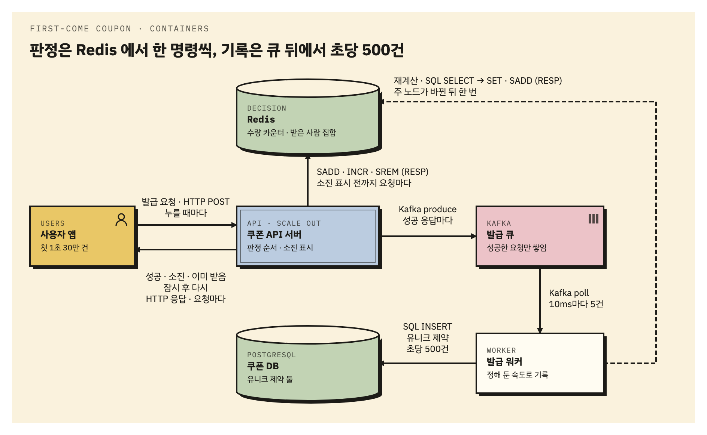
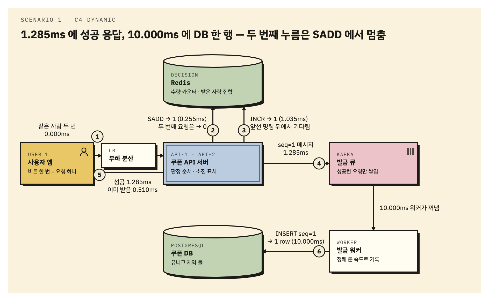
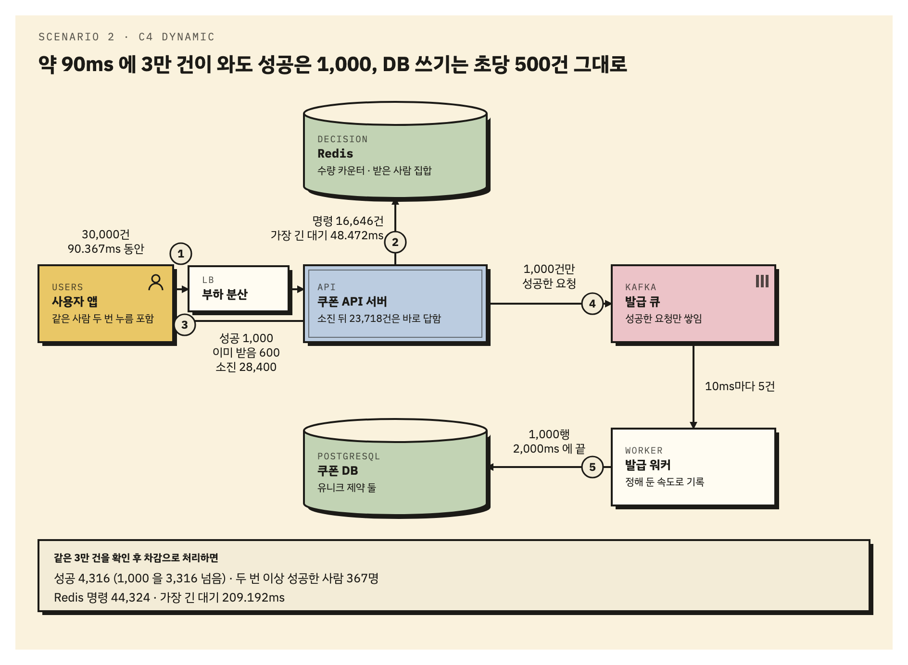
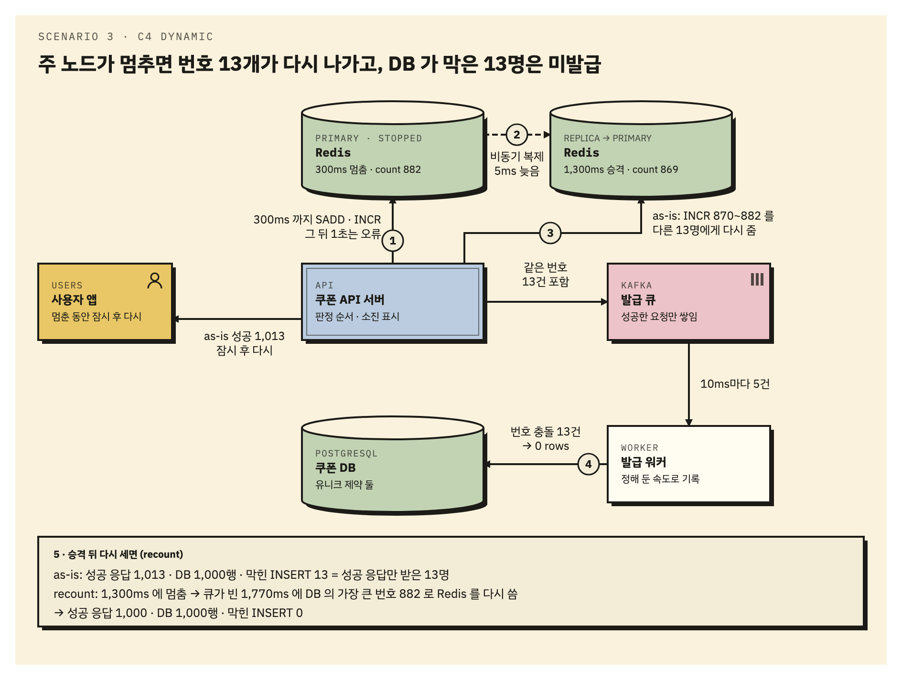

# 선착순 쿠폰 발급 — 판정은 Redis 명령 하나씩, 기록은 큐 뒤에서, 마지막 확인은 DB 유니크 제약

## 문제와 요구사항

봄 세일 첫날 오전 10시 정각에 할인 쿠폰 1만 장을 선착순으로 나눠 준다고 해 봅시다. 버튼이 열리는 첫 1초에 요청이 30만 건쯤 들어오고, 그 가운데 1만 명만 쿠폰을 받아야 해요. 가장 먼저 떠오르는 구조는 남은 수량을 읽어 보고 남았으면 하나 줄이는 것입니다. 두 요청이 같은 순간에 「1장 남음」을 읽으면 둘 다 줄이러 가서 10,001번째 쿠폰이 나갑니다. 한 장이 넘친 거예요.

이 글은 「아직 남았는가」와 「이 사람이 이미 받았는가」를 Redis 의 명령 하나씩으로 판정하고, DB(데이터베이스) 기록은 큐 뒤에서 워커가 정해 둔 속도로 하는 구조를 따라갑니다. 끝까지 읽으면 과발급 · 미발급 · 한 사람 한 장을 각각 어느 자리에서 지키는지 시나리오와 실행 출력으로 확인할 수 있어요. 요구 수치를 바꿨을 때 어느 구조로 옮겨야 하는지도 판단할 수 있게 됩니다. 아래 그림의 GET 은 값을 읽기만 하는 Redis 명령이고, INCR 은 값을 1 올리고 올린 값을 돌려주는 명령이에요.

```text
확인 후 차감 (명령 둘)                           원자 판정 (명령 하나)
  A: GET count → 9,999   남음                      A: INCR count → 10,000   통과 → 성공
  B: GET count → 9,999   남음                      B: INCR count → 10,001   한도 넘음 → 소진
  A: INCR count → 10,000 → 성공
  B: INCR count → 10,001 → 성공   ← 한도를 넘은 쿠폰
```

기능 요구는 셋입니다.

1. 사용자는 정각부터 쿠폰 받기 버튼을 누르고, 성공 · 소진 · 이미 받음 · 잠시 후 다시 가운데 하나를 응답으로 받습니다.
2. 성공을 받은 사람은 쿠폰함에서 그 쿠폰을 봅니다.
3. 한 사람은 같은 쿠폰을 한 장만 받습니다.

비기능 요구는 아래처럼 수치로 고정합니다. 근거 칸의 출처 수치는 리서치 노트에서 원문과 대조한 것이고, 링크는 참고 자료에 다시 모았습니다.

| 항목 | 수치 | 근거 |
| --- | --- | --- |
| 요청 규모 | 정각 뒤 첫 1초에 요청 30만 건 | 이 가이드의 가정 — 토스는 라이브 쇼핑의 포인트 지급 API(서버가 요청을 받는 창구) 요청이 「초당 수십만 건」이라고 적었습니다([토스의 대규모 트래픽 글](https://toss.tech/article/monitoring-traffic)). 쿠폰이 아니라 포인트 지급이라 규모의 감으로만 씁니다 |
| 한정 수량 | 쿠폰 한 종류에 1만 장 | 이 가이드의 가정 — 올리브영이 부하 시험에 쓴 제한 수량 10,000건과 같은 크기입니다([올리브영의 미발급 0% 글](https://oliveyoung.tech/2025-12-15/fcfs-coupon/)) |
| 정확도 — 과발급 | 0장. 성공 응답 수와 DB 에 기록된 쿠폰 수가 모두 한정 수량을 넘지 않음 | 배민의 선착순 1,111명 이벤트는 「1,111명보다 많은 수가 이벤트 당첨 기록에 남아」 초과분까지 쿠폰을 발행했습니다([배민의 빼빼로데이 글](https://techblog.woowahan.com/2514/)) |
| 정확도 — 미발급 | 0건. 성공 응답을 받은 요청은 모두 DB 에 기록됨 | 올리브영은 성공 응답 뒤 발급되지 않은 비율이 7일 평균 약 0.014% 였고, 이것을 CS(고객 상담) 문의로 이어지는 문제로 다뤘습니다(같은 올리브영 글) |
| 정확도 — 한 사람 한 장 | 같은 사람의 두 번째 성공 0건 | 카카오페이는 포인트를 「회사 예산을 사용하기 때문에 중복으로 제공하면 안 됩니다」라고 적었습니다([카카오페이의 따닥 이슈 글](https://tech.kakaopay.com/post/troubleshooting-logs-as-a-junior-developer/)) |
| 응답 지연 | 모든 요청이 1초 안에 응답을 받음 | 이 가이드의 가정 — 응답 지연을 수치로 약속한 공개 사례는 찾지 못했습니다(확인 안 함) |
| 기록 지연 | 성공 응답 뒤 1분 안에 DB 에 기록됨 | 이 가이드의 가정 — 사용자가 쿠폰함을 다시 열어 볼 만한 시간으로 잡았습니다 |
| 장애 | Redis 주 노드가 멈춰도 정확도 세 행을 지키고, 발급이 멈추는 시간은 1분 안 | 이 가이드의 가정 — 멈춤을 감수하고 정확도를 지키는 쪽을 골랐습니다. 이유는 시나리오 3 에 있습니다 |

일부러 다루지 않는 것도 적어 둡니다.

- 먼저 누른 사람이 반드시 먼저 받는지(도착 순서와 발급 순서의 일치)는 다루지 않습니다. 이 글의 선착순은 「한도를 절대 넘지 않는다」입니다. 사람마다 네트워크 지연이 달라 서버가 받은 순서가 누른 순서와 같다는 보장이 없기 때문이에요(판단). 순서까지 약속해야 하는 경우는 전환점에서 다룹니다.
- 쿠폰을 결제에 쓰는 일, 만료와 회수, 여러 쿠폰을 한 번에 주는 묶음 발급은 범위 밖입니다.
- 매크로 · 봇 차단과 대기열(번호표) 화면도 다루지 않습니다.

## 규모 추정

입력은 다섯입니다. 요청 속도 30만 건/초와 한정 수량 1만 장은 요구 표의 값이에요. 같은 사람이 한 번 더 누르는 비율은 10% 로 가정합니다. Redis 한 대가 명령 하나를 처리하는 데 5μs 가 걸린다고 둡니다(가정). 공식 벤치마크 예시에서 파이프라인 없는 SET(키에 값을 쓰는 명령)이 초당 180,180건이었고([Redis 벤치마크 문서](https://redis.io/docs/latest/operate/oss_and_stack/management/optimization/benchmarks/)), 5μs 는 그와 비슷한 크기로 고른 값입니다. 발급 워커의 기록 속도 초당 500건은 이 가이드의 설정값이고, 고른 이유는 발급 워커 항목에 있어요. 요청 하나는 SADD(받은 사람 집합에 넣기) → INCR(번호 받기) 두 명령이고, 번호가 한도를 넘으면 SREM(받은 사람 집합에서 다시 빼기)까지 세 명령입니다.

```text
(입력)  R = 300,000 건/초(요구) · N = 10,000 장(요구) · 두 번 누름 10%(가정) · Redis 명령 하나 5μs(가정) · 워커 500 건/초(설정값)

[1] 소진까지 걸리는 시간   N ÷ (R × 0.9) = 10,000 ÷ 270,000 ≈ 0.037 초   (Redis 가 명령을 바로 처리한다고 볼 때)
[2] 첫 1초의 결과          성공 10,000 · 나머지 300,000 − 10,000 = 290,000 건은 소진이나 이미 받음
[3] Redis 한 대의 처리량   1 초 ÷ 5μs = 200,000 명령/초
[4] 소진 표시가 없으면     성공 10,000 × 2 (SADD · INCR) + 나머지 290,000 × 3 (SADD · INCR · SREM) = 890,000 명령/초  →  [3] 의 4.45 배
[5] DB 쓰기                성공만 기록 → 10,000 건 ÷ 500 건/초 = 20 초   (기록 지연 1분 안)
[6] DB 에서 판정하면       요청마다 수량 행 하나를 고침 → 300,000 건/초 가 한 행의 잠금을 차례로 기다림
```

[4] 의 나머지 290,000건은 모두 소진으로 보고 센 위쪽 한계입니다. 이미 받음으로 끝나는 요청은 명령이 하나라 실제 값은 조금 작아요. [1] 은 Redis 가 기다림 없이 처리할 때의 값이라, Redis 에 명령이 쌓이면 그만큼 늦어집니다. 그 크기는 실행으로 셉니다(시나리오 2).

이 계산에서 판단 셋이 나옵니다. 먼저 [4] 가 판정 저장소 앞의 문을 요구해요. 소진 뒤의 요청 29만 건이 전부 Redis 로 가면 한 대가 처리할 수 있는 양의 4배를 넘으니, 소진을 한 번 확인한 쿠폰 API 서버가 그 뒤 요청에는 스스로 답해야 합니다. 다음으로 [5] 와 [6] 이 DB 의 자리를 정합니다. DB 에서 판정하면 30만 건이 한 행의 잠금을 지나야 합니다. PostgreSQL 은 다른 트랜잭션이 이미 고친 행을 만나면 다음 UPDATE(행을 고치는 SQL 문장, SQL 은 DB 의 질의 언어)가 그 트랜잭션이 끝날 때까지 기다린다고 적어요([PostgreSQL 격리 수준 문서](https://www.postgresql.org/docs/current/transaction-iso.html)). 판정을 앞에서 끝내면 DB 가 받는 쓰기는 성공 1만 건이고 그 속도도 워커가 정합니다. 마지막으로 [1] 과 [3] 이 이 구조의 한계를 보여 줘요. **쿠폰 하나는 키 하나라서 판정을 여러 Redis 에 나눌 수 없고**, 쿠폰 하나의 판정 속도는 Redis 한 대가 상한입니다.

## 시스템 개념도



데이터가 이동하는 길은 한 줄입니다. 사용자 앱의 요청을 쿠폰 API 서버가 받아 Redis 에 SADD 와 INCR 을 차례로 보내 판정하고(그림의 RESP 는 Redis 의 요청 · 응답 규약), 통과한 요청만 발급 큐에 넣은 뒤 성공으로 답합니다. 발급 워커가 큐에서 10ms마다 5건씩 꺼내 쿠폰 DB 에 기록하고, DB 의 유니크 제약 둘(같은 값을 가진 행을 두 번 넣지 못하게 하는 규칙)이 마지막으로 중복을 막아요. 점선은 Redis 주 노드가 바뀐 뒤에만 쓰는 길로, 발급 워커가 큐를 비운 다음 DB 의 기록으로 Redis 를 다시 씁니다.

## 시나리오로 따라가기

### 시나리오 1 — 정각에 두 번 누른 사용자 1 이 1번 쿠폰을 받고, 두 번째 누름은 「이미 받음」이 되기까지

실행 규모로 줄여 쿠폰 C001 은 1,000장입니다. 정각(0ms)부터 90ms 남짓 동안 3만 건이 함께 들어오는 실행이지만(시나리오 2), 여기서는 처음 누른 사용자 1 한 사람만 따라갑니다. 사용자 1 은 0.000ms 에 버튼을 두 번 눌렀어요. 카카오페이 글이 「따닥 이슈」라고 부른 일로, 버튼을 한 순간에 여러 번 눌러 같은 요청이 겹쳐 나가는 것입니다. API 서버와 Redis 사이는 한 방향 0.25ms 로 둡니다(가정). 나와야 하는 것은 사용자 1 이 쿠폰 한 장만 받고, 두 번째 요청은 「이미 받음」으로 끝나고, DB 에 행이 하나만 생기는 것입니다.



1. 사용자 앱이 두 요청을 보내고, 앞단의 부하 분산(요청을 여러 서버에 나눠 주는 장치)이 쿠폰 API 서버 api-1 과 api-2 에 하나씩 나눕니다. 「이 사람이 이미 받았는가」를 서버 메모리에 적으면 api-1 과 api-2 가 서로의 기록을 보지 못해요. 그래서 판정은 모든 서버가 같이 쓰는 Redis 한 곳에서 합니다.
2. 0.255ms 에 api-1 의 SADD(집합에 원소를 넣고, 새로 넣었으면 1 · 이미 있었으면 0 을 돌려주는 Redis 명령)가 1 을 받고, 5μs 뒤 api-2 의 SADD 는 0 을 받습니다. Redis 가 명령을 한 번에 하나씩 처리하므로 같은 사람의 SADD 둘 가운데 1 을 받는 것은 하나뿐이에요. 사람 판정을 수량 판정보다 먼저 하는 이유는 아래 확인 질문에서 봅니다.
3. api-1 이 INCR(키의 정수를 1 올리고 올린 뒤의 값을 돌려주는 Redis 명령)을 보내고 1.035ms 에 1 을 받습니다. 1 이 1,000 이하이니 이 요청의 쿠폰 번호는 1번이에요. 「남았는가」를 묻는 일과 「하나 줄이는」 일이 명령 하나라서 둘 사이에 다른 요청이 끼어들 틈이 없습니다. INCR 은 0.755ms 에 Redis 에 도착했지만, 그사이 들어온 다른 요청의 명령을 먼저 처리하느라 1.035ms 에야 처리됐어요(계산: SADD 응답이 API 서버에 0.255 + 0.25 = 0.505ms, INCR 이 Redis 에 0.505 + 0.25 = 0.755ms).
4. api-1 이 발급 큐(Kafka 토픽 — 받은 메시지를 보관해 두는 저장소로, 같은 쿠폰의 메시지는 쓴 순서대로 읽힘)에 「사용자 1 · 쿠폰 C001 · 번호 1」 메시지를 넣고 받았다는 확인을 기다립니다. 응답보다 큐를 먼저 하는 이유는 순서를 바꾸면 성공이라고 답한 뒤에 큐 넣기가 실패할 수 있기 때문이에요. 그 요청은 성공 응답만 받고 쿠폰은 없는 미발급이 됩니다.
5. 응답이 나갑니다. api-2 는 0.510ms 에 「이미 받음」, api-1 은 1.285ms 에 「성공 · 1번」입니다. 이미 받음이 먼저 나간 이유는 SADD 한 번으로 판정이 끝나 INCR 과 큐를 거치지 않았기 때문이에요. 사용자 1 의 앱은 두 응답을 다 받지만 쿠폰은 하나입니다.
6. 발급 워커가 10.000ms 에 큐에서 메시지를 꺼내 쿠폰 DB 에 INSERT(행을 넣는 SQL 문장) 하고 행 하나가 생깁니다. 기록을 요청 처리에서 떼어 둔 이유는 시나리오 2 에서 3만 건이 몰려도 DB 쓰기를 초당 500건으로 묶어 두기 위해서입니다.

```text
t=0.000ms req=0 user=1 presses, api-1
t=0.000ms req=1 user=1 presses, api-2
t=0.255ms req=0 user=1 redis SADD -> 1
t=0.260ms req=1 user=1 redis SADD -> 0
t=0.510ms req=1 user=1 api: already issued
t=1.035ms req=0 user=1 redis INCR -> 1
t=1.285ms req=0 user=1 api: enqueue seq=1, answer success
t=10.000ms req=0 user=1 worker INSERT seq=1 -> 1 row
```

잠깐, 확인 하나만 해 볼까요? 2단계와 3단계의 순서를 바꿔 INCR 을 먼저 보내면 사용자 1 의 두 번째 요청은 어떻게 될까요?

두 요청이 INCR 에서 1 과 2 를 받아 둘 다 1,000 이하로 통과합니다. 그다음 SADD 에서야 하나가 0 을 받는데, 그 요청이 가져간 2번은 이미 카운터에서 빠졌어요. 카운터를 1 내려 되돌린다 해도 그사이 1,000번째 근처에서 「소진」을 받은 사람의 응답은 되돌릴 수 없습니다. 쿠폰이 남았는데 소진으로 답한 셈이죠.

```text
SADD 먼저 (이 가이드)                          INCR 먼저
req0 SADD → 1     req1 SADD → 0  끝            req0 INCR → 1     req1 INCR → 2
req0 INCR → 1  →  1번                          req0 SADD → 1 → 1번    req1 SADD → 0 → 2번은 아무도 못 받음
카운터에서 빠진 수: 1                            카운터에서 빠진 수: 2   (하나는 되돌려야 함)
```

이 시나리오가 보여 준 것은 판정 둘이 각각 명령 하나라 끼어들 틈이 없고, 사람 판정을 먼저 해서 같은 사람의 두 번째 요청이 수량을 쓰지 않는다는 점입니다. 성공 응답까지 1.285ms 는 응답 지연 요구 행으로, DB 기록까지 10.000ms 는 기록 지연 요구 행으로, 두 번째 요청의 `SADD -> 0` 은 한 사람 한 장 행으로 갑니다.

### 시나리오 2 — 90ms 에 3만 건이 몰려도 성공은 정확히 1,000건이고, DB 쓰기는 초당 500건 그대로

같은 실행에서 정각부터 90.367ms 동안 요청 3만 건이 들어옵니다. 초당으로 바꾸면 30,000 ÷ 0.090367 ≈ 33만 건이라(계산) 요구 표의 30만 건보다 조금 많아요. 길이는 1초의 약 10분의 1 입니다. 쿠폰은 1,000장이고 요청의 약 10% 는 바로 앞 사람이 한 번 더 누른 것입니다(가정). Redis 는 명령 하나를 5μs 에 처리합니다(가정, 규모 추정 [3]). 나와야 하는 것은 성공이 정확히 1,000건이고, DB 쓰기가 요청 속도와 상관없이 초당 500건을 넘지 않는 것입니다.



1. 요청이 쿠폰 API 서버 두 대에 반씩 들어가고, 소진 표시가 켜지기 전까지는 모두 Redis 로 명령을 보냅니다. 쿠폰 하나가 Redis 키 하나라 명령이 한 대에 모이고, Redis 는 명령을 도착한 차례대로 하나씩 처리하므로 명령이 차례를 기다립니다. 이 실행에서 가장 오래 기다린 요청은 응답까지 48.472ms 가 걸렸어요(`max-wait`). 판정을 한 곳에서 해야 정확하니 부하도 그 한 곳에 모이는 것입니다.
2. INCR 은 1부터 1,000까지를 정확히 1,000개의 요청에 하나씩 돌려줍니다. 같은 사람의 두 번째 요청 600건은 SADD 에서 0 을 받아 수량을 쓰지 않았어요(`already=600`). INCR 의 결과가 요청마다 다른 값이라 1,000 이하를 받는 요청이 1,000개를 넘을 수 없기 때문입니다.
3. INCR 이 1,000 을 넘는 값을 처음 돌려준 순간, 그 응답을 받은 API 서버는 자기 메모리에 소진 표시를 켜고 그 뒤 요청에는 Redis 에 묻지 않고 「소진」으로 답합니다. 소진 응답 28,400건 가운데 23,718건이 이렇게 Redis 에 가지 않았어요. 주 노드가 바뀌지 않는 한 카운터는 올라가기만 하니, 한 번 1,000 을 넘은 뒤 다시 1,000 이하가 되지 않아요. 그래서 이 표시는 늦게 켜질 수는 있어도 틀리게 켜지지는 않습니다. 주 노드가 바뀌어 카운터가 뒤로 가는 경우(시나리오 3)에도, 표시가 켜졌다는 것은 이미 1,000장이 다 나갔다는 뜻이라 표시는 맞습니다.
4. 큐에는 성공한 1,000건만 들어갑니다. 발급 워커가 10ms마다 5건씩 꺼내 INSERT 하므로 마지막 행은 2,000ms 에 생겼어요(`last-row`). 요청은 90ms 에 3만 건이었지만 DB 가 받은 쓰기는 초당 500건 그대로입니다. 쓰기 속도를 정하는 것이 요청이 아니라 워커가 큐에서 꺼내는 속도이기 때문이에요.
5. 같은 3만 건을 확인 후 차감 대역에 넣어 봅니다. 이 대역은 SISMEMBER(집합에 원소가 있는지 묻는 Redis 명령)와 GET(키의 값을 읽기만 하는 명령)으로 한 번 확인하고, 통과하면 SADD 와 INCR 로 한 번 더 왕복해 차감해요. 성공 응답이 4,316건으로 1,000 을 3,316건 넘었고, 두 번 이상 성공 응답을 받은 사람이 367명입니다. 확인과 차감 사이가 왕복 한 번(0.5ms)에 Redis 대기까지 더해 벌어지기 때문이에요. 그 틈에 들어온 다른 요청의 확인은 모두 줄기 전의 수량을 봅니다.

```text
atomic: requests=30000 success=1000 over=0 double=0 already=600 sold-out=28400 retry=0
atomic: redis-commands=16646 api-local-sold-out=23718 max-wait=48.472ms db-rows=1000 db-rejected=0 last-row=2000.000ms
check-then-act: requests=30000 success=4316 over=3316 double=367 already=0 sold-out=25684 retry=0
check-then-act: redis-commands=44324 api-local-sold-out=12154 max-wait=209.192ms db-rows=3905 db-rejected=411 last-row=8640.000ms
```

Redis 명령 수는 출력의 다른 값들로 다시 셀 수 있습니다. 원자 판정에서 Redis 까지 간 요청은 30,000 − 23,718 = 6,282건이에요. 그 가운데 600건은 SADD 에서 끝나고, 성공 1,000건은 SADD 와 INCR, 나머지는 SREM(받은 사람 집합에서 다시 빼기)까지 세 명령을 씁니다.

```text
                      원자 판정 (이 가이드)                        확인 후 차감
Redis 에 간 요청       30,000 − 23,718 = 6,282                      30,000 − 12,154 = 17,846
Redis 명령             SADD 6,282 + INCR 5,682 + SREM 4,682          확인 17,846 × 2 + 차감 4,316 × 2
                       = 16,646 (출력과 같음)                        = 44,324 (출력과 같음)
성공 응답              1,000                                        4,316
가장 긴 대기           48.472ms                                     209.192ms
```

이 시나리오가 보여 준 것은 부하가 어디서 받아지고 무엇이 그대로인가입니다. 몰린 요청은 Redis 의 대기 시간(가장 길게 48.472ms)과 API 서버의 소진 응답으로 받아지고, 성공 수 1,000 과 DB 쓰기 속도는 바뀌지 않아요. 확인 후 차감은 부하가 클수록 확인과 차감 사이가 벌어져 넘친 쿠폰이 늘어납니다. 전체 규모에서도 응답 지연 1초를 지키는지는 실행 상수 둘만 바꿔 확인했어요. `LIMIT` 를 10,000, 요청 수를 300,000 으로 바꾸고 마지막 요청 시각을 찍는 배열 첨자만 맞추면 `success=10000 over=0` 과 `max-wait=453.687ms` 가 나옵니다(변형 실행).

### 시나리오 3 — Redis 주 노드가 멈추면 확인해 준 INCR 13건이 사라져 13명이 미발급으로 남고, 큐를 비운 뒤 다시 세면 0 이 되기까지

두 번째 쿠폰 1,000장을 이번에는 덜 몰리는 속도로 엽니다. 요청 9,000건이 평균 0.3ms 간격으로 들어오니 초당 약 3,333건이에요(계산: 1,000ms ÷ 0.3ms). Redis 는 주 노드 하나와 복제본 하나이고, 복제본은 주 노드보다 5ms 늦게 쓰기를 받는다고 둡니다(가정). 300ms 에 주 노드가 멈추고, 복제본이 주 노드로 승격되기까지 1초가 걸린다고 둡니다(가정). 같은 사건열을 두 번 실행해, 승격된 복제본을 그대로 쓰는 경우(as-is)와 이 가이드처럼 다시 세는 경우(recount)를 나란히 봅니다.



1. 300ms 에 Redis 주 노드가 멈춥니다. 그때 카운터는 882 였어요. 승격까지 1초 동안 쿠폰 API 서버가 보내는 명령은 모두 실패하고, 사용자는 「잠시 후 다시」를 받습니다. 판정 저장소 없이 성공이나 소진을 답하면 그 답은 짐작이 되기 때문입니다.
2. 복제본에는 멈추기 5ms 전의 상태가 있어서 카운터가 869 입니다. Redis 는 기본으로 비동기 복제를 하고, 공식 문서는 확인된 쓰기도 장애 조치(failover — 멈춘 주 노드 대신 복제본을 주 노드로 올리는 일) 중에 잃을 수 있다고 적어요(「acknowledged writes can still be lost during a failover」, [Redis 복제 문서](https://redis.io/docs/latest/operate/oss_and_stack/management/replication/)). 870번부터 882번까지 13개 번호는 이미 13명에게 성공으로 답했고 큐에도 들어갔는데, 새 주 노드는 그 사실을 모릅니다.
3. (as-is) 1,300ms 에 복제본이 승격되고 쿠폰 API 서버가 그대로 이어 쓰면, INCR 이 870부터 882까지를 다른 13명에게 다시 돌려줍니다. 쿠폰 API 서버는 새 주 노드의 카운터가 뒤로 간 것을 알 방법이 없기 때문이에요. 성공 응답이 882 + (1,000 − 869) = 1,013건이 되어 한도를 13건 넘어요(계산, 출력의 `success=1013` 과 같음). 성공 응답 쪽의 과발급이고, 틀린 값이 남는 경로가 여기서 시작됩니다.
4. 그 13건의 메시지는 원래 주인의 메시지보다 큐에서 뒤에 있으므로, 발급 워커가 INSERT 할 때 번호 유니크 제약(같은 쿠폰에 같은 번호를 두 번 쓰지 못하게 하는 DB 규칙)에 걸려 0 rows 가 됩니다(`db-rejected=13`). DB 는 1,000행에서 멈추니 DB 에 기록되는 쿠폰은 1,000장을 넘지 않아요. 유니크 제약이 막는 것은 기록되는 쿠폰 수까지이고, 이미 나간 성공 응답 13건은 막지 못합니다. 그 13명은 성공 응답만 받고 쿠폰이 없는 미발급으로 남아요. 이 제약이 없으면 같은 사건열에서 DB 가 `db-rows=1013` 이 됩니다(변형 실행 — `CouponDb.insert` 에서 번호 중복 검사를 빼고 번호를 목록에 쌓게 바꿈).
5. (recount) 이 가이드의 구조는 승격 직후 판정을 열지 않습니다. 1,300ms 에 발급을 멈추고, 발급 워커가 큐를 다 비운 1,770ms 에 DB 행으로 Redis 를 다시 써요. 카운터는 DB 에 있는 가장 큰 번호 882(이 실행에서는 행 수와 같음), 받은 사람 집합은 DB 의 사용자 번호들입니다. 큐를 먼저 비우는 이유는 큐에 남은 메시지도 이미 성공으로 답한 요청이라, 비우기 전에 세면 그만큼 적게 세어 같은 번호를 다시 내주기 때문이에요. 행 수가 아니라 가장 큰 번호로 세는 이유도 같습니다. 쿠폰 API 서버가 INCR 과 큐 넣기 사이에서 멈춰 빈 번호가 하나라도 생기면, 행 수가 가장 큰 번호보다 작아져 이미 나간 번호를 다시 내주게 돼요(판단).
6. 발급을 다시 열면 INCR 이 883부터 이어서 1,000까지 나가고, 성공 응답 1,000 · DB 1,000행 · 막힌 INSERT 0 이 됩니다. 883부터인 이유는 카운터를 이미 나간 마지막 번호에 맞췄기 때문입니다. 대가로 발급이 300ms 부터 1,770ms 까지 1.47초 멈췄어요. 「잠시 후 다시」를 받은 요청은 as-is 의 3,339건보다 1,565건 많은 4,904건입니다(계산: 4,904 − 3,339).

```text
시각         주 노드 count    복제본 count    일어난 일
295.000ms       869             869          복제본이 받은 마지막 상태 (5ms 늦음)
300.000ms       882             869          주 노드 멈춤 — 870~882 는 복제본에 없음
1300.000ms      -               869          승격. as-is 는 바로 판정, recount 는 멈춤
1770.000ms      -               882          recount: 큐가 빈 뒤 DB 의 가장 큰 번호 882 로 다시 씀
```

이 시나리오가 보여 준 것은 Redis 를 판정 저장소로 쓸 때 틀린 값이 남는 경로입니다. 확인된 쓰기를 잃으면 카운터가 뒤로 가고, 같은 번호가 다시 나가요. 이번에는 13개였습니다. DB 의 번호 유니크 제약은 기록되는 쿠폰이 한도를 넘지 않게 하는 마지막 자리입니다. 넘친 성공 응답(과발급)과 그 응답의 미발급까지 막는 것은 큐를 비운 뒤의 재계산이에요. 멈춘 시간 1.47초와 정확도 세 행이 장애 요구 행으로 갑니다.

## 기술 상세 설명

### 구성 요소 — 사용자 앱

쿠폰 받기 버튼이 있는 모바일 앱이나 웹 페이지입니다. 버튼 한 번이 HTTP(웹의 요청 · 응답 규약) POST 요청 하나이고, 응답은 넷 가운데 하나예요.

맡는 일은 시나리오 1 의 1단계에서 요청을 보내고, 5단계의 응답을 화면에 보여 주는 것입니다. 시나리오 3 처럼 「잠시 후 다시」를 받으면 사용자가 다시 누를 수 있게 버튼을 열어 둡니다.

```http no-compile
POST /coupons/C001/issue HTTP/1.1
Authorization: Bearer <로그인 토큰>

HTTP/1.1 200 OK
Content-Type: application/json

{"result": "issued", "seq": 1}
```

연타를 막는 일을 앱에만 맡기지 않는 이유는 앱에서 막아도 다 막히지 않기 때문입니다. 카카오페이는 「1차적으로는 FE에서 디바운스를 통해 동시성 이슈를 막고 있지만, 100% 막을 수는 없어」 서버에서도 막았다고 적었어요(카카오페이 글, FE 는 프런트엔드 곧 앱 쪽). 디바운스는 짧은 시간 안에 여러 번 눌린 버튼을 한 번으로 치는 방법인데, 네트워크 재시도나 여러 기기에서 오는 요청은 앱이 알 수 없습니다. 그래서 앱은 버튼을 잠깐 막는 정도만 하고 판정은 서버가 합니다.

| 설정값 · 한계 | 값 | 이유 · 보장하지 않는 것 |
| --- | --- | --- |
| 응답 종류 | `issued` · `already` · `sold_out` · `retry_later` | 앞의 셋은 끝난 답이고, 마지막만 다시 눌러도 되는 답 |
| 사용자 번호 | 로그인 토큰에서 서버가 꺼냄 | 요청 본문의 사용자 번호를 믿으면 남의 번호로 받을 수 있음 |
| 같은 기기의 연타 | 앱이 응답을 받기 전까지 버튼을 막음 | 다른 기기 · 재시도까지는 막지 못함 — 시나리오 1 의 2단계가 막음 |

### 구성 요소 — 쿠폰 API 서버

발급 요청을 받아 판정 순서를 실행하는 서버 프로그램입니다. 자기 상태가 없어서 요청이 늘면 대수를 늘려 받아요. 예외가 하나 있는데, 소진을 한 번 확인한 서버는 그 사실을 자기 메모리에 표시해 둡니다.

맡는 일은 시나리오 1 의 1~5단계 전부와 시나리오 2 의 3단계(소진 표시), 시나리오 3 의 1 · 5단계(멈춤과 재개)입니다. 순서는 아래 표와 같고, 어느 두 줄을 바꿔도 시나리오 하나가 틀린 값을 냅니다.

```text
판정 순서      보내는 것               받은 결과에 따라
1 받은 사람    SADD 받은사람집합 u     0 → 「이미 받음」으로 끝 · 1 → 2 로
2 남은 수량    INCR 카운터             ≤ 1,000 → 3 으로 · > 1,000 → 소진 표시를 켜고 「소진」, SREM 으로 1 의 SADD 를 되돌림
3 기록 예약    발급 큐에 메시지 넣기   큐의 확인을 받으면 4 로
4 응답         HTTP 200                「성공 · 번호」
1 · 2 를 바꾸면 → 시나리오 1 의 확인 질문(두 번째 요청이 번호를 하나 씀)
3 · 4 를 바꾸면 → 시나리오 1 의 4단계(성공만 받은 미발급)
```

소진 표시를 서버 메모리에 두는 이유는 규모 추정 [4] 입니다. 소진 뒤의 요청까지 Redis 에 보내면 초당 89만 명령으로 한 대의 4배를 넘어요. 모든 사용자에게 같은 값을 Redis 에서 매번 읽는 대신 웹 서버의 로컬 캐시에 두어 Redis 사용량을 줄이는 것은 토스가 라이브 쇼핑의 Redis 과부하 해결책으로 적은 방법입니다(토스 글). 소진 여부도 모든 사용자에게 같은 값이라 같은 방법이 맞아요. 시나리오 2 에서는 소진 응답 28,400건 가운데 23,718건이 Redis 에 가지 않았습니다.

요청을 서버들에 나누는 일은 앞단의 부하 분산이 맡습니다. 배포 세부라 개념도에 상자로 그리지 않았지만 시나리오 1 의 1단계에서 일해요. 같은 사람의 두 요청이 서로 다른 서버로 갈 수 있다는 점이 받은 사람 판정을 서버 메모리가 아니라 Redis 에서 하는 이유이고, 소진 표시처럼 틀려도 Redis 가 바로잡아 주는 것만 서버 메모리에 둡니다.

| 설정값 · 한계 | 값 | 이유 · 보장하지 않는 것 |
| --- | --- | --- |
| 소진 표시 | 서버마다 따로, INCR 이 한도를 넘는 값을 처음 받을 때 켬 | 서버가 100대면 100대가 각자 한 번씩은 Redis 에 물어야 켜짐(판단). 주 노드가 바뀌지 않는 한 카운터가 줄지 않으니 틀리게 켜지지는 않음. 바뀌어 카운터가 뒤로 가도 켜진 표시는 1,000장이 다 나간 뒤라 맞음. 재계산도 DB 의 가장 큰 번호로 세므로 1,000장이 다 나간 뒤라면 다시 1,000 이 됨 |
| 멈춤 표시 | 주 노드가 바뀌면 켜고, 재계산이 끝나면 끔 | 서버들에 알리는 방법(설정 저장소 · Redis 키)은 이 글이 정하지 않음. 실행은 변수 하나로 흉내 냄 |
| INCR 과 큐 넣기 사이의 멈춤 | 서버가 그 사이에 멈추면 그 번호는 큐에도 DB 에도 없음 | 성공 응답이 나가지 않았으니 미발급은 아니지만 그 한 장은 나가지 않음. 재계산이 가장 큰 번호로 세므로 그 번호를 다시 내주지도 않음(판단, 실행 밖) |

### 구성 요소 — Redis

메모리에 키와 값을 두는 저장소입니다. 공식 문서는 Redis 를 명령 실행의 관점에서 「mostly, a single-threaded server」라고 적어요([Redis 벤치마크 문서](https://redis.io/docs/latest/operate/oss_and_stack/management/optimization/benchmarks/)). 명령이 한 번에 하나씩 처리되니 명령 하나 안에서는 다른 명령이 끼어들지 못합니다.

이 시스템에서는 쿠폰마다 키 둘을 둡니다. 카운터 `coupon:C001:count` 는 시나리오 1 의 3단계에서 INCR 을 받고, 받은 사람 집합 `coupon:C001:users` 는 2단계에서 SADD 를, 소진된 요청에서 SREM(집합에서 원소를 빼는 명령)을 받아요.

```redis no-compile
SADD coupon:C001:users 1                 # (integer) 1 → 처음 · 0 → 이미 받음
INCR coupon:C001:count                   # (integer) 1 → 1,000 이하면 그 값이 쿠폰 번호
SREM coupon:C001:users 1                 # INCR 이 1,000 을 넘었을 때만
```

판정은 명령이 돌려주는 값만 보고 합니다. 그 값은 명령마다 공식 문서가 정해 두었어요.

| 명령 | 하는 일 | 돌려주는 값 | 근거 |
| --- | --- | --- | --- |
| INCR | 키의 정수를 1 올림 | 올린 뒤의 값. 64비트 부호 정수까지 셈 | [Redis INCR 문서](https://redis.io/docs/latest/commands/incr/) |
| SADD | 집합에 원소를 넣음 | 새로 넣은 원소의 수 — 원소 하나면 1 아니면 0 | [Redis SADD 문서](https://redis.io/docs/latest/commands/sadd/) |
| SREM | 집합에서 원소를 뺌 | 뺀 원소의 수 | [Redis SREM 문서](https://redis.io/docs/latest/commands/srem/) |
| SISMEMBER | 원소가 있는지 물음(시나리오 2 의 대역만 씀) | 있으면 1, 없으면 0 | [Redis SISMEMBER 문서](https://redis.io/docs/latest/commands/sismember/) |

이 자리에 올 수 있는 다른 방법은 셋입니다. Lua 스크립트(Redis 안에서 여러 명령을 한 번에 실행하는 작은 프로그램)로 SADD 와 INCR 을 하나로 묶으면 두 명령 사이의 틈까지 없어집니다. 스크립트는 실행되는 동안 「all server activities are blocked」라서 명령 하나처럼 원자적으로 실행돼요([Redis Lua 스크립트 문서](https://redis.io/docs/latest/develop/programmability/eval-intro/)). `MULTI` · `EXEC` 트랜잭션은 명령을 끼어들기 없이 차례로 실행하지만 롤백이 없고, 같은 문서가 트랜잭션으로 하는 일은 스크립트로 하는 편이 「usually ... both simpler and faster」라고 적어요([Redis 트랜잭션 문서](https://redis.io/docs/latest/develop/using-commands/transactions/)). 마지막은 DB 에서 판정하는 후보 A 입니다. 이 글이 명령 둘을 고른 이유는 대안 비교의 결정 절에서 근거와 함께 봅니다.

| 설정값 · 한계 | 값 | 이유 · 보장하지 않는 것 |
| --- | --- | --- |
| 판정은 주 노드에서만 | 복제본에서 읽지 않음 | 복제는 비동기라 복제본의 카운터는 늦음. 배민 2016 은 참조를 복제본에서 해 한도를 넘김(실제 사례) |
| 키 만료 | 쿠폰 종료 1시간 뒤 | 올리브영 코드의 `couponEndTime.plusHours(1)` 과 같은 값(올리브영 글). 끝난 쿠폰의 키가 메모리에 남지 않게 함 |
| 복제와 장애 조치 | 주 노드 1 + 복제본 1, 복제 지연 5ms(가정) | 확인된 쓰기도 장애 조치 중에 잃을 수 있음(Replication 문서) — 시나리오 3 의 2단계. `WAIT` 으로 복제를 기다려도 강한 일관성을 갖춘 「CP system」이 되지는 않는다고 같은 문서가 적음 |
| 쿠폰 하나의 처리량 | Redis 한 대가 상한 | 쿠폰 하나가 키 하나라 나눌 수 없음. 토스도 Increment 를 짧은 시간에 너무 많이 보내면 Redis 의 명령이 쌓여 CPU(중앙 처리 장치) 사용량이 오른다고 적음(토스 글) |

### 구성 요소 — 발급 큐

받은 메시지를 보관했다가 소비자가 가져가게 하는 중간 저장소입니다. 이 글에서는 Kafka 토픽 하나를 씁니다. Kafka 는 이벤트를 「durably and reliably for as long as you want」 보관하고, 가져간 뒤에도 지우지 않으며, 한 파티션 안에서는 쓴 순서대로 읽힌다고 공식 소개가 적어요([Kafka 소개 문서](https://kafka.apache.org/intro)).

맡는 일은 시나리오 1 의 4단계에서 성공 메시지를 받고 6단계에서 워커에 넘기는 것입니다. 시나리오 3 에서 Redis 가 멈춰도 메시지를 가지고 있어서, 큐가 빈 뒤 DB 에 있는 가장 큰 번호가 곧 지금까지 나간 마지막 번호가 됩니다. 아래 표의 SQS(Amazon Simple Queue Service, 아마존이 운영하는 메시지 큐 서비스)는 다른 후보 큐이고, FIFO(먼저 넣은 메시지를 먼저 꺼냄)는 그 가운데 순서를 지키는 종류예요.

```text
후보                      판정 저장소와 같이 멈추는가     정각의 몰림을 받는가
Redis List (올리브영 2023) 같이 멈춤 — 재계산의 근거가 사라짐   받음
SQS FIFO 기본 모드        따로                           파티션당 초당 300건, 배치면 3,000 메시지
SQS FIFO 고처리량 모드    따로                           리전에 따라 초당 2,400 ~ 70,000건
Kafka 토픽 (이 가이드)    따로                           파티션을 늘려 받음 (처리량 공식 수치는 확인 안 함)
```

Redis 의 List 를 큐로 쓰면 부품 하나가 줄지만 판정 저장소와 같이 멈춥니다. 시나리오 3 의 재계산은 Redis 가 멈춘 동안에도 큐가 남아 있어야 성립하므로 큐는 Redis 밖에 둬요. Amazon SQS 의 FIFO 큐는 고처리량 모드가 아니면 파티션 하나가 API 동작마다 초당 300건, 배치를 쓰면 3,000 메시지까지입니다([Amazon SQS 메시지 한도 문서](https://docs.aws.amazon.com/AWSSimpleQueueService/latest/SQSDeveloperGuide/quotas-messages.html)). 성공 1만 건이 소진까지의 짧은 순간에 몰리는 이 문제에는 고처리량 모드가 필요해요. 고처리량 모드의 한도는 리전마다 달라요. 같은 문서가 든 리전 목록에 서울이 따로 없어, 서울은 「All other AWS Regions」(AWS 는 아마존이 운영하는 클라우드 서비스)에 해당하는 기본값 초당 2,400건(배치 없이)으로 읽힙니다. 그 값이면 성공 1만 건을 넣는 데 10,000 ÷ 2,400 ≈ 4.2초가 걸려 응답 1초 요구를 넘어요(계산). 배치(한 번에 10건)를 쓰면 0.42초로 줄지만, 응답마다 배치가 찰 때까지 기다리게 됩니다(판단). 이 계산이 말하는 것은 SQS 를 배치 없이 쓰면 문서의 기본 한도로는 쿠폰 하나의 성공 1만 건을 1초 안에 넣지 못한다는 데까지예요. SQS 문서는 메시지 그룹을 여럿으로 나누면 「better parallelism and higher overall throughput」을 얻는다고 적지만, 그렇게 하면 위의 배치 없는 한도가 오르는지는 찾지 못했습니다(확인 안 함). Kafka 가 그 1만 건을 1초 안에 받는다는 것도 이 계산은 말하지 않아요. 이 글은 쿠폰 종류를 키로 쓰므로(아래 표) 쿠폰 하나의 메시지는 모두 한 파티션에 쓰입니다(Kafka 소개 문서). Kafka 는 토픽을 파티션으로 나눠 여러 브로커에 두므로(같은 문서), 쓰기가 여러 브로커로 나뉘는 것은 쿠폰이 여럿이라 쿠폰마다 다른 파티션으로 흩어질 때입니다. 쿠폰 하나의 처리량은 파티션 하나가 정하고, 그 값은 공식 수치를 확인하지 못해 자기 클러스터에서 재야 합니다(판단). 그래도 Kafka 를 고른 것은 보관과 순서가 공식 문서로 확인되고(위 첫 문단), 토스가 같은 자리(DB 앞의 비동기 기록)에 썼기 때문이에요. 쿠폰 하나의 처리량은 쿠폰을 열기 전에 재서 확인할 일로 남깁니다(판단). 올리브영은 반대로 「확장 이후 축소가 불가한 Kafka의 파티션 정책」이 세일 때만 늘었다 줄어드는 자기 운영과 맞지 않아 RabbitMQ 를 골랐다고 적었어요(올리브영 RabbitMQ 글).

| 설정값 · 한계 | 값 | 이유 · 보장하지 않는 것 |
| --- | --- | --- |
| 토픽 · 파티션 | 쿠폰 발급 토픽 하나, 쿠폰 종류(C001 같은 값)를 키로 | 같은 키는 같은 파티션에 쓰여 한 쿠폰의 메시지가 쓴 순서대로 읽힘(Kafka 소개) |
| 복제 수 | 3 | Kafka 소개가 흔한 운영 설정으로 든 값. 브로커 하나가 멈춰도 메시지가 남음 |
| 같은 메시지를 두 번 처리 | 일어날 수 있다고 봄 | 올리브영은 워커 4대가 같은 메시지를 받아 「쿠폰 발급은 4회 실행」된 적이 있음(올리브영 Pub/Sub 글). 이 글은 큐가 막아 준다고 보지 않고 쿠폰 DB 의 유니크 제약이 막음 |

### 구성 요소 — 발급 워커

발급 큐에서 메시지를 꺼내 쿠폰 DB 에 쓰는 프로그램입니다. 이 글의 설정값은 10ms마다 5건, 곧 초당 500건이에요.

맡는 일은 시나리오 1 의 6단계에서 INSERT 하는 것, 시나리오 3 의 4단계에서 0 rows 가 된 메시지를 미발급 목록에 남기는 것, 5단계에서 큐가 비면 DB 행으로 Redis 를 다시 쓰는 것입니다.

```text
INSERT 결과    뜻                                        워커가 하는 일
1 row          처음 기록                                  다음 메시지로
0 rows         같은 (사용자, 번호) 행이 이미 있음         이미 기록된 것 — 다음 메시지로 (같은 메시지를 두 번 받은 경우)
0 rows         같은 번호를 다른 사용자가 가짐              미발급 목록에 남김 (시나리오 3 의 4단계)
```

워커를 따로 두는 이유는 DB 쓰기 속도를 요청 속도에서 떼어 내려는 것입니다. 쿠폰 API 서버가 DB 에 바로 쓰면 성공 1만 건이 소진까지의 0.037초(규모 추정 [1]) 안에 한꺼번에 DB 로 갑니다. 토스도 지급 내역을 「Kafka를 통해 비동기로 Insert하고, Consumer에서 Throttling을 걸어 최대 QPS에 도달하지 않도록」 했다고 적었어요(토스 글, QPS 는 초당 질의 수). 쓰기 속도를 워커가 정하면 DB 가 받는 양은 정각의 몰림과 상관없이 일정합니다.

| 설정값 · 한계 | 값 | 이유 · 보장하지 않는 것 |
| --- | --- | --- |
| 기록 속도 | 10ms마다 5건 = 초당 500건 | 1만 장이 20초에 끝나 기록 지연 1분을 지킴(규모 추정 [5]). DB 한 대가 실제로 받는 INSERT 속도는 확인 안 함 — 자기 DB 에서 재고 정함 |
| 0 rows 의 구분 | 기존 행의 사용자 번호를 다시 읽어 가름 | 실행의 `CouponDb.insert` 는 두 경우를 가르지 않고 false 를 돌려줌. 실행에는 같은 메시지를 두 번 받는 일이 없어서 `db-rejected` 는 모두 미발급 |
| 워커가 멈추면 | 큐가 메시지를 가지고 있음 | 다시 뜬 워커가 이어서 기록. 기록 지연은 멈춘 시간만큼 늘어남(판단, 실행 밖) |

### 구성 요소 — 쿠폰 DB

발급 결과를 영구히 남기는 PostgreSQL 테이블입니다. 행 하나가 쿠폰 한 장이고, 유니크 제약 둘을 둡니다. 사용자 번호에 거는 것과 쿠폰 번호(INCR 이 돌려준 값)에 거는 것이에요.

맡는 일은 시나리오 1 의 6단계에서 행을 받는 것, 시나리오 3 의 4단계에서 같은 번호의 두 번째 행을 거부하는 것, 5단계에서 재계산의 근거(가장 큰 번호 = 지금까지 나간 번호)가 되는 것입니다.

```sql no-compile
CREATE TABLE coupon_issue (
  coupon_id  text        NOT NULL,
  user_id    bigint      NOT NULL,
  seq        integer     NOT NULL,
  issued_at  timestamptz NOT NULL DEFAULT now(),
  UNIQUE (coupon_id, user_id),
  UNIQUE (coupon_id, seq)
);

INSERT INTO coupon_issue (coupon_id, user_id, seq) VALUES ('C001', 1, 1)
ON CONFLICT DO NOTHING;   -- 명령 태그 INSERT 0 1 이면 기록, INSERT 0 0 이면 거부
```

PostgreSQL 의 `ON CONFLICT DO NOTHING` 은 제약에 걸리면 그 행을 넣지 않는 것으로 대신하고, 대상 제약을 적지 않으면 쓸 수 있는 유니크 제약 전부를 봅니다. 명령 태그의 마지막 수는 넣은 행의 수예요([PostgreSQL INSERT 문서](https://www.postgresql.org/docs/current/sql-insert.html)). 그래서 워커는 오류 처리 없이 0 과 1 로 결과를 압니다. 같은 일을 애플리케이션이 「먼저 SELECT(행을 읽는 SQL 문장)로 있는지 보고 없으면 INSERT」로 하면 시나리오 2 의 5단계와 같은 확인 후 차감이 DB 앞에서 다시 생겨요. 제약은 DB 가 행을 넣는 순간에 보므로 그 틈이 없습니다.

| 설정값 · 한계 | 값 | 이유 · 보장하지 않는 것 |
| --- | --- | --- |
| `UNIQUE (coupon_id, user_id)` | 한 사람 한 장 | 같은 메시지를 두 번 받거나 Redis 의 받은 사람 집합을 잃어도 두 번째 행이 생기지 않음 |
| `UNIQUE (coupon_id, seq)` | 번호 하나에 한 장 | 시나리오 3 처럼 카운터가 뒤로 가 같은 번호가 다시 나가도 두 번째 행이 생기지 않음. 이미 나간 성공 응답은 막지 못함(시나리오 3 의 4단계) |
| 번호의 범위 | 1 ~ 한정 수량은 쿠폰 API 서버가 지킴 | DB 는 1,000 을 넘는 번호를 막지 않음. 확인 후 차감 대역은 1,000 을 넘는 번호를 큐에 넣어 DB 에 3,905행이 남음(시나리오 2 의 출력) |

## 대안 비교

### 후보 구조 비교

후보는 넷입니다. 기준은 이 문제에 걸리는 여섯 가지로 맞췄어요. 판정하는 곳, 요청 30만 건/초에서 부하가 모이는 곳, 정확도, 장애가 번지는 범위, 그리고 얻는 것과 포기하는 것입니다.

| 후보 | 판정하는 곳 | 30만 건/초의 부하 | 정확도 | 장애 범위 | 얻는 것 | 포기하는 것 |
| --- | --- | --- | --- | --- | --- | --- |
| A. DB 조건부 UPDATE + 유니크 제약 | DB 한 곳 | 30만 건이 수량 행 하나의 잠금을 차례로 지남 (규모 추정 [6]) | 커밋이 곧 확정 — 저장소가 하나라 어긋날 곳이 없음(판단) | DB 가 멈추면 발급 전체가 멈춤 | 부품이 가장 적고 재계산이 필요 없음 | 소진 뒤 요청도 DB 까지 감. 배민 2023 은 「속도가 많이 저하되는 문제」를 인정하고 골랐음 |
| B. Redis 판정 + 큐 + DB 유니크 제약 (이 가이드) | Redis | Redis 한 대에 판정 명령, DB 는 성공 1만 건만 (규모 추정 [5]) | 정확. 장애 때는 재계산으로 지킴 (시나리오 3) | Redis 가 멈추면 판정이 멈춤 — 실행에서 1.47초 | DB 쓰기가 성공 수에만 비례, 소진 뒤 요청은 API 서버에서 끝 | 저장소가 둘이라 감시 · 재계산 절차가 필요. 쿠폰 하나의 속도는 Redis 한 대가 상한 |
| C. 큐 직렬 처리 | 큐의 소비자 하나 | 요청 30만 건이 전부 큐에 들어감 | 처리자가 하나라 경쟁이 없음(판단) | 브로커가 멈추면 접수가 멈춤 | 접수 순서대로 처리돼 순서까지 지킬 수 있음 | 응답이 처리 뒤에야 나오거나, 먼저 「접수」로 답하면 성공 응답 뒤 미발급의 틈이 생김. SQS FIFO 는 기본 모드에서 파티션당 초당 300건 |
| D. 서버별 로컬 할당량 | 각 서버 메모리 | 왕복이 없음 | 서버별 몫을 나누면 한쪽이 남고 다른 쪽이 모자람 — 하드 한도와 맞추기 어려움(판단) | 서버가 멈추면 그 몫이 사라짐 | 한 키에 몰리는 일 없이 빠름 | 한 사람 한 장은 따로 중앙 저장소가 필요. 토스도 로컬 카운팅을 두고 「Hard하게 Capping하는 방식은 아니어서」라고 단서를 달았음 |

같은 문제를 단계별로 고쳐 온 공개 기록이 하나 있습니다. 올리브영 쿠폰 발급이 글로 남긴 구조 변화를 글이 나온 순서로 놓으면, 단계마다 무엇이 아팠는지가 곧 위 후보를 가르는 기준이 됩니다.

```text
글이 나온 때   바꾼 것                                               그 전에 아팠던 것
2023-08       동기 처리 + 순번 제어 → 비동기 발급 워커               DB Connection 등 자원을 많이 점유, 사용자가 자기 차례를 오래 기다림
              Pub/Sub 으로 워커 하나를 골라 보냄                     워커 4대가 같은 메시지를 받아 발급 4회
              데이터는 Pub/Sub 대신 List 에 넣음                     Pub/Sub 전달이 보장되지 않아 미발급
2023-09       List 대신 RabbitMQ                                    Kafka 는 파티션을 늘린 뒤 줄일 수 없어 세일 때만 늘리는 운영과 맞지 않음
2025-10       Classic Mirrored Queue → Quorum Queue                 1,500만 건 발급 중 브로커 장애, 새 브로커로 옮겨 약 30분 만에 정상화
2025-12       Redis 수량 선차감 + 이중 카운터 (Lua 는 기각)           GET 과 INCR 사이의 경합으로 성공 응답 뒤 미발급, 6월 세일 7일 평균 약 0.014%
```

여기서 헷갈리기 쉬운 포인트는 A 와 B 의 차이입니다. 둘 다 정확하고, 둘 다 DB 의 유니크 제약을 마지막에 둬요. 다른 점은 판정을 DB 에서 하느냐 Redis 에서 하느냐 하나인데, 그 차이가 이 문제의 수치에서는 크게 벌어집니다. A 에서는 요청 하나가 DB 쓰기 하나라서 첫 1초의 30만 건이 전부 수량 행 하나의 잠금을 지나야 해요. B 에서는 같은 요청이 Redis 명령으로 끝나고, DB 는 성공 1만 건을 워커 속도(초당 500건)로 받습니다. DB 가 받는 쓰기는 30만 ÷ 1만 = 30배 차이이고(계산), 그 1만 건도 20초에 나눠 받아요. 거꾸로 A 가 앞서는 점도 있습니다. 저장소가 하나라 시나리오 3 같은 어긋남이 생기지 않고, 재계산 절차와 「잠시 후 다시」의 멈춤도 필요 없어요.

```text
                 A (DB 에서 판정)                         B (Redis 에서 판정)
요청 하나         → DB 수량 행 UPDATE 1건                   → Redis 명령 1~3개
첫 1초 30만 건    → DB 30만 건, 한 행의 잠금을 차례로        → DB 1만 건, 워커가 초당 500건으로
소진 뒤 요청      → DB 까지 감                               → API 서버의 소진 표시에서 끝 (시나리오 2 의 3단계)
Redis 가 멈추면   → 상관없음                                 → 판정이 멈춤, 재계산 뒤 재개 (시나리오 3)
```

### 결정

결정 전에 B 안의 갈래 하나를 정합니다. 받은 사람과 남은 수량을 Lua 스크립트 하나로 묶을지, SADD 와 INCR 두 명령으로 둘지예요. 올리브영은 GET 과 INCR 의 틈을 Lua 로 막아 미발급 · 과발급을 0 으로 만들었지만, 「21%의 처리량 감소」를 이유로 기각했습니다. 대신 명령 둘로 푼 이중 카운터를 「8%의 성능 저하」가 있어도 감당할 수 있다고 보고 골랐어요(올리브영 글). 두 수치를 어떤 처리량으로 어떻게 쟀는지는 글에 없습니다. 그리고 이 글의 SADD → INCR 은 올리브영 이중 카운터와 같은 명령 조합이 아니라서 8% 를 이 구조의 값으로 옮기지 않습니다.

```text
                         명령 둘 SADD → INCR (이 가이드)            Lua 스크립트 하나
API 서버 ↔ Redis 왕복     2번 = 0.25ms × 4 = 1.0ms                   1번 = 0.25ms × 2 = 0.5ms
다른 일을 막는 동안       명령마다 한 번씩                             스크립트 한 번 동안
Redis 가 쓰는 시간        5μs × 2 (이 실행의 가정)                     재지 않음 (확인 안 함)
두 명령 사이의 틈         있음 — 서버가 그 사이에 멈추면 받은 사람만 남음   없음
승격 직후                그대로 실행                                  스크립트 캐시가 비면 NOSCRIPT 오류, 다시 올려야 함
```

먼저 인정할 것이 있습니다. 이 글의 모형에서 Lua 가 Redis 를 더 오래 쓴다고 말할 근거는 없어요. Redis 는 명령 하나를 처리할 때도 다른 일을 멈추고(Redis 항목의 「mostly, a single-threaded server」), 짧은 스크립트가 두 명령보다 오래 걸리는지는 재지 않았습니다(확인 안 함). 오히려 Lua 로 묶으면 왕복이 하나 줄어 판정이 0.5ms 빨라지고 두 명령 사이의 틈도 없어집니다(위 표의 계산). 그런데도 명령 둘을 고른 근거는 확인된 것 둘입니다. 올리브영은 Lua 를 기각한 이유로 처리량과 함께 「스크립트 디버깅과 모니터링의 어려움」을 들었어요(올리브영 글). Redis 문서는 스크립트 캐시가 늘 휘발성이라 「during fail-over when a replica assumes the master role」에도 비워질 수 있고, 그때 EVALSHA(캐시에 올린 스크립트를 부르는 명령)는 NOSCRIPT(캐시에 그 스크립트가 없음) 오류를 받는다고 적습니다(Redis Lua 스크립트 문서). 같은 문서는 대부분의 클라이언트가 스크립트를 자동으로 다시 올려 주는 기능을 갖췄다고 적지만, 쓰는 클라이언트가 그렇게 하는지는 확인해야 해요. 시나리오 3 의 승격 직후가 바로 그 순간이라, 스크립트를 쓰면 재계산 절차에 스크립트를 다시 올리는 단계가 하나 더 붙어요.

나머지는 이 글의 판단입니다. 두 명령 사이의 틈이 바꾸는 것은 판정이 아니에요. 쿠폰 API 서버가 두 명령 사이에서 멈췄을 때 받은 사람 집합에 남는 사용자 하나뿐이고, 그 사람은 다시 누르면 쿠폰 없이 「이미 받음」을 받습니다(판단). 성공 응답은 나가지 않았으니 과발급도 미발급도 아니지만 틀린 응답이라, 주 노드 교체 때와 같은 재계산을 하면 이것도 바로잡힙니다. 명령마다 결과가 따로 남아 감시와 원인 찾기가 쉬운 쪽을 왕복 하나(0.5ms)와 바꾼 셈이에요. Lua 가 나은 조건은 전환점 4 에 적었습니다.

```text
맥락: 요청 30만 건/초(요구 표 1행)에 쿠폰 1만 장(2행)을 과발급 0 · 미발급 0 · 한 사람 한 장(3~5행)으로,
      응답 1초(6행) · 기록 1분(7행) 안에, Redis 주 노드 장애에도 정확도를 지키며(8행) 나눠 준다.
      규모 추정 [4] 가 소진 표시 없는 Redis 판정을, [6] 이 DB 에서 판정하는 구조를 뺀다.
결정: B — 쿠폰 API 서버가 Redis 에 SADD → INCR 을 명령 하나씩 보내 판정하고, 성공만 Kafka 발급 큐에 넣은 뒤 답한다.
      소진을 확인한 API 서버는 그 뒤 요청에 스스로 답한다. 발급 워커가 초당 500건으로 PostgreSQL 에 INSERT 하고,
      (coupon_id, user_id) · (coupon_id, seq) 유니크 제약이 마지막으로 막는다.
      Redis 주 노드가 바뀌면 발급을 멈추고, 큐가 빈 뒤 DB 의 가장 큰 번호와 사용자들로 Redis 를 다시 쓰고 연다.
결과: 얻는 것 — 성공이 정확히 한정 수량(실행 1,000), DB 쓰기는 성공 수에만 비례, 소진 뒤 요청은 Redis 에 가지 않음.
      포기하는 것 — 저장소가 둘이라 장애 때 발급이 멈춤(실행 1.47초), 쿠폰 하나의 판정 속도는 Redis 한 대가 상한,
      Lua 로 묶으면 줄어드는 왕복 하나(0.5ms).
      새로 생기는 일 — Redis 카운터와 DB 행 수의 차이 감시, 미발급 목록의 처리, 주 노드 교체 감지와 재계산 절차의 운영.
```

### 전환점

이 구조가 최적이 아니게 되는 조건은 넷입니다.

1. 쿠폰 하나의 수량과 요청 속도가 커서 응답 지연이 1초를 넘을 때. 이 실행의 모형(Redis 명령 하나 5μs)에서 약 33만 건/초로 요청을 넣으면, 가장 긴 대기가 1,000장에서 48.472ms, 1만 장에서 453.687ms 였어요. 2만 5,000장과 요청 75만 건으로 바꾸면 1,129.734ms 로 1초를 넘습니다(변형 실행 — `LIMIT` 와 요청 수, 마지막 요청 시각의 배열 첨자만 바꿈). 이때는 수량을 몇 개의 키로 나눠 Redis 여러 대에 몫을 나누는 D 의 변형으로 옮기거나, Redis 앞에 대기열을 두어 들어오는 속도를 조절합니다. 키를 나누면 한쪽 키만 소진되는 일이 생기므로 나머지 키로 넘겨 묻는 절차가 함께 필요해요(판단).
2. 요청이 DB 한 대가 받는 속도 안일 때. 사내 이벤트처럼 요청이 자기 DB 에서 잰 단일 행 UPDATE 속도보다 적으면 A 하나로 충분합니다. Redis · 큐 · 워커 · 재계산이라는 부품 넷을 더 두는 비용이 이득보다 커요(판단).
3. 먼저 누른 사람이 먼저 받아야 한다는 요구가 생길 때. 순번을 공개하는 이벤트처럼 접수 순서까지 약속해야 하면 C 로 옮겨 접수 순서대로 처리하고, 성공 응답은 처리 뒤에 보내는 대신 응답 지연 요구를 늘립니다(판단).
4. 왕복 지연이 응답 시간을 정할 때. API 서버와 Redis 사이가 멀거나 판정 명령이 셋 이상으로 늘어 왕복이 응답 시간의 대부분을 차지하면, SADD 와 INCR 을 Lua 하나로 묶어 왕복을 하나로 줄이는 쪽이 낫습니다(판단). 이 실행의 값으로는 판정 왕복 둘이 1.0ms 이고, 묶으면 0.5ms 가 줄어요(계산: 0.25ms × 2). 그때는 승격 뒤 스크립트를 다시 올리는 단계를 재계산 절차에 넣습니다.

## 구현 코드

### 상황 설정

시나리오 1~3 을 한 실행에서 차례로 재현합니다. 규모만 줄였어요. 쿠폰은 1만 장 대신 1,000장이고, 정각의 요청은 1초 30만 건 대신 90.367ms 동안 3만 건입니다(속도는 같고 길이가 10분의 1). 네트워크 0.25ms · Redis 명령 5μs · 워커 10ms마다 5건 · 복제 지연 5ms · 승격 1초는 본문의 값 그대로예요.

| 실제 구성 요소 | 코드의 타입 | 대역이 흉내 내는 것 | 흉내 내지 않는 것 |
| --- | --- | --- | --- |
| 사용자 앱 | `Arrivals` (도착 시각 · 사용자 배열) | 요청마다 도착 시각, 10% 확률로 바로 앞 사람이 한 번 더 누름 | 「잠시 후 다시」 뒤에 다시 누르기, 앱의 연타 막기 |
| 쿠폰 API 서버 | `CouponIssue.handle` 의 `ARRIVE` · `REPLY` | 판정 순서, 서버 두 대(요청 번호의 홀짝)의 소진 표시, 멈춤과 재개, 확인 후 차감 대역(`atomic=false`) | 큐 넣기 실패, 멈춤 표시를 서버들에 알리는 방법, 서버 처리 시간 |
| Redis | `Redis` | 명령 하나에 5μs 씩 도착 순서대로 처리, SADD · INCR · SREM, 멈추기 5ms 전 상태를 받은 복제본(`replicate`), 승격(`promote`) | 명령을 처리하는 도중의 멈춤, 키 만료, 클러스터 |
| 발급 큐 | `ArrayDeque` (TypeScript 는 배열, Rust 는 `VecDeque`) | 넣은 순서대로 꺼냄, Redis 가 멈춰도 남음 | 파티션, 디스크 보관, 같은 메시지를 다시 받기 |
| 발급 워커 | `WORK` 사건 | 10ms마다 5건 INSERT, 큐가 빈 뒤 DB 행으로 Redis 를 다시 씀 | 워커의 멈춤, 0 rows 의 두 경우 구분 |
| 쿠폰 DB | `CouponDb` | 유니크 제약 둘과 `ON CONFLICT DO NOTHING` — 거부하면 `false` | 트랜잭션, 디스크 쓰기 시간 |
| 네트워크 | `NET_US` | API 서버와 Redis 사이 한 방향 0.25ms | 지연의 흔들림, 패킷 손실 |
| 시간 | `VirtualClock` | 사건을 (시각, 사건 번호) 순서로 처리 | 실제 시계 |
| 무작위 | `Rng` (xorshift32 — 시프트와 XOR(배타적 논리합)만으로 만드는 32비트 의사난수 생성기, 씨앗 2026) | 도착 간격과 두 번 누름 | 표준 난수 — 세 언어가 같은 수열을 내도록 직접 구현함 |

가상 시계가 일으키는 사건은 아래와 같습니다. 같은 시각이면 먼저 예약한 사건이 먼저예요. 복제본의 상태는 멈추기 5ms 전에 한 번 받아 두는 사건(`REPLICATE`)으로 흉내 냅니다. 복제가 5ms 늦으면 멈춘 순간 복제본에 있는 것은 5ms 전 상태이기 때문입니다.

```text
시각                    사건                                                         시나리오
0 ~ 90.367ms            요청 3만 건 도착(ARRIVE), 간격 0~6μs, 쿠폰 1,000장              1 · 2
도착 + 0.25ms           API 서버의 명령이 Redis 에 도착(REDIS), 5μs 씩 차례로 처리       전체
처리 + 0.25ms           Redis 의 응답이 API 서버에 도착(REPLY), 다음 명령 · 큐 · 응답을 정함 전체
0, 10, 20 … ms          발급 워커가 큐에서 5건 꺼내 INSERT(WORK)                         전체
두 번째 실행             요청 9,000건, 간격 0~600μs, 쿠폰 1,000장                         3
295ms                   복제본이 이 순간의 상태를 받음(REPLICATE)                         3
300ms                   Redis 주 노드 멈춤(STOP)                                         3
1,300ms                 복제본 승격(PROMOTE), recount 는 여기서 발급을 멈춤                 3
```

출력의 시나리오 1 줄은 사용자 1 의 요청만 찍은 것입니다. 시나리오 2 · 3 의 두 줄씩은 실행이 끝난 뒤의 합계예요. `success` 는 성공 응답 수, `over` 는 그 가운데 1,000 을 넘은 수, `double` 은 성공을 두 번 이상 받은 사람 수, `already` · `sold-out` · `retry` 는 이미 받음 · 소진 · 잠시 후 다시 응답 수입니다. `api-local-sold-out` 은 소진 응답 가운데 Redis 에 묻지 않고 API 서버가 답한 수, `max-wait` 는 요청 하나가 응답까지 가장 오래 기다린 시간이에요. `db-rejected` 는 0 rows 로 끝난 INSERT 수, `last-row` 는 마지막 행이 생긴 시각입니다. 아래가 세 언어 구현의 실행 출력이고 가이드 폴더의 `code/expected-output.txt` 와 같은 24줄이에요. 이 글의 실행 수치는 전부 이 출력에서 왔습니다.

```text
-- scenario 1: user 1 presses twice at 0ms --
t=0.000ms req=0 user=1 presses, api-1
t=0.000ms req=1 user=1 presses, api-2
t=0.255ms req=0 user=1 redis SADD -> 1
t=0.260ms req=1 user=1 redis SADD -> 0
t=0.510ms req=1 user=1 api: already issued
t=1.035ms req=0 user=1 redis INCR -> 1
t=1.285ms req=0 user=1 api: enqueue seq=1, answer success
t=10.000ms req=0 user=1 worker INSERT seq=1 -> 1 row
-- scenario 2: 30000 requests in 90.367ms for 1000 coupons --
atomic: requests=30000 success=1000 over=0 double=0 already=600 sold-out=28400 retry=0
atomic: redis-commands=16646 api-local-sold-out=23718 max-wait=48.472ms db-rows=1000 db-rejected=0 last-row=2000.000ms
check-then-act: requests=30000 success=4316 over=3316 double=367 already=0 sold-out=25684 retry=0
check-then-act: redis-commands=44324 api-local-sold-out=12154 max-wait=209.192ms db-rows=3905 db-rejected=411 last-row=8640.000ms
-- scenario 3: redis primary stops at 300ms, 9000 requests --
t=300.000ms redis primary stops, count=882
t=1300.000ms replica promoted, count=869 (lost 13 INCR)
as-is: requests=9000 success=1013 over=13 double=0 already=112 sold-out=4536 retry=3339
as-is: redis-commands=2154 api-local-sold-out=4532 max-wait=1.015ms db-rows=1000 db-rejected=13 last-row=2030.000ms
t=300.000ms redis primary stops, count=882
t=1300.000ms replica promoted, count=869 (lost 13 INCR), pause
t=1770.000ms queue empty, rebuild from db: count=882, resume
recount: requests=9000 success=1000 over=0 double=0 already=114 sold-out=2982 retry=4904
recount: redis-commands=2130 api-local-sold-out=2978 max-wait=1.015ms db-rows=1000 db-rejected=0 last-row=2010.000ms
```

### 구현

```java
import java.util.ArrayDeque;
import java.util.Comparator;
import java.util.PriorityQueue;
import java.util.TreeMap;
import java.util.TreeSet;

final class Rng {
    private int x;

    Rng(int seed) {
        x = seed;
    }

    int below(int n) {
        x ^= x << 13;
        x ^= x >>> 17;
        x ^= x << 5;
        return (int) (Integer.toUnsignedLong(x) % n);
    }
}

enum Kind { ARRIVE, REDIS, REPLY, WORK, REPLICATE, STOP, PROMOTE }

record Ev(long at, long seq, Kind kind, int arg) {}

final class VirtualClock {
    private final PriorityQueue<Ev> queue =
            new PriorityQueue<>(Comparator.comparingLong(Ev::at).thenComparingLong(Ev::seq));
    private long seq = 0;

    void schedule(long at, Kind kind, int arg) {
        queue.add(new Ev(at, seq++, kind, arg));
    }

    Ev nextBefore(long limit) {
        Ev e = queue.peek();
        return e == null || e.at() >= limit ? null : queue.poll();
    }
}

final class Redis {
    static final long CMD_US = 5;
    long count = 0, busyUntil = 0, commands = 0, replicaCount = 0;
    TreeSet<Integer> users = new TreeSet<>(), replicaUsers = new TreeSet<>();
    boolean up = true;

    long run(long now) {
        busyUntil = Math.max(now, busyUntil) + CMD_US;
        commands++;
        return busyUntil;
    }

    long sadd(int user) { return users.add(user) ? 1 : 0; }

    long incr() { return ++count; }

    void replicate() {
        replicaCount = count;
        replicaUsers = new TreeSet<>(users);
    }

    void promote() {
        count = replicaCount;
        users = replicaUsers;
        up = true;
    }
}

final class CouponDb {
    final TreeMap<Long, Integer> bySeq = new TreeMap<>();
    final TreeSet<Integer> users = new TreeSet<>();

    boolean insert(int user, long seq) {
        if (users.contains(user) || bySeq.containsKey(seq)) return false;
        users.add(user);
        bySeq.put(seq, user);
        return true;
    }
}

record Arrivals(long[] at, int[] user, int users) {}

public final class CouponIssue {
    static final long NET_US = 250, WORK_US = 10_000, LAG_US = 5_000, FAILOVER_US = 1_000_000;
    static final int LIMIT = 1_000, WORK_BATCH = 5;

    final boolean atomic, recount, trace;
    final long[] at, reply, seq;
    final int[] user, step, wins;
    final VirtualClock clock = new VirtualClock();
    final Redis redis = new Redis();
    final ArrayDeque<Integer> queue = new ArrayDeque<>();
    final CouponDb db = new CouponDb();
    final boolean[] soldOut = new boolean[2];
    boolean paused;
    long stopCount, success, gone, already, retry, local, rejected, maxWait, lastRow;

    CouponIssue(boolean atomic, boolean recount, boolean trace, Arrivals a) {
        this.atomic = atomic;
        this.recount = recount;
        this.trace = trace;
        at = a.at();
        user = a.user();
        reply = new long[at.length];
        seq = new long[at.length];
        step = new int[at.length];
        wins = new int[a.users() + 1];
    }

    static String ms(long us) { return us / 1000 + "." + String.format("%03d", us % 1000) + "ms"; }

    void note(long now, int i, String what) {
        if (trace && user[i] == 1) System.out.println("t=" + ms(now) + " req=" + i + " user=1 " + what);
    }

    void finish(int i, long now, String what) {
        maxWait = Math.max(maxWait, now - at[i]);
        note(now, i, what);
    }

    void send(int i, long now, int next) {
        step[i] = next;
        clock.schedule(now + NET_US, Kind.REDIS, i);
    }

    void handle(Ev ev) {
        long now = ev.at();
        int i = ev.arg();
        switch (ev.kind()) {
            case ARRIVE -> {
                if (i + 1 < at.length) clock.schedule(at[i + 1], Kind.ARRIVE, i + 1);
                note(now, i, "presses, api-" + (i % 2 + 1));
                if (paused) retry++;
                else if (soldOut[i % 2]) { gone++; local++; }
                else send(i, now, 0);
            }
            case REDIS -> {
                reply[i] = -1;
                long done = now;
                if (redis.up && !paused) {
                    done = redis.run(now);
                    if (!atomic) done = redis.run(now);
                    int u = user[i];
                    if (step[i] == 1 && !atomic) redis.sadd(u);
                    if (step[i] == 0) reply[i] = atomic ? redis.sadd(u) : redis.users.contains(u) ? -2 : redis.count;
                    else if (step[i] == 1) reply[i] = redis.incr();
                    else redis.users.remove(u);
                    if (step[i] < 2) note(done, i, "redis " + (step[i] == 0 ? "SADD" : "INCR") + " -> " + reply[i]);
                }
                if (step[i] != 2) clock.schedule(done + NET_US, Kind.REPLY, i);
            }
            case REPLY -> {
                long r = reply[i];
                if (r == -1) {
                    retry++;
                    finish(i, now, "api: retry later");
                } else if (step[i] == 0 && (atomic ? r == 0 : r == -2)) {
                    already++;
                    finish(i, now, "api: already issued");
                } else if (step[i] == 0 && (atomic || r < LIMIT)) send(i, now, 1);
                else if (step[i] == 1 && (r <= LIMIT || !atomic)) {
                    seq[i] = r;
                    queue.add(i);
                    wins[user[i]]++;
                    success++;
                    finish(i, now, "api: enqueue seq=" + r + ", answer success");
                } else {
                    soldOut[i % 2] = true;
                    gone++;
                    finish(i, now, "api: sold out");
                    if (atomic) send(i, now, 2);
                }
            }
            case WORK -> {
                for (int k = 0; k < WORK_BATCH && !queue.isEmpty(); k++) {
                    int j = queue.poll();
                    boolean ok = db.insert(user[j], seq[j]);
                    if (ok) lastRow = now;
                    else rejected++;
                    note(now, j, "worker INSERT seq=" + seq[j] + (ok ? " -> 1 row" : " -> 0 rows"));
                }
                if (paused && queue.isEmpty()) {
                    redis.count = db.bySeq.isEmpty() ? 0 : db.bySeq.lastKey();
                    redis.users = new TreeSet<>(db.users);
                    paused = false;
                    System.out.println("t=" + ms(now) + " queue empty, rebuild from db: count=" + redis.count + ", resume");
                }
                clock.schedule(now + WORK_US, Kind.WORK, 0);
            }
            case REPLICATE -> redis.replicate();
            case STOP -> {
                redis.up = false;
                stopCount = redis.count;
                System.out.println("t=" + ms(now) + " redis primary stops, count=" + redis.count);
            }
            case PROMOTE -> {
                redis.promote();
                paused = recount;
                System.out.println("t=" + ms(now) + " replica promoted, count=" + redis.count
                        + " (lost " + (stopCount - redis.count) + " INCR)" + (recount ? ", pause" : ""));
            }
        }
    }

    CouponIssue run(long until, long stopAt) {
        clock.schedule(0, Kind.ARRIVE, 0);
        clock.schedule(0, Kind.WORK, 0);
        clock.schedule(stopAt - LAG_US, Kind.REPLICATE, 0);
        clock.schedule(stopAt, Kind.STOP, 0);
        clock.schedule(stopAt + FAILOVER_US, Kind.PROMOTE, 0);
        for (Ev ev = clock.nextBefore(until); ev != null; ev = clock.nextBefore(until)) handle(ev);
        return this;
    }

    void report(String name) {
        long doubles = 0;
        for (int w : wins) if (w > 1) doubles++;
        System.out.println(name + ": requests=" + at.length + " success=" + success + " over=" + Math.max(0, success - LIMIT)
                + " double=" + doubles + " already=" + already + " sold-out=" + gone + " retry=" + retry);
        System.out.println(name + ": redis-commands=" + redis.commands + " api-local-sold-out=" + local + " max-wait="
                + ms(maxWait) + " db-rows=" + db.bySeq.size() + " db-rejected=" + rejected + " last-row=" + ms(lastRow));
    }

    static Arrivals arrivals(Rng rng, int n, int maxGap) {
        long[] at = new long[n];
        int[] user = new int[n];
        int users = 0;
        for (int i = 0; i < n; i++) {
            boolean again = i == 1 || (i > 1 && rng.below(10) == 0);
            user[i] = again ? user[i - 1] : ++users;
            at[i] = i == 0 ? 0 : at[i - 1] + rng.below(maxGap + 1);
        }
        return new Arrivals(at, user, users);
    }

    public static void main(String[] args) {
        Rng rng = new Rng(2026);
        Arrivals burst = arrivals(rng, 30_000, 6);
        Arrivals steady = arrivals(rng, 9_000, 600);
        long never = 20_000_000;
        System.out.println("-- scenario 1: user 1 presses twice at 0ms --");
        CouponIssue first = new CouponIssue(true, false, true, burst).run(2_100_000, never);
        System.out.println("-- scenario 2: " + burst.at().length + " requests in " + ms(burst.at()[29_999]) + " for " + LIMIT + " coupons --");
        first.report("atomic");
        new CouponIssue(false, false, false, burst).run(10_000_000, never).report("check-then-act");
        System.out.println("-- scenario 3: redis primary stops at 300ms, " + steady.at().length + " requests --");
        new CouponIssue(true, false, false, steady).run(4_000_000, 300_000).report("as-is");
        new CouponIssue(true, true, false, steady).run(4_000_000, 300_000).report("recount");
    }
}
```

```typescript
class Rng {
  private x: number;

  constructor(seed: number) {
    this.x = seed >>> 0;
  }

  below(n: number): number {
    this.x = (this.x ^ (this.x << 13)) >>> 0;
    this.x = (this.x ^ (this.x >>> 17)) >>> 0;
    this.x = (this.x ^ (this.x << 5)) >>> 0;
    return this.x % n;
  }
}

enum Kind { ARRIVE, REDIS, REPLY, WORK, REPLICATE, STOP, PROMOTE }

interface Ev { at: number; seq: number; kind: Kind; arg: number }

class VirtualClock {
  private queue: Ev[] = [];
  private seq = 0;

  schedule(at: number, kind: Kind, arg: number): void {
    let i = this.queue.length;
    while (i > 0 && this.queue[i - 1]!.at > at) i--;
    this.queue.splice(i, 0, { at, seq: this.seq++, kind, arg });
  }

  nextBefore(limit: number): Ev | undefined {
    const e = this.queue[0];
    return e === undefined || e.at >= limit ? undefined : this.queue.shift();
  }
}

const CMD_US = 5;

class Redis {
  count = 0;
  busyUntil = 0;
  commands = 0;
  users = new Set<number>();
  replica = { count: 0, users: new Set<number>() };
  up = true;

  run(now: number): number {
    this.busyUntil = Math.max(now, this.busyUntil) + CMD_US;
    this.commands++;
    return this.busyUntil;
  }

  sadd(user: number): number {
    const before = this.users.size;
    return this.users.add(user).size - before;
  }

  incr(): number { return ++this.count; }

  replicate(): void {
    this.replica = { count: this.count, users: new Set(this.users) };
  }

  promote(): void {
    this.count = this.replica.count;
    this.users = this.replica.users;
    this.up = true;
  }
}

class CouponDb {
  readonly bySeq = new Map<number, number>();
  readonly users = new Set<number>();

  insert(user: number, seq: number): boolean {
    if (this.users.has(user) || this.bySeq.has(seq)) return false;
    this.users.add(user);
    this.bySeq.set(seq, user);
    return true;
  }
}

interface Arrivals { at: number[]; user: number[]; users: number }

const NET_US = 250, WORK_US = 10_000, LAG_US = 5_000, FAILOVER_US = 1_000_000;
const LIMIT = 1_000, WORK_BATCH = 5;

const ms = (us: number): string => `${Math.floor(us / 1000)}.${String(us % 1000).padStart(3, "0")}ms`;

class CouponIssue {
  readonly reply: number[];
  readonly seq: number[];
  readonly step: number[];
  readonly wins: number[];
  clock = new VirtualClock();
  redis = new Redis();
  queue: number[] = [];
  db = new CouponDb();
  soldOut = [false, false];
  paused = false;
  n = { stopCount: 0, success: 0, gone: 0, already: 0, retry: 0, local: 0, rejected: 0, maxWait: 0, lastRow: 0 };

  constructor(readonly atomic: boolean, readonly recount: boolean, readonly trace: boolean, readonly a: Arrivals) {
    this.reply = new Array<number>(a.at.length).fill(0);
    this.seq = new Array<number>(a.at.length).fill(0);
    this.step = new Array<number>(a.at.length).fill(0);
    this.wins = new Array<number>(a.users + 1).fill(0);
  }

  note(now: number, i: number, what: string): void {
    if (this.trace && this.a.user[i] === 1) console.log(`t=${ms(now)} req=${i} user=1 ${what}`);
  }

  finish(i: number, now: number, what: string): void {
    this.n.maxWait = Math.max(this.n.maxWait, now - this.a.at[i]!);
    this.note(now, i, what);
  }

  send(i: number, now: number, next: number): void {
    this.step[i] = next;
    this.clock.schedule(now + NET_US, Kind.REDIS, i);
  }

  handle(ev: Ev): void {
    const now = ev.at;
    const i = ev.arg;
    const n = this.n;
    const redis = this.redis;
    switch (ev.kind) {
      case Kind.ARRIVE:
        if (i + 1 < this.a.at.length) this.clock.schedule(this.a.at[i + 1]!, Kind.ARRIVE, i + 1);
        this.note(now, i, `presses, api-${(i % 2) + 1}`);
        if (this.paused) n.retry++;
        else if (this.soldOut[i % 2]) { n.gone++; n.local++; }
        else this.send(i, now, 0);
        break;
      case Kind.REDIS: {
        this.reply[i] = -1;
        let done = now;
        const step = this.step[i];
        if (redis.up && !this.paused) {
          done = redis.run(now);
          if (!this.atomic) done = redis.run(now);
          const u = this.a.user[i]!;
          if (step === 1 && !this.atomic) redis.sadd(u);
          if (step === 0) this.reply[i] = this.atomic ? redis.sadd(u) : redis.users.has(u) ? -2 : redis.count;
          else if (step === 1) this.reply[i] = redis.incr();
          else redis.users.delete(u);
          if (step! < 2) this.note(done, i, `redis ${step === 0 ? "SADD" : "INCR"} -> ${this.reply[i]}`);
        }
        if (step !== 2) this.clock.schedule(done + NET_US, Kind.REPLY, i);
        break;
      }
      case Kind.REPLY: {
        const r = this.reply[i]!;
        const step = this.step[i];
        if (r === -1) {
          n.retry++;
          this.finish(i, now, "api: retry later");
        } else if (step === 0 && (this.atomic ? r === 0 : r === -2)) {
          n.already++;
          this.finish(i, now, "api: already issued");
        } else if (step === 0 && (this.atomic || r < LIMIT)) this.send(i, now, 1);
        else if (step === 1 && (r <= LIMIT || !this.atomic)) {
          this.seq[i] = r;
          this.queue.push(i);
          this.wins[this.a.user[i]!]!++;
          n.success++;
          this.finish(i, now, `api: enqueue seq=${r}, answer success`);
        } else {
          this.soldOut[i % 2] = true;
          n.gone++;
          this.finish(i, now, "api: sold out");
          if (this.atomic) this.send(i, now, 2);
        }
        break;
      }
      case Kind.WORK:
        for (let k = 0; k < WORK_BATCH && this.queue.length > 0; k++) {
          const j = this.queue.shift()!;
          const ok = this.db.insert(this.a.user[j]!, this.seq[j]!);
          if (ok) n.lastRow = now; else n.rejected++;
          this.note(now, j, `worker INSERT seq=${this.seq[j]}${ok ? " -> 1 row" : " -> 0 rows"}`);
        }
        if (this.paused && this.queue.length === 0) {
          redis.count = Math.max(0, ...this.db.bySeq.keys());
          redis.users = new Set(this.db.users);
          this.paused = false;
          console.log(`t=${ms(now)} queue empty, rebuild from db: count=${redis.count}, resume`);
        }
        this.clock.schedule(now + WORK_US, Kind.WORK, 0);
        break;
      case Kind.REPLICATE: redis.replicate(); break;
      case Kind.STOP:
        redis.up = false;
        n.stopCount = redis.count;
        console.log(`t=${ms(now)} redis primary stops, count=${redis.count}`);
        break;
      case Kind.PROMOTE:
        redis.promote();
        this.paused = this.recount;
        console.log(`t=${ms(now)} replica promoted, count=${redis.count}`
          + ` (lost ${n.stopCount - redis.count} INCR)${this.recount ? ", pause" : ""}`);
        break;
    }
  }

  run(until: number, stopAt: number): this {
    this.clock.schedule(0, Kind.ARRIVE, 0);
    this.clock.schedule(0, Kind.WORK, 0);
    this.clock.schedule(stopAt - LAG_US, Kind.REPLICATE, 0);
    this.clock.schedule(stopAt, Kind.STOP, 0);
    this.clock.schedule(stopAt + FAILOVER_US, Kind.PROMOTE, 0);
    for (let ev = this.clock.nextBefore(until); ev !== undefined; ev = this.clock.nextBefore(until)) this.handle(ev);
    return this;
  }

  report(name: string): void {
    const n = this.n;
    const doubles = this.wins.filter((w) => w > 1).length;
    console.log(`${name}: requests=${this.a.at.length} success=${n.success} over=${Math.max(0, n.success - LIMIT)}`
      + ` double=${doubles} already=${n.already} sold-out=${n.gone} retry=${n.retry}`);
    console.log(`${name}: redis-commands=${this.redis.commands} api-local-sold-out=${n.local} max-wait=`
      + `${ms(n.maxWait)} db-rows=${this.db.bySeq.size} db-rejected=${n.rejected} last-row=${ms(n.lastRow)}`);
  }
}

function arrivals(rng: Rng, count: number, maxGap: number): Arrivals {
  const at: number[] = [];
  const user: number[] = [];
  let users = 0;
  for (let i = 0; i < count; i++) {
    const again = i === 1 || (i > 1 && rng.below(10) === 0);
    user.push(again ? user[i - 1]! : ++users);
    at.push(i === 0 ? 0 : at[i - 1]! + rng.below(maxGap + 1));
  }
  return { at, user, users };
}

const rng = new Rng(2026);
const burst = arrivals(rng, 30_000, 6);
const steady = arrivals(rng, 9_000, 600);
const never = 20_000_000;
console.log("-- scenario 1: user 1 presses twice at 0ms --");
const first = new CouponIssue(true, false, true, burst).run(2_100_000, never);
console.log(`-- scenario 2: ${burst.at.length} requests in ${ms(burst.at[29_999]!)} for ${LIMIT} coupons --`);
first.report("atomic");
new CouponIssue(false, false, false, burst).run(10_000_000, never).report("check-then-act");
console.log(`-- scenario 3: redis primary stops at 300ms, ${steady.at.length} requests --`);
new CouponIssue(true, false, false, steady).run(4_000_000, 300_000).report("as-is");
new CouponIssue(true, true, false, steady).run(4_000_000, 300_000).report("recount");
```

```rust
use std::cmp::Reverse;
use std::collections::{BTreeMap, BTreeSet, BinaryHeap, VecDeque};

struct Rng { x: u32 }

impl Rng {
    fn below(&mut self, n: u32) -> u32 {
        self.x ^= self.x << 13;
        self.x ^= self.x >> 17;
        self.x ^= self.x << 5;
        self.x % n
    }
}

#[derive(PartialEq, Eq, PartialOrd, Ord, Clone, Copy)]
enum Kind { Arrive, Redis, Reply, Work, Replicate, Stop, Promote }

#[derive(PartialEq, Eq, PartialOrd, Ord)]
struct Ev { at: i64, seq: u64, kind: Kind, arg: usize }

#[derive(Default)]
struct VirtualClock { queue: BinaryHeap<Reverse<Ev>>, seq: u64 }

impl VirtualClock {
    fn schedule(&mut self, at: i64, kind: Kind, arg: usize) {
        self.queue.push(Reverse(Ev { at, seq: self.seq, kind, arg }));
        self.seq += 1;
    }

    fn next_before(&mut self, limit: i64) -> Option<Ev> {
        let ready = self.queue.peek().is_some_and(|Reverse(e)| e.at < limit);
        if ready { self.queue.pop().map(|Reverse(e)| e) } else { None }
    }
}

const CMD_US: i64 = 5;

#[derive(Default)]
struct Redis { count: i64, busy_until: i64, commands: i64, users: BTreeSet<usize>, replica: (i64, BTreeSet<usize>), down: bool }

impl Redis {
    fn run(&mut self, now: i64) -> i64 {
        self.busy_until = now.max(self.busy_until) + CMD_US;
        self.commands += 1;
        self.busy_until
    }

    fn sadd(&mut self, user: usize) -> i64 { self.users.insert(user) as i64 }

    fn incr(&mut self) -> i64 {
        self.count += 1;
        self.count
    }

    fn replicate(&mut self) {
        self.replica = (self.count, self.users.clone());
    }

    fn promote(&mut self) {
        (self.count, self.users) = std::mem::take(&mut self.replica);
        self.down = false;
    }
}

#[derive(Default)]
struct CouponDb { by_seq: BTreeMap<i64, usize>, users: BTreeSet<usize> }

impl CouponDb {
    fn insert(&mut self, user: usize, seq: i64) -> bool {
        if self.users.contains(&user) || self.by_seq.contains_key(&seq) { return false; }
        self.users.insert(user);
        self.by_seq.insert(seq, user);
        true
    }
}

struct Arrivals { at: Vec<i64>, user: Vec<usize>, users: usize }

const NET_US: i64 = 250;
const WORK_US: i64 = 10_000;
const LAG_US: i64 = 5_000;
const FAILOVER_US: i64 = 1_000_000;
const LIMIT: i64 = 1_000;
const WORK_BATCH: usize = 5;

fn ms(us: i64) -> String { format!("{}.{:03}ms", us / 1000, us % 1000) }

#[derive(Default)]
struct Counts { stop_count: i64, success: i64, gone: i64, already: i64, retry: i64, local: i64, rejected: i64, max_wait: i64, last_row: i64 }

struct CouponIssue<'a> {
    atomic: bool, recount: bool, trace: bool,
    at: &'a [i64], user: &'a [usize],
    reply: Vec<i64>, seq: Vec<i64>, step: Vec<u8>, wins: Vec<u32>,
    clock: VirtualClock, redis: Redis, queue: VecDeque<usize>, db: CouponDb,
    sold_out: [bool; 2], paused: bool, n: Counts,
}

impl<'a> CouponIssue<'a> {
    fn new(atomic: bool, recount: bool, trace: bool, a: &'a Arrivals) -> Self {
        let len = a.at.len();
        CouponIssue {
            atomic, recount, trace, at: &a.at, user: &a.user,
            reply: vec![0; len], seq: vec![0; len], step: vec![0; len], wins: vec![0; a.users + 1],
            clock: VirtualClock::default(), redis: Redis::default(), queue: VecDeque::new(), db: CouponDb::default(),
            sold_out: [false; 2], paused: false, n: Counts::default(),
        }
    }

    fn note(&self, now: i64, i: usize, what: &str) {
        if self.trace && self.user[i] == 1 { println!("t={} req={} user=1 {}", ms(now), i, what); }
    }

    fn finish(&mut self, i: usize, now: i64, what: &str) {
        self.n.max_wait = self.n.max_wait.max(now - self.at[i]);
        self.note(now, i, what);
    }

    fn send(&mut self, i: usize, now: i64, next: u8) {
        self.step[i] = next;
        self.clock.schedule(now + NET_US, Kind::Redis, i);
    }

    fn handle(&mut self, ev: Ev) {
        let (now, i) = (ev.at, ev.arg);
        match ev.kind {
            Kind::Arrive => {
                if i + 1 < self.at.len() { self.clock.schedule(self.at[i + 1], Kind::Arrive, i + 1); }
                self.note(now, i, &format!("presses, api-{}", i % 2 + 1));
                if self.paused { self.n.retry += 1; }
                else if self.sold_out[i % 2] { self.n.gone += 1; self.n.local += 1; }
                else { self.send(i, now, 0); }
            }
            Kind::Redis => {
                self.reply[i] = -1;
                let (mut done, step, u) = (now, self.step[i], self.user[i]);
                if !self.redis.down && !self.paused {
                    done = self.redis.run(now);
                    if !self.atomic { done = self.redis.run(now); }
                    if step == 1 && !self.atomic { self.redis.sadd(u); }
                    if step == 0 {
                        self.reply[i] = if self.atomic { self.redis.sadd(u) }
                            else if self.redis.users.contains(&u) { -2 } else { self.redis.count };
                    } else if step == 1 { self.reply[i] = self.redis.incr(); }
                    else { self.redis.users.remove(&u); }
                    let cmd = if step == 0 { "SADD" } else { "INCR" };
                    if step < 2 { self.note(done, i, &format!("redis {} -> {}", cmd, self.reply[i])); }
                }
                if step != 2 { self.clock.schedule(done + NET_US, Kind::Reply, i); }
            }
            Kind::Reply => {
                let (r, step) = (self.reply[i], self.step[i]);
                if r == -1 {
                    self.n.retry += 1;
                    self.finish(i, now, "api: retry later");
                } else if step == 0 && (if self.atomic { r == 0 } else { r == -2 }) {
                    self.n.already += 1;
                    self.finish(i, now, "api: already issued");
                } else if step == 0 && (self.atomic || r < LIMIT) { self.send(i, now, 1); }
                else if step == 1 && (r <= LIMIT || !self.atomic) {
                    self.seq[i] = r;
                    self.queue.push_back(i);
                    self.wins[self.user[i]] += 1;
                    self.n.success += 1;
                    self.finish(i, now, &format!("api: enqueue seq={}, answer success", r));
                } else {
                    self.sold_out[i % 2] = true;
                    self.n.gone += 1;
                    self.finish(i, now, "api: sold out");
                    if self.atomic { self.send(i, now, 2); }
                }
            }
            Kind::Work => {
                for _ in 0..WORK_BATCH {
                    let Some(j) = self.queue.pop_front() else { break };
                    let ok = self.db.insert(self.user[j], self.seq[j]);
                    if ok { self.n.last_row = now; } else { self.n.rejected += 1; }
                    self.note(now, j, &format!("worker INSERT seq={}{}", self.seq[j], if ok { " -> 1 row" } else { " -> 0 rows" }));
                }
                if self.paused && self.queue.is_empty() {
                    self.redis.count = self.db.by_seq.keys().next_back().copied().unwrap_or(0);
                    self.redis.users = self.db.users.clone();
                    self.paused = false;
                    println!("t={} queue empty, rebuild from db: count={}, resume", ms(now), self.redis.count);
                }
                self.clock.schedule(now + WORK_US, Kind::Work, 0);
            }
            Kind::Replicate => self.redis.replicate(),
            Kind::Stop => {
                self.redis.down = true;
                self.n.stop_count = self.redis.count;
                println!("t={} redis primary stops, count={}", ms(now), self.redis.count);
            }
            Kind::Promote => {
                self.redis.promote();
                self.paused = self.recount;
                println!("t={} replica promoted, count={} (lost {} INCR){}", ms(now), self.redis.count,
                    self.n.stop_count - self.redis.count, if self.recount { ", pause" } else { "" });
            }
        }
    }

    fn run(mut self, until: i64, stop_at: i64) -> Self {
        self.clock.schedule(0, Kind::Arrive, 0);
        self.clock.schedule(0, Kind::Work, 0);
        self.clock.schedule(stop_at - LAG_US, Kind::Replicate, 0);
        self.clock.schedule(stop_at, Kind::Stop, 0);
        self.clock.schedule(stop_at + FAILOVER_US, Kind::Promote, 0);
        while let Some(ev) = self.clock.next_before(until) { self.handle(ev); }
        self
    }

    fn report(&self, name: &str) {
        let n = &self.n;
        let doubles = self.wins.iter().filter(|&&w| w > 1).count();
        println!("{}: requests={} success={} over={} double={} already={} sold-out={} retry={}", name, self.at.len(),
            n.success, (n.success - LIMIT).max(0), doubles, n.already, n.gone, n.retry);
        println!("{}: redis-commands={} api-local-sold-out={} max-wait={} db-rows={} db-rejected={} last-row={}", name,
            self.redis.commands, n.local, ms(n.max_wait), self.db.by_seq.len(), n.rejected, ms(n.last_row));
    }
}

fn arrivals(rng: &mut Rng, count: usize, max_gap: u32) -> Arrivals {
    let (mut at, mut user, mut users) = (Vec::with_capacity(count), Vec::with_capacity(count), 0);
    for i in 0..count {
        let again = i == 1 || (i > 1 && rng.below(10) == 0);
        user.push(if again { user[i - 1] } else { users += 1; users });
        at.push(if i == 0 { 0 } else { at[i - 1] + rng.below(max_gap + 1) as i64 });
    }
    Arrivals { at, user, users }
}

fn main() {
    let mut rng = Rng { x: 2026 };
    let burst = arrivals(&mut rng, 30_000, 6);
    let steady = arrivals(&mut rng, 9_000, 600);
    let never = 20_000_000;
    println!("-- scenario 1: user 1 presses twice at 0ms --");
    let first = CouponIssue::new(true, false, true, &burst).run(2_100_000, never);
    println!("-- scenario 2: {} requests in {} for {} coupons --", burst.at.len(), ms(burst.at[29_999]), LIMIT);
    first.report("atomic");
    CouponIssue::new(false, false, false, &burst).run(10_000_000, never).report("check-then-act");
    println!("-- scenario 3: redis primary stops at 300ms, {} requests --", steady.at.len());
    CouponIssue::new(true, false, false, &steady).run(4_000_000, 300_000).report("as-is");
    CouponIssue::new(true, true, false, &steady).run(4_000_000, 300_000).report("recount");
}
```

세 프로그램은 Java 21.0.11, TypeScript 5.9.3(Node.js 22.22.3 에서 실행), Rust 1.95.0 으로 실행했고 출력이 글자까지 같습니다. 줄 번호는 각 펜스의 첫 줄을 1 로 센 것이에요.

| 시나리오 단계 | Java | TypeScript | Rust |
| --- | --- | --- | --- |
| 시나리오 1 의 1단계 — 요청 도착, 서버 둘로 나눔 | 130~136행 `ARRIVE` (서버는 `i % 2`) | 129~135행 | 127~133행 |
| 시나리오 1 의 2단계 — SADD | 145행, 처리 시각은 141행 `run` | 145행, 141행 | 142행, 138행 |
| 시나리오 1 의 3단계 — INCR 과 한도 비교 | 146행, 비교는 161행 `r <= LIMIT` | 146행, 163행 | 144행, 160행 |
| 시나리오 1 의 4 · 5단계 — 큐 넣기와 응답 | 162~166행, 이미 받음은 157~159행 | 164~168행, 159~161행 | 161~165행, 156~158행 |
| 시나리오 1 의 6단계 — 워커 INSERT | 175~181행, 유니크 제약은 74행 | 178~183행, 75행 | 174~179행, 70행 |
| 시나리오 2 의 3단계 — 소진 표시 | 켜는 168행, 쓰는 134행, SREM 은 171 · 147행 | 170행, 133행, 173 · 147행 | 167행, 131행, 170 · 145행 |
| 시나리오 2 의 5단계 — 확인 후 차감 대역 | 142행(명령 둘), 144~145행, 160행 `r < LIMIT` | 142 · 144~145 · 162행 | 139 · 140~143 · 159행 |
| 시나리오 3 의 1 · 2단계 — 복제와 멈춤 | 208~209행 예약, 190~195행 | 210~211행, 192~197행 | 206~207행, 188~193행 |
| 시나리오 3 의 3단계 — 승격 | 196~201행, 62~66행 `promote` | 198~203행, 63~67행 | 194~199행, 59~62행 |
| 시나리오 3 의 5단계 — 큐를 비운 뒤 다시 세기 | 182~187행 | 184~189행 | 180~185행 |

여기서 가장 중요한 줄은 판정 두 줄입니다.

| 언어 | 행 | 판정하는 줄 |
| --- | --- | --- |
| Java | 145 · 146 | `if (step[i] == 0) reply[i] = atomic ? redis.sadd(u) : ...` · `else if (step[i] == 1) reply[i] = redis.incr();` |
| TypeScript | 145 · 146 | `if (step === 0) this.reply[i] = this.atomic ? redis.sadd(u) : ...` · `else if (step === 1) this.reply[i] = redis.incr();` |
| Rust | 142 · 144 | `self.reply[i] = if self.atomic { self.redis.sadd(u) } ...` · `} else if step == 1 { self.reply[i] = self.redis.incr(); }` |

두 줄 모두 Redis 의 상태를 읽는 일과 바꾸는 일을 한 번에 합니다. SADD 는 넣으면서 이미 있었는지를, INCR 은 올리면서 몇 번째인지를 돌려줘요. 같은 자리의 확인 후 차감 대역(`atomic=false`)은 145행에서 읽기만 하고 바꾸는 일을 다음 왕복의 144 · 146행으로 미룹니다. 그 한 왕복 사이에 시나리오 2 의 `over=3316` 이 생겼습니다. 다른 하나는 `CouponDb.insert` 의 Java 74행(TypeScript 75행 · Rust 70행) `bySeq.containsKey(seq)` 예요. 이 비교를 빼고 실행하면 시나리오 3 의 as-is 에서 `db-rows=1013` 이 찍혀, 다시 나간 번호 13개가 DB 에도 1,000장을 넘는 기록으로 남습니다(시나리오 3 의 4단계와 같은 변형 실행).

언어 차이는 셋만 짚습니다. 사건 대기열은 Java 가 `PriorityQueue` 에 (시각, 사건 번호) 비교기를, Rust 가 `BinaryHeap<Reverse<Ev>>` 를 쓰고, TypeScript 는 표준 우선순위 큐가 없어 배열 끝에서부터 자리를 찾아 끼워 넣습니다. 받은 사람 집합은 Java `TreeSet` · Rust `BTreeSet` · TypeScript `Set` 으로 순회 순서가 서로 다르지만, 출력에 집합을 순회하는 줄이 없어 결과가 같아요. Rust 의 `Redis` 는 `#[derive(Default)]` 를 쓰려고 살아 있음을 `up` 대신 `down` 으로 적었고, xorshift32 는 Java 가 `int` 에 `>>>` 를, TypeScript 가 `>>> 0` 을, Rust 가 `u32` 를 써서 같은 비트를 얻습니다.

## 요구 충족 확인

| 요구(요구 표의 행) | 충족을 보이는 자리 | 확인한 것 |
| --- | --- | --- |
| 요청 규모 30만 건/초 | 규모 추정 [3] · [4], 시나리오 2 의 1단계 | 실행은 같은 속도로 길이 10분의 1(`30000 requests in 90.367ms`). 1초 30만 건 전체는 실행 밖 — `LIMIT` 와 요청 수를 바꾼 변형 실행에서 `max-wait=453.687ms` |
| 한정 수량 1만 장 | 시나리오 2 의 2단계 | 실행은 1,000장: `atomic: ... success=1000 over=0`. 1만 장은 실행 밖 — 같은 변형 실행에서 `success=10000 over=0` |
| 과발급 0 | 시나리오 2 의 2 · 4단계 · 시나리오 3 의 6단계 | `atomic: ... success=1000 over=0` 과 `atomic: ... db-rows=1000`, `recount: ... success=1000 over=0` 과 `recount: ... db-rows=1000`. 반례: 재계산이 없으면 `as-is: ... success=1013 over=13` 으로 응답 쪽 과발급이 남고, DB 제약은 쿠폰 수(`as-is: ... db-rows=1000`)만 막음 |
| 미발급 0 | 시나리오 2 의 4단계 · 시나리오 3 의 5 · 6단계 | `atomic: ... db-rows=1000 db-rejected=0` 로 성공 1000 = 행 1000, `recount: ... db-rows=1000 db-rejected=0`. 재계산이 없으면 `as-is: ... db-rejected=13` 으로 13건이 남음 |
| 한 사람 한 장 | 시나리오 1 의 2단계 · 시나리오 2 의 2단계 | `t=0.260ms req=1 user=1 redis SADD -> 0`, `atomic: ... double=0 already=600` |
| 응답 지연 1초 | 시나리오 1 의 5단계 · 시나리오 2 의 1단계 | `t=1.285ms req=0 user=1 api: enqueue seq=1, answer success`, `atomic: ... max-wait=48.472ms`. 서버 처리 시간과 사용자 쪽 네트워크는 실행 밖 |
| 기록 지연 1분 | 시나리오 1 의 6단계 · 시나리오 2 의 4단계 · 규모 추정 [5] | `t=10.000ms req=0 user=1 worker INSERT seq=1 -> 1 row`, `atomic: ... last-row=2000.000ms`. 1만 장의 20초는 실행 밖 — [5] 의 계산 |
| 장애 — Redis 주 노드 | 시나리오 3 의 1~6단계 | `t=300.000ms redis primary stops, count=882` → `t=1770.000ms queue empty, rebuild from db: count=882, resume` 로 1.47초, `recount: ... success=1000 over=0 ... db-rejected=0`. 승격 1초는 가정이고 실제 승격 시간은 실행 밖(확인 안 함). 1만 장일 때 큐를 비우는 시간은 길어야 [5] 의 20초(계산) |

## 실제 사례

리서치 노트에서 원문과 대조한 출처로 확인한 사례만 싣습니다. 마지막 열이 이 가이드 구조의 어느 상자 · 단계에 해당하는지예요.

| 사례 | 확인한 것 | 이 가이드의 자리 |
| --- | --- | --- |
| 우아한형제들 빼빼로데이, 2016 ([글](https://techblog.woowahan.com/2514/)) | 선착순 1,111명에게 11,000원 할인쿠폰, 1.89초에 마감, 초당 트래픽은 평소 최대치의 100배. Node.js 5대 · Redis 마스터 1 + 복제본 2 · 참여 기록은 SQS 와 EB(AWS Elastic Beanstalk) Worker 후처리. 카운터 증가는 마스터에, 참조는 복제본에서 해 1,111명보다 많은 당첨 기록이 남았고 초과분까지 쿠폰을 발행함 | 쿠폰 API 서버 · Redis · 발급 큐 · 발급 워커와 같은 배치. 복제본 읽기는 시나리오 3 의 2단계와 같은 비동기 복제가 원인이라 이 글은 판정을 주 노드의 명령 하나로만 함 |
| 우아한형제들 프로모션, 2023 ([글](https://techblog.woowahan.com/10795/)) | `synchronized` · 낙관적 락 · 비관적 락을 견주고, 수량 행을 `SELECT ... FOR UPDATE` 로 잠그는 비관적 락을 고름. 「속도가 많이 저하되는 문제가 있지만」이라고 적음 | 후보 A |
| CJ올리브영 미발급 0%, 2025 ([글](https://oliveyoung.tech/2025-12-15/fcfs-coupon/)) | GET 과 INCR 이 분리돼 성공 응답 뒤 미발급(6월 세일 7일 평균 약 0.014%). Lua 는 「21%의 처리량 감소」로 기각, 수량 선차감 + 이중 카운터를 「8%의 성능 저하」로 채택. 부하 시험에서 성공 응답 10,162건 → 10,000건, 9월 세일 4일차부터 미발급 0건. Redis 장애 때 DB 기반 Fallback 과 정합성 보정을 운영안으로 둠 | 시나리오 2 의 5단계(확인 후 차감), 결정 절의 Lua 대 명령 둘, Redis 의 키 만료 설정값, 시나리오 3 의 재계산과 같은 방향의 운영안 |
| CJ올리브영 큐 변천, 2023~2025 ([Pub/Sub](https://oliveyoung.tech/2023-08-07/async-process-of-coupon-issuance-using-redis/) · [RabbitMQ](https://oliveyoung.tech/2023-09-18/oliveyoung-coupon-rabbit/) · [Quorum Queue](https://oliveyoung.tech/2025-10-28/coupon-mq-issue/)) | 워커 4대가 같은 메시지를 받아 발급 4회, Pub/Sub 은 워커를 고르는 데만 쓰고 데이터는 List 로. RabbitMQ 를 들이며 Kafka 의 파티션 정책을 이유로 Kafka 는 고르지 않음. 1,500만 건 발급 중 브로커 장애, 약 30분 만에 정상화, Quorum Queue 전환 | 발급 큐 · 발급 워커, 후보 구조 비교의 시간 순서, 쿠폰 DB 의 유니크 제약이 같은 메시지를 두 번 처리하는 일을 막는 이유 |
| 토스 라이브 쇼핑, 2024 ([글](https://toss.tech/article/monitoring-traffic)) | 요구 넷(중복 지급 금지 · 즉시 인지 · 원장 기록 · 선착순에 못 들면 미지급). RedLock 분산 락(여러 서버가 함께 쓰는 잠금)으로 연속 요청을 막고, 지급 내역은 Redis 같은 캐시 시스템의 키 하나에 Append 하고 DB 에는 Kafka 로 비동기 Insert 하며 Consumer 에서 Throttling. 선착순은 「Increment 커맨드」로 Cap 에 도달했는지 확인 | 발급 큐 · 발급 워커의 속도 조절, 쿠폰 API 서버의 소진 표시(로컬 캐시), 후보 D 의 단서 |
| 카카오페이 퀴즈타임, 2024 ([글](https://tech.kakaopay.com/post/troubleshooting-logs-as-a-junior-developer/)) | 버튼을 한 순간에 여러 번 눌러 생기는 「따닥 이슈」로 포인트 중복 지급 위험. `setIfAbsent`(SETNX — 키가 없을 때만 쓰는 Redis 명령) 로 TTL(키가 사라지기까지의 시간) 3초 락, 지급 이력으로 같은 요청에 같은 응답 | 한 사람 한 장(시나리오 1 의 2단계), 사용자 앱의 연타 막기가 서버 판정을 대신하지 못하는 이유 |

이 사례들이 이 가이드의 선택을 대신 정당화하지는 않습니다. 각 사례는 그 회사의 수치에서 그 구조가 동작했다는 사실을 보여 줄 뿐이에요. 이 문제에서 B 가 맞는 이유는 규모 추정 [4] · [5] · [6] 과 시나리오 1~3 의 실행 출력이 따로 보입니다. 토스의 상한 확인은 글에 적힌 문장 순서로는 「Cap에 도달하였는지 체크」한 뒤 「리워드를 지급하고 Increment」하는 것으로 읽힙니다. 코드가 없어 실제 순서는 확인 안 함이에요. 카카오페이 락이 수량 한도가 아니라 연타를 막는 용도라는 것도 이 글의 판단입니다.

## 스스로 점검하기

1. 쿠폰을 1만 장에서 10만 장으로 늘리고 다른 요구는 그대로 둔다고 해 봅시다. 기록 지연 1분을 지키려면 발급 워커의 기록 속도를 초당 몇 건 이상으로 올려야 하나요? 응답 지연 쪽에서는 어느 전환점을 먼저 확인해야 할까요?

   > 풀이 — 100,000 ÷ 60초 ≈ 초당 1,667건 이상입니다(규모 추정 [5] 의 식에 넣은 계산). 지금 설정값 500건이면 100,000 ÷ 500 = 200초라 1분을 넘어요. 응답 지연은 전환점 1 을 봅니다. 같은 모형에서 2만 5,000장만 돼도 가장 긴 대기가 1,129.734ms 로 1초를 넘었으니, 10만 장은 수량을 여러 키로 나누는 D 의 변형이나 Redis 앞의 대기열을 먼저 검토해야 합니다. 쿠폰 DB 가 초당 1,667건의 INSERT 를 실제로 받는지는 자기 DB 에서 재야 해요(발급 워커의 설정값과 한계).

2. 시나리오 1 에서 발급 워커가 seq=1 메시지를 INSERT 하고 1 row 를 받은 직후, 큐에 「처리했다」는 확인을 남기기 전에 멈췄다고 해 봅시다. 다시 뜬 워커는 같은 메시지를 또 받습니다. 쿠폰 DB 에는 무엇이 남고, 워커는 그 결과를 미발급으로 적어야 하나요?

   > 풀이 — 두 번째 INSERT 는 `(coupon_id, user_id)` 와 `(coupon_id, seq)` 두 제약에 모두 걸려 0 rows 가 되고, DB 에는 사용자 1 · 번호 1 의 행 하나만 남습니다(쿠폰 DB 의 설정값과 한계). 미발급으로 적으면 안 돼요. 같은 번호의 기존 행이 같은 사용자 것이면 이미 기록된 것이고, 다른 사용자 것일 때만 시나리오 3 의 4단계 같은 미발급입니다(발급 워커의 INSERT 결과 표). 이 글의 실행은 같은 메시지를 다시 받는 일을 흉내 내지 않아서 `db-rejected` 를 모두 미발급으로 셉니다(상황 설정의 대역 표).

3. 쿠폰 API 서버가 응답 지연을 줄이려고 순서를 바꿔, INCR 이 1,000 이하를 돌려주면 먼저 「성공」으로 답하고 큐 넣기는 그 뒤에 한다고 해 봅시다. 평소에는 무엇이 달라 보이지 않고, 큐 넣기가 한 번 실패하면 무엇이 조용히 틀리나요? 그 뒤 시나리오 3 의 재계산은 어떻게 되나요?

   > 풀이 — 평소에는 출력이 같습니다. 큐 넣기가 성공하는 한 성공 응답 수와 DB 행 수가 같기 때문이에요. 큐 넣기가 한 번 실패하면 그 사용자는 성공 응답만 받고 큐에도 DB 에도 기록이 없는 미발급이 됩니다(시나리오 1 의 4단계가 큐를 먼저 하는 이유). 재계산도 이 사람을 구하지 못합니다. 재계산은 DB 에 있는 가장 큰 번호와 사용자들로 Redis 를 다시 쓰는데(시나리오 3 의 5단계), 이 사람의 번호와 이름은 DB 에 없기 때문이에요. 그 번호는 다시 나가지 않으니 과발급은 없지만, 성공 응답을 받은 사람 하나가 끝내 쿠폰이 없고 쿠폰 한 장은 나가지 않은 채 남습니다.

## 참고 자료

웹 자료는 리서치 노트를 쓴 2026-11-13 에 확인했고, 본문에 실은 수치와 인용은 2026-11-15 에 원문과 대조했습니다. Redis 의 SADD · SREM · SISMEMBER 문서와 Kafka 소개는 리서치 노트 밖의 자료로, 2026-11-15 에 이 가이드를 쓰며 원문을 받아 대조했어요.

#### 1차 자료 — 기업 엔지니어링 글

- [우아한형제들 — 누군가에게는 빼빼로데이, 누군가에게는?](https://techblog.woowahan.com/2514/) — 선착순 1,111명 · 1.89초 · 평소의 100배, Redis 복제본 참조로 생긴 과발급, Node.js · Redis · SQS · EB Worker 구성. 요구 표의 과발급 행 · Redis 의 설정값 · 실제 사례. 게시일 2016-11-28
- [우아한형제들 — 프로모션 시스템 엿보기](https://techblog.woowahan.com/10795/) — 수량 행을 잠그는 비관적 락과 속도 저하. 후보 A · 실제 사례. 게시일 2023-03-21
- [CJ올리브영 — 올영세일 선착순 쿠폰, 미발급 0%를 향한 여정](https://oliveyoung.tech/2025-12-15/fcfs-coupon/) — GET 과 INCR 의 경합, 미발급률 약 0.014%, 부하 시험의 제한 수량 10,000건, Lua 의 21% 처리량 감소와 이중 카운터의 8% 성능 저하, Lua 를 기각한 이유인 스크립트 디버깅 · 모니터링 어려움, 키 만료, Fallback · 보정 운영안. 요구 표 · 결정 · Redis 의 설정값 · 시간 순서 · 실제 사례. 게시일 2025-12-15
- [CJ올리브영 — Redis Pub/Sub을 활용한 쿠폰 발급 비동기 처리](https://oliveyoung.tech/2023-08-07/async-process-of-coupon-issuance-using-redis/) — 동기 처리가 자원을 많이 점유한 일, 같은 메시지로 발급 4회, List 로 바꾼 일. 발급 큐 표의 한계 · 시간 순서 · 실제 사례. 게시일 2023-08-07
- [CJ올리브영 — 쿠폰 발급 RabbitMQ 도입기](https://oliveyoung.tech/2023-09-18/oliveyoung-coupon-rabbit/) — Kafka 의 파티션 정책을 이유로 RabbitMQ 를 고름. 발급 큐의 기술 선택 · 시간 순서. 게시일 2023-09-18
- [CJ올리브영 — RabbitMQ Classic Queue 메모리 장애와 Quorum Queue 전환기](https://oliveyoung.tech/2025-10-28/coupon-mq-issue/) — 1,500만 건 발급 중 브로커 장애와 약 30분 복구, Quorum Queue 전환. 시간 순서 · 실제 사례. 게시일 2025-10-28
- [토스 — 서버 증설 없이 처리하는 대규모 트래픽](https://toss.tech/article/monitoring-traffic) — 초당 수십만 건 규모, 요구 넷, 로컬 캐시, Kafka 비동기 Insert 와 Consumer Throttling, Increment 로 Cap 확인, 로컬 카운팅의 단서. 요구 표 · 쿠폰 API 서버 · 발급 워커 · 후보 D · 실제 사례. 게시일 2024-05-13
- [카카오페이 — 유저향 서비스를 개발하며 마주쳤던 이슈와 해결 방안](https://tech.kakaopay.com/post/troubleshooting-logs-as-a-junior-developer/) — 따닥 이슈, 회사 예산과 중복 지급, FE 디바운스의 한계, SETNX 락, 지급 이력. 요구 표 · 사용자 앱 · 실제 사례. 게시일 2024-11-05

#### 1차 자료 — 공식 문서

- [Redis INCR 문서](https://redis.io/docs/latest/commands/incr/) — 올린 뒤의 값을 돌려줌, 64비트 부호 정수. Redis 의 명령. 게시일 확인 안 함
- [Redis SADD 문서](https://redis.io/docs/latest/commands/sadd/) — 새로 넣은 원소의 수를 돌려줌. 시나리오 1 의 2단계 · Redis 의 명령. 게시일 확인 안 함
- [Redis SREM 문서](https://redis.io/docs/latest/commands/srem/) — 뺀 원소의 수를 돌려줌. Redis 의 명령. 게시일 확인 안 함
- [Redis SISMEMBER 문서](https://redis.io/docs/latest/commands/sismember/) — 원소가 있으면 1, 없으면 0. 시나리오 2 의 5단계 대역. 게시일 확인 안 함
- [Redis Lua 스크립트 문서](https://redis.io/docs/latest/develop/programmability/eval-intro/) — 스크립트가 실행되는 동안 서버의 다른 일이 모두 막힘, 스크립트 캐시가 휘발성이라 장애 조치 때도 비워질 수 있고 그때 EVALSHA 가 NOSCRIPT 를 받음, 대부분의 클라이언트가 다시 올리는 기능을 갖춤. Redis 의 기술 선택 · 결정. 게시일 확인 안 함
- [Redis 트랜잭션 문서](https://redis.io/docs/latest/develop/using-commands/transactions/) — 롤백이 없고, 스크립트가 대개 더 단순하고 빠름. Redis 의 기술 선택. 게시일 확인 안 함
- [Redis 복제 문서](https://redis.io/docs/latest/operate/oss_and_stack/management/replication/) — 기본 비동기 복제, `WAIT` 으로도 CP 가 되지 않고 확인된 쓰기를 장애 조치 중에 잃을 수 있음. 시나리오 3 의 2단계 · Redis 의 한계. 게시일 확인 안 함
- [Redis 벤치마크 문서](https://redis.io/docs/latest/operate/oss_and_stack/management/optimization/benchmarks/) — 파이프라인 없는 SET 초당 180,180건 예시, 명령 실행의 관점에서 대부분 단일 스레드. 규모 추정의 입력 · Redis 의 정의. 게시일 확인 안 함
- [PostgreSQL 격리 수준 문서](https://www.postgresql.org/docs/current/transaction-iso.html) — 다른 트랜잭션이 이미 고친 행을 만나면 다음 UPDATE 가 그 트랜잭션이 끝날 때까지 기다림. 규모 추정 [6] · 후보 A. 게시일 확인 안 함
- [PostgreSQL INSERT 문서](https://www.postgresql.org/docs/current/sql-insert.html) — `ON CONFLICT DO NOTHING`, 대상을 적지 않으면 모든 유니크 제약을 봄, 명령 태그의 행 수. 쿠폰 DB. 게시일 확인 안 함
- [Kafka 소개 문서](https://kafka.apache.org/intro) — 이벤트를 오래 보관하고 가져간 뒤에도 지우지 않음, 파티션 안의 순서, 토픽을 파티션으로 나눠 여러 브로커에 둠, 같은 키는 같은 파티션, 흔한 복제 수 3. 발급 큐. 게시일 확인 안 함
- [Amazon SQS 메시지 한도 문서](https://docs.aws.amazon.com/AWSSimpleQueueService/latest/SQSDeveloperGuide/quotas-messages.html) — FIFO 파티션당 초당 300건 · 배치 3,000 메시지, 고처리량 모드 리전별 초당 2,400~70,000건. 발급 큐의 기술 선택 · 후보 C. 게시일 확인 안 함
