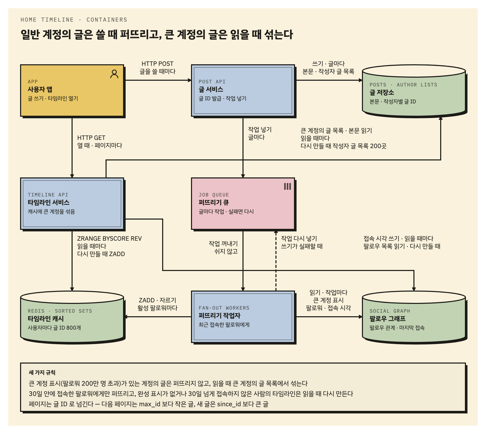
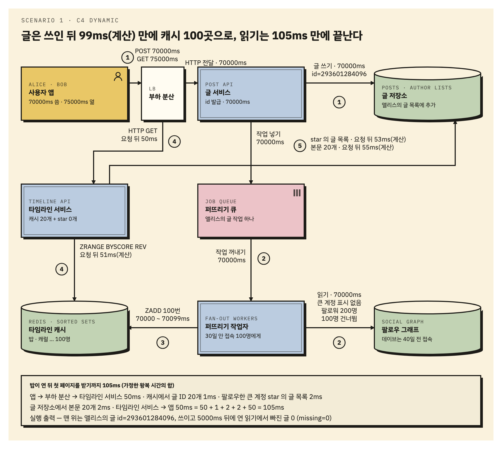
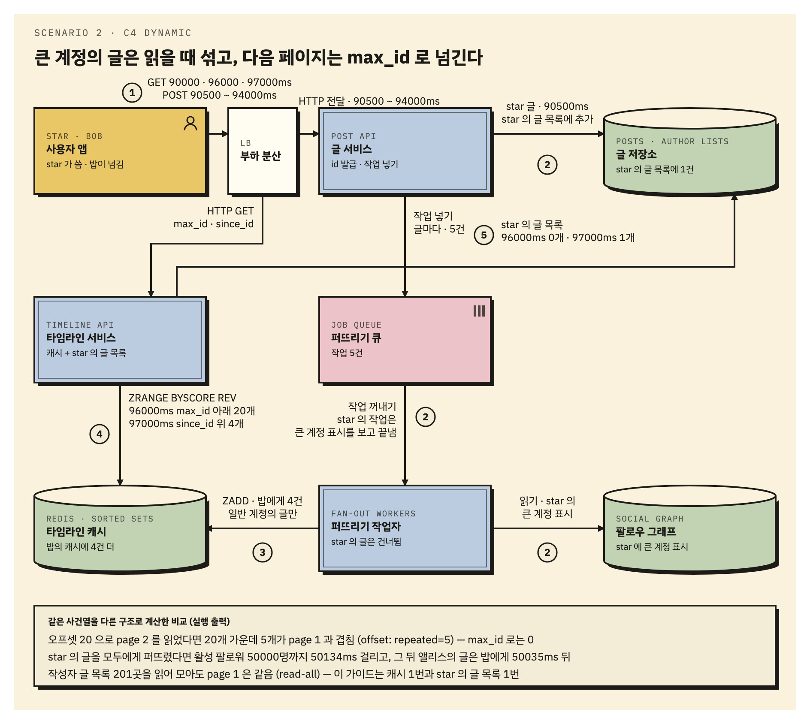
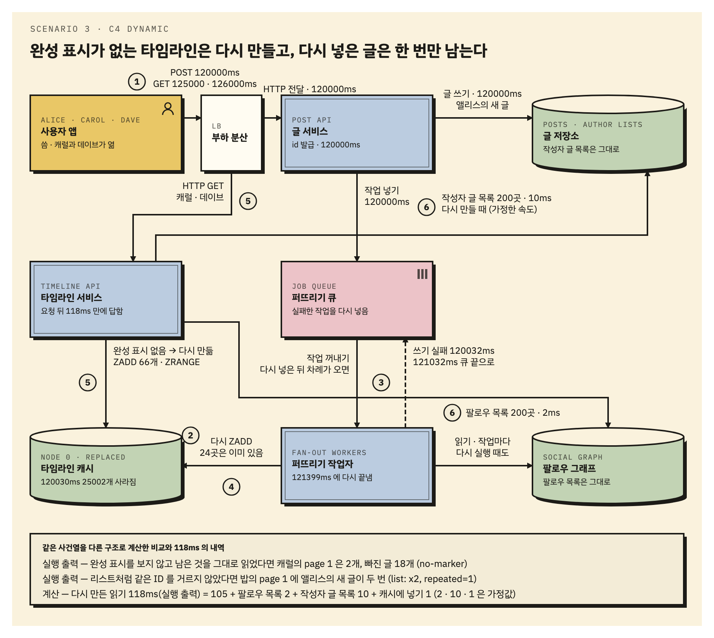

# 홈 타임라인 — 일반 계정의 글은 최근 접속한 팔로워의 캐시에 미리 넣고, 큰 계정의 글은 읽을 때 섞으며, 페이지는 글 ID 로 넘긴다

## 문제와 요구사항

짧은 글을 올리는 SNS(Social Network Service, 사람들이 서로 팔로우하며 글을 주고받는 서비스)를 떠올려 봅시다. 밥은 계정 200곳을 팔로우(그 계정의 글을 받아 보겠다고 구독하는 일)하고 있어요. 앱을 열면 그 200곳이 쓴 글을 최근 것부터 20개씩 받습니다. 이 목록이 홈 타임라인이에요. 2012년 Twitter 강연을 요약한 글은 홈 타임라인을 팔로우하는 사람들 각자의 글 목록을 시간순으로 합친 것으로 정의합니다([High Scalability 의 2012년 Twitter 강연 요약 글](https://highscalability.com/the-architecture-twitter-uses-to-deal-with-150m-active-users/), 2차 자료). 앨리스가 글을 쓰면 몇 초 안에 밥의 화면에 나와야 하고, 팔로워가 1억 명인 스타가 써도 그래야 해요.

가장 먼저 떠오르는 구조는 둘입니다. 하나는 밥이 열 때마다 200곳의 최근 글을 모아 정렬하는 것이에요. 읽기 한 번이 조회 200번이 되어, 초당 30만 번 열리면 초당 6천만 번을 조회합니다(규모 추정 [5]). 다른 하나는 글이 쓰일 때 팔로워들의 홈 타임라인에 미리 넣는 것이에요. 최근에 접속한 팔로워에게만 넣어도, 팔로워 1억 명인 계정의 글 하나는 활성 팔로워 5천만 명에게 쓰기 5천만 번이 되어 마지막 팔로워까지 50초가 걸리고, 그 뒤에 쓰인 글들까지 같이 늦어집니다(규모 추정 [3]).

```text
읽을 때마다 모으기                           활성 팔로워 모두에게 미리 넣기                      이 글
  밥이 엶 ──▶ 작성자 글 목록 200곳을 읽음      스타가 씀 ──▶ 활성 팔로워 5천만 명의 캐시에 씀      앨리스가 씀 ──▶ 최근 30일 안에 접속한 팔로워의 캐시에 글 ID
  초당 30만 번 × 200 = 6천만 번 조회           한 글에 쓰기 5천만 번 → 50초                        스타가 씀 ──▶ 스타의 글 목록에만 (퍼뜨리지 않음)
  (규모 추정 [5], 계산)                        (규모 추정 [3], 계산)                               밥이 엶 ──▶ 캐시 1번 + 큰 계정의 글 목록 1번
                                               그 뒤에 쓰인 글도 줄줄이 늦음                       다음 페이지 ──▶ 마지막으로 받은 글 ID 보다 작은 것
```

그림의 이름을 먼저 소개합니다. 글 ID 는 글마다 붙는 64비트 정수이고, 쓰인 시각을 앞자리에 담아 대략 시간순으로 커져요. 타임라인 캐시는 사용자마다 홈 타임라인에 보일 글 ID 를 최근 것부터 800개까지 미리 담아 두는 메모리 저장소입니다. 글을 팔로워의 캐시에 미리 넣는 방식을 쓰기 때 퍼뜨리기(fan-out on write), 읽는 순간 팔로우한 곳에서 모으는 방식을 읽을 때 모으기(fan-out on read)라고 불러요. 큰 계정은 팔로워가 기준(이 글에서는 200만 명)을 넘는 계정이고, 그 밖은 일반 계정이라고 부릅니다. 작성자 글 목록은 계정마다 그 계정이 쓴 글 ID 를 최근 것부터 모아 둔 목록이고, 큰 계정의 것은 큰 계정의 글 목록이라고 부릅니다. 커서는 「여기부터 이어서」를 가리키는 값이에요. 이 글은 페이지마다 받은 글 가운데 가장 작은 글 ID 를 다음 페이지의 커서 `max_id`(이 ID 보다 작은 글만 달라는 값)로, 가장 큰 글 ID 를 새 글을 받는 커서 `since_id`(이 ID 보다 큰 글만 달라는 값)로 씁니다.

```text
글 ID 293601284096          = 70000ms 에 쓰인 글              ← 앞자리가 시각이라 ID 가 크면 대체로 최근 글
밥의 타임라인 캐시            [ 293601284096 · … ]               ← 글 ID 만, 큰 것부터 최대 800개
다음 페이지의 커서 max_id     이번 페이지에서 가장 작은 글 ID      ← 「이 ID 보다 작은 글 20개」
```

끝까지 읽으면 글 하나가 밥의 화면에 오르기까지 어느 상자를 어떤 순서로 지나는지 실행 출력으로 확인할 수 있어요. 큰 계정이 글을 쓰거나, 페이지를 넘기는 사이 새 글이 붙거나, 캐시 서버 하나가 멈출 때 무엇이 글을 빠짐없이 한 번만 보이게 지키는지도 확인할 수 있습니다. 요구 수치가 바뀌면 어느 구조로 옮겨야 하는지도 판단할 수 있게 돼요. 기능 요구는 아래 셋입니다.

1. 사용자가 글을 쓰면, 그 사용자를 팔로우하는 사람의 홈 타임라인에 그 글이 들어갑니다.
2. 사용자는 홈 타임라인을 최근 글부터 20개씩 받고, 이어서 다음 페이지를 받거나 그 뒤에 새로 들어온 글만 받습니다.
3. 오래 접속하지 않았다가 돌아온 사용자도 홈 타임라인을 받습니다.

비기능 요구는 아래처럼 수치로 고정합니다. 근거 칸의 인용은 원문과 글자 그대로 대조한 것이고, 링크는 참고 자료에 다시 모았어요.

| 항목 | 수치 | 근거 |
| --- | --- | --- |
| 1. 사용자 | 가입한 사용자 2억 명. 그 가운데 한 달에 한 번 이상 접속하는 사람 1억 명 | 이 가이드의 가정 — 2012년 강연 요약 글은 그때의 Twitter 를 활성 사용자 1억 5천만 명의 서비스로 소개해요(2012년 Twitter 강연 요약 글). 같은 자릿수의 서비스로 잡았습니다. 가입자의 절반이 한 달 안에 들어온다는 비율은 재지 않은 값이에요 |
| 2. 새 글 | 초당 6천 건 | 이 가이드의 가정 — 같은 요약 글의 쓰기 수치(「300K requests per second for reading and 6000 RPS for writing.」)를 빌렸어요. RPS 는 초당 요청 수입니다. 같은 글에는 다른 값도 함께 있어요. 글 입력 통계로 「400m tweets per day; 5K/sec daily average; 7K/sec daily peak; >12K/sec during large events.」를 적습니다. 6천은 하루 평균 5천과 하루 피크 7천 사이라 평소 값으로 썼어요. 큰 행사 때의 1만 2천 건 넘는 값은 이 행에 넣지 않았고, 넣으면 무엇이 바뀌는지는 전환점 8 에 적었습니다 |
| 3. 타임라인 읽기 | 초당 30만 건(한 페이지 요청 하나가 한 건) | 이 가이드의 가정 — 같은 문장의 읽기 수치를 빌렸어요. 같은 글은 이 값을 「300K QPS for timelines (home and search)」로도 적어서(QPS 는 초당 질의 수), 홈 타임라인과 검색 타임라인을 합친 값으로 읽힙니다. 이 글은 30만 건을 모두 홈 타임라인 읽기로 잡아 넉넉한 쪽으로 둡니다 |
| 4. 팔로우 | 한 사람이 평균 200곳을 팔로우하고, 글을 쓴 계정의 팔로워도 평균 200명 | 이 가이드의 가정 — 아는 사람과 관심 있는 계정을 합쳐 수백 곳을 따라 읽는다고 본 어림이에요. 글을 쓰는 계정이 팔로워 수와 상관없이 고르게 나온다고 보면 두 평균이 같습니다. 이 값이 몇 배 틀려야 결론이 바뀌는지는 규모 추정에서 계산했어요 |
| 5. 큰 계정 | 팔로워가 1억 명(사용자의 절반)인 계정이 글을 써도 6행과 9행이 그대로 | 이 가이드의 가정 — 요약 글은 팔로워 3100만 명인 계정의 글 하나가 모두에게 퍼지는 데 5분까지 걸렸다고 적어요(「it can take up to 5 minutes for a tweet to flow from Lady Gaga's fingers to her 31 million followers.」). 팔로워가 한 계정에 몰리는 것이 이 문제의 어려운 점이라 그보다 큰 값을 상한으로 잡았어요 |
| 6. 전달 지연 | 새 글은 쓰인 뒤 5초 안에 그 계정을 팔로우하는 모든 사용자의 타임라인 읽기에 나옴 | 이 가이드의 가정 — 요약 글이 적은 목표(「Goal is to have a message flow to a user in no more than 5 seconds.」)를 빌렸어요. 같은 글은 이 목표를 늘 지키지는 못했다고도 적습니다(「Try to do it under 5 seconds but doesn't work sometimes.」). 답글이 몇 초 안에 이어져야 대화가 되는 서비스라고 보고 이 값을 요구로 씁니다 |
| 7. 읽기 응답 | 한 페이지를 요청한 뒤 200ms 안에 받음(10행의 첫 요청은 빼고) | 이 가이드의 가정 — 앱을 열자마자 첫 화면이 차 보이는 정도로 잡았어요. 한 페이지 20개는 Mastodon(누구나 서버를 띄워 서로 잇는 분산형 SNS 소프트웨어)의 홈 타임라인 API(Application Programming Interface, 프로그램끼리 요청을 주고받는 약속)가 쓰는 기본값(「Defaults to 20 statuses. Max 40 statuses.」)을 빌렸어요([Mastodon 타임라인 API 문서](https://docs.joinmastodon.org/methods/timelines/)) |
| 8. 거슬러 보는 깊이 | 한 번 열어 최근 글부터 200개(20개씩 10페이지)까지 이어 받음 | 이 가이드의 가정 — 홈 타임라인은 최근 글을 차례로 보는 화면이라 한 번에 넘기는 양의 상한을 열 페이지로 잡았어요. 그보다 오래된 글은 다루지 않습니다(아래) |
| 9. 정확도 | 읽은 사람이 팔로우하는 계정들의 글 가운데, 8행의 깊이 안에서 그 읽기보다 5초 넘게 앞서 쓰인 글은 빠지지 않고 같은 글은 한 번만 나옴(이어 받은 페이지들을 합쳐도). 허용 오차 0. 순서는 글 ID 가 큰 것부터 | 이 가이드의 가정 — 빠진 글은 사용자가 알아챌 길이 없고 두 번 나온 글은 바로 눈에 띄어서, 둘 다 0 으로 둡니다. 5초는 6행의 지연이에요. 그보다 최근에 쓰인 글은 아직 안 보여도 됩니다 |
| 10. 돌아온 사용자 | 한 달 넘게 접속하지 않았다가 돌아온 사용자는 첫 페이지를 2초 안에 받고, 9행이 그대로 | 이 가이드의 가정 — 오래 쉬었다 온 사람은 첫 화면을 조금 더 기다려도 된다고 보고, 빈 화면이 2초를 넘지 않게 잡았어요. 한 달은 1행의 「한 달에 한 번 이상 접속」과 같은 기준입니다 |
| 11. 서버가 멈출 때 | 서버 한 대가 멈춰도 모든 사용자의 다음 읽기에서 7행과 9행이 그대로 | 이 가이드의 가정 — 서버 한 대가 멈추는 일은 드물지 않고 사용자 탓도 아니라서, 그때도 응답 시간과 정확도가 평소와 같아야 한다고 잡았어요 |

일부러 다루지 않는 것도 적어 둡니다.

- 관련성 점수로 피드를 다시 정렬하는 일(추천 · 순위)은 다루지 않습니다. 이 글의 홈 타임라인은 글 ID 순서예요.
- 8행보다 깊이 거슬러 보는 일은 범위 밖이에요. 오래된 글은 작성자 글 목록에서 따로 본다고 둡니다.
- 팔로우를 새로 하거나 끊었을 때 그 계정의 지난 글을 타임라인에 넣고 빼는 일, 글의 삭제 · 수정, 다시 올리기 · 답글 묶기는 다루지 않습니다.
- 글 본문 · 사진의 저장과 전송, 검색, 알림, 화면에 새 글을 바로 보내는 실시간 연결은 범위 밖이에요.
- 글과 팔로우 관계라는 원본 데이터를 지키는 장애 대비 복제와 장애 조치는 다루지 않습니다. 원본 데이터는 잃지 않는다고 둬요.

## 규모 추정

식에 쓰는 이름을 먼저 짚어 둡니다. 퍼뜨리기 작업자는 글 하나의 팔로워 목록을 읽어 각자의 타임라인 캐시에 글 ID 를 넣는 프로세스들이에요. 캐시 쓰기 한 번은 Redis(데이터를 메모리에 두는 키-값 저장소)의 정렬 집합(멤버마다 점수가 붙어 점수 순으로 정렬된 자료형)에 글 ID 하나를 넣는 명령 ZADD 한 번입니다. 작성자 글 목록은 한 계정이 쓴 글 ID 를 모아 둔 목록이고, 읽을 때 모으기에서는 이것을 팔로우한 곳마다 한 번씩 읽어요. 작업자들이 캐시에 쓰는 속도는 재지 않은 가정입니다. 이 글은 평소 쓰기([2])에 1.67배의 여유를 둔 초당 100만 번으로 잡았어요.

```text
(입력)  가입자 200,000,000 명 · 한 달 안에 접속하는 사람 100,000,000 명(요구 1행)
        새 글 초당 6,000 건(요구 2행) · 타임라인 읽기 초당 300,000 건(요구 3행)
        글 하나의 평균 팔로워 · 한 사람의 평균 팔로우 200(요구 4행) · 큰 계정의 팔로워 100,000,000 명(요구 5행)
        전달 5 초(요구 6행) · 거슬러 보는 깊이 200 개(요구 8행)
        팔로워 가운데 한 달 안에 접속한 비율 a = 100,000,000 ÷ 200,000,000 = 50%(계산 — 팔로워가 사용자 전체에서 고르게 나온다고 둔 가정)
        작업자들이 캐시에 쓰는 속도 W = 초당 1,000,000 번(가정 — [2] 의 600,000 × 약 1.67)
        글 ID 하나 8 B(64비트 정수 — X(옛 Twitter) IDs 문서) · 사용자마다 캐시에 두는 글 ID 800 개(설정 — 요약 글과 Mastodon 의 값)
        캐시 노드 16 대(가정 — 노드 하나에 [7] 의 640 GB ÷ 16 = 40 GB 이상)
        한 사용자가 팔로우하는 큰 계정 b = 1 곳(가정 — 모형의 밥과 같음)

[1] 비활성 팔로워까지 쓰면          6,000 × 200 = 1,200,000 번/초   (비활성 제외를 뺀 경우)
[2] 한 달 안 접속자에게만          1,200,000 × 50% = 600,000 번/초 → W 의 60%
[3] 큰 계정 글 하나를 퍼뜨리면       100,000,000 × 50% = 50,000,000 번 ÷ 1,000,000 = 50 초
                                  그 50초 동안 쌓인 쓰기 600,000 × 50 = 30,000,000 번 → 남는 속도 400,000 번/초로 75 초
                                  그 글보다 x 초 뒤에 쓰인 글의 기다림 = 50 − 0.4 × x 초(x ≤ 125)
                                  5 초를 넘는 글 = x < (50 − 5) ÷ 0.4 = 112.5 초 동안 쓰인 글 = 6,000 × 112.5 = 675,000 건
[4] 큰 계정 기준                   글 하나의 퍼뜨리기 ≤ 1 초(판단 — 5초 가운데 1초)
                                  팔로워 × 50% ≤ 1,000,000 × 1 → 팔로워 ≤ 2,000,000 명
[5] 읽을 때 모으기                  300,000 × 200 = 60,000,000 번/초(작성자 글 목록 읽기)
    이 가이드                      읽기 300,000 × (캐시 1 + b) + 쓰기 600,000 = 300,000 × 2 + 600,000 = 1,200,000 번/초
[6] 큰 계정의 글 목록 읽기         300,000 × 50% = 150,000 번/초(목록 하나에 몰림, 사용자 절반이 그 계정을 팔로우)
[7] 캐시 크기                      100,000,000 × 800 × 8 B = 640,000,000,000 B = 640 GB(모든 가입자면 1,280 GB)
                                   글 ID 만 센 하한 — 정렬 집합이 원소마다 더 쓰는 크기는 세지 않음(확인 안 함)
[8] 캐시 노드 하나를 잃으면          100,000,000 ÷ 16 = 6,250,000 명의 캐시가 사라짐
                                  그 사람들의 첫 읽기 최대 300,000 ÷ 16 = 18,750 건/초
                                  다시 만들기 하나가 작성자 글 목록 200 곳 → 18,750 × 200 = 3,750,000 번/초
[9] 한 사람에게 하루에 들어오는 글    6,000 × 86,400 × 200 ÷ 200,000,000 = 518.4 개
                                  캐시 800 개 ÷ 518.4 ≈ 1.54 일 분량 · 깊이 200 개 ÷ 518.4 × 24 ≈ 9.3 시간 분량
```

이 계산이 구조를 정합니다. [3] 은 기준 없이 활성 팔로워 모두에게 퍼뜨리는 구조(대안 비교의 C)를 뺍니다. 큰 계정 글 하나가 50초 걸리고, 그 뒤 112.5초 동안 쓰인 일반 글까지 6행의 5초를 넘기 때문이에요. 처리량 W 가 가정의 10배(초당 1천만 번)면 스타의 글 하나가 5초에 끝나지만(계산 — 5천만 번 ÷ 5초), 이것은 필요조건일 뿐이에요. 그때도 바로 뒤에 쓰인 글은 약 5초를 기다립니다(계산 — 기다림 = 5 − 0.94 × x 초, 0.94 = (1천만 − 60만) ÷ 1천만). [4] 의 1초 예산을 지키며 1억 명을 퍼뜨리려면 50배(초당 5천만 번)가 있어야 해요(계산 — 5천만 번 ÷ 1초). [5] 는 읽을 때만 모으는 구조를 이 읽기 · 쓰기 비율에서 뺍니다. 초당 읽기 · 쓰기 횟수의 합이 50배(D 의 쓰기 포함, 6천만 번 대 120만 번)이기 때문이에요. 읽기 한 번만 놓고 보면 조회가 200곳 대 2곳으로 100배입니다(계산). 이 비교는 평균 팔로우 수에 기대는데, 팔로우가 약 2곳보다 적어야 결론이 뒤집혀요(계산 — 읽기 30만 × K 가 읽기 30만 × 2 와 쓰기 6천 × K × 50% 의 합보다 작아지는 K 를 풀면 K < 2.02). 남는 것은 두 방식을 섞는 구조이고, [4] 가 섞는 경계를 정합니다.

```text
읽기 · 쓰기 횟수 (초당, 작성자 글 목록 읽기와 캐시 쓰기를 한 번씩 셈)

읽을 때 모으기 (B)    ████████████████████████████████████████████████████  60,000,000
모두에게 퍼뜨리기 (C) █  600,000 (쓰기) + 300,000 (읽기) — 큰 계정 글마다 50초 막힘
이 가이드 (D)        █  600,000 (쓰기) + 600,000 (읽기)
```

[4] 의 기준 200만 명은 공개 자료에 없는 값이에요. 이 글이 「글 하나의 퍼뜨리기가 5초 가운데 1초를 넘지 않게」라는 판단으로 계산했습니다. 기준을 낮추면 큰 계정이 많아져 b 가 커지고 읽기마다 큰 계정의 글 목록을 더 읽어요. 높이면 글 하나가 퍼지는 시간이 길어져 그 뒤의 글이 늦어집니다. 그래서 쓰기 쪽이 감당하는 가장 큰 값으로 둬요. 기준은 W 에 비례하므로 처리량이 k 배면 기준도 k 배입니다. [7] 은 한 달 안에 접속한 사람만 캐시를 두는 이유예요. 640 GB 는 글 ID 만 센 하한이라 실제 메모리는 이보다 큽니다(확인 안 함). 모든 가입자에게 두면 메모리가 두 배이고, 그 절반은 한 달 안에 읽히지 않습니다. [8] 은 캐시 노드를 잃을 때 몰리는 다시 만들기의 양이에요. 11행을 지키려면 글 저장소가 이만큼을 더 받아야 하는데, 받을 수 있는지는 이 글이 확인하지 않았어요(확인 안 함). 그러지 못하면 전환점 5 로 갑니다. [9] 는 캐시 800개가 깊이 200개를 덮고도 남는다는 것을 보여요(기술 상세 설명의 타임라인 캐시, 변형 실행).

## 시스템 개념도



글이 지나는 주된 길은 이렇습니다. 사용자 앱이 글을 쓰면 HTTP(앱과 서버가 주고받는 요청과 응답의 규약) 요청이 글 서비스로 가요. 글 서비스는 글 ID 를 붙여 글 저장소에 쓰고, 퍼뜨리기 큐에 작업 하나를 넣습니다. 퍼뜨리기 작업자는 그 작업을 가져와 팔로우 그래프에서 작성자의 큰 계정 표시와 팔로워 목록, 팔로워마다의 마지막 접속 시각을 읽어요. 큰 계정 표시가 있으면 아무것도 쓰지 않고, 없으면 30일 안에 접속한 팔로워의 타임라인 캐시에 글 ID 를 넣습니다. 쓰기가 실패하면 그 작업을 퍼뜨리기 큐에 다시 넣어요. 읽는 쪽에서는 사용자 앱이 타임라인 서비스에 페이지를 요청해요. 타임라인 서비스는 캐시에서 글 ID 를 읽고, 팔로우한 큰 계정의 글 목록을 글 저장소에서 읽어 섞은 뒤, 본문을 채워 돌려줍니다. 개념도 규칙 상자의 완성 표시는 「다시 만들기를 마쳤다」는 뜻으로 타임라인과 같은 키에 함께 두는 값이에요(기술 상세 설명의 타임라인 캐시).

## 시나리오로 따라가기

### 시나리오 1 — 앨리스의 글 하나가 쓰인 뒤 99ms(계산) 만에 최근 접속한 팔로워 100명의 캐시에 들어가고, 5초 뒤 밥이 연 첫 페이지 맨 위에 요청한 뒤 105ms 만에 나온다

평소처럼 다른 계정들이 쓴 글이 초당 6건씩 들어오는 중이에요(모형 값, 실제는 그 1000배). 70000ms 에 앨리스가 글을 씁니다. 앨리스의 팔로워는 200명이고, 그 가운데 100명은 최근 30일 안에 접속했고 100명은 40일 전에 마지막으로 접속했어요. 데이브가 그 100명 가운데 하나입니다. 밥은 앨리스를 포함해 일반 계정 200곳과 큰 계정 star(문제 절의 스타에 해당하는 모형의 계정)를 팔로우하고, 75000ms 에 앱을 열어요. 다른 부하도 장애도 없습니다. 나와야 하는 것은 밥의 첫 페이지 20개이고, 맨 위가 앨리스의 글이어야 하며(6행과 9행), 요청하고 200ms 안에 받아야 해요(7행).



1. 70000ms 에 앨리스의 앱이 HTTP 요청을 보내고, 요청은 앞단의 부하 분산(요청을 여러 서버에 나눠 주는 장치)을 거쳐 글 서비스에 도착해요. 글 서비스는 글 ID 293601284096 을 붙여 글 저장소에 쓰고, 앨리스의 작성자 글 목록에도 그 ID 를 더한 뒤, 퍼뜨리기 큐에 작업 하나를 넣습니다. 글 ID 의 앞자리가 쓰인 시각이라 이 ID 를 그대로 정렬 기준과 커서로 쓸 수 있어요(기술 상세 설명의 글 서비스). 퍼뜨리기를 요청 안에서 하지 않고 큐에 넣는 이유는, 앨리스가 팔로워 100명에게 쓰는 시간을 기다리지 않고 바로 응답을 받게 하려는 것입니다.
2. 70000ms 에 퍼뜨리기 작업자가 큐에서 작업을 가져와요. 팔로우 그래프에서 앨리스의 큰 계정 표시를 읽고, 큰 계정 표시가 없으니 퍼뜨립니다. 큰 계정 표시는 팔로워가 기준(모형 2000, 실제 200만 명)을 넘을 때 켜지는데, 이 모형에서는 큰 계정 표시 대신 팔로워 수로 그때마다 바로 셉니다(아래 출력의 `200 followers is not above 2000`, 대역 표). 팔로워 200명의 마지막 접속 시각을 보고 30일 안에 접속한 100명에게만 쓰고, 데이브를 포함한 100명은 건너뛰어요. 건너뛰는 이유는 한 달 안에 읽지 않을 캐시에 쓰기와 메모리를 쓰지 않으려는 것입니다(규모 추정 [2] · [7]).
3. 작업자는 70000ms 부터 70099ms 까지 팔로워 100명의 타임라인 캐시에 글 ID 를 넣어요. 밥의 캐시에는 70000ms 에 들어갑니다. 캐시는 사용자마다 글 ID 를 점수로 쓰는 정렬 집합이라, 넣는 순간 ID 순서 자리에 놓이고 800개를 넘는 오래된 쪽은 잘려요. 모형에서 이 쓰기 100번이 100ms 걸리는 것은 축소 모형의 처리 속도(1ms 에 1번) 때문입니다(상황 설정).
4. 75000ms 에 밥의 앱이 첫 페이지를 요청하고, 요청은 부하 분산을 거쳐 50ms 뒤 타임라인 서비스에 도착해요. 타임라인 서비스는 밥의 캐시에서 최근 글 ID 20개를 한 번에 읽습니다. 밥의 캐시에는 처음 1분 동안 쌓인 글들과 앨리스의 글이 있어요. 200곳의 작성자 글 목록을 읽지 않고 캐시 하나를 읽는 것이 이 구조가 읽기 쪽에서 얻는 것입니다.
5. 타임라인 서비스는 밥이 팔로우한 큰 계정 star 의 글 목록에서도 최근 글을 읽어요. 아직 star 가 쓴 글이 없어 0개입니다. 두 목록을 글 ID 순서로 합쳐 20개를 고르고, 글 저장소에서 본문 20개를 읽어 돌려줘요. 큰 계정의 글은 캐시에 없으니 이 단계를 빼면 star 의 글이 밥의 타임라인에 영영 나오지 않습니다(시나리오 2).

```text
t=70000ms alice: posts id=293601284096, 200 followers is not above 2000, the worker will fan it out
t=70099ms fan-out: id=293601284096 is in the timelines of 100 followers seen in the last 30 days (bob's at 70000ms), 100 others skipped (dave last seen 40 days ago)
t=75000ms bob: page 1 = 20 posts, newest id=293601284096 by alice, oldest id=174063620096, from star's list 0, answered 105ms later, repeated=0 missing=0
```

잠깐, 확인 하나만 해 볼까요? 밥이 연 뒤 첫 페이지를 받기까지 105ms 는 어디서 나왔을까요? 모형은 왕복마다 정해 둔 시간을 더해요.

```text
75000ms   밥이 요청을 보냄
+50       앱 → 부하 분산 → 타임라인 서비스 (가정한 한 방향 시간)
+1        타임라인 캐시에서 글 ID 20개 (가정한 캐시 왕복)
+2        글 저장소에서 star 의 글 목록 (가정한 저장소 왕복)
+2        글 저장소에서 본문 20개 (가정한 저장소 왕복)
+50       타임라인 서비스 → 앱
합계      50 + 1 + 2 + 2 + 50 = 105ms   (요구 7행의 200ms 안)
```

이 시나리오가 보여 준 것은 글 하나가 지나는 순서와 그 순서의 이유입니다. 퍼지는 것은 한 번이에요. 글은 쓰일 때 퍼지고, 읽을 때는 캐시 하나와 큰 계정의 글 목록 하나만 읽어요. 이것이 전달 지연 행과 읽기 응답 행의 첫 근거입니다. 5초 뒤의 읽기에서 빠진 글이 없었다는 것(`missing=0`)은 정확도 행으로 가요. 데이브를 건너뛴 것이 데이브에게 무엇을 남기는지는 시나리오 3 의 6단계에서 봅니다.

### 시나리오 2 — 팔로워 10만 명(실제 1억 명)인 star 의 글은 퍼뜨리지 않고 읽을 때 섞어 밥의 다음 페이지는 max_id 로 겹침 0개이고 오프셋으로는 5개이며, 모두에게 퍼뜨렸다면 그 글 하나에 50134ms 가 걸려 그 글을 포함해 721건이 5초를 넘는다

90000ms 에 밥이 첫 페이지를 받아 읽기 시작해요. 90500ms 에 팔로워 100000명(모형의 값, 실제 1억 명)인 star 가 글을 쓰고, 91000ms 부터 1초마다 밥이 팔로우하는 일반 계정 넷(앨리스와 셋)이 글을 씁니다. 96000ms 에 밥이 다음 페이지를 넘기고, 97000ms 에 맨 위로 돌아와 새 글을 받아요. 같은 사건열을 star 의 글까지 모두에게 퍼뜨리는 구조(fan-out-all)로도 실행하고, 같은 순간의 같은 데이터로 오프셋 페이지와 작성자 글 목록 201곳을 모두 읽는 페이지(read-all)도 계산해 비교합니다. 나와야 하는 것은 star 가 써도 모든 글이 5초 안에 보이는 것(5행 · 6행)과, 페이지를 넘겨도 빠지거나 두 번 나오는 글이 없는 것(9행)이에요.



1. 90000ms 에 밥이 첫 페이지를 받아요. 맨 위는 앨리스의 글이고 맨 아래는 글 ID 174063620096 입니다. 앱은 이 맨 아래 ID 를 다음 페이지의 `max_id`(이 ID 보다 작은 글만 달라는 커서)로 기억해 둬요. 같은 순간 밥이 팔로우한 201곳의 작성자 글 목록을 모두 읽어 모아도 같은 20개가 나왔습니다(`read-all`). 같은 결과를 조회 201번 대신 캐시 1번과 star 의 글 목록 1번으로 얻는 것이에요.
2. 90500ms 에 star 가 글 379584516096 을 씁니다. 글 서비스는 글 저장소와 star 의 글 목록에 쓰고 작업을 큐에 넣어요. 작업자는 팔로우 그래프에서 star 의 큰 계정 표시를 보고(팔로워 100000명이 기준 2000 을 넘음), 아무 캐시에도 쓰지 않고 작업을 끝냅니다. 쓰기 50000번(활성 팔로워, 실제 5천만 번)을 하지 않으니 뒤에서 기다리는 작업들이 늦어지지 않아요.
3. 91000ms 부터 94000ms 까지 일반 계정 넷의 글은 시나리오 1 처럼 퍼져, 밥의 캐시에 4개가 더해집니다. 넷 모두 팔로워가 200명이라 기준 2000 아래여서 큰 계정 표시가 없고, 그래서 작업자가 퍼뜨려요. 이 네 글과 star 의 글을 합친 5개가 밥의 첫 페이지보다 위에 붙어요.
4. 96000ms 에 밥이 다음 페이지를 `max_id=174063620096` 으로 요청해요. 타임라인 서비스는 캐시와 star 의 글 목록에서 모두 그 ID 보다 작은 글만 골라 20개를 돌려주고, 첫 페이지와 겹친 글은 0개입니다. 위에 새 글이 몇 개 붙든 경계가 ID 라서 다음 페이지의 시작이 움직이지 않아요. 같은 순간 오프셋(앞에서부터 몇 개를 건너뛸지 세는 방식) 20 으로 읽었다면 20개 가운데 5개가 첫 페이지와 겹쳤습니다(`offset: repeated=5`). 위에 붙은 5개만큼 모든 글의 위치가 뒤로 옮겨졌기 때문이에요.
5. 97000ms 에 밥이 맨 위로 돌아와 `since_id=293601284096`(이 ID 보다 큰 글만 달라는 커서)으로 새 글을 받아요. 5개가 왔고 그 가운데 1개는 star 의 글 목록에서 섞인 글입니다. 20개보다 적게 왔으므로 그 사이를 더 채울 일은 없어요(기술 상세 설명의 사용자 앱, 사이 채우기). 새 글을 받을 때 페이지를 거듭 넘기지 않고 `since_id` 로 받는 것은 X API 문서의 권고(「For new data, use since_id instead of paginating repeatedly.」)와 같아요(기술 상세 설명의 사용자 앱).
6. 기준 없이 활성 팔로워 모두에게 퍼뜨리는 구조(`fan-out-all`)로 같은 사건열을 실행하면 star 의 글은 활성 팔로워 50000명의 캐시에 50134ms 걸려 들어가고, 밥의 캐시에는 25134ms 뒤에 들어갔어요. 91000ms 에 쓰인 앨리스의 글은 그 작업 뒤에서 기다리다 밥의 캐시에 50035ms 뒤에 들어갔어요. 실행 전체에서 퍼뜨리기 작업 1499건 가운데 star 의 글을 포함해 721건이 5초를 넘었어요. 처리 속도를 두 배로 올리는 것으로는 풀리지 않습니다(전환점 3 의 변형 실행).

```text
t=90000ms bob: page 1 = 20 posts, newest id=293601284096 by alice, oldest id=174063620096, from star's list 0, answered 105ms later, repeated=0 missing=0
read-all: the same page 1 from 201 author lists instead of 1 timeline and 1 list
t=90500ms star: posts id=379584516096, 100000 followers is above 2000, the worker will skip it and followers read it from star's own list
t=91000ms alice: posts id=381681668096, 200 followers is not above 2000, the worker will fan it out
t=96000ms bob: page 2 by max_id=174063620096 = 20 posts, newest id=169869316096 by user 10119, oldest id=90177540096, from star's list 0, answered 105ms later, repeated=0 missing=0
offset: page 2 by offset=20 = 20 posts, repeated=5
t=97000ms bob: newer by since_id=293601284096 = 5 posts, newest id=394264580096 by user 47008, oldest id=379584516096, from star's list 1, answered 105ms later, repeated=0 missing=0
fan-out-all: star's post was in all 50000 active followers' timelines 50134ms after it was written (bob's after 25134ms), alice's post written at 91000ms was in bob's after 50035ms, 721 of 1499 posts took over 5000ms
```

`user 10119` · `user 47008` 은 밥이 팔로우하는 일반 계정이에요. 아래 그림에서 P1 과 Q 는 앨리스가 70000ms 와 91000ms 에 쓴 글이에요. a1 · a2 · a3 은 다른 세 계정이 92000 · 93000 · 94000ms 에 쓴 글이고, h0 부터 h59 는 처음 1분 동안 쓰인 글입니다. 오프셋과 커서의 차이를 밥의 목록 하나로 다시 보면 이렇습니다.

```text
96000ms 에 밥이 보는 목록 (글 ID 가 큰 것부터)
위치    0     1     2     3     4      5     6     …    24     25  …
글     a3    a2    a1    Q     star   P1    h59   …    h41    h40 …
       └──────── 90000ms 뒤에 붙은 5개 ────────┘ └── 첫 페이지 20개 ──┘

오프셋 20  → 위치 20 ~ 39 = h45 … h26   (h45 · h44 · h43 · h42 · h41 이 첫 페이지와 겹침, 5개)
max_id     → ID < h41 인 것 20개 = h40 … h21   (겹침 0)
since_id   → ID > P1 인 것 = a3 · a2 · a1 · Q · star   (5개, 이 가운데 star 는 star 의 글 목록에서)
```

`h41` 은 41500ms 에 쓰인 글이라는 뜻이에요. 모형은 밥이 팔로우하는 계정들이 처음 1분 동안 1초에 한 건씩 글 60개(`h0` ~ `h59`)를 써 둔 상태에서 시작합니다(상황 설정).

> 다음은 「몇 번째」가 아니라 「무엇보다 작은」으로 묻는다.

이 시나리오가 보여 준 것은 부하가 몰리는 두 자리와 그것을 받는 방법입니다. 큰 계정의 글은 쓰기 쪽에서 받지 않고 읽기 쪽에서 섞어서, 다른 글의 전달이 늦어지지 않았어요. 이것이 큰 계정 행과 전달 지연 행의 근거입니다. 이 실행에서는 새 글이 계속 붙는 동안에도 페이지를 ID 경계로 넘겨 겹침이 0 이었고, 새 글은 `since_id` 로 빠짐없이 받았어요(맨 위를 받는 요청 직전의 창은 기술 상세 설명 — 사용자 앱). 이것이 정확도 행으로 가요. 버린 두 구조의 실행 근거는 `fan-out-all` 의 50134ms · 5초를 넘은 721건(star 의 글 포함)과 `offset` 의 `repeated=5` 입니다.

### 시나리오 3 — 캐시 노드 0 이 앨리스의 새 글을 퍼뜨리는 도중 멈춰 타임라인 25002개가 사라지면, 다시 넣은 글은 24곳에서 한 번만 남고, 완성 표시가 없는 캐럴의 타임라인은 다시 만들어 요청한 뒤 118ms 만에 빠짐없이 나오지만 완성 표시를 보지 않았다면 18개가 빠진다

120000ms 에 앨리스가 새 글을 씁니다. 캐시는 노드 4대(모형의 값, 규모 추정은 16대로 계산)에 사용자를 나눠 두는데, 120030ms 에 캐럴의 타임라인이 있는 노드 0 이 멈추고 빈 노드가 곧바로 그 자리를 맡아요(가정). 125000ms 에 캐럴이, 126000ms 에 40일 만에 돌아온 데이브가, 127000ms 에 밥이 타임라인을 엽니다. 같은 사건열을 캐시가 같은 ID 를 거르지 않는 구조(`list`)로도 실행하고, 캐럴의 읽기에서는 완성 표시를 보지 않고 남은 것을 그대로 읽는 경우(`no-marker`)도 계산해요. 나와야 하는 것은 셋입니다. 노드를 잃은 캐럴은 첫 페이지를 200ms 안에(7행 · 11행), 오래 쉬고 돌아온 데이브는 2초 안에(10행) 받아야 하고, 셋 모두 빠지거나 두 번 나오는 글이 없어야 하며(9행), 앨리스의 글이 5초 안에 보여야 해요(6행).



1. 120000ms 에 앨리스의 새 글 503316484096 이 시나리오 1 의 1 · 2단계를 지나 퍼지기 시작해요. 작업자가 밥 · 캐럴 순서로 팔로워들의 캐시에 넣어 갑니다. 캐럴은 앨리스의 팔로워 목록에서 밥 다음 활성 차례라(사이의 데이브는 건너뜀) 노드가 멈추기 전에 새 글을 받아요.
2. 120030ms 에 캐시 노드 0 이 멈춰요. 그 노드에 있던 타임라인 25002개가 사라지고, 빈 노드가 같은 자리를 맡습니다. 이미 앨리스의 글을 받았던 캐럴의 타임라인도 함께 사라져요. 각 타임라인에는 「다시 만들기를 마쳤다」는 완성 표시가 함께 있었고, 완성 표시도 같은 노드에 있었으므로 같이 사라졌습니다. 완성 표시를 데이터와 같은 노드에 두는 이유가 이것이에요. 빈 노드에는 완성 표시가 하나도 없어서, 그 노드의 타임라인은 모두 「아직 만들어지지 않음」으로 읽힙니다.
3. 120032ms 에 작업자가 노드 0 에 있는 사용자 113808 의 캐시에 쓰다가 실패해요. 작업은 1000ms 뒤인 121032ms 에 큐 끝에 다시 들어가고, 차례가 오면 처음 팔로워부터 다시 씁니다(이 가이드의 설정). 어디까지 썼는지를 따로 기록하지 않고 처음부터 다시 쓰는 이유는, 기록할 상태를 두지 않고 같은 쓰기를 두 번 해도 결과가 같게 만들려는 것이에요. 그 「같게」를 지키는 것이 다음 단계입니다.
4. 121399ms 에 다시 실행한 작업이 끝나요. 실패 전에 이미 글을 받았던 24곳(노드 0 밖의 팔로워)에 같은 글 ID 를 다시 넣었지만, 정렬 집합은 같은 멤버를 하나만 두므로 각 타임라인에 한 번씩 남았습니다. 노드 0 의 팔로워에게는 빈 노드에 새로 넣었어요. 캐럴의 타임라인에도 이 글 하나만 들어갑니다. 이 글은 쓰이고 1399ms 뒤에 모든 활성 팔로워의 캐시에 들어갔으므로 6행 안이에요. 같은 ID 를 거르지 않는 캐시(`list`)였다면 127000ms 에 밥의 첫 페이지에 이 글이 두 번 나왔어요(`x2, repeated=1`).
5. 125000ms 에 캐럴이 타임라인을 엽니다. 타임라인 서비스는 캐럴의 캐시에서 글 ID 1개를 찾지만 완성 표시가 없는 것을 봐요. 그래서 이 캐시를 완성된 타임라인으로 쓰지 않습니다. 완성 표시를 보지 않고 남은 것을 그대로 읽었다면 첫 페이지는 앨리스의 새 글과 star 의 글 2개뿐이고, 있어야 할 글 18개가 빠졌어요(`no-marker: missing=18`).
6. 타임라인 서비스는 팔로우 그래프에서 캐럴의 팔로우 목록 200곳을 읽고, 글 저장소에서 그 200곳의 작성자 글 목록을 읽어 합친 뒤, 캐시에 남아 있던 1개와 합쳐 글 ID 66개로 타임라인을 다시 만들어요. 그다음 완성 표시를 씁니다. 큰 계정 star 의 글은 다시 만들 때 넣지 않고 읽을 때 섞어요. 첫 페이지 20개는 빠진 글 없이 118ms 뒤에 나갔습니다. 126000ms 에 40일 만에 돌아온 데이브도 같은 길을 지나요. 데이브는 퍼뜨리기에서 빠져 있었으므로 타임라인이 아예 없었고, 같은 방법으로 66개를 다시 만들어 118ms 뒤에 받았습니다. 이제 데이브도 최근 접속한 사용자라 다음 글부터는 퍼뜨리기를 받아요.
7. 127000ms 에 밥이 엽니다. 밥의 타임라인은 노드 2 에 있었으므로 사라지지 않았고, 앨리스의 새 글은 한 번 나왔어요(`x1`).

```text
t=120000ms alice: posts id=503316484096, 200 followers is not above 2000, the worker will fan it out
t=120030ms cache node 0: stops, its 25002 built timelines are gone, an empty node takes its place
t=120032ms fan-out: writing id=503316484096 to user 113808 on node 0 fails, the job goes back to the queue at 121032ms to start again from its first follower
t=121399ms fan-out: id=503316484096 is in the timelines of 100 followers seen in the last 30 days, the retry wrote it again to 24 that already had it and each kept one copy
t=125000ms no-marker: carol's page 1 from the timeline as it is (ids=1) = 2 posts, missing=18
t=125000ms carol: no built mark, rebuilt from 200 author lists to ids=66, then page 1 = 20 posts, newest id=503316484096 by alice, oldest id=199229444096, from star's list 1, alice's id=503316484096 x1, answered 118ms later, repeated=0 missing=0
t=126000ms dave: no timeline, last seen 40 days ago, rebuilt from 200 author lists to ids=66, then page 1 = 20 posts, newest id=503316484096 by alice, oldest id=199229444096, from star's list 1, alice's id=503316484096 x1, answered 118ms later, repeated=0 missing=0
t=127000ms bob: page 1 = 20 posts, newest id=503316484096 by alice, oldest id=199229444096, from star's list 1, alice's id=503316484096 x1, answered 105ms later, repeated=0 missing=0
t=127000ms list: bob's page 1 has alice's id=503316484096 x2, repeated=1
```

118ms 는 시나리오 1 의 읽기 105ms 와 다시 만들기 13ms 를 더한 값이에요(계산). 팔로우 목록을 읽는 저장소 왕복 2ms, 작성자 글 목록 200곳을 1ms 에 20곳씩 읽는 10ms, 캐시에 넣는 1ms 이고 모두 가정한 시간입니다. 캐럴의 타임라인을 시간 순서로 보면 이렇습니다.

```text
시각            캐럴의 타임라인 (노드 0)                완성 표시   완성 표시를 보는 읽기 (이 가이드)           완성 표시를 보지 않는 읽기 (no-marker)
멈추기 전       글 66개 (앨리스의 새 글까지)            있음        —                                           —
120030ms        사라짐 → 빈 노드                        없음        —                                           —
121399ms 까지   앨리스의 새 글 1개 (다시 실행한 작업)   없음        —                                           —
125000ms        1개 + 작성자 글 목록 200곳 → 66개       씀          완성 표시 없음 → 다시 만듦 → 20개, 빠짐 0   1개 + star 의 글 → 2개, 빠짐 18
```

> 완성 표시가 없는 타임라인은 몇 개가 있든 비어 있는 것으로 읽는다.

여기서 헷갈리기 쉬운 포인트는 「키가 있으면 타임라인이 있다」고 보는 것입니다. 노드가 바뀐 뒤에도 퍼뜨리기는 멈추지 않아요. ZADD 는 키가 없으면 새로 만들기 때문에([Redis ZADD 문서](https://redis.io/docs/latest/commands/zadd/)), 캐럴의 키는 다시 실행한 작업이 쓴 글 하나로 다시 생깁니다. 키가 있는지만 보는 읽기는 이 하나짜리 집합을 완성된 타임라인으로 쓰고, 그 뒤로는 다시 만들 일이 없어요. 빠진 18개는 다시 넣을 길이 없어서, 새 글이 깊이 200개를 다 채울 때까지 첫 페이지들에서 빠진 채로 남는 틀린 값이에요(스스로 점검하기 2). 멈추기 전 66개는 처음 1분 동안 쓰인 글 60개에 70000ms · 91000ms 이후 네 개 · 120000ms 에 쓰인 글을 더한 계산이에요. 캐럴은 앨리스의 팔로워 가운데 두 번째로 쓰이는 자리라 멈추기 전에 이미 새 글을 받았습니다.

정합성이 걸린 문제라 틀린 값이 남는 길도 봐야 합니다. 완성 표시를 보지 않으면 빠진 글이 남고, 같은 ID 를 거르지 않는 캐시에서는 두 번 나온 글이 800개 밖으로 잘릴 때까지 남아요. 둘 다 시간이 지나도 저절로 고쳐지지 않습니다. 이 시나리오가 보여 준 것은 정확도 행 · 돌아온 사용자 행 · 서버가 멈춘 뒤 행의 근거예요. 캐럴과 데이브는 같은 다시 만들기 길로 요청한 뒤 118ms 만에 빠진 글 없이 받았고, 다시 넣은 글은 한 번만 남았으며, 앨리스의 글은 1399ms 안에 모두에게 보였습니다. 다만 노드 하나를 잃은 사용자 625만 명이 한꺼번에 다시 만들 때의 부하는 이 실행에 없어요. 그 양은 규모 추정 [8] 의 계산으로만 봅니다.

## 기술 상세 설명

### 구성 요소 — 사용자 앱

모바일 앱이나 웹 페이지예요. 글을 쓰면 글 서비스에, 타임라인을 열면 타임라인 서비스에 HTTP 요청을 보냅니다. 화면에 보이는 글 가운데 가장 작은 글 ID 와 가장 큰 글 ID 를 기억해 두는 것이 앱의 몫이에요. 아래로 넘길 때는 가장 작은 ID 를 `max_id` 로, 맨 위로 돌아와 새 글을 받을 때는 가장 큰 ID 를 `since_id` 로 보냅니다. 새 글이 20개로 꽉 차 오면 두 커서를 함께 보내 그 사이를 채워요(아래 사이 채우기).

맡는 일은 시나리오 1 의 1 · 4단계에서 글을 쓰고 첫 페이지를 여는 것, 시나리오 2 의 1 · 4 · 5단계에서 페이지를 넘기고 새 글을 받는 것이에요. 요청은 아래처럼 생겼습니다.

```text
GET /timelines/home?limit=20                          ← 첫 페이지
GET /timelines/home?limit=20&max_id=174063620096      ← 다음 페이지: 이 ID 보다 작은 글 20개
GET /timelines/home?limit=20&since_id=293601284096    ← 새 글: 이 ID 보다 큰 글
GET /timelines/home?limit=20&max_id=…&since_id=…      ← 사이 채우기: 받은 새 글 가운데 가장 작은 ID 와 앞선 since_id 사이
POST /statuses                                        ← 글 쓰기
```

이 두 커서는 Mastodon 홈 타임라인 API 의 정의를 따랐어요. `max_id` 는 「All results returned will be lesser than this ID. In effect, sets an upper bound on results.」이고, `since_id` 는 「All results returned will be greater than this ID. In effect, sets a lower bound on results.」입니다(Mastodon 타임라인 API 문서). 같은 문서 묶음은 ID 를 「Always treat IDs as opaque strings」라고 적어요([Mastodon API 안내 문서](https://docs.joinmastodon.org/api/guidelines/)). 앱은 ID 로 계산하지 않고 받은 값을 그대로 다시 보내기만 합니다. X 의 API 문서도 새 글은 페이지를 거듭 넘기지 말고 `since_id` 로 받으라고 권해요(「For new data, use since_id instead of paginating repeatedly.」, [X API 페이지 넘기기 문서](https://docs.x.com/x-api/fundamentals/pagination)).

같은 자리에 올 수 있는 다른 방법은 오프셋(앞에서부터 몇 개를 건너뛸지)으로 페이지를 넘기는 것이에요. 오프셋은 「몇 번째」를 세므로 위에 새 글이 붙으면 모든 위치가 그만큼 뒤로 옮겨집니다. 시나리오 2 의 4단계에서 5개가 겹친 것이 그 결과예요. Redis 문서는 큰 오프셋이 그만큼의 원소를 지나야 한다고도 적습니다(「Keep in mind that if <offset> is large, the sorted set needs to be traversed for <offset> elements before getting to the elements to return, which can add up to O(N) time complexity.」, [Redis ZRANGE 문서](https://redis.io/docs/latest/commands/zrange/)). O(N) 은 걸리는 시간이 원소 수 N 에 비례한다는 표기예요. 「오프셋 대신 ID 커서」의 이유를 직접 적은 공식 문장은 찾지 못했어요. 이유는 이 글의 판단이고, 근거는 시나리오 2 의 `repeated=5` 와 `repeated=0` 입니다.

```text
                      오프셋 20                          max_id=h41
위에 새 글 5개 붙음     위치 20 이 h45 로 바뀜 → 5개 겹침      「h41 보다 작은 것」은 그대로 h40 부터
새 글 받기             처음부터 다시 세어야 함                since_id=P1 → P1 보다 큰 5개
```

여기서 헷갈리기 쉬운 포인트는 「ID 커서면 아무것도 빠지지 않는다」고 보는 것입니다. 글 ID 는 쓰인 시각으로 정해지지만 캐시에는 퍼뜨린 뒤에 들어가요. 밥이 맨 위를 받는 요청(첫 페이지 · `since_id` 새 글 요청 · 사이 채우기)을 보내기 직전에 쓰인 글 Y 가 응답 직후에 캐시에 들어갔다고 해 봅시다. 그 응답에 Y 보다 늦게 쓰였지만 먼저 보인 글(읽을 때 섞인 큰 계정의 글이나, 다른 작업이 먼저 끝낸 글)이 있으면 다음 `since_id` 가 Y 의 ID 보다 커집니다. 그러면 Y 는 이미 받은 범위 안에 놓여 이번에 이어 받는 요청 어디에도 나오지 않고, 앱이 처음부터 다시 열 때 나와요. 첫 페이지 한 번만의 일이 아니라 맨 위를 받는 요청마다 같은 일이 생깁니다. 그런 글이 없으면 `since_id` 가 Y 보다 작아서 새 글 요청에 Y 가 나옵니다. Y 가 다음 읽기 때 쓰인 지 5초가 넘었다면 요구 9행은 Y 도 이어 받은 페이지 안에 있어야 한다고 봐요. 그러니 이 창은 이 구조가 9행을 지키지 못하는 자리입니다. 창의 길이는 퍼뜨리기 지연이고, 서버 사이의 시계 차이(글 서비스)가 있으면 그만큼 더 길어져요. 한 사람에게 들어오는 글이 초당 약 0.006개(계산 — 규모 추정 [9] 의 518.4 ÷ 86400)이므로, 맨 위를 받는 요청 한 번에 창이 모형의 지연 99ms(계산 — 70099 − 70000)면 약 0.0006개, 기준 바로 아래 계정의 글 뒤에서 기다리거나 시계가 어긋나 1초면 약 0.006개입니다(계산). 늦게 쓰인 글이 응답에 늘 먼저 있다고 본 상한이에요(계산). 출력의 `missing` 은 그 읽기보다 5초 넘게 앞서 쓰인 글만 세므로 이 창의 글을 세지 않아요. 이 글은 이 창을 결정의 「포기하는 것」에 적었어요.

**새 글이 20개를 넘을 때의 사이 채우기.** 새 글 요청은 `since_id` 보다 큰 글 가운데 가장 큰 20개만 돌려줘요(타임라인 캐시의 `ZRANGE … LIMIT 0 20`). 새 글이 20개보다 많이 쌓였다면 `since_id` 와 받은 20개 가운데 가장 작은 ID 사이의 글은 다음 새 글 요청에도, 화면 맨 아래에서 시작하는 `max_id` 요청에도 들어가지 않아 9행을 어겨요. 한 사람에게 하루 518.4개가 들어오므로(규모 추정 [9]) 마지막으로 새 글을 받고 약 56분이 지나면 20개를 넘습니다(계산 — 20 ÷ 518.4 × 24 × 60 ≈ 55.6). 그래서 앱은 새 글 요청이 20개를 꽉 채워 오면, 받은 것 가운데 가장 작은 ID 를 `max_id` 로, 앞서 보낸 `since_id` 를 그대로 `since_id` 로 함께 보내 20개보다 적게 올 때까지 그 사이를 이어 받아요(판단). Mastodon 은 같은 자리를 아래에서 위로 채우는 `min_id` 를 따로 둡니다(「Returns results immediately newer than this ID. In effect, sets a cursor at this ID and paginates forward.」, Mastodon 타임라인 API 문서). 이 글은 이미 쓰는 두 커서를 함께 보내는 쪽을 골랐어요(판단). 모형에서 새 글 요청은 5개만 받아 이 규칙이 쓰이지 않으므로 실행 밖이에요. 모형이 세는 `missing` 도 받은 페이지를 같은 범위에서 정답 위쪽 20개와만 비교해서 이 빈틈을 잡지 못합니다(상황 설정).

| 설정값 · 한계 | 값 | 이유 · 보장하지 않는 것 |
| --- | --- | --- |
| 한 페이지 | 20개 | 요구 7행의 근거와 같은 Mastodon 의 기본값 |
| 다음 페이지 | `max_id` = 받은 글 가운데 가장 작은 ID | 위에 붙는 새 글과 상관없이 시작점이 같음(시나리오 2 의 4단계) |
| 새 글 | `since_id` = 받은 글 가운데 가장 큰 ID | 맨 위를 받는 요청(첫 페이지 · 새 글 · 사이 채우기) 직전에 쓰이고 응답 직후에 캐시에 들어간 글은, 그보다 늦게 쓰인 글이 그 응답에 먼저 보였으면 받지 못함(위 문단, 판단) |
| 사이 채우기 | 새 글이 20개로 꽉 차 오면 `max_id` = 받은 것 가운데 가장 작은 ID, `since_id` = 앞서 보낸 값 | 20개보다 적게 올 때까지 이어 받음(판단). 모형에서는 쓰이지 않음(실행 밖) |
| ID 다루기 | 문자열 그대로 다시 보냄 | 앱의 시계나 계산에 기대지 않음 |

### 구성 요소 — 글 서비스

글 쓰기 요청을 받는 서버들이에요. 글에 글 ID 를 붙여 글 저장소에 쓰고, 퍼뜨리기 큐에 작업 하나를 넣은 뒤 바로 응답합니다. 서버는 상태를 따로 두지 않아 몇 대를 띄워도 같아요(판단). 글 ID 는 Twitter 가 공개했던 Snowflake(시각 · 기계 번호 · 순번을 이어 붙여 64비트 ID 를 만드는 방식)의 구성을 따릅니다. Snowflake 저장소의 설명(2010)은 ID 를 시각 41비트(「millisecond precision w/ a custom epoch gives us 69 years」), 기계 번호 10비트(「gives us up to 1024 machines」), 순번 12비트(「rolls over every 4096 per machine (with protection to avoid rollover in the same ms)」)로 짜요([Twitter Snowflake 저장소 README](https://github.com/twitter-archive/snowflake/tree/snowflake-2010)).

맡는 일은 시나리오 1 의 1단계, 시나리오 2 의 2단계, 시나리오 3 의 1단계예요. 시나리오 1 의 글 ID 를 비트로 풀면 이렇습니다.

```text
293601284096 = 70000 << 22  |  1 << 12  |  0
               └ 시각 41비트 ┘  └ 기계 10비트 ┘  └ 순번 12비트 ┘
               70000ms (모형 시작부터)   글 서비스 1번       그 ms 의 첫 글
ID >> 22 = 70000  → 글 ID 만 보고 쓰인 시각을 앎 (모형은 이 값으로 「5초 넘게 앞서 쓰인 글」을 가림)
```

같은 자리에 올 수 있는 다른 방법은 둘이에요. 데이터베이스가 하나씩 늘려 주는 번호는 모든 글이 그 한 곳을 거쳐야 하고, 무작위 ID 는 크기 순서가 시간 순서가 아니라서 정렬 기준과 커서로 쓸 수 없습니다(둘 다 판단). 시각을 앞자리에 둔 ID 는 서버마다 따로 만들어도 대략 시간순으로 커져요. X 의 ID 문서는 이것을 「This means IDs are roughly time-ordered: higher IDs generally represent newer objects.」라고 적습니다([X IDs 문서](https://docs.x.com/fundamentals/x-ids)). 얼마나 대략인지는 이 글이 비트 구성의 출처로 쓴 Snowflake README 가 적어요. 글 ID 는 「k-sorted」(정해진 범위 안에서만 앞뒤가 바뀔 수 있는 정렬)이고, 그 범위는 「within a reasonable bound (we're promising 1s, but shooting for 10's of ms)」입니다(Twitter Snowflake 저장소 README). 1초 안을 약속하고 수십 ms 를 목표로 한 2010년의 설계 목표이고, 지금의 X 가 같은지는 확인 안 함이에요. 그래서 이 글의 순서는 쓰인 시각이 아니라 글 ID 의 순서입니다(요구 9행). 처리량은 문제가 되지 않아요. 기계 하나가 1ms 에 4096개까지 만들 수 있고, 요구 2행은 초당 6천 건이라 1ms 에 6건꼴입니다(계산).

| 설정값 · 한계 | 값 | 이유 · 보장하지 않는 것 |
| --- | --- | --- |
| 글 ID | 64비트 = 시각 41 · 기계 10 · 순번 12 | Snowflake 의 구성. 모형은 기계 번호를 1 로 두고 시각을 모형 시작부터 셈 |
| 순서 | 글 ID 가 큰 것이 대체로 최근 | 서버 사이의 시계 차이만큼 어긋날 수 있음 — Snowflake README 는 1초 안을 약속하고 수십 ms 를 목표로 함(2010년 설계 목표, 지금의 X 는 확인 안 함). 이 차이는 맨 위를 받는 요청 직전의 창을 넓힘(사용자 앱) |
| 응답 | 저장소에 쓰고 큐에 넣은 뒤 바로 | 퍼뜨리기가 끝나기를 기다리지 않음. 그래서 6행의 지연은 퍼뜨리기 작업자가 정함 |

### 구성 요소 — 글 저장소

글 본문과, 계정마다 그 계정이 쓴 글 ID 를 최근 것부터 모아 둔 작성자 글 목록을 디스크에 오래 남기는 저장소예요. 2012년 강연 요약 글은 한 사람이 보낸 글 전체를 사용자 타임라인이라고 부르는데, 이 글의 작성자 글 목록이 그것입니다. 이 글은 제품을 정하지 않아요. 홈 타임라인의 원본은 여기에 있고, 타임라인 캐시는 여기서 다시 만들 수 있는 사본입니다.

맡는 일은 셋이에요. 시나리오 1 의 1단계에서 글과 작성자 글 목록을 받고, 시나리오 1 의 5단계와 시나리오 2 의 4 · 5단계에서 큰 계정의 글 목록과 본문을 내주고, 시나리오 3 의 6단계에서 다시 만들 작성자 글 목록 200곳을 내줍니다.

```text
글 저장소
├─ 글:            글 ID → (작성자, 본문, 쓴 시각)          ← 읽을 때 본문 20개를 한 번에 채움
└─ 작성자 글 목록:  작성자 → [글 ID … 최근 것부터]          ← 큰 계정 섞기 · 다시 만들기 · 읽을 때 모으기가 읽음
   star  → [379584516096]                                   (시나리오 2 의 90500ms 뒤)
   alice → [503316484096, 381681668096, 293601284096, …]    (시나리오 3 의 120000ms 뒤)
```

같은 자리에 올 수 있는 다른 방법은 글과 작성자 글 목록을 메모리 저장소에만 두는 것이에요. 그러면 캐시를 잃었을 때 다시 만들 원본이 없어집니다(판단). 시나리오 3 에서 캐럴의 타임라인을 66개로 되살린 것은 작성자 글 목록이 디스크 쪽에 그대로 있었기 때문이에요. 큰 계정의 글 목록은 따로 살펴볼 것이 있습니다. 그 계정을 팔로우하는 모든 사용자의 읽기가 이 목록 하나에 모여요. 사용자의 절반이 팔로우하면 초당 15만 번입니다(규모 추정 [6]). 이 글은 이 목록을 여러 벌 복제해 나눠 읽는 것으로 두었어요(판단, 실행 밖).

| 설정값 · 한계 | 값 | 이유 · 보장하지 않는 것 |
| --- | --- | --- |
| 작성자 글 목록 | 계정마다 최근 글 ID | 큰 계정 섞기와 다시 만들기가 이 목록만 읽음 |
| 큰 계정의 글 목록 | 여러 벌로 나눠 읽음 | 초당 15만 번이 한 키에 몰림(규모 추정 [6]). 복제 수는 정하지 않음(실행 밖) |
| 제품 | 정하지 않음 | 모형은 메모리 맵으로 흉내 냄. 원본을 지키는 장애 대비 복제와 장애 조치는 다루지 않는 것 |

### 구성 요소 — 퍼뜨리기 큐

글 서비스가 넣은 퍼뜨리기 작업을 차례로 쌓아 두는 작업 큐예요. 작업 하나가 글 하나이고, 작업자가 가져가 처리합니다. Mastodon 은 Sidekiq(Mastodon 의 Ruby 코드가 쓰는 작업 큐 처리기)으로 이 일을 해요. v4.7.6 의 퍼뜨리기 코드는 팔로워를 묶음으로 읽어 `FeedInsertWorker.push_bulk(followers)` 로 큐에 넣고, 작업마다 `push_to_home` 이 그 팔로워의 홈 피드에 넣습니다([Mastodon v4.7.6 소스 코드](https://github.com/mastodon/mastodon/tree/v4.7.6)).

맡는 일은 시나리오 1 의 1 · 2단계에서 작업을 받아 내주는 것, 시나리오 3 의 3단계에서 실패한 작업을 1000ms 뒤 큐 끝에 다시 넣는 것이에요.

```text
글 서비스 ──넣기──▶ [ star 작업 | 앨리스 작업 | user 작업 | … ] ──가져가기──▶ 작업자 (1ms 에 쓰기 1번, 모형)
                     맨 앞 작업이 끝나야 다음 작업          ← fan-out-all 에서 star 작업 50초 동안 앨리스 작업이 기다린 이유
쓰기 실패 ──1000ms 뒤──▶ 큐 끝에 다시 넣음 → 차례가 오면 처음 팔로워부터
작업자가 멈춤 ──정한 시간 안에 끝났다는 알림 없음──▶ 큐가 다른 작업자에게 다시 내줌 → 처음 팔로워부터 (실행 밖)
```

같은 자리에 올 수 있는 다른 방법은 큐 없이 글 서비스가 요청 안에서 직접 퍼뜨리는 것이에요. 그러면 앨리스는 팔로워 100명에게 다 쓸 때까지, 큰 계정을 퍼뜨린다면 50초 동안 응답을 기다립니다(규모 추정 [3], 계산). 기록을 순서대로 쌓아 두고 여러 소비자가 다시 읽게 하는 로그(이웃한 [광고 클릭 집계 가이드](../ad-click-aggregation/ad-click-aggregation-guide_v1.0.0.md)가 쓴 Kafka 같은)도 이 자리에 올 수 있어요. 이 문제에서는 캐시에 남는 결과가 글 사이의 퍼뜨리는 순서와 상관이 없습니다. 캐시가 글 ID 로 정렬하기 때문이에요(읽는 시점에 아직 캐시에 없는 글의 문제는 사용자 앱에서 따로 다룸). 그래서 그 성질로는 두 방법이 갈리지 않고, 실패한 작업 하나만 다시 넣으면 되는 작업 큐로 두었습니다(판단).

**작업자가 멈출 때의 다시 내주기.** 쓰기 실패와 달리 작업자 자체가 작업 도중 멈추면 그 작업을 다시 넣을 주체가 없어요. 그래서 큐는 내준 작업을 바로 지우지 않고, 작업자가 끝났다고 알릴 때까지 남겨 둡니다. 정한 시간 안에 알림이 없으면 큐가 그 작업을 다른 작업자에게 다시 내주고, 받은 작업자는 처음 팔로워부터 다시 써요. 이미 쓴 글 ID 는 정렬 집합이 한 번만 남기므로 결과가 같습니다(시나리오 3 의 4단계와 같은 성질). 정한 시간은 작업 하나가 걸리는 가장 긴 시간인 약 1초(규모 추정 [4] 의 예산)보다 길고, 다시 퍼뜨리는 1초를 더해도 6행의 5초 안이 되게 4초보다 짧게 잡아요(계산 — 5 − 1, 판단). 다시 내준 작업이 큐에서 차례를 기다리는 시간은 이 계산에서 뺐어요. 모형에는 작업자가 멈추는 일이 없어 이 규칙은 실행 밖입니다(대역 표).

| 설정값 · 한계 | 값 | 이유 · 보장하지 않는 것 |
| --- | --- | --- |
| 작업 단위 | 글 하나 | 모형의 단위. 실제로는 팔로워 묶음 단위로 나눌 수 있음 |
| 다시 넣기 | 실패하면 1000ms 뒤 큐 끝에, 처음 팔로워부터 | 이 가이드의 설정. 이미 쓴 팔로워에게 같은 ID 를 다시 씀 — 정렬 집합이 한 번만 남겨서 괜찮음(시나리오 3 의 4단계) |
| 순서 | 넣은 차례대로 | 앞선 작업이 길면 뒤의 작업이 기다림 — 큰 계정을 퍼뜨리지 않는 이유(규모 추정 [3]) |
| 다시 내주기 | 끝났다는 알림이 정한 시간(1초보다 길고 4초보다 짧게) 안에 없으면 다른 작업자에게 | 작업 하나의 가장 긴 시간(규모 추정 [4] 의 1초)과 6행의 5초 사이(계산 — 5 − 1, 판단, 큐에서 다시 기다린 시간은 뺀 값). 실행 밖 |
| 큐의 보존 | 이 구조의 가정(실행 밖) | 큐는 넣은 작업을 잃지 않는다고 둠. 작업을 잃으면 그 글이 빠져 9행을 어기고, 큐 서버가 멈추면 그동안 퍼뜨리기가 멈춰 6 · 9행을 넘김. 큐는 퍼뜨리는 구조(C · D)에만 있는 부품이라 이 구조가 지는 부담임. Mastodon 백업 문서도 큐의 작업만은 되살릴 수 없다고 적음(「The only irrecoverable data will be the contents of the Sidekiq queues and scheduled retries of previously failed jobs.」, [Mastodon 백업 문서](https://docs.joinmastodon.org/admin/backups/)) |

### 구성 요소 — 퍼뜨리기 작업자

큐에서 작업을 가져와 그 글을 팔로워들의 타임라인 캐시에 넣는 프로세스들이에요. 작업 하나에서 하는 판단은 아래 순서입니다.

```text
작업 (글 ID, 작성자) 를 가져옴                                         (work)
├─ 작성자에게 큰 계정 표시가 있음 (팔로워 > 200만 명이면 켜짐, 모형 2000)?  → 아무것도 쓰지 않고 끝
└─ 팔로워 목록을 차례로:
   ├─ 마지막 접속이 30일보다 오래됨?               → 건너뜀 (쓰기 0)
   ├─ 그 팔로워의 캐시에 ZADD 글ID 글ID, 800개 넘으면 오래된 쪽을 자름   (write)
   └─ 쓰기가 실패함?                              → 작업을 1000ms 뒤 큐 끝에 다시 넣고 끝
팔로워를 다 지나면 큐에 끝났다고 알림                                   (finish)
```

맡는 일은 시나리오 1 의 2 · 3단계, 시나리오 2 의 2 · 3단계, 시나리오 3 의 3 · 4단계예요. 실제 배포에서는 쓰기를 하나씩 보내고 응답을 기다리지 않고 묶어서 보냅니다. Redis 문서는 파이프라이닝을 「Redis pipelining is a technique for improving performance by issuing multiple commands at once without waiting for the response to each individual command.」로 설명하고, 한 번에 너무 많이 보내지 말고 「for instance 10k commands」 정도의 묶음으로 보내라고 권해요([Redis 파이프라이닝 문서](https://redis.io/docs/latest/develop/using-commands/pipelining/)). 2012년 강연 요약 글도 퍼뜨리기가 「Pipelined 4k destinations at a time」였다고 적습니다. 모형은 파이프라인을 흉내 내지 않고, 작업자 전체의 처리량을 1ms 에 쓰기 1번으로 줄여 둡니다.

비활성 사용자를 건너뛰는 생각은 두 공개 사례에 있어요. 2012년 요약 글은 「If you are not an active user then the tweet does not go into the cache.」와 「Active user is someone who has logged into Twitter within 30 days, which can change depending on cache capacity or Twitter's usage.」를 적습니다. Mastodon 문서는 오래 접속하지 않은 사용자의 홈 피드를 주기적으로 지우고, 돌아오면 데이터베이스에서 다시 만든다고 적어요(「if they re-appear, it regenerates those home feeds from database data.」, [Mastodon 설정 문서](https://docs.joinmastodon.org/admin/config/)). 기본값은 7일이고(「By default, users are considered active if they have been online in the past 7 days.」), v4.7.6 코드의 `push_to_home` 첫 줄 `return false unless account.user&.signed_in_recently?` 가 그 건너뛰기예요. 2012년 요약 글은 Redis 클러스터에서 빠진 사용자가 reconstruction(다시 만들기)이라는 과정을 거친다고도 적습니다(「If you fall out of the Redis cluster then you go through a process called reconstruction.」). 누구를 팔로우하는지 찾아 그 계정들의 글을 디스크에서 읽어 Redis 에 다시 넣는 과정이에요(「Query against the social graph service. Figure out who you follow. Hit disk for every single one of them and then shove them back into Redis.」).

```text
                 2012년 Twitter (요약 글)              Mastodon v4.7.6                        이 글
비활성 기준      30일 안에 로그인                      7일 (기본값, USER_ACTIVE_DAYS)         30일 (판단, 요구 7행 · 10행)
지난 사람에게    캐시에 넣지 않음                      홈 피드에 넣지 않고 주기적으로 지움    넣지 않음 (지우기는 모형 밖)
돌아오면         reconstruction — 팔로우한 곳을        데이터베이스에서 다시 만듦             작성자 글 목록 200곳으로 다시 만듦
                 찾아 디스크에서 읽어 Redis 에 넣음
```

이 글이 30일을 고른 것은 요구 7행이 다시 만들기 속도에 기대지 않게 하려는 판단이에요. 요구는 한 달 안에 접속한 사람에게 200ms(7행)를, 한 달 넘게 쉬고 돌아온 사람에게 2초(10행)를 줍니다. 모형에서 다시 만들기는 13ms(계산 — 118 − 105)라 다시 만든 읽기도 200ms 안이었지만(시나리오 3), 그 속도(1ms 에 20곳)는 가정이고 실제 다시 만들기의 지연과 몰릴 때의 부하는 확인 안 함이에요(전환점 5). Mastodon 문서도 다시 만들기를 「computationally expensive」라고 적습니다(Mastodon 설정 문서). 그래서 7행을 받는 사람, 곧 한 달 안에 접속한 사람의 캐시는 늘 두고, 다시 만들기를 기다리는 일은 2초를 받는 10행의 사람과 노드를 잃은 사람(11행, 전환점 5)에게만 남겼어요(판단). 30일보다 짧게 두면 그 사이에 돌아온 사람의 7행이 다시 만들기 속도에 달려요.

같은 자리에 올 수 있는 다른 방법은 비활성 팔로워까지 모두에게 쓰는 것이에요. 쓰기와 메모리가 두 배가 되고(규모 추정 [1] · [7]), 늘어난 절반은 한 달 안에 읽히지 않습니다. 그 절반은 쓸모가 없어요. 큰 계정을 건너뛰는 판단은 쓰기 쪽 처리량에서 나와요(규모 추정 [4]). Mastodon v4.7.6 의 퍼뜨리기 코드(`FanOutOnWriteService`)에는 팔로워 수로 건너뛰는 분기가 없어요(Mastodon v4.7.6 소스 코드). 2012년 요약 글은 큰 계정을 퍼뜨리지 않고 읽을 때 섞는 방향을 계획으로 적었습니다(근거: 2012년 강연 요약 글의 「The Future」 절). 기준의 값은 어느 공개 자료에도 없어서 이 글이 계산으로 정했어요.

| 설정값 · 한계 | 값 | 이유 · 보장하지 않는 것 |
| --- | --- | --- |
| 큰 계정 기준 | 팔로워 200만 명 초과(모형 2000) | 글 하나의 퍼뜨리기가 1초를 넘지 않게(규모 추정 [4], 판단). 기준에서의 시간은 변형 실행으로 확인(전환점 3) |
| 활성 기간 | 마지막 접속 30일 | 요구 7행이 다시 만들기 속도에 기대지 않게 둔 값(판단 — 실제 다시 만들기의 지연은 확인 안 함). 2012년 요약 글의 30일과 같고, Mastodon 기본값 7일과는 별개의 값 |
| 처리량 | 작업자 전체 초당 100만 번(모형 1ms 에 1번) | 재지 않은 가정. 기준이 이 값에 비례함 |
| 묶음 | 실제 배포는 파이프라인으로 수천 개씩 | 모형은 흉내 내지 않음 |
| 보장하지 않는 것 | 같은 글을 두 번 쓰지 않는 것 | 다시 넣거나 다시 내준 작업이 다시 씀. 캐시가 한 번만 남김(타임라인 캐시) |

### 구성 요소 — 팔로우 그래프

누가 누구를 팔로우하는지와, 사용자마다의 팔로워 수 · 큰 계정 표시 · 마지막 접속 시각을 담은 저장소예요. 2012년 요약 글은 Twitter 의 퍼뜨리기가 Flock 이라는 그래프 저장소에 묻는다고 적습니다(「Fanout queries the social graph service that is based on Flock.」). 이 글은 제품을 정하지 않아요.

맡는 일은 시나리오 1 의 2단계에서 앨리스의 큰 계정 표시 · 팔로워 목록 · 마지막 접속 시각을 내주는 것, 시나리오 2 의 2단계에서 star 의 큰 계정 표시를 내주는 것, 시나리오 3 의 6단계에서 캐럴과 데이브의 팔로우 목록 200곳을 내주는 것이에요. 읽을 때마다 타임라인 서비스가 그 사용자의 마지막 접속 시각을 씁니다.

```text
팔로우 그래프 (모형)
작성자 a 의 팔로워 j 번째 = (a + 1 + j × 997) mod 200000,  j = 0 … 199
사용자 u 의 팔로우 j 번째 = (u − 1 − j × 997) mod 200000   ← 위 식을 거꾸로 푼 것
star 의 팔로워 = 사용자 1 … 100000
앨리스 49999 의 팔로워: j=0 밥 50000 · j=1 데이브 50997 · j=2 캐럴 51994 · …
마지막 접속: 짝수 번호 = 모형 시작 시각(30일 안), 홀수 번호 = 그보다 40일 전
```

같은 자리에 올 수 있는 다른 방법은 팔로우 관계를 글 저장소에 함께 두는 것이에요. 이 글이 따로 둔 것은 읽는 모양이 달라서입니다. 퍼뜨리기는 한 작성자의 팔로워 전체를 차례로 읽고, 다시 만들기는 한 사용자의 팔로우 전체를 읽어요(판단).

**큰 계정 표시는 한 곳에만.** 큰 계정인지는 팔로우 그래프에 계정마다 둔 큰 계정 표시 하나로 정하고, 퍼뜨리기 작업자와 다시 만드는 타임라인 서비스가 같은 큰 계정 표시를 봅니다(판단). 큰 계정 표시는 그 계정의 팔로워가 기준을 넘을 때 켜요. 타임라인 서비스는 다시 만들 때 이 큰 계정 표시를 보고, 사용자마다 그가 팔로우하는 큰 계정들을 적은 팔로우한 큰 계정 명단을 타임라인과 같은 캐시 노드에 함께 써 둡니다(타임라인 서비스). 두 곳이 팔로워 수를 따로 재면, 계정이 기준을 넘는 순간 그 계정의 새 글이 퍼지지도 않고(작업자가 큰 계정으로 봄) 섞이지도 않는(팔로워마다의 팔로우한 큰 계정 명단에 아직 없음) 틈이 생겨요. 그래서 팔로워가 기준을 넘으면 먼저 활성 팔로워마다 팔로우한 큰 계정 명단에 그 계정을 더하는 작업을 넣고, 그 작업이 끝난 뒤 큰 계정 표시를 켭니다. 쓰기는 활성 팔로워 100만 명에게 한 번씩으로, 기준 계정의 글 하나를 퍼뜨리는 양과 같아요(계산 — 200만 × 50%). 큰 계정 표시를 켜기 전에 퍼진 글은 캐시와 큰 계정의 글 목록 양쪽에 있으므로 합칠 때 같은 ID 를 한 번만 둡니다. 모형에는 기준을 넘나드는 계정이 없고, 큰 계정 표시와 팔로우한 큰 계정 명단은 대역 표에 적은 대로 그때마다 셉니다(모형 밖).

| 설정값 · 한계 | 값 | 이유 · 보장하지 않는 것 |
| --- | --- | --- |
| 큰 계정 표시 | 계정마다 하나, 팔로워 > 200만 명이면 켬 | 퍼뜨리기와 다시 만들기가 같은 큰 계정 표시를 봄. 켜기 전에 활성 팔로워마다 팔로우한 큰 계정 명단부터 맞춤(판단, 모형 밖) |
| 마지막 접속 | 읽을 때마다 씀 | 활성 판단에 씀. 모형은 짝수 · 홀수로 정해 둠 |
| 팔로우 변경 | 다루지 않음 | 팔로우를 끊은 뒤 지난 글을 캐시에서 빼는 일은 범위 밖 |

### 구성 요소 — 타임라인 캐시

사용자마다 홈 타임라인에 보일 글 ID 를 최근 것부터 800개까지 담는 Redis 정렬 집합이에요. 키 하나가 사용자 하나이고, 멤버도 점수도 글 ID 입니다. Mastodon v4.7.6 이 이 모양을 써요. 상수 `MAX_ITEMS = 800` 을 두고, `redis.zadd(timeline_key, status.id, status.id)` 로 넣고, `redis.zremrangebyrank(timeline_key, 0, -(FeedManager::MAX_ITEMS + 1))` 로 점수가 낮은 쪽을 잘라 최근 800개만 남깁니다(Mastodon v4.7.6 소스 코드). 2012년 요약 글도 홈 타임라인이 Redis 클러스터에 있고 「has a maximum of 800 entries」라고 적어요. 두 800 은 서로 별개의 값입니다.

맡는 일은 시나리오 1 의 3단계에서 글 ID 를 받고 4단계에서 20개를 내주는 것, 시나리오 3 의 4단계에서 같은 ID 를 다시 받는 것, 6단계에서 다시 만든 66개와 완성 표시를 받는 것이에요. 실제 배포에서 쓰는 명령은 아래입니다.

```redis no-compile
# 넣기 — 퍼뜨리기 작업자, 팔로워마다 (파이프라인으로 묶어서)
ZADD timeline:50000 293601284096 293601284096
ZREMRANGEBYRANK timeline:50000 1 -801          # 완성 표시(점수 0, 0번 자리)는 남기고 최근 800개만
# 다음 페이지 — 타임라인 서비스, max_id 보다 작은 것 20개
ZRANGE timeline:50000 (174063620096 (0 BYSCORE REV LIMIT 0 20
# 새 글 — since_id 보다 큰 것 가운데 가장 큰 20개
ZRANGE timeline:50000 +inf (293601284096 BYSCORE REV LIMIT 0 20
# 사이 채우기 — 새 글이 20개로 꽉 찼을 때, 받은 것 가운데 가장 작은 ID(max_id) 와 앞선 since_id 사이
ZRANGE timeline:50000 (379584516096 (293601284096 BYSCORE REV LIMIT 0 20
# 다시 만들기를 마쳤다는 완성 표시 — 점수 0 의 멤버 하나
ZADD timeline:50000 0 built
```

정렬 집합은 넣을 때 같은 멤버를 다시 넣으면 새 원소를 만들지 않고 점수만 고칩니다(「If a specified member is already a member of the sorted set, the score is updated and the element reinserted at the right position to ensure the correct ordering.」, Redis ZADD 문서). 시나리오 3 의 4단계에서 같은 글을 24곳에 다시 넣어도 한 번씩만 남은 것이 이 성질이에요. 읽을 때는 `ZRANGE` 에 `BYSCORE` 와 `REV` 를 붙여 점수가 큰 것부터 범위로 읽습니다. Redis ZRANGE 문서의 설명으로는 「Using the REV option reverses the sorted set, with index 0 as the element with the highest score.」이고, 점수 앞에 `(` 를 붙이면 그 값을 빼는 열린 구간이에요(「It is possible to specify an open interval (exclusive) by prefixing the score with the character (.」). Mastodon 의 `Feed#get` 은 같은 일을 `ZREVRANGEBYSCORE` 로 합니다. [Redis ZREVRANGEBYSCORE 문서](https://redis.io/docs/latest/commands/zrevrangebyscore/)에 따르면 이 명령은 Redis 6.2.0 부터 사용 중단으로 적혀 있고 `ZRANGE … BYSCORE REV` 가 대신해요. 자르는 `ZREMRANGEBYRANK` 는 낮은 점수부터 0 으로 세고 음수는 가장 높은 점수부터 셉니다([Redis ZREMRANGEBYRANK 문서](https://redis.io/docs/latest/commands/zremrangebyrank/)). 그래서 `1 -801` 은 0번 자리의 완성 표시와 위쪽 800개를 남기고 그 사이를 지워요.

```text
점수:    0        …   174063620096   …   293601284096
멤버:   built    h0 … h41           …   P1          ← ZRANGE (h41 (0 BYSCORE REV LIMIT 0 20 → h40 … h21
         ▲ 0번 자리, 자를 때 남김                     ← 열린 구간 (0 이라 완성 표시는 읽히지 않음
```

같은 자리에 올 수 있는 다른 자료형은 Redis 리스트예요. Redis 문서는 `LPUSH`(리스트 앞에 넣기)와 `LTRIM`(정해진 범위만 남기기)을 짝지어 최근 N 개만 남기는 쓰임을 설명하고(「Redis allows us to use lists as a capped collection, only remembering the latest N items and discarding all the oldest items using the LTRIM command.」, [Redis 리스트 문서](https://redis.io/docs/latest/develop/data-types/lists/)), 이렇게 쓰면 `LTRIM` 이 평균 O(1)(원소 수와 상관없이 일정한 시간)이라고 적어요([Redis LTRIM 문서](https://redis.io/docs/latest/commands/ltrim/)). 정렬 집합의 `ZADD` 는 넣을 때마다 O(log N)(원소 수의 로그에 비례하는 시간)입니다(Redis ZADD 문서). 비용은 리스트가 작지만, 리스트는 같은 글을 두 번 넣으면 두 번 남아요. 시나리오 3 의 `list` 줄에서 밥의 첫 페이지에 같은 글이 두 번 나왔습니다. 리스트는 위치(`LRANGE` 의 번호)로 읽으므로 「이 ID 보다 작은 것」을 바로 읽지도 못해요. 이 두 가지가 정렬 집합을 고른 이유입니다.

```text
                         정렬 집합 (이 글)                          리스트 (LPUSH + LTRIM)
넣기                      O(log N)                                  평균 O(1)
같은 글을 두 번 넣으면       한 번 남음 (시나리오 3 의 x1)                  두 번 남음 (list 줄의 x2)
「이 ID 보다 작은 것」       ZRANGE … (h41 … BYSCORE REV 로 바로          위치로만 읽음 (LRANGE 0 19 …)
```

2014년 Twitter 강연의 요약 글은 Twitter 가 Hybrid List 라는 리스트 계열의 자료형을 썼고, Memcache(메모리 키-값 캐시)는 타임라인에 Redis 만큼 맞지 않았으며 문제는 퍼뜨리기였다고 적어요([High Scalability 의 2014년 Twitter Redis 강연 요약 글](https://highscalability.com/how-twitter-uses-redis-to-scale-105tb-ram-39mm-qps-10000-ins/), 2차 자료). 이것은 그 회사의 선택이라 선례로만 둡니다.

**다시 만들기를 마쳤다는 완성 표시.** 타임라인 서비스는 다시 만들기를 마치면 점수 0 의 멤버 `built` 를 함께 넣어요. 완성 표시는 그 타임라인과 같은 키, 같은 노드에 있으므로 노드를 잃으면 함께 사라집니다. 그래서 키가 다시 생겨도 완성 표시가 없으면 「아직 만들어지지 않음」으로 읽혀요(시나리오 3 의 5단계). 완성 표시 없이 「키가 있으면 완성」으로 보면, 퍼뜨리기가 빈 노드에 새로 만든 키 하나를 완성된 타임라인으로 쓰게 됩니다. `ZADD` 는 키가 없으면 새로 만들기 때문이에요(Redis ZADD 문서). 시나리오 3 의 `no-marker` 줄이 그 결과입니다. 완성 표시가 있어도 그 사용자의 마지막 접속이 30일을 넘었으면 다시 만들어요. 30일이 지난 사용자의 키는 주기적으로 지우는데, 지우기 전에 돌아온 사용자라면 퍼뜨리기가 그를 건너뛴 동안 쓰인 글이 캐시에 없기 때문입니다. Mastodon v4.7.6 도 로그인할 때 `regenerate_feed! if inactive_since_duration?` 로 마지막 접속을 보고 다시 만들어요(Mastodon v4.7.6 소스 코드). 이 완성 표시는 이 글의 설계(판단)입니다. Mastodon v4.7.6 에도 비슷한 값이 있지만 뜻이 달라요. `HomeFeed` 는 `account:#{@account.id}:regeneration` 키에 「다시 만드는 중」을 두고 다 만들면 `regeneration_finished!` 로 끝내요(Mastodon v4.7.6 소스 코드). 홈 타임라인 API 는 그동안 206 을 돌려줍니다(Mastodon 타임라인 API 문서). 이 글의 완성 표시는 「다시 만들기를 마쳤음」을 타임라인과 같은 키에 둬서, 노드를 잃으면 완성 표시도 함께 사라지게 한 것이에요.

```text
노드가 멈춘 뒤 캐럴의 키                              완성 표시를 보는 읽기 (이 글)    키만 보는 읽기 (no-marker)
키 없음 (사라짐)                                      다시 만듦                        다시 만듦
키 있음 · 완성 표시 없음 (퍼뜨리기가 새로 만든 키)    다시 만듦 → 66개                 완성으로 봄 → 2개, missing=18
키 있음 · 완성 표시 있음                              그대로 읽음                      그대로 읽음
```

**노드 나누기 — 개념도 밖 배포 세부.** 캐시는 사용자 번호의 해시로 여러 노드에 나눕니다. 규모 추정은 16대로 계산했고, 모형은 4대이며 해시는 사용자 번호에 2654435761 을 곱해 2³² 로 나눈 나머지의 위 2비트예요. 밥은 노드 2, 캐럴은 노드 0 입니다. 노드 하나가 멈추면 그 노드의 사용자들은 다음 읽기에서 다시 만들어요(시나리오 3). 2012년 요약 글은 Twitter 가 글마다 서로 다른 기계 셋에 넣었다고 적는데(「Each tweet is replicated 3 times on 3 different machines.」), 이 글은 복제하지 않고 다시 만드는 쪽을 골랐습니다. 그 대가와 전환점은 규모 추정 [8] 과 전환점 5 에 있어요.

```text
2⁵³ = 9007199254740992
Snowflake 구성의 글 ID = 시각(ms) × 2²² + …   → 시각이 2³¹ms (약 24.9일) 를 넘으면 2⁵³ 보다 큼 (계산)
모형의 가장 큰 ID ≈ 240000 × 2²² ≈ 1.0 × 10¹²   → 2⁵³ 안 (계산)
```

**점수의 정밀도.** 점수는 배정밀도 실수라서 「This format precisely represents integers between -(2^53) and +(2^53), inclusive.」입니다(Redis ZADD 문서). Snowflake 구성의 ID 는 시각이 2³¹ms(약 24.9일, 계산 — 2⁵³ ÷ 2²²)를 넘으면 2⁵³ 보다 커져요. 점수가 같아지는 글이 생기면 같은 점수끼리는 멤버를 사전 순으로 놓고(「Elements with the same score are ordered lexicographically.」, Redis ZRANGE 문서), 커서로 읽는 열린 구간은 경계와 점수가 같은 글을 함께 뺍니다. 다만 잃는 것은 아래 비트뿐이에요. Snowflake 범위의 끝인 2⁶³ 에서도 점수 한 칸이 2¹⁰ = 1024 이므로(계산 — 2⁶³ ÷ 2⁵³), 점수가 같아질 수 있는 것은 ID 차이가 1024 보다 작은 글, 곧 쓰인 시각이 1ms 안팎인 글끼리입니다(계산). 그런 글이 커서 경계에 걸리면 경계와 같은 점수를 포함해 읽고 이미 받은 ID 를 버리는 일이 필요해요(판단). 모형의 ID 는 2⁵³ 보다 훨씬 작아 이 경우가 생기지 않습니다(대역 표).

| 설정값 · 한계 | 값 | 이유 · 보장하지 않는 것 |
| --- | --- | --- |
| 길이 | 사용자마다 글 ID 800개 | 깊이 200개(요구 8행)를 덮고 하루 반 분량(규모 추정 [9]). 30개로 줄인 변형 실행(바꾼 것: `KEEP = 800` 을 `KEEP = 30` 으로)에서 밥의 다음 페이지가 6개만 오고 `missing=14` 였음 |
| 자료형 | 정렬 집합, 멤버 · 점수 = 글 ID | 같은 글은 한 번(시나리오 3 의 4단계), ID 범위로 읽기(시나리오 2 의 4단계) |
| 완성 표시 | 점수 0 의 멤버 `built` | 노드를 잃으면 함께 사라져 다시 만들기를 부름(판단) |
| 두는 사람 | 30일 안에 접속한 사용자만 | 메모리 640 GB 이상(글 ID 만 센 하한, 규모 추정 [7]). 지난 사람의 키는 지움(모형은 흉내 내지 않음) |
| 노드 | 사용자 해시로 16대(모형 4대) | 복제하지 않음. 잃으면 다시 만듦(규모 추정 [8]) |
| 보장하지 않는 것 | 노드가 멈춘 동안의 쓰기 | 실패한 작업은 다시 넣어 처리(퍼뜨리기 큐) |

### 구성 요소 — 타임라인 서비스

타임라인 읽기 요청을 받는 서버들이에요. 사용자의 캐시에서 글 ID 를 읽고, 팔로우한 큰 계정의 글 목록을 섞고, 본문을 채워 돌려줍니다. 캐시에 완성 표시가 없으면 먼저 다시 만들어요. 읽을 때 하는 판단은 아래 순서입니다.

```text
요청 (사용자 u, max_id · since_id 가운데 하나나 둘) 를 받음                       (read)
├─ u 의 캐시에 완성 표시가 없거나, 마지막 접속이 30일을 넘음?  → 팔로우 목록 200곳의 작성자 글 목록을 합쳐 다시 만듦   (rebuild)
│                             (큰 계정 제외, 남아 있던 ID 와 합침, 800개로 자름, 팔로우한 큰 계정 명단을 씀, 마지막에 완성 표시를 씀)
├─ 캐시에서 범위 안의 글 ID 20개                                                    (page)
├─ 팔로우한 큰 계정 명단에 있는 계정마다 큰 계정의 글 목록에서 범위 안의 글 ID 20개
├─ 둘을 글 ID 순서로 합쳐 20개, 같은 ID 는 한 번
├─ 글 저장소에서 본문 20개
└─ u 의 마지막 접속 시각을 씀
```

맡는 일은 시나리오 1 의 4 · 5단계, 시나리오 2 의 1 · 4 · 5단계, 시나리오 3 의 5 · 6 · 7단계예요. 팔로우한 큰 계정 명단은 다시 만들 때 팔로우 그래프의 큰 계정 표시를 보고 골라 타임라인과 같은 노드에 함께 둡니다(판단). 그래서 평소의 읽기는 팔로우 그래프를 읽지 않고 캐시를 읽는 왕복에 이 명단도 얻어요. 계정이 새로 큰 계정이 될 때 이 명단을 맞추는 일은 팔로우 그래프 항목에 있습니다.

같은 자리에 올 수 있는 다른 방법은 둘이에요. 하나는 읽을 때 팔로우한 곳 전부의 작성자 글 목록을 모으는 것이고, 시나리오 2 의 `read-all` 이 같은 페이지를 작성자 글 목록 201곳으로 만들었습니다. 결과는 같지만 읽기 한 번의 조회가 200곳 대 2곳으로 100배이고, 초당 읽기만 6천만 번이에요(계산 — 규모 추정 [5]). 다른 하나는 다시 만드는 동안 기다리지 않고 있는 것만 먼저 돌려주는 것입니다. Mastodon 은 오래 접속하지 않았다가 돌아온 사용자의 홈 피드를 데이터베이스에서 다시 만들어요(Mastodon 설정 문서). 타임라인 API 문서는 홈 피드를 다시 만드는 동안 홈 타임라인 요청에 206(일부만 담은 응답)을 돌려준다고 적습니다(「Partial content」 · 「Home feed is regenerating」, Mastodon 타임라인 API 문서). 이 글은 다시 만들기가 끝난 뒤 답하는 쪽을 골랐어요. 요구 10행이 돌아온 사용자에게 2초를 주고, 모형에서 다시 만들기는 13ms(계산 — 118 − 105)였기 때문입니다(판단). 실제로 다시 만드는 데 걸리는 시간은 확인 안 함이라, 노드를 잃은 사용자가 첫 읽기를 200ms(7행) 안에 받는 것은 모형에서만 보였어요. Mastodon 문서는 다시 만들기가 「computationally expensive」라고 적으므로(Mastodon 설정 문서), 한꺼번에 몰리면 이 판단이 바뀌어요(전환점 5).

```text
읽기 한 번               이 가이드                                   B (read-all)            Mastodon v4.7.6
평소                     캐시 1 + 큰 계정의 글 목록 b                작성자 글 목록 200곳    캐시 1
오래 쉬고 돌아왔을 때    다시 만든 뒤 답 (모형 118ms)                늘 같음                 다시 만드는 동안 206 (설정 · API 문서)
캐시 노드를 잃었을 때    완성 표시가 없어 다시 만든 뒤 답 (118ms)    늘 같음                 tootctl(Mastodon 의 명령줄 관리 도구)로 다시 만듦 (백업 문서)
```

**부하 분산 — 개념도 밖 배포 세부.** 앱이 보낸 요청은 앞단의 부하 분산을 거쳐, 글 서비스나 타임라인 서비스를 이루는 여러 대 가운데 하나로 갑니다. 세 경로 그림에만 「부하 분산」으로 그렸어요. 어느 대가 받든 결과가 같은 이유는 두 서비스가 상태를 두지 않고, 타임라인은 캐시에, 글은 글 저장소에 있기 때문입니다(판단). 모형은 부하 분산을 흉내 내지 않고 그 지연을 앱과 서비스 사이의 50ms 에 포함했어요.

| 설정값 · 한계 | 값 | 이유 · 보장하지 않는 것 |
| --- | --- | --- |
| 섞는 큰 계정 | 팔로우한 큰 계정 명단에 있는 계정마다 큰 계정의 글 목록 하나 | 모형의 밥은 1곳. 많아질수록 읽기가 늘어남(전환점 4) |
| 팔로우한 큰 계정 명단 | 다시 만들 때 큰 계정 표시를 보고 골라 타임라인과 같은 노드에 둠 | 평소 읽기가 팔로우 그래프를 읽지 않게(판단). 모형은 따로 두지 않고 팔로우 식으로 그때마다 셈(모형 밖) |
| 합치기 | 글 ID 순서, 같은 ID 는 한 번 | 기준을 넘기 전에 퍼진 큰 계정의 글은 캐시와 큰 계정의 글 목록 양쪽에 있을 수 있음(판단, 모형에 없는 경우) |
| 다시 만들기 | 완성 표시가 없거나 마지막 접속이 30일을 넘을 때, 팔로우 200곳의 작성자 글 목록을 1ms 에 20곳(가정) | 모형에서 13ms(계산 — 118 − 105). 몰리면 규모 추정 [8] 의 양. 30일을 넘긴 채 완성 표시가 남은 사용자는 이 실행에 없음 |
| 응답 | 다시 만든 뒤에 | 모형에서 118ms 로 요구 7 · 10행 안(실제 다시 만들기의 지연은 확인 안 함). 다시 만드는 도중 서버가 멈춰도 완성 표시를 마지막에 쓰므로 다음 읽기가 다시 만듦(판단). 몰릴 때 글 저장소가 받는지는 확인 안 함(전환점 5). Mastodon 의 206 과 다른 선택 |

## 대안 비교

### 후보 구조 비교

후보는 넷이에요. 기준은 이 문제에 걸리는 넷으로 맞췄습니다. 큰 계정이 써도 모든 글이 5초 안에 보이는가(요구 5 · 6행), 읽기 한 번에 드는 조회가 몇 번인가(3 · 7행), 빠지거나 두 번 나오는 글이 없는가(9행), 캐시를 잃거나 오래 쉰 사람이 돌아올 때 어떻게 되는가(10 · 11행)를 봐요. AWS(Amazon Web Services) Well-Architected 의 여섯 기둥(운영 우수성 · 보안 · 신뢰성 · 성능 효율 · 비용 최적화 · 지속 가능성)으로 빠진 기준을 점검하면, 성능은 지연과 조회 수가, 신뢰성은 정확도와 다시 만들기가 맡아요. 비용과 지속 가능성은 쓰기 횟수와 메모리(규모 추정 [2] · [7])가 대신하고, 운영 우수성은 따로 운영할 것의 수로 봅니다. 보안은 이 문제에서 후보를 가르지 않아 빼요(판단).

| 후보 | 쓰기 | 읽기 한 번 | 큰 계정이 쓸 때 | 이 글의 근거 | 얻는 것 | 포기하는 것 |
| --- | --- | --- | --- | --- | --- | --- |
| A. 읽을 때 글 저장소에 한꺼번에 조회 | 글 하나 | 팔로우 전체를 조건으로 한 큰 조회 | 문제없음 | 출처 — 2012년 요약 글이 이 방식을 「It was tried and died」라고 적음(2차 자료). 모형에 없음 | 쓰기가 가장 적음 | 읽기마다 팔로우 200곳의 글을 모두 읽는 조회(판단) |
| B. 읽을 때 모으기 | 글 하나 | 작성자 글 목록 200곳 | 문제없음 | 모형 — `read-all` 이 같은 페이지를 작성자 글 목록 201곳으로 만듦. 계산 — 규모 추정 [5] 의 초당 6천만 번 | 쓰기 증폭 없음, 정렬 기준을 읽을 때 바꿀 수 있음 | 이 읽기 · 쓰기 비율에서 초당 읽기 · 쓰기 횟수 합이 50배(D 의 쓰기 포함, 계산) |
| C. 모두에게 퍼뜨리기(기준 없이 활성 팔로워 전부에게) | 활성 팔로워 수만큼 | 캐시 하나 | 그 글 하나에 50초, 뒤의 글이 늦음 | 모형 — `fan-out-all` 에서 50134ms, 5초를 넘은 글이 star 의 글을 포함해 721건 | 읽기가 가장 적음 | 5 · 6행, 작업을 잃지 않는 큐가 필요(이 구조의 가정) |
| D. 섞기 + 비활성 제외 + 글 ID 커서 + 완성 표시(이 가이드) | 기준 이하 계정만, 활성 팔로워에게 | 캐시 하나 + 큰 계정의 글 목록 b곳 | 퍼뜨리지 않고 읽을 때 섞음 | 모형 — `guide` 의 모든 읽기 `missing=0 repeated=0`, 가장 늦은 글 1399ms | 5 · 6행과, 맨 위를 받는 요청 직전에 쓰인 글의 창을 뺀 9행(새 글이 20개를 넘으면 앱이 사이를 채움)을 쓰기 초당 60만 번으로 | 큰 계정의 글 목록에 읽기가 몰림, 캐시를 잃으면 다시 만들기, 작업을 잃지 않는 큐가 필요(이 구조의 가정) |

D 에서 한 가지씩 뺀 경우도 같은 사건열로 확인했어요. 다음 페이지를 오프셋으로 넘기면 `repeated=5`, 같은 ID 를 거르지 않는 캐시(`list`)면 같은 글이 `x2`, 완성 표시를 보지 않으면 캐럴의 첫 페이지에서 `missing=18` 이었습니다. 비활성 사용자에게도 퍼뜨리는 경우는 모형에 없고, 쓰기와 메모리가 두 배라는 계산(규모 추정 [1] · [7])으로만 봐요.

공개 사례에는 같은 문제를 단계별로 고쳐 온 기록이 둘 있습니다. 둘 다 인터뷰나 강연을 정리한 2차 자료이고, 마지막 단계는 계획으로 적혀 있어요.

```text
Twitter (2012년 강연의 요약 글, 2013 게시)               Tumblr (2012 · 2013 인터뷰 정리 글)
A. 읽을 때 한꺼번에 조회 → 「It was tried and died」        B. 모으기(scatter-gather) → 「has very limited runway」
C. 쓰기 때 퍼뜨리기 → 「Solution is a write based fanout」   C 쪽. 받은편지함(inbox) 으로 옮기는 계획
D 쪽(계획). 큰 계정은 읽을 때 섞기                          D 쪽(계획). 큰 계정은 접근 모양을 보고 골라서 미리 만들기
```

각 단계에서 무엇이 아팠는지가 후보를 가르는 기준이 됩니다. A 에서 C 로 옮긴 것은 읽기 쪽이 감당하지 못해서였다고 이 글은 읽어요(판단 — 요약 글은 A 를 「tried and died」로만 적음). C 에서 D 쪽을 계획한 이유는 요약 글이 직접 적었습니다. 「Fanout can be slow. Try to do it under 5 seconds but doesn't work sometimes. Very hard, especially when celebrities tweet, which is happening more and more.」와 「Queues back up all the time for high value fanouts.」 뒤에 큰 계정을 읽을 때 섞는 계획이 이어져요(근거: 2012년 강연 요약 글의 「The Future」 절). 이 글의 규모 추정 [3] · [5] 가 같은 두 자리를 수치로 보입니다. Tumblr 정리 글이 가리키는 「Feeding Frenzy」 논문은 이 글이 열어 보지 않아서(확인 안 함), 그 방법을 이 글의 D 와 같다고 쓰지 않아요.

여기서 헷갈리기 쉬운 포인트는 B 와 D 입니다. Facebook 은 2012년 발표에서 쓰기 때 퍼뜨리는 Megafeed 대신 읽을 때 모으는 Multifeed 를 골랐고, LinkedIn 도 2016년에 읽을 때 모으기를 골랐어요. 그러니 「큰 회사들은 B 를 골랐는데 왜 D 인가」라고 묻게 됩니다. 두 회사가 적은 조건을 보면 갈려요. Facebook 은 그 이유 가운데 하나로 「Never have huge fan-out write to do, only bounded (<10k) fan-out read」를 적었습니다([Facebook 2012 뉴스 피드 발표 슬라이드](https://qconnewyork.com/ny2016/ny2012/dl/qcon-newyork-2012/slides/facebook%20news-feed%20qcon%202012.pdf)). 읽을 때 모으는 대상에 상한이 있었다는 뜻이에요. LinkedIn 은 미리 만드는 쪽이 관련성 모델의 시험을 어렵게 한다고 적었습니다(「This approach makes A/B testing of relevance models significantly harder」, [LinkedIn FollowFeed 글](https://www.linkedin.com/blog/engineering/feed/followfeed-linkedin-s-feed-made-faster-and-smarter)). 두 피드 모두 관련성 점수로 순서를 정하는 피드로 읽혀요(판단). 이 글의 홈 타임라인은 글 ID 순서이고 팔로우 수에 상한이 없어서, 두 회사의 이유가 그대로 옮겨 오지 않습니다(판단).

```text
                    Facebook (2012 슬라이드)          LinkedIn (2016 글)            이 글
정렬                 관련성 순위 (판단)                 관련성 정렬 (판단)              글 ID 순서 (요구 9행)
읽을 때 모으는 대상     상한 있음 (<10k)                  글에 없음                      상한 없음 (평균 200)
고른 것               Multifeed — 읽을 때 모으기 (B)     fan-out-on-read (B)            D
```

수치로 보면 이렇습니다. B 는 읽기마다 작성자 글 목록 200곳을 읽어 초당 6천만 번이고, D 는 쓰기 60만 번과 읽기 60만 번을 합쳐 초당 120만 번이에요(규모 추정 [5]). 두 값이 같아지는 읽기 수를 풀면 초당 약 3천 건입니다(계산 — 읽기 R 에 대해 200 × R = 2 × R + 60만, R ≈ 3030). 지금의 초당 30만 건보다 100배쯤 적어야 B 쪽의 초당 읽기 · 쓰기 횟수 합이 D 보다 적어진다는 뜻이에요. 읽기 한 번과 쓰기 한 번에 드는 비용을 같다고 놓은 비교라서, 두 비용이 크게 다르면 이 경계도 움직입니다(판단).

```text
                          B (읽을 때 모으기)                  D (이 가이드)
쓰기 (초당)                 0 (글 저장소에 한 번뿐)               600,000 (활성 팔로워의 캐시)
읽기 (초당)                 300,000 × 200 = 60,000,000          300,000 × 2 = 600,000
합계                       60,000,000                          1,200,000
같은 페이지인가              read-all: the same page 1            guide: missing=0 repeated=0
큰 계정 글                   문제없음                             큰 계정의 글 목록 하나를 읽을 때 섞음
더 나아지는 조건              관련성 정렬 · 팔로우 상한 · 읽기가 초당 약 3천 건 아래
```

### 결정

```text
맥락: 가입한 사용자 2억 명. 그 가운데 한 달에 한 번 이상 접속하는 사람 1억 명(요구 표 1행),
      새 글 초당 6천 건(2행), 타임라인 읽기 초당 30만 건, 한 페이지 요청 하나가 한 건(3행),
      한 사람이 평균 200곳을 팔로우하고, 글을 쓴 계정의 팔로워도 평균 200명(4행),
      팔로워가 1억 명(사용자의 절반)인 계정이 글을 써도 6행과 9행이 그대로(5행),
      새 글은 쓰인 뒤 5초 안에 그 계정을 팔로우하는 모든 사용자의 타임라인 읽기에 나옴(6행),
      한 페이지를 요청한 뒤 200ms 안에 받음. 10행의 첫 요청은 빼고(7행),
      한 번 열어 최근 글부터 200개(20개씩 10페이지)까지 이어 받음(8행),
      읽은 사람이 팔로우하는 계정들의 글 가운데, 8행의 깊이 안에서 그 읽기보다 5초 넘게 앞서 쓰인 글은
        빠지지 않고 같은 글은 한 번만 나옴(이어 받은 페이지들을 합쳐도). 허용 오차 0. 순서는 글 ID 가 큰 것부터(9행),
      한 달 넘게 접속하지 않았다가 돌아온 사용자는 첫 페이지를 2초 안에 받고, 9행이 그대로(10행),
      서버 한 대가 멈춰도 모든 사용자의 다음 읽기에서 7행과 9행이 그대로(11행).
      규모 추정 [3] 이 모두에게 퍼뜨리는 구조(C)를, [5] 가 읽을 때만 모으는 구조를 빼고, [4] 가 섞는 경계를 정한다.
결정: D — 글 서비스가 Snowflake 구성의 글 ID 를 붙여 글 저장소와 작성자 글 목록에 쓰고 퍼뜨리기 큐에 작업을 넣는다.
      퍼뜨리기 작업자는 큰 계정 표시(팔로워 > 200만 명)가 있는 계정의 글은 쓰지 않고, 없으면 30일 안에 접속한 팔로워의
      타임라인 캐시(Redis 정렬 집합, 멤버 · 점수 = 글 ID, 최근 800개)에 넣는다. 쓰기가 실패하면 작업을 1초 뒤 큐 끝에 다시 넣고,
      작업자가 끝났다는 알림 없이 멈추면 큐가 정한 시간(1초보다 길고 4초보다 짧게) 뒤 다른 작업자에게 다시 내준다.
      큐는 넣은 작업을 잃지 않는다고 둔다(이 구조의 가정).
      타임라인 서비스는 캐시의 글 ID 에 팔로우한 큰 계정 명단에 있는 계정마다 큰 계정의 글 목록을 섞어 20개를 내고, 다음 페이지는 max_id,
      새 글은 since_id 로 받고, 새 글이 20개로 꽉 차 오면 max_id 와 since_id 를 함께 보내 그 사이를 채운다.
      완성 표시가 없거나 그 사용자의 마지막 접속이 30일을 넘은 캐시는 작성자 글 목록으로 다시 만들고
      (팔로우한 큰 계정 명단도 이때 쓴다) 답한다. 큰 계정 표시는 활성 팔로워마다 팔로우한 큰 계정 명단을 먼저 맞춘 뒤에 켠다.
결과: 얻는 것 — star(실제 1억 명)의 글이 다른 글을 늦추지 않음(시나리오 2, fan-out-all 의 50134ms · star 의 글을 포함해 5초를 넘은 721건과 비교),
        쓰기 초당 60만 번 · 메모리 640 GB 이상(글 ID 만 센 하한, 규모 추정 [2] · [7]), 읽기 한 번에 캐시 1번 + 큰 계정의 글 목록 b번(시나리오 1),
        페이지를 넘겨도 겹침 0(시나리오 2), 노드를 잃어도 빠짐 0 · 두 번 0(시나리오 3), 모든 글이 쓰인 뒤 1399ms 안(실행 끝).
      포기하는 것 — 큰 계정의 글 목록 하나에 읽기가 몰림(초당 15만 번, 규모 추정 [6]),
        돌아온 사람과 노드를 잃은 사람의 첫 읽기는 다시 만들기를 기다림(모형에서 13ms 더 걸려 118ms 로 7 · 10행 안 — 계산 118 − 105, 실제 지연은 확인 안 함.
          몰리면 [8] 의 초당 375만 번을 글 저장소가 받는지 확인 안 함이라 7 · 11행을 넘을 수 있음 — 전환점 5),
        맨 위를 받는 요청(첫 페이지 · since_id 새 글 · 사이 채우기) 직전에 쓰이고 응답 직후에 캐시에 들어간 글은,
          그보다 늦게 쓰인 글이 그 응답에 먼저 보였다면 그 세션의 어느 요청으로도 받지 못해 9행을 지키지 못함
          (요청 한 번에 상한 — 창이 99ms 면 약 0.0006개, 1초면 약 0.006개, 계산 — 기술 상세 설명의 사용자 앱),
        작업자가 멈추면 그 작업의 글은 다시 내줄 때까지 늦어짐(정한 시간을 4초 아래로 둬 6행 안 — 판단, 실행 밖,
          큐에서 다시 기다린 시간은 뺀 계산),
        큐 서버가 멈춘 동안은 퍼뜨리기가 멈춰 6 · 9행을 넘김(이 구조의 가정, 실행 밖),
        캐시가 800개라 그보다 오래된 글은 홈 타임라인에서 못 봄(8행의 200개는 덮음),
        빈 노드가 자리를 맡기까지 오래 걸리면 6행을 넘을 수 있음(전환점 7).
      새로 생기는 일 — 큰 계정의 글 목록 복제, 기준을 넘는 계정을 활성 팔로워마다 팔로우한 큰 계정 명단에 더한 뒤 큰 계정 표시를 켜는 작업
          (쓰기 약 100만 번 — 계산 200만 × 50%, 큰 계정 표시 전에 퍼진 글은 합칠 때 같은 ID 를 한 번만),
        30일이 지난 사용자의 캐시 지우기, 읽을 때마다 마지막 접속 시각 쓰기, 작업마다 끝났다는 알림과 다시 내주기,
        작업을 잃지 않는 큐의 운영(복제 — Mastodon 백업 문서도 큐의 작업은 되살릴 수 없다고 적음),
        감시할 것 — 퍼뜨리기 큐의 길이와 글마다 마지막 활성 팔로워까지 걸린 시간, 큰 계정의 글 목록마다 초당 읽기, 초당 다시 만들기 수.
      버린 안의 근거 — 모형으로 가른 것과 계산 · 판단을 나눈다.
        A (한꺼번에 조회): 출처 — 2012년 요약 글의 「It was tried and died」(2차). 모형에 없음.
        B (읽을 때 모으기): 모형 — read-all 이 같은 페이지를 작성자 글 목록 201곳으로 만듦.
            초당 읽기 · 쓰기 횟수 합이 50배(D 의 쓰기 포함)라는 것은 계산(규모 추정 [5]). 읽기 비용과 쓰기 비용을 같게 놓은 것은 판단.
        C (모두에게 퍼뜨리기): 모형 — fan-out-all 에서 50134ms, star 의 글을 포함해 721 of 1499 가 5초를 넘음. 계산 — 규모 추정 [3].
        D 에서 오프셋: 모형 — offset 에서 repeated=5.
        D 에서 리스트: 모형 — list 에서 x2, repeated=1.
        D 에서 완성 표시 없이: 모형 — no-marker 에서 missing=18.
        D 에서 비활성에게도: 계산 — 쓰기 · 메모리 두 배(규모 추정 [1] · [7]). 모형에 없음.
```

### 전환점

이 구조가 최적이 아니게 되는 조건은 여덟입니다.

1. 홈 타임라인을 관련성 점수로 정렬하게 될 때(요구 9행의 순서가 바뀔 때). 점수를 자주 바꿔 시험해야 하면 미리 만든 캐시를 매번 다시 만들어야 해요. LinkedIn 이 읽을 때 모으기를 고른 이유 가운데 하나가 이것이었습니다(다른 하나는 미리 만들면 데이터가 62배였다는 실험 결과, LinkedIn FollowFeed 글). B 로 옮겨요.
2. 읽기가 쓰기에 비해 크게 줄 때(요구 3행이 바뀔 때). 새 글 초당 6천 건에서 읽기가 초당 약 3천 건 아래로 내려가면 B 의 초당 읽기 · 쓰기 횟수의 합이 D 보다 적어집니다(계산 — 후보 구조 비교). 팔로우 수에 작은 상한이 있어도 B 의 읽기가 묶여요. Facebook 의 「bounded (<10k)」가 그 조건이었습니다. B 로 옮겨요.
3. 퍼뜨리기 처리량이 바뀔 때. 큰 계정 기준은 처리량 W 에 비례해요(규모 추정 [4]). 변형 실행(바꾼 것: `STAR_FOLLOWERS = 100_000` 을 `STAR_FOLLOWERS = 2_000` 으로, 모형의 기준과 같은 팔로워 수)에서 그 계정을 모두에게 퍼뜨리면 `fan-out-all: star's post was in all 1000 active followers' timelines 1134ms after it was written` 이었고, 그 뒤에서 기다린 앨리스 글은 1035ms 뒤에 밥 캐시에 들어갔으며 5초를 넘은 글은 `0 of 1499` 였어요. 기준의 10배(바꾼 것: `STAR_FOLLOWERS = 100_000` 을 `STAR_FOLLOWERS = 20_000` 으로)에서는 10134ms, 5초를 넘은 글이 그 글을 포함해 `101 of 1499` 였습니다. 처리량을 두 배로 올린 변형 실행(바꾼 것: `CAP = 1` 을 `CAP = 2` 로)에서도 star 의 글은 25041ms, 5초를 넘은 글은 그 글을 포함해 `207 of 1504` 였어요. 처리량을 늘리면 기준을 같은 배수로 올리면 됩니다(두 배면 400만 명, 계산). 처리량이 10배(초당 1천만 번)면 star 의 글 하나가 5초에 끝나지만 이것은 필요조건일 뿐이고, 바로 뒤의 글은 그때도 약 5초를 기다려요(계산 — 규모 추정 [3] 의 식에서 기다림 = 5 − 0.94 × x 초). [4] 의 1초 예산으로 1억 명을 퍼뜨리려면 50배(초당 5천만 번)가 있어야 하고(계산), 그때는 기준이 1억 명이 되어 C 로 옮겨도 돼요.
4. 한 사람이 팔로우하는 큰 계정이 많아질 때. 읽기 한 번이 캐시 1번 + 큰 계정 b번이라, b 가 199 에 가까워지면 D 의 읽기가 B 와 같아집니다(계산). 그보다 먼저 큰 계정의 글 목록마다 읽기가 몰려요. 처리량을 늘려 기준을 올리면 b 가 줄어듭니다(판단).
5. 캐시 노드 하나를 잃을 때의 다시 만들기를 글 저장소가 받지 못할 때(요구 11행을 지키는 범위). 16대 가운데 한 대를 잃으면 처음에 초당 최대 375만 번의 작성자 글 목록 읽기가 더해져요(규모 추정 [8]). 노드를 64대로 늘리면 약 94만 번입니다(계산 — 30만 ÷ 64 × 200 = 93만 7500). 그래도 받지 못하면 캐시를 여러 벌 둡니다. 2012년 요약 글의 Twitter 처럼 세 벌이면 쓰기가 초당 180만 번, 메모리가 1920 GB 이상이에요(계산 — [2] · [7] 의 세 배, [7] 은 글 ID 만 센 하한).
6. 거슬러 보는 깊이가 커질 때(요구 8행이 바뀔 때). 캐시 길이는 깊이에 그동안 들어오는 글을 더한 것보다 길어야 해요. 길이를 30으로 줄인 변형 실행(바꾼 것: `KEEP = 800` 을 `KEEP = 30` 으로)에서 밥의 다음 페이지가 `page 2 by max_id=174063620096 = 6 posts` 로 오고 `missing=14` 였습니다. 깊이가 800 에 가까워지면 길이를 늘리거나(메모리가 비례해 늘어남, 규모 추정 [7]), 캐시 끝을 넘는 페이지는 작성자 글 목록에서 모아 읽어요(B 를 그 부분에만).
7. 멈춘 캐시 노드의 자리를 빈 노드가 맡기까지 오래 걸릴 때. 이 모형은 곧바로 맡는다고 두었고, 그때 앨리스의 글은 1399ms 뒤에 모두에게 보였어요. 그 가운데 1000ms 가 재시도 간격입니다. 자리를 맡기까지 R 초가 걸리면 그 노드로 가는 쓰기가 R 초 동안 거듭 실패해, 그 글이 대략 R 초 더 늦어져요. 그래서 R 이 약 3.6초를 넘으면 6행의 5초를 넘을 수 있습니다(계산 — 5 − 1.399, 실행 밖). 실패한 노드의 쓰기만 따로 미뤄 두는 큐로 나누거나, 전환점 5 의 복제로 옮겨요(판단).
8. 큰 행사 때처럼 새 글이 몰릴 때(요구 2행에 피크를 넣을 때). 같은 요약 글은 큰 행사 때 초당 1만 2천 건이 넘는다고 적어요(요구 2행의 근거 칸). 그만큼이면 활성 팔로워에게만 쓰는 평소 쓰기도 초당 120만 번(계산 — 1만 2천 × 200 × 50%)이라 처리량 W 의 초당 100만 번을 넘습니다. 큐가 초당 20만 번씩 쌓여, 피크가 시작되고 25초가 지나면 그 뒤에 쓰인 글은 6행의 5초를 넘어요(계산 — 쌓인 쓰기 20만 × 25 = 500만 번을 초당 100만 번으로 처리하는 데 5초). 그런 피크까지 지켜야 하면 W 를 피크에 여유를 둔 값으로 늘리고, 큰 계정 기준도 같은 배수로 올립니다(규모 추정 [4], 판단).

## 구현 코드

### 상황 설정

시나리오 1 ~ 3 과 그 비교를 한 프로그램에서 차례로 재현합니다. 크기는 1000분의 1로 줄였어요. 가입자는 20만 명이고 그 가운데 짝수 번호 10만 명이 30일 안에 접속한 사람이에요. 다른 계정들의 글은 초당 6건이고 작업자 전체의 쓰기는 1ms 에 1번입니다. star 의 팔로워는 10만 명, 큰 계정 기준은 2000명이에요. 캐시 노드는 16대가 아니라 4대(4분의 1)로 줄였어요. 그래서 노드 하나를 잃을 때 사라지는 몫이 16분의 1 이 아니라 4분의 1(시나리오 3 의 25002개)이고, 노드 하나를 잃은 사용자가 한꺼번에 다시 만드는 부하는 모형 밖이라 규모 추정 [8] 의 계산으로만 봅니다. 줄이지 않은 것은 일반 계정의 팔로워 · 팔로우 200, 한 페이지 20개, 캐시 길이 800, 왕복 시간이에요. 큰 계정 글 하나의 시간은 「활성 팔로워 수 ÷ 처리량」이라 둘을 같은 비율로 줄이면 그대로이고, 작업자가 바쁜 정도(60%)도 그대로입니다. 그래서 시나리오 2 의 50초는 실제의 50초와 같은 뜻이에요. 크기를 두 배로 늘린 변형 실행(바꾼 것: `USERS = 200_000` 을 `400_000` 으로, `STAR_FOLLOWERS = 100_000` 을 `200_000` 으로, `CAP = 1` 을 `CAP = 2` 로, `BACKGROUND = 6` 을 `BACKGROUND = 12` 로)에서도 star 의 글은 50040ms 였습니다.

다르게 읽어야 하는 값도 있어요. 일반 계정의 글은 활성 팔로워 100명에게 쓰는데, 모형에서는 이것이 1ms 에 1번씩 100ms 걸립니다. 실제로는 초당 100만 번을 나눠 쓰는 작업자들에게 0.1ms 어치의 일이에요(계산 — 100 ÷ 100만 초). 그래서 작업 하나의 쓰기 시간은 모형(시나리오 1 의 99ms — 계산 70099 − 70000)이 실제보다 깁니다(판단 — 작업자 전체의 처리량을 그 작업 하나에 쓴다고 본 경우). 다만 큐에서 기다리는 시간은 그렇지 않아요. 기준 바로 아래 계정의 글이 앞에 있으면 실제로도 약 1초를 기다릴 수 있습니다(규모 추정 [4] 의 예산). star 의 팔로워 수를 기준과 같은 2000명으로 바꾼 변형 실행(바꾼 것: `STAR_FOLLOWERS = 100_000` 을 `STAR_FOLLOWERS = 2_000` 으로, 전환점 3)에서는, 그 뒤에 쓰인 앨리스 글이 밥 캐시에 1035ms 뒤에 들어갔어요. 정본 실행에는 그런 계정이 없습니다. 밥의 타임라인에 페이지 두 장 넘는 글이 있게, 밥이 팔로우하는 계정 60곳이 처음 1분 동안 1초에 한 건씩 글을 써 둡니다(`h0` ~ `h59`).

| 실제 구성 요소 | 코드의 타입 | 대역이 흉내 내는 것 | 흉내 내지 않는 것 |
| --- | --- | --- | --- |
| 사용자 앱 | `NAMED` · `READS` 의 사건, `first` | 앨리스 · star 의 쓰기, 밥 · 캐럴 · 데이브의 읽기. 첫 페이지의 가장 작은 · 큰 ID 를 `max_id` · `since_id` 로 | 화면, 앱의 재시도, 새 글이 20개를 넘을 때의 사이 채우기(모형의 새 글은 5개). 앱과 서비스 사이는 한 방향 `NET` 50ms 를 더하기만 함 |
| 부하 분산 | 없음 | — | 장치와 그 지연(`NET` 에 포함) |
| 글 서비스 | `post` | Snowflake 구성의 ID(시각 << 22, 기계 1 << 12, 순번), 큐에 작업 넣기 | 여러 대와 서버 사이의 시계 차이 — 모형의 ID 는 엄밀한 시간순 |
| 글 저장소 | `byAuthor` · `id` · `at` · `author` | 작성자 글 목록, 글 ID 로 작성자 찾기 | 본문, 디스크, 복제. 저장소 왕복은 `STORE_RT` 2ms 를 더하기만 함 |
| 팔로우 그래프 | `follower` · `followee` · `followerCount` · `lastSeen` | 가입자 20만 명(실제 2억 명), 짝수 번호 10만 명(실제 1억 명) = 30일 안 접속, 일반 계정 팔로워 200명 · star 100000명(실제 1억 명) | 팔로우 변경, 30일이 지나 비활성이 되는 일, 큰 계정 표시(`big` 이 `followerCount` 로 그때마다 셈 — 기준을 넘나드는 계정이 없어 큰 계정 표시와 결과가 같음) |
| 퍼뜨리기 큐 | `jobs` · `RETRY` 사건 | 넣은 차례, 실패한 작업을 1000ms 뒤 끝에 다시 | 큐 여러 개, 작업 유실, 끝났다는 알림과 작업자가 멈출 때의 다시 내주기(모형에는 작업자가 멈추는 일이 없음) |
| 퍼뜨리기 작업자 | `work` · `write` · `finish` | 작업자 전체가 1ms 에 쓰기 `CAP` = 1번(실제 초당 100만 번), 큰 계정(`BIG` = 2000, 실제 200만 명) · 비활성 건너뛰기, 실패하면 처음 팔로워부터 다시 | 작업자 여러 대, 파이프라인 묶음 |
| 타임라인 캐시 | `timeline`(사용자 → 큰 것부터 정렬한 글 ID 목록) · `built` · `node` · `crash` | 정렬 집합처럼 같은 ID 는 한 번(`LIST` 모드는 두 번), 800개로 자르기, 노드 4대(16대의 4분의 1), 노드 하나가 멈추면 그 노드의 타임라인과 완성 표시가 함께 사라지고 빈 노드가 곧바로 맡음, 멈춘 뒤 그 노드로 가는 첫 쓰기 하나가 실패 | 점수의 배정밀도(모형 ID 는 2⁵³ 보다 작음), 완성 표시를 점수 0 의 멤버로 두는 모양(배열 `built` 로 따로 두고 노드와 함께 지움), 30일이 지난 사용자의 키 지우기, 노드가 바뀌는 데 걸리는 시간, 팔로우한 큰 계정 명단(모형은 따로 두지 않고 팔로우 식으로 그때마다 셈) |
| 타임라인 서비스 | `read` · `page` · `rebuild` | 캐시와 star 의 글 목록 섞기, `max_id` · `since_id`, 완성 표시가 없거나 마지막 접속이 30일을 넘으면 다시 만들기(뒤의 경우는 이 실행에 없음). 응답 시간은 가정한 왕복의 합 | 여러 대, 다시 만들기가 몰릴 때의 대기, 큰 계정의 글 목록 하나에 읽기가 몰리는 부하 |
| 정답 | `truth` · `missing` · `repeated` | 팔로우한 곳 전부의 작성자 글 목록으로 만든 같은 범위의 위쪽 20개와 비교. 그 읽기보다 5초 넘게 앞서 쓰인 글만 빠짐으로 셈(글 ID 의 앞자리로 앎) | — |
| 시간 | `VirtualClock` | 1ms 마다의 `TICK` 과 나머지 사건을 (시각, 등록 순서)로 처리 | 실제 시계 |
| 무작위 | `below`(선형 합동 생성기, 씨앗 2026) | 다른 계정의 글: 1ms 마다 1000분의 6 확률, 작성자는 무작위 | 표준 난수 — 세 언어가 같은 수열을 내도록 직접 구현 |

선형 합동 생성기는 앞의 값에 정해진 수를 곱하고 더한 뒤 정해진 수로 나눈 나머지를 다음 값으로 삼는 의사 난수 생성기예요. 여기서는 더하는 수를 0 으로 둔 형태(`x = x × 48271 mod 2147483647`)라 곱한 값이 2⁴⁷ 보다 작아 세 언어가 같은 수열을 냅니다. 팔로우 관계는 무작위가 아니라 식으로 정했어요(기술 상세 설명의 팔로우 그래프). 결과는 세 언어가 같아요. 가상 시계가 일으키는 사건은 아래와 같고, 같은 시각이면 먼저 등록한 사건이 먼저입니다.

```text
시각                           사건                                                          시나리오
매 ms                          TICK: 다른 계정의 글(1000분의 6 확률) → 작업자가 쓰기 1번          전체
500 + 1000 × i ms (i < 60)     밥이 팔로우하는 계정 i 가 글 하나 (h0 … h59)                      준비
70000ms · 75000ms               앨리스가 씀 · 밥이 첫 페이지                                     1
90000 · 96000 · 97000ms         밥이 첫 페이지 · max_id 로 다음 · since_id 로 새 글                  2
90500ms                        star 가 씀                                                     2
91000 ~ 94000ms                앨리스와 밥이 팔로우하는 계정 셋이 1초마다 씀                         2
120000ms                       앨리스가 씀                                                     3
120030ms                       캐시 노드 0 이 멈추고 빈 노드가 맡음 (CRASH)                        3
실패 + 1000ms                  실패한 작업을 큐 끝에 (RETRY)                                     3
125000 · 126000 · 127000ms      캐럴 · 데이브 · 밥이 첫 페이지                                    3
240000ms                       실행 끝 (UNTIL)
```

비교는 두 가지 방법으로 했어요. `fan-out-all` 과 `list` 는 같은 사건열을 구조 하나만 바꿔 처음부터 다시 실행합니다. `fan-out-all` 은 큰 계정도 퍼뜨리고, 시나리오 2 를 보려는 것이라 캐시 노드를 멈추지 않아요. `list` 는 같은 ID 도 다시 넣습니다. `read-all` · `offset` · `no-marker` 는 이 가이드 실행 안에서 같은 순간의 같은 데이터로 다른 읽기를 계산한 것이에요. 출력의 `t=` 줄은 이 가이드(guide) 실행의 일입니다. `repeated` 는 앞 페이지와 겹치거나 한 페이지 안에서 두 번 나온 글 수, `missing` 은 같은 범위(`max_id` · `since_id`)의 정답 가운데 위쪽 20개를 기준으로, 그 읽기보다 5초 넘게 앞서 쓰였는데 빠진 글 수예요. 범위 안에 글이 20개보다 많을 때 그 아래쪽을 받았는지는 보지 않아요. `from star's list` 는 star 의 글 목록에서 섞인 글 수, `answered … later` 는 요청한 뒤 응답까지의 가정 시간, `ids=` 는 그 타임라인에 있는 글 ID 수입니다. 아래가 세 언어 구현의 실행 출력이고 가이드 폴더의 `code/expected-output.txt` 와 같은 24줄이에요. 이 글의 실행 수치는 변형 실행이라고 밝힌 자리를 빼면 전부 이 출력에서 왔습니다.

```text
-- scenario 1: alice posts once, bob opens his home timeline 5000ms later --
t=70000ms alice: posts id=293601284096, 200 followers is not above 2000, the worker will fan it out
t=70099ms fan-out: id=293601284096 is in the timelines of 100 followers seen in the last 30 days (bob's at 70000ms), 100 others skipped (dave last seen 40 days ago)
t=75000ms bob: page 1 = 20 posts, newest id=293601284096 by alice, oldest id=174063620096, from star's list 0, answered 105ms later, repeated=0 missing=0
-- scenario 2: star (100000 followers) posts between bob's page 1 and page 2, 4 more posts come in --
t=90000ms bob: page 1 = 20 posts, newest id=293601284096 by alice, oldest id=174063620096, from star's list 0, answered 105ms later, repeated=0 missing=0
read-all: the same page 1 from 201 author lists instead of 1 timeline and 1 list
t=90500ms star: posts id=379584516096, 100000 followers is above 2000, the worker will skip it and followers read it from star's own list
t=91000ms alice: posts id=381681668096, 200 followers is not above 2000, the worker will fan it out
t=96000ms bob: page 2 by max_id=174063620096 = 20 posts, newest id=169869316096 by user 10119, oldest id=90177540096, from star's list 0, answered 105ms later, repeated=0 missing=0
offset: page 2 by offset=20 = 20 posts, repeated=5
t=97000ms bob: newer by since_id=293601284096 = 5 posts, newest id=394264580096 by user 47008, oldest id=379584516096, from star's list 1, answered 105ms later, repeated=0 missing=0
fan-out-all: star's post was in all 50000 active followers' timelines 50134ms after it was written (bob's after 25134ms), alice's post written at 91000ms was in bob's after 50035ms, 721 of 1499 posts took over 5000ms
-- scenario 3: cache node 0 stops while alice's post at 120000ms fans out, then carol on that node and dave (away 40 days) read --
t=120000ms alice: posts id=503316484096, 200 followers is not above 2000, the worker will fan it out
t=120030ms cache node 0: stops, its 25002 built timelines are gone, an empty node takes its place
t=120032ms fan-out: writing id=503316484096 to user 113808 on node 0 fails, the job goes back to the queue at 121032ms to start again from its first follower
t=121399ms fan-out: id=503316484096 is in the timelines of 100 followers seen in the last 30 days, the retry wrote it again to 24 that already had it and each kept one copy
t=125000ms no-marker: carol's page 1 from the timeline as it is (ids=1) = 2 posts, missing=18
t=125000ms carol: no built mark, rebuilt from 200 author lists to ids=66, then page 1 = 20 posts, newest id=503316484096 by alice, oldest id=199229444096, from star's list 1, alice's id=503316484096 x1, answered 118ms later, repeated=0 missing=0
t=126000ms dave: no timeline, last seen 40 days ago, rebuilt from 200 author lists to ids=66, then page 1 = 20 posts, newest id=503316484096 by alice, oldest id=199229444096, from star's list 1, alice's id=503316484096 x1, answered 118ms later, repeated=0 missing=0
t=127000ms bob: page 1 = 20 posts, newest id=503316484096 by alice, oldest id=199229444096, from star's list 1, alice's id=503316484096 x1, answered 105ms later, repeated=0 missing=0
t=127000ms list: bob's page 1 has alice's id=503316484096 x2, repeated=1
guide: 1499 fan-out jobs done, the slowest was in all active followers' timelines 1399ms after it was written, reads missing=0 repeated=0
```

### 구현

```java
import java.util.*;
import java.util.stream.IntStream;

enum Kind { TICK, POST, READ, CRASH, RETRY }
enum Mode { GUIDE, FAN_OUT_ALL, LIST }
record Ev(long at, long seq, Kind kind, int a, int b) {}

final class VirtualClock {
    private final PriorityQueue<Ev> queue =
            new PriorityQueue<>(Comparator.comparingLong(Ev::at).thenComparingLong(Ev::seq));
    private long seq = 0;
    void schedule(long at, Kind kind, int a, int b) { queue.add(new Ev(at, seq++, kind, a, b)); }
    Ev next() { return queue.poll(); }
}

public final class HomeTimeline {
    static final int USERS = 200_000, STAR = 0, STAR_FOLLOWERS = 100_000, FOLLOWS = 200, STRIDE = 997, HISTORY = 60;
    static final int ALICE = 49_999, BOB = 50_000, DAVE = 50_997, CAROL = 51_994;
    static final int BIG = 2_000, KEEP = 800, PAGE = 20, CAP = 1, LISTS_PER_MS = 20, BACKGROUND = 6, MAX_POSTS = 4_000;
    static final long DAY = 86_400_000L, ACTIVE = 30 * DAY, NET = 50, CACHE_RT = 1, STORE_RT = 2;
    static final long RETRY_AFTER = 1_000, VISIBLE = 5_000, CRASH_AT = 120_030, UNTIL = 240_000;
    static final int[][] NAMED = {{70_000, ALICE, 0}, {90_500, STAR, 1}, {91_000, ALICE, 1}, {120_000, ALICE, 2}};
    static final int[][] READS = {{75_000, BOB, 0}, {90_000, BOB, 10}, {96_000, BOB, 11}, {97_000, BOB, 12}, {125_000, CAROL, 20}, {126_000, DAVE, 20}, {127_000, BOB, 20}};
    static final List<Long> NONE = List.of();

    final Mode mode;
    final VirtualClock clock = new VirtualClock();
    final long[] lastSeen = new long[USERS];
    final boolean[] built = new boolean[USERS];
    final HashMap<Integer, List<Long>> timeline = new HashMap<>(), byAuthor = new HashMap<>();
    final long[] id = new long[MAX_POSTS], at = new long[MAX_POSTS], done = new long[MAX_POSTS], toBob = new long[MAX_POSTS];
    final int[] author = new int[MAX_POSTS], scene = new int[MAX_POSTS];
    final ArrayDeque<Integer> jobs = new ArrayDeque<>();
    final ArrayList<ArrayList<String>> notes = new ArrayList<>();
    long[] first = new long[0];
    long seed = 2_026, lastMs = -1, seqInMs, slowest;
    int posts, cur = -1, next, again, lostNode = -1, missed, repeats, jobsDone;
    boolean broken;

    HomeTimeline(Mode mode) {
        this.mode = mode;
        for (int u = 0; u < USERS; u++) {
            lastSeen[u] = u % 2 == 0 ? 0 : -40 * DAY;
            built[u] = u % 2 == 0;
        }
        for (int i = 0; i < 4; i++) notes.add(new ArrayList<>());
        for (int i = 0; i < HISTORY; i++) clock.schedule(500 + 1_000L * i, Kind.POST, followee(BOB, i), -1);
        for (int[] p : NAMED) clock.schedule(p[0], Kind.POST, p[1], p[2]);
        for (int i = 1; i < 4; i++) clock.schedule(91_000 + 1_000L * i, Kind.POST, followee(BOB, i), -1);
        for (int[] r : READS) clock.schedule(r[0], Kind.READ, r[1], r[2]);
        if (mode != Mode.FAN_OUT_ALL) clock.schedule(CRASH_AT, Kind.CRASH, 0, 0);
        clock.schedule(0, Kind.TICK, 0, 0);
    }

    static int follower(int a, int j) { return a == STAR ? j + 1 : (int) ((a + 1 + (long) j * STRIDE) % USERS); }
    static int followee(int u, int j) { return (int) Math.floorMod(u - 1 - (long) j * STRIDE, (long) USERS); }
    static int followerCount(int a) { return a == STAR ? STAR_FOLLOWERS : FOLLOWS; }
    static boolean followsStar(int u) { return u >= 1 && u <= STAR_FOLLOWERS; }
    static int node(int u) { return (int) ((u * 2_654_435_761L % 4_294_967_296L) >>> 30); }
    static String who(int u) { return u == ALICE ? "alice" : u == BOB ? "bob" : u == CAROL ? "carol" : u == DAVE ? "dave" : u == STAR ? "star" : "user " + u; }
    boolean active(int u, long t) { return t - lastSeen[u] <= ACTIVE; }
    boolean big(int a) { return followerCount(a) > BIG && mode != Mode.FAN_OUT_ALL; }
    int size(int u) { return timeline.getOrDefault(u, NONE).size(); }
    int authorOf(long x) { return author[IntStream.range(0, posts).filter(p -> id[p] == x).findFirst().orElseThrow()]; }
    int last(int a) { return IntStream.range(0, posts).filter(p -> author[p] == a).max().orElse(0); }
    void note(int s, long t, String what) { notes.get(s).add((t < 0 ? "" : "t=" + t + "ms ") + what); }

    long below(int n) {
        seed = seed * 48_271 % 2_147_483_647;
        return seed % n;
    }

    static HomeTimeline run(Mode mode) {
        HomeTimeline s = new HomeTimeline(mode);
        for (Ev e = s.clock.next(); e != null; e = s.clock.next()) s.handle(e);
        return s;
    }

    void handle(Ev e) {
        long t = e.at();
        switch (e.kind()) {
            case TICK -> tick(t);
            case POST -> post(t, e.a(), e.b());
            case READ -> read(t, e.a(), e.b() / 10, e.b() % 10);
            case CRASH -> crash(t);
            case RETRY -> jobs.add(e.a());
        }
    }

    void tick(long t) {
        if (below(1_000) < BACKGROUND) post(t, 1 + (int) below(USERS - 1), -1);
        work(t);
        if (t < UNTIL) clock.schedule(t + 1, Kind.TICK, 0, 0);
    }

    void post(long t, int a, int s) {
        if (t != lastMs) seqInMs = 0;
        lastMs = t;
        int p = posts++;
        id[p] = t << 22 | 1L << 12 | seqInMs++;
        at[p] = t;
        author[p] = a;
        scene[p] = s;
        done[p] = -1;
        toBob[p] = -1;
        byAuthor.computeIfAbsent(a, k -> new ArrayList<>()).add(id[p]);
        jobs.add(p);
        String why = big(a) ? " is above " + BIG + ", the worker will skip it and followers read it from star's own list" : " is not above " + BIG + ", the worker will fan it out";
        if (s >= 0) note(s, t, who(a) + ": posts id=" + id[p] + ", " + followerCount(a) + " followers" + why);
    }

    void work(long t) {
        int budget = CAP;
        while (cur >= 0 || !jobs.isEmpty()) {
            if (cur < 0) {
                cur = jobs.poll();
                next = 0;
            }
            if (next == followerCount(author[cur]) || big(author[cur])) {
                finish(t);
                continue;
            }
            int u = follower(author[cur], next);
            if (!active(u, t)) {
                next++;
                continue;
            }
            if (budget-- == 0) return;
            if (!write(t, u)) return;
            next++;
        }
    }

    boolean write(long t, int u) {
        if (broken && node(u) == lostNode) {
            broken = false;
            note(2, t, "fan-out: writing id=" + id[cur] + " to user " + u + " on node " + lostNode + " fails, the job goes back to the queue at " + (t + RETRY_AFTER) + "ms to start again from its first follower");
            clock.schedule(t + RETRY_AFTER, Kind.RETRY, cur, 0);
            cur = -1;
            return false;
        }
        List<Long> tl = timeline.computeIfAbsent(u, k -> new ArrayList<>());
        int k = 0;
        while (k < tl.size() && tl.get(k) > id[cur]) k++;
        boolean dup = k < tl.size() && tl.get(k) == id[cur];
        if (!dup || mode == Mode.LIST) tl.add(k, id[cur]);
        if (tl.size() > KEEP) tl.remove(tl.size() - 1);
        if (dup) again++;
        if (u == BOB && toBob[cur] < 0) toBob[cur] = t;
        return true;
    }

    void finish(long t) {
        int a = author[cur];
        done[cur] = t;
        jobsDone++;
        slowest = Math.max(slowest, t - at[cur]);
        int skipped = (int) IntStream.range(0, followerCount(a)).filter(j -> !active(follower(a, j), t)).count();
        String reach = " is in the timelines of " + (followerCount(a) - skipped) + " followers seen in the last 30 days";
        if (scene[cur] == 0) note(0, t, "fan-out: id=" + id[cur] + reach + " (bob's at " + toBob[cur] + "ms), " + skipped + " others skipped (dave last seen 40 days ago)");
        if (scene[cur] == 2) note(2, t, "fan-out: id=" + id[cur] + reach + ", the retry wrote it again to " + again + " that already had it and each kept one copy");
        cur = -1;
    }

    void crash(long t) {
        lostNode = node(CAROL);
        int gone = 0;
        for (int u = 0; u < USERS; u++) {
            if (node(u) != lostNode) continue;
            if (built[u]) gone++;
            built[u] = false;
            timeline.remove(u);
        }
        broken = true;
        note(2, t, "cache node " + lostNode + ": stops, its " + gone + " built timelines are gone, an empty node takes its place");
    }

    void read(long t, int u, int s, int what) {
        if (mode == Mode.FAN_OUT_ALL) return;
        long wait = NET + CACHE_RT + (followsStar(u) ? STORE_RT : 0) + STORE_RT + NET;
        String how = "";
        if (!built[u] || !active(u, t)) {
            long[] asIs = page(u, Long.MAX_VALUE, 0, 0);
            if (size(u) > 0) note(s, t, "no-marker: " + who(u) + "'s page 1 from the timeline as it is (ids=" + size(u) + ") = " + asIs.length + " posts, missing=" + missing(t, asIs, truth(u, Long.MAX_VALUE, 0)));
            how = (size(u) == 0 ? "no timeline, last seen 40 days ago" : built[u] ? "last seen over 30 days ago" : "no built mark") + ", rebuilt from " + FOLLOWS + " author lists to ids=";
            rebuild(u);
            how += size(u) + ", then ";
            wait += STORE_RT + FOLLOWS / LISTS_PER_MS + CACHE_RT;
        }
        lastSeen[u] = t;
        long max = what == 1 ? first[first.length - 1] : Long.MAX_VALUE, since = what == 2 ? first[0] : 0;
        long[] got = page(u, max, since, 0);
        List<Long> all = truth(u, max, since);
        int miss = missing(t, got, all), rep = repeated(got, what == 1 ? first : new long[0]);
        missed += miss;
        repeats += rep;
        String[] asked = {"page 1", "page 2 by max_id=" + max, "newer by since_id=" + since};
        long fromStar = Arrays.stream(got).filter(x -> authorOf(x) == STAR).count(), p2 = id[last(ALICE)];
        String line = who(u) + ": " + how + asked[what] + " = " + got.length + " posts, newest id=" + got[0] + " by " + who(authorOf(got[0])) + ", oldest id=" + got[got.length - 1] + ", from star's list " + fromStar;
        if (s == 2) line += ", alice's id=" + p2 + " x" + Arrays.stream(got).filter(x -> x == p2).count();
        note(s, t, line + ", answered " + wait + "ms later, repeated=" + rep + " missing=" + miss);
        if (what == 0 && s == 1) note(s, -1, "read-all: " + (Arrays.equals(got, top(all)) ? "the same" : "other") + " page 1 from " + (FOLLOWS + 1) + " author lists instead of 1 timeline and 1 list");
        if (what == 1) note(s, -1, "offset: page 2 by offset=" + PAGE + " = " + page(u, Long.MAX_VALUE, 0, PAGE).length + " posts, repeated=" + repeated(page(u, Long.MAX_VALUE, 0, PAGE), first));
        if (s == 2 && u == BOB) note(3, t, "list: bob's page 1 has alice's id=" + p2 + " x" + Arrays.stream(got).filter(x -> x == p2).count() + ", repeated=" + rep);
        if (what == 0) first = got;
    }

    void rebuild(int u) {
        ArrayList<Long> all = new ArrayList<>(timeline.getOrDefault(u, NONE));
        for (int j = 0; j < FOLLOWS; j++) all.addAll(byAuthor.getOrDefault(followee(u, j), NONE));
        all.sort(Comparator.reverseOrder());
        ArrayList<Long> tl = new ArrayList<>();
        for (long x : all) if (tl.isEmpty() || tl.get(tl.size() - 1) != x) tl.add(x);
        while (tl.size() > KEEP) tl.remove(tl.size() - 1);
        timeline.put(u, tl);
        built[u] = true;
    }

    long[] page(int u, long max, long since, int skip) {
        ArrayList<Long> c = new ArrayList<>();
        for (long x : timeline.getOrDefault(u, NONE)) if (x < max && x > since) c.add(x);
        if (followsStar(u) && mode != Mode.FAN_OUT_ALL) for (long x : byAuthor.getOrDefault(STAR, NONE)) if (x < max && x > since) c.add(x);
        c.sort(Comparator.reverseOrder());
        return c.stream().skip(skip).limit(PAGE).mapToLong(Long::longValue).toArray();
    }

    List<Long> truth(int u, long max, long since) {
        ArrayList<Long> c = new ArrayList<>();
        for (int j = 0; j <= FOLLOWS; j++) {
            if (j == FOLLOWS && !followsStar(u)) break;
            for (long x : byAuthor.getOrDefault(j < FOLLOWS ? followee(u, j) : STAR, NONE)) if (x < max && x > since) c.add(x);
        }
        c.sort(Comparator.reverseOrder());
        return c;
    }

    static long[] top(List<Long> all) { return all.stream().limit(PAGE).mapToLong(Long::longValue).toArray(); }

    static int missing(long t, long[] got, List<Long> all) {
        HashSet<Long> in = new HashSet<>();
        for (long g : got) in.add(g);
        int m = 0;
        for (long x : top(all)) if ((x >> 22) <= t - VISIBLE && !in.contains(x)) m++;
        return m;
    }

    static int repeated(long[] got, long[] before) {
        HashSet<Long> seen = new HashSet<>();
        for (long b : before) seen.add(b);
        int r = 0;
        for (long x : got) if (!seen.add(x)) r++;
        return r;
    }

    String fanOutAll() {
        int star = last(STAR), q = IntStream.range(0, posts).filter(p -> author[p] == ALICE && scene[p] == 1).findFirst().orElse(0);
        long late = IntStream.range(0, posts).filter(p -> done[p] >= 0 && done[p] - at[p] > VISIBLE).count();
        return "fan-out-all: star's post was in all " + STAR_FOLLOWERS / 2 + " active followers' timelines " + (done[star] - at[star]) + "ms after it was written (bob's after " + (toBob[star] - at[star])
                + "ms), alice's post written at " + at[q] + "ms was in bob's after " + (toBob[q] - at[q]) + "ms, " + late + " of " + jobsDone + " posts took over " + VISIBLE + "ms";
    }

    public static void main(String[] args) {
        HomeTimeline g = run(Mode.GUIDE), f = run(Mode.FAN_OUT_ALL), l = run(Mode.LIST);
        String[] head = {
            "-- scenario 1: alice posts once, bob opens his home timeline 5000ms later --",
            "-- scenario 2: star (100000 followers) posts between bob's page 1 and page 2, 4 more posts come in --",
            "-- scenario 3: cache node " + node(CAROL) + " stops while alice's post at 120000ms fans out, then carol on that node and dave (away 40 days) read --"};
        for (int s = 0; s < 3; s++) {
            System.out.println(head[s]);
            g.notes.get(s).forEach(System.out::println);
            if (s == 1) System.out.println(f.fanOutAll());
        }
        l.notes.get(3).forEach(System.out::println);
        System.out.println("guide: " + g.jobsDone + " fan-out jobs done, the slowest was in all active followers' timelines " + g.slowest + "ms after it was written, reads missing=" + g.missed + " repeated=" + g.repeats);
    }
}
```

```typescript
enum Kind { TICK, POST, READ, CRASH, RETRY }
enum Mode { GUIDE, FAN_OUT_ALL, LIST }
interface Ev { at: number; seq: number; kind: Kind; a: number; b: number }

class VirtualClock {
  private queue: Ev[] = [];
  private seq = 0;
  schedule(at: number, kind: Kind, a: number, b: number): void {
    let i = this.queue.length;
    while (i > 0 && this.queue[i - 1]!.at > at) i--;
    this.queue.splice(i, 0, { at, seq: this.seq++, kind, a, b });
  }
  next(): Ev | undefined { return this.queue.shift(); }
}

const USERS = 200_000, STAR = 0, STAR_FOLLOWERS = 100_000, FOLLOWS = 200, STRIDE = 997, HISTORY = 60;
const ALICE = 49_999, BOB = 50_000, DAVE = 50_997, CAROL = 51_994;
const BIG = 2_000, KEEP = 800, PAGE = 20, CAP = 1, LISTS_PER_MS = 20, BACKGROUND = 6;
const DAY = 86_400_000, ACTIVE = 30 * DAY, NET = 50, CACHE_RT = 1, STORE_RT = 2;
const RETRY_AFTER = 1_000, VISIBLE = 5_000, CRASH_AT = 120_030, UNTIL = 240_000;
const NAMED = [[70_000, ALICE, 0], [90_500, STAR, 1], [91_000, ALICE, 1], [120_000, ALICE, 2]] as const;
const READS = [[75_000, BOB, 0], [90_000, BOB, 10], [96_000, BOB, 11], [97_000, BOB, 12], [125_000, CAROL, 20], [126_000, DAVE, 20], [127_000, BOB, 20]] as const;
const MAX_ID = (1n << 63n) - 1n;
const NONE: bigint[] = [];

function follower(a: number, j: number): number { return a === STAR ? j + 1 : (a + 1 + j * STRIDE) % USERS; }
function followee(u: number, j: number): number { return (((u - 1 - j * STRIDE) % USERS) + USERS) % USERS; }
function followerCount(a: number): number { return a === STAR ? STAR_FOLLOWERS : FOLLOWS; }
function followsStar(u: number): boolean { return u >= 1 && u <= STAR_FOLLOWERS; }
function node(u: number): number { return ((u * 2_654_435_761) % 4_294_967_296) >>> 30; }
function who(u: number): string { return u === ALICE ? "alice" : u === BOB ? "bob" : u === CAROL ? "carol" : u === DAVE ? "dave" : u === STAR ? "star" : "user " + u; }
function desc(c: bigint[]): bigint[] { return c.sort((x, y) => (x < y ? 1 : x > y ? -1 : 0)); }
function top(all: bigint[]): bigint[] { return all.slice(0, PAGE); }
function count(got: bigint[], keep: (x: bigint) => boolean): number { return got.filter(keep).length; }

function missing(t: number, got: bigint[], all: bigint[]): number {
  const inPage = new Set(got);
  let m = 0;
  for (const x of top(all)) if ((x >> 22n) <= BigInt(t - VISIBLE) && !inPage.has(x)) m++;
  return m;
}

function repeated(got: bigint[], before: bigint[]): number {
  const seen = new Set(before);
  let r = 0;
  for (const x of got) {
    if (seen.has(x)) r++;
    seen.add(x);
  }
  return r;
}

class HomeTimeline {
  readonly clock = new VirtualClock();
  readonly lastSeen: number[] = [];
  readonly built: boolean[] = [];
  readonly timeline = new Map<number, bigint[]>();
  readonly byAuthor = new Map<number, bigint[]>();
  readonly id: bigint[] = [];
  readonly at: number[] = [];
  readonly done: number[] = [];
  readonly toBob: number[] = [];
  readonly author: number[] = [];
  readonly scene: number[] = [];
  readonly jobs: number[] = [];
  readonly notes: string[][] = [[], [], [], []];
  first: bigint[] = [];
  readonly n = { seed: 2_026, lastMs: -1, seqInMs: 0, slowest: 0, cur: -1, next: 0, again: 0, lostNode: -1, missed: 0, repeats: 0, jobsDone: 0 };
  broken = false;

  constructor(readonly mode: Mode) {
    for (let u = 0; u < USERS; u++) {
      this.lastSeen.push(u % 2 === 0 ? 0 : -40 * DAY);
      this.built.push(u % 2 === 0);
    }
    for (let i = 0; i < HISTORY; i++) this.clock.schedule(500 + 1_000 * i, Kind.POST, followee(BOB, i), -1);
    for (const [at, a, s] of NAMED) this.clock.schedule(at, Kind.POST, a, s);
    for (let i = 1; i < 4; i++) this.clock.schedule(91_000 + 1_000 * i, Kind.POST, followee(BOB, i), -1);
    for (const [at, u, what] of READS) this.clock.schedule(at, Kind.READ, u, what);
    if (mode !== Mode.FAN_OUT_ALL) this.clock.schedule(CRASH_AT, Kind.CRASH, 0, 0);
    this.clock.schedule(0, Kind.TICK, 0, 0);
  }

  active(u: number, t: number): boolean { return t - this.lastSeen[u]! <= ACTIVE; }
  big(a: number): boolean { return followerCount(a) > BIG && this.mode !== Mode.FAN_OUT_ALL; }
  size(u: number): number { return (this.timeline.get(u) ?? NONE).length; }
  list(a: number): bigint[] { return this.byAuthor.get(a) ?? NONE; }
  authorOf(x: bigint): number { return this.author[this.id.indexOf(x)]!; }
  last(a: number): number { return Math.max(0, this.author.lastIndexOf(a)); }
  note(s: number, t: number, what: string): void { this.notes[s]!.push((t < 0 ? "" : "t=" + t + "ms ") + what); }

  below(n: number): number {
    this.n.seed = (this.n.seed * 48_271) % 2_147_483_647;
    return this.n.seed % n;
  }

  static run(mode: Mode): HomeTimeline {
    const s = new HomeTimeline(mode);
    for (let e = s.clock.next(); e !== undefined; e = s.clock.next()) s.handle(e);
    return s;
  }

  handle(e: Ev): void {
    const t = e.at;
    if (e.kind === Kind.TICK) this.tick(t);
    else if (e.kind === Kind.POST) this.post(t, e.a, e.b);
    else if (e.kind === Kind.READ) this.read(t, e.a, Math.floor(e.b / 10), e.b % 10);
    else if (e.kind === Kind.CRASH) this.crash(t);
    else this.jobs.push(e.a);
  }

  tick(t: number): void {
    if (this.below(1_000) < BACKGROUND) this.post(t, 1 + this.below(USERS - 1), -1);
    this.work(t);
    if (t < UNTIL) this.clock.schedule(t + 1, Kind.TICK, 0, 0);
  }

  post(t: number, a: number, s: number): void {
    if (t !== this.n.lastMs) this.n.seqInMs = 0;
    this.n.lastMs = t;
    const p = this.id.length;
    this.id.push((BigInt(t) << 22n) | (1n << 12n) | BigInt(this.n.seqInMs++));
    this.at.push(t);
    this.author.push(a);
    this.scene.push(s);
    this.done.push(-1);
    this.toBob.push(-1);
    if (!this.byAuthor.has(a)) this.byAuthor.set(a, []);
    this.byAuthor.get(a)!.push(this.id[p]!);
    this.jobs.push(p);
    const why = this.big(a) ? " is above " + BIG + ", the worker will skip it and followers read it from star's own list" : " is not above " + BIG + ", the worker will fan it out";
    if (s >= 0) this.note(s, t, who(a) + ": posts id=" + this.id[p] + ", " + followerCount(a) + " followers" + why);
  }

  work(t: number): void {
    let budget = CAP;
    while (this.n.cur >= 0 || this.jobs.length > 0) {
      if (this.n.cur < 0) {
        this.n.cur = this.jobs.shift()!;
        this.n.next = 0;
      }
      if (this.n.next === followerCount(this.author[this.n.cur]!) || this.big(this.author[this.n.cur]!)) {
        this.finish(t);
        continue;
      }
      const u = follower(this.author[this.n.cur]!, this.n.next);
      if (!this.active(u, t)) {
        this.n.next++;
        continue;
      }
      if (budget-- === 0) return;
      if (!this.write(t, u)) return;
      this.n.next++;
    }
  }

  write(t: number, u: number): boolean {
    const p = this.n.cur;
    if (this.broken && node(u) === this.n.lostNode) {
      this.broken = false;
      this.note(2, t, "fan-out: writing id=" + this.id[p] + " to user " + u + " on node " + this.n.lostNode + " fails, the job goes back to the queue at " + (t + RETRY_AFTER) + "ms to start again from its first follower");
      this.clock.schedule(t + RETRY_AFTER, Kind.RETRY, p, 0);
      this.n.cur = -1;
      return false;
    }
    if (!this.timeline.has(u)) this.timeline.set(u, []);
    const tl = this.timeline.get(u)!;
    let k = 0;
    while (k < tl.length && tl[k]! > this.id[p]!) k++;
    const dup = k < tl.length && tl[k] === this.id[p];
    if (!dup || this.mode === Mode.LIST) tl.splice(k, 0, this.id[p]!);
    if (tl.length > KEEP) tl.pop();
    if (dup) this.n.again++;
    if (u === BOB && this.toBob[p]! < 0) this.toBob[p] = t;
    return true;
  }

  finish(t: number): void {
    const p = this.n.cur;
    const a = this.author[p]!;
    this.done[p] = t;
    this.n.jobsDone++;
    this.n.slowest = Math.max(this.n.slowest, t - this.at[p]!);
    const skipped = [...Array(followerCount(a)).keys()].filter((j) => !this.active(follower(a, j), t)).length;
    const reach = " is in the timelines of " + (followerCount(a) - skipped) + " followers seen in the last 30 days";
    if (this.scene[p] === 0) this.note(0, t, "fan-out: id=" + this.id[p] + reach + " (bob's at " + this.toBob[p] + "ms), " + skipped + " others skipped (dave last seen 40 days ago)");
    if (this.scene[p] === 2) this.note(2, t, "fan-out: id=" + this.id[p] + reach + ", the retry wrote it again to " + this.n.again + " that already had it and each kept one copy");
    this.n.cur = -1;
  }

  crash(t: number): void {
    this.n.lostNode = node(CAROL);
    let gone = 0;
    for (let u = 0; u < USERS; u++) {
      if (node(u) !== this.n.lostNode) continue;
      if (this.built[u]) gone++;
      this.built[u] = false;
      this.timeline.delete(u);
    }
    this.broken = true;
    this.note(2, t, "cache node " + this.n.lostNode + ": stops, its " + gone + " built timelines are gone, an empty node takes its place");
  }

  read(t: number, u: number, s: number, what: number): void {
    if (this.mode === Mode.FAN_OUT_ALL) return;
    let wait = NET + CACHE_RT + (followsStar(u) ? STORE_RT : 0) + STORE_RT + NET;
    let how = "";
    if (!this.built[u] || !this.active(u, t)) {
      const asIs = this.page(u, MAX_ID, 0n, 0);
      if (this.size(u) > 0) this.note(s, t, "no-marker: " + who(u) + "'s page 1 from the timeline as it is (ids=" + this.size(u) + ") = " + asIs.length + " posts, missing=" + missing(t, asIs, this.truth(u, MAX_ID, 0n)));
      how = (this.size(u) === 0 ? "no timeline, last seen 40 days ago" : this.built[u] ? "last seen over 30 days ago" : "no built mark") + ", rebuilt from " + FOLLOWS + " author lists to ids=";
      this.rebuild(u);
      how += this.size(u) + ", then ";
      wait += STORE_RT + FOLLOWS / LISTS_PER_MS + CACHE_RT;
    }
    this.lastSeen[u] = t;
    const max = what === 1 ? this.first[this.first.length - 1]! : MAX_ID, since = what === 2 ? this.first[0]! : 0n;
    const got = this.page(u, max, since, 0);
    const all = this.truth(u, max, since);
    const miss = missing(t, got, all), rep = repeated(got, what === 1 ? this.first : []);
    this.n.missed += miss;
    this.n.repeats += rep;
    const asked = ["page 1", "page 2 by max_id=" + max, "newer by since_id=" + since];
    const fromStar = count(got, (x) => this.authorOf(x) === STAR), p2 = this.id[this.last(ALICE)]!;
    let line = who(u) + ": " + how + asked[what] + " = " + got.length + " posts, newest id=" + got[0] + " by " + who(this.authorOf(got[0]!)) + ", oldest id=" + got[got.length - 1] + ", from star's list " + fromStar;
    if (s === 2) line += ", alice's id=" + p2 + " x" + count(got, (x) => x === p2);
    this.note(s, t, line + ", answered " + wait + "ms later, repeated=" + rep + " missing=" + miss);
    if (what === 0 && s === 1) this.note(s, -1, "read-all: " + (top(all).join() === got.join() ? "the same" : "other") + " page 1 from " + (FOLLOWS + 1) + " author lists instead of 1 timeline and 1 list");
    if (what === 1) this.note(s, -1, "offset: page 2 by offset=" + PAGE + " = " + this.page(u, MAX_ID, 0n, PAGE).length + " posts, repeated=" + repeated(this.page(u, MAX_ID, 0n, PAGE), this.first));
    if (s === 2 && u === BOB) this.note(3, t, "list: bob's page 1 has alice's id=" + p2 + " x" + count(got, (x) => x === p2) + ", repeated=" + rep);
    if (what === 0) this.first = got;
  }

  rebuild(u: number): void {
    const all = [...(this.timeline.get(u) ?? NONE)];
    for (let j = 0; j < FOLLOWS; j++) all.push(...this.list(followee(u, j)));
    desc(all);
    const tl: bigint[] = [];
    for (const x of all) if (tl.length === 0 || tl[tl.length - 1] !== x) tl.push(x);
    while (tl.length > KEEP) tl.pop();
    this.timeline.set(u, tl);
    this.built[u] = true;
  }

  page(u: number, max: bigint, since: bigint, skip: number): bigint[] {
    const c: bigint[] = [];
    for (const x of this.timeline.get(u) ?? NONE) if (x < max && x > since) c.push(x);
    if (followsStar(u) && this.mode !== Mode.FAN_OUT_ALL) for (const x of this.list(STAR)) if (x < max && x > since) c.push(x);
    return desc(c).slice(skip, skip + PAGE);
  }

  truth(u: number, max: bigint, since: bigint): bigint[] {
    const c: bigint[] = [];
    for (let j = 0; j <= FOLLOWS; j++) {
      if (j === FOLLOWS && !followsStar(u)) break;
      for (const x of this.list(j < FOLLOWS ? followee(u, j) : STAR)) if (x < max && x > since) c.push(x);
    }
    return desc(c);
  }

  fanOutAll(): string {
    const star = this.last(STAR), q = Math.max(0, this.id.findIndex((_, p) => this.author[p] === ALICE && this.scene[p] === 1));
    const late = this.done.filter((d, p) => d >= 0 && d - this.at[p]! > VISIBLE).length;
    return "fan-out-all: star's post was in all " + STAR_FOLLOWERS / 2 + " active followers' timelines " + (this.done[star]! - this.at[star]!) + "ms after it was written (bob's after " + (this.toBob[star]! - this.at[star]!)
      + "ms), alice's post written at " + this.at[q] + "ms was in bob's after " + (this.toBob[q]! - this.at[q]!) + "ms, " + late + " of " + this.n.jobsDone + " posts took over " + VISIBLE + "ms";
  }
}

const g = HomeTimeline.run(Mode.GUIDE), f = HomeTimeline.run(Mode.FAN_OUT_ALL), l = HomeTimeline.run(Mode.LIST);
const head = [
  "-- scenario 1: alice posts once, bob opens his home timeline 5000ms later --",
  "-- scenario 2: star (100000 followers) posts between bob's page 1 and page 2, 4 more posts come in --",
  "-- scenario 3: cache node " + node(CAROL) + " stops while alice's post at 120000ms fans out, then carol on that node and dave (away 40 days) read --",
];
for (let s = 0; s < 3; s++) {
  console.log(head[s]);
  for (const line of g.notes[s]!) console.log(line);
  if (s === 1) console.log(f.fanOutAll());
}
for (const line of l.notes[3]!) console.log(line);
console.log("guide: " + g.n.jobsDone + " fan-out jobs done, the slowest was in all active followers' timelines " + g.n.slowest + "ms after it was written, reads missing=" + g.n.missed + " repeated=" + g.n.repeats);
```

```rust
use std::cmp::Reverse;
use std::collections::{BinaryHeap, HashMap, HashSet, VecDeque};

#[derive(PartialEq, Eq, PartialOrd, Ord, Clone, Copy)] enum Kind { Tick, Post, Read, Crash, Retry }
#[derive(PartialEq, Eq, Clone, Copy, Default)] enum Mode { #[default] Guide, FanOutAll, List }
#[derive(PartialEq, Eq, PartialOrd, Ord)] struct Ev { at: i64, seq: u64, kind: Kind, a: usize, b: i64 }

#[derive(Default)]
struct VirtualClock { queue: BinaryHeap<Reverse<Ev>>, seq: u64 }

impl VirtualClock {
    fn schedule(&mut self, at: i64, kind: Kind, a: usize, b: i64) {
        self.queue.push(Reverse(Ev { at, seq: self.seq, kind, a, b }));
        self.seq += 1;
    }
    fn next(&mut self) -> Option<Ev> { self.queue.pop().map(|Reverse(e)| e) }
}

const USERS: usize = 200_000;
const STAR: usize = 0;
const STAR_FOLLOWERS: usize = 100_000;
const FOLLOWS: usize = 200;
const STRIDE: usize = 997;
const HISTORY: usize = 60;
const ALICE: usize = 49_999;
const BOB: usize = 50_000;
const DAVE: usize = 50_997;
const CAROL: usize = 51_994;
const BIG: usize = 2_000;
const KEEP: usize = 800;
const PAGE: usize = 20;
const CAP: i32 = 1;
const LISTS_PER_MS: i64 = 20;
const BACKGROUND: i64 = 6;
const DAY: i64 = 86_400_000;
const ACTIVE: i64 = 30 * DAY;
const NET: i64 = 50;
const CACHE_RT: i64 = 1;
const STORE_RT: i64 = 2;
const RETRY_AFTER: i64 = 1_000;
const VISIBLE: i64 = 5_000;
const CRASH_AT: i64 = 120_030;
const UNTIL: i64 = 240_000;
const NAMED: [(i64, usize, i64); 4] = [(70_000, ALICE, 0), (90_500, STAR, 1), (91_000, ALICE, 1), (120_000, ALICE, 2)];
const READS: [(i64, usize, i64); 7] = [(75_000, BOB, 0), (90_000, BOB, 10), (96_000, BOB, 11), (97_000, BOB, 12), (125_000, CAROL, 20), (126_000, DAVE, 20), (127_000, BOB, 20)];

fn follower(a: usize, j: usize) -> usize { if a == STAR { j + 1 } else { (a + 1 + j * STRIDE) % USERS } }
fn followee(u: usize, j: usize) -> usize { (u as i64 - 1 - (j * STRIDE) as i64).rem_euclid(USERS as i64) as usize }
fn follower_count(a: usize) -> usize { if a == STAR { STAR_FOLLOWERS } else { FOLLOWS } }
fn follows_star(u: usize) -> bool { u >= 1 && u <= STAR_FOLLOWERS }
fn node(u: usize) -> usize { ((u as u64 * 2_654_435_761 % 4_294_967_296) >> 30) as usize }
fn who(u: usize) -> String { match u { ALICE => "alice".into(), BOB => "bob".into(), CAROL => "carol".into(), DAVE => "dave".into(), STAR => "star".into(), _ => format!("user {}", u) } }
fn desc(mut c: Vec<i64>) -> Vec<i64> {
    c.sort_by(|x, y| y.cmp(x));
    c
}
fn top(all: &[i64]) -> &[i64] { &all[..all.len().min(PAGE)] }
fn count(got: &[i64], keep: impl Fn(i64) -> bool) -> usize { got.iter().filter(|&&x| keep(x)).count() }

fn missing(t: i64, got: &[i64], all: &[i64]) -> usize {
    let in_page: HashSet<i64> = got.iter().copied().collect();
    top(all).iter().filter(|&&x| (x >> 22) <= t - VISIBLE && !in_page.contains(&x)).count()
}

fn repeated(got: &[i64], before: &[i64]) -> usize {
    let mut seen: HashSet<i64> = before.iter().copied().collect();
    got.iter().filter(|&&x| !seen.insert(x)).count()
}

#[derive(Default)]
struct HomeTimeline {
    mode: Mode, clock: VirtualClock, last_seen: Vec<i64>, built: Vec<bool>,
    timeline: HashMap<usize, Vec<i64>>, by_author: HashMap<usize, Vec<i64>>,
    id: Vec<i64>, at: Vec<i64>, done: Vec<i64>, to_bob: Vec<i64>, author: Vec<usize>, scene: Vec<i64>, jobs: VecDeque<usize>,
    notes: Vec<Vec<String>>, first: Vec<i64>, seed: i64, last_ms: i64, seq_in_ms: i64, slowest: i64,
    cur: Option<usize>, next: usize, again: usize, lost_node: usize, missed: usize, repeats: usize, jobs_done: usize, broken: bool,
}

impl HomeTimeline {
    fn new(mode: Mode) -> Self {
        let last_seen = (0..USERS).map(|u| if u % 2 == 0 { 0 } else { -40 * DAY }).collect();
        let mut s = HomeTimeline { mode, last_seen, built: (0..USERS).map(|u| u % 2 == 0).collect(), notes: vec![Vec::new(); 4], seed: 2_026, last_ms: -1, lost_node: usize::MAX, ..Default::default() };
        for i in 0..HISTORY { s.clock.schedule(500 + 1_000 * i as i64, Kind::Post, followee(BOB, i), -1); }
        for (at, a, scene) in NAMED { s.clock.schedule(at, Kind::Post, a, scene); }
        for i in 1..4 { s.clock.schedule(91_000 + 1_000 * i as i64, Kind::Post, followee(BOB, i), -1); }
        for (at, u, what) in READS { s.clock.schedule(at, Kind::Read, u, what); }
        if mode != Mode::FanOutAll { s.clock.schedule(CRASH_AT, Kind::Crash, 0, 0); }
        s.clock.schedule(0, Kind::Tick, 0, 0);
        s
    }

    fn active(&self, u: usize, t: i64) -> bool { t - self.last_seen[u] <= ACTIVE }
    fn big(&self, a: usize) -> bool { follower_count(a) > BIG && self.mode != Mode::FanOutAll }
    fn size(&self, u: usize) -> usize { self.timeline.get(&u).map_or(0, |v| v.len()) }
    fn list(&self, a: usize) -> &[i64] { self.by_author.get(&a).map_or(&[], |v| v.as_slice()) }
    fn note(&mut self, s: usize, t: i64, what: String) { self.notes[s].push(if t < 0 { what } else { format!("t={}ms {}", t, what) }); }

    fn below(&mut self, n: i64) -> i64 {
        self.seed = self.seed * 48_271 % 2_147_483_647;
        self.seed % n
    }

    fn run(mode: Mode) -> Self {
        let mut s = HomeTimeline::new(mode);
        while let Some(e) = s.clock.next() { s.handle(e); }
        s
    }

    fn handle(&mut self, e: Ev) {
        let t = e.at;
        match e.kind {
            Kind::Tick => self.tick(t),
            Kind::Post => self.post(t, e.a, e.b),
            Kind::Read => self.read(t, e.a, (e.b / 10) as usize, e.b % 10),
            Kind::Crash => self.crash(t),
            Kind::Retry => self.jobs.push_back(e.a),
        }
    }

    fn tick(&mut self, t: i64) {
        if let Some(a) = (self.below(1_000) < BACKGROUND).then(|| 1 + self.below(USERS as i64 - 1) as usize) { self.post(t, a, -1); }
        self.work(t);
        if t < UNTIL { self.clock.schedule(t + 1, Kind::Tick, 0, 0); }
    }

    fn post(&mut self, t: i64, a: usize, s: i64) {
        if t != self.last_ms { self.seq_in_ms = 0; }
        self.last_ms = t;
        let p = self.id.len();
        self.id.push(t << 22 | 1 << 12 | self.seq_in_ms);
        self.seq_in_ms += 1;
        self.at.push(t);
        self.author.push(a);
        self.scene.push(s);
        self.done.push(-1);
        self.to_bob.push(-1);
        self.by_author.entry(a).or_default().push(self.id[p]);
        self.jobs.push_back(p);
        let why = if self.big(a) { format!(" is above {}, the worker will skip it and followers read it from star's own list", BIG) } else { format!(" is not above {}, the worker will fan it out", BIG) };
        if s >= 0 { self.note(s as usize, t, format!("{}: posts id={}, {} followers{}", who(a), self.id[p], follower_count(a), why)); }
    }

    fn work(&mut self, t: i64) {
        let mut budget = CAP;
        while self.cur.is_some() || !self.jobs.is_empty() {
            if self.cur.is_none() {
                self.cur = self.jobs.pop_front();
                self.next = 0;
            }
            let p = self.cur.unwrap();
            if self.next == follower_count(self.author[p]) || self.big(self.author[p]) {
                self.finish(t);
                continue;
            }
            let u = follower(self.author[p], self.next);
            if !self.active(u, t) {
                self.next += 1;
                continue;
            }
            if budget == 0 { return; }
            budget -= 1;
            if !self.write(t, u) { return; }
            self.next += 1;
        }
    }

    fn write(&mut self, t: i64, u: usize) -> bool {
        let p = self.cur.unwrap();
        if self.broken && node(u) == self.lost_node {
            self.broken = false;
            self.note(2, t, format!("fan-out: writing id={} to user {} on node {} fails, the job goes back to the queue at {}ms to start again from its first follower", self.id[p], u, self.lost_node, t + RETRY_AFTER));
            self.clock.schedule(t + RETRY_AFTER, Kind::Retry, p, 0);
            self.cur = None;
            return false;
        }
        let (pid, list_mode) = (self.id[p], self.mode == Mode::List);
        let tl = self.timeline.entry(u).or_default();
        let k = tl.iter().take_while(|&&x| x > pid).count();
        let dup = k < tl.len() && tl[k] == pid;
        if !dup || list_mode { tl.insert(k, pid); }
        if tl.len() > KEEP { tl.pop(); }
        if dup { self.again += 1; }
        if u == BOB && self.to_bob[p] < 0 { self.to_bob[p] = t; }
        true
    }

    fn finish(&mut self, t: i64) {
        let p = self.cur.unwrap();
        let a = self.author[p];
        self.done[p] = t;
        self.jobs_done += 1;
        self.slowest = self.slowest.max(t - self.at[p]);
        let skipped = (0..follower_count(a)).filter(|&j| !self.active(follower(a, j), t)).count();
        let reach = format!(" is in the timelines of {} followers seen in the last 30 days", follower_count(a) - skipped);
        if self.scene[p] == 0 { self.note(0, t, format!("fan-out: id={}{} (bob's at {}ms), {} others skipped (dave last seen 40 days ago)", self.id[p], reach, self.to_bob[p], skipped)); }
        if self.scene[p] == 2 { self.note(2, t, format!("fan-out: id={}{}, the retry wrote it again to {} that already had it and each kept one copy", self.id[p], reach, self.again)); }
        self.cur = None;
    }

    fn crash(&mut self, t: i64) {
        self.lost_node = node(CAROL);
        let lost: Vec<usize> = (0..USERS).filter(|&u| node(u) == self.lost_node).collect();
        let gone = lost.iter().filter(|&&u| self.built[u]).count();
        for &u in &lost {
            self.built[u] = false;
            self.timeline.remove(&u);
        }
        self.broken = true;
        self.note(2, t, format!("cache node {}: stops, its {} built timelines are gone, an empty node takes its place", self.lost_node, gone));
    }

    fn read(&mut self, t: i64, u: usize, s: usize, what: i64) {
        if self.mode == Mode::FanOutAll { return; }
        let mut wait = NET + CACHE_RT + if follows_star(u) { STORE_RT } else { 0 } + STORE_RT + NET;
        let mut how = String::new();
        if !self.built[u] || !self.active(u, t) {
            let as_is = self.page(u, i64::MAX, 0, 0);
            if self.size(u) > 0 { self.note(s, t, format!("no-marker: {}'s page 1 from the timeline as it is (ids={}) = {} posts, missing={}", who(u), self.size(u), as_is.len(), missing(t, &as_is, &self.truth(u, i64::MAX, 0)))); }
            how = format!("{}, rebuilt from {} author lists to ids=", if self.size(u) == 0 { "no timeline, last seen 40 days ago" } else if self.built[u] { "last seen over 30 days ago" } else { "no built mark" }, FOLLOWS);
            self.rebuild(u);
            how += &format!("{}, then ", self.size(u));
            wait += STORE_RT + FOLLOWS as i64 / LISTS_PER_MS + CACHE_RT;
        }
        self.last_seen[u] = t;
        let (max, since) = (if what == 1 { self.first[self.first.len() - 1] } else { i64::MAX }, if what == 2 { self.first[0] } else { 0 });
        let got = self.page(u, max, since, 0);
        let all = self.truth(u, max, since);
        let before: &[i64] = if what == 1 { &self.first } else { &[] };
        let (miss, rep) = (missing(t, &got, &all), repeated(&got, before));
        self.missed += miss;
        self.repeats += rep;
        let asked = ["page 1".to_string(), format!("page 2 by max_id={}", max), format!("newer by since_id={}", since)];
        let (from_star, p2) = (count(&got, |x| self.author_of(x) == STAR), self.id[self.last(ALICE)]);
        let mut line = format!("{}: {}{} = {} posts, newest id={} by {}, oldest id={}, from star's list {}", who(u), how, asked[what as usize], got.len(), got[0], who(self.author_of(got[0])), got[got.len() - 1], from_star);
        if s == 2 { line += &format!(", alice's id={} x{}", p2, count(&got, |x| x == p2)); }
        self.note(s, t, format!("{}, answered {}ms later, repeated={} missing={}", line, wait, rep, miss));
        if what == 0 && s == 1 { self.note(s, -1, format!("read-all: {} page 1 from {} author lists instead of 1 timeline and 1 list", if top(&all) == got.as_slice() { "the same" } else { "other" }, FOLLOWS + 1)); }
        let off = self.page(u, i64::MAX, 0, PAGE);
        if what == 1 { self.note(s, -1, format!("offset: page 2 by offset={} = {} posts, repeated={}", PAGE, off.len(), repeated(&off, &self.first))); }
        if s == 2 && u == BOB { self.note(3, t, format!("list: bob's page 1 has alice's id={} x{}, repeated={}", p2, count(&got, |x| x == p2), rep)); }
        if what == 0 { self.first = got; }
    }

    fn author_of(&self, x: i64) -> usize { self.id.iter().rposition(|&y| y == x).map_or(usize::MAX, |p| self.author[p]) }
    fn last(&self, a: usize) -> usize { self.author.iter().rposition(|&y| y == a).unwrap_or(0) }

    fn rebuild(&mut self, u: usize) {
        let mut all = self.timeline.get(&u).cloned().unwrap_or_default();
        for j in 0..FOLLOWS { all.extend_from_slice(self.list(followee(u, j))); }
        let mut tl = desc(all);
        tl.dedup();
        tl.truncate(KEEP);
        self.timeline.insert(u, tl);
        self.built[u] = true;
    }

    fn page(&self, u: usize, max: i64, since: i64, skip: usize) -> Vec<i64> {
        let mut c: Vec<i64> = self.timeline.get(&u).map_or(&[][..], |v| v.as_slice()).iter().copied().filter(|&x| x < max && x > since).collect();
        if follows_star(u) && self.mode != Mode::FanOutAll { c.extend(self.list(STAR).iter().copied().filter(|&x| x < max && x > since)); }
        desc(c).into_iter().skip(skip).take(PAGE).collect()
    }

    fn truth(&self, u: usize, max: i64, since: i64) -> Vec<i64> {
        let mut c = Vec::new();
        for j in 0..=FOLLOWS {
            if j == FOLLOWS && !follows_star(u) { break; }
            c.extend(self.list(if j < FOLLOWS { followee(u, j) } else { STAR }).iter().copied().filter(|&x| x < max && x > since));
        }
        desc(c)
    }

    fn fan_out_all(&self) -> String {
        let star = self.last(STAR);
        let q = (0..self.id.len()).find(|&p| self.author[p] == ALICE && self.scene[p] == 1).unwrap_or(0);
        let late = (0..self.id.len()).filter(|&p| self.done[p] >= 0 && self.done[p] - self.at[p] > VISIBLE).count();
        format!("fan-out-all: star's post was in all {} active followers' timelines {}ms after it was written (bob's after {}ms), alice's post written at {}ms was in bob's after {}ms, {} of {} posts took over {}ms",
            STAR_FOLLOWERS / 2, self.done[star] - self.at[star], self.to_bob[star] - self.at[star], self.at[q], self.to_bob[q] - self.at[q], late, self.jobs_done, VISIBLE)
    }
}

fn main() {
    let (g, f, l) = (HomeTimeline::run(Mode::Guide), HomeTimeline::run(Mode::FanOutAll), HomeTimeline::run(Mode::List));
    let head = [
        "-- scenario 1: alice posts once, bob opens his home timeline 5000ms later --".to_string(),
        "-- scenario 2: star (100000 followers) posts between bob's page 1 and page 2, 4 more posts come in --".to_string(),
        format!("-- scenario 3: cache node {} stops while alice's post at 120000ms fans out, then carol on that node and dave (away 40 days) read --", node(CAROL)),
    ];
    for s in 0..3 {
        println!("{}", head[s]);
        for line in &g.notes[s] { println!("{}", line); }
        if s == 1 { println!("{}", f.fan_out_all()); }
    }
    for line in &l.notes[3] { println!("{}", line); }
    println!("guide: {} fan-out jobs done, the slowest was in all active followers' timelines {}ms after it was written, reads missing={} repeated={}", g.jobs_done, g.slowest, g.missed, g.repeats);
}
```

세 프로그램은 Java 21.0.11, TypeScript 5.9.3(Node.js 22.22.3 에서 실행), Rust 1.95.0 으로 실행했고 출력이 글자까지 같습니다. 줄 번호는 각 펜스의 첫 줄을 1 로 센 것이에요.

| 시나리오 단계 | Java | TypeScript | Rust |
| --- | --- | --- | --- |
| 시나리오 1 의 1단계 — 글 ID 를 붙이고 작성자 글 목록과 큐에 넣기 | `post` 96 ~ 110행, ID 100행 · 작성자 글 목록 106행 · 큐 107행 | 118 ~ 133행, 122행 · 128 · 129행 · 130행 | 126 ~ 141행, 130행 · 137행 · 138행 |
| 시나리오 1 의 2단계 · 2 의 2단계 — 큰 계정과 비활성 팔로워 건너뛰기 | `work` 112 ~ 132행, 큰 계정 119행 · 비활성 124행 · `big` 62행 | 135 ~ 155행, 142행 · 147행 · 85행 | 143 ~ 165행, 151행 · 156행 · 93행 |
| 시나리오 1 의 3단계 · 3 의 4단계 — 자리 찾기, 같은 ID 는 한 번, 800개로 자르기 | `write` 142 ~ 148행 | 166 ~ 173행 | 176 ~ 182행 |
| 시나리오 1 의 4 · 5단계 · 2 의 4 · 5단계 — 캐시 범위에 큰 계정의 글 목록 섞기 | `read` 191 · 192행 · `page` 219 ~ 225행, 섞기 222행 | 217 · 218행 · 245 ~ 250행, 248행 | 225 · 226행 · 257 ~ 261행, 259행 |
| 시나리오 1 의 확인 질문 — 105ms | `read` 180행 | 206행 | 214행 |
| 시나리오 3 의 2단계 — 노드의 타임라인과 완성 표시가 함께 사라짐 | `crash` 165 ~ 176행, 171 · 172행 | 191 ~ 202행, 197 · 198행 | 200 ~ 210행, 205 · 206행 |
| 시나리오 3 의 3단계 — 실패한 작업을 1000ms 뒤 큐 끝에 | `write` 135 ~ 141행, 138행 | 159 ~ 165행, 162행 | 169 ~ 175행, 172행 |
| 시나리오 3 의 5 · 6단계 — 완성 표시를 보고 다시 만들기, 완성 표시는 마지막에 | `read` 182 ~ 189행 · `rebuild` 208 ~ 217행, 완성 표시 216행 | 208 ~ 215행 · 234 ~ 243행, 242행 | 216 ~ 223행 · 247 ~ 255행, 254행 |
| 비교 — read-all · offset · no-marker · 정답 | `truth` 227행 · `read` 184 · 202 · 203행 · `missing` 239행 | 252행 · 210 · 228 · 229행 · 36행 | 263행 · 218 · 237 · 239행 · 60행 |

여기서 가장 중요한 줄은 노드가 멈출 때 완성 표시를 지우는 줄과 읽을 때 완성 표시를 보는 줄, 이 두 줄입니다.

| 언어 | 행 | 완성 표시를 지움 · 완성 표시를 봄(같은 줄에서 30일도 확인) |
| --- | --- | --- |
| Java | 171 · 182 | `built[u] = false;` · `!built[u]` 와 `!active(u, t)` |
| TypeScript | 197 · 208 | `this.built[u] = false;` · `!this.built[u]` 와 `!this.active(u, t)` |
| Rust | 205 · 216 | `self.built[u] = false;` · `!self.built[u]` 와 `!self.active(u, t)` |

두 줄이 짝을 이뤄 「키가 있다」와 「완성된 타임라인이다」를 갈라요. 퍼뜨리기는 빈 노드에도 계속 쓰므로(`write` 의 `computeIfAbsent`), 키만 보면 캐럴의 타임라인은 있습니다. 읽는 쪽이 완성 표시를 볼 때만 그 1개짜리 타임라인을 다시 만들어요. 같은 줄은 마지막 접속이 30일을 넘은 사용자도 완성 표시와 상관없이 다시 만들게 `active` 를 함께 보는데, 이 실행에는 그런 사용자가 없어 그 조건은 쓰이지 않았습니다. 위쪽 줄을 지운 변형 실행(바꾼 것: Java 판 `crash` 의 `built[u] = false;` 를 지움)에서 캐럴의 첫 페이지는 `page 1 = 2 posts ... missing=18` 이었고, 이 실행 안의 `no-marker` 줄과 같았어요. 짝이 되는 줄은 같은 ID 를 한 번만 두는 Java 145 · 146행(TypeScript 170 · 171행, Rust 179 · 180행)이에요. 이 줄이 있어서 실패한 작업을 처음부터 다시 실행해도 결과가 같고, `LIST` 모드에서 이 조건을 푼 결과가 `list` 줄의 `x2` 입니다.

언어 차이는 셋만 짚어요. 사건 대기열은 Java 가 `PriorityQueue` 에 (시각, 등록 순서) 비교기를, Rust 가 `BinaryHeap<Reverse<Ev>>` 를 쓰고, TypeScript 는 표준 우선순위 큐가 없어 배열 끝에서부터 자리를 찾아 끼워 넣습니다. 64비트 글 ID 는 Java 와 Rust 가 `long` · `i64` 정수로, TypeScript 는 `bigint`(크기 제한이 없는 정수 형식)로 셈해 세 언어가 같은 값을 내요. Rust 는 빌림 규칙 때문에 `write` 에서 글 ID 와 모드를 먼저 꺼낸 뒤 캐시를 고치고, 다시 만들 때는 정렬 뒤 `dedup` 으로 같은 ID 를 지웁니다.

## 요구 충족 확인

| 요구(요구 표의 행) | 충족을 보이는 자리 | 확인한 것 |
| --- | --- | --- |
| 1. 사용자 — 가입 2억 명, 한 달 안 접속 1억 명 | 상황 설정, 규모 추정 [7] · [8] | 실행 밖 — 1000분의 1인 20만 명 · 짝수 번호 10만 명으로 줄임. 크기를 두 배로 한 변형 실행(바꾼 것: `USERS = 200_000` 을 `400_000` 으로, `STAR_FOLLOWERS = 100_000` 을 `200_000` 으로, `CAP = 1` 을 `CAP = 2` 로, `BACKGROUND = 6` 을 `BACKGROUND = 12` 로)에서 star 의 글 50040ms(정본 50134ms) |
| 2. 새 글 — 초당 6천 건 | 상황 설정, 시나리오 2 의 6단계 | 실행 밖 — 1000분의 1인 초당 6건으로 만듦. `guide: 1499 fan-out jobs done` 은 240초 동안의 작업 수(준비 글 60개 포함) |
| 3. 타임라인 읽기 — 초당 30만 건 | 규모 추정 [5] · [6] · [8] | 실행 밖 — 계산. 모형은 이름 붙인 읽기 일곱 번만 함 |
| 4. 팔로우 — 평균 200 | 시나리오 1 의 2단계, 시나리오 3 의 6단계 | `is in the timelines of 100 followers seen in the last 30 days ..., 100 others skipped`, `rebuilt from 200 author lists`, `read-all: ... from 201 author lists` |
| 5. 큰 계정 — 팔로워 1억 명이 써도 6 · 9행 | 시나리오 2 의 2 · 5 · 6단계, 규모 추정 [3] · [4] | `star: posts id=379584516096, 100000 followers is above 2000, the worker will skip it ...`, `t=97000ms bob: newer by since_id=... = 5 posts, ... from star's list 1, ... missing=0`. 비교 `fan-out-all: ... 50134ms ... 721 of 1499 posts took over 5000ms`(star 의 글 포함). 1억 명 자체는 실행 밖 — 1000분의 1 |
| 6. 전달 지연 — 쓰인 뒤 5초 안 | 시나리오 1 의 1 ~ 3단계, 시나리오 3 의 3 · 4단계 | `t=70099ms fan-out: id=293601284096 is in the timelines of 100 followers ... (bob's at 70000ms)`, `guide: ... the slowest was in all active followers' timelines 1399ms after it was written`. 작업 하나의 쓰기 시간은 모형이 실제보다 김(상황 설정, 판단). 기준 바로 아래 계정의 글 뒤에서는 실제로도 약 1초를 기다릴 수 있고(실행 밖 — 변형 실행(바꾼 것: `STAR_FOLLOWERS = 100_000` 을 `STAR_FOLLOWERS = 2_000` 으로)에서 1035ms), 그래도 5초 안(계산 — 기다림 약 1초 + 그 글의 쓰기 약 0.1ms). 그런 글이 여럿 겹치는 경우는 실행 밖이고 정본 실행에는 그런 계정이 없음. 빈 노드가 늦게 자리를 맡는 경우는 실행 밖 — 계산(전환점 7). 작업자가 멈추면 그 글은 다시 내주기까지 늦어지고, 정한 시간을 4초 아래로 둬 5초 안(판단, 실행 밖 — 퍼뜨리기 큐, 큐에서 다시 기다린 시간은 뺀 계산). 큐 서버가 멈춘 동안은 5초를 넘김(이 구조의 가정, 실행 밖) |
| 7. 읽기 응답 — 200ms 안 | 시나리오 1 의 4 · 5단계와 확인 질문 | `answered 105ms later`. 실행 밖 — 왕복 시간은 가정값(`NET` · `CACHE_RT` · `STORE_RT`)의 합이고, 큰 계정의 글 목록에 읽기가 몰릴 때의 지연은 재지 않음 |
| 8. 거슬러 보는 깊이 — 200개 | 시나리오 2 의 4단계, 기술 상세 설명의 타임라인 캐시 | 실행은 두 페이지 40개까지: `page 2 by max_id=174063620096 = 20 posts, ... missing=0`. 200개는 실행 밖 — 계산(캐시 800개 ≥ 깊이 200개, 하루 반 분량, 규모 추정 [9]). 실행 밖 — 변형 실행(바꾼 것: `KEEP = 800` 을 `KEEP = 30` 으로)에서 `6 posts ... missing=14` |
| 9. 정확도 — 빠짐 0 · 두 번 0 | 시나리오 2 의 4 · 5단계, 시나리오 3 의 4 ~ 7단계 | 이 실행에서: `guide: ... reads missing=0 repeated=0`, `page 2 by max_id=... repeated=0 missing=0`, `newer by since_id=... = 5 posts ... missing=0`, `carol: ... repeated=0 missing=0`, `bob: ... alice's id=503316484096 x1`. 비교 `offset: ... repeated=5`, `no-marker: ... missing=18`, `list: ... x2, repeated=1`. 미충족 — 맨 위를 받는 요청(첫 페이지 · since_id 새 글 · 사이 채우기) 직전에 쓰이고 응답 직후에 캐시에 들어간 글은, 그보다 늦게 쓰인 글이 그 응답에 먼저 보였으면 그 세션에서 빠짐(실행 밖 — 계산, 요청 한 번에 상한은 창이 99ms 면 약 0.0006개 · 1초면 약 0.006개, 결정의 포기하는 것). 위의 `missing=0` 은 이 실행에서의 값이고, 이 창의 글은 그 읽기보다 5초 안에 쓰인 글이라 `missing` 이 세지 않음. 새 글이 20개를 넘을 때 `since_id` 와 받은 20개 사이의 글은 앱의 사이 채우기로 받음(판단, 실행 밖 — 모형의 새 글은 5개이고 `missing` 은 같은 범위의 정답 위쪽 20개와만 비교함, 기술 상세 설명의 사용자 앱) |
| 10. 돌아온 사용자 — 첫 페이지 2초 안 | 시나리오 3 의 6단계, 기술 상세 설명의 타임라인 캐시(완성 표시) | `t=126000ms dave: no timeline, last seen 40 days ago, rebuilt from 200 author lists to ids=66, ... answered 118ms later, repeated=0 missing=0`. 키를 지우기 전에 돌아와 완성 표시가 남은 사용자는 마지막 접속으로 다시 만듦(Java 182행의 `!active(u, t)`) — 실행 밖, 이 실행에 그런 사용자가 없음. 다시 만들기의 속도(1ms 에 20곳)는 실행 밖 — 가정 |
| 11. 서버가 멈출 때 — 7행 · 9행 그대로 | 시나리오 3 의 2 · 5 · 6단계, 기술 상세 설명의 퍼뜨리기 큐 · 타임라인 서비스 | 서버 종류별로 나눠 봄. 캐시 노드 — 실행: `t=120030ms cache node 0: stops, its 25002 built timelines are gone`, `t=125000ms carol: no built mark, rebuilt from 200 author lists to ids=66, ... answered 118ms later, repeated=0 missing=0`(7행의 200ms 안). 노드 하나의 사용자가 한꺼번에 다시 만들 때는 실행 밖 — 계산(규모 추정 [8] 의 초당 375만 번), 글 저장소가 그 양을 받는지는 확인 안 함이라 받지 못하면 7행을 넘을 수 있음(전환점 5). 글 서비스 · 타임라인 서비스 — 상태를 두지 않고 여러 대를 부하 분산 뒤에 두므로 남은 대가 받고, 다시 만드는 도중 멈춰도 완성 표시를 마지막에 쓰므로 다음 읽기가 다시 만듦(판단, 실행 밖). 퍼뜨리기 작업자 — 끝났다는 알림이 없는 작업을 큐가 다시 내주고 같은 ID 는 정렬 집합이 한 번만 남김(판단, 실행 밖). 퍼뜨리기 큐 — 이 구조의 가정(실행 밖): 넣은 작업을 잃지 않는 큐를 두고, 큐 서버가 멈춘 동안은 퍼뜨리기가 멈춰 6 · 9행을 넘김(기술 상세 설명의 퍼뜨리기 큐, 결정의 포기하는 것). 글 저장소 · 팔로우 그래프 — 어느 후보든 쓰는 원본 데이터라 범위 밖(문제와 요구사항의 다루지 않는 것), 그 저장소 자체의 복제에 맡김 |

## 실제 사례

원문과 대조한 출처로 확인한 사례만 싣습니다. 마지막 열이 이 가이드 구조의 어느 상자 · 단계에 해당하는지예요.

| 사례 | 확인한 것 | 이 가이드의 자리 |
| --- | --- | --- |
| Twitter, 2012년 강연([InfoQ 의 Timelines at Scale](https://www.infoq.com/presentations/Twitter-Timeline-Scalability/), 페이지에 대본이 없음). 수치는 [High Scalability 의 2012년 Twitter 강연 요약 글](https://highscalability.com/the-architecture-twitter-uses-to-deal-with-150m-active-users/)과 [VMware 의 사례 글](https://blogs.vmware.com/tanzu/case-study-staple-yourself-to-a-tweet-to-understand-30-billion-redis-updates-per-day/)에서 옴 — 둘 다 2차 자료 | 쓰기 때 퍼뜨리기, Redis 의 홈 타임라인 800개, 글마다 기계 셋에 복제, 4천 곳씩 묶은 파이프라인, Flock 그래프, 30일 안 활성 사용자만, Redis 에서 빠진 사용자는 reconstruction(팔로우한 곳의 글을 디스크에서 읽어 다시 넣음)으로 다시 만듦, 1백만 명에게 전달하는 데 중앙값(p50, 절반이 그보다 빠른 값) 3.5초(「3.5 seconds @ p50 (50th percentile) to deliver to 1m」), 큰 계정은 읽을 때 섞는 계획(근거: 요약 글의 「The Future」 절). VMware 글은 Redis 에 홈 타임라인마다 마지막 800개의 글 ID 만 두고 글 본문은 두지 않는다고 적음(「the Twitter engineering team limits Redis to storing the last 800 tweet IDs for each home timeline.」) | 퍼뜨리기 작업자, 타임라인 캐시, 팔로우 그래프, 큰 계정 기준의 방향(계획). 기준의 값과 복제 대신 다시 만들기는 이 가이드의 판단 |
| Mastodon v4.7.6([소스 코드](https://github.com/mastodon/mastodon/tree/v4.7.6) · [설정 문서](https://docs.joinmastodon.org/admin/config/) · [타임라인 API 문서](https://docs.joinmastodon.org/methods/timelines/)) — 공식 코드와 문서 | 홈 피드를 Redis 정렬 집합에 글 ID 로 넣고(`zadd`) 800개로 자름(`zremrangebyrank`), 7일 안에 접속하지 않은 사용자는 건너뛰고(`push_to_home`) 돌아오면 다시 만듦(`populate_home`), 로그인할 때 마지막 접속이 오래됐으면 다시 만듦(`regenerate_feed! if inactive_since_duration?`), 다시 만드는 동안 `account:#{@account.id}:regeneration` 키에 「다시 만드는 중」을 두고 API 는 206, Redis 를 잃으면 tootctl(Mastodon 의 명령줄 관리 도구)로 다시 만들 수 있음([백업 문서](https://docs.joinmastodon.org/admin/backups/)), `max_id` · `since_id` 커서. 팔로워 수로 건너뛰는 분기는 없음 | 타임라인 캐시, 퍼뜨리기 작업자의 비활성 건너뛰기, 타임라인 서비스의 다시 만들기, 사용자 앱의 커서. 큰 계정 섞기는 v4.7.6 코드에 없음. 이 가이드의 완성 표시와 Mastodon 의 값은 뜻이 다름 — Mastodon 은 「다시 만드는 중」을 따로 두고, 이 가이드는 「다시 만들기를 마쳤음」을 타임라인과 같은 키에 둠 |
| Facebook, 2012년 발표([뉴스 피드 슬라이드](https://qconnewyork.com/ny2016/ny2012/dl/qcon-newyork-2012/slides/facebook%20news-feed%20qcon%202012.pdf)) | 쓰기 때 퍼뜨리는 Megafeed 대신 읽을 때 모으는 Multifeed 를 고름, 이유 넷 가운데 「Write amplification makes the storage needs expensive in Megafeed」와 읽을 때 모으는 대상의 상한(<10k), 피드 조회 하나에 약 40 요청(「Do ~40 requests per feed query」) | 대안 비교의 B, 전환점 2. 관련성 순위 피드라 이 글의 시간순 타임라인과 조건이 다름 |
| LinkedIn FollowFeed, 2016([엔지니어링 글](https://www.linkedin.com/blog/engineering/feed/followfeed-linkedin-s-feed-made-faster-and-smarter)) | 읽을 때 모으기를 고름(「the fan-out-on-read model is more efficient for our use case」), LinkedIn 의 실험에서 미리 만들면 데이터가 62배(「In our experiments, we found out that data size with this model was 62 times greater than pull based architecture.」), 영구 저장은 RocksDB(LinkedIn 글이 「For persistent storage, FollowFeed uses RocksDB」라고 적은 저장 엔진), 모바일 피드의 p99(100번 가운데 99번이 그보다 빠른 값) 약 140ms | 대안 비교의 B, 전환점 1. 관련성 정렬 피드이고 큰 계정 · 비활성 · 커서는 다루지 않음 |
| Tumblr, 2012 · 2013 인터뷰 정리([2012 정리 글](https://highscalability.com/gone-fishin-tumblr-architecture-15-billion-page-views-a-mont/) · [2013 정리 글](https://highscalability.com/the-tumblr-architecture-yahoo-bought-for-a-cool-billion-doll)) — 2차 자료 | 모으기에서 받은편지함으로 옮기는 계획, 팔로워가 많은 계정은 접근 모양을 보고 골라서 미리 만든다는 서술(「selectively materializing user feeds by their access model」), 대시보드의 쓰기 초당 1백만 대 읽기 초당 5만 — 같은 글이 이 수치를 지금의 대시보드로도(「Dashboard runs at a million writes a second, 50K reads a second, and it is growing.」), 받은편지함으로 바꾸려는 설계의 사양으로도(「Spec'ed at a million writes a second and 50K reads a second.」) 적음 | 대안 비교의 시간순 기록, 퍼뜨리기 작업자의 큰 계정. 원문이 가리키는 논문은 확인하지 않음 |

이 사례들이 이 가이드의 선택을 대신 정당화하지는 않습니다. 큰 계정을 퍼뜨리지 않는 이유는 규모 추정 [3] 과 시나리오 2 의 `fan-out-all` 줄이, 읽을 때만 모으지 않는 이유는 규모 추정 [5] 가, 정렬 집합과 완성 표시를 둔 이유는 시나리오 3 의 `list` · `no-marker` 줄이 따로 보여요. Twitter 의 800 · 30일과 Mastodon 의 800 · 7일은 서로 별개의 값이고, 이 글의 30일은 요구 7행이 다시 만들기 속도에 기대지 않게 둔 판단이에요(퍼뜨리기 작업자).

## 스스로 점검하기

1. 퍼뜨리기 처리량이 초당 200만 번으로 두 배가 되면 큰 계정 기준은 얼마가 될까요? 그때는 팔로워 1억 명인 star 의 글도 모두에게 퍼뜨려 요구 6행을 지킬 수 있을까요?

   > 풀이 — 기준은 400만 명입니다(규모 추정 [4] 의 식, 1초 × 200만 ÷ 50%). star 의 글은 여전히 퍼뜨리면 안 돼요. 처리량을 두 배로 한 변형 실행(바꾼 것: `CAP = 1` 을 `CAP = 2` 로)에서 star 의 글은 25041ms 걸렸고 5초를 넘은 글이 그 글을 포함해 `207 of 1504` 였습니다. 처리량이 초당 1천만 번(10배)이면 star 의 글 하나가 5초에 끝나지만 이것은 필요조건일 뿐이고, 바로 뒤의 글은 약 5초를 기다려요(계산 — 규모 추정 [3]). [4] 의 1초 예산까지 지키려면 초당 5천만 번(50배)이 있어야 합니다(계산, 전환점 3).

2. 시나리오 3 에서 완성 표시를 두지 않고 「키가 있으면 완성된 타임라인」으로 읽는다면, 캐럴은 무엇을 보고 그 상태는 얼마나 이어질까요?

   > 풀이 — 첫 페이지가 2개뿐이고 18개가 빠집니다(`no-marker: carol's page 1 from the timeline as it is (ids=1) = 2 posts, missing=18`). 다시 실행한 작업이 빈 노드에 쓴 글 하나로 키가 다시 생겼기 때문이에요(Redis ZADD 문서의 「Creates the key if it doesn't exist.」, 시나리오 3 의 5단계). 그 뒤로는 다시 만들 일이 없어서, 깊이 200개(요구 8행) 안이 새 글로 다 찰 때까지 빠진 글이 남아요. 한 사람에게 하루 518.4개가 들어오므로 약 9.3시간입니다(계산 — 규모 추정 [9]).

3. 다시 만들 때 완성 표시를 먼저 쓰고 작성자 글 목록 200곳의 글을 나중에 채운다면, 그 사이에 들어온 다른 읽기는 무엇을 볼까요?

   > 풀이 — 완성 표시가 있는 반쯤 찬 타임라인을 완성으로 읽어, 완성 표시를 보지 않는 읽기와 같은 꼴로 글이 빠집니다(판단). 모형은 다시 만들기를 사건 하나 안에서 끝내 이 사이가 생기지 않으므로, 가장 가까운 실행 근거는 `no-marker` 의 `missing=18` 이에요. 그래서 시나리오 3 의 6단계와 코드(Java `rebuild` 216행)는 작성자 글 목록의 글을 다 넣은 뒤 마지막에 완성 표시를 씁니다.

## 참고 자료

웹 자료는 리서치 노트를 쓴 2026-11-22 에 확인했고, 본문에 실은 수치와 인용은 같은 날 원문과 대조했습니다. 아래 문장은 리서치 노트에 없던 것이라 이 가이드를 쓴 2026-11-22 에 원문을 다시 열어 확인했어요.

- 2012년 Twitter 강연 요약 글 — 그때의 Twitter 를 활성 사용자 1억 5천만 명으로 소개한 문장, 사용자 타임라인을 한 사람이 보낸 글 전체로 정의한 문장
- Redis ZADD 문서 — 키가 없으면 만든다는 문장(「Creates the key if it doesn't exist.」)
- Redis ZRANGE 문서 — 같은 점수는 사전 순으로 놓인다는 문장
- Redis ZREMRANGEBYRANK 문서 — 음수 위치는 가장 높은 점수부터 센다는 문장
- Mastodon 타임라인 API 문서 — 홈 피드를 다시 만드는 동안 206 을 돌려준다는 응답 표기
- 2012년 Twitter 강연 요약 글 — 글 입력 통계(「400m tweets per day; 5K/sec daily average; 7K/sec daily peak; >12K/sec during large events.」), 30만이 홈과 검색 타임라인을 합친 값이라는 문장(「300K QPS for timelines (home and search)」), 「The Future」 절의 「Very hard, especially when celebrities tweet」와 「Queues back up all the time for high value fanouts.」
- Mastodon v4.7.6 소스 코드 — 로그인 때 다시 만드는 `regenerate_feed! if inactive_since_duration?`(`app/models/user.rb`), 「다시 만드는 중」 키 `account:#{@account.id}:regeneration`(`app/models/home_feed.rb`)
- LinkedIn FollowFeed 글 — 62배가 실험 결과라는 「In our experiments」
- Twitter Snowflake 저장소 README — 글 ID 의 순서를 「k-sorted」로, 그 범위를 「within a reasonable bound (we're promising 1s, but shooting for 10's of ms)」로 적은 문장
- Mastodon 백업 문서 — 큐의 작업만은 되살릴 수 없다는 문장(「The only irrecoverable data will be the contents of the Sidekiq queues and scheduled retries of previously failed jobs.」)

#### 1차 자료 — 기업 엔지니어링 글 · 발표

- [LinkedIn Engineering — FollowFeed: LinkedIn's Feed Made Faster and Smarter](https://www.linkedin.com/blog/engineering/feed/followfeed-linkedin-s-feed-made-faster-and-smarter) — 읽을 때 모으기를 고른 이유, 실험에서 62배, 관련성 모델 시험, RocksDB, p99. 대안 비교의 B · 전환점 1 · 실제 사례. 게시일 2016-03-31
- [Facebook — News Feed: Social data at scale (QCon New York 2012 슬라이드)](https://qconnewyork.com/ny2016/ny2012/dl/qcon-newyork-2012/slides/facebook%20news-feed%20qcon%202012.pdf) — Megafeed · Multifeed, 이유 넷과 「bounded (<10k)」, 조회 하나에 약 40 요청. 대안 비교의 B · 전환점 2 · 실제 사례. 게시일 2012-06-18(표지)

#### 1차 자료 — 공식 문서 · 공개 코드

- [Mastodon v4.7.6 소스 코드](https://github.com/mastodon/mastodon/tree/v4.7.6) — `MAX_ITEMS = 800`, `zadd` · `zremrangebyrank`, `push_to_home` 의 비활성 건너뛰기, `push_bulk`, `ZREVRANGEBYSCORE` 로 읽는 `Feed#get`, 팔로워 수 분기 없음, 로그인 때의 `regenerate_feed! if inactive_since_duration?`, 「다시 만드는 중」 키. 퍼뜨리기 큐 · 퍼뜨리기 작업자 · 타임라인 캐시 · 실제 사례. 리서치 노트 밖에서 이 가이드가 확인한 코드를 포함. 릴리스 2026-11-19
- [Mastodon — Configuring your environment](https://docs.joinmastodon.org/admin/config/) — 비활성 사용자의 홈 피드를 지우고 돌아오면 다시 만듦, 기본 7일, 다시 만들기의 비용. 퍼뜨리기 작업자 · 타임라인 서비스. 갱신 2026-10-08(페이지 표기)
- [Mastodon — Backing up your server](https://docs.joinmastodon.org/admin/backups/) — 홈 피드는 Redis 에 있고 tootctl 로 다시 만들 수 있음, 큐의 작업은 되살릴 수 없음. 타임라인 서비스 · 퍼뜨리기 큐 · 실제 사례. 리서치 노트 밖에서 이 가이드가 확인한 문장을 포함. 갱신 2025-11-21(페이지 표기)
- [Mastodon — Timelines API methods](https://docs.joinmastodon.org/methods/timelines/) — `max_id` · `since_id` 의 정의, 기본 20개 최대 40개, 다시 만드는 동안 206. 요구 7행 · 사용자 앱 · 타임라인 서비스. 리서치 노트 밖에서 이 가이드가 확인한 문장을 포함. 갱신 2026-10-19(페이지 표기)
- [Mastodon — API guidelines](https://docs.joinmastodon.org/api/guidelines/) — ID 는 불투명한 문자열로 다룸. 사용자 앱. 갱신 2025-11-23(페이지 표기)
- [Redis — ZADD](https://redis.io/docs/latest/commands/zadd/) — 같은 멤버는 점수만 고침, 키가 없으면 만듦, O(log N), 점수의 ±2⁵³ 정밀도. 타임라인 캐시 · 시나리오 3. 리서치 노트 밖에서 이 가이드가 확인한 문장을 포함. 게시일 확인 안 함
- [Redis — ZRANGE](https://redis.io/docs/latest/commands/zrange/) — `REV` · `BYSCORE` · 열린 구간 `(`, 큰 오프셋은 O(N), 같은 점수는 사전 순. 사용자 앱 · 타임라인 캐시. 리서치 노트 밖에서 이 가이드가 확인한 문장을 포함. 게시일 확인 안 함
- [Redis — ZREVRANGEBYSCORE](https://redis.io/docs/latest/commands/zrevrangebyscore/) — 6.2.0 부터 사용 중단, `ZRANGE … BYSCORE REV` 가 대신함. 타임라인 캐시. 게시일 확인 안 함
- [Redis — ZREMRANGEBYRANK](https://redis.io/docs/latest/commands/zremrangebyrank/) — 낮은 점수부터 0 으로 세고 음수는 높은 점수부터. 타임라인 캐시. 리서치 노트 밖에서 이 가이드가 확인한 문장을 포함. 게시일 확인 안 함
- [Redis — Lists](https://redis.io/docs/latest/develop/data-types/lists/) — `LPUSH` · `LTRIM` 으로 최근 N 개만 남기기. 타임라인 캐시의 다른 자료형. 게시일 확인 안 함
- [Redis — LTRIM](https://redis.io/docs/latest/commands/ltrim/) — 그렇게 쓸 때 평균 O(1). 타임라인 캐시의 다른 자료형. 게시일 확인 안 함
- [Redis — Pipelining](https://redis.io/docs/latest/develop/using-commands/pipelining/) — 응답을 기다리지 않고 여러 명령을 보냄, 1만 개쯤의 묶음 권고. 퍼뜨리기 작업자. 게시일 확인 안 함
- [X API — Pagination](https://docs.x.com/x-api/fundamentals/pagination) — 새 글은 `since_id` 로. 사용자 앱 · 시나리오 2. 게시일 확인 안 함
- [X — X IDs](https://docs.x.com/fundamentals/x-ids) — 64비트, 대략 시간순(「roughly time-ordered」). 글 서비스. 게시일 확인 안 함
- [Twitter — snowflake README (태그 snowflake-2010)](https://github.com/twitter-archive/snowflake/tree/snowflake-2010) — 시각 41 · 기계 10 · 순번 12 비트, 「k-sorted」와 1초 · 수십 ms 의 범위. 글 서비스. 리서치 노트 밖에서 이 가이드가 확인한 문장을 포함. 2010(태그), 게시일 확인 안 함

#### 내부 문서

- [광고 클릭 집계 가이드](../ad-click-aggregation/ad-click-aggregation-guide_v1.0.0.md) — 기록을 순서대로 쌓아 두는 로그(Kafka)를 쓴 이웃한 문제. 퍼뜨리기 큐의 다른 방법. 게시일 2026-11-18(v1.0.0)

#### 2차 자료 — 강연 · 인터뷰 정리

- [InfoQ — Timelines at Scale (Raffi Krikorian, QCon SF 2012)](https://www.infoq.com/presentations/Twitter-Timeline-Scalability/) — 강연 자체. 페이지에 대본이 없어 수치는 아래 요약 글에서 옴. 실제 사례. 게시일 2013-04-03
- [High Scalability — The Architecture Twitter Uses to Deal with 150M Active Users, 300K QPS, a 22 MB/S Firehose, and Send Tweets in Under 5 Seconds](https://highscalability.com/the-architecture-twitter-uses-to-deal-with-150m-active-users/) — 위 강연의 요약. 홈 타임라인 정의, 요구 1 · 2 · 3 · 5 · 6행 값, 800, 30일, 4천 곳씩 묶음, 기계 셋 복제, Flock, Redis 에서 빠진 사용자의 reconstruction, 「It was tried and died」, 「The Future」 절에 적힌 섞기 계획과 그 이유, 글 입력 통계(평균 5천 · 하루 피크 7천 · 큰 행사 1만 2천 넘음), p50 3.5초. 요구 2 · 3행 · 대안 비교 · 전환점 8 · 실제 사례. 리서치 노트 밖에서 이 가이드가 확인한 문장을 포함. 게시일 2013-07-08
- [VMware Tanzu — Case Study: Staple Yourself to a Tweet to Understand 30 Billion Redis Updates Per Day](https://blogs.vmware.com/tanzu/case-study-staple-yourself-to-a-tweet-to-understand-30-billion-redis-updates-per-day/) — 강연을 출처로 밝힌 사례 글. 마지막 800개의 글 ID 만 둠. 실제 사례. 게시일 2013-08-07
- [High Scalability — How Twitter Uses Redis to Scale - 105TB RAM, 39MM QPS, 10,000+ Instances](https://highscalability.com/how-twitter-uses-redis-to-scale-105tb-ram-39mm-qps-10000-ins/) — 2014년 강연의 요약. Hybrid List, Memcache 와의 비교. 타임라인 캐시. 게시일 2014-09-08
- [High Scalability — Gone Fishin': Tumblr Architecture - 15 Billion Page Views A Month And Harder To Scale Than Twitter](https://highscalability.com/gone-fishin-tumblr-architecture-15-billion-page-views-a-mont/) — 모으기의 한계, 받은편지함 계획, 큰 계정을 골라서 미리 만들기. 대안 비교 · 실제 사례. 게시일 2012-11-19
- [High Scalability — The Tumblr Architecture Yahoo Bought for a Cool Billion Dollars](https://highscalability.com/the-tumblr-architecture-yahoo-bought-for-a-cool-billion-doll) — 대시보드 쓰기 초당 1백만 대 읽기 초당 5만(지금 대시보드의 값과, 받은편지함으로 바꾸려는 설계 사양 두 가지로 적힘). 실제 사례. 게시일 2013-05-20
