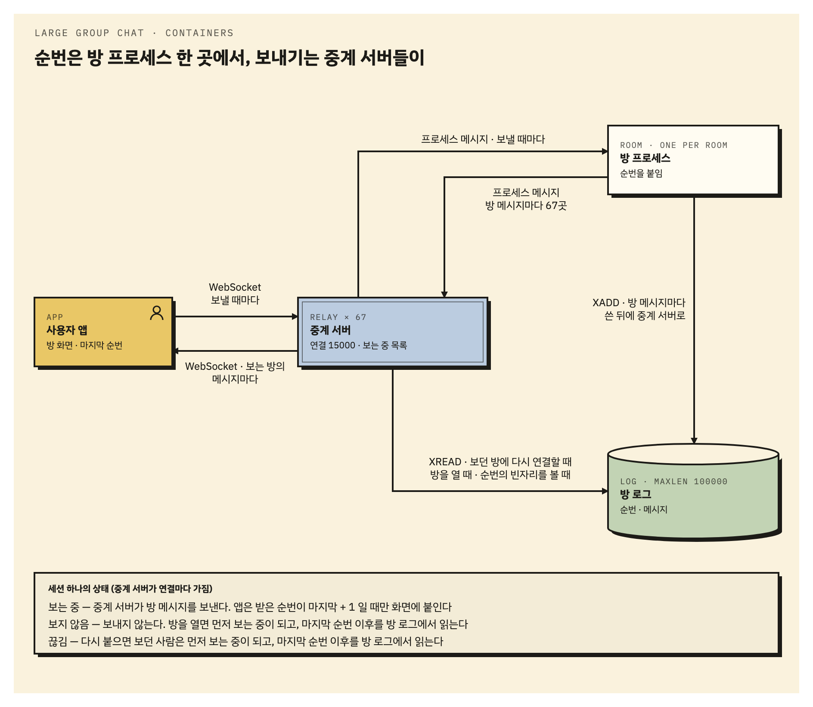
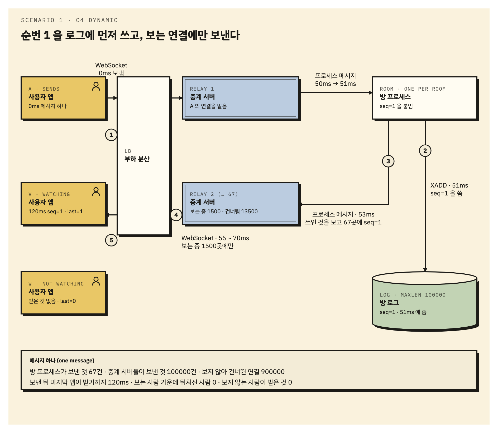
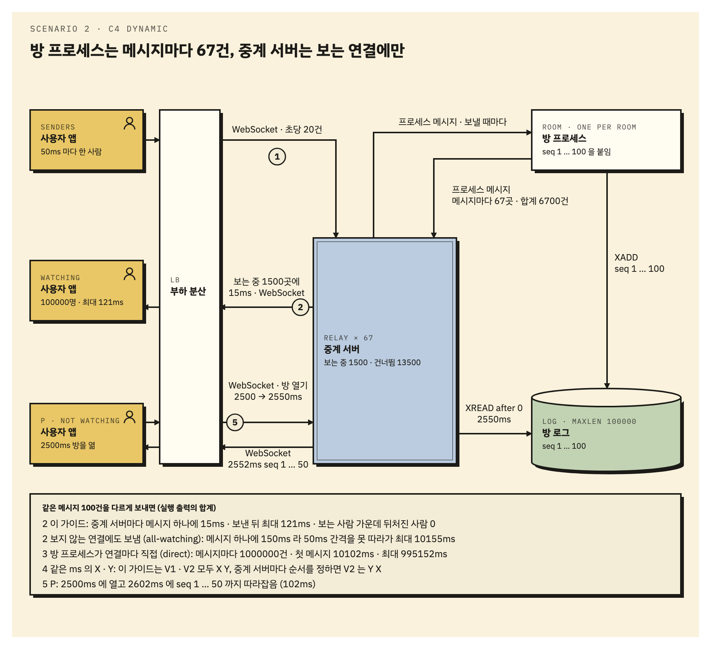
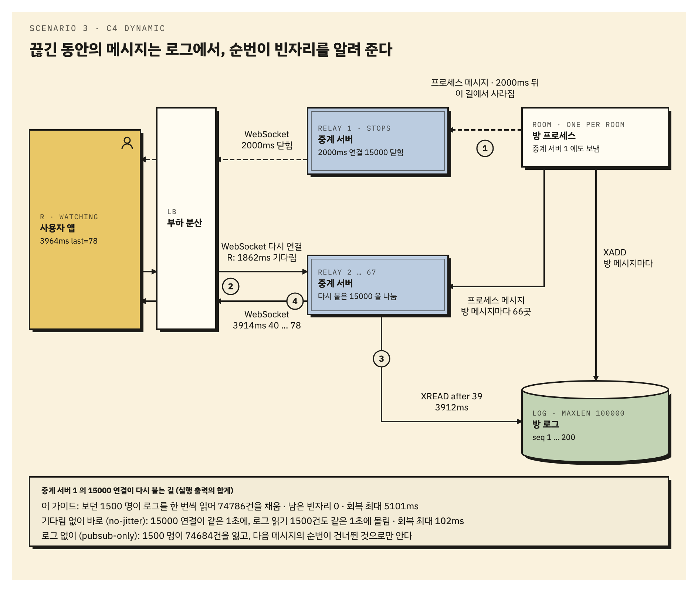

# 대형 그룹 채팅 — 순번은 방 프로세스 한 곳이 붙여 로그에 먼저 쓰고, 중계 서버는 보고 있는 연결에만 보내며, 놓친 것은 마지막 순번 이후를 로그에서 읽는다

## 문제와 요구사항

메신저의 공개 대화방 하나에 100만 명이 동시에 접속해 있다고 해 봅시다. 누군가 메시지를 보내면 그 방 화면을 열어 둔 사람은 곧바로 받아야 하고, 모두가 같은 순서로 봐야 해요. 다른 방을 보던 사람이 이 방을 열거나, 지하철에서 연결이 끊겼다 돌아온 사람은 그사이 메시지를 빠짐없이 이어서 봐야 하고요. 가장 먼저 떠오르는 구조는 방을 맡은 서버 한 곳이 메시지마다 연결 100만 개에 하나씩 보내는 것입니다. 이 구조는 두 곳에서 문제가 생깁니다. 메시지 하나가 전송 100만 번이 되어 방 전체로 초당 20건이면 초당 2천만 번이고(규모 추정 [2]), 끊긴 사람에게 보낸 메시지는 그 길에서 사라져 다시 오지 않아요.

여기서 fan-out(메시지 하나를 받는 사람 수만큼 복제해 보내는 일)을 누가 하는지가 갈립니다. 아래 그림의 오른쪽이 이 글이 따라가는 구조예요.

```text
방 서버가 연결마다 직접                       이 글
  메시지 1건 ──▶ 연결 1,000,000 개에 전송        메시지 1건 ──▶ 방 프로세스: 순번을 붙여 방 로그에 씀 ──▶ 중계 서버 67 대에 전송
  끊긴 사람: 놓친 것을 알 길이 없음                                      ──▶ 중계 서버: 그 방을 보고 있는 연결에만 전송
                                               보던 중에 끊긴 사람: 마지막으로 받은 순번 이후를 방 로그에서 읽음
```

방 프로세스는 방마다 하나 뜨는 실행 단위로, 그 방의 메시지에 1부터 하나씩 늘어나는 순번을 붙입니다. 방 로그는 메시지를 순번과 함께 순서대로 남겨 두는 저장소이고, 중계 서버는 사용자 앱의 연결을 맡아 두고 메시지를 나눠 보내는 서버예요. 앱은 WebSocket(브라우저나 앱이 서버와 연결 하나를 열어 두고 양쪽에서 메시지를 주고받는 표준 프로토콜로, 인터넷 표준 문서 RFC(Request for Comments) 가운데 [RFC 6455](https://www.rfc-editor.org/rfc/rfc6455) 가 정의함)으로 중계 서버에 붙어 있습니다. 끝까지 읽으면 메시지 하나가 어느 상자를 어떤 순서로 지나는지, 보고 있지 않은 사람과 끊겼던 사람이 무엇으로 빠짐없이 따라잡는지를 실행 출력으로 확인할 수 있어요. 요구 수치가 바뀌면 어느 구조로 옮겨야 하는지도 판단할 수 있게 됩니다. 기능 요구는 아래 셋입니다.

1. 방에 있는 사람은 메시지를 보내고, 그 방을 보고 있으면 다른 사람의 메시지를 곧바로 받습니다.
2. 그 방을 보고 있지 않다가 방을 열면, 마지막으로 받은 메시지 다음부터 이어서 봅니다.
3. 그 방을 보던 중에 연결이 끊겼다 다시 붙으면, 끊긴 동안의 메시지를 빠짐없이 순서대로 받습니다. 보고 있지 않던 방의 메시지는 2 처럼 방을 열 때 받습니다.

비기능 요구는 아래처럼 수치로 고정합니다. 근거 칸의 출처 수치와 인용은 리서치 노트에서 원문과 대조한 것이고, 링크는 참고 자료에 다시 모았어요.

| 항목 | 수치 | 근거 |
| --- | --- | --- |
| 방 크기 | 한 방에 온라인 100만 명 | 이 가이드의 가정 — Discord 가 한 서버의 크기를 「over 10 million members, of whom over 1 million are online」으로 소개한 Midjourney 서버를 빌렸어요([Discord Maxjourney 글](https://discord.com/blog/maxjourney-pushing-discords-limits-with-a-million-plus-online-users-in-a-single-server)). 같은 글은 중계 계층(relay)으로 다룬 규모를 수십만 명의 커뮤니티로도 적어 도입부 값과 다르고, 두 값의 관계를 설명한 문장은 없습니다(근거: Discord Maxjourney 글의 도입부와 Relays 절) |
| 방 메시지 | 피크에 방 전체로 초당 20건 | 이 가이드의 가정 — 한 방의 메시지 속도를 밝힌 공개 자료를 찾지 못해 정한 값이에요. 초당 20건이면 화면에 50ms 마다 새 메시지가 붙는 빠르기라, 대화가 가장 몰리는 순간의 상한으로 잡았어요 |
| 전달 지연 | 방을 보고 있는 사람은 메시지를 보낸 뒤 1초 안에 받음 | 이 가이드의 가정 — 대화로 느끼는 응답의 상한으로 잡았어요. Slack 은 자기 시스템이 세계 어디로든 메시지를 500ms 에 전달한다고 적습니다([Slack 실시간 메시징 글](https://slack.engineering/real-time-messaging/)). 1초는 그보다 느슨한 값이에요 |
| 순서 | 같은 방의 메시지는 그 방의 모든 사람에게 같은 순서로 보임 | Discord 는 「Discord clients depend on linearizability of events.」라고 적어요([Discord 2017 글](https://discord.com/blog/how-discord-scaled-elixir-to-5-000-000-concurrent-users)). 선형성(linearizability)은 모든 사람이 일어난 일들을 실제 앞뒤와 어긋나지 않는 하나의 순서로 보는 성질입니다. 이 가이드는 그것을 방 안의 메시지 순서 요구로 옮겼어요 |
| 방 열기 | 보고 있지 않던 방을 연 사람은 연 뒤 1초 안에, 마지막으로 받은 메시지 다음부터 받기 시작함 | 이 가이드의 가정 — 방을 연 사람이 기다리는 시간을 전달 지연과 같은 1초로 뒀어요 |
| 끊김 회복 | 그 방을 보던 중에 연결이 끊긴 사람은 끊긴 뒤 10초 안에 끊긴 동안의 메시지를 받고 새 메시지를 다시 받음 | 이 가이드의 가정 — 앱이 끊긴 것을 알고 다시 붙는 시간까지 넣은 상한이에요. 그 방 화면에 「다시 연결 중」이 10초 넘게 남지 않게 하려는 값입니다. 보지 않던 사람은 그 방의 메시지를 원래 실시간으로 받지 않으므로(기능 요구 1), 끊긴 동안의 메시지도 방을 열 때 방 열기 행으로 받아요 |
| 정확도 — 놓친 메시지 | 1시간까지 비운 사람이 돌아와 받는 메시지는 방의 순서와 같고, 빠진 것 0건 · 두 번 보인 것 0건 | 이 가이드의 가정 — 대화는 앞의 말이 빠지면 뒤의 답이 무엇에 대한 것인지 알 수 없어 허용 오차를 두지 않아요. 1시간은 회의나 이동처럼 한동안 앱을 닫아 두었다 돌아오는 경우를 덮으려고 잡은 값입니다. 이 행은 저절로 지켜지지 않아요. Redis(데이터를 메모리에 두는 키-값 저장소)의 Pub/Sub(발행한 메시지를 구독자에게 바로 넘기는 기능)과 웹 프레임워크 Phoenix 의 문서는 둘 다 실시간 전달이 최대 한 번(at-most-once, 잃으면 다시 보내지 않음)이라고 적습니다([Redis Pub/Sub 문서](https://redis.io/docs/latest/develop/pubsub/) · [Phoenix Channels 문서](https://phoenix.hexdocs.pm/channels.html)) |

일부러 다루지 않는 것도 적어 둡니다.

- 1시간보다 오래 비운 사람이 지난 메시지를 거슬러 올라가 보는 이력 조회와 그 저장소는 다루지 않습니다. 방 로그 길이가 1시간 분량을 덮는다는 것까지만 봐요(규모 추정 [5]).
- 보고 있지 않은 방의 읽지 않음 수와 알림(푸시)은 범위 밖이에요. 보지 않는 연결에는 메시지를 아예 보내지 않는 것으로 둡니다.
- 권한 확인(누가 그 방의 메시지를 볼 수 있는가)은 다루지 않습니다. 모두가 볼 수 있는 공개 방으로 둬요.
- 보낸 메시지가 방 프로세스에 들어가기 전에 사라졌을 때 보낸 사람 쪽의 재전송과 중복 제거는 다루지 않습니다.
- 방 프로세스 자체가 멈췄을 때 다른 기계에서 다시 띄우는 일(장애 조치)은 범위 밖이에요. 다시 띄운 방 프로세스가 순번을 어디서 이어야 하는지만 스스로 점검하기 2 에서 짚습니다.
- 메시지 수정 · 삭제 · 반응, 첨부 파일, 한 사람의 여러 기기는 다루지 않습니다.

## 규모 추정

식에 쓰는 이름을 먼저 소개합니다. 방 로그는 Redis Streams(Redis 의 추가 전용 로그 자료형)를 예로 들어요. XADD 는 스트림 끝에 항목 하나를 붙이는 명령, XREAD 는 호출한 쪽이 알려 준 마지막 ID(스트림 항목마다 붙는, 커지기만 하는 식별자)보다 큰 항목만 읽는 명령입니다. MAXLEN 은 XADD 에 붙이는 길이 상한으로, 넘치면 가장 오래된 항목부터 지워요. 중계 서버 하나가 맡는 연결 수는 Discord 가 relay 하나에 세션을 15,000 개까지 둔다고 적은 값을 빌립니다. 보는 연결의 비율은 Discord 가 큰 서버에서 연결의 약 90% 가 수동(passive, 그 서버를 열어 보고 있지 않은) 연결이었다고 적은 값을 빌려 10% 로 둬요. 프로세스 하나가 1ms 에 보내는 전송 수는 재지 않은 가정입니다.

```text
(입력)  온라인 1,000,000 명(요구 1행) · 방 메시지 초당 20 건(요구 2행) · 1시간 비움(요구 7행)
        중계 서버 하나가 맡는 연결 15,000(Discord) · 보는 연결 10% (Discord 의 수동 연결 약 90%)
        프로세스 하나가 1ms 에 보내는 전송 100 건 = 초당 100,000 건(가정)
        한 방향 시간: 앱 ↔ 중계 서버 50ms · 서버 사이 1ms · 방 로그 왕복 2ms(가정)
        피크 5초 = 메시지 100 건, 50ms 마다 한 건(가정)

[1] 모두가 한 번씩 말하면         1,000,000 × 1,000,000 = 10^12 건 (Discord 의 1,000명 → 100만 건을 일반화)
[2] 방 서버가 연결마다 직접       20 건/초 × 1,000,000 = 20,000,000 건/초
                                  메시지 하나에 1,000,000 ÷ 100 = 10,000ms
[3] 중계 서버 수                  1,000,000 ÷ 15,000 ≈ 66.7 → 67 대
                                  방 프로세스가 보내는 것: 20 × 67 = 1,340 건/초 (메시지 하나에 67 ÷ 100 → 1ms)
[4] 보는 연결에만                 1,000,000 × 10% = 100,000 → 20 × 100,000 = 2,000,000 건/초
                                  중계 서버 하나: 1,500 × 20 = 30,000 건/초, 메시지 하나에 1,500 ÷ 100 = 15ms
                                  보지 않는 연결까지 보내면: 메시지 하나에 15,000 ÷ 100 = 150ms
                                  전송 속도를 1ms 에 c 건으로 두면, 5초 피크의 100번째 메시지 지연
                                  = 55 + 100 × ⌈15,000 ÷ c⌉ + 50 − 4,950
                                    55 = 50 + 1 + 2 + 1 + 1 (앱 → 중계 서버 → 방 프로세스 → 로그 왕복 → 67곳에 보내기 → 중계 서버)
                                    50 = 중계 서버 → 앱, 4,950 = 50 × 99 (100번째를 보낸 시각)
                                  ≤ 1,000ms 이려면 c ≥ 259 (가정의 약 2.6배) · c = 100 이면 10,155ms
                                  피크가 길수록 이 문턱은 c = 300 (메시지 하나 50ms) 쪽으로 오름
[5] 1시간 비운 사람에게 쌓인 메시지 20 × 3,600 = 72,000 건 → 방 로그 길이 100,000 건(설정)
[6] 중계 서버 하나가 멈추면        연결 15,000 이 다시 붙고, 그 가운데 보던 1,500 이 방 로그를 읽음
                                  0 ~ 5초에 흩으면 15,000 ÷ 5 = 초당 약 3,000 연결
```

이 계산에서 빠지는 구조가 있어요. [2] 는 방 서버가 연결마다 직접 보내는 구조(대안 비교의 A)를 뺍니다. 가정한 전송 속도로는 메시지 하나를 모두에게 보내는 데만 10초가 걸려 요구 3행의 1초를 첫 메시지부터 넘어요. 초당 20건을 따라가려면 1ms 에 20,000건을 보내야 하니 가정의 200배입니다. 전송 속도 가정이 몇 배 틀려도 이 결론은 그대로예요. [3] 은 중계 계층이 방 프로세스의 일을 사람 수가 아니라 중계 서버 수로 바꾼다는 것을 보입니다. 100만 명이든 1천만 명이든 방 프로세스는 메시지마다 중계 서버 수만큼만 보내요.

[4] 는 보지 않는 연결에 보내지 않는 것을 강제합니다. 메시지는 50ms 마다 오는데, 보지 않는 연결까지 보내면 중계 서버 하나가 메시지 하나에 150ms 를 써서 일이 계속 쌓여요. 보는 연결에만 보내면 15ms 라 다음 메시지 전에 끝납니다. 이 차이는 시나리오 2 에서 실행으로 확인해요. 다만 [4] 의 여유는 [2] 보다 훨씬 작습니다. 전송 속도가 가정의 약 2.6배(1ms 에 약 260건)면 보지 않는 연결까지 보내도 5초 피크의 마지막 메시지가 1초 안에 도착하고, 3배면 메시지 하나에 50ms 라 간격과 같아져 일이 더 쌓이지 않아요(계산). 그래서 [4] 의 결론은 가정한 전송 속도에 기대고, 실제로 재야 할 값은 중계 서버 하나가 1ms 에 보내는 수입니다. [5] 는 방 로그 길이의 하한이고, [6] 은 다시 붙는 연결이 한꺼번에 몰릴 때의 양이에요. 그것을 시간에 흩는 근거는 RFC 6455 의 재연결 권고입니다(시나리오 3 의 2단계).

## 시스템 개념도



메시지가 지나는 주된 길은 이렇습니다. 사용자 앱이 열어 둔 WebSocket 으로 메시지를 보내면, 그 연결을 맡은 중계 서버가 방 프로세스로 넘겨요. 방 프로세스는 다음 순번을 붙여 방 로그에 XADD 로 쓰고, 쓰였다는 답을 받은 뒤 67곳의 중계 서버에 보냅니다. 중계 서버는 그 방을 보고 있는 연결에만 보내고, 앱은 받은 순번이 마지막 순번 + 1 일 때 화면에 붙여요. 방을 연 사람, 그 방을 보던 중에 다시 연결한 사람, 순번이 건너뛴 것을 본 사람은 중계 서버를 거쳐 방 로그에서 마지막 순번 이후를 XREAD 로 읽습니다.

## 시나리오로 따라가기

### 시나리오 1 — A 의 메시지 하나가 순번 1 을 받아 로그에 먼저 쓰이고, 보고 있는 10만 연결에 120ms 안에 가며 보지 않는 90만 연결에는 가지 않는다

온라인 100만 명이 중계 서버 67대에 나눠 붙어 있고, 10명에 1명이 이 방을 보고 있어요. 0ms 에 중계 서버 1 에 붙은 A 가 메시지 하나를 보냅니다. 다른 메시지도 장애도 없어요. 한 방향 시간은 앱과 중계 서버 사이 50ms, 서버 사이 1ms 이고, 프로세스 하나는 1ms 에 100건을 보냅니다(모두 가정). 따라가는 사람은 중계 서버 2 에서 이 방을 보는 V 와, 같은 중계 서버에서 이 방을 보지 않는 W 예요. 나와야 하는 것은 순번 1 과 방 로그의 항목 하나예요. 보는 연결 10만 개에는 모두 1초 안에 도착하고, 보지 않는 연결 90만 개에는 아무것도 가지 않아야 합니다.



1. 0ms 에 A 의 앱이 열어 둔 WebSocket 으로 메시지를 보내고, 50ms 에 그 연결을 맡은 중계 서버 1 이 받아 방 프로세스로 넘깁니다(51ms 도착). A 의 연결은 처음 붙을 때 앞단의 부하 분산(연결을 여러 서버에 나눠 주는 장치)이 중계 서버 1 로 보낸 것이에요. 앱이 연결 하나를 미리 열어 두는 이유는 메시지마다 연결을 맺지 않고 보내기와 받기를 한 연결에서 하기 위해서예요. 중계 서버가 여기서 순번을 붙이지 않고 넘기는 이유는 순번을 붙이는 곳이 방마다 하나여야 하기 때문입니다. 중계 서버마다 순서를 정하면 무엇이 어긋나는지는 시나리오 2 의 4단계에서 봐요.
2. 51ms 에 방 프로세스가 이 메시지에 순번 1 을 붙이고 방 로그에 XADD 로 씁니다. 53ms 에 쓰였다는 답이 와요. 방 프로세스는 받은 메시지를 메일박스(프로세스에 온 메시지가 차례로 쌓이는 곳)에서 하나씩 꺼내 처리하므로, 꺼낸 차례가 곧 순번이에요. 두 사람이 같은 순간 보내도 순번은 하나씩 붙습니다.
3. 53ms 에 로그에 쓰인 것을 확인한 뒤에야 67곳의 중계 서버에 순번 1 을 보내고, 55ms 에 도착해요. 로그에 먼저 쓰는 이유는 보던 중에 다시 연결한 사람이나 방을 연 사람이 로그를 읽을 때, 남이 이미 받은 메시지가 로그에는 아직 없는 경우를 없애기 위해서입니다(판단). 보내는 곳이 연결 100만 개가 아니라 중계 서버 67곳이라 방 프로세스의 일은 1ms 로 끝나요.
4. 55ms 에 중계 서버 2 가 이 방을 보는 연결 1500개에만 보내고, 보지 않는 13500개는 건너뜁니다. 1500 ÷ 100 = 15ms 라 70ms 에 끝나요. 보지 않는 연결에 보내지 않는 이유는 중계 서버의 일을 10분의 1로 줄이기 위해서입니다. 모두에게 보내면 메시지 하나에 150ms 가 걸리고, 그 결과는 시나리오 2 의 2단계에서 봐요.
5. 120ms 에 V 가 순번 1 을 받고 마지막 순번(last)을 1 로 기억합니다. 같은 중계 서버의 W 는 아무것도 받지 않아 last 가 0 그대로예요. 앱이 마지막 순번을 기억하는 이유는 다음에 받을 것이 무엇인지 알기 위해서입니다. 받은 순번이 last + 1 이 아니면 바로 붙이지 않고, 그 방을 보던 중에 끊겼다 돌아오면 last 이후를 로그에서 읽어요(시나리오 3). W 처럼 보지 않던 앱은 방을 열 때 읽습니다(시나리오 2 의 5단계).

```text
t=0ms A app: sends a message on its WebSocket
t=50ms relay 1: passes A's message to the room process
t=51ms room: gives it seq=1 and appends it to the room log
t=53ms room: the log has seq=1, sends seq=1 to 67 relays
t=55ms relay 2: seq=1 to 1500 watching sessions, 13500 not watching are skipped, done at 70ms
t=120ms V app: got A's message seq=1, last=1
one message: messages=1 room-sends=67 relay-sends=100000 skipped=900000 delay-first=120ms delay-max=120ms watching-behind=0 not-watching-got=0
```

잠깐, 확인 하나만 해 볼까요? A 가 보낸 뒤 마지막 앱이 받기까지 120ms 는 어디서 나왔을까요?

출력의 시각을 차례로 더하면 됩니다. 기다리는 자리가 없어서 네트워크와 전송 비용만 남아요.

```text
0ms     A 가 보냄
50ms    중계 서버 1 이 받음               앱 → 중계 서버 50ms
51ms    방 프로세스가 받음, 순번 1         중계 서버 → 방 프로세스 1ms
53ms    로그에 쓰였다는 답                방 로그 왕복 1 + 1ms
54ms    67곳에 다 보냄                    67 ÷ 100 → 1ms
55ms    중계 서버들이 받음                 1ms
70ms    보는 연결 1500 에 다 보냄          1500 ÷ 100 = 15ms
120ms   마지막 앱이 받음                  중계 서버 → 앱 50ms
합계    50 + 1 + 2 + 1 + 1 + 15 + 50 = 120ms   (요구 3행의 1초 안)
```

이 시나리오가 보여 준 것은 메시지 하나가 지나는 순서와 그 순서의 이유입니다. 중계 서버들이 보낸 100000건과 건너뛴 900000건을 더하면 온라인 100만 명이라, 실행이 요구 1행의 크기 그대로예요. 보는 사람 모두가 120ms 에 받았고(`watching-behind=0`) 이것이 전달 지연 행의 첫 근거입니다. 보지 않는 사람이 받은 것은 0건이에요(`not-watching-got=0`). 이 사람들이 방을 열 때 무엇을 받는지는 시나리오 2 의 5단계에서 이어 봅니다.

### 시나리오 2 — 피크 5초 동안 메시지 100건이 와도 방 프로세스는 메시지마다 67곳에만 보내 보는 사람이 121ms 안에 받고, 방을 연 P 는 102ms 에 순번 50 까지 따라잡는다

방은 시나리오 1 과 같아요. 피크에 방 전체로 초당 20건, 즉 0ms 부터 50ms 마다 한 사람이 보내 5초 동안 100건이 옵니다. 보내는 사람은 중계 서버 2 ~ 67 에서 이 방을 보는 사람 가운데 정해진 씨앗의 의사 난수(정해진 식으로 만드는, 난수처럼 보이는 수열)로 고릅니다. 2500ms 에는 중계 서버 2 에서 이 방을 보고 있지 않던 P 가 방을 엽니다. 같은 사건열을 보지 않는 연결에도 보내는 구조와 방 프로세스가 연결마다 직접 보내는 구조로도 실행해 비교해요. 따로, 중계 서버 1 의 X 와 중계 서버 2 의 Y 가 같은 ms 에 보내는 경우도 실행합니다. 나와야 하는 것은 보는 사람 모두가 1초 안에 받는 것, 모두가 같은 순서로 받는 것, P 가 연 뒤 1초 안에 마지막 다음부터 받는 것입니다.



1. 메시지 100건이 하나씩 시나리오 1 의 1 ~ 3단계와 같은 길을 지나요. 방 프로세스는 1 ~ 100 을 붙여 로그에 쓰고 메시지마다 67곳에 보내 모두 6700건을 보냅니다(`room-sends=6700`). 방 프로세스가 메시지 하나에 쓰는 시간은 로그 왕복 2ms 와 보내기 1ms 라(실행의 가정에서 셈), 50ms 마다 오는 메시지를 기다림 없이 처리해요. 방 프로세스의 일이 사람 수가 아니라 중계 서버 수를 따라가는 것이 규모 추정 [3] 의 실행 결과입니다.
2. 중계 서버마다 메시지 하나를 보는 연결 1500 에 15ms 에 보내고, 다음 메시지가 오는 50ms 전에 끝나요. 보낸 뒤 마지막 앱이 받기까지 가장 오래 걸린 것이 121ms 입니다. 시나리오 1 보다 1ms 늘어난 것은 P 가 보는 중이 된 뒤 중계 서버 2 가 1501곳에 보내 16ms 가 걸리기 때문이에요. 같은 사건열을 보지 않는 연결에도 보내면(`all-watching`) 중계 서버 하나가 메시지 하나에 150ms 를 써서 50ms 간격을 따라가지 못해요. 첫 메시지는 보낸 뒤 255ms, 100번째 메시지는 보낸 뒤 10155ms 만에 마지막 앱에 도착했습니다. 보지 않는 연결에 보내지 않는 것은 선택이 아니라 이 속도에서 요구 3행을 지키는 조건이에요.
3. 방 프로세스가 연결 100만 개에 직접 보내면(`direct`) 메시지 하나에 1000000 ÷ 100 = 10000ms 가 걸립니다. 첫 메시지가 10102ms 에 도착하고, 100번째 메시지는 앞의 99건이 끝나기를 메일박스에서 기다려 995152ms 가 걸렸어요. 중계 계층을 두는 이유가 이 숫자예요. 방 프로세스가 하나인 한 보내는 일을 여러 기계로 나눌 방법은 보내는 대상을 바꾸는 것뿐입니다.
4. X 와 Y 가 0ms 에 같이 보내면 두 메시지는 51ms 에 방 프로세스에 함께 도착하고, 메일박스에 먼저 들어간 X 가 순번 1, Y 가 순번 2 를 받아요. 중계 서버 1 의 V1 과 중계 서버 2 의 V2 가 모두 X, Y 순서로 봅니다. 중계 서버가 받은 메시지를 자기 연결에 먼저 보내고 다른 중계 서버로 넘기면(`relay-order`), V1 은 X, Y 를 보고 V2 는 Y, X 를 봐요. 순번을 붙이는 곳이 방마다 하나여야 하는 이유가 이 실행입니다.
5. 2500ms 에 P 의 앱이 방을 열고 마지막 순번 0 을 중계 서버 2 로 보내요. 2550ms 에 중계 서버 2 가 P 를 먼저 보는 연결 목록에 넣은 뒤, 방 로그에서 순번 0 이후를 XREAD 로 읽습니다. 2552ms 에 순번 1 ~ 50 을 받아 P 에게 보내고, 2602ms 에 P 의 last 가 50 이 돼요. 방을 연 뒤 102ms 입니다. 51 부터는 보는 연결로서 실시간으로 받아요. 목록에 먼저 넣고 읽는 이유는 읽기가 끝난 뒤에 로그에 쓰인 메시지가 실시간으로 오게 하려는 것이에요. 순서를 바꾼 경우는 시나리오 3 의 3단계에서 봅니다.

```text
t=2500ms P app: opens the room it was not watching, last=0
t=2550ms relay 2: P is watching, reads the room log after seq 0
t=2552ms relay 2: P gets seq 1..50 from the room log
t=2602ms P app: last=50, caught up 102ms after opening the room
guide: messages=100 room-sends=6700 relay-sends=10000050 skipped=89999949 delay-first=120ms delay-max=121ms watching-behind=0 not-watching-got=0
all-watching: messages=100 room-sends=6700 relay-sends=100000000 skipped=0 delay-first=255ms delay-max=10155ms watching-behind=0 not-watching-got=0
direct: messages=100 room-sends=100000000 relay-sends=0 skipped=0 delay-first=10102ms delay-max=995152ms
two senders press at the same ms, X on relay 1 and Y on relay 2:
guide: V1 sees X Y, V2 sees X Y
relay-order: V1 sees X Y, V2 sees Y X
```

`relay-sends=10000050` 은 메시지 100건 × 보는 연결 10만 개에, P 가 보는 중이 된 뒤의 50건이 더해진 값이에요(계산). `skipped=89999949` 는 그 반대쪽으로, 보지 않는 연결에 보내지 않은 수입니다.

```text
같은 ms 의 X · Y        이 가이드 (방 프로세스가 순번)          중계 서버마다 순서 (relay-order)
중계 서버 1 의 V1        X(1) → Y(2)                          X (자기 것을 먼저) → Y (넘겨받음)
중계 서버 2 의 V2        X(1) → Y(2)                          Y (자기 것을 먼저) → X (넘겨받음)
```

이 시나리오가 보여 준 것은 부하를 받는 곳과 바뀌지 않는 것입니다. 초당 20건의 부하를 받은 곳은 중계 서버들이고, 방 프로세스의 일은 메시지마다 67건으로 그대로였어요. 이것이 방 크기 행과 방 메시지 행의 근거입니다. 보는 사람이 121ms 안에 받은 것은 전달 지연 행으로, V1 · V2 가 같은 순서로 본 것은 순서 행으로 가요. P 가 연 뒤 102ms 에 순번 1 부터 받기 시작한 것은 방 열기 행으로 갑니다. 보지 않는 연결에도 보내면 10155ms, 방 프로세스가 직접 보내면 995152ms 라는 것이 버린 두 구조의 실행 근거예요.

### 시나리오 3 — 중계 서버 1 이 2000ms 에 멈추면 그 연결 15000 이 끊기고, 보던 1500 명은 0 ~ 5초 기다렸다 다른 중계 서버로 붙어 놓친 메시지를 방 로그에서 빈자리 없이 채운다(최대 5101ms)

방 전체로 초당 20건이 10초 동안 계속 오는 중에, 2000ms 에 중계 서버 1 이 멈추고 돌아오지 않아요. 그 중계 서버의 연결 15000 이 끊기고, 그 가운데 이 방을 보던 사람이 1500 명입니다. 앱은 연결이 닫힌 것을 멈춘 그 ms 에 안다고 둬요(가정). 앱은 0 ~ 4999ms 가운데 무작위로 기다렸다 다시 연결하고, 앞단의 부하 분산이 살아 있는 중계 서버 66대 가운데 하나로 보냅니다. 따라가는 사람은 중계 서버 1 에서 이 방을 보던 R 이에요. 나와야 하는 것은 보던 사람 모두가 끊긴 뒤 10초 안에 놓친 메시지를 받는 것, 빠진 것과 두 번 보인 것이 0 인 것입니다.



1. 2000ms 에 중계 서버 1 이 멈추고 연결 15000 이 닫힙니다. 그때 R 의 last 는 39 예요. 방 프로세스는 그 뒤로도 메시지마다 중계 서버 1 에 보내지만 그 길에서 사라집니다. Erlang(대량의 동시 실행을 위해 설계된 언어와 그 런타임)의 참조 설명서도 노드(따로 실행되는 Erlang 런타임 하나) 사이 연결이 끊기면 프로세스 사이 메시지를 잃을 수 있다고 적어요([Erlang 참조 설명서 Processes](https://www.erlang.org/doc/system/ref_man_processes.html)). 방 프로세스가 다시 보내지 않는 이유는, 다시 보내려면 연결마다 무엇을 받았는지 기억해야 하고 그 일이 연결 수만큼 커지기 때문이에요(판단). 놓친 것을 채우는 일은 순번과 방 로그가 맡습니다.
2. 끊긴 앱은 저마다 0 ~ 4999ms 가운데 무작위로 기다렸다 다시 연결해요. R 은 1862ms 를 기다려 3912ms 에 중계 서버 2 에 붙습니다. 무작위로 기다리는 이유는 RFC 6455 가 비정상으로 끊긴 클라이언트 모두가 곧바로 다시 붙으면 서버가 서비스 거부 공격을 받은 것과 같은 상태가 될 수 있다며, 첫 재연결을 무작위 시간만큼 늦추라고 권하기 때문이에요. RFC 6455 는 0 ~ 5초의 무작위 값을 적당한 첫 지연으로 듭니다(근거: RFC 6455 §7.2.3). 기다림 없이 바로 붙으면(`no-jitter`) 연결 15000 이 같은 1초에 몰리고 로그 읽기 1500 건도 같은 1초에 몰렸어요. 이 글의 모형은 연결을 맺는 데 드는 시간을 세지 않아서, 그 실행에서는 회복이 오히려 102ms 로 빨랐습니다. 몰렸을 때의 대가는 실행 밖이고, 근거는 RFC 의 설명이에요.
3. 3912ms 에 중계 서버 2 가 R 을 보는 연결 목록에 먼저 넣고, 방 로그에서 순번 39 이후를 XREAD 로 읽습니다. 3914ms 에 순번 40 ~ 78 을 받아요. 목록에 먼저 넣는 이유는 읽기와 등록 사이에 들어온 메시지가 어느 쪽으로도 오지 않는 틈을 없애려는 것입니다(판단). 이 글의 모형에서는 로그에 쓰인 메시지가 중계 서버에 도착하기까지 3ms 가 걸려, 등록을 따라잡기가 끝난 뒤로 옮긴 변형 실행(바꾼 것: Java 판 `resume` 의 `watchers[r]++` · `joiners.get(r).add(s)` 를 `readDone` 의 따라잡기 완료 뒤로 옮김)에서도 빈자리는 생기지 않았어요(`gaps-left=0`, `log-reads=1500` 그대로, `live-dropped` 만 102 → 30). 틈이 생기는지는 로그와 중계 서버 사이 지연에 달려 있어서, 이 글은 등록을 먼저 하는 쪽을 고릅니다(판단). 따라잡는 동안 실시간으로 온 메시지는 버리고, 가장 큰 순번만 기억해요. 읽은 끝보다 더 큰 순번을 봤으면 한 번 더 읽습니다.
4. 3964ms 에 R 의 last 가 78 이 되어 끊긴 뒤 1964ms 에 따라잡았어요. 보던 1500 명 모두로는 가장 늦은 사람이 5101ms 였고, 로그에서 채운 메시지가 74786건, 남은 빈자리가 0, 로그 길이 때문에 읽지 못한 것이 0 입니다. 보지 않던 13500 명은 다시 붙기만 하고 로그를 읽지 않아요. 이들은 방을 열 때 읽으면 되므로(시나리오 2 의 5단계) 로그 읽기가 15000 이 아니라 1500 이었습니다.
5. 같은 사건열을 방 로그 없이 실행하면(`pubsub-only`) 보던 1500 명이 합쳐서 74684건을 잃었고, 1500 명 모두에게 빈자리가 남았어요(`sessions-with-gap=1500`). 다음 메시지의 순번이 건너뛴 것을 보고서야 빈자리를 알지만 채울 곳이 없습니다. 이 수는 이 가이드의 실행에서 로그로 채운 74786건에서 실시간으로도 와서 버린 102건을 뺀 값과 같아요(74786 − 102 = 74684, 계산). 로그가 채운 것 가운데 실시간과 겹치지 않은 것이 실시간 경로가 잃은 것과 같은 수라는 뜻입니다.

```text
t=2000ms relay 1: stops, 15000 connections close, R had last=39 and waits 1862ms to reconnect
t=3912ms relay 2: R is watching, reads the room log after seq 39
t=3914ms relay 2: R gets seq 40..78 from the room log
t=3964ms R app: last=78, caught up 1964ms after relay 1 stopped
guide: reconnected=15000 log-reads=1500 filled-from-log=74786 live-dropped=102 trimmed=0 gaps-left=0 recovered-max=5101ms reconnects-per-second-max=3087 log-reads-per-second-max=329
no-jitter: reconnected=15000 log-reads=1500 filled-from-log=1500 live-dropped=0 trimmed=0 gaps-left=0 recovered-max=102ms reconnects-per-second-max=15000 log-reads-per-second-max=1500
pubsub-only: reconnected=15000 log-reads=0 lost=74684 sessions-with-gap=1500
```

R 한 사람의 상태만 따라가면 이렇습니다.

```text
시각       R 의 상태                    last   받는 길
2000ms     끊김 (중계 서버 1 멈춤)        39     그 뒤 방 프로세스가 보낸 것은 사라짐
3912ms     보는 중 (중계 서버 2 에 등록)   39     XREAD after 39
3914ms     따라잡는 중                   78     로그에서 40 … 78
3964ms     보는 중                       78     앱에 도착, 79 부터는 실시간
```

> 잃어도 괜찮게 보내고, 순번으로 빈자리를 알고, 로그에서 채운다.

정합성이 걸린 문제라 틀린 값이 남는 길도 봐야 합니다. 로그가 없으면 1500 명의 화면에서 74684건이 빠진 채 대화가 이어져요. 사용자는 다음 메시지가 올 때까지 빠진 것을 모르고, 순번이 없다면 그것조차 모릅니다. 이 시나리오가 보여 준 것은 끊김 회복 행과 정확도 행의 근거예요. 가장 늦은 사람이 5101ms 에 따라잡은 것은 10초 안이고, 남은 빈자리 0 · 읽지 못한 것 0 은 빠진 것 0건의 근거입니다. 실시간으로도 와서 버린 102건은 앱이 순번으로 걸러 두 번 보이지 않았어요.

## 기술 상세 설명

### 구성 요소 — 사용자 앱

방 화면이 있는 모바일 앱이나 웹 페이지입니다. 중계 서버와 WebSocket 연결 하나를 열어 두고 보내기와 받기를 함께 하고, 방마다 마지막으로 받은 순번(last)을 기억해요. RFC 6455 는 WebSocket 을 TCP(연결형 전송 규약) 위의 프로토콜로 정의합니다(「layered over TCP」). TCP 표준 문서는 TCP 가 응용 프로그램에 믿을 수 있고 순서가 지켜지는 바이트 흐름을 제공한다고 적어요(근거: [RFC 9293](https://www.rfc-editor.org/rfc/rfc9293) §2.2). RFC 6455 는 또 한 메시지를 조각으로 나눠 보낼 때 그 조각은 보낸 순서대로 전달해야 한다고 적습니다(「Message fragments MUST be delivered to the recipient in the order sent by the sender.」, [RFC 6455](https://www.rfc-editor.org/rfc/rfc6455)). 한 연결 안에서 메시지끼리의 순서를 그대로 적은 문장은 찾지 못했어요. 이 글은 TCP 위라는 데서 그렇게 읽고(판단), 그래도 앱이 순번을 직접 확인하게 둡니다.

맡는 일은 시나리오 1 의 1 · 5단계에서 보내고 받는 것, 시나리오 2 의 5단계에서 방을 열며 last 를 보내는 것, 시나리오 3 의 2 ~ 4단계에서 기다렸다 다시 붙고 따라잡는 것입니다. 받은 메시지는 아래 규칙으로 다뤄요.

```text
받은 순번 x 를 last 와 비교해서                           (receive)
x = last + 1                → 화면에 붙이고 last = x
x ≤ last                    → 이미 있음. 버림 (두 번 보이지 않게)
x > last + 1                → 빈자리. last 이후를 로그에서 읽기 시작하고, 이 x 는 버림
따라잡는 중에 온 x           → 버리고 가장 큰 x 만 기억. 읽기가 끝난 뒤 last 가 그보다 작으면 한 번 더 읽음
```

같은 자리에 올 수 있는 다른 방법은 서버가 연결마다 무엇을 보냈는지 기억해 두었다가 다시 보내는 것입니다. 그러려면 중계 서버가 연결 100만 개의 상태를 저마다 가지고 있어야 하고, 중계 서버가 멈추면 그 기억도 함께 사라져요(판단). 순번 하나를 앱이 기억하면 서버는 무엇을 보냈는지 몰라도 되고, 그 방을 보던 앱은 어느 중계 서버로 다시 붙든 로그에서 이어 읽고, 보지 않던 앱은 방을 열 때 이어 읽습니다. 공개 프로토콜에도 같은 모양이 있어요. Discord 가 봇과 앱에 공개한 게이트웨이 프로토콜은 이벤트마다 순번을 붙이고, 끊긴 앱이 재개를 요청하면 「replay any lost events starting from the last sequence number it received」를 할 수 있다고 적습니다([Discord 게이트웨이 문서](https://docs.discord.com/developers/events/gateway)). 이것은 바깥에 공개된 프로토콜이지 Discord 내부의 방 프로세스가 순번을 붙이는 방법이 아니에요. Telegram API(응용 프로그램이 Telegram 서버에 요청할 때 쓰는 공개 인터페이스)는 채널의 놓친 업데이트를 `updates.getChannelDifference` 로 묻게 합니다([Telegram API 업데이트 문서](https://core.telegram.org/api/updates)).

순번만으로는 빈자리를 다음 메시지가 와야 안다는 한계가 있어요. 교육용 분석인 Hello Interview 도 마지막으로 본 순번과 새로 받은 순번의 차이로 빠진 것을 찾는 방법을 들면서 이 한계를 함께 적습니다(Hello Interview 분석, 2차 자료). 그래서 이 글은 보던 방에 다시 연결할 때와 방을 열 때에는 다음 메시지를 기다리지 않고 곧바로 로그를 읽어요.

| 설정값 · 한계 | 값 | 이유 · 보장하지 않는 것 |
| --- | --- | --- |
| 연결 | WebSocket 하나 | 보내기와 받기를 한 연결에서. 앱과 중계 서버 사이 한 방향 50ms(실행의 가정) |
| 마지막 순번 | 방마다 하나, 앱 메모리 | 앱을 지우거나 기기를 바꾸면 사라짐(실행 밖) |
| 다시 연결 전 대기 | 0 ~ 4999ms 무작위 | RFC 6455 의 첫 재연결 권고. 두 번째 이후의 대기 늘리기는 실행 밖 |
| 끊김을 아는 때 | 연결이 닫힌 그 ms | 가정. 닫혔다는 신호가 오지 않으면 주기적인 확인으로 알아야 하고 그만큼 회복이 늦어짐(판단, 실행 밖) |
| 따라잡는 동안 온 메시지 | 버리고 가장 큰 순번만 기억 | 시나리오 3 에서 실시간으로도 와서 버린 것은 102건. 그 가운데 따라잡는 동안 온 것과 따라잡은 뒤 이미 가진 순번으로 온 것이 각각 몇 건인지는 스스로 점검하기 3 의 변형 실행에서 셈. 보관해 두면 읽기를 줄일 수 있지만 규칙이 하나 늘어남(판단) |

### 구성 요소 — 중계 서버

사용자 앱의 WebSocket 연결을 맡아 두고, 방 프로세스가 보낸 메시지를 그 방을 보고 있는 연결에 나눠 보내는 서버입니다. Discord 가 relay 라고 부르는 계층을 빌렸어요. Discord 는 relay 가 길드(Discord 의 서버) 대신 세션과의 연결을 맡고, 권한 확인과 함께 fan-out 을 맡는다고 적습니다([Discord Maxjourney 글](https://discord.com/blog/maxjourney-pushing-discords-limits-with-a-million-plus-online-users-in-a-single-server)). Discord 의 relay 는 세션 프로세스와 연결하고, 이 글의 중계 서버는 앱의 WebSocket 을 직접 맡아요. 둘을 한 상자로 합친 것은 이 글의 단순화입니다(판단).

맡는 일은 시나리오 1 의 1 · 3 · 4단계, 시나리오 2 의 2 · 5단계, 시나리오 3 의 2 · 3단계입니다. 연결마다 그 방을 보는 중인지를 두 목록으로 나눠 가지고, 방 메시지가 오면 보는 중 목록에만 보내요.

```text
중계 서버 하나 (연결 15,000)            방 메시지 하나가 오면
보는 중 목록      1,500                 전부에 보냄 → 1,500 ÷ 100 = 15ms
보지 않음 목록   13,500                 보내지 않음
방을 연 연결      보지 않음 → 보는 중     먼저 목록을 옮기고, last 이후를 방 로그에서 읽어 보냄
```

보지 않는 연결의 생각은 Discord 에서 왔어요. Discord 는 원래 모든 사용자가 자기가 속한 모든 길드의 볼 수 있는 일을 다 받았는데, 「What if we didn't send them everything until they clicked in?」이라는 물음에서 수동 연결을 만들었다고 적습니다. 큰 서버에서는 연결의 약 90% 가 수동이었고 fan-out 일이 90% 줄었다고 해요(Discord Maxjourney 글). Discord 가 수동 연결을 어떻게 판정하는지, 수동 연결이 무엇을 받는지는 글에 없습니다. 이 글은 보지 않는 연결에 그 방의 메시지를 하나도 보내지 않고, 방을 여는 순간 로그에서 따라잡게 설계했어요(판단).

같은 자리에 올 수 있는 다른 기술은 방 프로세스가 연결마다 직접 보내는 것(대안 비교의 A)과, 메시지 브로커의 토픽을 연결 서버들이 구독하는 것입니다. Slack 은 연결을 맡은 Gateway Server 가 채널을 구독하고, 채널 메시지를 받으면 그 채널을 구독한 클라이언트 모두에게 보낸다고 적어요([Slack 실시간 메시징 글](https://slack.engineering/real-time-messaging/)). Twitch 는 Pubsub 과 Edge 가 함께 계층적인 메시지 배포 시스템을 이룬다고 적습니다([Twitch 2015 글](https://blog.twitch.tv/en/2015/12/18/twitch-engineering-an-introduction-and-overview-a23917b71a25)). 세 회사 모두 「방을 맡은 한 곳 → 연결을 가진 여러 곳 → 연결」의 두 단계예요. 두 단계 가운데 이 상자를 가르는 성질은 둘입니다. 방 프로세스의 일을 중계 서버 수로 줄이는 것(규모 추정 [3], 시나리오 2 의 `direct` 와 비교), 그리고 보지 않는 연결을 건너뛰는 것(시나리오 2 의 `all-watching` 과 비교)이에요. 회사들이 이 모양을 썼다는 것은 선례이고, 이 글이 고른 이유는 두 실행의 숫자입니다.

```text
같은 메시지 100건 (시나리오 2)     방 프로세스가 직접 (direct)   중계 서버 · 보는 연결만 (guide)   중계 서버 · 모두에게 (all-watching)
방 프로세스가 메시지마다 보냄       1,000,000                    67                              67
중계 서버 하나가 메시지마다 보냄    없음                          1,500 (15ms)                     15,000 (150ms)
보낸 뒤 가장 늦은 도착             995152ms                     121ms                           10155ms
```

요청을 중계 서버들에 나누는 일은 앞단의 부하 분산이 맡습니다. 배포 세부라 개념도에는 그리지 않았고, 세 시나리오의 경로 그림에만 「부하 분산」으로 그렸어요. 앱이 처음 연결할 때 부하 분산이 중계 서버 하나를 고르고, 그 중계 서버가 멈추면 다시 붙는 연결을 살아 있는 중계 서버들로 나눠 보냅니다. 어느 중계 서버에 붙든 결과가 같은 이유는 순번이 방 프로세스에서, 따라잡기가 방 로그에서 오기 때문이에요. 실행은 부하 분산을 흉내 내지 않고, 처음에는 세션 번호 ÷ 15000 번째 중계 서버로, 다시 붙을 때는 살아 있는 66대 가운데 세션 번호로 정한 곳으로 보냅니다.

| 설정값 · 한계 | 값 | 이유 · 보장하지 않는 것 |
| --- | --- | --- |
| 맡는 연결 수 | 15000 | Discord 의 relay 당 세션 수. 메시지 하나에 보는 연결 1500 → 15ms(규모 추정 [4]) |
| 대수 | 67 | 계산 — 1000000 ÷ 15000 ≈ 66.7 |
| 전송 속도 | 1ms 에 100건 | 가정. 이 값이 3배 느려지면 15ms 가 45ms 로 50ms 간격에 가까워짐(계산) |
| 보지 않는 연결 | 보내지 않음 | 방을 열 때 로그에서 따라잡음(시나리오 2 의 5단계) |
| 멈췄을 때 | 그 연결의 실시간 메시지는 사라짐 | 다시 보내지 않음(최대 한 번). 놓친 것은 앱이 로그에서 채움(시나리오 3) |
| 권한 확인 | 하지 않음 | 다루지 않는 것. Discord 의 relay 는 권한 확인도 함 |

### 구성 요소 — 방 프로세스

방 하나를 맡는 실행 단위입니다. 운영체제 프로세스가 아니라 언어 런타임이 만드는 가벼운 프로세스이고, 다른 프로세스가 보낸 메시지는 자기 메일박스에 쌓였다가 하나씩 처리돼요. Elixir 는 Erlang 의 가상 머신 위에서 실행되는 언어예요. Discord 2017 글은 Elixir 가 Erlang VM(가상 머신)의 힘을 더 현대적인 언어와 도구로 쓰게 해 준다고 소개합니다. Elixir 문서는 이런 프로세스가 메모리와 CPU(중앙 처리 장치) 면에서 매우 가볍고, 수만에서 수십만 개를 동시에 실행하는 일이 드물지 않다고 적습니다([Elixir Processes 문서](https://elixir.hexdocs.pm/processes.html)). Discord 는 길드마다 Elixir 프로세스 하나를 그 서버에서 일어나는 모든 일의 중앙 경로로 쓴다고 적었고(「We use a single Elixir process per guild as a central routing point for everything happening on that server」, Discord Maxjourney 글), 2026년 글도 길드마다 Elixir 프로세스 하나라고 적어요([Discord Tracing 글](https://discord.com/blog/tracing-discords-elixir-systems-without-melting-everything)).

맡는 일은 시나리오 1 의 2 · 3단계, 시나리오 2 의 1 · 4단계입니다. 메시지를 받으면 다음 순번을 붙이고, 방 로그에 쓴 뒤, 중계 서버들에 보내요. 순서가 끝까지 같은 이유는 아래 그림처럼 각 구간이 「보내는 쪽 하나 → 받는 쪽 하나」이기 때문입니다.

```text
X · Y ──▶ 방 프로세스 (메일박스에서 하나씩: X → 1, Y → 2)
              │  보내는 쪽 하나 → 중계 서버 하나: 1, 2 순서 그대로
              ▼
          중계 서버 k ──▶ 앱 (연결 하나, TCP 위): 1, 2 순서 그대로, 앱이 순번으로 다시 확인
```

Erlang 참조 설명서는 신호(프로세스 사이 메시지 포함)의 순서 보장을 하나만 듭니다. 「The only signal ordering guarantee given is the following:」 다음에, 한 개체가 같은 상대에게 신호를 여러 번 보내면 그 순서가 지켜진다는 것이에요(Erlang 참조 설명서 Processes). 서로 다른 보내는 쪽 사이의 순서는 보장 목록에 없습니다. 「보장하지 않는다」를 직접 적은 문장은 없고, 「유일한 보장」에서 이 글이 읽어 낸 것이에요. 그래서 X 와 Y 가 서로 다른 중계 서버를 거쳐 다른 중계 서버들로 바로 퍼지면 순서가 갈릴 수 있고, 시나리오 2 의 `relay-order` 가 그 실행입니다. 이 글은 방 프로세스가 Erlang 의 이 규칙을 따른다고 두고, 실행에서는 가상 시계의 사건 순서로 흉내 냈어요.

같은 자리에 올 수 있는 다른 기술은 채널을 서버에 나눠 맡기는 방식과 로그 저장소의 파티션입니다. Slack 은 상태를 메모리에 두는 Channel Server 들에 채널을 일관 해싱(키를 해시해 서버를 고르되, 서버가 늘거나 줄어도 옮겨지는 키가 적게 하는 방법)으로 나눠 맡긴다고 적어요(Slack 실시간 메시징 글). Kafka(파티션 단위로 순서를 지키는 분산 로그)는 같은 키의 이벤트를 같은 파티션에 쓰고, 한 파티션을 읽는 소비자는 쓰인 순서 그대로 읽는다고 적습니다([Kafka 4.4 소개 문서](https://kafka.apache.org/44/getting-started/introduction/)). 방 id 를 키로 쓰면 방 안의 순서가 됩니다(판단). 세 방법 모두 방마다 순서를 정하는 곳이 하나라는 점은 같아요. 이 글이 방 프로세스를 고른 이유는 순번 계수기를 메모리에 두고 메시지를 하나씩 처리해, 순번을 붙이는 데 잠금이나 다른 저장소 왕복이 들지 않기 때문입니다(판단). 방 프로세스가 어느 기계에 뜰지는 배포 세부라 다루지 않아요. Slack 의 일관 해싱이 그런 배치의 예입니다.

| 설정값 · 한계 | 값 | 이유 · 보장하지 않는 것 |
| --- | --- | --- |
| 순번 | 방마다 1부터 1씩, 줄지 않음 | 앱의 last 와 비교하는 값. 다시 띄울 때 로그의 마지막 순번에서 이어야 함(스스로 점검하기 2, 판단) |
| 처리 차례 | 로그에 쓰고 답을 받은 뒤 중계 서버로 | 보던 중에 다시 연결한 사람과 방을 연 사람이 로그에서 못 찾는 메시지를 없앰(판단) |
| 메시지 하나의 일 | 로그 왕복 2ms + 67곳에 보내기 1ms | 실행의 가정에서 셈. 하나씩 처리하므로 초당 약 1000 ÷ 3 ≈ 333건이 한계(계산, 전환점 3) |
| 코어 | 방 하나가 코어 하나에 묶임 | Discord 는 relay 를 설명하며, 코어 하나의 처리량 한계를 넘는 표준 방법이 일을 여러 스레드 · 프로세스로 나누는 것이라고 적어요(Discord Maxjourney 글) |
| 멈췄을 때 | 다루지 않음 | 장애 조치는 범위 밖 |

### 구성 요소 — 방 로그

방의 메시지를 순번과 함께 순서대로 남기는 추가 전용 로그입니다. 이 글은 Redis Streams 를 예로 들어요. Redis 는 스트림의 ID 가 언제나 커지기만 해서 스트림 안의 항목이 전체 순서를 갖는다고 적습니다(「Redis guarantees that IDs are always incremental: the ID of any entry you insert will be greater than any previous ID, so entries are totally ordered inside a stream.」, [Redis XADD 문서](https://redis.io/docs/latest/commands/xadd/)). XREAD 는 호출한 쪽이 알려 준 마지막 ID 보다 큰 항목만 돌려주고, 읽어도 항목을 지우지 않아요([Redis XREAD 문서](https://redis.io/docs/latest/commands/xread/)).

맡는 일은 시나리오 1 의 2단계에서 방 프로세스의 XADD 를 받는 것, 시나리오 2 의 5단계와 시나리오 3 의 3단계에서 중계 서버의 XREAD 에 순번 이후를 내주는 것입니다. 실제 배포에서는 방 프로세스가 붙인 순번을 항목 ID 로 씁니다.

```redis no-compile
# 방 프로세스: 순번 51 을 항목 ID 로 붙여 쓰고, 길이를 100000 으로 묶음
XADD room:42 MAXLEN 100000 51-0 sender U150010 text "..."
# 중계 서버: 앱이 보낸 마지막 순번 39 이후를 읽음
XREAD STREAMS room:42 39-0
```

XADD 에 ID 를 직접 주면 스트림에 있는 어느 ID 보다도 커야 하고, 아니면 명령이 실패하고 오류를 돌려줘요(Redis XADD 문서). 순번을 ID 로 쓰면 다시 띄운 방 프로세스가 순번을 1부터 다시 붙이려 할 때 XADD 가 실패합니다. 순번이 겹친 채 조용히 쓰이지 않아요(판단, 스스로 점검하기 2). MAXLEN 은 넘치면 가장 오래된 항목부터 지운다고 문서가 적어요(Redis XADD 문서). 지워진 앞부분은 XREAD 로 읽을 수 없다는 것이 이 글의 판단입니다. 그래서 길이를 1시간 분량 72000건보다 길게 잡아요(규모 추정 [5]).

같은 자리에 올 수 있는 다른 방법은 방 프로세스가 최근 이력을 메모리에 두는 것과, 로그 없이 Pub/Sub 만 쓰는 것입니다. Slack 의 Channel Server 는 채널 이력을 어느 정도 메모리에 둔다고 적어요(Slack 실시간 메시징 글). 방 프로세스 메모리에 두면 시나리오 3 처럼 1500 명이 한꺼번에 따라잡을 때 그 읽기가 코어 하나의 방 프로세스로 몰립니다. 로그를 따로 두는 이유가 그 읽기를 방 프로세스 밖으로 빼는 것이에요(판단). Pub/Sub 만 쓰면 Redis 문서가 적는 대로 구독자가 메시지를 처리하지 못하면(오류나 네트워크 끊김 등) 그 메시지는 영원히 잃습니다(Redis Pub/Sub 문서). 시나리오 3 의 `pubsub-only` 가 74684건을 잃은 실행이에요. 같은 문서는 더 강한 보장이 필요하면 저장되는 Streams 를 권합니다.

| 설정값 · 한계 | 값 | 이유 · 보장하지 않는 것 |
| --- | --- | --- |
| 길이 | 100000건 (MAXLEN) | 1시간 비움의 72000건을 덮음(규모 추정 [5]). 넘는 시간은 다루지 않는 것(이력 조회) |
| 쓰는 때 | 방 프로세스가 중계 서버에 보내기 전 | 시나리오 1 의 2 · 3단계 |
| 읽는 때 | 보던 연결이 다시 붙을 때 · 방을 열 때 · 빈자리를 볼 때 | 보지 않던 연결이 다시 붙을 때는 읽지 않음(시나리오 3 에서 15000 이 아니라 1500) |
| 지워진 앞부분 | 읽을 수 없음 | 판단. 실행에서는 `trimmed` 로 셈(정본 0) |
| 저장 · 복제 | 다루지 않음 | 로그 저장소가 멈추면 방 프로세스가 쓰기를 못 해 메시지가 멈춤(판단, 실행 밖) |

## 대안 비교

### 후보 구조 비교

후보는 다섯입니다. 기준은 이 문제에 걸리는 넷으로 맞췄어요. 보는 사람이 받기까지의 지연(요구 3행), 방 하나에 걸리는 일의 양, 같은 순서(4행), 끊긴 뒤에 빠짐없이 받는가(6 · 7행)를 봅니다. AWS(Amazon Web Services) Well-Architected 의 여섯 기둥(운영 우수성 · 보안 · 신뢰성 · 성능 효율 · 비용 최적화 · 지속 가능성)으로 빠진 기준을 점검하면, 성능은 지연과 일의 양이, 신뢰성은 끊긴 뒤가 맡아요. 운영 우수성은 따로 운영할 저장소의 수로 봅니다. 보안(권한 확인)은 다루지 않는 것이고, 비용과 지속 가능성은 일의 양이 대신합니다(판단).

| 후보 | 순서를 정하는 곳 · 보내는 일 | 끊긴 뒤 | 이 글의 근거 | 얻는 것 | 포기하는 것 |
| --- | --- | --- | --- | --- | --- |
| A. 방 프로세스가 연결마다 직접 보냄 | 방 프로세스 · 메시지마다 1000000건 | 다루지 않음 | 모형 — 시나리오 2 의 `direct`: 첫 메시지 10102ms, 100번째 995152ms | 중계 계층이 없음 | 요구 3행을 첫 메시지부터 넘음 |
| B. 사용자마다 수신함에 씀 | 쓰는 쪽 · 메시지마다 수신함 1000000곳에 씀 | 수신함에서 읽음 | 계산 — 20 × 1000000 = 초당 2천만 건 쓰기(규모 추정 [2]) | 사람마다 이력이 따로 있음 | 쓰기가 인원에 비례 |
| C. 방 단위 Pub/Sub 토픽(브로커) + 연결 서버 | 브로커 · 브로커 → 연결 서버 → 연결 | 최대 한 번이라 잃음 | 모형 — 시나리오 3 의 `pubsub-only`: 1500 명이 74684건을 잃음 | 이미 운영하는 브로커를 씀 | 따라잡기용 로그를 따로 둬야 함 |
| D. 방 프로세스(순번 · 로그) + 중계 서버 + 보지 않는 연결 건너뜀 + 로그 따라잡기 (이 가이드) | 방 프로세스 · 메시지마다 중계 서버 67곳 | 마지막 순번 이후를 로그에서 | 모형 — 시나리오 1 ~ 3 의 `guide`: 최대 121ms, 회복 최대 5101ms, 빈자리 0 | 지연 · 순서 · 빠짐없음을 함께 | 방 로그 저장소를 운영, 방 하나가 코어 하나에 묶임 |
| E. 앱이 주기적으로 로그를 읽음(폴링) | 로그 · 각자 읽음 | 다음 폴링에서 | 계산 — 1초마다 읽으면 보는 사람만으로 초당 10만 번 읽기, 지연은 폴링 간격 + 왕복 | 연결을 열어 둘 필요가 없음 | 지연이 간격에 묶이고 새 메시지가 없어도 읽음 |

D 에서 두 가지를 하나씩 뺀 실행도 같은 사건열로 했어요. 보지 않는 연결에도 보내면(`all-watching`) 최대 10155ms, 순서를 중계 서버마다 정하면(`relay-order`) V2 가 Y, X 순서로 봤습니다.

공개 사례는 같은 회사가 시점마다 다르게 적은 기록이 있어요. Discord 의 2017년 글은 길드에서 무엇이 발행되면 연결된 모든 세션에 fan-out 한다고 적습니다. 같은 글은 동시 접속이 3만 명까지 되는 서버들이 생겼고, 피크 시간에 큰 길드의 이벤트 하나를 발행하는 데 900ms ~ 2.1s 가 걸릴 수 있었다고 적었어요(Discord 2017 글). 또 보낼 대상을 원격 노드별로 묶어, 보내는 프로세스가 원격 노드 수만큼만 send(다른 프로세스에 메시지를 보내는 함수)를 부르게 한 자체 라이브러리 Manifold 를 설명해요. 2023년 글은 길드와 세션 사이의 relay 와 수동 연결을 설명합니다(Discord Maxjourney 글). 두 글 사이에 무엇이 언제 바뀌었는지는 글에 없어서, 이 글은 둘을 한 흐름으로 잇지 않고 두 시점으로만 적어요. 2017년 글에서 Manifold 이전의 구조가 후보 A 에 해당합니다. Manifold 는 보내는 쪽의 send 를 원격 노드 수로 줄였으므로 A 와 같지 않아요. 2023년 글의 구조는 D 의 중계 서버 · 보지 않는 연결 부분에 해당합니다.

```text
Discord 2017 글                              Discord 2023 글
길드 프로세스 → 연결된 모든 세션                길드 프로세스 → relay → 세션 (relay 하나에 세션 15,000 까지)
큰 길드의 이벤트 하나 900ms ~ 2.1s (피크 시간)   큰 서버 연결의 약 90% 가 수동, fan-out 일 90% 감소
Manifold 이전의 구조가 이 글의 후보 A         이 글의 D 가운데 중계 서버 · 보지 않는 연결
```

여기서 헷갈리기 쉬운 포인트는 C 와 D 입니다. 둘 다 「방을 맡은 한 곳 → 연결을 가진 여러 곳」의 두 단계라 지연과 일의 양은 같은 모양이에요. Redis Pub/Sub 도 구독자가 발행된 순서대로 받는다고 적으니(Redis Pub/Sub 문서) 토픽 하나 안의 순서도 됩니다. 다른 점은 끊긴 뒤 하나예요. C 의 실시간 경로는 최대 한 번이라, 시나리오 3 의 사건열에서 1500 명이 74684건을 잃었습니다. D 는 같은 사건열에서 로그로 74786건을 채웠고, 그 가운데 102건은 실시간으로도 와서 앱이 버렸어요. 74786 − 102 = 74684 라, 로그가 채운 것 가운데 실시간과 겹치지 않은 것이 C 가 잃은 것과 같은 수입니다(계산). 그래서 C 에 로그를 더하면 D 와 같은 결과를 낸다고 봐요(판단). 그때 순번을 붙이고 로그에 쓴 뒤 발행하는 일을 한 곳이 해야 하는데, 그 한 곳이 D 의 방 프로세스예요. D 는 방 프로세스가 브로커 노릇까지 하는 C 라고 읽어도 됩니다(판단).

```text
                    C (Pub/Sub 토픽만)                        D (이 가이드)
보내는 길            방 담당 → 연결 서버들 → 연결               방 프로세스 → 중계 서버들 → 보는 연결
순번                 없음 (발행 순서는 토픽 안에서 지켜짐)        방 프로세스가 붙임, 로그 ID 와 같음
중계 서버 1 이 멈추면  1500 명이 74684건을 잃음                  1500 명이 로그에서 74786건을 채움 (102건은 실시간과 겹쳐 버림)
빈자리를 아는 때       다음 메시지의 순번이 건너뛸 때 (순번이 있다면)  다시 붙자마자 (last 이후를 읽음)
```

### 결정

```text
맥락: 한 방에 온라인 100만 명(요구 표 1행),
      피크에 방 전체로 초당 20건(2행),
      방을 보고 있는 사람은 메시지를 보낸 뒤 1초 안에 받음(3행),
      같은 방의 메시지는 그 방의 모든 사람에게 같은 순서로 보임(4행),
      보고 있지 않던 방을 연 사람은 연 뒤 1초 안에, 마지막으로 받은 메시지 다음부터 받기 시작함(5행),
      그 방을 보던 중에 연결이 끊긴 사람은 끊긴 뒤 10초 안에 끊긴 동안의 메시지를 받고 새 메시지를 다시 받음(6행),
      1시간까지 비운 사람이 돌아와 받는 메시지는 방의 순서와 같고, 빠진 것 0건 · 두 번 보인 것 0건(7행).
      규모 추정 [2] 가 연결마다 직접 보내는 구조를 빼고, [4] 는 가정한 전송 속도에서 보지 않는 연결에 보내지 않는 것을 강제한다.
결정: D — 방마다 방 프로세스 하나가 메시지에 순번을 붙여 방 로그에 XADD 로 쓰고, 답을 받은 뒤 중계 서버 67대에 보낸다.
      중계 서버는 그 방을 보는 연결에만 보낸다. 앱은 순번이 last + 1 일 때만 붙이고, 빈자리를 보면 로그를 읽는다.
      방을 열거나 보던 연결이 다시 붙으면, 중계 서버가 먼저 보는 연결 목록에 넣은 뒤 last 이후를 XREAD 로 읽는다.
      끊긴 앱은 0 ~ 5초 무작위로 기다렸다 다시 붙는다. 방 로그 길이는 100000건이다.
결과: 얻는 것 — 보는 사람 모두가 최대 121ms 에 받음(시나리오 2), 방 프로세스의 일은 메시지마다 67건(시나리오 2),
      같은 ms 의 두 메시지도 모두 같은 순서(시나리오 2), 방을 연 뒤 102ms 에 따라잡음(시나리오 2),
      중계 서버가 멈춰도 보던 1500 명이 최대 5101ms 에 빈자리 없이 따라잡음(시나리오 3).
      포기하는 것 — 방 하나의 메시지 처리가 방 프로세스 하나에 묶임(초당 약 333건, 전환점 3),
      로그로 받은 것과 겹쳐 실시간으로도 온 메시지를 버림(시나리오 3 에서 102건), 다시 붙기 전 최대 5초의 대기.
      새로 생기는 일 — 방 로그 저장소의 운영과 길이 감시, 중계 서버마다 메시지 하나의 전송 시간 감시(50ms 간격 안인가),
      다시 연결 수와 로그 읽기 수의 초당 최대 감시, 방 프로세스를 다시 띄울 때 순번을 로그에서 잇는 절차.
      버린 안의 근거 — 모형으로 가른 것과 계산 · 판단을 나눈다.
        A (방 프로세스가 직접): 모형 — 시나리오 2 의 direct 에서 첫 메시지 10102ms, 100번째 995152ms.
        B (사용자마다 수신함): 계산 — 메시지마다 수신함 100만 곳, 초당 2천만 건 쓰기(규모 추정 [2]). 모형에 없음.
        C (Pub/Sub 토픽만): 모형 — 시나리오 3 의 pubsub-only 에서 1500 명이 74684건을 잃음.
            C 에 로그를 더하면 D 와 같은 결과라는 것은 판단(위의 74786 − 102 = 74684 는 계산).
        E (폴링): 계산 — 1초마다 읽어도 지연이 간격 + 왕복이라 1초를 넘을 수 있고, 보는 사람만으로 초당 10만 번 읽기. 모형에 없음.
        D 에서 보지 않는 연결 건너뛰기를 뺌: 모형 — 시나리오 2 의 all-watching 에서 최대 10155ms.
        D 에서 순번을 중계 서버마다 정함: 모형 — 시나리오 2 의 relay-order 에서 V2 가 Y X.
```

### 전환점

이 구조가 최적이 아니게 되는 조건은 다섯입니다.

1. 방이 작을 때(요구 1행이 바뀔 때). 방 프로세스가 연결마다 직접 보내도 되려면, 초당 일이 처리 속도 안이어야 해요. 온라인 N 명 × 초당 20건 ÷ 초당 10만 건(가정) < 1 이면 N < 5000 이고(계산), 그때 메시지 하나는 5000 ÷ 100 = 50ms 에 다 보냅니다. 이보다 작은 방이면 중계 계층 없이 A 로 충분해요. 끊긴 뒤를 채우는 순번과 방 로그는 그대로 둡니다. Discord 2017년 글도 모든 세션에 fan-out 하는 방식이 처음 「groups of 25 of less」(원문 철자 그대로)를 위해 만들 때는 괜찮았다고 적습니다(Discord 2017 글).
2. 보는 사람의 비율이 오를 때. 중계 서버 하나의 일은 (맡는 연결 수 × 보는 비율) ÷ 100 ms 이고, 50ms 간격 안이어야 해요(계산). 보는 비율이 50% 가 되면 15000 연결로는 75ms 라 넘습니다. 변형 실행(바꾼 것: Java 판 생성자의 `every` 를 10 에서 2 로)에서 시나리오 2 의 `guide: ... delay-max=2705ms` 가 나왔어요. 맡는 연결을 5000 으로 줄이면(바꾼 것: 위에 더해 `SIZE = 15_000, RELAYS = 67` 을 `SIZE = 5_000, RELAYS = 200` 으로) `guide: ... room-sends=20000 ... delay-max=132ms` 였습니다. 중계 서버를 늘려 옮기되, 방 프로세스가 메시지마다 보내는 곳이 67 에서 200 으로 늘어요.
3. 방 메시지가 방 프로세스 하나의 처리량을 넘을 때(요구 2행이 바뀔 때). 메시지 하나에 3ms 라 초당 약 333건이 한계예요(계산). 넘으면 방 프로세스를 나눠야 하는데, 그러면 순번을 붙이는 한 곳이 사라집니다. 같은 순서(4행)를 지키려면 방을 하위 채널로 나누는 제품 결정이 함께 필요해요(판단). 로그 쓰기를 기다리는 2ms 를 묶어 보내는 식으로 한계를 먼저 올릴 수 있지만, 이 글은 실행하지 않았습니다.
4. 비운 시간이 로그 길이를 넘어도 빠짐없이 받아야 할 때(요구 7행이 바뀔 때). 변형 실행(바꾼 것: `MAXLEN = 100_000` 을 `50` 으로)에서 시나리오 3 은 `guide: ... filled-from-log=56296 ... trimmed=18490 gaps-left=0 ...` 이었어요. 로그에서 읽지 못한 메시지가 18490건이고, `gaps-left=0` 은 앱이 그 자리를 건너뛰고 이어 붙였다는 뜻이라 빠진 것이 화면에 남습니다. 로그를 늘리거나, 오래된 메시지를 옮겨 두는 이력 저장소를 더합니다.
5. 이미 Kafka 같은 로그를 운영하고 있을 때. 방 id 를 파티션 키로 써서 순번과 로그를 그쪽에 맡기면 C + 로그가 됩니다(판단). 이 경우에도 끊긴 앱이 마지막 위치 이후를 읽는 따라잡기는 같아요.

## 구현 코드

### 상황 설정

시나리오 1 ~ 3 과 그 비교 실행을 한 프로그램에서 차례로 재현합니다. 규모는 줄이지 않았어요. 온라인 100만 명의 세션 상태(붙은 중계 서버 · 보는 중인지 · last)를 배열로 메모리에 두고, 중계 서버 67대, 10명에 1명이 보는 중입니다. 메시지마다 보는 연결 10만 개의 last 를 실제로 고치므로 `watching-behind`(보는 사람 가운데 마지막 순번까지 받지 못한 수)는 100만 명 전체를 센 값이에요. 시나리오 2 의 X · Y 실행도 같은 크기의 방에서 했습니다. 시간은 정수 밀리초로 셉니다.

| 실제 구성 요소 | 코드의 타입 | 대역이 흉내 내는 것 | 흉내 내지 않는 것 |
| --- | --- | --- | --- |
| 사용자 앱 | `relayOf` · `state` · `last` 배열과 `receive` · `catchUp` · `open` | 세션의 상태 셋 — 보는 중(`WATCHING`) · 보지 않음(`PASSIVE`) · 끊겼다 돌아오면 보는 중이 될 세션(`AWAY_WATCHING`, 방을 열러 가는 50ms 동안의 P 도). last + 1 일 때만 붙이기, 빈자리면 따라잡기, 따라잡는 동안 온 것은 버리고 가장 큰 순번 기억(`Catchup`) | 화면, 여러 방, 앱의 저장소, 끊긴 것을 알아채는 데 걸리는 시간(연결이 닫힌 그 ms 에 안다고 둠). 보지 않던 세션은 끊겨도 `PASSIVE` 그대로(어차피 받지 않음) |
| 부하 분산 | `stop` 의 중계 서버 고르기 | 처음은 세션 번호 ÷ 15000, 다시 붙을 때는 살아 있는 66대 가운데 세션 번호로 | 부하 분산 장치 자체와 그 지연 |
| 중계 서버 | `relay` · `resume` · `watchers` · `joiners` · `relayBusy` | 보는 연결에만 보냄, 메시지 하나에 ⌈보는 연결 ÷ 100⌉ ms, 바쁘면 다음 메시지가 기다림, 보던 중에 다시 붙거나 방을 연 세션을 먼저 등록하고 로그 읽기 | 연결을 맺는 비용, 권한 확인. 한 묶음은 마지막 전송 시각에 모두 도착한다고 셈(늦게 잡은 쪽). 멈추기 전에 보낸 메시지는 앱에 도착한다고 둠 |
| 방 프로세스 | `room` · `roomBusy` · `seq` | 도착 차례대로 순번, 로그 왕복 2ms 뒤 67곳에 보냄(1ms), 바쁘면 메일박스에서 기다림. `direct` 에서는 연결 100만 개에 직접(10000ms) | 방 프로세스의 멈춤과 다시 띄우기 |
| 방 로그 | `RoomLog` 와 `read` · `readDone` | 쓰인 시각이 있는 항목 목록, 그 시각까지 쓰인 마지막 순번 읽기, 길이 상한을 넘은 앞부분은 읽을 수 없음(`trimmed`) | 디스크, 복제, 로그 저장소의 처리 속도 |
| 네트워크 | `APP_NET` · `DC_NET` | 한 방향 50ms · 1ms | 흔들림, 패킷 손실 |
| 시간 | `VirtualClock` | 사건을 (시각, 등록 순서)로 처리 | 실제 시계 |
| 무작위 | `below` (선형 합동 생성기, 씨앗 2026) | 보내는 사람 고르기, 다시 연결 전 0 ~ 4999ms 대기 | 표준 난수 — 세 언어가 같은 수열을 내도록 직접 구현함 |

선형 합동 생성기는 앞의 값에 정해진 수를 곱하고 더한 뒤 정해진 수로 나눈 나머지를 다음 값으로 삼는 의사 난수 생성기입니다. 여기서는 더하는 수를 0 으로 둔 형태(`x = x × 48271 mod 2147483647`)라 곱한 값이 2⁴⁷ 보다 작아서 세 언어가 같은 수열을 내요. 가상 시계가 일으키는 사건은 아래와 같습니다. 같은 시각이면 먼저 등록한 사건이 먼저예요.

```text
시각                                사건                                                       시나리오
보낸 시각 + 50ms                     보낸 사람의 중계 서버가 받아 방 프로세스로 넘김(FORWARD)          전체
그 + 1ms                            방 프로세스가 순번을 붙이고 로그에 씀(ROOM)                      전체
방 프로세스가 끝낸 시각 + 1ms          중계 서버마다 보는 연결에 보냄(RELAY)                           전체
0, 50, 100 … ms                     한 사람씩 보냄 — 시나리오 2 는 100건, 3 은 200건                2 · 3
0ms 에 X 와 Y                        같은 ms 에 두 사람이 보냄(relay-order 는 중계 서버가 바로 퍼뜨림)   2
2500ms · 그 + 50ms                   P 가 방을 엶(OPEN) · 중계 서버가 등록하고 읽음(RESUME)            2
2000ms · 그 + 대기 + 50ms            중계 서버 1 이 멈춤(STOP) · 0 ~ 4999ms 기다렸다 다시 붙음(RESUME) 3
읽기 시작 + 2ms                      로그를 읽은 결과가 중계 서버에 옴(READ_DONE)                     2 · 3
```

출력의 `t=` 줄은 따라가는 사람(시나리오 1 의 A · V, 2 의 P, 3 의 R)의 일이고, `relay n` 은 중계 서버 n, `seq` 는 순번이에요. `room-sends` 는 방 프로세스가 보낸 수, `relay-sends` 는 중계 서버들이 앱에 보낸 수, `skipped` 는 보지 않아 건너뛴 연결 수입니다. `delay-first` 는 첫 메시지를, `delay-max` 는 가장 늦은 메시지를 보낸 뒤 마지막 앱이 받기까지의 시간이에요. `not-watching-got` 은 보지 않는 사람 가운데 무엇이든 받은 수, `reconnected` 는 다시 붙은 연결 수, `log-reads` 는 로그를 읽은 횟수, `filled-from-log` 는 로그에서 채운 메시지 수입니다. `live-dropped` 는 앱이 이미 있거나 따라잡는 중이라 버린 실시간 메시지 수, `trimmed` 는 로그 길이 때문에 읽지 못한 메시지 수, `gaps-left` 는 끝까지 따라잡지 못한 세션 수예요. `recovered-max` 는 끊긴 뒤 가장 늦게 따라잡은 시간이고, `lost` · `sessions-with-gap` 은 로그가 없을 때 잃은 메시지 수와 그런 세션 수입니다. 아래가 세 언어 구현의 실행 출력이고 가이드 폴더의 `code/expected-output.txt` 와 같은 27줄이에요. 이 글의 실행 수치는 변형 실행이라고 밝힌 자리를 빼면 전부 이 출력에서 왔습니다.

```text
-- scenario 1: A sends one message to a room with 1000000 online on 67 relays, 1 in 10 watching it --
t=0ms A app: sends a message on its WebSocket
t=50ms relay 1: passes A's message to the room process
t=51ms room: gives it seq=1 and appends it to the room log
t=53ms room: the log has seq=1, sends seq=1 to 67 relays
t=55ms relay 2: seq=1 to 1500 watching sessions, 13500 not watching are skipped, done at 70ms
t=120ms V app: got A's message seq=1, last=1
one message: messages=1 room-sends=67 relay-sends=100000 skipped=900000 delay-first=120ms delay-max=120ms watching-behind=0 not-watching-got=0
-- scenario 2: 20 messages per second for 5s, P opens the room at 2500ms --
t=2500ms P app: opens the room it was not watching, last=0
t=2550ms relay 2: P is watching, reads the room log after seq 0
t=2552ms relay 2: P gets seq 1..50 from the room log
t=2602ms P app: last=50, caught up 102ms after opening the room
guide: messages=100 room-sends=6700 relay-sends=10000050 skipped=89999949 delay-first=120ms delay-max=121ms watching-behind=0 not-watching-got=0
all-watching: messages=100 room-sends=6700 relay-sends=100000000 skipped=0 delay-first=255ms delay-max=10155ms watching-behind=0 not-watching-got=0
direct: messages=100 room-sends=100000000 relay-sends=0 skipped=0 delay-first=10102ms delay-max=995152ms
two senders press at the same ms, X on relay 1 and Y on relay 2:
guide: V1 sees X Y, V2 sees X Y
relay-order: V1 sees X Y, V2 sees Y X
-- scenario 3: relay 1 stops at 2000ms while 20 messages per second go on, its 15000 sessions reconnect --
t=2000ms relay 1: stops, 15000 connections close, R had last=39 and waits 1862ms to reconnect
t=3912ms relay 2: R is watching, reads the room log after seq 39
t=3914ms relay 2: R gets seq 40..78 from the room log
t=3964ms R app: last=78, caught up 1964ms after relay 1 stopped
guide: reconnected=15000 log-reads=1500 filled-from-log=74786 live-dropped=102 trimmed=0 gaps-left=0 recovered-max=5101ms reconnects-per-second-max=3087 log-reads-per-second-max=329
no-jitter: reconnected=15000 log-reads=1500 filled-from-log=1500 live-dropped=0 trimmed=0 gaps-left=0 recovered-max=102ms reconnects-per-second-max=15000 log-reads-per-second-max=1500
pubsub-only: reconnected=15000 log-reads=0 lost=74684 sessions-with-gap=1500
```

### 구현

```java
import java.util.ArrayList;
import java.util.Comparator;
import java.util.HashMap;
import java.util.Map;
import java.util.PriorityQueue;
import java.util.TreeMap;

enum Kind { FORWARD, ROOM, RELAY, OPEN, RESUME, READ_DONE, STOP }
enum Mode { GUIDE, ALL_WATCHING, DIRECT, RELAY_ORDER, NO_JITTER, PUBSUB_ONLY }
record Ev(long at, long seq, Kind kind, int a, long b) {}

final class VirtualClock {
    private final PriorityQueue<Ev> queue =
            new PriorityQueue<>(Comparator.comparingLong(Ev::at).thenComparingLong(Ev::seq));
    private long seq = 0;
    void schedule(long at, Kind kind, int a, long b) { queue.add(new Ev(at, seq++, kind, a, b)); }
    Ev next() { return queue.poll(); }
}

final class RoomLog {
    private final ArrayList<Long> writtenAt = new ArrayList<>();
    void append(long at) { writtenAt.add(at); }
    long lastWritten(long now) {
        int i = writtenAt.size();
        while (i > 0 && writtenAt.get(i - 1) > now) i--;
        return i;
    }
}

final class Catchup {
    long upto, newest;
    boolean recovering;
}

public final class LargeGroupChat {
    static final int ONLINE = 1_000_000, SIZE = 15_000, RELAYS = 67, PER_MS = 100, MAXLEN = 100_000;
    static final int PASSIVE = 0, WATCHING = 1, AWAY_WATCHING = 2;
    static final String[] LABEL = {"guide", "all-watching", "direct", "relay-order", "no-jitter", "pubsub-only"};
    static final long APP_NET = 50, DC_NET = 1, GAP = 50, JITTER = 5_000;

    final Mode mode;
    final int every;
    final int[] relayOf = new int[ONLINE], last = new int[ONLINE], watchers = new int[RELAYS], members = new int[RELAYS];
    final byte[] state = new byte[ONLINE];
    final boolean[] catching = new boolean[ONLINE], down = new boolean[RELAYS];
    final long[] relayBusy = new long[RELAYS];
    final ArrayList<ArrayList<Integer>> joiners = new ArrayList<>();
    final HashMap<Integer, Catchup> catchups = new HashMap<>();
    final HashMap<Integer, String> names = new HashMap<>();
    final HashMap<Integer, StringBuilder> seen = new HashMap<>();
    final ArrayList<Long> sentAt = new ArrayList<>(), messageOfSeq = new ArrayList<>();
    final ArrayList<Integer> senderOf = new ArrayList<>();
    final TreeMap<Long, Integer> resumesPerSecond = new TreeMap<>(), readsPerSecond = new TreeMap<>();
    final VirtualClock clock = new VirtualClock();
    final RoomLog log = new RoomLog();
    boolean trace;
    final int follow;
    long seed = 2026, seq, roomBusy, since, delayFirst, delayMax;
    long roomSends, relaySends, skipped, dropped, filled, trimmed, logReads, resumes, lost, gapSessions, recoveredMax;

    LargeGroupChat(Mode mode, int follow, String name) {
        this.mode = mode;
        this.follow = follow;
        names.put(follow, name);
        every = mode == Mode.ALL_WATCHING ? 1 : 10;
        for (int r = 0; r < RELAYS; r++) joiners.add(new ArrayList<>());
        for (int s = 0; s < ONLINE; s++) {
            relayOf[s] = s / SIZE;
            state[s] = (byte) (s % every == 0 ? WATCHING : PASSIVE);
            members[relayOf[s]]++;
            if (state[s] == WATCHING) watchers[relayOf[s]]++;
        }
    }

    String name(int s) { return names.getOrDefault(s, "U" + s); }
    long cost(long n) { return (n + PER_MS - 1) / PER_MS; }
    void say(long at, String what) { System.out.println("t=" + at + "ms " + what); }
    void bump(TreeMap<Long, Integer> per, long now) { per.merge(now / 1_000, 1, Integer::sum); }
    int peak(TreeMap<Long, Integer> per) { return per.values().stream().max(Integer::compare).orElse(0); }

    int below(int n) {
        seed = seed * 48_271 % 2_147_483_647;
        return (int) (seed % n);
    }

    void post(long at, int sender) {
        if (trace) say(at, name(sender) + " app: sends a message on its WebSocket");
        senderOf.add(sender);
        sentAt.add(at);
        clock.schedule(at + APP_NET, Kind.FORWARD, relayOf[sender], senderOf.size() - 1);
    }

    void traffic(int count) {
        for (int k = 0; k < count; k++) post(k * GAP, SIZE + 10 * below((ONLINE - SIZE) / 10));
    }

    void forward(long now, int r, long k) {
        if (mode == Mode.RELAY_ORDER) {
            for (int o = 0; o < RELAYS; o++) clock.schedule(o == r ? now : now + DC_NET, Kind.RELAY, o, k);
            return;
        }
        if (trace) say(now, "relay " + (r + 1) + ": passes " + name(senderOf.get((int) k)) + "'s message to the room process");
        clock.schedule(now + DC_NET, Kind.ROOM, 0, k);
    }

    void room(long now, long k) {
        long start = Math.max(now, roomBusy);
        seq++;
        messageOfSeq.add(k);
        if (mode == Mode.DIRECT) {
            roomBusy = start + cost(ONLINE);
            roomSends += ONLINE;
            arrived(k, roomBusy + DC_NET + APP_NET);
            return;
        }
        log.append(start + DC_NET);
        roomBusy = start + 2 * DC_NET + cost(RELAYS);
        roomSends += RELAYS;
        if (trace) say(start, "room: gives it seq=" + seq + " and appends it to the room log");
        if (trace) say(start + 2 * DC_NET, "room: the log has seq=" + seq + ", sends seq=" + seq + " to " + RELAYS + " relays");
        for (int r = 0; r < RELAYS; r++) clock.schedule(roomBusy + DC_NET, Kind.RELAY, r, seq);
    }

    void arrived(long k, long at) {
        long d = at - sentAt.get((int) k);
        if (k == 0) delayFirst = Math.max(delayFirst, d);
        delayMax = Math.max(delayMax, d);
    }

    void relay(long now, int r, long x) {
        if (down[r]) return;
        relayBusy[r] = Math.max(now, relayBusy[r]) + cost(watchers[r]);
        relaySends += watchers[r];
        skipped += members[r] - watchers[r];
        long k = mode == Mode.RELAY_ORDER ? x : messageOfSeq.get((int) x - 1);
        long at = relayBusy[r] + APP_NET;
        if (watchers[r] > 0) arrived(k, at);
        if (trace && r == 1) say(now, "relay 2: seq=" + x + " to " + watchers[r] + " watching sessions, " + (members[r] - watchers[r]) + " not watching are skipped, done at " + relayBusy[r] + "ms");
        for (int s = r * SIZE; s < Math.min(r * SIZE + SIZE, ONLINE); s += every) if (relayOf[s] == r && state[s] == WATCHING) receive(s, x, k, at);
        for (int s : joiners.get(r)) if (relayOf[s] == r && state[s] == WATCHING) receive(s, x, k, at);
    }

    void receive(int s, long x, long k, long at) {
        if (seen.containsKey(s)) seen.get(s).append(' ').append(name(senderOf.get((int) k)));
        if (mode == Mode.RELAY_ORDER) return;
        if (x == last[s] + 1 && !catching[s]) {
            last[s] = (int) x;
            if (trace && s == follow) say(at, name(s) + " app: got " + name(senderOf.get((int) k)) + "'s message seq=" + x + ", last=" + last[s]);
        } else if (mode == Mode.PUBSUB_ONLY && x > last[s]) {
            lost += x - last[s] - 1;
            gapSessions++;
            last[s] = (int) x;
        } else {
            dropped++;
            if (!catching[s] && x > last[s] + 1) catchUp(at - APP_NET, s);
            if (catching[s]) catchups.get(s).newest = Math.max(catchups.get(s).newest, x);
        }
    }

    void catchUp(long now, int s) {
        catching[s] = true;
        read(now, s, catchups.computeIfAbsent(s, i -> new Catchup()));
    }

    void read(long now, int s, Catchup c) {
        long first = Math.max(1, log.lastWritten(now + DC_NET) - MAXLEN + 1);
        trimmed += Math.max(0, first - last[s] - 1);
        last[s] = (int) Math.max(last[s], first - 1);
        c.upto = log.lastWritten(now + DC_NET);
        logReads++;
        bump(readsPerSecond, now);
        clock.schedule(now + 2 * DC_NET, Kind.READ_DONE, s, 0);
    }

    void readDone(long now, int s) {
        Catchup c = catchups.get(s);
        if (s == follow) say(now, "relay " + (relayOf[s] + 1) + ": " + name(s) + " gets seq " + (last[s] + 1) + ".." + c.upto + " from the room log");
        filled += Math.max(0, c.upto - last[s]);
        last[s] = (int) Math.max(last[s], c.upto);
        if (c.newest > last[s]) {
            read(now, s, c);
            return;
        }
        catchups.remove(s);
        catching[s] = false;
        if (c.recovering) recoveredMax = Math.max(recoveredMax, now + APP_NET - since);
        if (s == follow) say(now + APP_NET, name(s) + " app: last=" + last[s] + ", caught up " + (now + APP_NET - since) + "ms after " + (c.recovering ? "relay 1 stopped" : "opening the room"));
    }

    void open(long now, int s) {
        say(now, name(s) + " app: opens the room it was not watching, last=" + last[s]);
        since = now;
        members[relayOf[s]]--;
        state[s] = AWAY_WATCHING;
        clock.schedule(now + APP_NET, Kind.RESUME, s, 0);
    }

    void resume(long now, int s) {
        int r = relayOf[s];
        boolean watch = state[s] == AWAY_WATCHING;
        state[s] = (byte) (watch ? WATCHING : PASSIVE);
        members[r]++;
        resumes++;
        bump(resumesPerSecond, now);
        if (!watch) return;
        watchers[r]++;
        joiners.get(r).add(s);
        if (mode == Mode.PUBSUB_ONLY) return;
        if (s == follow) say(now, "relay " + (r + 1) + ": " + name(s) + " is watching, reads the room log after seq " + last[s]);
        catchUp(now, s);
    }

    void stop(long now, int r) {
        down[r] = true;
        since = now;
        for (int s = r * SIZE; s < Math.min(r * SIZE + SIZE, ONLINE); s++) {
            boolean watch = state[s] == WATCHING;
            long wait = mode == Mode.NO_JITTER ? 0 : below((int) JITTER);
            state[s] = (byte) (watch ? AWAY_WATCHING : PASSIVE);
            relayOf[s] = (r + 1 + s % (RELAYS - 1)) % RELAYS;
            if (s == follow) say(now, "relay " + (r + 1) + ": stops, " + members[r] + " connections close, " + name(s) + " had last=" + last[s] + " and waits " + wait + "ms to reconnect");
            if (watch && mode != Mode.PUBSUB_ONLY) catchups.computeIfAbsent(s, i -> new Catchup()).recovering = true;
            clock.schedule(now + wait + APP_NET, Kind.RESUME, s, 0);
        }
    }

    LargeGroupChat run() {
        for (Ev e = clock.next(); e != null; e = clock.next()) {
            switch (e.kind()) {
                case FORWARD -> forward(e.at(), e.a(), e.b());
                case ROOM -> room(e.at(), e.b());
                case RELAY -> relay(e.at(), e.a(), e.b());
                case OPEN -> open(e.at(), e.a());
                case RESUME -> resume(e.at(), e.a());
                case READ_DONE -> readDone(e.at(), e.a());
                case STOP -> stop(e.at(), e.a());
            }
        }
        return this;
    }

    String flow() {
        long behind = 0, passiveGot = 0;
        for (int s = 0; s < ONLINE; s++) if (state[s] == WATCHING && last[s] < seq) behind++;
        for (int s = 0; s < ONLINE; s++) if (state[s] == PASSIVE && last[s] > 0) passiveGot++;
        return "messages=" + seq + " room-sends=" + roomSends + " relay-sends=" + relaySends + " skipped=" + skipped + " delay-first=" + delayFirst
                + "ms delay-max=" + delayMax + "ms" + (mode == Mode.DIRECT ? "" : " watching-behind=" + behind + " not-watching-got=" + passiveGot);
    }

    String recovery() {
        if (mode == Mode.PUBSUB_ONLY) return "reconnected=" + resumes + " log-reads=0 lost=" + lost + " sessions-with-gap=" + gapSessions;
        return "reconnected=" + resumes + " log-reads=" + logReads + " filled-from-log=" + filled + " live-dropped=" + dropped + " trimmed=" + trimmed
                + " gaps-left=" + catchups.size() + " recovered-max=" + recoveredMax + "ms reconnects-per-second-max=" + peak(resumesPerSecond)
                + " log-reads-per-second-max=" + peak(readsPerSecond);
    }

    public static void main(String[] args) {
        System.out.println("-- scenario 1: A sends one message to a room with 1000000 online on 67 relays, 1 in 10 watching it --");
        LargeGroupChat one = new LargeGroupChat(Mode.GUIDE, 15_010, "V");
        one.trace = true;
        one.names.put(0, "A");
        one.post(0, 0);
        System.out.println("one message: " + one.run().flow());
        System.out.println("-- scenario 2: 20 messages per second for 5s, P opens the room at 2500ms --");
        for (Mode m : new Mode[] {Mode.GUIDE, Mode.ALL_WATCHING, Mode.DIRECT}) {
            LargeGroupChat c = new LargeGroupChat(m, m == Mode.GUIDE ? 15_011 : -1, "P");
            c.traffic(100);
            if (m == Mode.GUIDE) c.clock.schedule(2_500, Kind.OPEN, 15_011, 0);
            System.out.println(LABEL[m.ordinal()] + ": " + c.run().flow());
        }
        System.out.println("two senders press at the same ms, X on relay 1 and Y on relay 2:");
        for (Mode m : new Mode[] {Mode.GUIDE, Mode.RELAY_ORDER}) {
            LargeGroupChat c = new LargeGroupChat(m, 10, "V1");
            c.names.putAll(Map.of(0, "X", 15_000, "Y", 15_010, "V2"));
            c.seen.putAll(Map.of(10, new StringBuilder(), 15_010, new StringBuilder()));
            c.post(0, 0);
            c.post(0, 15_000);
            c.run();
            System.out.println(LABEL[m.ordinal()] + ": V1 sees" + c.seen.get(10) + ", V2 sees" + c.seen.get(15_010));
        }
        System.out.println("-- scenario 3: relay 1 stops at 2000ms while 20 messages per second go on, its 15000 sessions reconnect --");
        for (Mode m : new Mode[] {Mode.GUIDE, Mode.NO_JITTER, Mode.PUBSUB_ONLY}) {
            LargeGroupChat c = new LargeGroupChat(m, m == Mode.GUIDE ? 0 : -1, "R");
            c.traffic(200);
            c.clock.schedule(2_000, Kind.STOP, 0, 0);
            System.out.println(LABEL[m.ordinal()] + ": " + c.run().recovery());
        }
    }
}
```

```typescript
enum Kind { FORWARD, ROOM, RELAY, OPEN, RESUME, READ_DONE, STOP }
enum Mode { GUIDE, ALL_WATCHING, DIRECT, RELAY_ORDER, NO_JITTER, PUBSUB_ONLY }
interface Ev { at: number; seq: number; kind: Kind; a: number; b: number }

const ONLINE = 1_000_000, SIZE = 15_000, RELAYS = 67, PER_MS = 100, MAXLEN = 100_000;
const PASSIVE = 0, WATCHING = 1, AWAY_WATCHING = 2;
const LABEL = ["guide", "all-watching", "direct", "relay-order", "no-jitter", "pubsub-only"];
const APP_NET = 50, DC_NET = 1, GAP = 50, JITTER = 5_000;

class VirtualClock {
  private queue: Ev[] = [];
  private seq = 0;
  schedule(at: number, kind: Kind, a: number, b: number): void {
    let i = this.queue.length;
    while (i > 0 && this.queue[i - 1]!.at > at) i--;
    this.queue.splice(i, 0, { at, seq: this.seq++, kind, a, b });
  }
  next(): Ev | undefined { return this.queue.shift(); }
}

class RoomLog {
  private writtenAt: number[] = [];
  append(at: number): void { this.writtenAt.push(at); }
  lastWritten(now: number): number {
    let i = this.writtenAt.length;
    while (i > 0 && this.writtenAt[i - 1]! > now) i--;
    return i;
  }
}

interface Catchup { upto: number; newest: number; recovering: boolean }

class LargeGroupChat {
  readonly every: number;
  readonly relayOf = new Int32Array(ONLINE);
  readonly last = new Int32Array(ONLINE);
  readonly watchers = new Int32Array(RELAYS);
  readonly members = new Int32Array(RELAYS);
  readonly state = new Uint8Array(ONLINE);
  readonly catching = new Uint8Array(ONLINE);
  readonly down = new Uint8Array(RELAYS);
  readonly relayBusy = new Array<number>(RELAYS).fill(0);
  readonly joiners: number[][] = Array.from({ length: RELAYS }, () => []);
  readonly catchups = new Map<number, Catchup>();
  readonly names = new Map<number, string>();
  readonly seen = new Map<number, string>();
  readonly sentAt: number[] = [];
  readonly messageOfSeq: number[] = [];
  readonly senderOf: number[] = [];
  readonly resumesPerSecond = new Map<number, number>();
  readonly readsPerSecond = new Map<number, number>();
  readonly clock = new VirtualClock();
  readonly log = new RoomLog();
  trace = false;
  seed = 2026;
  seq = 0;
  roomBusy = 0;
  since = 0;
  delayFirst = 0;
  delayMax = 0;
  readonly n = { roomSends: 0, relaySends: 0, skipped: 0, dropped: 0, filled: 0, trimmed: 0, logReads: 0, resumes: 0, lost: 0, gapSessions: 0, recoveredMax: 0 };

  constructor(readonly mode: Mode, readonly follow: number, name: string) {
    this.names.set(follow, name);
    this.every = mode === Mode.ALL_WATCHING ? 1 : 10;
    for (let s = 0; s < ONLINE; s++) {
      this.relayOf[s] = Math.floor(s / SIZE);
      this.state[s] = s % this.every === 0 ? WATCHING : PASSIVE;
      this.members[this.relayOf[s]!]!++;
      if (this.state[s] === WATCHING) this.watchers[this.relayOf[s]!]!++;
    }
  }

  name(s: number): string { return this.names.get(s) ?? "U" + s; }
  cost(n: number): number { return Math.floor((n + PER_MS - 1) / PER_MS); }
  say(at: number, what: string): void { console.log("t=" + at + "ms " + what); }
  bump(per: Map<number, number>, now: number): void { per.set(Math.floor(now / 1_000), (per.get(Math.floor(now / 1_000)) ?? 0) + 1); }
  peak(per: Map<number, number>): number { return Math.max(0, ...per.values()); }

  below(n: number): number {
    this.seed = this.seed * 48_271 % 2_147_483_647;
    return this.seed % n;
  }

  post(at: number, sender: number): void {
    if (this.trace) this.say(at, this.name(sender) + " app: sends a message on its WebSocket");
    this.senderOf.push(sender);
    this.sentAt.push(at);
    this.clock.schedule(at + APP_NET, Kind.FORWARD, this.relayOf[sender]!, this.senderOf.length - 1);
  }

  traffic(count: number): void {
    for (let k = 0; k < count; k++) this.post(k * GAP, SIZE + 10 * this.below(Math.floor((ONLINE - SIZE) / 10)));
  }

  forward(now: number, r: number, k: number): void {
    if (this.mode === Mode.RELAY_ORDER) {
      for (let o = 0; o < RELAYS; o++) this.clock.schedule(o === r ? now : now + DC_NET, Kind.RELAY, o, k);
      return;
    }
    if (this.trace) this.say(now, "relay " + (r + 1) + ": passes " + this.name(this.senderOf[k]!) + "'s message to the room process");
    this.clock.schedule(now + DC_NET, Kind.ROOM, 0, k);
  }

  room(now: number, k: number): void {
    const start = Math.max(now, this.roomBusy);
    this.seq++;
    this.messageOfSeq.push(k);
    if (this.mode === Mode.DIRECT) {
      this.roomBusy = start + this.cost(ONLINE);
      this.n.roomSends += ONLINE;
      this.arrived(k, this.roomBusy + DC_NET + APP_NET);
      return;
    }
    this.log.append(start + DC_NET);
    this.roomBusy = start + 2 * DC_NET + this.cost(RELAYS);
    this.n.roomSends += RELAYS;
    if (this.trace) this.say(start, "room: gives it seq=" + this.seq + " and appends it to the room log");
    if (this.trace) this.say(start + 2 * DC_NET, "room: the log has seq=" + this.seq + ", sends seq=" + this.seq + " to " + RELAYS + " relays");
    for (let r = 0; r < RELAYS; r++) this.clock.schedule(this.roomBusy + DC_NET, Kind.RELAY, r, this.seq);
  }

  arrived(k: number, at: number): void {
    const d = at - this.sentAt[k]!;
    if (k === 0) this.delayFirst = Math.max(this.delayFirst, d);
    this.delayMax = Math.max(this.delayMax, d);
  }

  relay(now: number, r: number, x: number): void {
    if (this.down[r]) return;
    const w = this.watchers[r]!;
    this.relayBusy[r] = Math.max(now, this.relayBusy[r]!) + this.cost(w);
    this.n.relaySends += w;
    this.n.skipped += this.members[r]! - w;
    const k = this.mode === Mode.RELAY_ORDER ? x : this.messageOfSeq[x - 1]!;
    const at = this.relayBusy[r]! + APP_NET;
    if (w > 0) this.arrived(k, at);
    if (this.trace && r === 1) this.say(now, "relay 2: seq=" + x + " to " + w + " watching sessions, " + (this.members[r]! - w) + " not watching are skipped, done at " + this.relayBusy[r] + "ms");
    for (let s = r * SIZE; s < Math.min(r * SIZE + SIZE, ONLINE); s += this.every) if (this.relayOf[s] === r && this.state[s] === WATCHING) this.receive(s, x, k, at);
    for (const s of this.joiners[r]!) if (this.relayOf[s] === r && this.state[s] === WATCHING) this.receive(s, x, k, at);
  }

  receive(s: number, x: number, k: number, at: number): void {
    if (this.seen.has(s)) this.seen.set(s, this.seen.get(s) + " " + this.name(this.senderOf[k]!));
    if (this.mode === Mode.RELAY_ORDER) return;
    if (x === this.last[s]! + 1 && !this.catching[s]) {
      this.last[s] = x;
      if (this.trace && s === this.follow) this.say(at, this.name(s) + " app: got " + this.name(this.senderOf[k]!) + "'s message seq=" + x + ", last=" + this.last[s]);
    } else if (this.mode === Mode.PUBSUB_ONLY && x > this.last[s]!) {
      this.n.lost += x - this.last[s]! - 1;
      this.n.gapSessions++;
      this.last[s] = x;
    } else {
      this.n.dropped++;
      if (!this.catching[s] && x > this.last[s]! + 1) this.catchUp(at - APP_NET, s);
      if (this.catching[s]) this.catchups.get(s)!.newest = Math.max(this.catchups.get(s)!.newest, x);
    }
  }

  catchUp(now: number, s: number): void {
    this.catching[s] = 1;
    if (!this.catchups.has(s)) this.catchups.set(s, { upto: 0, newest: 0, recovering: false });
    this.read(now, s, this.catchups.get(s)!);
  }

  read(now: number, s: number, c: Catchup): void {
    const first = Math.max(1, this.log.lastWritten(now + DC_NET) - MAXLEN + 1);
    this.n.trimmed += Math.max(0, first - this.last[s]! - 1);
    this.last[s] = Math.max(this.last[s]!, first - 1);
    c.upto = this.log.lastWritten(now + DC_NET);
    this.n.logReads++;
    this.bump(this.readsPerSecond, now);
    this.clock.schedule(now + 2 * DC_NET, Kind.READ_DONE, s, 0);
  }

  readDone(now: number, s: number): void {
    const c = this.catchups.get(s)!;
    if (s === this.follow) this.say(now, "relay " + (this.relayOf[s]! + 1) + ": " + this.name(s) + " gets seq " + (this.last[s]! + 1) + ".." + c.upto + " from the room log");
    this.n.filled += Math.max(0, c.upto - this.last[s]!);
    this.last[s] = Math.max(this.last[s]!, c.upto);
    if (c.newest > this.last[s]!) {
      this.read(now, s, c);
      return;
    }
    this.catchups.delete(s);
    this.catching[s] = 0;
    if (c.recovering) this.n.recoveredMax = Math.max(this.n.recoveredMax, now + APP_NET - this.since);
    if (s === this.follow) this.say(now + APP_NET, this.name(s) + " app: last=" + this.last[s] + ", caught up " + (now + APP_NET - this.since) + "ms after " + (c.recovering ? "relay 1 stopped" : "opening the room"));
  }

  open(now: number, s: number): void {
    this.say(now, this.name(s) + " app: opens the room it was not watching, last=" + this.last[s]);
    this.since = now;
    this.members[this.relayOf[s]!]!--;
    this.state[s] = AWAY_WATCHING;
    this.clock.schedule(now + APP_NET, Kind.RESUME, s, 0);
  }

  resume(now: number, s: number): void {
    const r = this.relayOf[s]!;
    const watch = this.state[s] === AWAY_WATCHING;
    this.state[s] = watch ? WATCHING : PASSIVE;
    this.members[r]!++;
    this.n.resumes++;
    this.bump(this.resumesPerSecond, now);
    if (!watch) return;
    this.watchers[r]!++;
    this.joiners[r]!.push(s);
    if (this.mode === Mode.PUBSUB_ONLY) return;
    if (s === this.follow) this.say(now, "relay " + (r + 1) + ": " + this.name(s) + " is watching, reads the room log after seq " + this.last[s]);
    this.catchUp(now, s);
  }

  stop(now: number, r: number): void {
    this.down[r] = 1;
    this.since = now;
    for (let s = r * SIZE; s < Math.min(r * SIZE + SIZE, ONLINE); s++) {
      const watch = this.state[s] === WATCHING;
      const wait = this.mode === Mode.NO_JITTER ? 0 : this.below(JITTER);
      this.state[s] = watch ? AWAY_WATCHING : PASSIVE;
      this.relayOf[s] = (r + 1 + s % (RELAYS - 1)) % RELAYS;
      if (s === this.follow) this.say(now, "relay " + (r + 1) + ": stops, " + this.members[r] + " connections close, " + this.name(s) + " had last=" + this.last[s] + " and waits " + wait + "ms to reconnect");
      if (watch && this.mode !== Mode.PUBSUB_ONLY) this.catchups.set(s, { upto: 0, newest: 0, recovering: true });
      this.clock.schedule(now + wait + APP_NET, Kind.RESUME, s, 0);
    }
  }

  run(): this {
    for (let e = this.clock.next(); e !== undefined; e = this.clock.next()) {
      if (e.kind === Kind.FORWARD) this.forward(e.at, e.a, e.b);
      else if (e.kind === Kind.ROOM) this.room(e.at, e.b);
      else if (e.kind === Kind.RELAY) this.relay(e.at, e.a, e.b);
      else if (e.kind === Kind.OPEN) this.open(e.at, e.a);
      else if (e.kind === Kind.RESUME) this.resume(e.at, e.a);
      else if (e.kind === Kind.READ_DONE) this.readDone(e.at, e.a);
      else this.stop(e.at, e.a);
    }
    return this;
  }

  flow(): string {
    let behind = 0, passiveGot = 0;
    for (let s = 0; s < ONLINE; s++) if (this.state[s] === WATCHING && this.last[s]! < this.seq) behind++;
    for (let s = 0; s < ONLINE; s++) if (this.state[s] === PASSIVE && this.last[s]! > 0) passiveGot++;
    return "messages=" + this.seq + " room-sends=" + this.n.roomSends + " relay-sends=" + this.n.relaySends + " skipped=" + this.n.skipped + " delay-first=" + this.delayFirst
      + "ms delay-max=" + this.delayMax + "ms" + (this.mode === Mode.DIRECT ? "" : " watching-behind=" + behind + " not-watching-got=" + passiveGot);
  }

  recovery(): string {
    if (this.mode === Mode.PUBSUB_ONLY) return "reconnected=" + this.n.resumes + " log-reads=0 lost=" + this.n.lost + " sessions-with-gap=" + this.n.gapSessions;
    return "reconnected=" + this.n.resumes + " log-reads=" + this.n.logReads + " filled-from-log=" + this.n.filled + " live-dropped=" + this.n.dropped + " trimmed=" + this.n.trimmed
      + " gaps-left=" + this.catchups.size + " recovered-max=" + this.n.recoveredMax + "ms reconnects-per-second-max=" + this.peak(this.resumesPerSecond)
      + " log-reads-per-second-max=" + this.peak(this.readsPerSecond);
  }
}

console.log("-- scenario 1: A sends one message to a room with 1000000 online on 67 relays, 1 in 10 watching it --");
const one = new LargeGroupChat(Mode.GUIDE, 15_010, "V");
one.trace = true;
one.names.set(0, "A");
one.post(0, 0);
console.log("one message: " + one.run().flow());
console.log("-- scenario 2: 20 messages per second for 5s, P opens the room at 2500ms --");
for (const m of [Mode.GUIDE, Mode.ALL_WATCHING, Mode.DIRECT]) {
  const c = new LargeGroupChat(m, m === Mode.GUIDE ? 15_011 : -1, "P");
  c.traffic(100);
  if (m === Mode.GUIDE) c.clock.schedule(2_500, Kind.OPEN, 15_011, 0);
  console.log(LABEL[m] + ": " + c.run().flow());
}
console.log("two senders press at the same ms, X on relay 1 and Y on relay 2:");
for (const m of [Mode.GUIDE, Mode.RELAY_ORDER]) {
  const c = new LargeGroupChat(m, 10, "V1");
  for (const [s, n] of [[0, "X"], [15_000, "Y"], [15_010, "V2"]] as const) c.names.set(s, n);
  for (const s of [10, 15_010]) c.seen.set(s, "");
  c.post(0, 0);
  c.post(0, 15_000);
  c.run();
  console.log(LABEL[m] + ": V1 sees" + c.seen.get(10) + ", V2 sees" + c.seen.get(15_010));
}
console.log("-- scenario 3: relay 1 stops at 2000ms while 20 messages per second go on, its 15000 sessions reconnect --");
for (const m of [Mode.GUIDE, Mode.NO_JITTER, Mode.PUBSUB_ONLY]) {
  const c = new LargeGroupChat(m, m === Mode.GUIDE ? 0 : -1, "R");
  c.traffic(200);
  c.clock.schedule(2_000, Kind.STOP, 0, 0);
  console.log(LABEL[m] + ": " + c.run().recovery());
}
```

```rust
use std::cmp::Reverse;
use std::collections::{BTreeMap, BinaryHeap, HashMap};

#[derive(PartialEq, Eq, PartialOrd, Ord, Clone, Copy)]
enum Kind { Forward, Room, Relay, Open, Resume, ReadDone, Stop }
#[derive(PartialEq, Eq, Clone, Copy, Default)]
enum Mode { #[default] Guide, AllWatching, Direct, RelayOrder, NoJitter, PubsubOnly }
#[derive(PartialEq, Eq, PartialOrd, Ord)]
struct Ev { at: i64, seq: u64, kind: Kind, a: usize, b: i64 }

#[derive(Default)]
struct VirtualClock { queue: BinaryHeap<Reverse<Ev>>, seq: u64 }

impl VirtualClock {
    fn schedule(&mut self, at: i64, kind: Kind, a: usize, b: i64) {
        self.queue.push(Reverse(Ev { at, seq: self.seq, kind, a, b }));
        self.seq += 1;
    }
    fn next(&mut self) -> Option<Ev> { self.queue.pop().map(|Reverse(e)| e) }
}

#[derive(Default)]
struct RoomLog { written_at: Vec<i64> }

impl RoomLog {
    fn append(&mut self, at: i64) { self.written_at.push(at); }
    fn last_written(&self, now: i64) -> i64 {
        let mut i = self.written_at.len();
        while i > 0 && self.written_at[i - 1] > now { i -= 1; }
        i as i64
    }
}

#[derive(Default, Clone, Copy)]
struct Catchup { upto: i64, newest: i64, recovering: bool }

const ONLINE: usize = 1_000_000;
const SIZE: usize = 15_000;
const RELAYS: usize = 67;
const PER_MS: i64 = 100;
const MAXLEN: i64 = 100_000;
const PASSIVE: u8 = 0;
const WATCHING: u8 = 1;
const AWAY_WATCHING: u8 = 2;
const LABEL: [&str; 6] = ["guide", "all-watching", "direct", "relay-order", "no-jitter", "pubsub-only"];
const APP_NET: i64 = 50;
const DC_NET: i64 = 1;
const GAP: i64 = 50;
const JITTER: i64 = 5_000;

#[derive(Default)]
struct LargeGroupChat {
    mode: Mode, every: usize, follow: usize, trace: bool,
    relay_of: Vec<usize>, last: Vec<i64>, state: Vec<u8>, catching: Vec<bool>,
    watchers: Vec<i64>, members: Vec<i64>, down: Vec<bool>, relay_busy: Vec<i64>, joiners: Vec<Vec<usize>>,
    catchups: HashMap<usize, Catchup>, names: HashMap<usize, String>, seen: HashMap<usize, String>,
    sent_at: Vec<i64>, message_of_seq: Vec<i64>, sender_of: Vec<usize>,
    resumes_per_second: BTreeMap<i64, i64>, reads_per_second: BTreeMap<i64, i64>, clock: VirtualClock, log: RoomLog,
    seed: i64, seq: i64, room_busy: i64, since: i64, delay_first: i64, delay_max: i64,
    room_sends: i64, relay_sends: i64, skipped: i64, dropped: i64, filled: i64, trimmed: i64,
    log_reads: i64, resumes: i64, lost: i64, gap_sessions: i64, recovered_max: i64,
}

impl LargeGroupChat {
    fn new(mode: Mode, follow: usize, name: &str) -> Self {
        let every = if mode == Mode::AllWatching { 1 } else { 10 };
        let mut c = LargeGroupChat { mode, every, follow, relay_of: vec![0; ONLINE], last: vec![0; ONLINE], state: vec![PASSIVE; ONLINE], catching: vec![false; ONLINE], watchers: vec![0; RELAYS], members: vec![0; RELAYS], down: vec![false; RELAYS], relay_busy: vec![0; RELAYS], joiners: vec![Vec::new(); RELAYS], seed: 2026, ..Default::default() };
        c.names.insert(follow, name.to_string());
        for s in 0..ONLINE {
            c.relay_of[s] = s / SIZE;
            c.members[s / SIZE] += 1;
            if s % every == 0 { c.state[s] = WATCHING; }
            if s % every == 0 { c.watchers[s / SIZE] += 1; }
        }
        c
    }

    fn name(&self, s: usize) -> String { self.names.get(&s).cloned().unwrap_or(format!("U{}", s)) }
    fn cost(n: i64) -> i64 { (n + PER_MS - 1) / PER_MS }
    fn say(at: i64, what: &str) { println!("t={}ms {}", at, what); }
    fn bump(per: &mut BTreeMap<i64, i64>, now: i64) { *per.entry(now / 1_000).or_insert(0) += 1; }
    fn peak(per: &BTreeMap<i64, i64>) -> i64 { per.values().copied().max().unwrap_or(0) }

    fn below(&mut self, n: i64) -> i64 {
        self.seed = self.seed * 48_271 % 2_147_483_647;
        self.seed % n
    }

    fn post(&mut self, at: i64, sender: usize) {
        if self.trace { Self::say(at, &format!("{} app: sends a message on its WebSocket", self.name(sender))); }
        self.sender_of.push(sender);
        self.sent_at.push(at);
        self.clock.schedule(at + APP_NET, Kind::Forward, self.relay_of[sender], self.sender_of.len() as i64 - 1);
    }

    fn traffic(&mut self, count: i64) {
        for k in 0..count {
            let sender = SIZE + 10 * self.below(((ONLINE - SIZE) / 10) as i64) as usize;
            self.post(k * GAP, sender);
        }
    }

    fn forward(&mut self, now: i64, r: usize, k: i64) {
        if self.mode == Mode::RelayOrder {
            for o in 0..RELAYS { self.clock.schedule(if o == r { now } else { now + DC_NET }, Kind::Relay, o, k); }
            return;
        }
        if self.trace { Self::say(now, &format!("relay {}: passes {}'s message to the room process", r + 1, self.name(self.sender_of[k as usize]))); }
        self.clock.schedule(now + DC_NET, Kind::Room, 0, k);
    }

    fn room(&mut self, now: i64, k: i64) {
        let start = now.max(self.room_busy);
        self.seq += 1;
        self.message_of_seq.push(k);
        if self.mode == Mode::Direct {
            self.room_busy = start + Self::cost(ONLINE as i64);
            self.room_sends += ONLINE as i64;
            self.arrived(k, self.room_busy + DC_NET + APP_NET);
            return;
        }
        self.log.append(start + DC_NET);
        self.room_busy = start + 2 * DC_NET + Self::cost(RELAYS as i64);
        self.room_sends += RELAYS as i64;
        if self.trace { Self::say(start, &format!("room: gives it seq={} and appends it to the room log", self.seq)); }
        if self.trace { Self::say(start + 2 * DC_NET, &format!("room: the log has seq={}, sends seq={} to {} relays", self.seq, self.seq, RELAYS)); }
        for r in 0..RELAYS { self.clock.schedule(self.room_busy + DC_NET, Kind::Relay, r, self.seq); }
    }

    fn arrived(&mut self, k: i64, at: i64) {
        let d = at - self.sent_at[k as usize];
        if k == 0 { self.delay_first = self.delay_first.max(d); }
        self.delay_max = self.delay_max.max(d);
    }

    fn relay(&mut self, now: i64, r: usize, x: i64) {
        if self.down[r] { return; }
        let w = self.watchers[r];
        self.relay_busy[r] = now.max(self.relay_busy[r]) + Self::cost(w);
        self.relay_sends += w;
        self.skipped += self.members[r] - w;
        let k = if self.mode == Mode::RelayOrder { x } else { self.message_of_seq[x as usize - 1] };
        let at = self.relay_busy[r] + APP_NET;
        if w > 0 { self.arrived(k, at); }
        if self.trace && r == 1 { Self::say(now, &format!("relay 2: seq={} to {} watching sessions, {} not watching are skipped, done at {}ms", x, w, self.members[r] - w, self.relay_busy[r])); }
        for s in (r * SIZE..(r * SIZE + SIZE).min(ONLINE)).step_by(self.every) { if self.relay_of[s] == r && self.state[s] == WATCHING { self.receive(s, x, k, at); } }
        for s in self.joiners[r].clone() { if self.relay_of[s] == r && self.state[s] == WATCHING { self.receive(s, x, k, at); } }
    }

    fn receive(&mut self, s: usize, x: i64, k: i64, at: i64) {
        let who = if self.seen.contains_key(&s) || (self.trace && s == self.follow) { self.name(self.sender_of[k as usize]) } else { String::new() };
        if let Some(v) = self.seen.get_mut(&s) { v.push_str(&format!(" {}", who)); }
        if self.mode == Mode::RelayOrder { return; }
        if x == self.last[s] + 1 && !self.catching[s] {
            self.last[s] = x;
            if self.trace && s == self.follow { Self::say(at, &format!("{} app: got {}'s message seq={}, last={}", self.name(s), who, x, self.last[s])); }
        } else if self.mode == Mode::PubsubOnly && x > self.last[s] {
            self.lost += x - self.last[s] - 1;
            self.gap_sessions += 1;
            self.last[s] = x;
        } else {
            self.dropped += 1;
            if !self.catching[s] && x > self.last[s] + 1 { self.catch_up(at - APP_NET, s); }
            if self.catching[s] { self.catchups.get_mut(&s).unwrap().newest = self.catchups[&s].newest.max(x); }
        }
    }

    fn catch_up(&mut self, now: i64, s: usize) {
        self.catching[s] = true;
        self.catchups.entry(s).or_default();
        self.read(now, s);
    }

    fn read(&mut self, now: i64, s: usize) {
        let first = (self.log.last_written(now + DC_NET) - MAXLEN + 1).max(1);
        self.trimmed += (first - self.last[s] - 1).max(0);
        self.last[s] = self.last[s].max(first - 1);
        self.catchups.get_mut(&s).unwrap().upto = self.log.last_written(now + DC_NET);
        self.log_reads += 1;
        Self::bump(&mut self.reads_per_second, now);
        self.clock.schedule(now + 2 * DC_NET, Kind::ReadDone, s, 0);
    }

    fn read_done(&mut self, now: i64, s: usize) {
        let c = self.catchups[&s];
        if s == self.follow { Self::say(now, &format!("relay {}: {} gets seq {}..{} from the room log", self.relay_of[s] + 1, self.name(s), self.last[s] + 1, c.upto)); }
        self.filled += (c.upto - self.last[s]).max(0);
        self.last[s] = self.last[s].max(c.upto);
        if c.newest > self.last[s] {
            self.read(now, s);
            return;
        }
        self.catchups.remove(&s);
        self.catching[s] = false;
        if c.recovering { self.recovered_max = self.recovered_max.max(now + APP_NET - self.since); }
        if s == self.follow { Self::say(now + APP_NET, &format!("{} app: last={}, caught up {}ms after {}", self.name(s), self.last[s], now + APP_NET - self.since, if c.recovering { "relay 1 stopped" } else { "opening the room" })); }
    }

    fn open(&mut self, now: i64, s: usize) {
        Self::say(now, &format!("{} app: opens the room it was not watching, last={}", self.name(s), self.last[s]));
        self.since = now;
        self.members[self.relay_of[s]] -= 1;
        self.state[s] = AWAY_WATCHING;
        self.clock.schedule(now + APP_NET, Kind::Resume, s, 0);
    }

    fn resume(&mut self, now: i64, s: usize) {
        let r = self.relay_of[s];
        let watch = self.state[s] == AWAY_WATCHING;
        self.state[s] = if watch { WATCHING } else { PASSIVE };
        self.members[r] += 1;
        self.resumes += 1;
        Self::bump(&mut self.resumes_per_second, now);
        if !watch { return; }
        self.watchers[r] += 1;
        self.joiners[r].push(s);
        if self.mode == Mode::PubsubOnly { return; }
        if s == self.follow { Self::say(now, &format!("relay {}: {} is watching, reads the room log after seq {}", r + 1, self.name(s), self.last[s])); }
        self.catch_up(now, s);
    }

    fn stop(&mut self, now: i64, r: usize) {
        self.down[r] = true;
        self.since = now;
        for s in r * SIZE..(r * SIZE + SIZE).min(ONLINE) {
            let watch = self.state[s] == WATCHING;
            let wait = if self.mode == Mode::NoJitter { 0 } else { self.below(JITTER) };
            self.state[s] = if watch { AWAY_WATCHING } else { PASSIVE };
            self.relay_of[s] = (r + 1 + s % (RELAYS - 1)) % RELAYS;
            if s == self.follow { Self::say(now, &format!("relay {}: stops, {} connections close, {} had last={} and waits {}ms to reconnect", r + 1, self.members[r], self.name(s), self.last[s], wait)); }
            if watch && self.mode != Mode::PubsubOnly { self.catchups.entry(s).or_default().recovering = true; }
            self.clock.schedule(now + wait + APP_NET, Kind::Resume, s, 0);
        }
    }

    fn run(&mut self) -> &mut Self {
        while let Some(e) = self.clock.next() {
            match e.kind {
                Kind::Forward => self.forward(e.at, e.a, e.b),
                Kind::Room => self.room(e.at, e.b),
                Kind::Relay => self.relay(e.at, e.a, e.b),
                Kind::Open => self.open(e.at, e.a),
                Kind::Resume => self.resume(e.at, e.a),
                Kind::ReadDone => self.read_done(e.at, e.a),
                Kind::Stop => self.stop(e.at, e.a),
            }
        }
        self
    }

    fn flow(&self) -> String {
        let behind = (0..ONLINE).filter(|&s| self.state[s] == WATCHING && self.last[s] < self.seq).count();
        let passive_got = (0..ONLINE).filter(|&s| self.state[s] == PASSIVE && self.last[s] > 0).count();
        let tail = if self.mode == Mode::Direct { String::new() } else { format!(" watching-behind={} not-watching-got={}", behind, passive_got) };
        format!("messages={} room-sends={} relay-sends={} skipped={} delay-first={}ms delay-max={}ms{}", self.seq, self.room_sends, self.relay_sends, self.skipped, self.delay_first, self.delay_max, tail)
    }

    fn recovery(&self) -> String {
        if self.mode == Mode::PubsubOnly { return format!("reconnected={} log-reads=0 lost={} sessions-with-gap={}", self.resumes, self.lost, self.gap_sessions); }
        format!("reconnected={} log-reads={} filled-from-log={} live-dropped={} trimmed={} gaps-left={} recovered-max={}ms reconnects-per-second-max={} log-reads-per-second-max={}",
            self.resumes, self.log_reads, self.filled, self.dropped, self.trimmed, self.catchups.len(), self.recovered_max, Self::peak(&self.resumes_per_second), Self::peak(&self.reads_per_second))
    }
}

fn main() {
    println!("-- scenario 1: A sends one message to a room with 1000000 online on 67 relays, 1 in 10 watching it --");
    let mut one = LargeGroupChat::new(Mode::Guide, 15_010, "V");
    one.trace = true;
    one.names.insert(0, "A".to_string());
    one.post(0, 0);
    println!("one message: {}", one.run().flow());
    println!("-- scenario 2: 20 messages per second for 5s, P opens the room at 2500ms --");
    for m in [Mode::Guide, Mode::AllWatching, Mode::Direct] {
        let mut c = LargeGroupChat::new(m, if m == Mode::Guide { 15_011 } else { usize::MAX }, "P");
        c.traffic(100);
        if m == Mode::Guide { c.clock.schedule(2_500, Kind::Open, 15_011, 0); }
        println!("{}: {}", LABEL[m as usize], c.run().flow());
    }
    println!("two senders press at the same ms, X on relay 1 and Y on relay 2:");
    for m in [Mode::Guide, Mode::RelayOrder] {
        let mut c = LargeGroupChat::new(m, 10, "V1");
        for (s, n) in [(0, "X"), (15_000, "Y"), (15_010, "V2")] { c.names.insert(s, n.to_string()); }
        for s in [10, 15_010] { c.seen.insert(s, String::new()); }
        c.post(0, 0);
        c.post(0, 15_000);
        c.run();
        println!("{}: V1 sees{}, V2 sees{}", LABEL[m as usize], c.seen[&10], c.seen[&15_010]);
    }
    println!("-- scenario 3: relay 1 stops at 2000ms while 20 messages per second go on, its 15000 sessions reconnect --");
    for m in [Mode::Guide, Mode::NoJitter, Mode::PubsubOnly] {
        let mut c = LargeGroupChat::new(m, if m == Mode::Guide { 0 } else { usize::MAX }, "R");
        c.traffic(200);
        c.clock.schedule(2_000, Kind::Stop, 0, 0);
        println!("{}: {}", LABEL[m as usize], c.run().recovery());
    }
}
```

세 프로그램은 Java 21.0.11, TypeScript 5.9.3(Node.js 22.22.3 에서 실행), Rust 1.95.0 으로 실행했고 출력이 글자까지 같습니다. 줄 번호는 각 펜스의 첫 줄을 1 로 센 것이에요.

| 시나리오 단계 | Java | TypeScript | Rust |
| --- | --- | --- | --- |
| 시나리오 1 의 1단계 — 앱이 보내고 중계 서버가 방 프로세스로 넘김 | `post` 86 ~ 91행, `forward` 97 ~ 104행 | 85 ~ 90행, 96 ~ 103행 | 89 ~ 94행, 103 ~ 110행 |
| 시나리오 1 의 2 · 3단계 — 순번, 로그에 먼저 쓰기, 67곳에 보내기 | `room` 106 ~ 122행, 순번 108행 · 로그 116행 · 보내기 121행 | 105 ~ 121행, 107 · 115 · 120행 | 112 ~ 128행, 114 · 122 · 127행 |
| 시나리오 1 의 4단계 · 2 의 2단계 — 보는 연결에만, ⌈보는 연결 ÷ 100⌉ ms | `relay` 130 ~ 141행, 시간 132행, 보는 연결 139 · 140행 | 129 ~ 141행, 132행, 139 · 140행 | 136 ~ 148행, 139행, 146 · 147행 |
| 시나리오 1 의 5단계 — last + 1 일 때만 붙임 | `receive` 143 ~ 158행, 조건 146행 | 143 ~ 158행, 146행 | 150 ~ 166행, 154행 |
| 시나리오 2 의 3단계 — 방 프로세스가 직접(`direct`) | `room` 110 ~ 115행 | 109 ~ 114행 | 116 ~ 121행 |
| 시나리오 2 의 4단계 — 중계 서버마다 순서(`relay-order`) | `forward` 98 ~ 101행 | 97 ~ 100행 | 104 ~ 107행 |
| 시나리오 2 의 5단계 · 3 의 3단계 — 먼저 등록, 그다음 XREAD | `open` 190 ~ 196행, `resume` 198 ~ 211행, `catchUp` 160 ~ 163행, `read` 165 ~ 173행 | 191 ~ 197행, 199 ~ 212행, 160 ~ 164행, 166 ~ 174행 | 199 ~ 205행, 207 ~ 220행, 168 ~ 172행, 174 ~ 182행 |
| 시나리오 3 의 1 · 2단계 — 멈춤, 무작위 대기, 다른 중계 서버 | `stop` 213 ~ 225행, 대기 218행 · 고르기 220행 | 214 ~ 226행, 219 · 221행 | 222 ~ 234행, 227 · 229행 |
| 시나리오 3 의 3 · 4단계 — 따라잡는 동안 버림, 더 뒤처졌으면 다시 읽음 | `receive` 153 ~ 157행, `readDone` 175 ~ 188행, 다시 읽기 180행 | 153 ~ 157행, 176 ~ 189행, 181행 | 161 ~ 165행, 184 ~ 197행, 189행 |
| 시나리오 3 의 5단계 — 로그 없음(`pubsub-only`) | `receive` 149 ~ 152행 | 149 ~ 152행 | 157 ~ 160행 |

여기서 가장 중요한 줄은 앱이 메시지를 붙이는 조건 한 줄입니다.

| 언어 | 행 | 붙이는 조건 |
| --- | --- | --- |
| Java | 146 | `if (x == last[s] + 1 && !catching[s]) {` |
| TypeScript | 146 | `if (x === this.last[s]! + 1 && !this.catching[s]) {` |
| Rust | 154 | `if x == self.last[s] + 1 && !self.catching[s] {` |

순번이 정확히 다음 것이고 따라잡는 중이 아닐 때만 붙여요. 이 조건이 거짓이면 153행(Rust 161행)의 `else` 갈래가 그 메시지를 버리고, 건너뛴 것이면 155행(Rust 163행)이 따라잡기를 시작합니다. 그 사이의 149행(Rust 157행)은 비교 실행 `pubsub-only` 에서만 쓰는 갈래예요. 이 줄이 「받은 대로 붙이기」였다면 시나리오 3 에서 실시간으로도 온 102건이 화면에 다시 붙었을 거예요. 그 102건이 어떻게 나뉘는지는 스스로 점검하기 3 에서 셉니다. 순번을 붙이는 쪽의 짝은 Java 116 · 121행(TypeScript 115 · 120행, Rust 122 · 127행)으로, 로그에 쓰는 줄이 중계 서버로 보내는 줄보다 앞서고 보내는 사건은 로그 왕복이 끝난 시각에 잡힙니다.

언어 차이는 셋만 짚습니다. 사건 대기열은 Java 가 `PriorityQueue` 에 (시각, 등록 순서) 비교기를, Rust 가 `BinaryHeap<Reverse<Ev>>` 를 쓰고, TypeScript 는 표준 우선순위 큐가 없어 배열 끝에서부터 자리를 찾아 끼워 넣습니다. 100만 개짜리 세션 배열은 TypeScript 가 `Int32Array` · `Uint8Array` 로 두고, 세는 값은 객체 `n` 하나에 모았어요. Rust 는 빌림 규칙 때문에 중계 서버의 다시 붙거나 방을 연 세션 목록을 복사해 순회하며 `receive` 를 부르고, 따라잡기 상태(`Catchup`)를 값으로 복사해 읽은 뒤 고칩니다.

## 요구 충족 확인

| 요구(요구 표의 행) | 충족을 보이는 자리 | 확인한 것 |
| --- | --- | --- |
| 방 크기 — 한 방에 온라인 100만 명 | 시나리오 1 의 4단계, 규모 추정 [3] | `one message: ... relay-sends=100000 skipped=900000 ...` — 보낸 것과 건너뛴 것을 더하면 100만(계산). 세션 상태는 100만 개 모두 메모리에 둠 |
| 방 메시지 — 피크에 초당 20건 | 시나리오 2 의 1단계 | `guide: messages=100 room-sends=6700 ...` — 5초에 100건, 방 프로세스는 메시지마다 67곳. 방 프로세스의 한계 초당 약 333건은 실행 밖 — 계산 |
| 전달 지연 — 보는 사람은 보낸 뒤 1초 안에 | 시나리오 1 의 1 ~ 5단계, 시나리오 2 의 2단계 | `one message: ... delay-max=120ms ...`, `guide: ... delay-max=121ms watching-behind=0 ...`. 비교 `all-watching: ... delay-max=10155ms`, `direct: ... delay-first=10102ms delay-max=995152ms`. 지연은 가정한 네트워크 값(50ms · 1ms)에서 잰 것이고 실제 지연의 흔들림은 실행 밖 |
| 순서 — 모든 사람에게 같은 순서 | 시나리오 2 의 4단계, 시나리오 1 의 5단계 | `guide: V1 sees X Y, V2 sees X Y`. 비교 `relay-order: V1 sees X Y, V2 sees Y X`. 앱은 last + 1 일 때만 붙이므로 화면의 순서가 곧 순번의 순서 |
| 방 열기 — 연 뒤 1초 안에 마지막 다음부터 | 시나리오 2 의 5단계 | `t=2552ms relay 2: P gets seq 1..50 from the room log` → `t=2602ms P app: last=50, caught up 102ms after opening the room` |
| 끊김 회복 — 보던 중에 끊긴 사람, 끊긴 뒤 10초 안에 | 시나리오 3 의 2 ~ 4단계 | `t=3964ms R app: last=78, caught up 1964ms after relay 1 stopped`, `guide: ... recovered-max=5101ms ...`. 끊김을 아는 시간은 0 으로 둬서 실행 밖 — 그만큼 더해짐(판단). 비교 `no-jitter: ... reconnects-per-second-max=15000 log-reads-per-second-max=1500` |
| 정확도 — 1시간까지 비운 사람, 빠진 것 0 · 두 번 보인 것 0 | 시나리오 3 의 3 ~ 5단계, 규모 추정 [5] | `guide: ... filled-from-log=74786 live-dropped=102 trimmed=0 gaps-left=0 ...` — 빠진 것 0, 실시간과 겹친 102건은 앱이 버려 두 번 보이지 않음. 비교 `pubsub-only: ... lost=74684 sessions-with-gap=1500`. 1시간(72000건)과 로그 길이 100000 은 실행 밖 — 계산. 로그 길이가 비운 동안의 메시지를 덮지 못하면 무엇이 빠지는지는 변형 실행(바꾼 것: `MAXLEN` 을 50 으로)의 `trimmed=18490` 으로 봄(전환점 4) |

## 실제 사례

리서치 노트에서 원문과 대조한 출처로 확인한 사례만 싣습니다. 마지막 열이 이 가이드 구조의 어느 상자 · 단계에 해당하는지예요.

| 사례 | 확인한 것 | 이 가이드의 자리 |
| --- | --- | --- |
| Discord 2023 ([Maxjourney 글](https://discord.com/blog/maxjourney-pushing-discords-limits-with-a-million-plus-online-users-in-a-single-server)) | 길드마다 Elixir 프로세스 하나가 중앙 경로, relay 가 세션과의 연결을 맡고 권한 확인과 함께 fan-out, relay 당 세션 15000 까지. 수동 연결이 큰 서버 연결의 약 90%, fan-out 일 90% 감소, 「a 10x reduction in work gives us a ~3x win in maximum community size」. 온라인 100만 명이 넘는 Midjourney 서버(같은 글은 relay 로 다룬 규모를 수십만 명으로도 적음) | 방 프로세스, 중계 서버, 보지 않는 연결, 요구 1행, 규모 추정 [3] · [4] |
| Discord 2017 ([Elixir 5M 글](https://discord.com/blog/how-discord-scaled-elixir-to-5-000-000-concurrent-users)) | 길드가 연결된 모든 세션에 fan-out, 동시 접속 3만 명까지 되는 서버들, 피크 시간에 큰 길드의 이벤트 하나 900ms ~ 2.1s, 원격 노드 수만큼만 send 하는 Manifold, 클라이언트가 이벤트의 선형성에 기댐 | 대안 A(Manifold 이전의 구조), 요구 4행, 전환점 1 |
| Discord 2026 ([Tracing 글](https://discord.com/blog/tracing-discords-elixir-systems-without-melting-everything)) | 길드마다 Elixir 프로세스가 메시지 전달로 연결된 곳에 fan-out | 방 프로세스 |
| Discord 게이트웨이 ([개발자 문서](https://docs.discord.com/developers/events/gateway)) | 봇 · 앱용 공개 프로토콜. 이벤트마다 순번, 마지막으로 받은 순번부터 놓친 이벤트를 순서대로 다시 받음. Discord 내부 구조의 설명이 아님 | 사용자 앱의 last, 따라잡기 |
| Slack ([실시간 메시징 글](https://slack.engineering/real-time-messaging/)) | 채널을 일관 해싱으로 Channel Server 에, 지역마다 뜨는 Gateway Server 가 채널을 구독해 연결된 클라이언트에 보냄, 세계 어디로든 500ms | 대안 C, 중계 서버, 요구 3행 |
| Twitch ([2015 글](https://blog.twitch.tv/en/2015/12/18/twitch-engineering-an-introduction-and-overview-a23917b71a25) · [2023 글](https://blog.twitch.tv/en/2023/09/28/twitch-state-of-engineering-2023/)) | Pubsub 과 Edge 의 계층적 배포, 브로커가 그 토픽을 구독한 모든 Edge 로 보냄 | 대안 C, 중계 서버 |
| Telegram ([API 업데이트 문서](https://core.telegram.org/api/updates)) | 채널의 놓친 업데이트를 `updates.getChannelDifference` 로 물음 | 사용자 앱의 따라잡기 |

이 사례들이 이 가이드의 선택을 대신 정당화하지는 않습니다. 중계 계층과 보지 않는 연결을 고른 이유는 규모 추정 [2] · [4] 와 시나리오 2 의 `direct` · `all-watching` 줄이, 순번과 로그를 고른 이유는 시나리오 2 의 `relay-order` 줄과 시나리오 3 의 `pubsub-only` 줄이 따로 보여요.

## 스스로 점검하기

1. 큰 행사가 열려 방 사람의 절반이 방을 보고 있다고 해 봅시다(보는 비율 10% → 50%, 다른 값은 그대로). 이 구조가 요구 3행의 1초를 그대로 지키나요? 지키지 못하면 무엇을 바꾸나요?

   > 풀이 — 지키지 못합니다. 중계 서버 하나가 보는 연결 7500 에 보내는 데 7500 ÷ 100 = 75ms 가 걸려(계산) 50ms 간격을 넘고, 일이 계속 쌓여요. 변형 실행(바꾼 것: Java 판 생성자의 `every` 를 10 에서 2 로)에서 시나리오 2 는 `guide: ... delay-max=2705ms` 였습니다. 전환점 2 에 해당하고, 중계 서버가 맡는 연결을 줄여 대수를 늘립니다. 맡는 연결을 5000 으로 줄인 변형 실행(바꾼 것: 위에 더해 `SIZE = 15_000, RELAYS = 67` 을 `SIZE = 5_000, RELAYS = 200` 으로)에서 `guide: ... room-sends=20000 ... delay-max=132ms` 가 나왔어요. 대가로 방 프로세스가 메시지마다 보내는 곳이 67 에서 200 이 됩니다.

2. 2500ms 에 방 프로세스가 멈췄다가 다른 기계에서 바로 다시 떴는데, 순번을 로그에서 읽지 않고 1부터 다시 붙였다고 해 봅시다(시나리오 2 의 사건열). 앱들의 화면에서는 무슨 일이 일어나고, 감시 지표로는 그것이 보일까요?

   > 풀이 — 새 메시지 대부분이 화면에 나오지 않는데 지표는 멀쩡해 보입니다. 변형 실행(바꾼 것: Java 판 `room` 에서 2500ms 이후 처음 처리하는 메시지 때 `seq` 를 0 으로 되돌리고, 순번이 겹쳐 메시지를 찾을 수 없으므로 `relay` 의 메시지 찾기를 마지막 메시지로 바꾸고, `flow` 출력에 버린 수와 로그 항목 수를 더함)에서 `guide: messages=51 ... watching-behind=0 not-watching-got=0 live-dropped=4900049 log-entries=100` 이 나왔어요. `live-dropped` 와 `log-entries` 는 이 변형 실행에서 세려고 시나리오 2 줄에 더한 출력이고, 정본 출력의 시나리오 2 줄에는 없어요. 앱들은 last 가 49 인데 새로 온 순번 1 ~ 49 를 「이미 있음」으로 버리고(시나리오 1 의 5단계의 규칙), 순번 50 · 51 만 다음 것으로 붙입니다. `watching-behind=0` 은 마지막 순번이 51 로 내려가서 0 이에요. 로그 항목은 100 인데 순번은 51 이라는 어긋남만 남습니다. 다시 띄운 방 프로세스는 방 로그의 마지막 순번에서 이어야 해요(방 프로세스의 설정값). 순번을 로그 항목 ID 로 쓰면 1부터 다시 붙인 XADD 는 실패하므로(방 로그 항목, Redis XADD 문서) 조용히 넘어가지 않습니다(판단 — 이 변형 실행의 로그는 ID 를 검사하지 않음).

3. 시나리오 3 에서 앱이 순번을 보지 않고 받은 메시지를 받은 차례대로 화면에 붙인다고 해 봅시다(로그에서 읽은 것도, 실시간으로 온 것도). 무엇이 조용히 틀릴까요?

   > 풀이 — 같은 메시지가 두 번 보이거나 순서가 뒤바뀌어 보입니다. 정본 실행에서 앱이 버린 실시간 메시지는 102건이에요(`live-dropped=102`). 변형 실행(바꾼 것: Java 판 `receive` 의 버리는 갈래에서 「이미 가진 순번」과 「따라잡는 중에 앞서 온 순번」을 따로 셈 — 동작은 그대로)에서 `already-had=30 ahead-while-catching=72` 였어요. 순번을 보지 않고 붙이면 30건은 로그에서 받은 것과 겹쳐 두 번 보입니다. 72건은 로그에서 받을 앞 메시지보다 먼저 화면에 붙어 순서가 바뀌고, 로그에서 한 번 더 와 역시 두 번 보여요. 로그 읽기가 1500번으로 다시 읽은 세션이 없었으니 이 72건도 모두 로그에서 읽은 범위 안에 있었습니다(판단 — 실행은 세기만 함). 요구 7행의 「두 번 보인 것 0건」과 4행의 같은 순서를 어기는 길이고, 막는 것은 구현의 가장 중요한 줄인 last + 1 조건이에요.

## 참고 자료

웹 자료는 리서치 노트를 쓴 2026-11-17 에 확인했고, 본문에 실은 수치와 인용은 같은 날 원문과 대조했습니다. RFC 6455 의 재연결 절(0 ~ 5초 · 서비스 거부), Redis XADD 문서의 ID 직접 지정 문장, RFC 9293 의 순서 문장은 리서치 노트에 없던 것이라, 이 가이드를 쓴 2026-11-17 에 원문을 다시 열어 본문의 뜻을 확인했어요.

#### 1차 자료 — 기업 엔지니어링 글

- [Discord — Maxjourney: Pushing Discord's limits with a million+ online users in a single server](https://discord.com/blog/maxjourney-pushing-discords-limits-with-a-million-plus-online-users-in-a-single-server) — 절 Elixir as a fanout system(길드마다 프로세스 하나, N² 알림) · Relays(relay 정의, relay 당 15000, 코어 하나의 한계) · Passive sessions(수동 연결, 약 90%, 10배 → 약 3배). 도입부의 Midjourney 온라인 100만 명과 relay 절의 수십만 명. 요구 1행 · 규모 추정 · 중계 서버 · 방 프로세스 · 실제 사례. 게시일 2023-10-25
- [Discord — How Discord Scaled Elixir to 5,000,000 Concurrent Users](https://discord.com/blog/how-discord-scaled-elixir-to-5-000-000-concurrent-users) — 절 Message Fanout(모든 세션에 fan-out, 900ms ~ 2.1s, 3만 명, Manifold, 선형성), 25명 이하 그룹에서 출발, Elixir 와 Erlang VM 의 관계. 요구 4행 · 방 프로세스 · 대안 A · 전환점 1 · 실제 사례. 게시일 2017-07-06
- [Discord — Tracing Discord's Elixir Systems (Without Melting Everything)](https://discord.com/blog/tracing-discords-elixir-systems-without-melting-everything) — 길드마다 Elixir 프로세스. 방 프로세스 · 실제 사례. 게시일 2026-03-04
- [Slack — Real-time Messaging](https://slack.engineering/real-time-messaging/) — 절 Server overview(Channel Server 와 일관 해싱, 채널 이력) · Send a message to a million clients in real time(Gateway Server 가 구독한 클라이언트에 보냄) · What's next(500ms). 요구 3행 · 중계 서버 · 방 프로세스 · 방 로그 · 실제 사례. 게시일 2023-04-11
- [Twitch — Twitch Engineering: An Introduction and Overview](https://blog.twitch.tv/en/2015/12/18/twitch-engineering-an-introduction-and-overview-a23917b71a25) — 절 Chat: Pubsub 과 Edge 의 계층적 배포. 중계 서버 · 실제 사례. 게시일 2015-12-18
- [Twitch — State of Engineering 2023](https://blog.twitch.tv/en/2023/09/28/twitch-state-of-engineering-2023/) — 브로커가 토픽을 구독한 모든 Edge 로 보냄. 실제 사례. 게시일 2023-09-28

#### 1차 자료 — 공식 문서 · 표준

- [RFC 6455 — The WebSocket Protocol](https://www.rfc-editor.org/rfc/rfc6455) — 초록: TCP 위의 프로토콜, §5.4 조각은 보낸 순서대로 전달(MUST), §7.2.3 비정상 종료 뒤 모두 곧바로 다시 붙으면 서비스 거부와 같은 상태가 될 수 있어 첫 재연결을 무작위로 늦출 것(SHOULD), 0 ~ 5초를 적당한 첫 지연으로 듦. 사용자 앱 · 시나리오 3. §7.2.3 의 서비스 거부 · 0 ~ 5초는 리서치 노트 밖에서 이 가이드가 확인한 것. 게시일 2011-12
- [RFC 9293 — Transmission Control Protocol (TCP)](https://www.rfc-editor.org/rfc/rfc9293) — §2.2 TCP 는 응용 프로그램에 믿을 수 있고 순서가 지켜지는 바이트 흐름을 제공. 사용자 앱. 리서치 노트 밖에서 이 가이드가 확인한 것. 게시일 2022-08
- [Erlang Reference Manual — Processes](https://www.erlang.org/doc/system/ref_man_processes.html) — 절 Signals 의 Delivery of Signals: 유일한 순서 보장(같은 상대에게 보낸 신호의 순서), 분산 채널이 끊기면 신호를 잃을 수 있음. 방 프로세스 · 시나리오 3. 게시일 확인 안 함(OTP 29.1.2)
- [Elixir — Processes](https://elixir.hexdocs.pm/processes.html) — 프로세스가 가볍고 수십만 개를 동시에 실행, 메일박스. 방 프로세스. 게시일 확인 안 함(v1.20.5)
- [Phoenix — Channels](https://phoenix.hexdocs.pm/channels.html) — 클라이언트로 보내는 것은 최대 한 번, 오프라인이면 다시 보내지 않음. 요구 7행. 게시일 확인 안 함(Phoenix v1.8.16)
- [Redis — Pub/Sub](https://redis.io/docs/latest/develop/pubsub/) — 발행 순서대로 받음, 최대 한 번, 처리하지 못하면 영원히 잃음, 더 강한 보장은 Streams. 요구 7행 · 방 로그 · 대안 C. 게시일 확인 안 함
- [Redis — XADD](https://redis.io/docs/latest/commands/xadd/) — ID 는 언제나 커지고 스트림 안에서 전체 순서, ID 를 직접 주면 어느 ID 보다도 커야 하고 아니면 실패, MAXLEN 은 가장 오래된 항목부터 지움. 방 로그 · 스스로 점검하기 2. ID 직접 지정 문장은 리서치 노트 밖에서 이 가이드가 확인한 것. 게시일 확인 안 함
- [Redis — XREAD](https://redis.io/docs/latest/commands/xread/) — 마지막으로 받은 ID 보다 큰 항목만 읽음, 읽어도 지우지 않음. 방 로그. 게시일 확인 안 함
- [Apache Kafka 4.4 — Introduction](https://kafka.apache.org/44/getting-started/introduction/) — 같은 키는 같은 파티션, 파티션 안은 쓰인 순서대로 읽음. 방 프로세스 · 전환점 5. 최종 수정 2026-10-22(페이지 표기)
- [Discord Developer Docs — Gateway](https://docs.discord.com/developers/events/gateway) — 이벤트의 순번, 마지막 순번부터 놓친 이벤트를 다시 받음(봇 · 앱용 공개 프로토콜). 사용자 앱 · 실제 사례. 게시일 확인 안 함
- [Telegram API — Working with Updates](https://core.telegram.org/api/updates) — `updates.getChannelDifference` 로 채널의 차이를 물음. 사용자 앱 · 실제 사례. 게시일 확인 안 함

#### 2차 자료 — 교육용 분석

- [Hello Interview — Design a Messaging App Like WhatsApp](https://www.hellointerview.com/learn/system-design/problem-breakdowns/whatsapp) — 마지막으로 본 순번과의 차이로 빠진 것을 찾는 방법과 그 한계. 그룹을 100명으로 제한한 분석이라 큰 방의 근거로 쓰지 않음. 사용자 앱. 갱신일 확인 안 함
