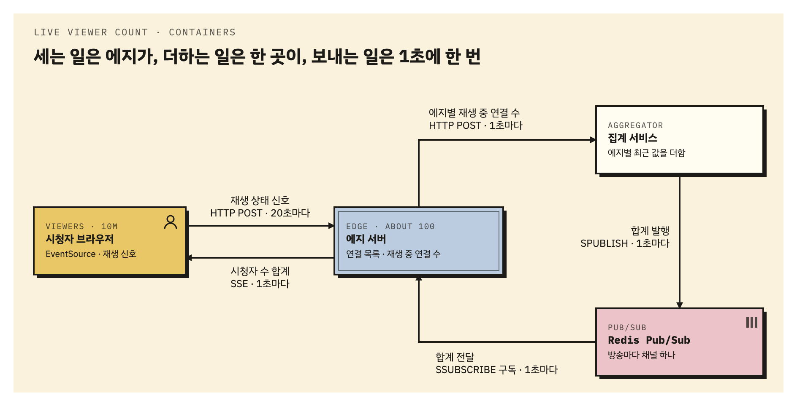
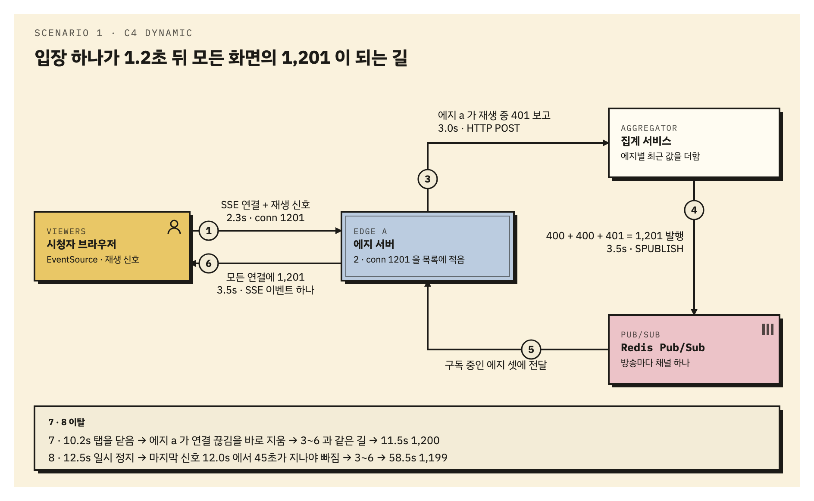
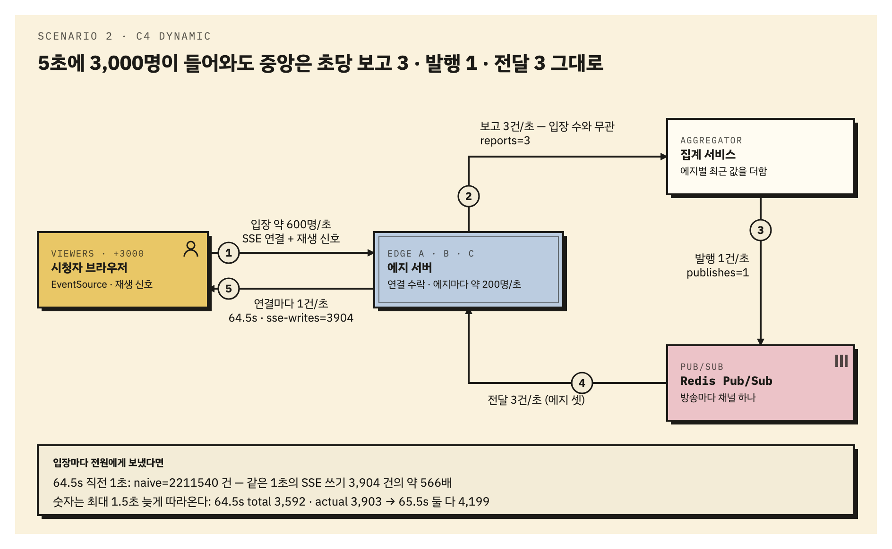
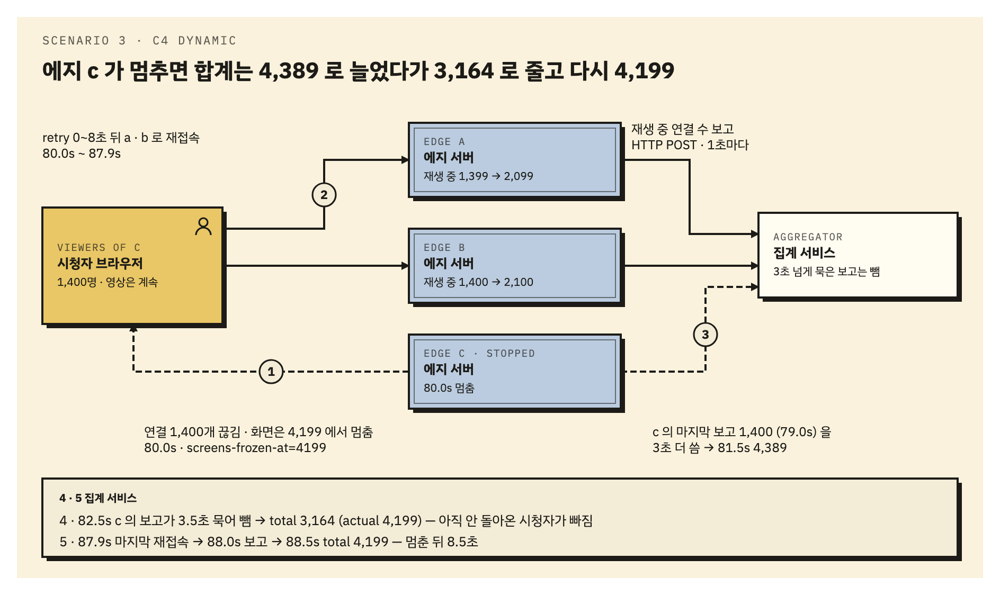

# 라이브 동시 시청자 수 — 연결을 가진 에지가 세고, 합계는 1초에 한 번 모두에게

## 문제와 요구사항

토요일 저녁 야구 결승전을 1,000만 명이 같은 방송으로 보고 있다고 해 봅시다. 화면 구석에는 지금 몇 명이 함께 보고 있는지가 떠 있고, 누가 들어오거나 나가면 그 숫자가 몇 초 안에 바뀌어야 해요. 가장 먼저 떠오르는 구조는 누가 들어올 때마다 한 명 늘었다는 소식을 보고 있는 모두에게 보내는 것입니다. 그러면 입장 한 번이 메시지 1,000만 건이 돼요. 정각에 사람이 몰리는 1초에는 수백억 건입니다.

이 글은 숫자를 세는 일을 시청자 연결을 이미 가진 에지 서버에 맡기고, 집계 서비스가 그 값을 1초에 한 번 더해 모든 화면에 보내는 구조를 따라갑니다. 끝까지 읽으면 요구 수치(지연 · 정확도 · 규모)를 넣어 이 구조와 다른 후보를 직접 비교하고, 어느 수치에서 다른 구조로 옮겨야 하는지 판단할 수 있게 됩니다.

```text
입장마다 전원에게                       1초에 한 번 합계 하나
  입장 1건 ──▶ 화면 1,000만 개            입장 n건 ──▶ 에지 서버가 셈 ──▶ 합계 1개 ──▶ 화면 1,000만 개
  입장 8,333건/초 ──▶ 8.3×10¹⁰ 건/초       입장 속도와 상관없이 1,000만 건/초
```

기능 요구는 셋입니다.

1. 시청자는 방송을 보는 동안 화면에서 지금 시청자 수를 봅니다.
2. 재생을 시작하면 그 시청자가 숫자에 들어가고, 재생을 멈추거나 나가면 빠집니다.
3. 시청자가 아무것도 누르지 않아도 숫자가 저절로 바뀝니다.

비기능 요구는 아래처럼 수치로 고정합니다. 근거 칸의 출처 수치는 리서치 노트에서 원문과 대조한 것이고, 링크는 참고 자료에 다시 모았습니다.

| 항목 | 수치 | 근거 |
| --- | --- | --- |
| 동시 시청자 수 | 방송 하나에 최대 1,000만 명 | 이 가이드의 가정 — 대형 스포츠 중계 규모. 공개 사례로 Hotstar 는 실시간 메시지 서비스를 최고 동시 연결 5,000만을 감당하도록 만들었다고 밝혔습니다(「50M peak concurrent connections」, [Hotstar PubSub 발표 소개](https://hasgeek.com/rootconf/2020-delhi/sub/pubsub-realtime-messaging-service-hotstar-LP7A7b7ZVu6ibfgYFAcvXZ)) |
| 입장 측정 지연 | 재생 시작 후 3초 안에 집계값에 들어감 | 이 가이드의 가정 — AWS IVS(Interactive Video Service)는 재생 시작 15초 안에 시청자 수에 나타난다고 정의합니다([Amazon IVS — Stream](https://docs.aws.amazon.com/ivs/latest/LowLatencyAPIReference/API_Stream.html)). 몇 초면 지연이 없다고 느끼는지 다룬 연구는 찾지 못해(확인 안 함) 체감과 부하의 균형으로 고른 값입니다 |
| 이탈 측정 지연 | 재생을 멈추거나 나간 뒤 1분 안에 집계값에서 빠짐 | AWS IVS 의 정의 「within 1 minute」를 그대로 씁니다(같은 문서) |
| 전달 지연 | 합계가 정해진 뒤 모든 화면까지 1초 안 | 이 가이드의 가정 — LinkedIn 은 상태 변화를 99번째 백분위(p99)에서 200ms 안에 전달했습니다([LinkedIn presence](https://www.linkedin.com/blog/engineering/product-design/now-you-see-me-now-you-dont-linkedins-real-time-presence-platf)) |
| 화면 갱신 빈도 | 화면 하나에 초당 1건 이하 | Facebook 의 Bladerunner 는 시청자 한 명에게 댓글을 초당 최대 1건만 보냈습니다([Bladerunner 논문](https://www.eecg.utoronto.ca/~stumm/Papers/Barber-sosp-21.pdf)) |
| 정확도 | 근사 허용 — 입장 · 이탈이 멎고 3초 뒤 실제 재생 중 시청자 수와 1% 안 | 이 가이드의 가정 — 이 글이 조사한 범위에서 정확한 시청자 수를 약속한 공개 사례는 없었습니다 |
| 장애 회복 | 에지 서버 한 대가 멈춘 뒤 30초 안에 정확도 범위로 돌아옴 | 이 가이드의 가정 — 이탈 측정 지연 1분의 절반으로 잡아, 장애로 틀린 숫자가 이탈 반영보다 오래 남지 않게 했습니다 |

일부러 다루지 않는 것도 적어 둡니다.

- 한 사람이 탭 둘을 열면 둘로 셉니다. 여러 탭 · 여러 기기를 한 명으로 묶는 공개 사례를 찾지 못했고, 묶어야 하는 경우는 전환점에서 다룹니다.
- 광고 정산에 쓰는 고유 시청자 수와 누적 조회수는 다루지 않습니다. 정확도 요구가 달라서 다른 경로가 맡습니다.
- 봇이나 조작된 시청자를 걸러 내는 일, 영상 자체를 보내는 CDN(Content Delivery Network)도 범위 밖입니다.

## 규모 추정

입력은 넷입니다. 동시 시청자는 요구 표의 1,000만 명이에요. 정각에 시청자가 분당 수십만 명씩 들어온다고 가정하고 그 값을 분당 50만 명으로 잡습니다(가정). 서버 한 대가 맡는 연결은 10만 개로 둡니다. 여기서 연결은 화면에 숫자를 보내려고 열어 두는 SSE(Server-Sent Events) 연결이에요. LinkedIn 이 한 대에서 연결 10만 개를 유지했다고 밝힌 값입니다(「100,000 connections on the same machine」, [LinkedIn 발표](https://www.infoq.com/presentations/linkedin-play-akka-distributed-systems)). 재생 상태 신호는 20초마다 보냅니다. 이 값은 이 가이드의 설정값이고, 고른 이유는 기술 상세 설명의 시청자 브라우저와 에지 서버 항목에 있어요.

```text
(계산)  V = 10⁷ 명(가정), 정각 입장 = 500,000 명/분(가정), 서버 한 대 = 10⁵ 연결(출처), 재생 상태 신호 = 20초마다(설정값)

[1] 입장마다 전원에게      0 + 1 + … + (V−1) = V(V−1)/2 ≈ (10⁷)² ÷ 2 = 5×10¹³ 건  (V 명이 다 들어오기까지)
[2] 그 구조의 정각 1초     500,000 ÷ 60 ≈ 8,333 명/초  →  8,333 × 10⁷ ≈ 8.3×10¹⁰ 건/초
[3] 1초에 합계 하나        10⁷ 화면 × 1 건/초 = 10⁷ 건/초  (입장 속도와 무관)
[4] 에지 서버 대수         10⁷ ÷ 10⁵ = 100 대  →  한 대가 1초에 쓰는 SSE 이벤트 10⁵ 건
[5] 재생 상태 신호         10⁷ ÷ 20 = 5×10⁵ 건/초 (전체)  ·  한 대에 10⁵ ÷ 20 = 5,000 건/초
[6] 중앙이 받는 것         100 대 × 1 건/초 = 100 건/초 보고  ·  발행 1 건/초  ·  전달 100 건/초
[7] 본문 바이트            "data: 10000000\n\n" = 16 바이트  →  한 대에 10⁵ × 16 = 1.6 MB/초
```

[4]의 셈은 같은 발표가 서버 대수를 추정한 방식과 같습니다. 그 발표는 행사 하나를 서버 180대로 받는다고 추정했고, 한 대 10만 연결 × 180대 = 1,800만 연결이에요. 다만 그 발표는 같은 행사의 동시 시청자를 「18 million viewers」와 「more than 80 million viewers concurrently」 두 값으로 적고 있어서, 이 글은 시청자 수 자체를 근거로 쓰지 않습니다. [7]은 이벤트 본문만 센 값이고 HTTP 헤더와 암호화 비용은 넣지 않았습니다.

이 계산에서 판단 셋이 나옵니다. 먼저 입장마다 전원에게 보내는 구조는 [2]와 [3]이 약 8,300배 차이라서 처음부터 후보에서 빠져요. 다음으로 [5]의 초당 50만 건을 저장소 한 곳에 쓰는 구조는 키를 나누지 않으면 받기 어렵죠. Redis 공식 벤치마크는 파이프라인 없는 단일 인스턴스 예시에서 SET 을 초당 180,180건 처리했고([Redis benchmark](https://redis.io/docs/latest/operate/oss_and_stack/management/optimization/benchmarks/)), 50만은 그 약 2.8배입니다. 벤치마크는 그 문서의 기계와 조건에서 잰 값이라 한도로 쓰지 않지만, 시청자마다 중앙에 쓰는 구조가 키 나누기를 끌고 온다는 신호로는 충분해요. 마지막으로 [6]이 남는 길을 보여 줍니다. **연결을 이미 가진 에지 서버가 세면 중앙이 받는 양이 시청자 수가 아니라 에지 대수에 비례합니다.**

## 시스템 개념도



데이터가 이동하는 길은 하나의 고리입니다. 시청자 브라우저가 에지 서버에 연결을 열고 재생 상태 신호를 보내면, 에지 서버는 재생 중인 연결 수를 1초마다 집계 서비스에 보고합니다. 집계 서비스는 에지별 최근 값을 더해 Redis Pub/Sub 채널에 발행하고, 구독 중인 에지 서버들이 그 합계를 자기 연결 전부에 SSE 로 보내 화면의 숫자가 바뀝니다.

## 시나리오로 따라가기

### 시나리오 1 — 시청자 한 명이 들어와 1,201 이 모든 화면에 뜨고, 나가면 다시 1,200 이 되기까지

방송을 1,200명이 보고 있습니다. 에지 서버는 a · b · c 세 대이고 400명씩 붙어 있어요. 2.3초에 새 시청자 하나(연결 번호 1201)가 재생을 누르고, 10.2초에 그 탭을 닫습니다. 12.5초에는 다른 시청자(연결 번호 751)가 탭은 둔 채 일시 정지를 누릅니다. 나와야 하는 것은 1,201 이 3초 안에 모든 화면에 뜨고, 두 이탈이 각각 1분 안에 숫자에서 빠지는 것입니다.



1. 시청자 브라우저가 에지 a 에 SSE(Server-Sent Events, 서버가 브라우저로 한 방향 이벤트를 계속 보내는 HTTP 연결) 연결을 열고, 곧바로 재생 상태 신호를 한 번 보냅니다. SSE 는 서버에서 브라우저 쪽으로만 흐름이 있어서 브라우저가 지금 보고 있다고 알리려면 신호가 따로 필요해요. 첫 신호를 20초 주기까지 기다리지 않는 이유는 그러면 입장이 최대 20초 늦게 세어져 입장 측정 지연 3초를 지키지 못하기 때문입니다.
2. 에지 a 가 연결 번호 1201 과 마지막 신호 시각 2.3초를 자기 연결 목록에 적습니다. 이 일을 에지가 맡는 이유는 연결을 이미 가진 곳이라서 시청자마다 중앙에 쓰는 일이 생기지 않기 때문이에요(규모 추정 [5]). 아직 아무도 더하지 않았으니 2.5초의 합계는 1,200 그대로입니다.
3. 3.0초에 에지 a 가 재생 중인 연결 수 401 을 집계 서비스(에지 보고를 받아 방송별 합계를 내는 작은 서비스)에 보냅니다. 늘어난 1명이 아니라 지금 개수를 보내는 이유는 보고 하나를 잃어도 다음 보고가 덮어써 맞춰지기 때문이에요. 증감을 보내면 잃은 +1 은 다시 돌아오지 않습니다.
4. 3.5초에 집계 서비스가 에지별 최근 보고 셋을 더해 400 + 400 + 401 = 1,201 을 Redis Pub/Sub(채널에 보낸 메시지를 그 순간 구독 중인 연결에 전해 주는 Redis 기능) 채널에 발행합니다. 모든 화면에 같은 값 하나라서 한 곳에서 한 번만 더하면 됩니다. 발행을 보고 시각에서 0.5초 늦춘 것은 같은 초의 보고가 모일 틈을 주려는 것이에요.
5. Redis Pub/Sub 이 그 메시지를 구독 중인 에지 셋에 전달합니다. 집계 서비스가 에지 목록을 몰라도 되는 이유가 이 단계예요. 에지가 늘거나 줄어도 구독만 하면 받습니다.
6. 에지 셋이 각자 자기 연결 전부에 1,201 을 SSE 이벤트 하나로 씁니다. 새로 들어온 시청자 화면도 같은 이벤트로 1,201 이 됩니다. 중앙이 보내는 것은 에지 수만큼이고, 연결 수만큼 쓰는 일은 에지들이 나눠 맡아요(규모 추정 [4]).
7. 10.2초에 탭을 닫으면 에지 a 가 연결이 끊긴 것을 바로 알고 목록에서 지웁니다. 그 뒤는 3~6단계와 같은 길이라 11.5초에 1,200 이 됩니다. 연결 끊김은 에지가 직접 보므로 만료 시간을 기다릴 필요가 없어요.
8. 12.5초의 일시 정지는 연결을 그대로 두므로 에지가 알 길이 없습니다. 브라우저는 재생 중에만 20초마다 신호를 보내기 때문에 신호가 멈추고, 마지막 신호(12.0초)에서 만료 시간 45초가 지나야 재생 중 개수에서 빠져요. 그래서 58.5초에야 1,199 가 됩니다.

```text
시각    사건                         집계값(total)   실제 재생 중(actual)
 2.3s   conn 1201 재생 시작             1,200            1,201
 3.5s   3~6단계 끝                      1,201            1,201      ← 1.2초 뒤
10.2s   conn 1201 탭 닫음               1,201            1,200
11.5s   3~6단계 끝                      1,200            1,200      ← 1.3초 뒤
12.5s   conn 751 일시 정지 (신호 12.0s)  1,200            1,199
58.5s   만료 45초 + 3~6단계              1,199            1,199      ← 46.0초 뒤
```

잠깐, 확인 하나만 해 볼까요? conn 751 이 12.5초가 아니라 31.9초에 일시 정지했다면 숫자는 언제 빠질까요?

마지막 신호가 여전히 12.0초라서 똑같이 58.5초에 빠집니다. 다음 신호가 32.0초였으니 그 직전에 멈춘 것이죠. 멈춘 시점에서 재면 26.6초 뒤라서, 일시 정지가 반영되는 시간은 마지막 신호와 얼마나 떨어져 멈췄는지에 따라 달라집니다. 가장 늦은 경우는 신호 직후에 멈출 때이고 45초 + 보고 1초 + 발행 0.5초 = 46.5초입니다(계산).

```text
conn 751   신호 12.0s ──────── (32.0s 신호는 안 보냄)
멈춤             12.5s  또는  31.9s        ← 어느 쪽이든 마지막 신호는 12.0s
만료                                  57.0s = 12.0 + 45
에지 a 보고      57.0s 까지는 셈 (45.0초 ≤ 45초) · 58.0s 부터 빠짐 → 58.5s 발행
```

이 시나리오가 보여 준 것은 입장과 이탈이 같은 길(3~6단계)을 지나되 이탈을 아는 방법이 둘이라는 점입니다. 탭을 닫는 이탈은 에지가 연결로 바로 알아서 1.3초 만에 반영되고, 재생만 멈춘 이탈은 신호가 끊긴 것으로만 알 수 있어 만료 시간이 반영 시간을 정합니다. 입장 1.2초와 이탈 1.3초 · 46.0초가 각각 입장 · 이탈 측정 지연 요구 행으로 갑니다.

### 시나리오 2 — 5초 동안 3,000명이 몰려도 중앙의 메시지는 초당 일곱 건 그대로

시나리오 1 이 끝난 방송(1,199명)에 정각인 60초부터 65초까지 3,000명이 들어옵니다. 초당 약 600명이고, 규모 추정의 분당 50만 명을 이 실행 규모(에지 3대)로 줄인 상황이에요. 나와야 하는 것은 입장이 몰리는 동안에도 집계 서비스와 Redis Pub/Sub 이 받는 양이 그대로이고, 화면마다 초당 1건씩만 받는 것입니다.



1. 새 연결을 앞단의 부하 분산(연결을 서버들에 차례로 나눠 주는 장치)이 에지 a · b · c 에 차례로 나눠 줍니다. 1초에 600건이면 에지마다 약 200건이에요. 연결을 받는 일은 연결 수에 비례하는 일이라 에지 대수를 늘려서 받는 자리이기 때문입니다.
2. 에지 셋은 여전히 1초에 한 번씩만 보고합니다(`reports=3`). 보고가 증감이 아니라 지금 개수라서, 1초 동안 들어온 200명이 보고 한 건으로 접히기 때문이에요.
3. 집계 서비스의 발행도 1초에 한 건입니다(`publishes=1`). 발행 시각이 입장 사건이 아니라 시계에 묶여 있어서 입장 수가 발행 수를 바꾸지 못합니다.
4. Redis Pub/Sub 의 전달은 구독한 에지 수인 초당 3건입니다. 2~4단계를 합친 중앙의 메시지는 보고 3 + 발행 1 + 전달 3 = 초당 7건이고(계산), 입장 속도와 상관이 없어요.
5. 에지는 그 순간 연결 수만큼 SSE 이벤트를 씁니다. 64.5초 직전 1초에는 3,904건이고, 연결 하나에 한 건씩이라 화면 갱신 빈도 요구를 그대로 지킵니다. 이 수가 actual 3,903 보다 하나 많은 것은 시나리오 1 에서 일시 정지한 conn 751 의 연결이 여전히 열려 있어서예요.
6. 같은 1초 동안 입장마다 전원에게 보냈다면 메시지는 2,211,540건이었습니다(`naive`). 실제 SSE 쓰기 3,904건의 약 566배이고, 입장 600건 남짓이 그 순간 연결 수천 개에 곱해진 결과예요. 대신 이 구조는 숫자가 최대 1.5초 늦게 따라옵니다. 64.5초의 total 3,592 는 actual 3,903 보다 311 적고, 입장이 멎은 65.5초에 둘 다 4,199 가 됩니다.

```text
시각    입장   total   actual   보고   발행   SSE 쓰기   입장마다 전원에게(naive)
60.5s   307    1,199   1,506      3      1      1,507        415,371
61.5s   559    1,801   2,065      3      1      2,066        998,374
62.5s   621    2,357   2,686      3      1      2,687      1,475,496
63.5s   602    2,996   3,288      3      1      3,289      1,798,475
64.5s   615    3,592   3,903      3      1      3,904      2,211,540
65.5s   296    4,199   4,199      3      1      4,200      1,199,244
```

이 시나리오가 보여 준 것은 부하가 어디에 쌓이는가입니다. 입장 속도는 에지가 받는 연결 수에만 쌓이고, 중앙의 보고 · 발행 · 전달은 표의 두 열처럼 바뀌지 않아요. 치른 값은 지연입니다. 입장이 몰리는 동안 화면의 숫자는 실제보다 최대 1.5초 늦은 값이고, 이 차이는 입장이 멎은 뒤 첫 발행(65.5초)에서 사라져 정확도 요구 행의 조건(멎고 3초 뒤 1%)을 만족합니다.

### 시나리오 3 — 에지 서버 c 가 멈추면 합계가 4,389 로 늘었다가 3,164 로 줄고, 8.5초 뒤 4,199 로 돌아오기까지

4,199명이 보고 있습니다. 80.0초에 에지 c 의 프로세스가 멈추고, c 에 붙어 있던 연결 1,400개가 한꺼번에 끊겨요. 영상은 CDN 에서 오니 그 시청자들은 계속 보고 있습니다. 실제 재생 중 시청자 수는 그대로예요. 나와야 하는 것은 숫자가 30초 안에 4,199 로 돌아오는 것이고, 그사이 어떤 틀린 값이 화면에 뜨는지도 보려고 합니다.



1. 에지 c 가 멈추면 그 연결 1,400개가 끊기고, 그 시청자들의 화면은 마지막으로 받은 4,199 에서 멈춥니다(`screens-frozen-at=4199`). 영상과 숫자가 다른 경로로 오기 때문에 숫자만 멈추고 영상은 계속 나와요.
2. 브라우저마다 EventSource(브라우저에 들어 있는 SSE 클라이언트)가 끊김을 알고, 에지가 연결을 열 때 정해 준 retry 값(SSE 의 재연결 대기 시간 필드)만큼 기다렸다가 다시 연결합니다. 부하 분산이 살아 있는 a · b 로 보내 80.0초부터 87.9초 사이에 1,400개가 다 돌아와요. 대기 시간을 연결마다 0~8초 사이에서 무작위로 주는 이유는, 모두 같은 값이면 1,400개가 같은 순간에 몰리기 때문입니다. 지수 백오프(실패할 때마다 대기 시간을 몇 배씩 늘려 가는 방식)만으로는 호출이 뭉쳐 남아서 무작위 지터를 더한다는 것이 AWS 의 분석이에요([Exponential Backoff And Jitter](https://aws.amazon.com/blogs/architecture/exponential-backoff-and-jitter/)).
3. 81.5초에 집계 서비스는 c 의 마지막 보고(79.0초의 1,400)를 아직 씁니다. 보고가 3초 넘게 끊겨야 그 에지를 빼는 규칙이라서요. 그사이 먼저 돌아온 시청자들이 a · b 의 보고에 들어가 합계가 4,389 가 됩니다. 실제보다 190 많은데, 같은 사람이 c 의 묵은 값과 a · b 의 새 값에 두 번 세어진 것입니다. 틀린 값이 화면에 뜨는 길이 바로 이 단계예요.
4. 82.5초에는 c 의 보고가 3.5초 묵어 합계에서 뺍니다. 이번에는 아직 돌아오지 않은 시청자가 어디에도 세어지지 않아 3,164 로, 실제보다 1,035 적어요. 3초를 기다리는 이유는 정상인 에지의 보고가 한 번 늦었을 때 그 에지의 시청자가 통째로 빠지지 않게 하려는 것입니다.
5. 마지막 재접속이 87.9초이고, 88.0초의 보고를 더한 88.5초에 합계가 4,199 로 돌아옵니다. 멈춘 시점에서 8.5초예요.

```text
시각    total   actual   a       b       c        화면에 뜬 값이 틀린 이유
80.0s   (c 멈춤 · 연결 1,400 끊김 · c 의 화면은 4,199 에서 멈춤)
81.5s   4,389   4,199    1,494   1,495   1,400    c 의 묵은 값 + 돌아온 시청자 → 두 번 셈
82.5s   3,164   4,199    1,581   1,583   -        c 를 뺌 → 안 돌아온 시청자가 빠짐
85.5s   3,697   4,199    1,848   1,849   -
88.5s   4,199   4,199    2,099   2,100   -        재접속 끝 (마지막 87.9s)
```

이 시나리오가 보여 준 것은 에지 하나가 멈췄을 때 틀린 값이 두 방향으로 남는다는 점입니다. 묵은 보고를 쓰는 동안은 두 번 세어 많아요. 그 보고를 뺀 뒤에는 재접속이 끝날 때까지 모자랍니다. 회복 시간은 retry 상한(8초)과 묵은 보고 기준(3초) 가운데 큰 쪽이 정하고, 이 실행에서는 8.5초로 장애 회복 요구 행(30초)을 만족했어요. 실제 규모에서는 에지 100대 가운데 한 대라서 빠지는 몫이 1,000만 ÷ 100 = 10만 명, 약 1% 입니다(계산).

## 기술 상세 설명

### 구성 요소 — 시청자 브라우저

방송 페이지를 연 브라우저와 그 안에서 실행되는 스크립트입니다. 이 시스템에서 브라우저가 쓰는 부품은 둘이에요. 서버가 보내는 이벤트를 받는 EventSource 와, 재생 중일 때만 보내는 재생 상태 신호(HTTP POST 요청)입니다.

맡는 일은 시나리오 1 의 1단계에서 연결을 열고 첫 신호를 보내는 것, 재생 중에 20초마다 신호를 보내는 것, 6단계에서 받은 합계를 화면에 그리는 것이에요. 시나리오 3 의 2단계에서는 끊긴 연결을 retry 만큼 기다렸다가 다시 엽니다. 재생 신호는 그 연결을 가진 에지로 가야 셀 수 있으므로, 에지가 연결을 열 때 첫 이벤트로 자기 주소와 연결 번호를 알려 주고 브라우저가 그 주소로 신호를 보냅니다(이 가이드의 설계).

```javascript no-compile
const source = new EventSource("/streams/42/viewers");
let edge, conn, timer;
source.addEventListener("hello", (e) => { [edge, conn] = e.data.split(" "); });
source.onmessage = (e) => { viewerBadge.textContent = e.data; };
const signal = () => fetch(`https://${edge}/playing/${conn}`, { method: "POST" });
video.addEventListener("playing", () => { signal(); timer = setInterval(signal, 20_000); });
video.addEventListener("pause", () => clearInterval(timer));
```

받는 쪽 기술로 SSE 를 고른 이유는 숫자가 한 방향으로만 오기 때문입니다. WebSocket 은 양방향이고 연결 확인용 Ping · Pong 프레임까지 갖췄지만([RFC 6455](https://www.rfc-editor.org/rfc/rfc6455#section-5.5.2)), 시청자 수만 받는 화면에는 거꾸로 가는 길이 필요 없어요. 롱 폴링(요청을 열어 두었다가 값이 생기면 답하고 다시 요청하는 방식)은 메시지마다 요청을 새로 보내 HTTP 헤더 전체가 다시 붙습니다([RFC 6202](https://www.rfc-editor.org/rfc/rfc6202)). 1초마다 몇 바이트짜리 숫자를 받는 일에는 헤더가 본문보다 커져요. SSE 는 끊기면 브라우저가 알아서 다시 연결하고 대기 시간을 서버가 `retry` 필드로 정할 수 있어서([MDN — Using server-sent events](https://developer.mozilla.org/en-US/docs/Web/API/Server-sent_events/Using_server-sent_events)), 시나리오 3 의 2단계를 브라우저 코드 없이 얻습니다. LinkedIn 은 SSE 를 고른 이유로 WebSocket 이 일부 방화벽에서 막힌다는 점을 들었습니다([LinkedIn 발표](https://www.infoq.com/presentations/linkedin-play-akka-distributed-systems)).

| 설정값 · 한계 | 값 | 이유 · 보장하지 않는 것 |
| --- | --- | --- |
| 재생 신호 주기 | 20초 (설정값) | 만료 45초 안에 신호가 두 번 오게 해서 한 번 늦어도 빠지지 않게 함 |
| 브라우저당 연결 수 | HTTP/2 가 아니면 같은 도메인에 6개까지 | MDN 이 적은 브라우저 제한이라 탭을 여럿 열면 막힘. HTTP/2 는 서버와 정한 동시 스트림 수(기본 100)까지 늘어남 |
| 숨긴 탭의 타이머 | 초당 1회, 5분 넘게 숨기면 조건에 따라 분당 1회 | Chrome 88 부터의 동작([Chrome 블로그](https://developer.chrome.com/blog/timer-throttling-in-chrome-88)). 분당 1회가 되면 신호 간격 60초가 만료 45초보다 길어 숫자에서 빠졌다 들어오기를 되풀이함. 이 가이드는 그런 탭을 보지 않는 시청자로 셈(판단) |
| 여러 탭 | 탭마다 따로 셈 | 다루지 않는 것에 적은 대로 중복을 묶지 않음 |

### 구성 요소 — 에지 서버

시청자 가까이 놓여 연결을 오래 열어 두는 일을 맡는 서버 무리입니다. 예를 들어 LinkedIn 은 서버 한 대가 동시 연결 10만 개를 유지했고, 같은 회사의 메시징 글은 한 대에 수십만 개의 지속 연결(「hundreds of thousands of concurrent persistent connections」)을 SSE 로 다뤘다고 적어요([LinkedIn 메시징](https://www.linkedin.com/blog/engineering/archive/instant-messaging-at-linkedin-scaling-to-hundreds-of-thousands-)).

맡는 일은 다섯입니다. 연결을 열 때 연결 번호와 retry 값을 첫 이벤트로 보내고(시나리오 3 의 2단계), 재생 신호가 오면 그 연결의 마지막 신호 시각을 고칩니다(시나리오 1 의 2단계). 1초마다 마지막 신호가 45초 안인 연결을 세어 집계 서비스에 보내고(3단계), 구독으로 받은 합계를 자기 연결 전부에 씁니다(6단계). 연결이 끊기면 목록에서 바로 지워요(7단계).

```http no-compile
HTTP/1.1 200 OK
Content-Type: text/event-stream
Cache-Control: no-cache

retry: 5321
event: hello
data: edge-a.example.com 1201

data: 1201

data: 1201
```

세는 자리를 에지로 고른 이유는 규모 추정 [5]입니다. 시청자마다 중앙 저장소에 신호를 쓰면 초당 50만 건이 한 곳에 몰리지만, 에지가 세면 한 대가 받는 신호는 초당 5,000건이고 중앙에는 대당 1초에 한 건만 갑니다. 연결 끊김을 바로 아는 것도 연결을 가진 쪽만 할 수 있는 일이에요. 중앙 저장소 방식은 탭을 닫은 시청자도 만료 시간이 지나야 빠집니다. 이 계층 모양이 이 글만의 것은 아니어서, LinkedIn 은 프런트엔드 서버가 연결을 맡고 디스패처가 그 프런트엔드들에만 보내는 구조를 썼어요([LinkedIn 발표](https://www.infoq.com/presentations/linkedin-play-akka-distributed-systems)).

만료 시간은 45초로 잡았습니다. 신호 주기 20초의 두 배에 여유 5초를 더한 값이에요. LinkedIn 의 presence 는 d초마다 하트비트를 받고 항목을 d+ε초 뒤 만료되게 쓰는 방식이었는데([LinkedIn presence](https://www.linkedin.com/blog/engineering/product-design/now-you-see-me-now-you-dont-linkedins-real-time-presence-platf)), 같은 생각에 이탈 측정 지연 1분을 맞춘 값입니다. 다른 제품의 기본값과 비교하면 이유가 분명해져요.

```text
신호 주기 · 만료              일시 정지가 숫자에서 빠지기까지(가장 늦은 경우)        1분 요구
LinkedIn 팟캐스트 예시          30초 신호 · 1분 넘게 끊기면 오프라인 → 1분 넘음         넘음
PubNub presenceTimeout 기본    300초                                              넘음
이 가이드                      20초 · 45초 → 45 + 1 + 0.5 = 46.5초 (계산)             안
```

LinkedIn 팟캐스트의 값은 30초 하트비트를 예로 들고 1분 넘게 끊기면 오프라인으로 본다는 설명이고([InfoQ 팟캐스트](https://www.infoq.com/podcasts/linkedin-realtime-messaging-architecture)), PubNub 의 기본값은 공식 문서의 「300 seconds」입니다([PubNub — Presence events](https://www.pubnub.com/docs/general/presence/presence-events)).

연결을 에지들에 나누는 일은 에지 앞에 둔 부하 분산(연결을 서버들에 차례로 나눠 주는 장치)이 맡습니다. 배포 세부라 개념도에 상자로 그리지 않았지만, 시나리오 2 의 1단계와 시나리오 3 의 2단계에서 일해요. 새 연결과 재접속을 살아 있는 에지에 차례로 나누고, 주기적인 상태 검사(살아 있는지 묻는 짧은 요청)에 답하지 않는 에지는 나눠 줄 대상에서 뺍니다(이 가이드의 설계). 한계는 상태 검사가 멈춘 에지를 알아채기 전까지의 틈입니다. 그사이 들어온 새 연결과 재접속 일부는 멈춘 에지로 가서 실패해요. 이 글의 실행은 부하 분산이 멈춤을 바로 안다고 두어서 그 틈을 재현하지 않습니다.

```text
부하 분산이 나눠 주는 곳         에지 a     에지 b     에지 c
평소 (차례로)                    1, 4       2, 5       3, 6
c 가 멈춘 뒤 · 상태 검사 전       7          8          9 → 실패
상태 검사가 c 를 뺀 뒤            10, 12     11, 13     (대상 아님)
```

에지가 보장하지 않는 것도 있습니다. 연결만 셀 뿐 같은 사람의 탭 둘을 묶지 못하고, 에지가 멈추면 그 에지의 마지막 보고가 묵은 보고 기준(3초) 동안 합계에 남아요(시나리오 3 의 3단계). 연결 유지는 따로 신경 쓰지 않아도 됩니다. AWS ALB(Application Load Balancer)는 데이터가 오가지 않는 연결을 기본 60초에 끊지만([AWS ALB 연결 유휴 타임아웃](https://docs.aws.amazon.com/elasticloadbalancing/latest/application/edit-load-balancer-attributes.html)), 이 구조는 1초마다 합계를 쓰므로 연결이 그만큼 비어 있을 일이 없어요.

### 구성 요소 — 집계 서비스

에지 보고를 받아 방송마다 합계를 내는 작은 서비스입니다. 가진 상태는 표 하나예요. 에지마다 최근 보고값과 그 보고를 받은 시각을 적어 둡니다.

```text
에지   최근 보고값   받은 시각   81.5s 에 더하는가        82.5s 에 더하는가
a      1,494        81.0s       예                       예 (82.0s 의 1,581)
b      1,495        81.0s       예                       예 (82.0s 의 1,583)
c      1,400        79.0s       예 (2.5초 묵음 ≤ 3초)     아니오 (3.5초 묵음 > 3초)
```

맡는 일은 시나리오 1 의 3 · 4단계에서 보고를 받아 1초마다 더해 발행하는 것, 시나리오 3 의 3 · 4단계에서 3초 넘게 묵은 보고를 빼는 것입니다.

```http no-compile
POST /streams/42/edge-report HTTP/1.1
Content-Type: application/json

{"edge": "a", "playing": 401}
```

이 자리에 올 수 있는 다른 기술은 이벤트 스트림과 윈도 집계입니다. 입장 · 이탈 사건을 Kafka 같은 로그에 쌓고 스트림 처리기가 시간 구간(윈도)마다 고유 수를 세는 방식이에요. 토스증권은 사내 실시간 동시 접속자 대시보드를 ksqlDB 의 30초 텀블링 윈도(겹치지 않게 자른 고정 구간)와 `COUNT_DISTINCT` 로 만들었습니다([토스 — ksqlDB](https://toss.tech/article/ksqldb-realtime-data)). 같은 구간 길이를 이 문제에 쓰면 숫자가 최대 30초 늦어 입장 측정 지연 3초를 지키지 못합니다. 이 문제에 필요한 것은 에지별 최근 값 몇백 개를 더하는 일뿐이라 상태 표 하나로 충분해요.

설정값은 발행 주기 1초와 묵은 보고 기준 3초입니다. 1초는 화면 갱신 빈도 요구의 상한이고, 3초는 보고 세 번이 연달아 빠져야 그 에지를 버린다는 뜻이에요. 이 기준을 1초로 줄이면 정상 에지의 보고가 한 번만 빠져도 그 에지 몫이 합계에서 잠깐 빠집니다. 에지 a 의 30.0초 보고 하나를 빼고 실행하면 `t=30.5s total=800` 이 찍히고 31.5초에 1,200 으로 돌아와요. 10초로 늘리면 시나리오 3 의 두 번 세기가 81.5초부터 88.5초 발행까지 이어져 합계가 5,599 까지 커져요. c 를 빼는 89.5초에야 4,199 로 돌아옵니다(1초는 기준값을 바꾸고 a 의 30.0초 보고 하나를 빼서, 10초는 기준값만 바꿔 직접 실행해 확인). 이 서비스가 보장하지 않는 것은 자기 자신이 멈췄을 때의 숫자예요. 멈추면 모든 화면이 마지막 합계에서 멈추므로, 대기 서버를 하나 두고 발행은 한 대만 하게 하는 편을 권합니다(판단). 보고가 지금 개수라서, 새로 발행을 맡은 서버는 보고 1초분만 받으면 맞는 합계를 냅니다.

### 구성 요소 — Redis Pub/Sub

Redis 의 발행 · 구독 기능입니다. 채널에 보낸 메시지를 그 순간 구독 중인 연결 전부에 전하고, 메시지를 보관하지 않아요. 이 시스템에서는 방송마다 채널 하나(`viewers:{42}`)를 두고 에지 서버가 모두 구독합니다.

```redis no-compile
SSUBSCRIBE viewers:{42}
SPUBLISH viewers:{42} 1201
```

맡는 일은 시나리오 1 의 4 · 5단계에서 집계 서비스의 발행 한 건을 에지 서버 전부(실제 규모로는 100대)에 전하는 것입니다. 이 일을 집계 서비스가 에지에 직접 HTTP 로 보내면 집계 서비스가 지금 살아 있는 에지 목록을 알아야 해요. LinkedIn 의 디스패처가 구독자를 가진 프런트엔드를 공유 저장소에서 찾아 그 노드에만 보낸 것이 그 방식입니다. Pub/Sub 을 두면 에지가 늘고 줄어도 구독만 하면 되고, 시나리오 3 에서 멈춘 c 에 보낼지 따질 필요도 없어요. 메시지를 보관하고 at-least-once 전달까지 지원하는 Redis Streams 는 이 자리에 과합니다([Redis — Pub/Sub](https://redis.io/docs/latest/develop/pubsub/)). 시청자 수는 가장 최근 값만 뜻이 있어서, 지난 값을 다시 받아도 쓸 데가 없기 때문이에요. 같은 생각을 한 프로세스 안의 객체 사이에서 푼 것이 [Observer 패턴](../../design-pattern-guide/observer/observer-guide_v1.1.0.md)이고, 그 가이드는 GoF(Gang of Four, 『Design Patterns』를 쓴 저자 넷)가 Publish-Subscribe 를 Observer 의 다른 이름으로 적었다는 점과 브로커를 두는 방식을 판정 대상 밖에 둔 이유를 함께 설명합니다.

설정과 한계는 공식 문서가 직접 적습니다([Redis — Pub/Sub](https://redis.io/docs/latest/develop/pubsub/)). Redis Pub/Sub 의 전달은 많아야 한 번(at-most-once)이고, 구독자가 오류나 연결 끊김으로 받지 못한 메시지는 영영 사라져요. 시청자 수에서는 이 한계가 1초짜리입니다. 한 에지가 발행 하나를 놓치면 그 에지의 화면은 이전 값을 1초 더 보여 주고, 다음 발행이 그 자리를 채웁니다(판단). 클러스터에서는 일반 Pub/Sub 메시지가 모든 노드로 퍼지지만, Redis 7.0 부터 있는 샤드 Pub/Sub(`SPUBLISH` · `SSUBSCRIBE`)은 채널이 속한 샤드 안으로만 전해집니다. 방송 수가 늘수록 클러스터 안의 전달량이 방송이 있는 샤드에만 생기도록 샤드 Pub/Sub 을 골랐어요.

## 대안 비교

### 후보 구조 비교

후보는 여섯입니다. 입장마다 전원에게 보내는 구조(N), 시청자마다 중앙의 Redis 정렬 집합(멤버마다 점수를 매겨 두고 점수 범위로 멤버를 지울 수 있는 자료형, [Redis — ZREMRANGEBYSCORE](https://redis.io/docs/latest/commands/zremrangebyscore/))에 신호를 쓰는 구조(A), 에지가 연결만 세는 구조(B), 이 가이드의 구조(B+A), 구간별 HyperLogLog(C), 이벤트 스트림 윈도 집계(D)예요. 기준은 이 문제에 걸리는 다섯 가지로 맞췄습니다. 1,000만 명일 때 중앙의 부하, 숫자에 반영되기까지의 지연, 정확도, 그리고 얻는 것과 포기하는 것입니다.

| 후보 | 중앙 부하(1,000만 명) | 반영 지연 | 정확도 | 얻는 것 | 포기하는 것 |
| --- | --- | --- | --- | --- | --- |
| N. 입장 · 이탈마다 전원에게 | 정각에 8.3×10¹⁰ 건/초 (규모 추정 [2]) | 사건 즉시 | 사건마다 정확 | 구조가 가장 단순함 | 메시지가 시청자 수의 제곱으로 늚 — 처음부터 제외 |
| A. 신호 → 중앙 Redis 정렬 집합 → 주기 SSE | 신호 쓰기 5×10⁵ 건/초 (규모 추정 [5]) | 입장 약 1초 · 탭을 닫아도 만료까지 | 사용자 번호를 멤버로 쓰면 탭 중복이 묶임 | 부품이 적고 설명이 쉬움 | 키 하나에 쓰기가 몰려 나눠야 함 · 닫기를 바로 모름 |
| B. 에지가 연결 수만 셈 → 중앙 합산 | 보고 100 건/초 (규모 추정 [6]) | 입장 · 닫기 1.5초 안 | 연결만 열고 안 보는 시청자까지 셈 | 신호 트래픽이 없음 · 끊김을 바로 앎 | 일시 정지 · 숨긴 탭을 가리지 못함 |
| B+A. 이 가이드 | 보고 100 건/초 + 에지 안 신호 대당 5,000 건/초 | 입장 · 닫기 1.5초 안 · 일시 정지 46.5초 안 | 일시 정지 뒤 45초까지 셈 · 탭 중복 | 중앙 부하가 에지 대수 비례 · 재생 기준으로 셈 | 에지 장애 때 잠깐 두 번 세거나 모자람 (시나리오 3) |
| C. 시간 구간별 HyperLogLog | `PFADD` 5×10⁵ 건/초 (A 와 같은 양) | 이탈이 구간 길이만큼 늦음 | 표준 오차 0.81% | 키 하나 12KB 이하 · 사용자 번호로 탭 중복이 묶임 | 오차를 받아들임 · 중앙 쓰기는 A 와 같음 |
| D. 사건 → 로그 → 윈도 집계 | 사건 수만큼 (신호를 사건으로 보내면 5×10⁵ 건/초) | 윈도 길이 (토스증권 예는 30초) | 윈도 안의 고유 수 | 분석 · 정산 지표와 파이프라인을 함께 씀 | 반영이 윈도만큼 늦음 · 운영할 부품이 늘어남 |

C 의 0.81% 와 12KB 는 Redis 공식 문서의 HyperLogLog 설명에서 온 값입니다(「standard error rate of 0.81%」 · 「up to 12 KB of memory」, [Redis — HyperLogLog](https://redis.io/docs/latest/develop/data-types/probabilistic/hyperloglogs/)). HyperLogLog 는 원소를 저장하지 않고 고유 수를 근사하는 자료구조라 같은 사용자 번호가 여러 번 들어와도 한 번으로 세어요.

여기서 헷갈리기 쉬운 포인트는 A 와 B+A 의 차이입니다. 둘 다 재생 신호와 만료 시간으로 보고 있는지를 판정하니 같은 구조로 보이기 쉬워요. 다른 점은 판정을 어디서 하느냐 하나인데, 그 차이가 수치로는 크게 벌어집니다. A 에서는 신호 하나가 중앙 쓰기 하나라서 1,000만 명이면 초당 50만 건이 한 곳으로 갑니다. B+A 에서는 같은 신호가 에지 100대에 5,000건씩 나뉘어 메모리 안에서 끝나요. 중앙에는 에지가 센 결과만 초당 100건 갑니다. 50만 ÷ 100 = 5,000배 차이입니다(계산). 닫기 반영도 다릅니다. A 는 연결을 모르니 탭을 닫아도 마지막 신호에서 만료 시간이 지나야 빠지고, B+A 는 시나리오 1 의 7단계처럼 1.3초 만에 빠져요. 거꾸로 A 가 앞서는 점도 있습니다. 정렬 집합의 멤버를 사용자 번호로 두면 탭 둘이 한 명으로 묶이는데, B+A 의 에지는 연결 단위로 세어서 그렇게 하지 못해요.

```text
                  A (중앙에서 판정)                         B+A (에지에서 판정)
신호 하나          → 중앙 쓰기 1건                           → 에지 메모리 1건
1,000만 명         → 중앙 5×10⁵ 건/초                         → 중앙 100 건/초 (에지 100대 × 1)
탭 닫기            → 마지막 신호 + 만료 시간 뒤 빠짐            → 연결 끊김으로 1.3초 뒤 빠짐
탭 둘              → 사용자 번호면 1명                         → 연결 2개
```

### 결정

```text
맥락: 동시 시청자 1,000만 명(요구 표 1행)에서 입장 3초 · 이탈 1분 안 반영(2·3행), 화면마다 초당 1건 이하(5행),
      근사 허용(6행)을 만족해야 한다. 규모 추정 [5]가 시청자마다 중앙에 쓰는 구조를, [2]가 사건마다 보내는 구조를 뺀다.
결정: B+A — 에지 서버가 재생 신호와 만료 45초로 재생 중 연결을 세고, 집계 서비스가 1초마다 더해
      Redis 샤드 Pub/Sub 으로 에지에 보내고, 에지가 SSE 로 모든 연결에 쓴다.
결과: 얻는 것 — 중앙 부하가 에지 대수에 비례(초당 100건), 닫기 1.5초 · 일시 정지 46.5초 안 반영.
      포기하는 것 — 탭 · 기기 중복 제거, 에지 장애 때 몇 초 동안의 두 번 세기와 모자람.
      새로 생기는 일 — 에지별 보고가 3초 넘게 끊긴 것을 경보로 감시, 집계 서비스의 대기 서버 운영,
      retry 상한(8초)과 묵은 보고 기준(3초)을 장애 회복 요구에 맞춰 관리.
```

### 전환점

이 구조가 최적이 아니게 되는 조건은 셋입니다.

1. 방송 하나의 시청자가 적을 때. A 의 중앙 쓰기는 시청자 수 ÷ 신호 주기입니다. 시청자가 1만 명이면 10,000 ÷ 20 = 초당 500건이라 저장소 한 곳이 충분히 받고, 에지 보고 · 집계 서비스라는 부품 둘을 더 두는 비용이 이득보다 커요(판단). 넘어가는 지점은 시청자 수 ÷ 20 이 자기 저장소가 실제로 받는 쓰기 속도에 가까워질 때입니다. 위 벤치마크 값을 그대로 넣으면 180,180 × 20 ≈ 360만 명이지만(계산), 벤치마크는 한도가 아니므로 자기 환경에서 잰 값으로 바꿔 넣어야 합니다.
2. 탭 · 기기 중복 제거가 요구가 될 때. 에지가 개수 대신 사용자 번호를 담은 HyperLogLog(키 하나 12KB 이하)를 보고하고 집계 서비스가 그것을 합치는 쪽, 즉 C 의 셈법을 에지 단위로 적용하는 쪽으로 옮깁니다. 정확도 요구를 1% 로 둔 이 글에서는 0.81% 오차를 받아들일 수 있다는 판단입니다(판단).
3. 시청자 수가 광고 정산처럼 돈과 이어질 때. 정산에는 지연보다 고유 수의 정확도가 중요하므로 D 를 별도 경로로 두고, 화면 표시는 이 구조를 그대로 씁니다(판단). 실시간 표시값과 정산값을 나누면 두 경로가 서로의 요구를 떠안지 않아요.

## 구현 코드

### 상황 설정

시나리오 1~3 을 한 실행에서 차례로 재현합니다. 규모만 줄였어요. 시청자는 1,000만 명 대신 1,200명에서 시작해 4,199명까지 늘고, 에지 서버는 100대 대신 a · b · c 세 대입니다. 신호 주기 20초 · 만료 45초 · 보고 1초 · 발행 1초(보고보다 0.5초 늦게) · 묵은 보고 기준 3초 · retry 0~8초는 본문의 값 그대로예요.

| 실제 구성 요소 | 코드의 타입 | 대역이 흉내 내는 것 | 흉내 내지 않는 것 |
| --- | --- | --- | --- |
| 시청자 브라우저 | `JOIN` · `BEAT` · `CLOSE` · `PAUSE` · `RECONNECT` 사건과 `playing` · `retryOf` 배열 | 재생 시작 때 첫 신호, 재생 중 20초마다 신호, 일시 정지하면 신호가 멈춤, retry 뒤 재접속 | 숨긴 탭 타이머 제한, 한 사람의 여러 탭 |
| 에지 서버 | `EdgeServer` | 연결 번호 → 마지막 신호 시각 목록, 45초 만료로 세기, 끊김 즉시 지우기, 연결을 열 때 retry 정하기(`connect`), 멈춤 | 실제 HTTP · TCP, 연결을 받는 비용 |
| 집계 서비스 | `Aggregator` | 에지별 최근 값과 받은 시각, 3초 넘게 묵은 값 빼기 | 대기 서버, 재시작 |
| Redis Pub/Sub | `PubSub` | 그 순간 살아 있는 구독자에게만 한 번 전달 | 클러스터 샤드, 전달 지연 |
| 앞단의 부하 분산 | `connect` 의 차례 나누기 | 살아 있는 에지에 연결을 차례로 나눔 | 상태 검사에 걸리는 시간 |
| 시간 | `VirtualClock` | 사건을 (시각, 사건 번호) 순서로 처리 | 네트워크 지연 — 0으로 둠 |
| 무작위 | `Rng` (xorshift32 — 시프트와 XOR 만으로 만드는 32비트 의사난수 생성기, 씨앗 2026) | 시나리오 2 의 입장 시각, 연결마다의 retry | 표준 난수 — 세 언어가 같은 수열을 내도록 직접 구현함 |

가상 시계가 일으키는 사건은 아래와 같습니다. 같은 시각에 사건이 겹치면 먼저 예약한 사건이 먼저예요. 시작 전에 예약한 사건(80.0초의 멈춤)은 실행 중에 예약된 보고보다 앞서므로, 에지 c 는 80.0초 보고를 못 보내고 마지막 보고가 79.0초로 남습니다.

```text
시각(초)          사건                                              시나리오
-20.0 ~ -0.8      기본 시청자 1,200명 입장, 16ms 간격으로 a · b · c 에 차례로     준비
정각마다          에지 셋이 재생 중 연결 수를 보고(REPORT)                   전체
정각 + 0.5        집계 서비스가 합계를 발행(TICK), 값이 바뀐 때만 한 줄 출력       전체
입장 + 20초 × k   시청자마다 재생 신호(BEAT), 일시 정지 · 닫기 뒤에는 멈춤        전체
 2.3              conn 1201 입장                                    1
10.2              conn 1201 탭 닫음                                  1
12.5              conn 751 일시 정지                                 1
60.0 ~ 65.0       3,000명 입장, 시각은 Rng                             2
80.0              에지 c 멈춤, 끊긴 연결마다 retry 뒤 RECONNECT 예약          3
```

출력 줄의 `total` 은 집계 서비스가 발행한 합계, `actual` 은 그 순간 실제로 재생 중인 시청자 수입니다. 시나리오 2 줄의 `joins` · `reports` · `publishes` · `sse-writes` 는 직전 1초 동안의 입장 · 보고 · 발행 · SSE 쓰기 수이고, `naive` 는 같은 1초에 입장마다 전원에게 보냈다면 생겼을 메시지 수예요. 시나리오 3 줄의 `a` · `b` · `c` 는 집계 서비스가 더한 에지별 값이고, `-` 는 묵어서 뺀 에지입니다. 아래가 세 언어 구현의 실행 출력이고 가이드 폴더의 `code/expected-output.txt` 와 같은 29줄이에요. 이 글의 실행 수치는 전부 이 출력에서 왔습니다.

```text
-- scenario 1: one join, one close, one pause --
t=0.5s total=1200 actual=1200
t=2.3s join conn=1201 edge=a
t=2.5s total=1200 actual=1201
t=3.5s total=1201 actual=1201
t=10.2s close conn=1201 edge=a
t=10.5s total=1201 actual=1200
t=11.5s total=1200 actual=1200
t=12.5s pause conn=751 edge=a last-signal=12.0s
t=12.5s total=1200 actual=1199
t=58.5s total=1199 actual=1199
-- scenario 2: 3000 joins in 5 seconds --
t=60.5s total=1199 actual=1506 joins=307 reports=3 publishes=1 sse-writes=1507 naive=415371
t=61.5s total=1801 actual=2065 joins=559 reports=3 publishes=1 sse-writes=2066 naive=998374
t=62.5s total=2357 actual=2686 joins=621 reports=3 publishes=1 sse-writes=2687 naive=1475496
t=63.5s total=2996 actual=3288 joins=602 reports=3 publishes=1 sse-writes=3289 naive=1798475
t=64.5s total=3592 actual=3903 joins=615 reports=3 publishes=1 sse-writes=3904 naive=2211540
t=65.5s total=4199 actual=4199 joins=296 reports=3 publishes=1 sse-writes=4200 naive=1199244
-- scenario 3: edge c stops --
t=80.0s stop edge=c dropped=1400 screens-frozen-at=4199
t=81.5s total=4389 actual=4199 a=1494 b=1495 c=1400
t=82.5s total=3164 actual=4199 a=1581 b=1583 c=-
t=83.5s total=3341 actual=4199 a=1670 b=1671 c=-
t=84.5s total=3517 actual=4199 a=1758 b=1759 c=-
t=85.5s total=3697 actual=4199 a=1848 b=1849 c=-
t=86.5s total=3858 actual=4199 a=1928 b=1930 c=-
t=87.5s total=4033 actual=4199 a=2016 b=2017 c=-
t=88.5s total=4199 actual=4199 a=2099 b=2100 c=-
last-reconnect=87.9s
```

### 구현

```java
import java.util.ArrayList;
import java.util.Arrays;
import java.util.Comparator;
import java.util.List;
import java.util.PriorityQueue;
import java.util.TreeMap;

final class Rng {
    private int x;

    Rng(int seed) {
        x = seed;
    }

    int below(int n) {
        x ^= x << 13;
        x ^= x >>> 17;
        x ^= x << 5;
        return (int) (Integer.toUnsignedLong(x) % n);
    }
}

enum Kind { JOIN, BEAT, CLOSE, PAUSE, REPORT, TICK, STOP, RECONNECT }

record Ev(long at, long seq, Kind kind, int arg) {}

final class VirtualClock {
    private final PriorityQueue<Ev> queue =
            new PriorityQueue<>(Comparator.comparingLong(Ev::at).thenComparingLong(Ev::seq));
    private long seq = 0;

    void schedule(long at, Kind kind, int arg) {
        queue.add(new Ev(at, seq++, kind, arg));
    }

    Ev nextBefore(long limit) {
        Ev e = queue.peek();
        return e == null || e.at() >= limit ? null : queue.poll();
    }
}

final class EdgeServer {
    static final long TTL_MS = 45_000;
    static final long NEVER = Long.MIN_VALUE / 2;
    final String name;
    final TreeMap<Integer, Long> lastSignal = new TreeMap<>();
    boolean alive = true;
    long shown = 0;

    EdgeServer(String name) {
        this.name = name;
    }

    void open(int conn) {
        lastSignal.put(conn, NEVER);
    }

    void signal(int conn, long now) {
        if (lastSignal.containsKey(conn)) lastSignal.put(conn, now);
    }

    void close(int conn) {
        lastSignal.remove(conn);
    }

    long activeCount(long now) {
        return lastSignal.values().stream().filter(t -> now - t <= TTL_MS).count();
    }

    long push(long total) {
        shown = total;
        return lastSignal.size();
    }

    List<Integer> stop() {
        alive = false;
        List<Integer> dropped = new ArrayList<>(lastSignal.keySet());
        lastSignal.clear();
        return dropped;
    }
}

final class Aggregator {
    static final long STALE_MS = 3_000;
    final long[] count;
    private final long[] reportedAt;

    Aggregator(int edges) {
        count = new long[edges];
        reportedAt = new long[edges];
        Arrays.fill(reportedAt, EdgeServer.NEVER);
    }

    void report(int edge, long n, long now) {
        count[edge] = n;
        reportedAt[edge] = now;
    }

    boolean fresh(int edge, long now) {
        return now - reportedAt[edge] <= STALE_MS;
    }

    long total(long now) {
        long sum = 0;
        for (int e = 0; e < count.length; e++) if (fresh(e, now)) sum += count[e];
        return sum;
    }
}

final class PubSub {
    long publish(long total, List<EdgeServer> subscribers) {
        long writes = 0;
        for (EdgeServer edge : subscribers) if (edge.alive) writes += edge.push(total);
        return writes;
    }
}

public final class LiveViewerCount {
    static final long HEARTBEAT_MS = 20_000;
    static final int RETRY_MAX_MS = 8_000;
    static final int VIEWERS = 4_201;

    final VirtualClock clock = new VirtualClock();
    final Rng rng = new Rng(2026);
    final List<EdgeServer> edges = List.of(new EdgeServer("a"), new EdgeServer("b"), new EdgeServer("c"));
    final Aggregator aggregator = new Aggregator(edges.size());
    final PubSub pubsub = new PubSub();
    final int[] edgeOf = new int[VIEWERS + 1];
    final int[] retryOf = new int[VIEWERS + 1];
    final boolean[] playing = new boolean[VIEWERS + 1];
    int mode = 0, nextEdge = 0;
    long actual, joins, reports, publishes, sseWrites, naive, lastTotal, lastActual, lastReconnect;

    static String t(long ms) {
        return ms / 1000 + "." + ms % 1000 / 100 + "s";
    }

    void connect(int conn, long now) {
        while (!edges.get(nextEdge).alive) nextEdge = (nextEdge + 1) % edges.size();
        edgeOf[conn] = nextEdge;
        nextEdge = (nextEdge + 1) % edges.size();
        EdgeServer edge = edges.get(edgeOf[conn]);
        edge.open(conn);
        retryOf[conn] = rng.below(RETRY_MAX_MS);
        if (playing[conn]) edge.signal(conn, now);
    }

    void handle(Ev ev) {
        long now = ev.at();
        int x = ev.arg();
        switch (ev.kind()) {
            case JOIN -> {
                for (EdgeServer edge : edges) if (edge.alive) naive += edge.lastSignal.size();
                joins++;
                actual++;
                playing[x] = true;
                connect(x, now);
                clock.schedule(now + HEARTBEAT_MS, Kind.BEAT, x);
                if (mode == 1) System.out.println("t=" + t(now) + " join conn=" + x + " edge=" + edges.get(edgeOf[x]).name);
            }
            case BEAT -> {
                if (!playing[x]) return;
                if (edgeOf[x] >= 0) edges.get(edgeOf[x]).signal(x, now);
                clock.schedule(now + HEARTBEAT_MS, Kind.BEAT, x);
            }
            case CLOSE -> {
                playing[x] = false;
                actual--;
                edges.get(edgeOf[x]).close(x);
                System.out.println("t=" + t(now) + " close conn=" + x + " edge=" + edges.get(edgeOf[x]).name);
            }
            case PAUSE -> {
                EdgeServer edge = edges.get(edgeOf[x]);
                playing[x] = false;
                actual--;
                System.out.println("t=" + t(now) + " pause conn=" + x + " edge=" + edge.name
                        + " last-signal=" + t(edge.lastSignal.get(x)));
            }
            case REPORT -> {
                EdgeServer edge = edges.get(x);
                if (!edge.alive) return;
                aggregator.report(x, edge.activeCount(now), now);
                reports++;
                clock.schedule(now + 1_000, Kind.REPORT, x);
            }
            case TICK -> {
                long total = aggregator.total(now);
                publishes++;
                sseWrites += pubsub.publish(total, edges);
                if (now >= 0 && (total != lastTotal || actual != lastActual)) print(now, total);
                joins = reports = publishes = sseWrites = naive = 0;
                clock.schedule(now + 1_000, Kind.TICK, 0);
            }
            case STOP -> {
                EdgeServer edge = edges.get(x);
                List<Integer> dropped = edge.stop();
                for (int conn : dropped) {
                    edgeOf[conn] = -1;
                    clock.schedule(now + retryOf[conn], Kind.RECONNECT, conn);
                }
                System.out.println("t=" + t(now) + " stop edge=" + edge.name + " dropped=" + dropped.size()
                        + " screens-frozen-at=" + edge.shown);
            }
            case RECONNECT -> {
                connect(x, now);
                lastReconnect = now;
            }
        }
    }

    void print(long now, long total) {
        StringBuilder line = new StringBuilder("t=" + t(now) + " total=" + total + " actual=" + actual);
        if (mode == 2) {
            line.append(" joins=").append(joins).append(" reports=").append(reports).append(" publishes=").append(publishes)
                    .append(" sse-writes=").append(sseWrites).append(" naive=").append(naive);
        }
        for (int e = 0; mode == 3 && e < edges.size(); e++) {
            line.append(' ').append(edges.get(e).name).append('=')
                    .append(aggregator.fresh(e, now) ? String.valueOf(aggregator.count[e]) : "-");
        }
        System.out.println(line);
        lastTotal = total;
        lastActual = actual;
    }

    void runUntil(long limit) {
        for (Ev ev = clock.nextBefore(limit); ev != null; ev = clock.nextBefore(limit)) handle(ev);
    }

    public static void main(String[] args) {
        LiveViewerCount sim = new LiveViewerCount();
        for (int id = 1; id <= 1_200; id++) sim.clock.schedule(-20_000 + (id - 1) * 16L, Kind.JOIN, id);
        sim.clock.schedule(2_300, Kind.JOIN, 1_201);
        sim.clock.schedule(10_200, Kind.CLOSE, 1_201);
        sim.clock.schedule(12_500, Kind.PAUSE, 751);
        for (int id = 1_202; id <= VIEWERS; id++) sim.clock.schedule(60_000 + sim.rng.below(5_000), Kind.JOIN, id);
        sim.clock.schedule(80_000, Kind.STOP, 2);
        for (int e = 0; e < sim.edges.size(); e++) sim.clock.schedule(-20_000, Kind.REPORT, e);
        sim.clock.schedule(-19_500, Kind.TICK, 0);

        sim.runUntil(0);
        String[] titles = {"one join, one close, one pause", "3000 joins in 5 seconds", "edge c stops"};
        long[] ends = {60_000, 80_000, 95_000};
        for (sim.mode = 1; sim.mode <= 3; sim.mode++) {
            System.out.println("-- scenario " + sim.mode + ": " + titles[sim.mode - 1] + " --");
            sim.runUntil(ends[sim.mode - 1]);
        }
        System.out.println("last-reconnect=" + t(sim.lastReconnect));
    }
}
```

```typescript
class Rng {
  private x: number;

  constructor(seed: number) {
    this.x = seed >>> 0;
  }

  below(n: number): number {
    this.x = (this.x ^ (this.x << 13)) >>> 0;
    this.x = (this.x ^ (this.x >>> 17)) >>> 0;
    this.x = (this.x ^ (this.x << 5)) >>> 0;
    return this.x % n;
  }
}

enum Kind { JOIN, BEAT, CLOSE, PAUSE, REPORT, TICK, STOP, RECONNECT }

interface Ev {
  at: number;
  seq: number;
  kind: Kind;
  arg: number;
}

class VirtualClock {
  private queue: Ev[] = [];
  private seq = 0;

  schedule(at: number, kind: Kind, arg: number): void {
    let i = this.queue.length;
    while (i > 0 && this.queue[i - 1]!.at > at) i--;
    this.queue.splice(i, 0, { at, seq: this.seq++, kind, arg });
  }

  nextBefore(limit: number): Ev | undefined {
    const e = this.queue[0];
    return e === undefined || e.at >= limit ? undefined : this.queue.shift();
  }
}

const TTL_MS = 45_000;
const STALE_MS = 3_000;
const NEVER = -1e15;

class EdgeServer {
  readonly lastSignal = new Map<number, number>();
  alive = true;
  shown = 0;

  constructor(readonly name: string) {}

  open(conn: number): void {
    this.lastSignal.set(conn, NEVER);
  }

  signal(conn: number, now: number): void {
    if (this.lastSignal.has(conn)) this.lastSignal.set(conn, now);
  }

  close(conn: number): void {
    this.lastSignal.delete(conn);
  }

  activeCount(now: number): number {
    return [...this.lastSignal.values()].filter((t) => now - t <= TTL_MS).length;
  }

  push(total: number): number {
    this.shown = total;
    return this.lastSignal.size;
  }

  stop(): number[] {
    this.alive = false;
    const dropped = [...this.lastSignal.keys()].sort((p, q) => p - q);
    this.lastSignal.clear();
    return dropped;
  }
}

class Aggregator {
  readonly count: number[];
  private reportedAt: number[];

  constructor(edges: number) {
    this.count = new Array<number>(edges).fill(0);
    this.reportedAt = new Array<number>(edges).fill(NEVER);
  }

  report(edge: number, n: number, now: number): void {
    this.count[edge] = n;
    this.reportedAt[edge] = now;
  }

  fresh(edge: number, now: number): boolean {
    return now - this.reportedAt[edge]! <= STALE_MS;
  }

  total(now: number): number {
    let sum = 0;
    for (let e = 0; e < this.count.length; e++) if (this.fresh(e, now)) sum += this.count[e]!;
    return sum;
  }
}

class PubSub {
  publish(total: number, subscribers: EdgeServer[]): number {
    let writes = 0;
    for (const edge of subscribers) if (edge.alive) writes += edge.push(total);
    return writes;
  }
}

const HEARTBEAT_MS = 20_000;
const RETRY_MAX_MS = 8_000;
const VIEWERS = 4_201;

const t = (ms: number): string => `${Math.floor(ms / 1000)}.${Math.floor((ms % 1000) / 100)}s`;

class LiveViewerCount {
  clock = new VirtualClock();
  rng = new Rng(2026);
  edges = [new EdgeServer("a"), new EdgeServer("b"), new EdgeServer("c")];
  aggregator = new Aggregator(this.edges.length);
  pubsub = new PubSub();
  edgeOf = new Array<number>(VIEWERS + 1).fill(-1);
  retryOf = new Array<number>(VIEWERS + 1).fill(0);
  playing = new Array<boolean>(VIEWERS + 1).fill(false);
  mode = 0;
  nextEdge = 0;
  actual = 0;
  load = { joins: 0, reports: 0, publishes: 0, sseWrites: 0, naive: 0 };
  last = { total: 0, actual: 0, reconnect: 0 };

  edgeFor(conn: number): EdgeServer {
    return this.edges[this.edgeOf[conn]!]!;
  }

  connect(conn: number, now: number): void {
    while (!this.edges[this.nextEdge]!.alive) this.nextEdge = (this.nextEdge + 1) % this.edges.length;
    this.edgeOf[conn] = this.nextEdge;
    this.nextEdge = (this.nextEdge + 1) % this.edges.length;
    const edge = this.edgeFor(conn);
    edge.open(conn);
    this.retryOf[conn] = this.rng.below(RETRY_MAX_MS);
    if (this.playing[conn]) edge.signal(conn, now);
  }

  handle(ev: Ev): void {
    const now = ev.at;
    const x = ev.arg;
    switch (ev.kind) {
      case Kind.JOIN:
        for (const edge of this.edges) if (edge.alive) this.load.naive += edge.lastSignal.size;
        this.load.joins++;
        this.actual++;
        this.playing[x] = true;
        this.connect(x, now);
        this.clock.schedule(now + HEARTBEAT_MS, Kind.BEAT, x);
        if (this.mode === 1) console.log(`t=${t(now)} join conn=${x} edge=${this.edgeFor(x).name}`);
        break;
      case Kind.BEAT:
        if (!this.playing[x]) return;
        if (this.edgeOf[x]! >= 0) this.edgeFor(x).signal(x, now);
        this.clock.schedule(now + HEARTBEAT_MS, Kind.BEAT, x);
        break;
      case Kind.CLOSE:
        this.playing[x] = false;
        this.actual--;
        this.edgeFor(x).close(x);
        console.log(`t=${t(now)} close conn=${x} edge=${this.edgeFor(x).name}`);
        break;
      case Kind.PAUSE: {
        const edge = this.edgeFor(x);
        this.playing[x] = false;
        this.actual--;
        console.log(`t=${t(now)} pause conn=${x} edge=${edge.name} last-signal=${t(edge.lastSignal.get(x)!)}`);
        break;
      }
      case Kind.REPORT: {
        const edge = this.edges[x]!;
        if (!edge.alive) return;
        this.aggregator.report(x, edge.activeCount(now), now);
        this.load.reports++;
        this.clock.schedule(now + 1_000, Kind.REPORT, x);
        break;
      }
      case Kind.TICK: {
        const total = this.aggregator.total(now);
        this.load.publishes++;
        this.load.sseWrites += this.pubsub.publish(total, this.edges);
        if (now >= 0 && (total !== this.last.total || this.actual !== this.last.actual)) this.print(now, total);
        this.load = { joins: 0, reports: 0, publishes: 0, sseWrites: 0, naive: 0 };
        this.clock.schedule(now + 1_000, Kind.TICK, 0);
        break;
      }
      case Kind.STOP: {
        const edge = this.edges[x]!;
        const dropped = edge.stop();
        for (const conn of dropped) {
          this.edgeOf[conn] = -1;
          this.clock.schedule(now + this.retryOf[conn]!, Kind.RECONNECT, conn);
        }
        console.log(`t=${t(now)} stop edge=${edge.name} dropped=${dropped.length} screens-frozen-at=${edge.shown}`);
        break;
      }
      case Kind.RECONNECT:
        this.connect(x, now);
        this.last.reconnect = now;
        break;
    }
  }

  print(now: number, total: number): void {
    let line = `t=${t(now)} total=${total} actual=${this.actual}`;
    const l = this.load;
    if (this.mode === 2) {
      line += ` joins=${l.joins} reports=${l.reports} publishes=${l.publishes} sse-writes=${l.sseWrites} naive=${l.naive}`;
    }
    for (let e = 0; this.mode === 3 && e < this.edges.length; e++) {
      line += ` ${this.edges[e]!.name}=${this.aggregator.fresh(e, now) ? this.aggregator.count[e] : "-"}`;
    }
    console.log(line);
    this.last.total = total;
    this.last.actual = this.actual;
  }

  runUntil(limit: number): void {
    for (let ev = this.clock.nextBefore(limit); ev !== undefined; ev = this.clock.nextBefore(limit)) this.handle(ev);
  }
}

const sim = new LiveViewerCount();
for (let id = 1; id <= 1_200; id++) sim.clock.schedule(-20_000 + (id - 1) * 16, Kind.JOIN, id);
sim.clock.schedule(2_300, Kind.JOIN, 1_201);
sim.clock.schedule(10_200, Kind.CLOSE, 1_201);
sim.clock.schedule(12_500, Kind.PAUSE, 751);
for (let id = 1_202; id <= VIEWERS; id++) sim.clock.schedule(60_000 + sim.rng.below(5_000), Kind.JOIN, id);
sim.clock.schedule(80_000, Kind.STOP, 2);
for (let e = 0; e < sim.edges.length; e++) sim.clock.schedule(-20_000, Kind.REPORT, e);
sim.clock.schedule(-19_500, Kind.TICK, 0);

sim.runUntil(0);
const titles = ["one join, one close, one pause", "3000 joins in 5 seconds", "edge c stops"];
const ends = [60_000, 80_000, 95_000];
for (sim.mode = 1; sim.mode <= 3; sim.mode++) {
  console.log(`-- scenario ${sim.mode}: ${titles[sim.mode - 1]} --`);
  sim.runUntil(ends[sim.mode - 1]!);
}
console.log(`last-reconnect=${t(sim.last.reconnect)}`);
```

```rust
use std::cmp::Reverse;
use std::collections::{BTreeMap, BinaryHeap};

#[derive(Default)]
struct Rng { x: u32 }

impl Rng {
    fn below(&mut self, n: u32) -> u32 {
        self.x ^= self.x << 13;
        self.x ^= self.x >> 17;
        self.x ^= self.x << 5;
        self.x % n
    }
}

#[derive(PartialEq, Eq, PartialOrd, Ord)]
enum Kind { Join, Beat, Close, Pause, Report, Tick, Stop, Reconnect }

#[derive(PartialEq, Eq, PartialOrd, Ord)]
struct Ev { at: i64, seq: u64, kind: Kind, arg: usize }

#[derive(Default)]
struct VirtualClock { queue: BinaryHeap<Reverse<Ev>>, seq: u64 }

impl VirtualClock {
    fn schedule(&mut self, at: i64, kind: Kind, arg: usize) {
        self.queue.push(Reverse(Ev { at, seq: self.seq, kind, arg }));
        self.seq += 1;
    }

    fn next_before(&mut self, limit: i64) -> Option<Ev> {
        let ready = self.queue.peek().is_some_and(|Reverse(e)| e.at < limit);
        if ready { self.queue.pop().map(|Reverse(e)| e) } else { None }
    }
}

const TTL_MS: i64 = 45_000;
const STALE_MS: i64 = 3_000;
const NEVER: i64 = i64::MIN / 2;
const HEARTBEAT_MS: i64 = 20_000;
const RETRY_MAX_MS: u32 = 8_000;
const VIEWERS: usize = 4_201;

struct EdgeServer { name: &'static str, last_signal: BTreeMap<usize, i64>, alive: bool, shown: i64 }

impl EdgeServer {
    fn new(name: &'static str) -> Self {
        EdgeServer { name, last_signal: BTreeMap::new(), alive: true, shown: 0 }
    }

    fn open(&mut self, conn: usize) {
        self.last_signal.insert(conn, NEVER);
    }

    fn signal(&mut self, conn: usize, now: i64) {
        if let Some(t) = self.last_signal.get_mut(&conn) { *t = now; }
    }

    fn close(&mut self, conn: usize) {
        self.last_signal.remove(&conn);
    }

    fn active_count(&self, now: i64) -> i64 {
        self.last_signal.values().filter(|&&t| now - t <= TTL_MS).count() as i64
    }

    fn push(&mut self, total: i64) -> i64 {
        self.shown = total;
        self.last_signal.len() as i64
    }

    fn stop(&mut self) -> Vec<usize> {
        self.alive = false;
        let dropped: Vec<usize> = self.last_signal.keys().copied().collect();
        self.last_signal.clear();
        dropped
    }
}

#[derive(Default)]
struct Aggregator { count: Vec<i64>, reported_at: Vec<i64> }

impl Aggregator {
    fn report(&mut self, edge: usize, n: i64, now: i64) {
        self.count[edge] = n;
        self.reported_at[edge] = now;
    }

    fn fresh(&self, edge: usize, now: i64) -> bool {
        now - self.reported_at[edge] <= STALE_MS
    }

    fn total(&self, now: i64) -> i64 {
        (0..self.count.len()).filter(|&e| self.fresh(e, now)).map(|e| self.count[e]).sum()
    }
}

struct PubSub;

impl PubSub {
    fn publish(&self, total: i64, subscribers: &mut [EdgeServer]) -> i64 {
        subscribers.iter_mut().filter(|edge| edge.alive).map(|edge| edge.push(total)).sum()
    }
}

fn t(ms: i64) -> String {
    format!("{}.{}s", ms / 1000, ms % 1000 / 100)
}

#[derive(Default)]
struct Load { joins: i64, reports: i64, publishes: i64, sse_writes: i64, naive: i64 }

#[derive(Default)]
struct LiveViewerCount {
    clock: VirtualClock,
    rng: Rng,
    edges: Vec<EdgeServer>,
    aggregator: Aggregator,
    edge_of: Vec<Option<usize>>,
    retry_of: Vec<u32>,
    playing: Vec<bool>,
    mode: usize,
    next_edge: usize,
    actual: i64,
    load: Load,
    last: (i64, i64, i64),
}

impl LiveViewerCount {
    fn connect(&mut self, conn: usize, now: i64) {
        while !self.edges[self.next_edge].alive { self.next_edge = (self.next_edge + 1) % self.edges.len(); }
        let e = self.next_edge;
        self.edge_of[conn] = Some(e);
        self.next_edge = (self.next_edge + 1) % self.edges.len();
        self.edges[e].open(conn);
        self.retry_of[conn] = self.rng.below(RETRY_MAX_MS);
        if self.playing[conn] { self.edges[e].signal(conn, now); }
    }

    fn handle(&mut self, ev: Ev) {
        let (now, x) = (ev.at, ev.arg);
        match ev.kind {
            Kind::Join => {
                self.load.naive += self.edges.iter().filter(|e| e.alive).map(|e| e.last_signal.len() as i64).sum::<i64>();
                self.load.joins += 1;
                self.actual += 1;
                self.playing[x] = true;
                self.connect(x, now);
                self.clock.schedule(now + HEARTBEAT_MS, Kind::Beat, x);
                let name = self.edges[self.edge_of[x].unwrap()].name;
                if self.mode == 1 { println!("t={} join conn={} edge={}", t(now), x, name); }
            }
            Kind::Beat => {
                if !self.playing[x] { return; }
                if let Some(e) = self.edge_of[x] { self.edges[e].signal(x, now); }
                self.clock.schedule(now + HEARTBEAT_MS, Kind::Beat, x);
            }
            Kind::Close => {
                let edge = &mut self.edges[self.edge_of[x].unwrap()];
                self.playing[x] = false;
                self.actual -= 1;
                edge.close(x);
                println!("t={} close conn={} edge={}", t(now), x, edge.name);
            }
            Kind::Pause => {
                let edge = &self.edges[self.edge_of[x].unwrap()];
                self.playing[x] = false;
                self.actual -= 1;
                println!("t={} pause conn={} edge={} last-signal={}", t(now), x, edge.name, t(edge.last_signal[&x]));
            }
            Kind::Report => {
                if !self.edges[x].alive { return; }
                self.aggregator.report(x, self.edges[x].active_count(now), now);
                self.load.reports += 1;
                self.clock.schedule(now + 1_000, Kind::Report, x);
            }
            Kind::Tick => {
                let total = self.aggregator.total(now);
                self.load.publishes += 1;
                self.load.sse_writes += PubSub.publish(total, &mut self.edges);
                if now >= 0 && (total != self.last.0 || self.actual != self.last.1) { self.print(now, total); }
                self.load = Load::default();
                self.clock.schedule(now + 1_000, Kind::Tick, 0);
            }
            Kind::Stop => {
                let dropped = self.edges[x].stop();
                for &conn in &dropped {
                    self.edge_of[conn] = None;
                    self.clock.schedule(now + self.retry_of[conn] as i64, Kind::Reconnect, conn);
                }
                let (name, shown) = (self.edges[x].name, self.edges[x].shown);
                println!("t={} stop edge={} dropped={} screens-frozen-at={}", t(now), name, dropped.len(), shown);
            }
            Kind::Reconnect => {
                self.connect(x, now);
                self.last.2 = now;
            }
        }
    }

    fn print(&mut self, now: i64, total: i64) {
        let mut line = format!("t={} total={} actual={}", t(now), total, self.actual);
        let l = &self.load;
        if self.mode == 2 {
            line += &format!(" joins={} reports={} publishes={}", l.joins, l.reports, l.publishes);
            line += &format!(" sse-writes={} naive={}", l.sse_writes, l.naive);
        }
        for (e, edge) in self.edges.iter().enumerate().filter(|_| self.mode == 3) {
            let shown = if self.aggregator.fresh(e, now) { self.aggregator.count[e].to_string() } else { "-".into() };
            line += &format!(" {}={}", edge.name, shown);
        }
        println!("{}", line);
        self.last = (total, self.actual, self.last.2);
    }

    fn run_until(&mut self, limit: i64) {
        while let Some(ev) = self.clock.next_before(limit) { self.handle(ev); }
    }
}

fn main() {
    let mut sim = LiveViewerCount {
        rng: Rng { x: 2026 },
        edges: vec![EdgeServer::new("a"), EdgeServer::new("b"), EdgeServer::new("c")],
        aggregator: Aggregator { count: vec![0; 3], reported_at: vec![NEVER; 3] },
        edge_of: vec![None; VIEWERS + 1],
        retry_of: vec![0; VIEWERS + 1],
        playing: vec![false; VIEWERS + 1],
        ..Default::default()
    };
    for id in 1..=1_200 { sim.clock.schedule(-20_000 + (id as i64 - 1) * 16, Kind::Join, id); }
    sim.clock.schedule(2_300, Kind::Join, 1_201);
    sim.clock.schedule(10_200, Kind::Close, 1_201);
    sim.clock.schedule(12_500, Kind::Pause, 751);
    for id in 1_202..=VIEWERS { sim.clock.schedule(60_000 + sim.rng.below(5_000) as i64, Kind::Join, id); }
    sim.clock.schedule(80_000, Kind::Stop, 2);
    for e in 0..sim.edges.len() { sim.clock.schedule(-20_000, Kind::Report, e); }
    sim.clock.schedule(-19_500, Kind::Tick, 0);

    sim.run_until(0);
    let titles = ["one join, one close, one pause", "3000 joins in 5 seconds", "edge c stops"];
    let ends = [60_000, 80_000, 95_000];
    for mode in 1..=3 {
        sim.mode = mode;
        println!("-- scenario {}: {} --", mode, titles[mode - 1]);
        sim.run_until(ends[mode - 1]);
    }
    println!("last-reconnect={}", t(sim.last.2));
}
```

세 프로그램은 Java 21.0.11, TypeScript 5.9.3(Node.js 22.22.3 에서 실행), Rust 1.95.0 으로 실행했고 출력이 글자까지 같습니다. 줄 번호는 각 펜스의 첫 줄을 1 로 센 것이에요.

| 시나리오 단계 | Java | TypeScript | Rust |
| --- | --- | --- | --- |
| 시나리오 1 의 1단계 — 연결을 열고 첫 신호 | 152~160행 `JOIN`, 첫 신호는 `connect` 의 145행 | 153~161행, 146행 | 143~152행, 137행 |
| 시나리오 1 의 2단계 — 연결 목록에 적기 | 54~60행 `open` · `signal` | 52~58행 | 51~57행 |
| 시나리오 1 의 3단계 — 1초마다 개수 보고 | 179~185행, 세는 줄은 67행 | 180~187행, 65행 | 171~176행, 64행 |
| 시나리오 1 의 4단계 — 더해서 발행 | 186~189행, 더하는 줄은 103~107행 | 188~191행, 99~103행 | 177~180행, 93~95행 |
| 시나리오 1 의 5 · 6단계 — 전달과 SSE 쓰기 | 111~115행 `publish` → 70~73행 `push` | 107~111행 → 68~71행 | 101~103행 → 67~70행 |
| 시나리오 1 의 7단계 — 탭 닫기 | 166~171행, 62~64행 `close` | 167~172행, 60~62행 | 158~164행, 59~61행 |
| 시나리오 1 의 8단계 — 일시 정지와 만료 | 172~178행, 신호가 멈추는 162행 | 173~179행, 163행 | 165~170행, 154행 |
| 시나리오 2 의 1~3단계 — 입장 3,000건과 고정된 보고 · 발행 | 236행 예약, 153행 `naive`, 183 · 188행 | 238행, 154행, 184 · 190행 | 235행, 144행, 174 · 179행 |
| 시나리오 3 의 1단계 — 에지 c 멈춤 | 194~203행, 75~80행 `stop` | 197~206행, 73~78행 | 185~192행, 72~77행 |
| 시나리오 3 의 2단계 — retry 뒤 재접속 | 144행(연결을 열 때 정함) · 199행 · 204~207행 | 145 · 202 · 207~210행 | 136 · 189 · 194~197행 |
| 시나리오 3 의 3 · 4단계 — 묵은 보고 3초 | 99~101행 `fresh`, 105행 | 95~97행, 101행 | 89~91행, 94행 |

여기서 가장 중요한 줄은 둘입니다. 하나는 에지가 재생 중 연결을 세는 줄이에요.

| 언어 | 행 | 재생 중 연결을 세는 줄 |
| --- | --- | --- |
| Java | 67 | `return lastSignal.values().stream().filter(t -> now - t <= TTL_MS).count();` |
| TypeScript | 65 | `return [...this.lastSignal.values()].filter((t) => now - t <= TTL_MS).length;` |
| Rust | 64 | `self.last_signal.values().filter(\|&&t\| now - t <= TTL_MS).count() as i64` |

이 줄이 연결 수가 아니라 마지막 신호가 45초 안인 연결 수를 셉니다. `lastSignal.size()` 로 바꾸면 B 구조가 되고, 시나리오 1 의 일시 정지가 숫자에서 끝내 빠지지 않아 출력의 `t=58.5s total=1199` 줄이 사라져요(Java 67행만 바꿔 직접 실행해 확인). 다른 하나는 집계 서비스가 묵은 보고를 거르는 Java 100행(TypeScript 96행 · Rust 90행)의 `now - reportedAt[edge] <= STALE_MS` 입니다. 이 비교가 없으면 멈춘 에지 c 의 1,400 이 끝까지 더해져, 시나리오 3 의 합계가 재접속이 끝난 뒤 4,199 + 1,400 = 5,599 로 굳습니다(Java 100행을 `return true;` 로 바꿔 직접 실행해 확인).

언어 차이는 셋만 짚습니다. 사건 대기열은 Java 가 `PriorityQueue` 에 (시각, 사건 번호) 비교기를, Rust 가 `BinaryHeap<Reverse<Ev>>` 를 쓰고, TypeScript 는 표준 우선순위 큐가 없어 배열 끝에서부터 자리를 찾아 끼워 넣습니다. 사건 번호가 늘 커지므로 같은 시각이면 뒤에 들어간 사건이 뒤에 서요. 에지의 연결 목록은 Java `TreeMap` · Rust `BTreeMap` 이 번호 순서로 순회하고, TypeScript `Map` 은 넣은 순서로 순회하므로 멈출 때 끊긴 연결을 번호로 정렬해 재접속 예약 순서를 맞춥니다. xorshift32 는 Java 가 `int` 에 `>>>` 를 쓰고 마지막에 부호 없는 값으로 바꾸며, TypeScript 는 매 단계 `>>> 0` 으로 32비트 부호 없는 수로 되돌리고, Rust 는 `u32` 로 같은 비트를 얻습니다.

## 요구 충족 확인

| 요구(요구 표의 행) | 충족을 보이는 자리 | 확인한 것 |
| --- | --- | --- |
| 동시 시청자 1,000만 명 | 규모 추정 [4] · [5] · [6] | 실행 밖 — 계산으로 보임. 에지 100대, 중앙 보고 초당 100건. 메모리 대역의 에지 3대로는 1,000만 연결을 재현할 수 없음 |
| 입장 측정 지연 3초 | 시나리오 1 의 1~4단계 | `t=2.3s join conn=1201 edge=a` → `t=3.5s total=1201 actual=1201` 로 1.2초 |
| 이탈 측정 지연 1분 | 시나리오 1 의 7 · 8단계 | `t=10.2s close conn=1201 edge=a` → `t=11.5s total=1200 actual=1200` 로 1.3초, `t=12.5s pause conn=751 edge=a last-signal=12.0s` → `t=58.5s total=1199 actual=1199` 로 46.0초. 가장 늦은 경우는 46.5초(계산) |
| 전달 지연 1초 | 시나리오 1 의 5 · 6단계 | 실행 밖 — 가상 시계가 네트워크 지연을 0으로 둠. 경로가 Pub/Sub 전달 한 번과 SSE 쓰기 한 번이라는 구조, LinkedIn 의 p99 200ms 미만 사례로 보임 |
| 화면 갱신 빈도 초당 1건 이하 | 시나리오 2 의 5단계 | `t=64.5s ... sse-writes=3904` 줄 — 연결 3,904개에 1초 동안 한 건씩 |
| 정확도 1% | 시나리오 2 의 6단계 · 시나리오 1 의 8단계 | `t=65.5s total=4199 actual=4199` 로 입장이 멎은 뒤 첫 발행에서 같아짐. 일시 정지 동안의 차이는 `t=12.5s total=1200 actual=1199` 로 1 ÷ 1,199 ≈ 0.08% |
| 장애 회복 30초 | 시나리오 3 의 3~5단계 | `t=80.0s stop edge=c ...` → `t=88.5s total=4199 actual=4199` 로 8.5초. 그사이 `t=81.5s` 는 190 많고(4.5%) `t=82.5s` 는 1,035 적음(24.7%). 앞단 부하 분산의 상태 검사가 멈춘 에지를 알아채는 시간은 실행 밖 |

## 실제 사례

리서치 노트에서 원문과 대조한 출처로 확인한 사례만 싣습니다. 마지막 열이 이 가이드 구조의 어느 상자 · 단계에 해당하는지예요.

| 사례 | 확인한 것 | 이 가이드의 자리 |
| --- | --- | --- |
| LinkedIn presence · Live ([presence 글](https://www.linkedin.com/blog/engineering/product-design/now-you-see-me-now-you-dont-linkedins-real-time-presence-platf) · [발표](https://www.infoq.com/presentations/linkedin-play-akka-distributed-systems)) | d초 하트비트와 d+ε초 만료, d+2ε초 뒤 울리는 지연 타이머로 오프라인을 판정. 상태 변화 전달 p99 200ms 미만, presence 노드 하나가 약 1.8K QPS(초당 질의 수). 서버 한 대가 연결 10만 개를 SSE 로 유지하고, 행사 하나를 180대(한 대 10만 연결 × 180대)로 받는다고 추정. 디스패처에서 클라이언트까지 p90 75ms | 에지 서버의 만료 판정(시나리오 1 의 8단계), 에지 대수(규모 추정 [4]), 전달 지연 요구 행 |
| Facebook Bladerunner ([논문](https://www.eecg.utoronto.ca/~stumm/Papers/Barber-sosp-21.pdf)) | 폴링 질의의 80% 가 새 데이터 없이 끝났고, 1~2초 폴링이 초당 10억 건 규모의 질의를 만들었음. 푸시로 바꾸자 CPU 와 질의 수가 10분의 1. 시청자당 댓글을 초당 최대 1건 전달, 최선 노력 전달 | 화면 갱신 빈도 요구 행, Redis Pub/Sub 의 at-most-once 를 받아들이는 판단 |
| Hotstar ([발표 소개](https://hasgeek.com/rootconf/2020-delhi/sub/pubsub-realtime-messaging-service-hotstar-LP7A7b7ZVu6ibfgYFAcvXZ) · [재게시, 2차](https://highscalability.com/capturing-a-billion-emo-j-i-ons/)) | 실시간 메시지 서비스를 최고 동시 연결 5,000만을 감당하도록 만들었다고 밝힘(「1rps messages sent rate」), 대회 기간 「250 Billion+ messages」. 이모지 반응을 2초 묶음으로 집계(2차 자료 — High Scalability 재게시) | 동시 시청자 요구 행, 집계 서비스의 1초 합산과 같은 원리 |
| AWS IVS ([공식 문서](https://docs.aws.amazon.com/ivs/latest/LowLatencyAPIReference/API_Stream.html)) | 시청자 수에 재생 시작 15초 안에 나타나고 재생 종료 1분 안에 빠진다는 공식 정의 | 입장 · 이탈 측정 지연 요구 행 |
| Discord · Slack ([Discord](https://discord.com/blog/maxjourney-pushing-discords-limits-with-a-million-plus-online-users-in-a-single-server) · [Slack](https://slack.engineering/flannel-an-application-level-edge-cache-to-make-slack-scale/)) | Discord: 온라인 1,000명이 한 마디씩 하면 알림 100만 건, 10만 명이면 100억 건. 큰 서버에서는 연결의 약 90% 가 수동 연결(보고 있지 않아 일부 이벤트만 받는 연결). Slack: 보는 화면 기준 구독으로 presence 이벤트 수신을 5분의 1로 줄임 | 규모 추정 [1] · [2] 의 제곱 증가, 시나리오 2 |
| 토스증권 ([토스 기술 블로그](https://toss.tech/article/ksqldb-realtime-data)) | 사내 실시간 동시 접속자 대시보드를 ksqlDB 의 30초 텀블링 윈도와 `COUNT_DISTINCT` 로 셈. Spark Streaming 대신 ksqlDB 를 고름 | 후보 D. 사용자 화면이 아니라 사내 대시보드용 |

이 사례들이 이 가이드의 선택을 대신 정당화하지는 않습니다. 각 사례가 보여 주는 것은 그 회사의 수치에서 그 구조가 동작했다는 사실이고, 이 문제에서 B+A 가 맞는 이유는 규모 추정 [5] · [6] 의 5,000배 차이와 시나리오 1~3 의 실행 출력이 따로 보입니다. Hotstar 가 동시 시청자를 어떻게 세는지는 공식 근거를 찾지 못해, 위 표에서는 메시지 전달 규모와 묶음 집계만 대응시켰어요.

## 스스로 점검하기

1. 이탈 측정 지연 요구가 1분에서 20초로 바뀌었다고 해 봅시다. 지금 설정(신호 20초 · 만료 45초)은 어느 단계에서 요구를 못 지키고, 만료를 신호 주기의 두 배에 5초를 더하는 규칙을 유지한다면 신호 주기를 몇 초로 줄여야 하나요? 그때 에지 한 대가 받는 신호는 초당 몇 건인가요?

   > 풀이 — 시나리오 1 의 8단계(일시 정지)가 못 지킵니다. 탭 닫기는 1.3초라 그대로 괜찮지만, 일시 정지는 가장 늦을 때 만료 + 보고 1초 + 발행 0.5초 = 46.5초예요. 20초 안에 반영되려면 만료 ≤ 20 − 1.5 = 18.5초이고, 만료 = 2 × 주기 + 5 이므로 주기 ≤ 6.75초, 정수 초로 6초입니다(만료 17초, 가장 늦은 반영 18.5초). 규모 추정 [5]의 식에 넣으면 에지 한 대가 받는 신호는 10⁵ ÷ 6 ≈ 16,667건/초로 늘지만 여전히 에지 메모리 안의 일이라 중앙 부하([6])는 그대로예요. 다만 숨긴 탭은 분당 1회 타이머에 걸려 더 자주 빠지므로, 재생 신호를 타이머 대신 일시 정지 사건에 바로 보내는 쪽을 함께 검토해야 합니다.

2. 시나리오 3 에서 멈춘 것이 에지 c 가 아니라 80.0초의 집계 서비스라면 화면에는 무엇이 보이나요? 틀린 값이 뜨는지, 대기 서버가 81.0초에 발행을 넘겨받으면 언제 숫자가 맞아지는지 답해 보세요.

   > 풀이 — 모든 화면의 숫자가 마지막 발행값 4,199 에서 멈춥니다(시나리오 1 의 4단계가 사라지므로 5 · 6단계도 일어나지 않음). 에지는 계속 세어 보고하지만 받을 곳이 없을 뿐이라 틀린 값은 뜨지 않고, 낡은 값이 남아요. 시나리오 3 처럼 두 번 세거나 모자란 값이 생기지 않는 이유는 보고가 증감이 아니라 지금 개수라서 새 집계 서비스가 81.0초 보고 셋만 받아도 맞는 합계를 내기 때문입니다(시나리오 1 의 3단계, 집계 서비스의 설정값과 한계). 81.0초에 넘겨받으면 81.0초 보고를 더한 81.5초 발행부터 맞는 숫자가 보입니다. 79.0~80.0초 사이의 변화는 80.0초 보고에 들어가지만 80.5초 발행이 없어져 81.5초에 보이므로, 변화 시점에서 1.5~2.5초 뒤이고 평소보다 최대 1초 늦습니다.

3. 에지가 보고에 지금 개수 대신 직전 보고 뒤의 증감(+n · −n)을 담고, 집계 서비스가 그것을 누적한다고 바꿔 봅시다. 시나리오 3 이 끝난 88.5초의 합계는 얼마가 되고, 묵은 보고를 3초 뒤 빼는 규칙이 왜 이 문제를 고치지 못하나요?

   > 풀이 — 5,599 로 굳습니다. 에지 c 가 멈추기 전까지 쌓은 +1,400 은 누적 합계 안에 남는데, c 가 멈췄으니 −1,400 을 보낼 쪽이 없어요. 그 1,400명이 a · b 로 재접속하면 a · b 가 +1,400 을 보내 4,199 + 1,400 = 5,599 가 됩니다(계산). 묵은 보고 규칙은 에지별 최근 값을 따로 가지고 있어야 뺄 몫을 알 수 있는데, 누적 방식에는 에지별 값이 없어서 뺄 몫 자체가 없습니다. 시나리오 1 의 3단계가 지금 개수를 보내는 이유로 든 것과 같은 문제가, 보고를 잃었을 때가 아니라 에지가 멈췄을 때 나타난 것이에요. 구현에서 이 차이를 만드는 줄은 Java 95행(TypeScript 91행 · Rust 85행)의 `count[edge] = n` 덮어쓰기입니다.

## 참고 자료

웹 자료는 리서치 노트를 쓴 2026-11-13 에 확인했고, 본문에 실은 수치는 2026-11-15 에 원문과 대조했습니다. Redis Pub/Sub 문서는 2026-11-15 에 이 가이드를 쓰며 직접 대조했어요.

#### 1차 자료 — 기업 엔지니어링 글 · 발표 · 논문

- [LinkedIn — Now You See Me, Now You Don't: Real-Time Presence Platform](https://www.linkedin.com/blog/engineering/product-design/now-you-see-me-now-you-dont-linkedins-real-time-presence-platf) — d초 하트비트 · d+ε 만료 · 지연 타이머, p99 200ms 미만, 노드당 약 1.8K QPS. 전달 지연 요구 행 · 에지 서버의 만료 · 실제 사례. 게시일 2018-01-12
- [Akhilesh Gupta — Streaming a Million Likes/Second (InfoQ 발표)](https://www.infoq.com/presentations/linkedin-play-akka-distributed-systems) — 서버 한 대 연결 10만 개, 행사 하나를 서버 180대로 받는다는 추정(같은 행사의 시청자 수를 두 값으로 적어 시청자 수는 근거로 쓰지 않음), p90 75ms, WebSocket 이 방화벽에 막히는 일, 디스패처 구조. 규모 추정 [4] · 브라우저와 에지 서버의 기술 선택. 게시일 확인 안 함
- [InfoQ 팟캐스트 — LinkedIn real-time messaging architecture](https://www.infoq.com/podcasts/linkedin-realtime-messaging-architecture) — 30초 하트비트 예시와 1분 넘게 끊기면 오프라인. 에지 서버의 만료 비교. 게시일 확인 안 함
- [LinkedIn — Instant Messaging: Hundreds of Thousands of Persistent Connections on One Machine](https://www.linkedin.com/blog/engineering/archive/instant-messaging-at-linkedin-scaling-to-hundreds-of-thousands-) — 한 대에 수십만 지속 연결, SSE 사용. 에지 서버의 정의. 게시일 2016-10-24
- [Barber 외 — Bladerunner (SOSP '21)](https://www.eecg.utoronto.ca/~stumm/Papers/Barber-sosp-21.pdf) — 폴링 80% 무소득, 초당 10억 건 규모 질의, 푸시 뒤 10분의 1, 시청자당 댓글 초당 최대 1건, 최선 노력 전달. 화면 갱신 빈도 요구 행 · 실제 사례. 게시일 2021-10
- [Hotstar PubSub (Rootconf Delhi 2020 소개)](https://hasgeek.com/rootconf/2020-delhi/sub/pubsub-realtime-messaging-service-hotstar-LP7A7b7ZVu6ibfgYFAcvXZ) — 「50M peak concurrent connections with 1rps messages sent rate」, 「250 Billion+ messages」. 동시 시청자 요구 행 · 실제 사례. 게시일 2019-11-26(소개 글 제출), 행사 2020-01-18
- [Discord — Maxjourney: a Million+ Online Users in a Single Server](https://discord.com/blog/maxjourney-pushing-discords-limits-with-a-million-plus-online-users-in-a-single-server) — 알림의 제곱 증가, 약 90% 수동 연결. 실제 사례. 게시일 2023-10-25
- [Slack — Flannel: An Application-Level Edge Cache](https://slack.engineering/flannel-an-application-level-edge-cache-to-make-slack-scale/) — presence 이벤트 수신 5분의 1. 실제 사례. 게시일 2017-05-31
- [AWS Architecture Blog — Exponential Backoff And Jitter](https://aws.amazon.com/blogs/architecture/exponential-backoff-and-jitter/) — 지수 백오프만으로는 호출이 뭉쳐 지터를 더함. 시나리오 3 의 2단계. 게시일 2015-03-04
- [토스 — ksqlDB를 활용한 증권사의 실시간 데이터 처리하기](https://toss.tech/article/ksqldb-realtime-data) — 30초 텀블링 윈도와 `COUNT_DISTINCT`, Spark Streaming 대신 ksqlDB. 집계 서비스의 대안 · 후보 D · 실제 사례. 게시일 2024-07-17

#### 1차 자료 — 공식 문서 · 표준

- [Amazon IVS API — Stream (`viewerCount`)](https://docs.aws.amazon.com/ivs/latest/LowLatencyAPIReference/API_Stream.html) — 재생 시작 15초 안, 재생 종료 1분 안. 입장 · 이탈 측정 지연 요구 행. 게시일 확인 안 함
- [PubNub — Presence events](https://www.pubnub.com/docs/general/presence/presence-events) — `presenceTimeout` 기본 300초. 에지 서버의 만료 비교. 게시일 확인 안 함
- [Redis — Pub/Sub](https://redis.io/docs/latest/develop/pubsub/) — at-most-once 전달, 끊긴 구독자의 메시지 유실, 7.0 의 샤드 Pub/Sub, 보관하고 at-least-once 도 지원하는 Redis Streams. Redis Pub/Sub 의 설정과 한계. 게시일 확인 안 함
- [Redis — HyperLogLog](https://redis.io/docs/latest/develop/data-types/probabilistic/hyperloglogs/) — 표준 오차 0.81%, 최대 12KB. 후보 C · 전환점. 게시일 확인 안 함
- [Redis — ZREMRANGEBYSCORE](https://redis.io/docs/latest/commands/zremrangebyscore/) — 정렬 집합에서 점수 범위의 멤버를 지우는 명령. 후보 A 의 정렬 집합. 게시일 확인 안 함
- [Redis — benchmark](https://redis.io/docs/latest/operate/oss_and_stack/management/optimization/benchmarks/) — 파이프라인 없는 SET 초당 180,180건 예시. 규모 추정 · 전환점. 게시일 확인 안 함
- [MDN — Using server-sent events](https://developer.mozilla.org/en-US/docs/Web/API/Server-sent_events/Using_server-sent_events) — 자동 재연결과 `retry` 필드, HTTP/2 가 아닐 때 연결 6개 제한, HTTP/2 동시 스트림 기본 100. 시청자 브라우저 · 시나리오 3 의 2단계. 게시일 확인 안 함
- [RFC 6202 — Long Polling and Streaming](https://www.rfc-editor.org/rfc/rfc6202) — 롱 폴링의 요청마다 붙는 헤더. 시청자 브라우저의 기술 선택. 게시일 2011-04
- [RFC 6455 — WebSocket Ping](https://www.rfc-editor.org/rfc/rfc6455#section-5.5.2) — Ping · Pong 프레임. 시청자 브라우저의 기술 선택. 게시일 2011-12
- [Chrome — Heavy throttling of chained JS timers (Chrome 88)](https://developer.chrome.com/blog/timer-throttling-in-chrome-88) — 숨긴 탭 타이머 초당 1회, 5분 넘게 숨기면 조건에 따라 분당 1회. 시청자 브라우저의 한계. 게시일 2021-01
- [AWS ALB — 연결 유휴 타임아웃](https://docs.aws.amazon.com/elasticloadbalancing/latest/application/edit-load-balancer-attributes.html) — 기본 60초. 에지 서버의 한계. 게시일 확인 안 함

#### 2차 자료

- [High Scalability — Capturing A Billion Emo(j)i-ons (Hotstar 글 재게시)](https://highscalability.com/capturing-a-billion-emo-j-i-ons/) — 이모지를 2초 묶음으로 집계. 실제 사례의 Hotstar 행. 게시일 2024-03-26

#### 이 저장소의 패턴 가이드

- [Observer 패턴 가이드](../../design-pattern-guide/observer/observer-guide_v1.1.0.md) — Publish-Subscribe 를 Observer 의 다른 이름으로 적은 GoF 의 기록과, 브로커 방식을 판정 대상 밖에 둔 이유. Redis Pub/Sub 의 비교
