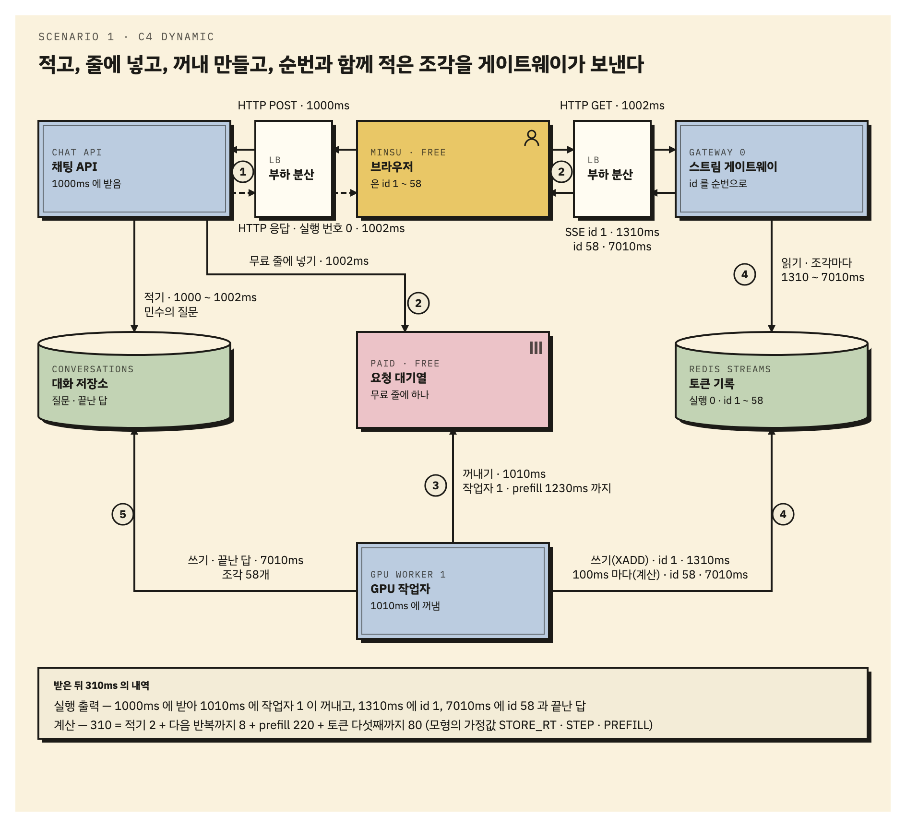

# LLM 채팅 서비스 — 답은 연결과 떼어 순번을 붙여 적어 두고, GPU 앞의 줄은 등급마다 짧게 끊는다

## 문제와 요구사항

민수가 채팅 화면에 질문을 적고 엔터를 누르는 순간을 떠올려 봅시다. 답은 한 번에 오지 않고 몇 글자씩 화면에 나타나요. LLM(Large Language Model, 많은 글로 학습해 다음 낱말을 이어 쓰는 큰 언어 모델)이 답을 토큰 단위로 만들기 때문입니다. 토큰은 모델이 한 번에 만드는 글 조각으로, 낱말 하나나 낱말의 일부쯤 되는 단위예요. 교육용 분석인 Hello Interview 는 이 서비스를 「a conversational AI product where users send prompts in natural language and get responses streamed back from a large language model」로 적습니다([Hello Interview: ChatGPT](https://www.hellointerview.com/learn/system-design/problem-breakdowns/chatgpt)). 토큰을 만드는 계산은 GPU(Graphics Processing Unit, 같은 계산을 한꺼번에 많이 하는 연산 장치)가 맡아요.

가장 먼저 떠오르는 구조는 GPU 서버가 사용자의 연결에 토큰을 곧바로 보내는 것입니다. 그러면 지하철에서 신호가 끊긴 순간 답이 화면에 어디까지 왔는지 서버가 알 길이 없어요. Ably 의 글(실시간 메시지 서비스를 파는 회사의 글)은 이 상태를 「The client has no record of where the stream stopped: no offset, no sequence number, no reference it can use to resume.」라고 적습니다([Ably: AI chat stream resumption](https://ably.com/blog/ai-chat-stream-resumption)). 질문이 GPU 가 처리할 수 있는 양보다 많이 들어올 때 모두 한 줄에서 기다리게 하면 줄이 끝없이 길어져, 모든 사람이 빈 화면을 오래 봅니다.

```text
GPU 서버가 연결에 바로 보냄                      이 글
  브라우저 ◀── GPU 서버 (토큰마다)                 브라우저 ──▶ 채팅 API ──▶ 대화 저장소에 질문을 적음
  ↳ 끊기면 어디까지 갔는지 모름                                    └──▶ 요청 대기열 (유료 줄 · 무료 줄, 줄마다 한도)
  ↳ 몰리면 한 줄에서 모두 기다림                      GPU 작업자 ──▶ 빈자리마다 꺼냄 ──▶ 토큰 기록 (조각마다 순번)
                                                  스트림 게이트웨이 ──▶ 토큰 기록을 읽어 SSE 로, 다시 연결하면 다음 순번부터
```

그림의 이름을 먼저 소개합니다. 채팅 API(Application Programming Interface, 프로그램끼리 요청을 주고받는 약속)는 브라우저의 질문을 받는 입구예요. 대화 저장소는 지난 대화의 질문과 끝난 답을 적어 두는 데이터베이스이고, 요청 대기열은 GPU 를 기다리는 질문을 유료 사용자의 줄과 무료 사용자의 줄로 나눠 넣어 두는 곳입니다. GPU 작업자는 GPU 로 답을 만드는 서버예요. 토큰 기록은 만든 답을 몇 토큰씩 순번과 함께 차례로 적어 두는 저장소이고, 스트림 게이트웨이는 그 기록을 읽어 브라우저에 보내는 서버입니다. SSE(Server-Sent Events)는 서버가 열린 HTTP 연결 하나로 이벤트를 계속 내려보내는 방식이에요. HTTP 는 브라우저와 서버가 요청 · 응답을 주고받는 규약입니다. 이 글은 아래 낱말을 한 뜻으로만 씁니다.

```text
대화 이어 가기   지난 대화를 열어 앞 문맥과 함께 새 질문을 보내는 일           ← 끊긴 답을 이어 오게 하는 일이 아님
응답 이어 받기   끊긴 답을 브라우저에 마지막으로 온 순번 다음부터 다시 오게 하는 일
실행            질문 하나에 대한 답 생성 작업 하나 — 실행 번호로 가리킴        ← 사용자의 연결이 아님
조각            GPU 작업자가 토큰 다섯 개를 모아 토큰 기록에 한 번에 적는 단위
순번            한 실행 안에서 조각마다 1 부터 붙이는 정수 — SSE 의 id 로 보냄  ← 저장소가 붙이는 자동 ID 가 아님
토큰 기록        실행이 만든 조각을 순번과 함께 차례로 적어 두는 저장소          ← 대화 저장소가 아님
첫 토큰 지연     질문을 받은 뒤 첫 토큰이 담긴 첫 조각이 사용자에게 가기까지 걸린 시간 — 줄에서 기다린 시간을 포함
취소            사용자가 멈춤 버튼을 눌러 실행을 끝내고 GPU 자리를 돌려받는 일  ← 연결이 끊기는 일이 아님
```

```text
실행의 상태   대기 ──(GPU 작업자가 꺼냄)──▶ 생성 중 ──(마지막 조각)──▶ 끝남
                                          ├──(조각 사이 시간 제한을 넘음)──▶ 실패
                                          └──(멈춤 버튼)──▶ 취소됨
거절          줄이 가득 차 실행을 만들지 않은 질문 — 상태가 없음
어김          요구 표의 한 행을 지키지 못함
```

끝까지 읽으면 질문 하나의 첫 조각이 어느 상자를 어떤 순서로 지나 받은 뒤 310ms 에 화면에 나오는지 실행 출력으로 확인할 수 있습니다. 질문이 GPU 가 처리할 수 있는 양보다 많을 때 유료 줄과 무료 줄이 첫 토큰 지연을 어떻게 묶는지, 연결이 끊기거나 게이트웨이가 다시 떠도 답이 왜 빠지지도 겹치지도 않는지, GPU 작업자가 멈추면 사용자가 무엇을 보는지도 숫자로 봐요. 요구 수치가 바뀌면 어느 구조로 옮겨야 하는지도 판단할 수 있게 됩니다. 기능 요구는 아래 셋이에요.

1. 사용자가 질문을 보내면 답이 몇 토큰씩 차례로 화면에 나타납니다.
2. 지난 대화를 열어 앞 문맥과 함께 새 질문을 보낼 수 있습니다(대화 이어 가기). Hello Interview 의 기능 요구 「Users should be able to view past chats and resume a conversation, with the chat's prior context carried into the prompt.」를 그대로 빌렸어요.
3. 답이 나오는 중에 멈춤 버튼을 누르면 답이 멈춥니다(취소).

사례 목록은 이 문제의 어려운 점으로 「재접속 중에도 생성은 계속됨」을 꼽아요. 그런데 「끊겨도 답이 계속 만들어지고, 다시 연결하면 빠짐 없이 이어진다」를 어떤 경우에도 지키는 구조는 없습니다. 만든 조각을 어딘가에 적어 두어야 이어 줄 수 있는데, 적어 둔 저장소가 그 조각을 잃을 수 있기 때문이에요. Redis(데이터를 메모리에 두는 키-값 저장소)의 복제 문서는 복제본의 확인을 기다리는 `WAIT` 명령을 써도 지속성 설정에 따라 저장했다고 답한 쓰기를 장애 조치(주 서버가 멈출 때 복제본을 주 서버로 올리는 일) 때 잃을 수 있다고 적습니다(「acknowledged writes can still be lost during a failover」, [Redis: Replication](https://redis.io/docs/latest/operate/oss_and_stack/management/replication/)). 그래서 아래 표는 요구를 사용자가 겪는 일로 적었어요. 고른 구조가 그 요구를 어기는 경우는 기술 상세 설명의 「이 구조의 가정(실행 밖)」 칸과 결정의 「포기하는 것」, 요구 충족 확인 표에 같은 글자로 적었습니다. 「실행 밖」은 구현 코드의 실행 출력으로 보이지 않았다는 표시예요. 비기능 요구는 아래처럼 수치로 고정해요. 근거 칸의 인용은 리서치 노트에서 원문과 글자 그대로 대조한 것이고, 링크는 참고 자료에 다시 모았습니다. Hello Interview 의 수치는 OpenAI 가 밝힌 값이 아니라 그 교육용 분석이 설계 대상으로 정한 추정이라, 빌려 쓴 행에는 그렇게 밝혔어요.

| 항목 | 수치 | 근거 |
| --- | --- | --- |
| 1. 질문 수 | 최대 초당 2만 질문 | 이 가이드의 가정 — 교육용 분석이 정한 추정을 빌림(「ChatGPT serves a little over 200M daily active users at the time of writing.」 · 「A few prompts each per day puts us somewhere around 20k prompts per second at peak,」). 2억 명이 하루 몇 번씩 묻는 서비스의 최대(at peak)로 봄 |
| 2. 동시에 보내는 답 | 어느 순간이든 12만 개 | 이 가이드의 가정 — 같은 분석의 추정을 빌림(「and since a response takes several seconds to generate, roughly 120k of them are streaming at any given moment.」) |
| 3. 첫 토큰 지연 — 평소 | GPU 에 빈자리가 있을 때 질문을 받은 뒤 1초 안 | 이 가이드의 가정 — 같은 분석이 「ChatGPT feels broken if you stare at a blank screen for a few seconds after hitting enter, so latency to the first token matters more than total completion time.」라고 적음. 「몇 초」의 아래쪽 끝보다 짧게 잡음 |
| 4. 첫 토큰 지연 — 유료, 몰릴 때 | 질문이 GPU 가 처리할 수 있는 양보다 많아도 유료 사용자는 받은 뒤 3초 안. 그 안에 시작하지 못할 질문은 받은 즉시(받은 뒤 1초 안) 거절하고 언제 다시 보내면 되는지 알려 줌 | 이 가이드의 가정 — 같은 분석이 깊이 들어가는 절의 제목으로만 던진 질문(「How do we keep heavy users from taking over the GPU pool while giving paid tiers a better experience?」, 본문은 유료)을 요구로 빌림. 몰릴 때도 「몇 초」 안에 화면이 움직이게 잡음 |
| 5. 첫 토큰 지연 — 무료, 몰릴 때 | 받은 뒤 10초 안. 그 안에 시작하지 못할 질문은 받은 즉시(받은 뒤 1초 안) 거절하고 언제 다시 보내면 되는지 알려 줌 | 이 가이드의 가정 — 무료는 유료보다 늦어도 되지만, 빈 화면으로 10초 넘게 기다리게 두면 사용자가 새로 고치거나 떠난다고 봄. 거절이 빨라야 사용자가 기다릴지 다른 일을 할지 정할 수 있음 |
| 6. 응답 이어 받기 — 지연 | 연결이 끊긴 사용자가 다시 연결하면, 다시 연결한 뒤 1초 안에 끊긴 동안 만들어진 부분까지 화면에 나옴 | 이 가이드의 가정 — 다시 연결한 사용자도 빈 화면을 몇 초 보면 고장으로 여긴다고 봄(위 3행의 인용과 같은 문장) |
| 7. 정확도 — 이어 받은 답 | 다시 연결한 뒤 화면의 답에 빠진 조각 0, 두 번 나온 조각 0 | 이 가이드의 가정 — 몇 글자라도 빠지거나 겹치면 답의 뜻이 달라질 수 있음. LibreChat(오픈소스 채팅 앱) 문서는 「문제 해결」 항목에서 겹침은 대개 클라이언트 판이 맞지 않을 때 생긴다고 보고 최신 판으로 올리라고 안내함(「콘텐츠가 중복되어 나타납니다. 이는 일반적으로 클라이언트 버전이 일치하지 않을 때 발생합니다. LibreChat을 최신 버전으로 업데이트하세요.」, [LibreChat: 재개 가능한 스트림](https://www.librechat.ai/ko/docs/features/resumable_streams)) |
| 8. 정확도 — 받은 질문 | 실행 번호를 돌려준 질문은 답이 끝까지 오거나, 오지 못한 사실(「실패」 · 「취소됨」)이 화면과 대화에 남음. 허용 0 | 이 가이드의 가정 — 사용자가 같은 질문을 다시 할지 정하려면 그 질문이 어떻게 끝났는지 알아야 함 |
| 9. 정확도 — 끝난 답 | 끝까지 만든 답은 탭을 닫았어도 대화를 다시 열면 글자 하나 다르지 않게 보임. 허용 0 | 이 가이드의 가정 — 위 기능 요구 2(대화 이어 가기)는 끝난 답이 대화에 그대로 남아 있어야 이룰 수 있음 |
| 10. 취소 — 지연 | 멈춤 버튼을 누른 뒤 1초 안에 GPU 가 그 답을 그만 만듦 | 이 가이드의 가정 — 누른 뒤에도 글자가 1초 넘게 나오면 버튼이 듣지 않는 것처럼 보임. 같은 분석은 「Because GPUs are limited and expensive, the system has to be deliberate about who gets compute and when.」라고 적음 |
| 11. 정확도 — 취소 | 같은 취소가 두 번 와도(두 번 누르거나 응답을 잃어 한 번 더 보내도) 결과는 하나 — 멈춘 순번이 바뀌지 않음. 허용 0 | 이 가이드의 가정 — 화면과 대화에 남는 답이 하나여야 사용자가 답이 어디까지 왔는지 헷갈리지 않음 |
| 12. GPU 서버 하나가 멈출 때 | 그 서버에서 만들던 답은 마지막 조각이 온 뒤 5초 안에 오류가 화면에 나오고, 그 뒤의 새 질문은 3행 그대로(받은 뒤 1초 안) | 이 가이드의 가정 — 빈 화면이 몇 초 넘게 가면 고장으로 보임(3행의 인용). 서버 하나 때문에 다른 사용자의 새 질문까지 「실패」로 끝나면 한 대의 장애가 전체로 번짐 |

일부러 다루지 않는 것도 적어 둡니다.

- 모델이 답을 얼마나 잘 쓰는지, 답의 안전성 검사, 질문과 답의 내용 저장 정책은 다루지 않아요.
- 문맥을 다시 계산하지 않으려고 계산 결과를 남겨 두는 KV 캐시(Key-Value cache, 앞 토큰들의 계산 결과를 남겨 두는 것)를 한 대화 안의 질문과 질문 사이에 남겨 두는 일과, 같은 대화를 같은 서버로 보내는 라우팅은 범위 밖이에요. Character.AI(사용자가 캐릭터와 대화하는 채팅 서비스)는 대화 이력이 평균 180 메시지라고 적고(「the average message has a dialogue history of 180 messages」), 이 캐시를 한 대화 안의 질문과 질문 사이에(「between chat turns」) 호스트 메모리에 남겨 둔다고 적습니다([Character.AI: 기술 글](https://blog.character.ai/optimizing-ai-inference-at-character-ai-2/)). 이 글의 모형(구현 코드 절에서 실제 규모를 줄여 흉내 내는 프로그램)은 문맥 길이를 다루지 않아요.
- 몇 분씩 걸리는 에이전트 실행(모델이 도구를 부르며 여러 단계를 거치는 작업), 이미지 · 음성 답, 사용자마다의 분당 사용 한도는 범위 밖입니다.
- 요청 대기열 · 요청 대기열의 차단기(「실패」가 쌓인 대상으로 가는 일을 잠시 막는 장치) 상태 · 토큰 기록 · 스트림 게이트웨이 · 대화 저장소가 멈추거나 잃는 경우는 범위 밖으로 빼지 않았어요. 이 부품들은 이 글이 고른 구조에만 있는 것이라, 부품마다 멈춘 동안과 잃었을 때 어기는 행을 기술 상세 설명의 「이 구조의 가정(실행 밖)」 칸과 결정의 「포기하는 것」에 적었습니다.

## 규모 추정

식에 쓰는 이름을 먼저 짚어 둡니다. DAU(Daily Active Users)는 하루에 한 번 이상 쓰는 사용자 수예요. prefill 은 질문과 문맥을 처음 한 번 계산해 첫 토큰을 낼 준비를 하는 단계이고, 그 뒤로는 반복(모델이 실행마다 토큰 하나씩을 만드는 한 걸음)마다 토큰이 하나씩 나옵니다. GPU 자리는 GPU 작업자 하나가 한 반복에 함께 계산하는 실행의 수(배치 자리)를 모든 작업자에 걸쳐 더한 것이에요. 처리 능력은 GPU 전체가 초당 새로 시작해 끝낼 수 있는 실행 수입니다. 꺼내는 몫은 요청 대기열이 GPU 에 실행을 내줄 때 두 줄이 나눠 갖는 비율이에요(이 글의 설정, 시나리오 2). 토큰 기록은 Redis 의 Redis Streams(끝에 붙이기만 하는 로그 자료형)로 두고, 조각 하나를 `XADD`(로그 끝에 항목 하나를 붙이는 명령) 한 번으로 적습니다. HTTP/2 는 연결 하나에 요청 · 응답의 스트림 여럿을 함께 싣는 HTTP 의 2판이고, HTTP/1.1 은 그 앞 판이에요. 429 는 요청이 너무 많다는 뜻의 HTTP 응답 코드이고, Retry-After 는 서버가 거절 응답에 몇 초 뒤에 다시 보내면 되는지 적어 주는 HTTP 머리(요청 · 응답에 붙는 이름과 값의 쌍)예요. 정본은 구현 코드 절에 실은 세 프로그램과 그 실행 출력이고, 변형 실행은 정본 Java 를 복사해 상수나 줄을 바꾸거나 값을 찍는 줄을 더해 다시 실행한 것이에요(번호와 바꾼 것을 함께 적음).

```text
(입력)  최대 초당 20,000 질문(요구 1행) · 동시에 보내는 답 120,000 개(요구 2행)
        모델이 실행 하나에 만드는 토큰 초당 50 개(가정 — 모델과 GPU 마다 다르고 공개 운영 수치를 쓰지 않음)
        조각 하나 = 토큰 5 개(이 가이드의 설정, 토큰 기록 항목)
        GPU 처리 능력 초당 16,000 실행(가정 — 최대의 80%, 아래 문단)
        꺼내는 몫 — 두 줄 모두 기다리면 네 번에 한 번은 무료 줄 먼저 → 유료 최소 75% · 무료 최소 25%(이 가이드의 설정)
        첫 조각까지 걸리는 시간과 자리가 몰려 비는 빈틈을 덮는 여유 2 초(판단 — 빈틈은 시나리오 2 의 변형 실행 V10(바꾼 것: 정본 Java 의 `main` 에 줄 몇 개를 더해, 20000 ~ 80000ms 에 받은 실행 가운데 「끝남」인 것의 끝난 시각을 차례로 늘어놓고 이웃한 두 시각의 차이 가운데 가장 큰 값과 그 앞 시각, 첫 끝난 시각을 찍음. 결과에는 손대지 않음)에서 1250ms)
        토큰 기록 보관 — 실행이 끝난 뒤 600 초(이 가이드의 설정) · 답 하나 2 KB(가정 — 300 토큰 남짓의 글)
        조각 사이 시간 제한을 확인하는 주기 1 초(이 가이드의 설정)
        브라우저 연결 한도 — HTTP/2 가 아니면 브라우저 · 도메인마다 6, HTTP/2 의 동시 스트림 기본 100(출처 — MDN, Mozilla 가 운영하는 웹 기술 문서)

[1] 답 하나를 보내는 시간          120,000 ÷ 20,000 = 평균 6 초
[2] 답 하나의 토큰 수              50 × 6 = 300 토큰 · 조각 300 ÷ 5 = 60 개
[3] 토큰 기록 쓰기                 토큰마다 적으면 120,000 × 50 = 초당 6,000,000 번
                                   토큰 5 개마다 적으면 120,000 × 50 ÷ 5 = 초당 1,200,000 번
                                   (상한 — 12만 개가 모두 생성 중일 때. GPU 자리 [5] 의 96,000 개면 96,000 × 10 = 초당 960,000 번)
                                   첫 조각이 늦어지는 시간 = 토큰 넷 × (1,000 ÷ 50) = 80 ms
[4] 한 줄에 한도 없이 넣으면        (20,000 − 16,000) × 60 = 1 분 뒤 240,000 개가 기다림
                                   그 뒤에 온 질문의 기다림 = 240,000 ÷ 16,000 = 15 초 > 4행 3 초 · 5행 10 초
[5] GPU 자리                       16,000 × 6 = 96,000 실행을 함께 계산 < 2행 120,000
[6] 줄 한도                        유료 = (3 − 2) × 16,000 × 75% = 12,000 · 무료 = (10 − 2) × 16,000 × 25% = 32,000
    Retry-After                    유료 12,000 ÷ 12,000 = 1 초 · 무료 32,000 ÷ 4,000 = 8 초
[7] 토큰 기록의 크기               끝난 실행 20,000 × 600 = 12,000,000 개 × 2 KB = 24 GB
                                   (상한 — 질문이 모두 실행될 때. 처리 능력 초당 16,000 이면 16,000 × 600 = 9,600,000 개 × 2 KB = 19.2 GB)
[8] 대화 저장소 쓰기               20,000 × (질문 1 + 끝난 답 1) = 초당 40,000 번
                                   (상한 — 질문을 모두 받아 실행할 때. 처리 능력 초당 16,000 이면 16,000 × 2 = 초당 32,000 번)
[9] 시간 제한 확인                 생성 중 실행 최대 96,000 개를 1 초마다 = 초당 96,000 번 읽기
[10] 브라우저 연결                 HTTP/1.1 이면 한 도메인에 연결 6 개 → 채팅 탭 일곱째부터 스트림이 막힘
                                   HTTP/2 이면 연결 하나에 스트림 100 개까지(기본값)
```

처리 능력을 최대의 80% 로 잡은 데는 문제 쪽 이유가 있어요. 같은 분석이 GPU 를 「limited and expensive」로 적는 것처럼 GPU 는 수가 한정되고 비용이 커서, 최대에 맞춰 들이면 최대가 아닌 시간에는 대부분 놀게 됩니다. 그래서 최대의 몇 할은 곧바로 계산하지 못하는 상황을 문제의 조건으로 둡니다. Azure(마이크로소프트의 클라우드)의 대기열 패턴 문서도 대기열을 두면 「you only need enough service instances to meet the requirements for an average load rather than the peak load」라고 적어요([Azure: Queue-Based Load Leveling](https://learn.microsoft.com/en-us/azure/architecture/patterns/queue-based-load-leveling)). 80% 가 몇 배 틀려도 이 글의 결론이 유지되는 범위는 대안 비교에서 계산합니다. 이 글은 [6] 에서 줄을 한도까지 채운 실행이 모두 빠지는 시간을 Retry-After 의 값으로 씁니다.

이 계산이 구조를 정합니다. [4] 는 한도 없는 한 줄을 뺍니다. 최대가 1분만 이어져도 줄 끝의 질문은 15초를 기다려 4행과 5행을 모두 어겨요. NVIDIA(GPU 를 만드는 회사)도 첫 토큰 지연에 대개(generally) 대기열에서 기다린 시간이 들어간다고 적습니다(「TTFT generally includes both request queuing time, prefill time, and network latency.」, [NVIDIA: LLM Inference Benchmarking](https://developer.nvidia.com/blog/llm-benchmarking-fundamental-concepts)). TTFT(Time To First Token)는 첫 토큰 지연의 영어 이름이에요. [5] 는 GPU 가 최대를 다 계산하지 못한다는 것을 보입니다. 최대일 때 2행을 어기는 것이 이 문제의 조건이에요(요구 충족 확인 2행). 그래서 몰릴 때 누군가는 기다리거나 거절되어야 하고, 4행 · 5행이 그 몫을 유료와 무료에 나눠요. [6] 은 그 나눔을 줄 길이 한도로 바꾼 값입니다. [3] 은 조각을 정해요. 토큰마다 적으면 초당 상한 600만 번이고, 토큰 다섯 개를 모으면 상한 120만 번으로 줄어드는 대신 첫 조각이 80ms 늦어집니다. [7] 은 토큰 기록이 메모리에 둘 만한 크기(상한 24 GB)라는 것을 보여요. 다만 메모리 저장소는 장애 때 일부를 잃을 수 있으므로, 끝난 답의 기준은 [8] 의 대화 저장소에 둡니다(판단). [10] 은 게이트웨이를 HTTP/2 로 둘 이유예요(MDN 문서, [MDN: Using server-sent events](https://developer.mozilla.org/en-US/docs/Web/API/Server-sent_events/Using_server-sent_events)).

```text
최대가 1분 이어진 뒤 들어온 질문에 첫 조각이 가기까지 (초, 계산 — 처리 능력 초당 16,000)

한 줄 · 한도 없음                  ██████████████████████████████  15    (240,000 ÷ 16,000)
유료 줄 · 한도 12,000              ██  1 + 여유      (12,000 ÷ 12,000, 4행의 3초 안)
무료 줄 · 한도 32,000              ████████████████  8 + 여유   (32,000 ÷ 4,000, 5행의 10초 안)
한도를 넘은 질문                    ▏ 받은 즉시 429 와 Retry-After
```

## 시스템 개념도


질문이 지나는 주된 길은 이렇습니다. 브라우저가 HTTP POST 요청으로 질문을 보내면 채팅 API 가 사용자 메시지를 대화 저장소에 적고, 요청 대기열의 유료 줄이나 무료 줄에 실행을 넣은 뒤 실행 번호를 돌려줘요. 그 줄이 한도까지 차 있으면 실행을 만들지 않고 429 와 Retry-After 로 곧바로 거절합니다. 브라우저는 돌려받은 실행 번호로 `EventSource`(브라우저가 SSE 연결을 열고, 끊기면 스스로 다시 연결하는 내장 객체)를 열어 스트림 게이트웨이에 HTTP GET 요청을 보내요. GPU 작업자는 20ms 마다 반복을 하나씩 계산하고, 배치에 빈자리가 생길 때마다 요청 대기열에서 실행을 꺼내 넣습니다(연속 배칭 — 배치 전체가 끝나기를 기다리지 않고 반복마다 실행을 바꿔 넣는 방식). 토큰이 다섯 개 모이면 순번을 붙인 조각 하나를 토큰 기록에 `XADD` 로 적어요. 스트림 게이트웨이는 `XREAD BLOCK`(새 항목이 붙을 때까지 기다렸다가 읽는 명령)으로 그 조각을 읽어 SSE 이벤트로 보내고, 순번을 이벤트의 `id` 로 붙입니다. 브라우저는 마지막으로 온 `id` 를 기억했다가 다시 연결할 때 `Last-Event-ID` 머리에 실어 보내고, 게이트웨이는 그 다음 순번부터 보내요. 실행이 끝나면 GPU 작업자가 끝난 답을 대화 저장소에 적고, 토큰 기록의 그 실행은 10분 뒤 지워집니다.

나머지 두 화살표는 장애와 취소의 길이에요. 요청 대기열은 1초마다 토큰 기록에서 생성 중인 실행의 마지막 조각 시각을 읽어, 3초(조각 사이 시간 제한) 넘게 조각이 없으면 그 실행을 토큰 기록과 대화 저장소에 「실패」로 적습니다. 오류 이벤트는 토큰 기록의 이 「실패」 기록을 게이트웨이가 읽어 보내요. 같은 GPU 작업자에서 잇달아 셋이 「실패」가 되면 그 작업자의 차단기(「실패」가 쌓인 대상으로 가는 일을 잠시 막는 장치)가 30초 동안 열려(열림 — 막는 상태) 그 작업자에게 실행을 내주지 않습니다. 사용자가 멈춤 버튼을 누르면 채팅 API 가 요청 대기열에 취소를 알리고, 요청 대기열이 토큰 기록과 대화 저장소에 그 실행을 「취소됨」으로 적어요. 끝난 답은 GPU 작업자가, 「실패」 · 「취소됨」으로 끝난 답은 요청 대기열이 대화 저장소에 적는 셈입니다. GPU 작업자는 반복마다 자기 배치의 「취소됨」 · 「실패」 목록을 읽어 그 실행을 빼고 자리를 비웁니다. 개념도의 「규칙」 상자에 나오는 낱말은 모두 여기까지 소개했고, 정식 설명은 기술 상세 설명이 맡아요.

## 시나리오로 따라가기

### 시나리오 1 — 민수의 질문 하나가 무료 줄을 거쳐 받은 뒤 310ms 만에 첫 조각으로 화면에 나오고, 받은 뒤 6010ms 만에 끝난 답이 대화 저장소에 적힌다

다른 질문도 장애도 없는 1000ms 에, 무료 사용자 민수가 질문 하나를 보내요. 나와야 하는 것은 받은 뒤 1초 안에 첫 조각이 화면에 나오는 것(요구 3행)과, 끝까지 만든 답이 대화 저장소에 그대로 남는 것(9행)입니다. 시각은 모형의 가상 시계 값이에요. 모형은 GPU 자리와 질문 수를 실제의 1000분의 1로 줄였고, 시간은 줄이지 않았습니다(상황 설정).



1. 1000ms 에 브라우저의 HTTP POST 요청이 앞단의 부하 분산(LB, Load Balancer — 요청을 여러 서버에 나눠 주는 장치)을 지나 채팅 API 에 와요. 채팅 API 는 무료 줄의 길이(0)가 한도 32 보다 작은 것을 보고, 민수의 질문을 대화 저장소에 사용자 메시지로 적습니다(모형에서 2ms). 실행보다 질문을 먼저 적는 이유는, 그 뒤 어느 부품이 멈춰도 무엇을 물었는지가 대화에 남아야 「실패」 사실을 대화에 남길 수 있기 때문이에요(8행).
2. 1002ms 에 채팅 API 가 실행 0 을 무료 줄에 넣고 실행 번호를 돌려줍니다. 브라우저는 그 번호로 `EventSource` 를 열어 부하 분산을 지나 스트림 게이트웨이 0 에 HTTP GET 요청을 보내요. 넣고 나서 답합니다. 순서를 바꿔 실행 번호를 먼저 돌려준 뒤 넣기 전에 채팅 API 가 멈추면, 민수는 번호를 돌려받았는데 그 실행은 어디에도 없어 답도 「실패」도 오지 않아요(8행을 어김).
3. 1010ms 에 GPU 작업자 1 이 다음 반복에서 실행 0 을 꺼냅니다. 모형의 작업자 0 은 20ms 의 배수(…00 · …20ms)마다, 작업자 1 은 그 사이(…10 · …30ms)마다 반복을 계산하고, 반복마다 빈자리를 대기열에서 채워요. prefill 은 1230ms 까지 걸리고 그때 토큰 1 이 나옵니다. 반복마다 빈자리를 채우는 이유는, 배치가 통째로 끝나기를 기다리면 앞 배치의 가장 긴 답(모형에서 6초, 계산)이 끝날 때까지 새 질문이 기다리기 때문이에요(3행).
4. 1310ms 에 토큰 다섯째가 나오면 GPU 작업자 1 이 순번 1 을 붙인 조각을 토큰 기록에 적고, 게이트웨이 0 이 그것을 읽어 SSE 이벤트 `id: 1` 로 보냅니다. 받은 뒤 310ms 예요. 게이트웨이가 GPU 작업자에게서 직접 가져오지 않고 토큰 기록을 거치는 이유는, 연결이 끊겼다가 돌아온 브라우저에 다시 내줄 근거가 그 기록이기 때문입니다(시나리오 3).
5. 그 뒤로 100ms 마다(계산 — 토큰 다섯 × 20ms) 조각이 하나씩 적히고 보내져, 7010ms 에 순번 58(토큰 290)이 적혀요. GPU 작업자 1 은 실행을 「끝남」으로 적고 끝난 답을 대화 저장소에 적으며, 게이트웨이는 `done` 이벤트로 스트림을 닫습니다. 받은 뒤 6010ms 예요. 끝난 답을 토큰 기록이 아니라 대화 저장소에 적는 이유는, 토큰 기록은 10분 뒤 지우고 메모리 저장소라 장애 때 일부를 잃을 수 있기 때문입니다(9행).

```text
t=1000ms minsu (free): the question is written to the conversation store, run 0 is queued at 1002ms and the run id goes back
t=1010ms gpu worker 1: takes run 0, prefill until 1230ms, id 1 is written to the token record at 1310ms and the gateway sends it to minsu over sse
t=7010ms gpu worker 1: writes id 58, the answer goes to the conversation store and the stream ends 6010ms after the question was received
minsu: run 0 on gpu worker 1, first id 310ms after the question was received, got ids 1-58 in order then the done event (missing 0, twice 0), the conversation store keeps the finished answer with 58 ids
```

잠깐, 확인 하나만 해 볼까요? 받은 뒤 310ms 는 어디서 나왔을까요? 모형은 단계마다 정해 둔 시간을 더해요.

```text
1000ms   채팅 API 가 받음
+2       대화 저장소에 질문 적기 (가정한 저장소 왕복 STORE_RT)
+8       작업자 1 의 다음 반복까지 (1002 다음은 1010)
+220     prefill (가정한 PREFILL) — 1230ms 에 토큰 1
+80      토큰 다섯째까지 넷 × 20ms (반복 STEP) — 1310ms 에 조각 1
합계     2 + 8 + 220 + 80 = 310ms   (요구 3행의 1초 안)
```

이 시나리오가 보여 준 것은 질문 하나가 지나는 순서와 그 순서의 이유입니다. 적고 → 넣고 → 답하고, 만들고 → 적고 → 읽어 보내요. 앞의 순서는 8행(실행 번호를 돌려준 질문은 답이 끝까지 오거나, 오지 못한 사실이 화면과 대화에 남음)을 지키고, 뒤의 순서는 끊긴 연결을 이어 줄 근거(토큰 기록)를 남깁니다. 310ms 가운데 80ms(위 계산)는 토큰을 다섯 개씩 모아 적는 대가예요. 토큰마다 적으면 첫 조각은 받은 뒤 230ms 에 가지만 조각 수가 58개에서 290개로 다섯 배가 됩니다(변형 실행 V7(바꾼 것: `CHUNK = 5` 를 `CHUNK = 1` 로)). 310ms 는 3행의 첫 근거로 요구 충족 확인에 가요.

### 시나리오 2 — 질문이 GPU 가 처리할 수 있는 양보다 초당 4개 많이 몰릴 때 유료는 받은 뒤 최대 1310ms, 무료는 받은 뒤 최대 3760ms 만에 첫 조각이 가거나 받은 즉시 429 와 Retry-After 8 로 거절된다(한 줄에 한도가 없으면 모두 받은 뒤 최대 14710ms)

20000ms 부터 80000ms 까지 50ms 마다 질문이 하나씩, 모두 1200개 들어와요(초당 20개, 실제의 초당 2만에 해당). 다섯째마다 유료라 유료는 초당 4개, 무료는 초당 16개입니다. 유료 비율 20% 는 공개 수치를 찾지 못해 둔 가정이에요(유료가 80% 인 경우는 아래 변형 실행으로 봅니다). 모형의 GPU 자리는 작업자 둘에 48개씩 96개이고, 실행 하나가 자리를 6000ms(계산 — prefill 220 + 289 × 20) 동안 쓰므로 처리 능력은 초당 16 실행입니다(계산 — 96 ÷ 6). 들어오는 양이 초당 4개 많아요(20 − 16 의 계산). 같은 사건열을 한 줄 · 한도 없음(`one-queue`)으로도 실행해 비교합니다. 나와야 하는 것은 유료 3초(4행), 무료 10초 또는 받은 즉시 거절(5행)이에요.


1. 질문마다 채팅 API 가 그 사용자의 줄 길이를 봐요. 무료 줄에 32개가 기다리고 있으면 실행을 만들지 않고 받은 즉시 429 와 `Retry-After: 8` 로 거절합니다. 정본에서 무료 질문 204개가 그렇게 거절됐어요. 줄에 넣고 오래 기다리게 하는 대신 받을 때 거절하는 이유는, 5행이 「그 안에 시작하지 못할 질문은 받은 즉시(받은 뒤 1초 안) 거절하고 언제 다시 보내면 되는지 알려 줌」을 요구하기 때문이에요. 8초는 무료 줄을 가득 채운 32개가 모두 빠지는 시간입니다(규모 추정 [6] 을 모형 크기로 — 32 ÷ 4).
2. 받은 질문은 유료 줄이나 무료 줄에 들어가요. 정본에서 유료 줄은 가장 길 때 5개, 무료 줄은 한도인 32개까지 찼습니다. 줄을 나누는 이유는, 한 줄이면 넣은 차례대로만 꺼낼 수 있어 유료 질문이 무료 질문 뒤에서 기다리기 때문이에요.
3. GPU 작업자는 빈자리가 생길 때마다 유료 줄을 먼저 보고, 네 번 꺼낼 때 한 번은 무료 줄을 먼저 봅니다. 두 줄 모두 기다릴 때 무료 줄이 꺼내는 몫의 25% 를 갖게 하는 규칙이에요. 이 규칙이 없으면 유료 질문이 처리 능력만큼 몰릴 때 무료 줄은 하나도 꺼내지지 않아, 5행의 10초를 지킬 길이 없습니다.
4. 유료의 첫 조각은 받은 뒤 최대 1310ms, 무료는 받은 뒤 최대 3760ms 에 갔어요. 4행의 3초와 5행의 10초 안입니다. 무료가 3760ms 에 그친 것은 정본의 유료가 초당 4개뿐이라 무료가 최소 몫(초당 4)보다 많은 초당 12개를 꺼냈기 때문이에요(계산 — 16 − 4). 한도 32 는 최소 몫으로 셈한 값이라 이 혼합에서는 넉넉합니다.
5. 같은 사건열을 한 줄 · 한도 없음으로 실행하면 거절은 0이지만 줄이 240개까지 길어져, 유료와 무료 모두 받은 뒤 최대 14710ms 에 첫 조각이 갔어요(`one-queue`). 규모 추정 [4] 의 15초와 같은 꼴입니다. 줄에 넣어 두기만 하는 대기열은 몰림을 흡수하지만, 기다림을 묶어 주지는 않아요.

```text
guide: paid 240 asked, 240 answered with the first id at most 1310ms after the question was received, 0 refused; free 960 asked, 756 answered with the first id at most 3760ms after the question was received, 204 refused with 429 and Retry-After 8; the paid lane held at most 5 and the free lane 32
one-queue: paid 240 asked, 240 answered with the first id at most 14710ms after the question was received, 0 refused; free 960 asked, 960 answered with the first id at most 14710ms after the question was received, 0 refused; the one queue held at most 240
```

여기서 헷갈리기 쉬운 포인트는 「줄만 나누면 되지 한도까지 둘 필요가 있나」, 또는 「한도만 두면 줄은 하나여도 되지 않나」입니다. 둘을 하나씩 떼어 실행해 보면 두 장치가 맡는 요구가 달라요.

```text
같은 사건열 (20000 ~ 80000ms 에 1200 질문, V1 · V2 의 바꾼 것은 아래 문단)        유료 첫 조각(받은 뒤 최대)   무료 첫 조각(받은 뒤 최대)   거절
한 줄 · 한도 없음 (one-queue, 정본)              14710ms                   14710ms                   0
유료 · 무료 줄 · 한도 없음 (변형 실행 V1)          1310ms                    15260ms                   0     ← 5행을 어김
한 줄 · 한도 12 (변형 실행 V2)                    2060ms                    2060ms                    유료 47 · 무료 181  ← 유료도 거절
유료 · 무료 줄 · 한도 12 · 32 (guide, 정본)        1310ms                    3760ms                    무료 204
```

변형 실행 V1(바꾼 것: `LIMIT = {12, 32}` 를 `LIMIT = {100_000, 100_000}` 으로)은 무료 줄이 236개까지 길어져 무료가 받은 뒤 15260ms 를 기다렸어요. 줄을 나누면 유료는 지켜지지만 무료의 기다림은 묶이지 않습니다. 변형 실행 V2(바꾼 것: 줄 길이가 한도 이상이면 거절하는 확인을 `one-queue` 에서도 하게 함. 한 줄은 유료 줄로 보아 한도가 12)는 기다림이 받은 뒤 2060ms 로 묶였지만, 줄이 하나라 유료 질문도 47개가 거절됐어요. 한도는 기다림을 묶고, 줄 나누기는 누구를 먼저 꺼낼지 정합니다.

> 줄은 누가 먼저인지를, 한도는 얼마나 기다리는지를 정한다 — 둘 중 하나만으로는 4행과 5행을 함께 지키지 못한다.

```text
몰릴 때 실행이 끝나는 시각 (모형 — 답이 모두 같은 길이라 20000ms 부터 함께 시작한 실행이 함께 끝남, 변형 실행 V10 의 바꾼 것은 아래 문단)
  26010ms 첫 끝남 ──── … ──── 30760ms ──(1250ms 동안 끝나는 실행 없음)──▶ 32010ms(계산) …
  이 빈틈에 들어온 유료 질문은 자리가 빌 때까지 기다림 → 정본의 받은 뒤 최대 1310ms
```

유료의 받은 뒤 1310ms 는 한도와 상관없는 곳에서 왔습니다. 유료 줄은 가장 길 때 5개였어요. 그런데 모형의 답은 모두 꺼낸 뒤 6000ms(계산 — 220 + 289 × 20)로 길이가 같아서, 20000ms 부터 함께 시작한 실행들이 함께 끝나고 자리도 몰려서 빕니다. 그 사이에는 한동안 아무 자리도 비지 않아요. 빈틈이 생기는 거예요. 끝나는 시각을 찍어 보니 첫 끝남은 26010ms 였어요. 그리고 30760ms 뒤 1250ms 동안 끝난 실행이 하나도 없었습니다(변형 실행 V10(바꾼 것: 정본 Java 의 `main` 에 줄 몇 개를 더해, 20000 ~ 80000ms 에 받은 실행 가운데 「끝남」인 것의 끝난 시각을 차례로 늘어놓고 이웃한 두 시각의 차이 가운데 가장 큰 값과 그 앞 시각, 첫 끝난 시각을 찍음. 결과에는 손대지 않음)). 규모 추정 [6] 의 여유 2초는 이 빈틈(1250ms)과 첫 조각까지 걸리는 시간(300ms 남짓, 정본의 310 · 320ms)을 덮으려고 잡은 값이에요(판단). 실제 답은 길이가 제각각이라 빈틈은 이보다 짧다고 봅니다(판단, 실행 밖).

유료가 질문의 80% 로 몰리면 유료 줄이 한도까지 찹니다. 다섯째마다 무료로 바꾼 변형 실행 V9(바꾼 것: `i % 5 == 0 ? PAID : FREE` 를 `i % 5 != 0 ? PAID : FREE` 로)에서 유료의 첫 조각은 받은 뒤 최대 2260ms 에 갔고, 유료 223개가 받은 즉시 429 와 `Retry-After: 1` 로 거절됐어요. 4행의 「받은 즉시(받은 뒤 1초 안) 거절하고 언제 다시 보내면 되는지 알려 줌」 쪽으로 간 것입니다. 무료(초당 4개)의 첫 조각은 받은 뒤 최대 1660ms 에 갔습니다. 최소 몫 25% 가 무료 줄을 비워 준 것으로 봅니다(판단).

```text
유료 비율을 바꾼 세 변형 실행 (같은 사건열)
  변형 실행 V15(바꾼 것: `i % 5 == 0 ? PAID : FREE` 를 `i % 20 < 9 ? PAID : FREE` 로) — 유료 45% · 유료 거절 0
  변형 실행 V14(바꾼 것: `i % 5 == 0 ? PAID : FREE` 를 `i % 2 == 0 ? PAID : FREE` 로) — 유료 50% · 유료 거절 9 · 유료 첫 조각은 받은 뒤 최대 1510ms
  변형 실행 V9(바꾼 것: `i % 5 == 0 ? PAID : FREE` 를 `i % 5 != 0 ? PAID : FREE` 로) — 유료 80% · 유료 거절 223 · 유료 첫 조각은 받은 뒤 최대 2260ms
  계산으로는 유료가 초당 12,000(질문의 60%)을 넘어야 유료 줄이 쌓이지만, 모형에서는 자리가 몰려 비는 빈틈 때문에 50% 부터 거절이 생김
```

이 시나리오가 보여 준 것은 몰림을 다루는 두 장치예요. 줄 나누기는 유료를 무료 뒤에서 기다리게 하지 않아 4행(받은 뒤 최대 1310ms)을 지키고, 줄 한도는 기다림을 묶고 넘치는 질문을 받은 즉시 거절해 5행(받은 뒤 최대 3760ms, 거절 204개)을 지킵니다. 대가도 보였어요. 무료 질문 다섯에 하나꼴(204 ÷ 960)이 거절되고, 거절된 사용자는 8초 뒤 다시 보내야 합니다. 몰림이 1분 내내 이어지면 8초 뒤에도 줄이 차 있을 수 있어요(판단, 실행 밖 — 모형의 사용자는 다시 보내지 않음).

### 시나리오 3 — 지수의 연결이 끊기고 게이트웨이 1 이 다시 떠도 답은 빠짐 · 겹침 없이 이어지고, GPU 작업자 1 이 토큰을 멈추면 도윤의 답이 오류로 끝나 차단기가 다음 질문을 작업자 0 으로 보내며, 두 번 온 취소는 같은 결과를 돌려준다

200000ms 부터 280000ms 까지 장애 셋과 취소 하나를 차례로 겪어요. 한 장면씩 따라가 봅시다. 200000ms 에 유료 사용자 지수가 질문하고, 204250ms 에 지수의 연결이 끊겨 5초 뒤 다시 연결합니다. 210000ms 에 무료 사용자 소라가 게이트웨이 1 에 연결된 채 질문하고, 213000ms 에 게이트웨이 1 이 다시 떠요(배포). 228000ms 부터 도윤과 두 사람의 질문이 GPU 작업자 1 에 들어가고, 230000ms 에 작업자 1 이 토큰을 만들지 못하게 됩니다. 이 모형의 작업자 1 은 GPU 계산만 멈추고 대기열에서 실행을 꺼내는 일은 계속해요(가정 — 아래 4단계). 235000ms 에 유료 사용자 도라가 질문하고, 250000ms 에 작업자 1 이 회복합니다. 270000ms 에 무료 사용자 유나가 질문하고, 273220ms 와 273720ms 에 멈춤 버튼을 두 번 눌러요. 나와야 하는 것은 이어 받기(6 · 7행), 받은 질문의 끝(8행), 끝난 답(9행), 취소(10 · 11행), GPU 서버 하나의 멈춤(12행)입니다. 차단기의 상태는 닫힘(실행을 내줌) · 열림(내주지 않음) · 반열림(시험 실행 하나만 내줘 회복을 확인함) 셋이에요.


1. 204250ms 에 지수의 연결이 끊겨요. 지수에게는 순번 40 까지 왔습니다. GPU 작업자 1 은 연결을 모르고 실행을 이어 가, 206010ms 에 순번 58 까지 토큰 기록에 적고 끝난 답을 대화 저장소에 적어요. 실행을 연결과 떼어 둔 이유가 이것입니다. 연결에 토큰을 바로 보내는 구조라면 끊긴 뒤 만든 조각은 갈 곳이 없어요. Ably 의 글은 그런 구조가 서버가 끊김을 늦게 알면 「burning inference cost with nothing to show for it」이 된다고 적습니다(Ably 글).
2. 209250ms 에 지수의 `EventSource` 가 다시 연결하며 `Last-Event-ID: 40` 을 보내요. 게이트웨이 0 은 토큰 기록에서 순번 41 부터 58 까지 18개를 한꺼번에 보내고, 실행이 끝났으므로 `done` 이벤트를 붙입니다. 다시 연결한 뒤 0ms 예요(모형의 네트워크 지연은 0). 지수에게 온 순번은 1 부터 58 까지 한 번씩입니다. 브라우저가 기억한 순번 다음부터 보내는 이유는, 그보다 앞부터 보내면 겹치고 뒤부터 보내면 빠지기 때문이에요. 다시 연결할 때 지금 끝 순번 다음부터 보내게 바꾸면 18개가 빠졌고(변형 실행 V5(바꾼 것: `int id = c.last, from = id;` 를 `int id = c.last, from = r.seq;` 로)), 처음부터 보내게 바꾸면 40개가 두 번 왔습니다(변형 실행 V6(바꾼 것: `int id = c.last, from = id;` 를 `int id = c.last, from = 0;` 으로)).
3. 213000ms 에 게이트웨이 1 이 다시 떠서 소라의 연결이 순번 27 뒤에 닫혀요. 브라우저는 서버가 정해 둔 다시 연결 간격(`retry`, 이 글은 1000ms)이 지난 214000ms 에 다시 연결하고, 부하 분산은 살아 있는 게이트웨이로 보내고, 이 모형에서는 그것이 게이트웨이 0 입니다. 게이트웨이 0 은 그동안 적힌 28 부터 37 까지 10개를 한꺼번에 보내고, 38 부터는 적히는 대로 보내요. 소라에게도 1 부터 58 까지 한 번씩 왔습니다. 다른 게이트웨이가 이어 줄 수 있는 이유는, 게이트웨이가 연결 말고는 아무것도 기억하지 않고 순번은 브라우저에, 조각은 토큰 기록에 있기 때문이에요.
4. 230000ms 에 GPU 작업자 1 이 토큰을 만들지 못하게 돼요. 그 위에는 실행 셋이 있었고, 도윤에게는 순번 17 까지 왔습니다. 요청 대기열은 1초마다 토큰 기록에서 생성 중인 실행의 마지막 조각 시각을 읽어요. 233000ms 의 확인에서 셋 모두 마지막 조각 뒤 3초가 넘은 것을 보고 토큰 기록과 대화 저장소에 「실패」로 적었고, 게이트웨이가 그 기록을 읽어 도윤에게 `error` 이벤트를 보냈습니다. 도윤의 마지막 조각은 229910ms 에 적혔으니(계산 — 228000 + 첫 조각까지 310 + 16 × 100) 그 뒤 3090ms 만에 오류가 화면에 나왔어요(12행의 5초 안). 같은 작업자에서 잇달아 셋이 「실패」가 되어 작업자 1 의 차단기가 263000ms 까지 열립니다. 시간 제한을 답 전체가 아니라 조각 사이에 두는 이유는, 답의 길이는 제각각이지만 조각은 100ms(계산 — 토큰 5개 × 20ms) 마다 오므로 3초 동안 조각이 없으면 이상이 생긴 것으로 볼 수 있기 때문이에요(판단). 확인을 요청 대기열이 맡는 이유는, 실행을 내준 곳이라 어느 실행이 어느 작업자에 있는지 알기 때문입니다.
5. 235000ms 에 도라가 질문해요. 235010ms(계산 — 작업자 1 의 반복 시각)에 작업자 1 이 대기열에서 꺼내려 했지만 차단기가 열려 있어 꺼내지 못했고, 235020ms(계산 — 작업자 0 의 반복 시각)에 작업자 0 이 꺼내 도라에게는 받은 뒤 320ms 에 첫 조각이 갔습니다(12행의 「새 질문은 3행 그대로」). 차단기가 없으면 멈춘 작업자 1 이 도라의 실행을 꺼내 가, 첫 조각도 없이 239000ms 에 「실패」가 됐어요(변형 실행 V4(바꾼 것: `FAILS_TO_OPEN = 3` 을 `FAILS_TO_OPEN = 1_000` 으로), 차단기가 열리지 않음). 250000ms 에 작업자 1 이 회복해요. 270000ms 에 유나의 질문이 오고, 270010ms 에 열린 지 30초가 지난 차단기가 반열림이 되어 유나의 실행을 시험 실행으로 내줍니다. 271000ms 의 확인에서 그 실행이 조각을 적은 것을 보고 차단기가 닫혀요. 시험 실행을 하나만 내주는 이유는, 아직 멈춰 있다면 그 하나만 「실패」로 끝나게 하려는 것입니다. 회복을 279000ms 로 늦추고 유나의 멈춤 버튼을 그 뒤로 옮기면, 유나의 시험 실행은 274000ms 의 확인에서 첫 조각 없이 「실패」가 되고 차단기가 다시 열렸어요(변형 실행 V16(바꾼 것: `250_000, Kind.RECOVER` 를 `279_000, Kind.RECOVER` 로, `273_220, Kind.STOP` · `273_720, Kind.STOP` 을 `279_500, Kind.STOP` · `279_600, Kind.STOP` 으로)). 이 하나는 3 · 4 · 5 · 12행을 어기고, 시나리오 3 그림의 첫 토큰 상한 ⑤ 에 적었습니다.
6. 유나에게 순번 30 이 온 뒤 273220ms 에 유나가 멈춤 버튼을 눌러요. 채팅 API 가 요청 대기열에 취소를 알리고, 요청 대기열이 토큰 기록과 대화 저장소에 그 실행을 「취소됨」으로 적고, 채팅 API 는 「순번 30 뒤 취소됨」을 돌려줍니다. 273230ms 에 작업자 1 이 다음 반복에서 그 실행을 빼고 자리를 비웠어요. 누른 뒤 10ms 이고, 만들지 않은 토큰이 140개입니다(10행). 대화 저장소에는 조각 30개까지의 답이 「취소됨」으로 남아요. 273720ms 에 유나가 다시 누르자 채팅 API 는 같은 「순번 30 뒤 취소됨」을 돌려주고 아무것도 바꾸지 않았습니다(11행). 두 번째 요청이 순번을 다시 정하지 않는 이유는, 그러면 화면에 남은 답(30개)과 대화에 남은 답이 달라질 수 있기 때문이에요. OpenAI 의 background 문서도 취소를 두 번 해도 같은 결과라고 적습니다(「Canceling twice is idempotent. Later calls return the final Response object.」, [OpenAI API: Background mode](https://developers.openai.com/api/docs/guides/background)). 이 모형은 같은 시각이면 취소를 조각 쓰기보다 먼저 처리해요(코드 — 멈춤 사건을 반복 사건보다 먼저 등록하고, 가상 시계가 같은 시각의 사건을 등록 순서대로 처리함). 실제 설계에서 취소를 적는 일과 GPU 작업자가 조각을 적는 일의 순서는 모형 밖이에요(확인 안 함). 순서가 뒤집혀 「순번 30 뒤 취소됨」을 적은 뒤에 조각 31 이 적혀 화면에 가면, 화면(31개)과 대화(30개)에 남는 순번이 달라져 11행을 어길 수 있습니다(판단).

```text
t=204250ms jisu: the connection drops after id 40, the run goes on
t=209250ms jisu: reconnects to gateway 0 with Last-Event-ID 40, 18 ids were written while away and 18 come at once, the run finished at 206010ms
t=213000ms gateway 1: restarts, sora's connection closes after id 27, the browser reconnects after retry 1000ms
t=214000ms sora: reconnects to gateway 0 with Last-Event-ID 27, 10 ids were written while away and 10 come at once, the rest follow as they are written
t=230000ms gpu worker 1: stops making tokens with 3 runs on it, it still asks the queue for runs
t=233000ms queue: 3 runs on gpu worker 1 wrote nothing for 3000ms or more, they fail with an error event (doyun after id 17), gpu worker 1's breaker opens until 263000ms
t=270010ms queue: gpu worker 1 is half-open, yuna's run is its test run
t=271000ms queue: the test run on gpu worker 1 wrote id 1, its breaker closes
t=273220ms yuna: presses stop after id 30, the queue marks the run stopped in the token record and the api answers stopped after id 30
t=273230ms gpu worker 1: drops yuna's stopped run, the slot is free 10ms after the stop and 140 tokens are not made
t=273720ms yuna: presses stop again, the api answers stopped after id 30 and changes nothing
jisu: run 1201 on gpu worker 1, first id 310ms after the question was received, got ids 1-58 in order then the done event (missing 0, twice 0), the conversation store keeps the finished answer with 58 ids
sora: run 1202 on gpu worker 1, first id 310ms after the question was received, got ids 1-58 in order then the done event (missing 0, twice 0), the conversation store keeps the finished answer with 58 ids
doyun: run 1203 on gpu worker 1, first id 310ms after the question was received, got ids 1-17 in order then the error event (missing 0, twice 0), the conversation store keeps the failed answer with 17 ids
dora: run 1206 on gpu worker 0, first id 320ms after the question was received, got ids 1-58 in order then the done event (missing 0, twice 0), the conversation store keeps the finished answer with 58 ids
yuna: run 1207 on gpu worker 1, first id 310ms after the question was received, got ids 1-30 in order then the stopped event (missing 0, twice 0), the conversation store keeps the stopped answer with 30 ids
```

지수의 끊김을 시간 순서로 다시 그리면 이렇습니다. 200310 · 204210ms 는 계산이에요(받은 200000ms 에 첫 조각까지 310ms, 그 뒤 100ms 마다).

```text
시각(ms)        200310          204210   204250                206010            209250
토큰 기록        id 1 ────────▶  id 40 ──────────────────────▶  id 58 · 「끝남」
지수의 화면      id 1 ────────▶  id 40    ✕ 끊김 ·····(오지 않음)·····             ◀── id 41 ~ 58 한꺼번에 + done
GPU 작업자 1     ───────── 만들기 계속 (연결을 모름) ──────────▶  끝난 답을 대화 저장소에
```

빠짐이나 겹침은 정본에서 0이었지만, 순번 다음부터 보낸다는 규칙이 늘 지켜지는 것은 아니에요. 설계로 막은 경우와 그래도 남는 경우를 나눠 적습니다. 그림의 선점은 KV 캐시가 모자라 GPU 서버가 실행 중인 요청을 배치에서 빼는 일이에요(GPU 작업자 항목에서 다룸).

```text
설계로 막은 경우
  게이트웨이가 Last-Event-ID 를 쓰지 않고 지금 끝부터 보냄 — 빠짐 — 변형 실행 V5(바꾼 것: `int id = c.last, from = id;` 를 `int id = c.last, from = r.seq;` 로)에서 18개
  게이트웨이가 처음부터 보냄 — 겹침 — 변형 실행 V6(바꾼 것: `int id = c.last, from = id;` 를 `int id = c.last, from = 0;` 으로)에서 40개
  다시 연결 때 XREAD 를 $(지금 끝)로 부름 — 빠짐(Redis XREAD 문서) — 이 글은 처음부터 읽어 순번으로 거름
  토큰 기록을 길이로 자름 — 빠짐 — 이 글은 실행이 끝난 뒤 10분으로 지움
그래도 남는 경우 (실행 밖)
  빠짐 · 겹침이 남는 경우 ① 토큰 기록이 저장했다고 답한 조각을 장애 조치 때 잃을 때(끝나지 않은 실행이면 빠짐) ② 브라우저가 순번을 잃었는데 화면의 글을 지우지 않은 채 처음부터 이어 붙일 때(겹침) ③ 브라우저의 화면 코드와 서버의 판이 맞지 않을 때(겹침) ④ 선점된 실행을 다시 계산해 이미 보낸 토큰과 다른 토큰이 나올 때(앞 글과 이어지지 않음, 확인 안 함)
  첫 토큰 상한을 넘는 경우 ① 처리 능력이 절반으로 줄 때(유료 줄 끝은 12,000 ÷ 6,000 = 2초에 여유를 더해 3초를 넘을 수 있고 무료 줄 끝은 32,000 ÷ 2,000 = 16초, 계산, 4 · 5행) ② GPU 작업자가 멈춘 뒤 차단기가 열리기 전에 온 질문을 그 작업자가 꺼낼 때(첫 조각 없이 「실패」, 변형 실행 V13(바꾼 것: `ask(235_000, "dora", PAID)` 를 `ask(231_000, "dora", PAID)` 로), 3 · 4 · 5 · 12행) ③ 문맥이 긴 질문의 prefill 이 910ms(계산)를 넘을 때(3행) ④ 선점된 실행이 대기열에서 다시 기다릴 때(3 · 4 · 5행, 확인 안 함) ⑤ 반열림의 시험 실행을 아직 멈춘 작업자가 꺼낼 때(첫 조각 없이 「실패」, 변형 실행 V16(바꾼 것: `250_000, Kind.RECOVER` 를 `279_000, Kind.RECOVER` 로, `273_220, Kind.STOP` · `273_720, Kind.STOP` 을 `279_500, Kind.STOP` · `279_600, Kind.STOP` 으로), 3 · 4 · 5 · 12행)
빠짐 · 겹침은 아니지만 답이 끊기는 경우
  GPU 작업자가 생성 중간에 멈춤 — 온 조각에는 빠짐 · 겹침이 없지만 답이 「실패」로 끝남 — 정본에서 도윤(id 1 ~ 17)
```

이 시나리오가 보여 준 것은 장애 셋과 취소 하나가 무엇을 남기는가예요. 연결이 끊기든(지수) 게이트웨이가 다시 뜨든(소라) 실행은 계속되고, 다시 연결하면 순번 다음부터 와 빠짐도 겹침도 없었습니다(6 · 7행). GPU 작업자가 멈추면 그 위의 답은 이어 만들 수 없어 「실패」로 끝나지만, 마지막 조각 뒤 3090ms(계산)에 오류가 화면에 나와 사용자가 다시 물을 수 있고(8 · 12행), 차단기가 다음 질문을 멈춘 작업자에게서 떼어 놓았어요(12행). 취소는 누른 뒤 10ms 에 GPU 자리를 비우고, 두 번 와도 결과가 하나였습니다(10 · 11행). 정본에서 틀린 값이 남는 경로는 없었지만, 위 그림의 「그래도 남는 경우」 두 목록은 모형 밖에서 남아요. 차단기가 열리기 전 3000ms 사이(작업자가 멈춘 230000ms 부터 열린 233000ms 까지)에 온 질문은 멈춘 작업자가 먼저 꺼내면 첫 조각 없이 「실패」가 됩니다. 도라의 질문을 그 사이로 옮기면 235000ms 에 첫 조각 없이 「실패」였어요(변형 실행 V13(바꾼 것: `ask(235_000, "dora", PAID)` 를 `ask(231_000, "dora", PAID)` 로)).

## 기술 상세 설명

### 구성 요소 — 브라우저

질문하는 사람의 웹 브라우저예요. 이 글에서 중요한 것은 브라우저에 내장된 SSE 클라이언트인 `EventSource` 입니다. 서버가 보낸 이벤트에 `id` 가 있으면 브라우저는 그 값을 마지막 이벤트 ID 로 기억하고(웹 표준 단체 WHATWG 가 관리하는 HTML 표준의 표현으로 「set the last event ID buffer to the field value」), 연결이 닫히면 스스로 다시 연결하면서 그 값을 `Last-Event-ID` 머리로 보내요. HTML 표준은 다시 연결을 「Clients will reconnect if the connection is closed; a client can be told to stop reconnecting using the HTTP 204 No Content response code.」로, 머리를 보내는 일을 「reports an EventSource object's last event ID string to the server when the user agent is to reestablish the connection」으로 적습니다([WHATWG: HTML Living Standard, Server-sent events](https://html.spec.whatwg.org/multipage/server-sent-events.html)).

맡는 일은 시나리오 1 의 1 · 2단계에서 질문을 보내고 돌려받은 실행 번호로 연결을 여는 것, 시나리오 3 의 2 · 3단계에서 `Last-Event-ID` 로 다시 연결하는 것, 6단계에서 멈춤 버튼을 눌러 취소를 보내는 것이에요. 브라우저가 기억하는 마지막 순번이 이어 받기의 기준입니다.

```text
브라우저가 기억하는 것            언제 바뀌나                          잃으면
마지막 이벤트 ID (= 순번)          이벤트가 올 때마다 (id 필드)            새로 고침 — 새 화면에 처음부터 옴(판단)
다시 연결 간격                    서버가 보낸 retry 필드 (이 글은 1000ms)   표준의 처음 값은 구현이 정함(아마 몇 초쯤)
```

같은 자리에 올 수 있는 다른 기술은 `fetch` 로 HTTP 응답 본문을 직접 읽는 스트림이에요. OpenAI 와 Anthropic 의 API 도 SSE 형식으로 토큰을 보냅니다. OpenAI 문서는 「This guide focuses on HTTP streaming (stream=true) over server-sent events (SSE).」라고 적고([OpenAI API: Streaming](https://developers.openai.com/api/docs/guides/streaming-responses)), Anthropic 문서는 「Each server-sent event includes a named event type and associated JSON data.」라고 적어요([Anthropic: Streaming messages](https://platform.claude.com/docs/en/build-with-claude/streaming)). 두 방법 모두 같은 SSE 이벤트를 읽을 수 있으니 이벤트 형식은 고른 이유가 아니에요. 가르는 것은 다시 연결과 `Last-Event-ID` 를 표준이 브라우저에 맡긴다는 점입니다. 직접 읽는 스트림은 끊김을 알아채고, 기다렸다 다시 요청하고, 마지막 순번을 실어 보내는 일을 앱이 모두 만들어야 해요(판단). 대신 `EventSource` 는 HTTP GET 만 보내므로, 질문은 따로 POST 로 보내고 돌려받은 실행 번호로 연결을 엽니다.

| 설정값 · 한계 | 값 | 이유 · 보장하지 않는 것 |
| --- | --- | --- |
| 다시 연결 간격 | 서버가 첫 이벤트에 `retry: 1000` 을 실어 1초 | 표준의 처음 값은 「an implementation-defined value, probably in the region of a few seconds」. 끊긴 화면을 몇 초 두지 않으려고 줄였음(판단). 앞 시도가 연결되지 않으면 브라우저가 간격을 늘릴 수도 있음(「user agents might introduce an exponential backoff delay to avoid overloading a potentially already overloaded server」 — 세기는 might). 늘 1초로 다시 연결한다는 보장은 없음 |
| 마지막 순번 | 브라우저 메모리 | 새로 고치면 잃음. 그때는 새 화면에 처음부터 오므로 겹치지 않음(판단, 시나리오 3 그림의 빠짐 · 겹침 ②) |
| 연결 수 | 게이트웨이를 HTTP/2 로 둠 | HTTP/1.1 이면 브라우저 · 도메인마다 6개라(「When not used over HTTP/2, SSE suffers from a limitation to the maximum number of open connections」, MDN 문서) 채팅 탭 일곱째부터 막힘(규모 추정 [10]) |

### 구성 요소 — 채팅 API

브라우저의 질문과 취소를 받는 HTTP 서버예요. 질문을 받으면 그 사용자의 줄 길이를 확인하고, 질문을 대화 저장소에 적고, 요청 대기열에 실행을 넣은 뒤 실행 번호를 돌려줍니다. 상태를 메모리에 두지 않아 여러 대를 띄워요.

맡는 일은 시나리오 1 의 1 · 2단계(적고 → 넣고 → 답하기), 시나리오 2 의 1단계(줄이 차 있으면 받은 즉시 429 와 Retry-After), 시나리오 3 의 6단계(취소를 요청 대기열에 알리고, 두 번째 취소에는 기록된 결과를 그대로 돌려주기)입니다.

```http no-compile
POST /conversations/c-81/questions        ← 질문 (이 가이드의 설계)
202 Accepted          {"run": 1207}          줄에 넣은 뒤에 답함
429 Too Many Requests Retry-After: 8         무료 줄이 한도(32,000)까지 차 있을 때, 실행을 만들지 않음

POST /runs/1207/cancel                    ← 취소 — 두 번 와도
200 OK                {"state": "취소됨", "after": 30}   처음 기록된 순번을 그대로 돌려줌
```

거절 코드로 429 를 고른 이유는 줄 한도가 사용자의 요금 등급에 걸린 한도라 그 등급에서 요청이 너무 많다는 뜻이기 때문이에요(판단). 같은 자리에 오는 다른 코드로, 요청한 모델이 잠시 넘칠 때 OpenAI 는 503 `server_is_overloaded`(「The requested model is temporarily overloaded.」, [OpenAI API: Error codes](https://developers.openai.com/api/docs/guides/error-codes)), Anthropic 은 529 `overloaded_error`(529 는 Anthropic 이 API 가 잠시 넘칠 때 쓰는 상태 코드, 「The API is temporarily overloaded.」, [Anthropic: Errors](https://platform.claude.com/docs/en/api/errors))를 씁니다. 503 은 서버가 지금 요청을 처리할 수 없다는 뜻의 HTTP 응답 코드예요. 어느 코드든 다시 보낼 시간이 늘 오지는 않아요. OpenAI 문서는 그 머리를 「The minimum number of seconds to wait before retrying a temporary rate-limit error, when present.」로 적고([OpenAI API: Rate limits](https://developers.openai.com/api/docs/guides/rate-limits)), Anthropic 문서는 「Not every 429 carries it; the spend-cap 429 never does」라고 적습니다([Anthropic: Rate limits](https://platform.claude.com/docs/en/api/rate-limits)). 그래서 이 서비스는 거절할 때 Retry-After 를 늘 붙이고(설계), 브라우저는 그 값만큼 기다렸다가 다시 보내게 둡니다. OpenAI 문서는 성공하지 못한 요청도 분당 한도를 쓰므로 계속 다시 보내는 일이 소용없다고 적어요(「Note that unsuccessful requests contribute to your per-minute limit, so continuously resending a request won’t work.」).

**부하 분산.** 브라우저의 요청은 채팅 API 앞의 부하 분산을 지나 여러 대 가운데 한 대로 가요(경로 그림의 LB). 채팅 API 는 상태를 대화 저장소와 요청 대기열에만 두므로, 한 대가 멈추면 부하 분산이 남은 대로 보냅니다(판단, 실행 밖 — 모형에 부하 분산이 없음). 같은 부하 분산이 스트림 게이트웨이 앞에도 있고, 그 역할은 스트림 게이트웨이 항목에서 다뤄요.

| 설정값 · 한계 | 값 | 이유 · 보장하지 않는 것 |
| --- | --- | --- |
| 순서 | 줄 길이 확인 → 질문 적기 → 줄에 넣기 → 실행 번호로 답하기 | 답한 뒤 넣으면 그 사이 멈출 때 8행을 어김(시나리오 1 의 2단계). 확인과 넣기 사이에 다른 질문이 끼면 줄이 한도를 한두 개 넘을 수 있음(판단, 실행 밖 — 모형은 질문을 하나씩 처리) |
| Retry-After | 유료 1초 · 무료 8초 | 그 줄을 한도까지 채운 실행이 모두 빠지는 시간(규모 추정 [6]). 몰림이 길면 그 시간 뒤에도 줄이 차 있을 수 있음 — 다시 보낸 질문도 거절될 수 있음(판단) |
| 취소 | 두 번 와도 처음 기록된 순번을 돌려줌 | 11행. 처음 취소의 기록을 잃으면 두 번째 취소가 다른 순번을 남길 수 있음(토큰 기록 항목). 취소와 조각 쓰기의 순서 — 모형은 같은 시각이면 취소를 먼저 처리함(코드). 실제 설계의 순서는 실행 밖(확인 안 함)이고, 뒤집히면 화면과 대화에 남는 순번이 달라져 11행을 어길 수 있음(판단) |

### 구성 요소 — 대화 저장소

지난 대화를 적어 두는 데이터베이스예요. 대화마다 질문과 답을 차례로 두고, 답에는 끝난 상태(「끝남」 · 「실패」 · 「취소됨」)와 그때까지의 글을 둡니다. 대화 번호로 나눠(샤딩, 데이터를 키에 따라 여러 서버에 나눠 담는 일) 여러 서버에 둬요(판단).

맡는 일은 시나리오 1 의 1단계에서 질문을, 5단계에서 GPU 작업자가 보낸 끝난 답을, 시나리오 3 의 4 · 6단계에서 요청 대기열이 보낸 「실패」 · 「취소됨」 답을 적어 두는 것이에요. 사용자가 지난 대화를 열면(대화 이어 가기) 채팅 API 가 여기서 읽습니다. 토큰 조각은 여기에 적지 않아요. 실행마다 두 번(질문 · 끝)만 씁니다(규모 추정 [8] 의 초당 상한 4만 번).

```text
대화 하나 (c-81)                       적는 곳
  질문 1 ─ 끝난 답 · 「끝남」             질문은 채팅 API, 끝난 답은 GPU 작업자
  질문 2 ─ 조각 30개까지의 답 · 「취소됨」   질문은 채팅 API, 끝은 요청 대기열
  질문 3 ─ 조각 17개까지의 답 · 「실패」     질문은 채팅 API, 끝은 요청 대기열
```

같은 자리에 올 수 있는 다른 방법은 답을 토큰 기록에만 두는 것이에요. 토큰 기록은 실행이 끝나고 10분 뒤 지우고, 메모리 저장소라 장애 때 일부를 잃을 수 있습니다. Redis 의 지속성 문서는 AOF(쓰기 명령을 파일에 덧붙여 두는 방식)를 켰을 때 기본으로 권하는 정책(`appendfsync everysec`, 1초마다 디스크에 적기)에서도 「you may lose 1 second of data if there is a disaster」라고 적어요([Redis: Persistence](https://redis.io/docs/latest/operate/oss_and_stack/management/persistence/)). 9행의 「대화를 다시 열면 글자 하나 다르지 않게 보임」을 지키려면 끝난 답의 기준은 디스크에 여러 벌 두는 데이터베이스여야 합니다(판단). 쓰기를 주 서버 하나에 모으는 구조와도 비교할 수 있어요. OpenAI 의 글은 핵심 제품을 떠받치는 PostgreSQL(오픈소스 관계형 데이터베이스)이 쓰기를 주 서버 하나로 두고(「With only one writer, a single-primary setup can’t scale writes.」), 쓰기가 많은 일은 샤딩된 저장소로 옮겼다고 적습니다(「we’ve migrated shardable, write-heavy workloads to sharded systems such as Azure CosmosDB」, [OpenAI: Scaling PostgreSQL](https://openai.com/index/scaling-postgresql/)). 그 글은 대화를 어디에 저장하는지는 적지 않아요. 이 글이 대화 번호로 나누는 근거는 그 글이 아니라 [8] 의 초당 상한 4만 번 쓰기와, 대화 하나의 읽기 · 쓰기가 그 대화 안에서 끝난다는 성질입니다(판단).

| 설정값 · 한계 | 값 | 이유 · 보장하지 않는 것 |
| --- | --- | --- |
| 쓰기 | 실행마다 두 번(질문 · 끝) | 조각을 적지 않으므로 초당 상한 120만 번이 아니라 상한 4만 번(규모 추정 [3] · [8]) |
| 끝을 적는 곳 | 「끝남」은 GPU 작업자, 「실패」 · 「취소됨」은 요청 대기열 | 멈춘 GPU 작업자는 자기 실행의 끝을 적을 수 없으므로 「실패」를 판단한 쪽이 적음(시나리오 3 의 4단계) |
| 대화 저장소의 보존 | 이 구조의 가정(실행 밖) | 적은 질문과 답을 잃지 않는다고 둠(여러 벌 복제). 대화 저장소가 멈춘 동안 1 · 2 · 3 · 4 · 5 · 12행을 어기고, 잃으면(10분보다 길게 멈춘 경우 포함) 8 · 9행을 어김. 멈춘 동안 끝난 답은 토큰 기록에 남는 10분 안에 다시 적음(판단). 10분보다 길게 멈추면 그동안 끝난 답을 다시 적을 수 없어 대화 저장소를 잃은 것과 같이 8 · 9행을 어김(판단) |

### 구성 요소 — 요청 대기열

GPU 를 기다리는 실행을 넣어 두는 대기열 서버예요. 유료 줄과 무료 줄을 따로 두고 줄마다 길이 한도를 둡니다. GPU 작업자가 빈자리를 채우려고 실행을 달라고 하면 정해 둔 차례로 꺼내 주고, 내준 실행이 어느 작업자에 있는지 기억해요. Azure 의 대기열 패턴 문서는 이 장치를 「Use a queue that acts as a buffer between a task and the service that it invokes.」로 정의합니다(Azure 대기열 패턴 문서).

맡는 일은 셋이에요. 시나리오 2 의 2 · 3단계에서 줄을 나누고 차례대로 꺼내 주는 것, 시나리오 3 의 4단계에서 1초마다 조각 사이 시간 제한을 확인해 「실패」를 적는 것, 4 · 5단계에서 GPU 작업자마다 차단기를 두어 열린 작업자에게 실행을 내주지 않는 것입니다. 채팅 API 가 알린 취소도 여기서 토큰 기록과 대화 저장소에 「취소됨」으로 적어요(시나리오 3 의 6단계).

```text
GPU 작업자가 빈자리마다 꺼낼 때 보는 순서
  유료 줄에 기다리는 실행이 있으면 유료 줄 — 단, 네 번째 꺼낼 때마다 무료 줄을 먼저 봄
  유료 줄이 비었으면 무료 줄
  그 작업자의 차단기가 열려 있으면 아무것도 내주지 않음 (열린 지 30초가 지났으면 시험 실행 하나만)
받을 때 (채팅 API 가 확인)
  그 줄의 길이 ≥ 한도(유료 12,000 · 무료 32,000) 이면 실행을 만들지 않고 429 와 Retry-After
```

같은 자리에 올 수 있는 다른 방법은 둘이에요. 하나는 대기열 없이 GPU 서버가 동시에 계산할 수 있는 만큼만 맡고 나머지를 거절하는 것입니다. Hugging Face 의 TGI(Text Generation Inference, LLM 서빙 서버)는 동시 요청 한도(`--max-concurrent-requests`, 기본값 128)를 두고 「Having a low limit will refuse clients requests instead of having them wait for too long and is usually good to handle backpressure correctly」라고 적어요([TGI: launcher arguments](https://huggingface.co/docs/text-generation-inference/en/basic_tutorials/launcher)). 넘치면 「If there are too many requests at the same time, TGI returns an HTTP Error with an overloaded error type」라고 적지만 상태 코드 숫자는 적지 않습니다([TGI: Streaming](https://huggingface.co/docs/text-generation-inference/conceptual/streaming)). TGI 는 지금 유지 보수 상태라(「text-generation-inference is now in maintenance mode.」, [TGI 첫 페이지](https://huggingface.co/docs/text-generation-inference/en/index)) 기본값과 동작의 예로만 씁니다. 대기열이 없으면 자리가 비기 10ms 전에 온 질문도 거절됩니다(판단). 다른 하나는 한도 없는 대기열로, 시나리오 2 의 `one-queue` 에서 받은 뒤 14710ms 였어요. 같은 Azure 문서도 이 패턴이 맞지 않을 수 있는 경우로 「The caller requires a low-latency, synchronous response.」를 꼽습니다(세기는 might not be suitable). 채팅은 그 경우에 가까워서, 대기열을 두되 기다림이 몇 초를 넘지 않게 줄을 짧게 끊었어요(판단). 그 문서에 「가득 차면 거절하라」는 문장은 없고, 가장 가까운 것이 「Monitor queue depth and scale consumers within safe limits, or shed work at the producer.」입니다. 받을 때 거절하는 이 글의 방식이 「shed work at the producer」에 해당해요.

```text
GPU 앞에 질문을 두는 세 방법 (모형 크기, 처리 능력 초당 16 · 들어오는 양 초당 20)
  대기열 없음 (TGI 의 동시 요청 한도처럼)   자리가 없으면 곧바로 거절 — 자리가 비기 직전에 온 질문도 거절(판단)
  한 줄 · 한도 없음 (one-queue)           거절 0 · 줄 240 · 받은 뒤 최대 14710ms
  유료 · 무료 줄 · 한도 (이 글)             무료 204 거절 · 유료 받은 뒤 최대 1310ms · 무료 받은 뒤 최대 3760ms
```

GPU 서버 안에도 대기열이 있습니다. vLLM(연속 배칭을 하는 LLM 서빙 서버)의 스케줄러는 먼저 온 요청부터 처리하는 것이 기본이고(「FCFS (default): requests are scheduled first-come, first-served.」), 우선순위 정책도 고를 수 있어요([vLLM: Architecture Overview](https://docs.vllm.ai/en/stable/design/arch_overview.html)). 이 글이 그 앞에 대기열을 하나 더 두는 이유는, 줄 한도와 등급의 몫을 GPU 서버 한 대가 아니라 GPU 전체에 걸쳐 지켜야 하기 때문입니다(판단).

**조각 사이 시간 제한.** AWS(Amazon Web Services, 아마존의 클라우드)의 글은 「A best practice in Amazon is to set a timeout on any remote call」이라 적고, 값은 거짓 시간 초과의 비율을 정한 뒤 내려가는 서비스의 지연 분포에서 고른다고 적어요(「we choose an acceptable rate of false timeouts (such as 0.1%). Then, we look at the corresponding latency percentile on the downstream service (p99.9 in this example).」, [AWS Builders' Library: Timeouts, retries, and backoff with jitter](https://builder.aws.com/content/3EumjoZascWd1oZiEgL8ORlv3qE/timeouts-retries-and-backoff-with-jitter)). p99.9 는 1000번 가운데 999번이 그 안에 끝나는 값이에요. LLM 의 답처럼 몇 초씩 걸리는 호출에 이 방법을 어떻게 쓰는지는 그 글이 말하지 않습니다. 이 글은 답 전체가 아니라 조각 사이의 간격에 시간 제한을 둬요. 답의 길이는 제각각이지만 조각은 정상이면 100ms 마다 오고, 첫 조각도 꺼낸 뒤 300ms 남짓이기 때문입니다(판단).

```text
조각 사이 시간 제한(3초)이 보는 것
  정상           꺼낸 뒤 300ms 남짓에 첫 조각 · 그 뒤 100ms 마다 조각 (계산 — 220 + 80 · 토큰 다섯 × 20)
  멈춘 GPU 작업자  마지막 조각 뒤 3초 넘게 조각이 없음 → 다음 1초 확인에서 「실패」 (마지막 조각 뒤 최대 4초, 계산)
  답 전체에 두면   답의 길이(모형 6초는 계산, 실제는 제각각)보다 길게 잡아야 해 멈춤을 늦게 알게 됨
```

**차단기.** 차단기는 닫힘 · 열림 · 반열림 세 상태를 오가요. Azure 의 차단기 패턴 문서는 반열림을 「A limited number of requests from the application are allowed to pass through and invoke the operation.」로 적고, 한계로 「A circuit breaker might not fully protect applications from failures in external services that have long time-out periods.」를 적습니다([Azure: Circuit Breaker](https://learn.microsoft.com/en-us/azure/architecture/patterns/circuit-breaker)). 이 글은 이 문장을 시간 제한이 길면 「실패」가 늦게 쌓여 차단기도 늦게 열린다는 뜻으로 읽고(판단), 시간 제한을 3초로 짧게 둔 이유의 하나로 삼았어요. 차단기의 상태 전이와 시험 호출은 [알림 대량 발송](../notification-fanout/notification-fanout-guide_v1.0.0.md) 가이드가 발송사 이중화로 자세히 다뤄요. 여기서는 그 차단기를 발송사가 아니라 GPU 작업자마다 둡니다.

```text
시간 제한과 차단기 (이 가이드)        조각 사이 3초 · 1초마다 확인 · 잇달아 셋이 「실패」면 열림 · 30초 뒤 반열림 · 시험 실행 하나 · 첫 조각을 적으면 닫힘 · 시간 제한을 넘으면 다시 열림
시나리오 3 (정본)                   230000 작업자 1 멈춤 → 233000 셋 「실패」 · 열림 → 235020(계산) 도라는 작업자 0 → 270010 반열림(유나) → 271000 닫힘
차단기 없음                         235010(계산) 작업자 1 이 도라를 꺼냄 → 239000 첫 조각 없이 「실패」
  변형 실행 V4(바꾼 것: `FAILS_TO_OPEN = 3` 을 `FAILS_TO_OPEN = 1_000` 으로), 차단기가 열리지 않음
시간 제한 1초                       231000 에 셋 「실패」 · 열림 (정본보다 2000ms 이름, 계산)
  변형 실행 V11(바꾼 것: `TIMEOUT = 3_000` 을 `TIMEOUT = 1_000` 으로)
```

시간 제한을 1초로 줄이면 오류가 2초 일찍 나와요(변형 실행 V11(바꾼 것: `TIMEOUT = 3_000` 을 `TIMEOUT = 1_000` 으로)). 그래도 3초로 둔 것은, 문맥이 긴 질문의 prefill 이 1초를 넘으면 멀쩡한 실행을 「실패」로 적을 수 있기 때문입니다(판단, 실행 밖 — 모형의 prefill 은 모두 220ms). 3초와 확인 주기 1초를 더해도 마지막 조각 뒤 4초 안이라 12행의 5초 안이에요(계산). 열림 30초는 GPU 서버를 다시 띄우는 데 걸리는 시간보다 길게 잡은 판단이고, 그 대가로 회복한 작업자도 30초가 지나기 전에는 실행을 꺼내지 못합니다. 정본에서 작업자 1 은 250000ms 에 회복했지만 차단기가 263000ms 까지 열려 있어, 그 사이 질문이 왔다면 자리 48개가 13초 동안 놀았을 거예요(263000 − 250000 의 계산). 정본에는 235000ms 의 도라 뒤로 270000ms 의 유나까지 질문이 없어서 차단기 때문에 논 자리는 없고, 작업자 1 이 다시 꺼낸 첫 실행은 270010ms 의 유나 것이었어요(시나리오 3 의 5단계). 잇달아 셋은 한 실행이 우연히 「실패」가 된 것으로는 열리지 않을 만큼의 수예요(판단).

모형의 GPU 작업자 1 은 GPU 계산만 멈추고 대기열에서 실행을 꺼내는 일은 계속합니다(가정). 작업자 프로세스가 통째로 멈추면 꺼내지도 않으므로 차단기가 할 일이 없고, 시간 제한만으로 그 위의 실행을 「실패」로 적어요(판단). 차단기가 막는 것은 GPU 는 멈췄는데 꺼내는 부분은 살아 있는 고장입니다.

| 설정값 · 한계 | 값 | 이유 · 보장하지 않는 것 |
| --- | --- | --- |
| 줄 한도 | 유료 12,000 · 무료 32,000(모형 12 · 32) | (첫 토큰 상한 − 여유 2초) × 그 줄이 갖는 가장 작은 꺼내기 속도(규모 추정 [6]). 처리 능력을 초당 16,000 으로 놓고 셈한 값이라, 처리 능력이 줄면 기다림이 상한을 넘을 수 있음(전환점 4) |
| 꺼내는 몫 | 네 번에 한 번 무료 줄 먼저(무료 최소 25%) | 유료가 처리 능력만큼 몰려도 무료가 굶지 않게(시나리오 2 의 3단계 · 변형 실행 V9(바꾼 것: `i % 5 == 0 ? PAID : FREE` 를 `i % 5 != 0 ? PAID : FREE` 로)). 25% 는 판단 |
| 조각 사이 시간 제한 | 3초, 1초마다 확인 | 위 문단. 확인은 생성 중 실행마다 마지막 조각 시각 읽기 한 번이라 초당 최대 96,000 번(규모 추정 [9]) |
| 차단기 | 잇달아 3번 · 30초 · 시험 실행 하나 | 위 표 · 문단. 판단 |
| 요청 대기열의 보존 | 이 구조의 가정(실행 밖) | 넣은 실행을 잃지 않는다고 둠(여러 벌 복제). 요청 대기열이 멈춘 동안 1 · 2 · 3 · 4 · 5 · 10 · 12행을 어기고, 잃으면 3 · 4 · 5 · 8 · 12행을 어김 |
| 첫 토큰 상한 | 남는 한계(실행 밖) | 첫 토큰 상한을 넘는 경우 ① 처리 능력이 절반으로 줄 때(유료 줄 끝은 12,000 ÷ 6,000 = 2초에 여유를 더해 3초를 넘을 수 있고 무료 줄 끝은 32,000 ÷ 2,000 = 16초, 계산, 4 · 5행) ② GPU 작업자가 멈춘 뒤 차단기가 열리기 전에 온 질문을 그 작업자가 꺼낼 때(첫 조각 없이 「실패」, 변형 실행 V13(바꾼 것: `ask(235_000, "dora", PAID)` 를 `ask(231_000, "dora", PAID)` 로), 3 · 4 · 5 · 12행) ③ 문맥이 긴 질문의 prefill 이 910ms(계산)를 넘을 때(3행) ④ 선점된 실행이 대기열에서 다시 기다릴 때(3 · 4 · 5행, 확인 안 함) ⑤ 반열림의 시험 실행을 아직 멈춘 작업자가 꺼낼 때(첫 조각 없이 「실패」, 변형 실행 V16(바꾼 것: `250_000, Kind.RECOVER` 를 `279_000, Kind.RECOVER` 로, `273_220, Kind.STOP` · `273_720, Kind.STOP` 을 `279_500, Kind.STOP` · `279_600, Kind.STOP` 으로), 3 · 4 · 5 · 12행) |
| 차단기 상태 | 이 구조의 가정(실행 밖) — 대기열 서버의 메모리 | 대기열 서버가 다시 뜨면 닫힘에서 시작해 멈춘 작업자에게 실행을 다시 내줌. 차단기 상태를 잃으면 3 · 4 · 5 · 12행을 어김 |

### 구성 요소 — GPU 작업자

GPU 로 답을 만드는 서버예요. 반복마다 배치에 있는 실행 하나하나에 토큰 하나씩을 만들고, 끝난 실행이 빠진 자리에는 대기열에서 다음 실행을 꺼내 넣습니다. 이것이 연속 배칭이에요. Orca 논문(2022년 OSDI 학회 논문)은 이를 「iteration-level scheduling, a new scheduling mechanism that schedules execution at the granularity of iteration (instead of request)」로 제안했어요([Orca, OSDI '22](https://www.usenix.org/conference/osdi22/presentation/yu)).

맡는 일은 시나리오 1 의 3 ~ 5단계(꺼내고, prefill 뒤 토큰을 만들고, 다섯 개마다 조각을 적고, 끝난 답을 적기), 시나리오 2 의 3단계(빈자리마다 꺼내기), 시나리오 3 의 6단계(반복마다 「취소됨」 · 「실패」 목록을 읽어 그 실행을 빼고 자리를 비우기)입니다. 시나리오 3 의 4단계에서는 멈추는 쪽이에요.

```text
배치 자리 4개, 답 길이가 다른 실행 A(2 반복) · B(5 반복) · C(3 반복) · D(5 반복), 새 실행 E 가 반복 2 에 도착
                 반복 1   반복 2   반복 3   반복 4   반복 5   반복 6
정적 배칭        A B C D  A B C D  · B C D  · B · D  · B · D  E · · ·    ← E 는 배치 전체가 끝난 반복 6 에야 들어감
연속 배칭        A B C D  A B C D  E B C D  E B · D  E B · D  E · · ·    ← A 가 빠진 반복 3 에 E 가 들어감
```

같은 자리에 올 수 있는 다른 방식은 배치를 통째로 계산하는 정적 배칭이에요. Anyscale(Ray 기반 분산 실행 서비스를 파는 회사)의 글은 그 문제를 「the GPU will be underutilized until the last sequence in the batch finishes generation」로 적고, Orca 논문은 새 요청이 「have to wait until the current batch completely finishes」라고 적습니다. 이 문제에서 그 기다림은 앞 배치의 가장 긴 답만큼이라 모형에서는 최대 6초예요(계산). 3행의 1초를 지키지 못합니다. 처리량 수치는 실험값이에요. vLLM 블로그는 출력 하나일 때 「vLLM achieves 14x - 24x higher throughput than HF and 2.2x - 2.5x higher throughput than TGI.」, 출력 셋일 때 「vLLM achieves 8.5x - 15x higher throughput than HF and 3.3x - 3.5x higher throughput than TGI.」라고 적어요([vLLM 블로그](https://vllm.ai/blog/2023-06-20-vllm)). HF 는 그 글이 비교한 HuggingFace Transformers 라이브러리예요(vLLM 블로그). Anyscale 의 「Up to 23x throughput improvement using continuous batching and continuous batching-specific memory optimizations (using vLLM).」는 연속 배칭만의 효과가 아니고, 글도 「We have not analyzed what optimization contributes the most to vLLM performance」라고 적습니다([Anyscale: continuous batching](https://www.anyscale.com/blog/continuous-batching-llm-inference)). 선례로는 vLLM 블로그가 LMSYS(Chatbot Arena 와 Vicuna 데모를 운영한 연구 팀)의 경우를 「cut the number of GPUs used for serving the above traffic by 50%」로 적고, 그 양을 「an average of 30K requests daily and a peak of 60K」로 적어요. 하루 요청 수입니다.

**선점.** vLLM 은 KV 캐시 블록이 모자라면 실행 중인 요청을 배치에서 빼 대기열에 다시 넣고, 정책이 FCFS 면 맨 앞에 둡니다(「When a request cannot be allocated new KV cache blocks, the scheduler preempts running requests, chosen by the scheduling policy, until enough blocks are free」 · 「Its progress is reset and it returns to the waiting queue. Under FCFS it goes to the front of the queue; under Priority it is reinserted by (priority, arrival_time).」, vLLM 구조 문서). 다시 들어오면 처음부터 다시 계산해요(「When re-admitted, it is recomputed rather than swapped back from CPU memory.」). 이미 보낸 토큰과 같은 토큰을 다시 만드는지는 문서에 없습니다(확인 안 함). 이 글은 선점된 실행이 이미 적은 순번 다음부터만 새로 적는다고 규칙을 두지만(판단), 다시 만든 글이 앞 글과 이어진다는 보장은 없어요(시나리오 3 그림의 빠짐 · 겹침 ④). 모형에는 선점이 없습니다.

| 설정값 · 한계 | 값 | 이유 · 보장하지 않는 것 |
| --- | --- | --- |
| 반복 | 20ms(초당 50 토큰) | 가정 — 규모 추정의 입력 |
| prefill | 220ms(모형) | 가정 — 문맥 길이와 GPU 에 따라 달라 공개 수치를 쓰지 않음. 두 배(440ms)여도 시나리오 1 의 첫 조각은 받은 뒤 530ms 라 3행의 1초 안(변형 실행 V8(바꾼 것: `PREFILL = 220` 을 `PREFILL = 440` 으로)) |
| 조각 | 토큰 5개마다 적기 | 쓰기를 5분의 1로(규모 추정 [3]) 줄이는 대신 첫 조각이 80ms 늦음 — 토큰마다 적으면 받은 뒤 230ms(변형 실행 V7(바꾼 것: `CHUNK = 5` 를 `CHUNK = 1` 로)) |
| 「취소됨」 · 「실패」 반영 | 반복마다 자기 배치의 「취소됨」 · 「실패」 목록을 읽음 | 10행의 1초 안. 모형은 누른 뒤 10ms. 목록은 작업자마다 하나라 읽기는 작업자 수 × 초당 50 번. 취소와 조각 쓰기의 순서 — 모형은 같은 시각이면 취소를 먼저 처리함(코드). 실제 설계의 순서는 실행 밖(확인 안 함)이고, 뒤집히면 화면과 대화에 남는 순번이 달라져 11행을 어길 수 있음(판단) |
| 토큰 기록이 멈출 때 | 적지 못한 조각을 메모리에 두었다가 차례대로 다시 적음 | 판단, 실행 밖. 차례를 지켜야 순번이 빠지지 않음 |
| 생성 중간에 멈춤 | 그 위의 실행은 「실패」(요청 대기열이 적음) | 이어 만들 수 없음. Anthropic 의 오류 복구 안내는 Claude 4.5 이하 모델에는 부분 답을 새 요청에 넣어 이어 쓰게 하고(「Create a new API request that includes the partial assistant response as the beginning of a new assistant message.」), Claude 4.6 이후 모델에는 이어 쓰라고 지시하는 사용자 메시지를 더하게 함(「add a user message that instructs the model to continue from where it left off」, [Anthropic: Streaming](https://platform.claude.com/docs/en/build-with-claude/streaming)). 어느 쪽이든 이어진 글이 처음 생성과 같다는 보장은 문서에 없음(확인 안 함). 이 글은 사용자가 다시 만들게 둠 |

### 구성 요소 — 토큰 기록

실행이 만든 조각을 순번과 함께 차례로 적어 두는 저장소예요. Redis Streams 로 두고 실행마다 스트림 하나를 씁니다. 조각 하나는 `XADD` 로 항목 하나가 되고, 항목에는 순번과 토큰 다섯 개의 글을 담아요. 실행의 상태(「생성 중」 · 「끝남」 · 「실패」 · 「취소됨」)도 같은 실행 옆에 적습니다. 조각은 그 실행을 맡은 GPU 작업자 하나가 적고, 「실패」 · 「취소됨」은 요청 대기열이 적어요. 읽는 쪽은 여럿이에요.

맡는 일은 시나리오 1 의 4 · 5단계에서 조각을 적어 두는 것, 시나리오 3 의 1 ~ 3단계에서 끊긴 동안 만든 조각을 남겨 두었다가 다시 연결한 게이트웨이에 내주는 것, 4 · 6단계에서 「실패」 · 「취소됨」을 게이트웨이와 GPU 작업자에게 알리는 것이에요.

```text no-compile
XADD run:1201 * seq 41 text "…"                  ← GPU 작업자가 조각 하나를 적음 (* 는 Redis 가 ID 를 붙임)
XREAD BLOCK 15000 STREAMS run:1201 <마지막으로 읽은 ID>   ← 게이트웨이가 새 조각을 기다렸다 읽음 (15000ms 는 주석 줄 간격 15초에 맞춘 판단)
XREAD STREAMS run:1201 0                         ← 다시 연결 때 처음부터 읽고, seq ≤ Last-Event-ID 인 항목은 건너뜀
```

`XREAD` 는 「returning only entries with an ID greater than the last received ID reported by the caller」이고, `BLOCK` 을 주면 「Block for up to this many milliseconds if no entries are available.」입니다([Redis: XREAD](https://redis.io/docs/latest/commands/xread/)). 같은 문서는 지금 끝을 뜻하는 `$` 를 첫 호출에만 써야 한다고 적어요(세기는 should, 「you should use the $ ID only for the first call to XREAD. Later the ID should be the one of the last reported item in the stream, otherwise you could miss all the entries that are added in between.」). 다시 연결 때 `$` 로 읽으면 끊긴 사이의 조각이 빠집니다(시나리오 3 그림의 「설계로 막은 경우」 가운데 `$` 로 읽는 줄). Redis 가 붙이는 자동 ID 는 「the first part is the Unix time in milliseconds」인 시각과 번호의 문자열이에요([Redis: XADD](https://redis.io/docs/latest/commands/xadd/)). 이 글은 그 ID 를 브라우저에 보내지 않고 실행마다 1 부터 붙이는 순번을 따로 둡니다. 브라우저가 다시 연결하며 실어 오는 값을 저장소의 내부 ID 와 떼어 두면, 저장소를 바꿔도 브라우저 쪽은 그대로이기 때문이에요(판단). 그래서 다시 연결 때는 그 실행의 스트림을 처음부터 읽어 순번으로 거릅니다. 실행 하나가 조각 60개 남짓이라(규모 추정 [2]) 처음부터 읽어도 작아요.

같은 자리에 올 수 있는 다른 곳은 셋이에요. GPU 작업자의 메모리에 두면 작업자가 멈출 때 함께 사라지고, 게이트웨이가 그 실행을 가진 작업자를 찾아가야 합니다. 대화 저장소에 두면 디스크에 여러 벌 적는 데이터베이스에 초당 상한 120만 번을 써야 해요(규모 추정 [3], [8] 의 30배). 다시 연결이 드물다고 아무 데도 두지 않으면 끊긴 사이의 조각이 빠집니다(변형 실행 V5(바꾼 것: `int id = c.last, from = id;` 를 `int id = c.last, from = r.seq;` 로)에서 18개). 순서대로 붙이고, 마지막으로 읽은 위치 다음을 기다렸다 읽고, 메모리에 있어 쓰기가 빠른 저장소가 필요해서 Redis Streams 를 골랐어요(판단). 같은 모양의 선례가 여럿 있습니다. Upstash(Redis 를 관리형 데이터베이스로 파는 회사)의 예제는 「The stream generator opens an LLM stream and writes each chunk to a Redis stream.」라고 적고([Upstash: resumable LLM streams](https://upstash.com/blog/resumable-llm-streams), 벤더 글), Vercel AI SDK(SDK 는 Software Development Kit, 앱을 만들 때 가져다 쓰는 라이브러리 묶음)는 저장을 앱의 몫으로 둡니다(「Stream resumption requires persistence for messages and active streams in your application.」, [Vercel AI SDK: Chatbot Resume Streams](https://ai-sdk.dev/docs/ai-sdk-ui/chatbot-resume-streams)). OpenAI 의 background 모드도 끊기면 마지막 이벤트의 순번 다음부터 이어 받게 합니다(「If the connection drops, resume the stream by passing the last event’s sequence_number as starting_after.」, OpenAI background 문서). 이것은 API 문서이고 ChatGPT 앱이 끊긴 답을 어떻게 이어 주는지 적은 1차 자료는 찾지 못했어요.

| 설정값 · 한계 | 값 | 이유 · 보장하지 않는 것 |
| --- | --- | --- |
| 보관 | 실행이 끝난 뒤 10분, 그 뒤 지움 | 판단 — 끊긴 뒤 다시 연결하는 일(탭을 다시 열기 · 네트워크가 돌아오기 · 배포)이 대부분 몇 초에서 몇 분 안이라고 봄. 상한 24 GB(규모 추정 [7]). 참고로 OpenAI 의 background 응답은 기본 처리 창에서 「roughly 10 minutes」 디스크에 두지만, `store` 를 빼거나 false 로 둔 경우의 값이고(「If you omit store or set it to false, the response is deleted after the temporary retention period.」, [OpenAI API: Your data](https://developers.openai.com/api/docs/guides/your-data)) 다른 제품의 값이라 근거가 아님. 10분 뒤 다시 연결하면 게이트웨이가 대화 저장소의 끝난 답을 한 이벤트로 보내 화면을 통째로 바꿈(판단, 실행 밖) |
| 지우는 기준 | 길이가 아니라 시각 | 길이로 자르면(`MAXLEN ~`) 정확히 그 수가 아니라 「the stream may have a few tens of additional entries over the threshold」이고([Redis: XTRIM](https://redis.io/docs/latest/commands/xtrim/)), 무엇보다 얼마나 오래 남는지를 정하지 못함 |
| 빠짐 · 겹침 | 남는 한계(실행 밖) | 빠짐 · 겹침이 남는 경우 ① 토큰 기록이 저장했다고 답한 조각을 장애 조치 때 잃을 때(끝나지 않은 실행이면 빠짐) ② 브라우저가 순번을 잃었는데 화면의 글을 지우지 않은 채 처음부터 이어 붙일 때(겹침) ③ 브라우저의 화면 코드와 서버의 판이 맞지 않을 때(겹침) ④ 선점된 실행을 다시 계산해 이미 보낸 토큰과 다른 토큰이 나올 때(앞 글과 이어지지 않음, 확인 안 함) |
| 순번 | 실행마다 1 부터, 조각마다 하나씩 | 위 문단. 브라우저에 보내는 `id` 와 같은 값 |
| 토큰 기록의 보존 | 이 구조의 가정(실행 밖) | 적은 조각을 잃지 않는다고 둠. Redis 는 기본으로 비동기 복제를 쓰고(「Redis uses by default asynchronous replication」), 복제본 확인을 기다리는 `WAIT` 를 써도 지속성 설정에 따라 저장했다고 답한 쓰기를 장애 조치 때 잃을 수 있음(Redis 복제 문서). 토큰 기록이 멈춘 동안 2 · 3 · 4 · 5 · 6 · 10 · 12행을 어기고, 잃으면 7 · 8 · 10 · 11 · 12행을 어김. 끝난 실행의 조각을 잃었으면 대화 저장소의 끝난 답으로 화면을 통째로 바꿔 줄 수 있음(판단) |

### 구성 요소 — 스트림 게이트웨이

토큰 기록을 읽어 브라우저에 SSE 로 보내는 서버예요. 연결 하나마다 실행 번호와 마지막으로 보낸 위치만 기억하고, 그 밖의 상태는 두지 않습니다. 여러 대를 띄워요.

맡는 일은 시나리오 1 의 4 · 5단계(조각을 읽어 `id` 를 붙여 보내고 `done` 으로 닫기), 시나리오 3 의 2 · 3단계(`Last-Event-ID` 다음 순번부터 보내기), 4단계(`error` 이벤트 보내기)예요.

```text no-compile
retry: 1000                    ← 첫 이벤트에 다시 연결 간격(ms)을 실어 보냄
id: 41                         ← 순번. 브라우저가 마지막 이벤트 ID 로 기억함
data: {"run":1201,"text":"…"}

: keep-alive                   ← 콜론으로 시작하는 주석 줄. 대기열에서 기다리는 동안 15초마다
event: error
data: {"run":1203,"after":17}  ← 「실패」를 읽으면 보냄
```

같은 자리에 올 수 있는 다른 방법은 GPU 작업자가 브라우저 연결을 직접 맡는 것이에요(대안 비교의 A). 연결이 끊기면 이어 줄 근거가 없고(변형 실행 V5(바꾼 것: `int id = c.last, from = id;` 를 `int id = c.last, from = r.seq;` 로)에서 18개 빠짐과 같은 결과), 연결 수만큼 GPU 서버의 연결을 잡아 둡니다. 게이트웨이를 따로 두면 GPU 서버는 토큰 기록에 적기만 하고, 연결이 많아지면 게이트웨이를 늘리면 돼요(판단). 다만 게이트웨이는 연결마다 토큰 기록을 읽으므로 토큰 기록의 읽기도 연결 수만큼 함께 늘어요(판단). 게이트웨이가 기억하는 것이 없어서 어느 게이트웨이로 다시 연결해도 같은 결과가 납니다(시나리오 3 의 3단계). Vercel 의 resumable-stream 도 고정 세션 없는 서버리스(서버를 띄워 두지 않고 요청마다 함수를 실행하는 방식) 환경을 위해 같은 모양을 택했다고 적어요(「The producer will always complete the stream, even if the reader of the original stream goes away.」, [vercel/resumable-stream](https://github.com/vercel/resumable-stream)).

**부하 분산과 배포.** 브라우저의 `EventSource` 연결은 게이트웨이 앞의 부하 분산을 지나 여러 대 가운데 한 대로 갑니다(경로 그림의 LB). 게이트웨이를 배포하려고 한 대를 다시 띄우면 그 대의 연결이 모두 닫히고, 브라우저는 다시 연결 간격 뒤 부하 분산을 지나 살아 있는 대로 가요. 시나리오 3 의 3단계가 이 길입니다. 한 대의 연결이 한꺼번에 다시 오므로, 배포는 한 대씩 하고 연결을 몇 초에 걸쳐 닫는 편이 낫습니다(판단, 실행 밖 — 모형은 연결 하나만 다시 연결함). 오래된 프록시(브라우저와 서버 사이에서 요청을 대신 전달하는 서버)는 쉬는 연결을 끊을 수 있어 HTML 표준은 15초쯤마다 주석 줄을 넣을 수 있다고 적어요(「Legacy proxy servers are known to, in certain cases, drop HTTP connections after a short timeout.」 · 「authors can include a comment line (one starting with a ':' character) every 15 seconds or so」 — 세기는 can). 이 글은 대기열에서 기다리는 동안에도 주석 줄을 보냅니다(판단). 표준은 서버가 `Last-Event-ID` 머리를 보고 어디부터 보낼지는 정하지 않아요(표준 텍스트에 `resume` · `replay` 가 없음). 그 몫은 서버 설계이고, 이 글은 「그 다음 순번부터」로 정했습니다.

```text
게이트웨이 1 을 다시 띄울 때 (시나리오 3 의 3단계)
  213000ms  게이트웨이 1 이 연결을 닫음 — 소라에게는 순번 27 까지 옴
  214000ms  retry 1000ms 뒤 부하 분산 → 게이트웨이 0, Last-Event-ID: 27 → 28 ~ 37 한꺼번에, 38 부터 적히는 대로
```

스트림이 시작된 뒤의 오류는 상태 코드로 알릴 수 없습니다. 이미 200 을 보냈기 때문이에요. Anthropic 문서는 「an error can occur after the API returns a 200 response. In that case, error handling doesn’t follow these standard mechanisms.」라고 적어요(Anthropic 오류 문서). 스트림 안에 오류 이벤트를 보내는 예로는 「you might receive an `overloaded_error`, which would normally correspond to an HTTP 529 in a non-streaming context」를 적습니다(Anthropic 스트리밍 문서, 세기는 might). 이 글의 `error` 이벤트도 같은 자리예요.

| 설정값 · 한계 | 값 | 이유 · 보장하지 않는 것 |
| --- | --- | --- |
| 보내는 위치 | `Last-Event-ID` 다음 순번부터, 없으면 1 부터 | 6 · 7행. 처음부터 보내면 겹치고(변형 실행 V6(바꾼 것: `int id = c.last, from = id;` 를 `int id = c.last, from = 0;` 으로)에서 40개), 지금 끝부터 보내면 빠짐(변형 실행 V5(바꾼 것: `int id = c.last, from = id;` 를 `int id = c.last, from = r.seq;` 로)에서 18개) |
| 다시 연결 간격 | `retry: 1000` | 브라우저 항목 |
| 주석 줄 | 15초쯤마다(기다리는 동안 포함) | 프록시가 쉬는 연결을 끊지 않게(HTML 표준, can) |
| HTTP/2 | 씀 | 규모 추정 [10] |
| 스트림 게이트웨이의 보존 | 이 구조의 가정(실행 밖) | 연결 말고는 기억하지 않음 — 순번은 브라우저에, 조각은 토큰 기록에 있음. 한 대가 멈추면 그 연결이 다른 대로 다시 연결해 이어 받음(시나리오 3 의 3단계). 스트림 게이트웨이가 모두 멈춘 동안 2 · 3 · 4 · 5 · 6 · 12행을 어기고, 잃어도 어기는 행은 없음 |

## 대안 비교

### 후보 구조 비교

후보는 두 갈래로 나뉘어요. 답을 브라우저까지 어떻게 보내는가(A · B · C · D)와, GPU 앞에 질문을 어떻게 두는가(대기열 1 · 2 · 3)입니다. 기준은 이 문제에 걸리는 다섯으로 맞췄어요. 첫 토큰 지연(3행), 몰릴 때 등급마다의 첫 토큰 지연과 거절(4 · 5행), 끊긴 뒤 이어 받기의 빠짐 · 겹침(6 · 7행), 쓰기 양과 따로 운영할 것, 부품이 멈출 때 무엇을 어기는가를 봐요. AWS Well-Architected 의 여섯 기둥(운영 우수성 · 보안 · 신뢰성 · 성능 효율 · 비용 최적화 · 지속 가능성)으로 빠진 기준을 점검하면, 성능은 첫 토큰 지연이, 신뢰성은 이어 받기와 부품의 멈춤이 맡습니다. 비용은 GPU 를 최대의 80% 만 두는 조건과 토큰 기록의 쓰기 양이 대신하고, 운영 우수성은 따로 운영할 것의 수로 봐요. 보안과 지속 가능성은 이 문제에서 후보를 가르지 않아 뺐습니다(판단).

| 후보 | 첫 토큰(3행) | 끊긴 뒤(6 · 7행) | 쓰기 · 운영 | 이 글의 근거 | 얻는 것 | 포기하는 것 |
| --- | --- | --- | --- | --- | --- | --- |
| A. GPU 작업자가 연결에 바로 씀 | B 와 같거나 토큰 기록 쓰기만큼 빠름 | 끊긴 동안의 조각이 빠짐 | 토큰 기록 없음 | 모형 — 변형 실행 V5(바꾼 것: `int id = c.last, from = id;` 를 `int id = c.last, from = r.seq;` 로)에서, 다시 연결해도 끊긴 동안의 조각을 보내지 않아 지수에게 18개가 가지 않음. 출처 — Ably 글 | 부품이 가장 적음 | 6 · 7행, 끊김을 늦게 알면 만든 토큰을 버림 |
| B. 토큰 기록 + 순번(이 가이드) | 받은 뒤 310ms | 빠짐 0 · 겹침 0 | 초당 상한 120만 번 쓰기 · 상한 24 GB · 게이트웨이 | 모형 — `guide` 의 출력 전부. 계산 — 규모 추정 [3] · [7] | 끊김 · 배포에도 이어 받음, 게이트웨이를 아무 대로나 보냄 | 토큰 기록 운영, 토큰 기록이 멈추거나 잃을 때(결정의 포기하는 것) |
| C. 끝난 답만 저장하고 브라우저가 물음(폴링) | 답 전체가 끝난 뒤 — 받은 뒤 6초 남짓 | 끝난 답이 통째로 오므로 빠짐 · 겹침 없음 | 실행마다 한 번 | 계산 — 규모 추정 [1] 의 6초 > 3행 1초. 출처 — OpenAI background 문서의 폴링(「Keep polling while the status is queued or in_progress.」). 모형에 없음 | 토큰 기록이 필요 없음 | 3행 |
| D. 관리형 지속 스트림 | B 와 같은 꼴 | 오프셋(스트림 안의 위치를 가리키는 값)으로 이어 받음 | 외부 서비스 | 출처 — Electric 글(PostgreSQL 데이터를 앱에 동기화하는 엔진을 만드는 회사의 글, 「Every position in a stream has an opaque, monotonic offset. Clients persist the last offset they've processed.」, [Electric: Durable Streams](https://electric.ax/blog/2025/12/09/announcing-durable-streams), 벤더 글). 판단. 모형에 없음 | 토큰 기록을 직접 운영하지 않음 | 외부 서비스에 기대고, 그 서비스의 보존 · 지연은 이 글이 확인하지 못함 |

| 후보 | 유료 첫 토큰(4행) | 무료 첫 토큰(5행) | 거절 | 이 글의 근거 | 얻는 것 | 포기하는 것 |
| --- | --- | --- | --- | --- | --- | --- |
| 대기열 1. 대기열 없이, 자리가 없으면 바로 거절 | 자리가 있으면 짧음 | 자리가 있으면 짧음 | 자리가 비기 직전에 온 질문도 거절 | 출처 — TGI 문서(기다리게 하지 않고 거절). 판단. 모형에 없음 | 대기열을 운영하지 않음, 기다림 0 | 짧은 몰림도 거절, 등급을 나눌 곳이 없음 |
| 대기열 2. 한 줄 · 한도 없음 | 받은 뒤 최대 14710ms | 받은 뒤 최대 14710ms | 0 | 모형 — `one-queue`. 계산 — 규모 추정 [4] | 거절 0 | 4 · 5행 |
| 대기열 3. 유료 · 무료 줄 · 줄마다 한도(이 가이드) | 받은 뒤 최대 1310ms | 받은 뒤 최대 3760ms | 무료 204 | 모형 — `guide` | 등급마다 기다림의 상한 | 몰릴 때 일부를 거절, 처리 능력이 바뀌면 한도를 다시 셈 |
| (반쪽) 줄만 나누고 한도 없음 | 받은 뒤 최대 1310ms | 받은 뒤 최대 15260ms | 0 | 모형 — 변형 실행 V1(바꾼 것: `LIMIT = {12, 32}` 를 `LIMIT = {100_000, 100_000}` 으로) | 유료는 지킴 | 5행 |
| (반쪽) 한 줄에 한도 12 | 받은 뒤 최대 2060ms | 받은 뒤 최대 2060ms | 유료 47 · 무료 181 | 모형 — 변형 실행 V2(바꾼 것: 줄 길이가 한도 이상이면 거절하는 확인을 `one-queue` 에서도 하게 함. 한 줄은 유료 줄로 보아 한도가 12) | 기다림의 상한 | 유료도 무료와 같이 거절 |

여기서 헷갈리기 쉬운 포인트는 A 와 B 예요. 둘 다 GPU 가 토큰을 만들어 SSE 로 보내니 「중간에 저장소 하나를 끼운 것」으로 보입니다. 끊김이 없으면 화면에서는 차이가 없어요. 차이는 끊긴 동안에 생깁니다.

```text
같은 끊김 (지수, 204250ms 에 id 40 뒤 끊김, 209250ms 에 다시 연결, V5 의 바꾼 것은 아래 문단)        A 쪽 (V5)                        B (이 가이드)
다시 연결했을 때 곧바로 온 조각                                           0                               18 (41 ~ 58)
지수에게 온 순번                                                        1 ~ 40 · 빠짐 18                  1 ~ 58 · 빠짐 0 · 겹침 0
끝난 답                                                                대화 저장소에 58 (화면에는 없음)    대화 저장소에 58 · 화면에도 58
드는 것                                                                 토큰 기록 없음                    토큰 기록 쓰기 초당 상한 1,200,000 번(계산) · 상한 24 GB(계산)
```

B 의 비용은 모든 실행이 내고, 이득은 끊긴 실행만 봐요. Ably 의 글도 이 점을 「You’re paying to persist tokens for every conversation in order to support the small subset that drop.」로 짚습니다(벤더의 비판). 생성 중에 끊기는 비율을 적은 1차 자료는 찾지 못했어요. 그래서 비용으로 가르지 않고 요구로 가릅니다. 6 · 7행은 끊긴 사용자가 다시 연결하면 끊긴 동안 만들어진 부분이 빠짐 · 겹침 없이 나오기를 요구하고, A 는 끊김이 한 번만 있어도 그것을 어겨요(변형 실행 V5(바꾼 것: `int id = c.last, from = id;` 를 `int id = c.last, from = r.seq;` 로)에서 18개). 끊김을 A 로 메우려면 끊긴 실행을 처음부터 다시 만들어야 하는데, 끊기는 비율이 p 면 GPU 가 계산해야 할 실행이 초당 20,000 × p 개 늘어납니다(계산 — p 가 1% 면 200개, 처리 능력의 1.25%). GPU 는 최대의 80% 만 둔 상태라 그 몫은 줄 한도를 넘는 거절로 바로 이어져요(판단).

재지 않은 가정에 결론이 얼마나 기대는지도 셈해 둡니다.

```text
가정            이 글의 값     결론이 바뀌는 값 (계산)                          바뀌면
GPU 처리 능력    초당 16,000    초당 20,000 넘게 (1.25배)                       최대에도 줄이 쌓이지 않아 대기열 2 로도 4 · 5행을 지킴
                              그보다 작으면 얼마나 작든                         줄이 쌓여 대기열 3 이 필요 — 줄 한도는 [6] 의 식에 새 값을 넣어 다시 셈
prefill         220ms         910ms 넘게 (4.1배 — 1000 − 2 − 8 − 80)          기본 흐름의 첫 조각이 3행의 1초를 넘음
토큰 속도        초당 50        —                                              토큰 기록 쓰기가 비례해 늚(두 배면 초당 상한 240만 번), A 와 B 의 차이(6 · 7행)는 그대로
유료 비율        20%           60% 넘게 (12,000 ÷ 20,000)                      유료도 거절됨 — 모형에서는 자리가 몰려 비는 빈틈 때문에 50% 부터 유료 9개 거절(V14), 45% 는 0(V15),
                                                                               80% 면 유료 223개 거절 · 첫 조각은 받은 뒤 최대 2260ms 로 4행 안(V9) — 세 변형의 바꾼 것은 아래 문단
```

세 변형은 변형 실행 V14(바꾼 것: `i % 5 == 0 ? PAID : FREE` 를 `i % 2 == 0 ? PAID : FREE` 로), 변형 실행 V15(바꾼 것: `i % 5 == 0 ? PAID : FREE` 를 `i % 20 < 9 ? PAID : FREE` 로), 변형 실행 V9(바꾼 것: `i % 5 == 0 ? PAID : FREE` 를 `i % 5 != 0 ? PAID : FREE` 로)예요. 대기열 쪽에서는 2 와 3 이 헷갈립니다. 둘 다 몰림을 줄에 넣어 두지만, 2 는 기다림을 묶지 않아 줄 끝의 질문이 받은 뒤 14710ms 를 기다렸어요. 3 은 줄 길이를 잘라 기다림을 3초 · 10초 안에 묶는 대신 무료 질문 204개를 받은 즉시 거절했습니다. 줄에 넣어 두는 것과 기다림을 묶는 것은 다른 일이에요.

### 결정

```text
맥락: 최대 초당 2만 질문(요구 표 1행), 어느 순간이든 12만 개의 답을 보냄(2행),
      GPU 에 빈자리가 있을 때 질문을 받은 뒤 1초 안에 첫 조각(3행),
      몰릴 때 유료는 받은 뒤 3초 안, 그 안에 시작하지 못할 질문은 받은 즉시 거절하고 기다릴 시간을 알려 줌(4행),
      몰릴 때 무료는 받은 뒤 10초 안, 그 안에 시작하지 못할 질문은 받은 즉시 거절하고 기다릴 시간을 알려 줌(5행),
      다시 연결한 뒤 1초 안에 끊긴 동안 만들어진 부분까지(6행), 이어 받은 답의 빠진 조각 0 · 두 번 나온 조각 0(7행),
      실행 번호를 돌려준 질문은 답이 끝까지 오거나 오지 못한 사실이 화면과 대화에 남음(8행),
      끝까지 만든 답은 탭을 닫았어도 대화를 다시 열면 그대로(9행),
      멈춤 버튼을 누른 뒤 1초 안에 GPU 가 그 답을 그만 만듦(10행), 같은 취소가 두 번 와도 결과는 하나(11행),
      GPU 서버 하나가 멈추면 마지막 조각이 온 뒤 5초 안에 오류가 화면에 나오고 새 질문은 3행 그대로(12행).
      규모 추정 [4] 가 한도 없는 한 줄을 빼고, [5] 가 몰릴 때 누군가 기다리거나 거절돼야 함을 보이며,
      [3] 이 토큰 5개를 모아 적는 조각을, [7] 이 토큰 기록을 메모리 저장소에 두는 것을, [10] 이 HTTP/2 를 정한다.
결정: B + 대기열 3 — 채팅 API 는 그 사용자의 줄 길이를 확인해 한도(유료 12,000 · 무료 32,000)에 차 있으면 실행을 만들지 않고
      429 와 Retry-After(유료 1초 · 무료 8초)로 받은 즉시 거절한다. 아니면 질문을 대화 저장소에 적고, 유료 줄이나 무료 줄에 실행을 넣고,
      실행 번호를 돌려준다. GPU 작업자는 20ms 반복마다 빈자리를 대기열에서 채우되 유료 줄을 먼저 보고 네 번에 한 번은 무료 줄을 먼저 본다.
      토큰 5개마다 순번을 붙인 조각을 토큰 기록(Redis Streams)에 적고, 끝난 답을 대화 저장소에 적는다.
      스트림 게이트웨이는 토큰 기록을 읽어 SSE 로 보내며 순번을 id 로 붙이고, 다시 연결하면 Last-Event-ID 다음 순번부터 보낸다(retry 1000ms, HTTP/2).
      요청 대기열은 1초마다 생성 중 실행의 마지막 조각 시각을 읽어 조각 사이 3초를 넘으면 「실패」로 적고(토큰 기록과 대화 저장소),
      GPU 작업자마다 차단기(잇달아 3번 · 30초 · 시험 실행 하나)를 둔다. 취소는 요청 대기열이 「취소됨」으로 적고 두 번 와도 처음 결과를 돌려주며,
      GPU 작업자는 반복마다 자기 배치의 「취소됨」 · 「실패」 목록을 읽어 자리를 비운다. 토큰 기록은 실행이 끝난 뒤 10분에 지운다.
      요청 대기열 · 토큰 기록 · 스트림 게이트웨이 · 대화 저장소는 잃지 않는다고 둔다(이 구조의 가정).
결과: 얻는 것 — 기본 흐름의 첫 조각 받은 뒤 310ms, 몰릴 때 유료 받은 뒤 최대 1310ms · 무료 받은 뒤 최대 3760ms(무료 204개는 받은 즉시 429 와
        Retry-After 8, 한 줄 · 한도 없음의 받은 뒤 최대 14710ms 와 비교), 끊김과 게이트웨이 재시작 뒤 빠짐 0 · 겹침 0(지수 · 소라 1 ~ 58),
        GPU 작업자가 멈추면 마지막 조각 뒤 3090ms(계산)에 오류 · 다음 질문은 작업자 0 에서 받은 뒤 320ms, 취소는 누른 뒤 10ms 에 자리를 비우고 두 번 와도 같은 결과.
      포기하는 것 — 부품이 멈추거나 잃을 때 어기는 행이 남는다(이 구조의 가정, 실행 밖):
          요청 대기열이 멈춘 동안 1 · 2 · 3 · 4 · 5 · 10 · 12행을 어기고, 잃으면 3 · 4 · 5 · 8 · 12행을 어김.
          차단기 상태를 잃으면 3 · 4 · 5 · 12행을 어김.
          토큰 기록이 멈춘 동안 2 · 3 · 4 · 5 · 6 · 10 · 12행을 어기고, 잃으면 7 · 8 · 10 · 11 · 12행을 어김.
          스트림 게이트웨이가 모두 멈춘 동안 2 · 3 · 4 · 5 · 6 · 12행을 어기고, 잃어도 어기는 행은 없음.
          대화 저장소가 멈춘 동안 1 · 2 · 3 · 4 · 5 · 12행을 어기고, 잃으면(10분보다 길게 멈춘 경우 포함) 8 · 9행을 어김.
        최대(초당 2만 질문)일 때 2행을 어김 — GPU 자리 96,000 개(규모 추정 [5])만 함께 계산하고 나머지는 줄에서 기다리거나 받은 즉시 거절됨(처리 능력을 최대의 80% 로 둔 문제 조건).
        빠짐 · 겹침이 남는 경우 ① 토큰 기록이 저장했다고 답한 조각을 장애 조치 때 잃을 때(끝나지 않은 실행이면 빠짐) ② 브라우저가 순번을 잃었는데 화면의 글을 지우지 않은 채 처음부터 이어 붙일 때(겹침) ③ 브라우저의 화면 코드와 서버의 판이 맞지 않을 때(겹침) ④ 선점된 실행을 다시 계산해 이미 보낸 토큰과 다른 토큰이 나올 때(앞 글과 이어지지 않음, 확인 안 함).
        GPU 작업자가 생성 중간에 멈추면 그 답은 이어 만들 수 없어 「실패」로 끝난다(도윤 id 17).
        취소와 조각 쓰기의 순서 — 모형은 같은 시각이면 취소를 먼저 처리함(코드). 실제 설계의 순서는 실행 밖(확인 안 함)이고, 뒤집히면 화면과 대화에 남는 순번이 달라져 11행을 어길 수 있음(판단).
        첫 토큰 상한을 넘는 경우 ① 처리 능력이 절반으로 줄 때(유료 줄 끝은 12,000 ÷ 6,000 = 2초에 여유를 더해 3초를 넘을 수 있고 무료 줄 끝은 32,000 ÷ 2,000 = 16초, 계산, 4 · 5행) ② GPU 작업자가 멈춘 뒤 차단기가 열리기 전에 온 질문을 그 작업자가 꺼낼 때(첫 조각 없이 「실패」, 변형 실행 V13(바꾼 것: `ask(235_000, "dora", PAID)` 를 `ask(231_000, "dora", PAID)` 로), 3 · 4 · 5 · 12행) ③ 문맥이 긴 질문의 prefill 이 910ms(계산)를 넘을 때(3행) ④ 선점된 실행이 대기열에서 다시 기다릴 때(3 · 4 · 5행, 확인 안 함) ⑤ 반열림의 시험 실행을 아직 멈춘 작업자가 꺼낼 때(첫 조각 없이 「실패」, 변형 실행 V16(바꾼 것: `250_000, Kind.RECOVER` 를 `279_000, Kind.RECOVER` 로, `273_220, Kind.STOP` · `273_720, Kind.STOP` 을 `279_500, Kind.STOP` · `279_600, Kind.STOP` 으로), 3 · 4 · 5 · 12행).
        몰릴 때 무료 질문의 일부(정본에서 960 가운데 204)는 받은 즉시 거절되고, 거절된 사용자는 Retry-After 뒤 다시 보내야 한다.
        회복한 GPU 작업자도 차단기가 열린 30초가 지나기 전에는 실행을 꺼내지 못한다(정본에서 작업자 1 은 250000ms 에 회복했지만 차단기가 263000ms 까지 열려 있어, 그 사이 질문이 왔다면 자리 48개가 13초 동안 놀았을 것 — 계산, 정본에는 그 사이 질문이 없음).
        토큰 기록에 초당 상한 120만 번을 쓰고, 부품이 일곱이라 운영할 것이 많다.
      새로 생기는 일 — 토큰 기록(Redis)의 복제와 장애 조치, 대화 저장소의 샤딩과 복제, 게이트웨이를 한 대씩 배포하기,
        차단기 상태를 대기열 서버가 다시 뜰 때 다시 정할 기준, 처리 능력이 바뀔 때 줄 한도 다시 셈하기,
        감시할 것 — 줄마다 기다리는 실행 수와 등급마다의 첫 토큰 지연, 429 수, 조각 사이 시간 제한으로 「실패」가 된 수,
        GPU 작업자마다의 차단기 상태 변화, 다시 연결의 수와 다시 연결 뒤 보낸 조각 수, 토큰 기록의 메모리 크기.
      버린 안의 근거 — 모형으로 가른 것과 계산 · 판단을 나눈다.
        A (연결에 바로 씀): 모형 — 변형 실행 V5(바꾼 것: `int id = c.last, from = id;` 를 `int id = c.last, from = r.seq;` 로)에서 18개 빠짐. 출처 — Ably 글.
        C (끝난 답만, 폴링): 계산 — 규모 추정 [1] 의 6초 > 3행. 모형에 없음.
        D (관리형 지속 스트림): 판단 — 외부 서비스의 보존 · 지연을 확인하지 못함. 모형에 없음.
        대기열 1 (바로 거절): 출처 — TGI 문서. 판단 — 자리가 비기 직전의 질문도 거절. 모형에 없음.
        대기열 2 (한 줄 · 한도 없음): 모형 — one-queue 에서 받은 뒤 최대 14710ms. 계산 — 규모 추정 [4].
        줄만 나눔: 모형 — 변형 실행 V1(바꾼 것: `LIMIT = {12, 32}` 를 `LIMIT = {100_000, 100_000}` 으로)에서 무료 받은 뒤 최대 15260ms.
        한 줄에 한도: 모형 — 변형 실행 V2(바꾼 것: 줄 길이가 한도 이상이면 거절하는 확인을 `one-queue` 에서도 하게 함. 한 줄은 유료 줄로 보아 한도가 12)에서 유료 47개 거절.
        차단기 없이: 모형 — 변형 실행 V4(바꾼 것: `FAILS_TO_OPEN = 3` 을 `FAILS_TO_OPEN = 1_000` 으로)에서 도라의 실행이 239000ms 에 첫 조각 없이 「실패」.
```

거절 기준은 줄 길이 말고도 하나 더 있어요. 줄 길이를 최근 꺼낸 속도로 나눈 예상 대기가 상한을 넘으면 거절하는 방식입니다. 처리 능력이 흔들릴 때는 이쪽이 더 맞지만, 최근 속도를 재는 창을 따로 정해야 하고 그 값을 이 글이 모형으로 확인하지 못했어요. 그래서 이 글은 줄 길이 한도 하나로 거절하고 예상 대기는 전환점 4 로 남겼습니다.

### 전환점

이 구조가 최적이 아니게 되는 조건은 다섯입니다.

1. 6 · 7행이 필요 없어질 때. 답이 평균 1초 안에 끝나는 서비스(지금의 6분의 1)라면 생성 중에 끊기는 일 자체가 드물고, 끊기면 다시 물어도 된다고 정할 수 있어요(판단). 그때는 토큰 기록을 빼고 A 로 옮겨 초당 상한 120만 번의 쓰기와 상한 24 GB 를 아낍니다.
2. 답 하나가 몇 분씩 걸릴 때(에이전트 실행처럼, 지금의 10배인 1분을 넘는 경우). 첫 토큰보다 「시작했고 아직 하는 중」을 알리는 것이 중요해지고, 브라우저를 닫았다가 나중에 결과를 보는 일이 늘어요. 그때는 C 의 폴링을 B 와 함께 씁니다. OpenAI 의 background 모드가 그 모양이에요(폴링하는 상태와 `starting_after` 로 이어 받는 스트림을 함께 둠). 첫 토큰이 늦어질 수 있다는 점도 그 문서가 적습니다(「Time to first token can be higher for a background response than for a synchronous response.」).
3. HTTP/2 를 쓸 수 없을 때(중간의 프록시가 HTTP/1.1 로만 잇는 회사망 등). 한 도메인에 연결 6개라 채팅 탭 일곱째부터 막혀요(규모 추정 [10]). 연결 하나로 여러 실행의 이벤트를 함께 보내는 게이트웨이로 옮깁니다(판단).
4. 처리 능력이 크게 흔들릴 때. 줄 한도는 처리 능력 초당 16,000 을 놓고 셈했어요. GPU 작업자 묶음 하나가 빠져 처리 능력이 절반(초당 8,000)이 되면 유료 줄이 꺼내지는 속도도 초당 6,000 으로 줄어, 한도 12,000 까지 찬 줄 끝의 기다림이 2초에 여유를 더한 값이 되고 3초를 넘을 수 있습니다(계산 — 12,000 ÷ 6,000 = 2초, 첫 조각까지 0.3초(정본의 310ms)와 빈틈을 더하면 3초 남짓). 그때는 줄 길이 대신 예상 대기(줄 길이 ÷ 최근 꺼낸 속도)가 상한을 넘으면 거절해요.
5. 유료 질문이 초당 12,000(질문의 60%, 계산 — 12,000 ÷ 20,000)을 넘게 몰릴 때. 유료 질문도 거절되기 시작합니다. 모형에서는 자리가 몰려 비는 빈틈 때문에 유료가 질문의 50% 일 때부터 9개가 거절됐고(변형 실행 V14(바꾼 것: `i % 5 == 0 ? PAID : FREE` 를 `i % 2 == 0 ? PAID : FREE` 로)), 45% 일 때는 0이었어요(변형 실행 V15(바꾼 것: `i % 5 == 0 ? PAID : FREE` 를 `i % 20 < 9 ? PAID : FREE` 로)). 80% 면 더 많이 거절됩니다(변형 실행 V9(바꾼 것: `i % 5 == 0 ? PAID : FREE` 를 `i % 5 != 0 ? PAID : FREE` 로)에서 유료 223개가 `Retry-After: 1` 로 거절). 유료를 거절하지 않으려면 GPU 를 늘리거나 무료의 최소 몫 25% 를 줄여야 하고, 줄이면 5행의 10초를 지킬 줄 한도도 함께 줄어요(규모 추정 [6] 의 식).

## 구현 코드

### 상황 설정

시나리오 1 ~ 3 과 그 비교를 한 프로그램에서 차례로 재현합니다. 처리량은 1000분의 1로 줄였어요. GPU 자리는 작업자 둘에 48개씩 96개, 몰릴 때 질문은 초당 20개, 줄 한도는 유료 12 · 무료 32 입니다. 줄이지 않은 것은 시각과 시간이에요. 반복 20ms, prefill 220ms, 답 하나 290 토큰(꺼낸 뒤 끝날 때까지 6000ms — 규모 추정 [2] 의 300 토큰 남짓에서 prefill 220ms 를 더해 한 실행이 자리를 6000ms 쓰도록 맞춘 가정), 조각 사이 시간 제한 3초, 차단기의 열림 30초는 줄이지 않은 값(설정값이거나 가정)으로 뒀습니다. 줄에서 기다리는 시간은 「줄 길이 ÷ 꺼내는 속도」라, 둘을 같은 비율로 줄이면 기다림의 초는 그대로예요. 크기를 두 배로 늘린 변형 실행 V3(바꾼 것: `SLOTS = 48` 을 `SLOTS = 96` 으로, `LIMIT = {12, 32}` 를 `LIMIT = {24, 64}` 로, 몰릴 때의 질문을 50ms 마다 1200개에서 25ms 마다 2400개로)에서도 한 줄 · 한도 없음은 받은 뒤 최대 14710ms 로 정본과 같았고, 줄은 240 의 두 배인 480 까지 찼어요. `guide` 는 유료 받은 뒤 최대 1435ms · 무료 받은 뒤 최대 3785ms 로 정본(1310 · 3760ms)과 조금 달랐고, 거절은 407개로 정본 204개의 두 배에 가까웠습니다. 자리가 몰려 비는 빈틈이 크기에 따라 조금 달라지기 때문이에요. 같았던 것은 「한 줄이면 15초 가까이, 등급별 줄과 한도면 유료 1초 남짓 · 무료 4초 남짓」이라는 결론입니다.

다르게 읽어야 하는 값도 있어요. 모형의 답은 모두 290 토큰이라 같은 때 시작한 실행이 같은 때 끝나요. 그래서 자리가 몰려서 빕니다(시나리오 2 의 변형 실행 V10(바꾼 것: 정본 Java 의 `main` 에 줄 몇 개를 더해, 20000 ~ 80000ms 에 받은 실행 가운데 「끝남」인 것의 끝난 시각을 차례로 늘어놓고 이웃한 두 시각의 차이 가운데 가장 큰 값과 그 앞 시각, 첫 끝난 시각을 찍음. 결과에는 손대지 않음)). 실제 답은 길이가 제각각이라 이 빈틈은 짧아진다고 봐요(판단). 모형의 GPU 작업자는 둘뿐이라, 하나가 멈추면 처리 능력의 절반이 빠집니다. 실제로 작업자가 수백 대면 하나가 빠져도 처리 능력은 조금만 줄어요(판단). 네트워크 지연은 0 으로 뒀으므로, 모형의 첫 토큰 지연은 브라우저까지 가는 시간을 뺀 값입니다.

| 실제 구성 요소 | 코드의 타입 | 대역이 흉내 내는 것 | 흉내 내지 않는 것 |
| --- | --- | --- | --- |
| 브라우저 | `Conn` | 온 순번 목록과 마지막 순번, 끊김(`DROP`)과 `Last-Event-ID` 로 다시 연결(`RECONNECT`), 마지막에 온 이벤트(done · error · stopped), 멈춤 버튼(`STOP`) | `EventSource` 의 다시 연결 간격 계산과 백오프(모형은 정해 둔 시각에 한 번), 새로 고침, 탭 여럿, 몰릴 때의 사용자(연결을 만들지 않고 첫 조각을 적은 시각을 첫 토큰 지연으로 셈), 거절된 사용자의 다시 보내기 |
| 부하 분산 | 없음 | — | 장치와 그 지연. 다시 연결은 늘 게이트웨이 0 으로 감 |
| 채팅 API | `request` · `enqueue` | 줄 길이 확인과 거절, 2ms 뒤 줄에 넣기, 실행 번호 돌려주기(연결 열기), 두 번째 취소에 같은 결과 | 확인과 넣기 사이의 경합(모형은 질문을 하나씩 처리), 여러 대, 상태 코드와 머리 그 자체(출력에 숫자로만) |
| 대화 저장소 | `kept` | 실행이 끝날 때 남는 조각 수와 상태(「끝남」 · 「실패」 · 「취소됨」) | 질문을 적는 일(2ms 의 `STORE_RT` 로만 흉내), 글 내용, 샤딩 · 복제 · 멈춤 |
| 요청 대기열 | `lanes` · `take` · `check` · `breaker` · `fails` · `openedAt` | 유료 · 무료 줄과 한도, 네 번에 한 번 무료 먼저, 1초마다 조각 사이 시간 제한 확인, GPU 작업자마다 차단기(잇달아 3 · 30초 · 시험 실행 하나), 취소를 「취소됨」으로 적기 | 대기열 서버의 멈춤과 잃음, 차단기 상태를 잃음, 예상 대기로 거절하기, `one-queue` 는 한 줄에 한도 없음 |
| GPU 작업자 | `step` · `slots` · `hung` | 작업자 둘 × 48자리, 20ms 반복(작업자 0 은 …00ms, 1 은 …10ms), prefill 220ms, 토큰 5개마다 조각, 반복마다 「취소됨」 · 「실패」 실행 빼기, 토큰만 멈추고 꺼내기는 계속하는 고장(`HANG` · `RECOVER`) | KV 캐시와 그 메모리, 선점, 문맥 길이에 따른 prefill, 답 길이의 차이(모두 290 토큰), 실제 토큰 내용(순번만 셈), 상태를 읽는 비용(실제는 작업자마다 목록 하나를 반복마다 읽음, 모형은 실행 상태를 바로 봄), 작업자 프로세스가 통째로 멈추는 고장 |
| 토큰 기록 | `Run` 의 `seq` · `lastAt` · `state` | 실행마다 적은 조각 수(순번)와 마지막 조각 시각, 상태 | Redis 의 자동 ID · 항목 내용 · 메모리 크기, 10분 뒤 지우기, 장애 조치 때 잃는 쓰기, 쓰기 지연(0) |
| 스트림 게이트웨이 | `write` 의 보내기 · `link` · `restart` | 조각이 적히는 순간 열린 연결에 보냄, 다시 연결하면 `Last-Event-ID` 다음 순번부터 한꺼번에, 게이트웨이 1 의 재시작이 그 연결을 닫음 | `XREAD BLOCK` 의 기다림, 주석 줄, `retry` 필드를 보내는 일(모형은 1000ms 를 상수로 씀), HTTP/2, 연결 여럿의 한꺼번 다시 연결 |
| 규모 | `SLOTS` · `LIMIT` · 몰릴 때 질문 간격 | 자리 96(실제 96,000) · 줄 한도 12 · 32(실제 12,000 · 32,000) · 초당 20 질문(실제 20,000) | 실제 크기. 시간 값(반복 · prefill · 시간 제한 · 열림 · 다시 연결 간격)은 줄이지 않음 |
| 시간 | `VirtualClock` | 사건을 (시각, 등록 순서)로 처리 | 실제 시계 |

모형은 무작위를 쓰지 않아요. 같은 시각의 사건은 먼저 등록한 것이 먼저입니다. 가상 시계가 일으키는 사건은 아래와 같아요.

```text
시각                                     사건                                                            시나리오
매 20ms (작업자 0 은 …00, 1 은 …10ms)     GPU 작업자의 반복: 「취소됨」 · 「실패」 빼기 → 토큰 하나씩 → 빈자리 채우기 (STEP)   전체
매 1000ms                                요청 대기열의 조각 사이 시간 제한 확인 (CHECK)                         전체
받은 시각 + 2ms                           질문을 적은 뒤 줄에 넣고 실행 번호를 돌려줌 (ENQ)                       전체
1000ms                                   민수(무료)의 질문 (ASK)                                           1
20000 + 50 × i ms (i < 1200)             몰릴 때의 질문, 다섯째마다 유료                                    2
200000 · 210000ms                        지수(유료) · 소라(무료, 게이트웨이 1)의 질문                         3
204250 · 209250ms                        지수의 연결이 끊김 (DROP) · 다시 연결 (RECONNECT)                    3
213000ms · 그 1000ms 뒤                   게이트웨이 1 재시작 (RESTART) · 소라가 다시 연결                     3
228000 · 228040 · 228080ms               도윤과 두 사람의 질문                                               3
230000 · 250000ms                        GPU 작업자 1 이 토큰을 멈춤 (HANG) · 회복 (RECOVER)                  3
235000 · 270000ms                        도라(유료) · 유나(무료)의 질문                                       3
273220 · 273720ms                        유나가 멈춤 버튼을 누름 (STOP) · 다시 누름                            3
280000ms                                 실행 끝 (UNTIL)
```

비교는 같은 사건열을 구조 하나만 바꿔 처음부터 다시 실행했어요. `one-queue` 는 모든 실행을 한 줄에 넣고 한도를 두지 않습니다. 출력의 `t=` 줄과 사용자 줄, `guide:` 줄은 이 가이드(guide) 구조의 일이에요. `first id … after the question was received` 는 질문을 받은 시각부터 첫 조각이 적혀 보내진 시각까지의 시간(첫 토큰 지연), `answered` 는 거절되지 않은 질문 수입니다(정본에서 모두 「끝남」으로 끝남 — 변형 실행 V12(바꾼 것: 정본 Java 의 `main` 에 줄 하나를 더해 20000 ~ 80000ms 에 받은 실행 가운데 거절되지 않은 수, 「끝남」인 수, 가장 늦게 끝난 시각을 찍음. 결과에는 손대지 않음)에서 996개 모두 87760ms 까지 「끝남」). `ids were written while away` 는 끊긴 동안 토큰 기록에 적힌 조각 수, `come at once` 는 다시 연결한 순간 한꺼번에 보낸 조각 수예요. `missing` 은 그 실행이 적은 조각 가운데 브라우저에 가지 못한 수, `twice` 는 두 번 간 수입니다. 아래가 세 언어 구현의 실행 출력이고 가이드 폴더의 `code/expected-output.txt` 와 같은 25줄이에요. 이 글의 측정 수치는 변형 실행이라고 밝힌 자리를 빼면 전부 이 출력에서 왔습니다. 변형 실행은 정본 Java 를 복사해 상수나 줄을 바꾸거나 값을 찍는 줄을 더한 스크립트로 실행했고, 정본 `code/` 는 바꾸지 않았어요.

```text
-- scenario 1: minsu asks one question while nothing else is running --
t=1000ms minsu (free): the question is written to the conversation store, run 0 is queued at 1002ms and the run id goes back
t=1010ms gpu worker 1: takes run 0, prefill until 1230ms, id 1 is written to the token record at 1310ms and the gateway sends it to minsu over sse
t=7010ms gpu worker 1: writes id 58, the answer goes to the conversation store and the stream ends 6010ms after the question was received
minsu: run 0 on gpu worker 1, first id 310ms after the question was received, got ids 1-58 in order then the done event (missing 0, twice 0), the conversation store keeps the finished answer with 58 ids
-- scenario 2: 20 questions a second for 60 seconds (every 5th paid), the gpus fit 16 runs a second --
guide: paid 240 asked, 240 answered with the first id at most 1310ms after the question was received, 0 refused; free 960 asked, 756 answered with the first id at most 3760ms after the question was received, 204 refused with 429 and Retry-After 8; the paid lane held at most 5 and the free lane 32
one-queue: paid 240 asked, 240 answered with the first id at most 14710ms after the question was received, 0 refused; free 960 asked, 960 answered with the first id at most 14710ms after the question was received, 0 refused; the one queue held at most 240
-- scenario 3: jisu's connection drops, gateway 1 restarts, gpu worker 1 stops making tokens, yuna presses stop --
t=204250ms jisu: the connection drops after id 40, the run goes on
t=209250ms jisu: reconnects to gateway 0 with Last-Event-ID 40, 18 ids were written while away and 18 come at once, the run finished at 206010ms
t=213000ms gateway 1: restarts, sora's connection closes after id 27, the browser reconnects after retry 1000ms
t=214000ms sora: reconnects to gateway 0 with Last-Event-ID 27, 10 ids were written while away and 10 come at once, the rest follow as they are written
t=230000ms gpu worker 1: stops making tokens with 3 runs on it, it still asks the queue for runs
t=233000ms queue: 3 runs on gpu worker 1 wrote nothing for 3000ms or more, they fail with an error event (doyun after id 17), gpu worker 1's breaker opens until 263000ms
t=270010ms queue: gpu worker 1 is half-open, yuna's run is its test run
t=271000ms queue: the test run on gpu worker 1 wrote id 1, its breaker closes
t=273220ms yuna: presses stop after id 30, the queue marks the run stopped in the token record and the api answers stopped after id 30
t=273230ms gpu worker 1: drops yuna's stopped run, the slot is free 10ms after the stop and 140 tokens are not made
t=273720ms yuna: presses stop again, the api answers stopped after id 30 and changes nothing
jisu: run 1201 on gpu worker 1, first id 310ms after the question was received, got ids 1-58 in order then the done event (missing 0, twice 0), the conversation store keeps the finished answer with 58 ids
sora: run 1202 on gpu worker 1, first id 310ms after the question was received, got ids 1-58 in order then the done event (missing 0, twice 0), the conversation store keeps the finished answer with 58 ids
doyun: run 1203 on gpu worker 1, first id 310ms after the question was received, got ids 1-17 in order then the error event (missing 0, twice 0), the conversation store keeps the failed answer with 17 ids
dora: run 1206 on gpu worker 0, first id 320ms after the question was received, got ids 1-58 in order then the done event (missing 0, twice 0), the conversation store keeps the finished answer with 58 ids
yuna: run 1207 on gpu worker 1, first id 310ms after the question was received, got ids 1-30 in order then the stopped event (missing 0, twice 0), the conversation store keeps the stopped answer with 30 ids
```

### 구현

```java
import java.util.*;

enum Mode { GUIDE, ONE_QUEUE }
enum Kind { ASK, ENQ, STEP, CHECK, DROP, RECONNECT, RESTART, HANG, RECOVER, STOP }
record Ev(long at, long seq, Kind kind, int a) {}

final class VirtualClock {
    private final PriorityQueue<Ev> queue =
            new PriorityQueue<>(Comparator.comparingLong(Ev::at).thenComparingLong(Ev::seq));
    private long seq = 0;
    void schedule(long at, Kind kind, int a) { queue.add(new Ev(at, seq++, kind, a)); }
    Ev next() { return queue.poll(); }
}

final class Conn {
    int gateway, last;
    boolean open = true;
    String end = "no end";
    final ArrayList<Integer> got = new ArrayList<>();
    Conn(int gateway) { this.gateway = gateway; }
    void receive(int seq) {
        got.add(seq);
        last = seq;
    }
}

final class Run {
    final int id, tier;
    final String who;
    final long received;
    int state, worker = -1, made, seq;
    long takenAt, lastAt, firstAt, endAt;
    boolean trial;
    Conn conn;
    Run(int id, String who, int tier, long received) {
        this.id = id;
        this.who = who;
        this.tier = tier;
        this.received = received;
    }
}

public final class LlmChatStreaming {
    static final int PAID = 0, FREE = 1, QUEUED = 0, RUNNING = 1, DONE = 2, FAILED = 3, CANCELED = 4, REFUSED = 5;
    static final int CLOSED = 0, OPEN = 1, HALF_OPEN = 2;
    static final int WORKERS = 2, SLOTS = 48, TOKENS = 290, CHUNK = 5, FREE_EVERY = 4, FAILS_TO_OPEN = 3;
    static final int[] LIMIT = {12, 32}, RETRY_AFTER = {1, 8};
    static final long STEP = 20, PREFILL = 220, STORE_RT = 2, TIMEOUT = 3_000, CHECK_EVERY = 1_000;
    static final long OPEN_FOR = 30_000, RETRY = 1_000, UNTIL = 280_000;
    static final String[] STATE = {"queued", "running", "finished", "failed", "stopped", "refused"};
    static final String[] EVENT = {"", "", "done", "error", "stopped", ""};
    static final String[] TIER = {"paid", "free"};

    final Mode mode;
    final VirtualClock clock = new VirtualClock();
    final ArrayList<Run> runs = new ArrayList<>();
    final List<ArrayDeque<Integer>> lanes = List.of(new ArrayDeque<>(), new ArrayDeque<>());
    final List<ArrayList<Run>> slots = List.of(new ArrayList<>(), new ArrayList<>());
    final List<ArrayList<String>> notes = List.of(
            new ArrayList<>(List.of("-- scenario 1: minsu asks one question while nothing else is running --")),
            new ArrayList<>(List.of("-- scenario 2: 20 questions a second for 60 seconds (every 5th paid), the gpus fit 16 runs a second --")),
            new ArrayList<>(List.of("-- scenario 3: jisu's connection drops, gateway 1 restarts, gpu worker 1 stops making tokens, yuna presses stop --")));
    final HashMap<Integer, Integer> kept = new HashMap<>();
    final boolean[] hung = new boolean[WORKERS];
    final int[] breaker = new int[WORKERS], fails = new int[WORKERS], longest = new int[2];
    final long[] openedAt = new long[WORKERS];
    int takes;

    LlmChatStreaming(Mode mode) {
        this.mode = mode;
        ask(1_000, "minsu", FREE);
        for (int i = 0; i < 1_200; i++) ask(20_000 + 50L * i, null, i % 5 == 0 ? PAID : FREE);
        int jisu = ask(200_000, "jisu", PAID);
        ask(210_000, "sora", FREE);
        for (int i = 0; i < 3; i++) ask(228_000 + 40L * i, i == 0 ? "doyun" : null, i == 2 ? PAID : FREE);
        ask(235_000, "dora", PAID);
        int yuna = ask(270_000, "yuna", FREE);
        clock.schedule(204_250, Kind.DROP, jisu);
        clock.schedule(209_250, Kind.RECONNECT, jisu);
        clock.schedule(213_000, Kind.RESTART, 1);
        clock.schedule(230_000, Kind.HANG, 1);
        clock.schedule(250_000, Kind.RECOVER, 1);
        clock.schedule(273_220, Kind.STOP, yuna);
        clock.schedule(273_720, Kind.STOP, yuna);
        for (int w = 0; w < WORKERS; w++) clock.schedule(10L * w, Kind.STEP, w);
        clock.schedule(CHECK_EVERY, Kind.CHECK, 0);
    }

    int ask(long at, String who, int tier) {
        runs.add(new Run(runs.size(), who, tier, at));
        clock.schedule(at, Kind.ASK, runs.size() - 1);
        return runs.size() - 1;
    }

    static boolean basic(Run r) { return r.received < 20_000; }
    int lane(Run r) { return mode == Mode.ONE_QUEUE ? PAID : r.tier; }
    void note(long t, String what) { notes.get(t < 20_000 ? 0 : t < 200_000 ? 1 : 2).add("t=" + t + "ms " + what); }

    void handle(Ev e) {
        long t = e.at();
        switch (e.kind()) {
            case ASK -> request(runs.get(e.a()), t);
            case ENQ -> enqueue(runs.get(e.a()), t);
            case STEP -> step(e.a(), t);
            case CHECK -> check(t);
            case DROP, RECONNECT -> link(runs.get(e.a()), e.kind() == Kind.RECONNECT, t);
            case RESTART -> restart(e.a(), t);
            case HANG, RECOVER -> hang(e.a(), e.kind() == Kind.HANG, t);
            case STOP -> stop(runs.get(e.a()), t);
        }
    }

    void request(Run r, long t) {
        if (mode == Mode.GUIDE && lanes.get(lane(r)).size() >= LIMIT[lane(r)]) r.state = REFUSED;
        else clock.schedule(t + STORE_RT, Kind.ENQ, r.id);
    }

    void enqueue(Run r, long t) {
        lanes.get(lane(r)).add(r.id);
        longest[lane(r)] = Math.max(longest[lane(r)], lanes.get(lane(r)).size());
        if (r.who == null) return;
        r.conn = new Conn(r.who.equals("sora") ? 1 : 0);
        if (basic(r)) note(r.received, r.who + " (" + TIER[r.tier] + "): the question is written to the conversation store, run " + r.id + " is queued at " + t + "ms and the run id goes back");
    }

    Run take(int w, long t) {
        int pick = lanes.get(PAID).isEmpty() || takes % FREE_EVERY == FREE_EVERY - 1 && !lanes.get(FREE).isEmpty() ? FREE : PAID;
        boolean trial = breaker[w] == OPEN && t - openedAt[w] >= OPEN_FOR;
        if (lanes.get(pick).isEmpty() || breaker[w] != CLOSED && !trial) return null;
        takes++;
        Run r = runs.get(lanes.get(pick).poll());
        r.state = RUNNING;
        r.worker = w;
        r.takenAt = r.lastAt = t;
        r.trial = trial;
        if (trial) breaker[w] = HALF_OPEN;
        if (trial) note(t, "queue: gpu worker " + w + " is half-open, " + r.who + "'s run is its test run");
        return r;
    }

    void step(int w, long t) {
        for (Iterator<Run> it = slots.get(w).iterator(); it.hasNext(); ) {
            Run r = it.next();
            if (r.state != RUNNING) {
                it.remove();
                if (r.state == CANCELED) note(t, "gpu worker " + w + ": drops " + r.who + "'s stopped run, the slot is free " + (t - r.endAt) + "ms after the stop and " + (TOKENS - r.made) + " tokens are not made");
                continue;
            }
            if (hung[w] || t < r.takenAt + PREFILL) continue;
            r.made++;
            if (r.made % CHUNK == 0 || r.made == TOKENS) write(r, t);
            if (r.made < TOKENS) continue;
            end(r, t, DONE);
            it.remove();
        }
        for (Run r; slots.get(w).size() < SLOTS && (r = take(w, t)) != null; ) slots.get(w).add(r);
        if (t + STEP <= UNTIL) clock.schedule(t + STEP, Kind.STEP, w);
    }

    void write(Run r, long t) {
        r.seq++;
        r.lastAt = t;
        if (r.seq == 1) r.firstAt = t;
        if (r.conn != null && r.conn.open) r.conn.receive(r.seq);
        if (r.seq == 1 && basic(r)) note(r.takenAt, "gpu worker " + r.worker + ": takes run " + r.id + ", prefill until " + (r.takenAt + PREFILL) + "ms, id 1 is written to the token record at " + t + "ms and the gateway sends it to " + r.who + " over sse");
    }

    void end(Run r, long t, int state) {
        r.state = state;
        r.endAt = t;
        kept.put(r.id, r.seq);
        if (r.conn != null && r.conn.open) r.conn.end = EVENT[state];
        if (state == DONE && basic(r)) note(t, "gpu worker " + r.worker + ": writes id " + r.seq + ", the answer goes to the conversation store and the stream ends " + (t - r.received) + "ms after the question was received");
    }

    void check(long t) {
        for (int w = 0; w < WORKERS; w++) {
            int failed = 0;
            String named = "", opened = "";
            for (Run r : slots.get(w)) {
                if (r.state != RUNNING) continue;
                boolean ok = t - r.lastAt < TIMEOUT;
                if (ok && (r.seq == 0 || r.firstAt <= t - CHECK_EVERY)) continue;
                if (!ok) failed++;
                if (!ok) end(r, t, FAILED);
                if (!ok && r.who != null) named = " (" + r.who + " after id " + r.seq + ")";
                if (breaker[w] == OPEN || breaker[w] == HALF_OPEN && !r.trial) continue;
                if (ok) fails[w] = 0;
                if (ok && breaker[w] == HALF_OPEN) note(t, "queue: the test run on gpu worker " + w + " wrote id 1, its breaker closes");
                if (ok) breaker[w] = CLOSED;
                if (ok || breaker[w] == CLOSED && ++fails[w] < FAILS_TO_OPEN) continue;
                breaker[w] = OPEN;
                openedAt[w] = t;
                fails[w] = 0;
                opened = ", gpu worker " + w + "'s breaker opens until " + (t + OPEN_FOR) + "ms";
            }
            if (failed > 0) note(t, "queue: " + failed + " runs on gpu worker " + w + " wrote nothing for " + TIMEOUT + "ms or more, they fail with an error event" + named + opened);
        }
        if (t + CHECK_EVERY <= UNTIL) clock.schedule(t + CHECK_EVERY, Kind.CHECK, 0);
    }

    void hang(int w, boolean stops, long t) {
        hung[w] = stops;
        if (stops) note(t, "gpu worker " + w + ": stops making tokens with " + slots.get(w).size() + " runs on it, it still asks the queue for runs");
    }

    void link(Run r, boolean up, long t) {
        Conn c = r.conn;
        int id = c.last, from = id;
        c.open = up;
        if (!up) note(t, r.who + ": the connection drops after id " + id + ", the run goes on");
        if (!up) return;
        c.gateway = 0;
        for (int s = from + 1; s <= r.seq; s++) c.receive(s);
        if (r.state >= DONE) c.end = EVENT[r.state];
        String rest = r.state >= DONE ? ", the run finished at " + r.endAt + "ms" : ", the rest follow as they are written";
        note(t, r.who + ": reconnects to gateway 0 with Last-Event-ID " + id + ", " + (r.seq - id) + " ids were written while away and " + (r.seq - from) + " come at once" + rest);
    }

    void restart(int g, long t) {
        for (Run r : runs) {
            if (r.conn == null || !r.conn.open || r.conn.gateway != g) continue;
            r.conn.open = false;
            clock.schedule(t + RETRY, Kind.RECONNECT, r.id);
            note(t, "gateway " + g + ": restarts, " + r.who + "'s connection closes after id " + r.conn.last + ", the browser reconnects after retry " + RETRY + "ms");
        }
    }

    void stop(Run r, long t) {
        if (r.state >= DONE) note(t, r.who + ": presses stop again, the api answers " + STATE[r.state] + " after id " + r.seq + " and changes nothing");
        if (r.state >= DONE) return;
        if (r.state == QUEUED) lanes.get(lane(r)).remove((Integer) r.id);
        end(r, t, CANCELED);
        note(t, r.who + ": presses stop after id " + r.seq + ", the queue marks the run stopped in the token record and the api answers stopped after id " + r.seq);
    }

    String userLine(Run r) {
        List<Integer> got = r.conn.got;
        int once = new TreeSet<>(got).size(), inOrder = 0;
        while (inOrder < got.size() && got.get(inOrder) == inOrder + 1) inOrder++;
        String more = inOrder < got.size() ? " and " + (got.size() - inOrder) + " more" : "";
        return r.who + ": run " + r.id + " on gpu worker " + r.worker + ", first id " + (r.firstAt - r.received) + "ms after the question was received, got ids 1-" + inOrder + " in order" + more + " then the " + r.conn.end + " event (missing " + (r.seq - once) + ", twice " + (got.size() - once) + "), the conversation store keeps the " + STATE[r.state] + " answer with " + kept.get(r.id) + " ids";
    }

    String loadLine(String label) {
        String line = label + ":";
        for (int tier = 0; tier < 2; tier++) {
            long asked = 0, refused = 0, worst = 0;
            for (Run r : runs) {
                if (r.tier != tier || r.received < 20_000 || r.received >= 80_000) continue;
                asked++;
                if (r.state == REFUSED) refused++;
                else worst = Math.max(worst, r.firstAt - r.received);
            }
            line += " " + TIER[tier] + " " + asked + " asked, " + (asked - refused) + " answered with the first id at most " + worst + "ms after the question was received, " + refused + " refused" + (refused > 0 ? " with 429 and Retry-After " + RETRY_AFTER[tier] : "") + ";";
        }
        return line + (mode == Mode.GUIDE ? " the paid lane held at most " + longest[PAID] + " and the free lane " + longest[FREE] : " the one queue held at most " + longest[PAID]);
    }

    static LlmChatStreaming run(Mode mode) {
        LlmChatStreaming s = new LlmChatStreaming(mode);
        for (Ev e = s.clock.next(); e != null && e.at() <= UNTIL; e = s.clock.next()) s.handle(e);
        return s;
    }

    public static void main(String[] args) {
        LlmChatStreaming g = run(Mode.GUIDE);
        g.notes.get(1).add(g.loadLine("guide"));
        g.notes.get(1).add(run(Mode.ONE_QUEUE).loadLine("one-queue"));
        for (Run r : g.runs) if (r.who != null) g.notes.get(basic(r) ? 0 : 2).add(g.userLine(r));
        g.notes.forEach(lines -> lines.forEach(System.out::println));
    }
}
```

```typescript
enum Mode { GUIDE, ONE_QUEUE }
enum Kind { ASK, ENQ, STEP, CHECK, DROP, RECONNECT, RESTART, HANG, RECOVER, STOP }
interface Ev { at: number; seq: number; kind: Kind; a: number }

class VirtualClock {
  private queue: Ev[] = [];
  private seq = 0;
  schedule(at: number, kind: Kind, a: number): void {
    const e = { at, seq: this.seq++, kind, a };
    let lo = 0, hi = this.queue.length;
    while (lo < hi) {
      const mid = (lo + hi) >> 1;
      if (this.queue[mid]!.at > at) lo = mid + 1;
      else hi = mid;
    }
    this.queue.splice(lo, 0, e);
  }
  next(): Ev | undefined { return this.queue.pop(); }
}

class Conn {
  constructor(public gateway: number, public last = 0, public open = true, public end = "no end", readonly got: number[] = []) {}
  receive(seq: number): void {
    this.got.push(seq);
    this.last = seq;
  }
}

class Run {
  state = 0;
  worker = -1;
  made = 0;
  seq = 0;
  takenAt = 0;
  lastAt = 0;
  firstAt = 0;
  endAt = 0;
  trial = false;
  conn: Conn | null = null;
  constructor(readonly id: number, readonly who: string | null, readonly tier: number, readonly received: number) {}
}

const PAID = 0, FREE = 1, QUEUED = 0, RUNNING = 1, DONE = 2, FAILED = 3, CANCELED = 4, REFUSED = 5;
const CLOSED = 0, OPEN = 1, HALF_OPEN = 2;
const WORKERS = 2, SLOTS = 48, TOKENS = 290, CHUNK = 5, FREE_EVERY = 4, FAILS_TO_OPEN = 3;
const LIMIT = [12, 32], RETRY_AFTER = [1, 8];
const STEP = 20, PREFILL = 220, STORE_RT = 2, TIMEOUT = 3_000, CHECK_EVERY = 1_000;
const OPEN_FOR = 30_000, RETRY = 1_000, UNTIL = 280_000;
const STATE = ["queued", "running", "finished", "failed", "stopped", "refused"];
const EVENT = ["", "", "done", "error", "stopped", ""];
const TIER = ["paid", "free"];

class LlmChatStreaming {
  clock = new VirtualClock();
  runs: Run[] = [];
  lanes: number[][] = [[], []];
  slots: Run[][] = [[], []];
  notes: string[][] = [
    ["-- scenario 1: minsu asks one question while nothing else is running --"],
    ["-- scenario 2: 20 questions a second for 60 seconds (every 5th paid), the gpus fit 16 runs a second --"],
    ["-- scenario 3: jisu's connection drops, gateway 1 restarts, gpu worker 1 stops making tokens, yuna presses stop --"]];
  kept = new Map<number, number>();
  hung = [false, false];
  breaker = [CLOSED, CLOSED];
  fails = [0, 0];
  longest = [0, 0];
  openedAt = [0, 0];
  takes = 0;

  constructor(readonly mode: Mode) {
    this.ask(1_000, "minsu", FREE);
    for (let i = 0; i < 1_200; i++) this.ask(20_000 + 50 * i, null, i % 5 === 0 ? PAID : FREE);
    const jisu = this.ask(200_000, "jisu", PAID);
    this.ask(210_000, "sora", FREE);
    for (let i = 0; i < 3; i++) this.ask(228_000 + 40 * i, i === 0 ? "doyun" : null, i === 2 ? PAID : FREE);
    this.ask(235_000, "dora", PAID);
    const yuna = this.ask(270_000, "yuna", FREE);
    this.clock.schedule(204_250, Kind.DROP, jisu);
    this.clock.schedule(209_250, Kind.RECONNECT, jisu);
    this.clock.schedule(213_000, Kind.RESTART, 1);
    this.clock.schedule(230_000, Kind.HANG, 1);
    this.clock.schedule(250_000, Kind.RECOVER, 1);
    this.clock.schedule(273_220, Kind.STOP, yuna);
    this.clock.schedule(273_720, Kind.STOP, yuna);
    for (let w = 0; w < WORKERS; w++) this.clock.schedule(10 * w, Kind.STEP, w);
    this.clock.schedule(CHECK_EVERY, Kind.CHECK, 0);
  }

  ask(at: number, who: string | null, tier: number): number {
    this.runs.push(new Run(this.runs.length, who, tier, at));
    this.clock.schedule(at, Kind.ASK, this.runs.length - 1);
    return this.runs.length - 1;
  }

  static basic(r: Run): boolean { return r.received < 20_000; }
  lane(r: Run): number { return this.mode === Mode.ONE_QUEUE ? PAID : r.tier; }
  note(t: number, what: string): void { this.notes[t < 20_000 ? 0 : t < 200_000 ? 1 : 2]!.push(`t=${t}ms ${what}`); }

  handle(e: Ev): void {
    const t = e.at;
    switch (e.kind) {
      case Kind.ASK: return this.request(this.runs[e.a]!, t);
      case Kind.ENQ: return this.enqueue(this.runs[e.a]!, t);
      case Kind.STEP: return this.step(e.a, t);
      case Kind.CHECK: return this.check(t);
      case Kind.DROP: case Kind.RECONNECT: return this.link(this.runs[e.a]!, e.kind === Kind.RECONNECT, t);
      case Kind.RESTART: return this.restart(e.a, t);
      case Kind.HANG: case Kind.RECOVER: return this.hang(e.a, e.kind === Kind.HANG, t);
      case Kind.STOP: return this.stop(this.runs[e.a]!, t);
    }
  }

  request(r: Run, t: number): void {
    if (this.mode === Mode.GUIDE && this.lanes[this.lane(r)]!.length >= LIMIT[this.lane(r)]!) r.state = REFUSED;
    else this.clock.schedule(t + STORE_RT, Kind.ENQ, r.id);
  }

  enqueue(r: Run, t: number): void {
    this.lanes[this.lane(r)]!.push(r.id);
    this.longest[this.lane(r)] = Math.max(this.longest[this.lane(r)]!, this.lanes[this.lane(r)]!.length);
    if (r.who === null) return;
    r.conn = new Conn(r.who === "sora" ? 1 : 0);
    if (LlmChatStreaming.basic(r)) this.note(r.received, `${r.who} (${TIER[r.tier]}): the question is written to the conversation store, run ${r.id} is queued at ${t}ms and the run id goes back`);
  }

  take(w: number, t: number): Run | null {
    const pick = this.lanes[PAID]!.length === 0 || (this.takes % FREE_EVERY === FREE_EVERY - 1 && this.lanes[FREE]!.length > 0) ? FREE : PAID;
    const trial = this.breaker[w] === OPEN && t - this.openedAt[w]! >= OPEN_FOR;
    if (this.lanes[pick]!.length === 0 || (this.breaker[w] !== CLOSED && !trial)) return null;
    this.takes++;
    const r = this.runs[this.lanes[pick]!.shift()!]!;
    r.state = RUNNING;
    r.worker = w;
    r.takenAt = r.lastAt = t;
    r.trial = trial;
    if (trial) this.breaker[w] = HALF_OPEN;
    if (trial) this.note(t, `queue: gpu worker ${w} is half-open, ${r.who}'s run is its test run`);
    return r;
  }

  step(w: number, t: number): void {
    const keep: Run[] = [];
    for (const r of this.slots[w]!) {
      if (r.state !== RUNNING) {
        if (r.state === CANCELED) this.note(t, `gpu worker ${w}: drops ${r.who}'s stopped run, the slot is free ${t - r.endAt}ms after the stop and ${TOKENS - r.made} tokens are not made`);
        continue;
      }
      keep.push(r);
      if (this.hung[w] || t < r.takenAt + PREFILL) continue;
      r.made++;
      if (r.made % CHUNK === 0 || r.made === TOKENS) this.write(r, t);
      if (r.made < TOKENS) continue;
      this.end(r, t, DONE);
      keep.pop();
    }
    this.slots[w] = keep;
    for (let r: Run | null; keep.length < SLOTS && (r = this.take(w, t)) !== null; ) keep.push(r);
    if (t + STEP <= UNTIL) this.clock.schedule(t + STEP, Kind.STEP, w);
  }

  write(r: Run, t: number): void {
    r.seq++;
    r.lastAt = t;
    if (r.seq === 1) r.firstAt = t;
    if (r.conn !== null && r.conn.open) r.conn.receive(r.seq);
    if (r.seq === 1 && LlmChatStreaming.basic(r)) this.note(r.takenAt, `gpu worker ${r.worker}: takes run ${r.id}, prefill until ${r.takenAt + PREFILL}ms, id 1 is written to the token record at ${t}ms and the gateway sends it to ${r.who} over sse`);
  }

  end(r: Run, t: number, state: number): void {
    r.state = state;
    r.endAt = t;
    this.kept.set(r.id, r.seq);
    if (r.conn !== null && r.conn.open) r.conn.end = EVENT[state]!;
    if (state === DONE && LlmChatStreaming.basic(r)) this.note(t, `gpu worker ${r.worker}: writes id ${r.seq}, the answer goes to the conversation store and the stream ends ${t - r.received}ms after the question was received`);
  }

  check(t: number): void {
    for (let w = 0; w < WORKERS; w++) {
      let failed = 0;
      let named = "", opened = "";
      for (const r of this.slots[w]!) {
        if (r.state !== RUNNING) continue;
        const ok = t - r.lastAt < TIMEOUT;
        if (ok && (r.seq === 0 || r.firstAt <= t - CHECK_EVERY)) continue;
        if (!ok) failed++;
        if (!ok) this.end(r, t, FAILED);
        if (!ok && r.who !== null) named = ` (${r.who} after id ${r.seq})`;
        if (this.breaker[w] === OPEN || (this.breaker[w] === HALF_OPEN && !r.trial)) continue;
        if (ok) this.fails[w] = 0;
        if (ok && this.breaker[w] === HALF_OPEN) this.note(t, `queue: the test run on gpu worker ${w} wrote id 1, its breaker closes`);
        if (ok) this.breaker[w] = CLOSED;
        if (ok || (this.breaker[w] === CLOSED && ++this.fails[w]! < FAILS_TO_OPEN)) continue;
        this.breaker[w] = OPEN;
        this.openedAt[w] = t;
        this.fails[w] = 0;
        opened = `, gpu worker ${w}'s breaker opens until ${t + OPEN_FOR}ms`;
      }
      if (failed > 0) this.note(t, `queue: ${failed} runs on gpu worker ${w} wrote nothing for ${TIMEOUT}ms or more, they fail with an error event${named}${opened}`);
    }
    if (t + CHECK_EVERY <= UNTIL) this.clock.schedule(t + CHECK_EVERY, Kind.CHECK, 0);
  }

  hang(w: number, stops: boolean, t: number): void {
    this.hung[w] = stops;
    if (stops) this.note(t, `gpu worker ${w}: stops making tokens with ${this.slots[w]!.length} runs on it, it still asks the queue for runs`);
  }

  link(r: Run, up: boolean, t: number): void {
    const c = r.conn!;
    const id = c.last, from = id;
    c.open = up;
    if (!up) this.note(t, `${r.who}: the connection drops after id ${id}, the run goes on`);
    if (!up) return;
    c.gateway = 0;
    for (let s = from + 1; s <= r.seq; s++) c.receive(s);
    if (r.state >= DONE) c.end = EVENT[r.state]!;
    const rest = r.state >= DONE ? `, the run finished at ${r.endAt}ms` : ", the rest follow as they are written";
    this.note(t, `${r.who}: reconnects to gateway 0 with Last-Event-ID ${id}, ${r.seq - id} ids were written while away and ${r.seq - from} come at once${rest}`);
  }

  restart(g: number, t: number): void {
    for (const r of this.runs) {
      if (r.conn === null || !r.conn.open || r.conn.gateway !== g) continue;
      r.conn.open = false;
      this.clock.schedule(t + RETRY, Kind.RECONNECT, r.id);
      this.note(t, `gateway ${g}: restarts, ${r.who}'s connection closes after id ${r.conn.last}, the browser reconnects after retry ${RETRY}ms`);
    }
  }

  stop(r: Run, t: number): void {
    if (r.state >= DONE) this.note(t, `${r.who}: presses stop again, the api answers ${STATE[r.state]} after id ${r.seq} and changes nothing`);
    if (r.state >= DONE) return;
    if (r.state === QUEUED) this.lanes[this.lane(r)] = this.lanes[this.lane(r)]!.filter((x) => x !== r.id);
    this.end(r, t, CANCELED);
    this.note(t, `${r.who}: presses stop after id ${r.seq}, the queue marks the run stopped in the token record and the api answers stopped after id ${r.seq}`);
  }

  userLine(r: Run): string {
    const got = r.conn!.got;
    let once = new Set(got).size, inOrder = 0;
    while (inOrder < got.length && got[inOrder] === inOrder + 1) inOrder++;
    const more = inOrder < got.length ? ` and ${got.length - inOrder} more` : "";
    return `${r.who}: run ${r.id} on gpu worker ${r.worker}, first id ${r.firstAt - r.received}ms after the question was received, got ids 1-${inOrder} in order${more} then the ${r.conn!.end} event (missing ${r.seq - once}, twice ${got.length - once}), the conversation store keeps the ${STATE[r.state]} answer with ${this.kept.get(r.id)} ids`;
  }

  loadLine(label: string): string {
    let line = `${label}:`;
    for (let tier = 0; tier < 2; tier++) {
      let asked = 0, refused = 0, worst = 0;
      for (const r of this.runs) {
        if (r.tier !== tier || r.received < 20_000 || r.received >= 80_000) continue;
        asked++;
        if (r.state === REFUSED) refused++;
        else worst = Math.max(worst, r.firstAt - r.received);
      }
      line += ` ${TIER[tier]} ${asked} asked, ${asked - refused} answered with the first id at most ${worst}ms after the question was received, ${refused} refused${refused > 0 ? ` with 429 and Retry-After ${RETRY_AFTER[tier]}` : ""};`;
    }
    return line + (this.mode === Mode.GUIDE ? ` the paid lane held at most ${this.longest[PAID]} and the free lane ${this.longest[FREE]}` : ` the one queue held at most ${this.longest[PAID]}`);
  }

  static run(mode: Mode): LlmChatStreaming {
    const s = new LlmChatStreaming(mode);
    for (let e = s.clock.next(); e !== undefined && e.at <= UNTIL; e = s.clock.next()) s.handle(e);
    return s;
  }
}

const g = LlmChatStreaming.run(Mode.GUIDE);
g.notes[1]!.push(g.loadLine("guide"));
g.notes[1]!.push(LlmChatStreaming.run(Mode.ONE_QUEUE).loadLine("one-queue"));
for (const r of g.runs) if (r.who !== null) g.notes[LlmChatStreaming.basic(r) ? 0 : 2]!.push(g.userLine(r));
for (const line of g.notes.flat()) console.log(line);
```

```rust
use std::cmp::Reverse;
use std::collections::{BTreeSet, BinaryHeap, HashMap, VecDeque};

#[derive(PartialEq, Clone, Copy)] enum Mode { Guide, OneQueue }
#[derive(PartialEq, Eq, PartialOrd, Ord)] enum Kind { Ask, Enq, Step, Check, Drop, Reconnect, Restart, Hang, Recover, Stop }
#[derive(PartialEq, Eq, PartialOrd, Ord)] struct Ev { at: i64, seq: u64, kind: Kind, a: usize }
#[derive(Default)] struct VirtualClock { queue: BinaryHeap<Reverse<Ev>>, seq: u64 }
impl VirtualClock {
    fn schedule(&mut self, at: i64, kind: Kind, a: usize) {
        self.queue.push(Reverse(Ev { at, seq: self.seq, kind, a }));
        self.seq += 1;
    }
    fn next(&mut self) -> Option<Ev> { self.queue.pop().map(|Reverse(e)| e) }
}
struct Conn { gateway: usize, last: usize, open: bool, end: &'static str, got: Vec<usize> }
impl Conn {
    fn receive(&mut self, seq: usize) {
        self.got.push(seq);
        self.last = seq;
    }
}
struct Run { id: usize, who: Option<&'static str>, tier: usize, received: i64, state: usize, worker: usize, made: usize, seq: usize, taken_at: i64, last_at: i64, first_at: i64, end_at: i64, trial: bool, conn: Option<Conn> }
const PAID: usize = 0;
const FREE: usize = 1;
const QUEUED: usize = 0;
const RUNNING: usize = 1;
const DONE: usize = 2;
const FAILED: usize = 3;
const CANCELED: usize = 4;
const REFUSED: usize = 5;
const CLOSED: usize = 0;
const OPEN: usize = 1;
const HALF_OPEN: usize = 2;
const WORKERS: usize = 2;
const SLOTS: usize = 48;
const TOKENS: usize = 290;
const CHUNK: usize = 5;
const FREE_EVERY: usize = 4;
const FAILS_TO_OPEN: usize = 3;
const LIMIT: [usize; 2] = [12, 32];
const RETRY_AFTER: [usize; 2] = [1, 8];
const STEP: i64 = 20;
const PREFILL: i64 = 220;
const STORE_RT: i64 = 2;
const TIMEOUT: i64 = 3_000;
const CHECK_EVERY: i64 = 1_000;
const OPEN_FOR: i64 = 30_000;
const RETRY: i64 = 1_000;
const UNTIL: i64 = 280_000;
const STATE: [&str; 6] = ["queued", "running", "finished", "failed", "stopped", "refused"];
const EVENT: [&str; 6] = ["", "", "done", "error", "stopped", ""];
const TIER: [&str; 2] = ["paid", "free"];

struct LlmChatStreaming { mode: Mode, clock: VirtualClock, runs: Vec<Run>, lanes: [VecDeque<usize>; 2], slots: [Vec<usize>; 2], notes: [Vec<String>; 3], kept: HashMap<usize, usize>, hung: [bool; 2], breaker: [usize; 2], fails: [usize; 2], longest: [usize; 2], opened_at: [i64; 2], takes: usize }
impl LlmChatStreaming {
    fn new(mode: Mode) -> Self {
        let notes = [
            vec!["-- scenario 1: minsu asks one question while nothing else is running --".to_string()],
            vec!["-- scenario 2: 20 questions a second for 60 seconds (every 5th paid), the gpus fit 16 runs a second --".to_string()],
            vec!["-- scenario 3: jisu's connection drops, gateway 1 restarts, gpu worker 1 stops making tokens, yuna presses stop --".to_string()]];
        let mut s = LlmChatStreaming { mode, clock: VirtualClock::default(), runs: vec![], lanes: Default::default(), slots: Default::default(), notes, kept: HashMap::new(), hung: [false; 2], breaker: [CLOSED; 2], fails: [0; 2], longest: [0; 2], opened_at: [0; 2], takes: 0 };
        s.ask(1_000, Some("minsu"), FREE);
        for i in 0..1_200 { s.ask(20_000 + 50 * i as i64, None, if i % 5 == 0 { PAID } else { FREE }); }
        let jisu = s.ask(200_000, Some("jisu"), PAID);
        s.ask(210_000, Some("sora"), FREE);
        for i in 0..3 { s.ask(228_000 + 40 * i, if i == 0 { Some("doyun") } else { None }, if i == 2 { PAID } else { FREE }); }
        s.ask(235_000, Some("dora"), PAID);
        let yuna = s.ask(270_000, Some("yuna"), FREE);
        s.clock.schedule(204_250, Kind::Drop, jisu);
        s.clock.schedule(209_250, Kind::Reconnect, jisu);
        s.clock.schedule(213_000, Kind::Restart, 1);
        s.clock.schedule(230_000, Kind::Hang, 1);
        s.clock.schedule(250_000, Kind::Recover, 1);
        s.clock.schedule(273_220, Kind::Stop, yuna);
        s.clock.schedule(273_720, Kind::Stop, yuna);
        for w in 0..WORKERS { s.clock.schedule(10 * w as i64, Kind::Step, w); }
        s.clock.schedule(CHECK_EVERY, Kind::Check, 0);
        s
    }
    fn ask(&mut self, at: i64, who: Option<&'static str>, tier: usize) -> usize {
        let id = self.runs.len();
        self.runs.push(Run { id, who, tier, received: at, state: QUEUED, worker: 0, made: 0, seq: 0, taken_at: 0, last_at: 0, first_at: 0, end_at: 0, trial: false, conn: None });
        self.clock.schedule(at, Kind::Ask, id);
        id
    }
    fn basic(r: &Run) -> bool { r.received < 20_000 }
    fn lane(&self, id: usize) -> usize { if self.mode == Mode::OneQueue { PAID } else { self.runs[id].tier } }
    fn note(&mut self, t: i64, what: String) { self.notes[if t < 20_000 { 0 } else if t < 200_000 { 1 } else { 2 }].push(format!("t={}ms {}", t, what)); }
    fn who(&self, id: usize) -> &'static str { self.runs[id].who.unwrap_or("someone") }
    fn handle(&mut self, e: Ev) {
        let t = e.at;
        match e.kind {
            Kind::Ask => self.request(e.a, t),
            Kind::Enq => self.enqueue(e.a, t),
            Kind::Step => self.step(e.a, t),
            Kind::Check => self.check(t),
            Kind::Drop | Kind::Reconnect => self.link(e.a, e.kind == Kind::Reconnect, t),
            Kind::Restart => self.restart(e.a, t),
            Kind::Hang | Kind::Recover => self.hang(e.a, e.kind == Kind::Hang, t),
            Kind::Stop => self.stop(e.a, t),
        }
    }
    fn request(&mut self, id: usize, t: i64) {
        let l = self.lane(id);
        if self.mode == Mode::Guide && self.lanes[l].len() >= LIMIT[l] {
            self.runs[id].state = REFUSED;
        } else {
            self.clock.schedule(t + STORE_RT, Kind::Enq, id);
        }
    }
    fn enqueue(&mut self, id: usize, t: i64) {
        let l = self.lane(id);
        self.lanes[l].push_back(id);
        self.longest[l] = self.longest[l].max(self.lanes[l].len());
        let Some(who) = self.runs[id].who else { return };
        self.runs[id].conn = Some(Conn { gateway: if who == "sora" { 1 } else { 0 }, last: 0, open: true, end: "no end", got: vec![] });
        let r = &self.runs[id];
        if Self::basic(r) { self.note(r.received, format!("{} ({}): the question is written to the conversation store, run {} is queued at {}ms and the run id goes back", who, TIER[r.tier], id, t)); }
    }
    fn take(&mut self, w: usize, t: i64) -> Option<usize> {
        let pick = if self.lanes[PAID].is_empty() || (self.takes % FREE_EVERY == FREE_EVERY - 1 && !self.lanes[FREE].is_empty()) { FREE } else { PAID };
        let trial = self.breaker[w] == OPEN && t - self.opened_at[w] >= OPEN_FOR;
        if self.lanes[pick].is_empty() || (self.breaker[w] != CLOSED && !trial) { return None; }
        self.takes += 1;
        let id = self.lanes[pick].pop_front()?;
        let r = &mut self.runs[id];
        r.state = RUNNING;
        r.worker = w;
        r.taken_at = t;
        r.last_at = t;
        r.trial = trial;
        if trial { self.breaker[w] = HALF_OPEN; }
        if trial { self.note(t, format!("queue: gpu worker {} is half-open, {}'s run is its test run", w, self.who(id))); }
        Some(id)
    }
    fn step(&mut self, w: usize, t: i64) {
        let mut keep = vec![];
        for id in std::mem::take(&mut self.slots[w]) {
            let r = &mut self.runs[id];
            if r.state != RUNNING {
                if r.state == CANCELED { self.note(t, format!("gpu worker {}: drops {}'s stopped run, the slot is free {}ms after the stop and {} tokens are not made", w, self.who(id), t - self.runs[id].end_at, TOKENS - self.runs[id].made)); }
                continue;
            }
            keep.push(id);
            if self.hung[w] || t < r.taken_at + PREFILL { continue; }
            r.made += 1;
            if r.made % CHUNK == 0 || r.made == TOKENS { self.write(id, t); }
            if self.runs[id].made < TOKENS { continue; }
            self.end(id, t, DONE);
            keep.pop();
        }
        self.slots[w] = keep;
        while self.slots[w].len() < SLOTS {
            let Some(id) = self.take(w, t) else { break };
            self.slots[w].push(id);
        }
        if t + STEP <= UNTIL { self.clock.schedule(t + STEP, Kind::Step, w); }
    }
    fn write(&mut self, id: usize, t: i64) {
        let r = &mut self.runs[id];
        r.seq += 1;
        r.last_at = t;
        if r.seq == 1 { r.first_at = t; }
        let seq = r.seq;
        if let Some(c) = r.conn.as_mut().filter(|c| c.open) { c.receive(seq); }
        let r = &self.runs[id];
        if seq == 1 && Self::basic(r) { self.note(r.taken_at, format!("gpu worker {}: takes run {}, prefill until {}ms, id 1 is written to the token record at {}ms and the gateway sends it to {} over sse", r.worker, id, r.taken_at + PREFILL, t, self.who(id))); }
    }
    fn end(&mut self, id: usize, t: i64, state: usize) {
        let r = &mut self.runs[id];
        r.state = state;
        r.end_at = t;
        let seq = r.seq;
        if let Some(c) = r.conn.as_mut().filter(|c| c.open) { c.end = EVENT[state]; }
        self.kept.insert(id, seq);
        let r = &self.runs[id];
        if state == DONE && Self::basic(r) { self.note(t, format!("gpu worker {}: writes id {}, the answer goes to the conversation store and the stream ends {}ms after the question was received", r.worker, seq, t - r.received)); }
    }
    fn check(&mut self, t: i64) {
        for w in 0..WORKERS {
            let (mut failed, mut named, mut opened) = (0, String::new(), String::new());
            for id in self.slots[w].clone() {
                let r = &self.runs[id];
                if r.state != RUNNING { continue; }
                let ok = t - r.last_at < TIMEOUT;
                if ok && (r.seq == 0 || r.first_at <= t - CHECK_EVERY) { continue; }
                if !ok { failed += 1; }
                if !ok { self.end(id, t, FAILED); }
                if !ok && self.runs[id].who.is_some() { named = format!(" ({} after id {})", self.who(id), self.runs[id].seq); }
                if self.breaker[w] == OPEN || (self.breaker[w] == HALF_OPEN && !self.runs[id].trial) { continue; }
                if ok { self.fails[w] = 0; }
                if ok && self.breaker[w] == HALF_OPEN { self.note(t, format!("queue: the test run on gpu worker {} wrote id 1, its breaker closes", w)); }
                if ok { self.breaker[w] = CLOSED; }
                if !ok && self.breaker[w] == CLOSED { self.fails[w] += 1; }
                if ok || (self.breaker[w] == CLOSED && self.fails[w] < FAILS_TO_OPEN) { continue; }
                self.breaker[w] = OPEN;
                self.opened_at[w] = t;
                self.fails[w] = 0;
                opened = format!(", gpu worker {}'s breaker opens until {}ms", w, t + OPEN_FOR);
            }
            if failed > 0 { self.note(t, format!("queue: {} runs on gpu worker {} wrote nothing for {}ms or more, they fail with an error event{}{}", failed, w, TIMEOUT, named, opened)); }
        }
        if t + CHECK_EVERY <= UNTIL { self.clock.schedule(t + CHECK_EVERY, Kind::Check, 0); }
    }
    fn hang(&mut self, w: usize, stops: bool, t: i64) {
        self.hung[w] = stops;
        if stops { self.note(t, format!("gpu worker {}: stops making tokens with {} runs on it, it still asks the queue for runs", w, self.slots[w].len())); }
    }
    fn link(&mut self, id: usize, up: bool, t: i64) {
        let (seq, state, end_at) = (self.runs[id].seq, self.runs[id].state, self.runs[id].end_at);
        let (last, from) = (self.runs[id].conn.as_ref().unwrap().last, self.runs[id].conn.as_ref().unwrap().last);
        self.runs[id].conn.as_mut().unwrap().open = up;
        if !up { self.note(t, format!("{}: the connection drops after id {}, the run goes on", self.who(id), last)); }
        if !up { return; }
        let c = self.runs[id].conn.as_mut().unwrap();
        c.gateway = 0;
        for s in from + 1..=seq { c.receive(s); }
        if state >= DONE { c.end = EVENT[state]; }
        let rest = if state >= DONE { format!(", the run finished at {}ms", end_at) } else { ", the rest follow as they are written".to_string() };
        self.note(t, format!("{}: reconnects to gateway 0 with Last-Event-ID {}, {} ids were written while away and {} come at once{}", self.who(id), last, seq - last, seq - from, rest));
    }
    fn restart(&mut self, g: usize, t: i64) {
        for id in 0..self.runs.len() {
            let Some(c) = self.runs[id].conn.as_mut().filter(|c| c.open && c.gateway == g) else { continue };
            c.open = false;
            let last = c.last;
            self.clock.schedule(t + RETRY, Kind::Reconnect, id);
            self.note(t, format!("gateway {}: restarts, {}'s connection closes after id {}, the browser reconnects after retry {}ms", g, self.who(id), last, RETRY));
        }
    }
    fn stop(&mut self, id: usize, t: i64) {
        let (state, seq) = (self.runs[id].state, self.runs[id].seq);
        if state >= DONE { self.note(t, format!("{}: presses stop again, the api answers {} after id {} and changes nothing", self.who(id), STATE[state], seq)); }
        if state >= DONE { return; }
        let l = self.lane(id);
        if state == QUEUED { self.lanes[l].retain(|&x| x != id); }
        self.end(id, t, CANCELED);
        self.note(t, format!("{}: presses stop after id {}, the queue marks the run stopped in the token record and the api answers stopped after id {}", self.who(id), seq, seq));
    }
    fn user_line(&self, r: &Run) -> String {
        let c = r.conn.as_ref().unwrap();
        let once = c.got.iter().collect::<BTreeSet<_>>().len();
        let in_order = c.got.iter().enumerate().take_while(|&(i, &s)| s == i + 1).count();
        let more = if in_order < c.got.len() { format!(" and {} more", c.got.len() - in_order) } else { String::new() };
        format!("{}: run {} on gpu worker {}, first id {}ms after the question was received, got ids 1-{} in order{} then the {} event (missing {}, twice {}), the conversation store keeps the {} answer with {} ids", self.who(r.id), r.id, r.worker, r.first_at - r.received, in_order, more, c.end, r.seq - once, c.got.len() - once, STATE[r.state], self.kept[&r.id])
    }
    fn load_line(&self, label: &str) -> String {
        let mut line = format!("{}:", label);
        for tier in 0..2 {
            let load: Vec<&Run> = self.runs.iter().filter(|r| r.tier == tier && r.received >= 20_000 && r.received < 80_000).collect();
            let refused = load.iter().filter(|r| r.state == REFUSED).count();
            let worst = load.iter().filter(|r| r.state != REFUSED).map(|r| r.first_at - r.received).max().unwrap_or(0);
            let why = if refused > 0 { format!(" with 429 and Retry-After {}", RETRY_AFTER[tier]) } else { String::new() };
            line += &format!(" {} {} asked, {} answered with the first id at most {}ms after the question was received, {} refused{};", TIER[tier], load.len(), load.len() - refused, worst, refused, why);
        }
        let held = if self.mode == Mode::Guide { format!(" the paid lane held at most {} and the free lane {}", self.longest[PAID], self.longest[FREE]) } else { format!(" the one queue held at most {}", self.longest[PAID]) };
        line + &held
    }
    fn run(mode: Mode) -> Self {
        let mut s = LlmChatStreaming::new(mode);
        while let Some(e) = s.clock.next().filter(|e| e.at <= UNTIL) { s.handle(e); }
        s
    }
}
fn main() {
    let mut g = LlmChatStreaming::run(Mode::Guide);
    let lines = [g.load_line("guide"), LlmChatStreaming::run(Mode::OneQueue).load_line("one-queue")];
    g.notes[1].extend(lines);
    for id in 0..g.runs.len() {
        if g.runs[id].who.is_none() { continue; }
        let line = g.user_line(&g.runs[id]);
        g.notes[if LlmChatStreaming::basic(&g.runs[id]) { 0 } else { 2 }].push(line);
    }
    for line in g.notes.iter().flatten() { println!("{}", line); }
}
```

세 프로그램은 Java 21.0.11, TypeScript 5.9.3(Node.js 22.22.3 에서 실행), Rust 1.95.0 으로 실행했고 출력이 글자까지 같습니다. 줄 번호는 각 펜스의 첫 줄을 1 로 매긴 것이에요.

| 시나리오 단계 | Java | TypeScript | Rust |
| --- | --- | --- | --- |
| 시나리오 1 의 1 · 2단계 · 2 의 1단계 — 줄 길이 확인과 거절 → 2ms 뒤 넣기 | `request` 113 ~ 116행, 한도 114 · `enqueue` 118 ~ 124행 | 113 ~ 116행, 114 · 118 ~ 124행 | 103 ~ 110행, 105 · 111 ~ 119행 |
| 시나리오 1 의 3단계 · 2 의 3단계 — 빈자리마다 꺼내기, 네 번에 한 번 무료 먼저 | `take` 126 ~ 139행, 차례 127 | 126 ~ 139행, 127 | 120 ~ 135행, 121 |
| 시나리오 1 의 3 ~ 5단계 — 반복마다 토큰, 다섯 개마다 조각, 끝난 답 | `step` 141 ~ 158행, prefill · 멈춘 작업자 149 · 조각 151 · `write` 160 ~ 166행 · `end` 168 ~ 174행 | 141 ~ 159행, 149 · 151 · 161 ~ 167행 · 169 ~ 175행 | 136 ~ 158행, 145 · 147 · 159 ~ 168행 · 169 ~ 178행 |
| 시나리오 3 의 1 ~ 3단계 — 끊김 · 다시 연결 · 다음 순번부터 · 게이트웨이 재시작 | `link` 207 ~ 218행, 시작 위치 209 · 보내기 214 · `restart` 220 ~ 227행 | 208 ~ 219행, 210 · 215 · 221 ~ 228행 | 209 ~ 221행, 211 · 217 · 222 ~ 230행 |
| 시나리오 3 의 4 · 5단계 — 조각 사이 시간 제한, 차단기 열림 · 반열림 · 닫힘 | `check` 176 ~ 200행, 시간 제한 182 · 열림 192 · `take` 128(반열림) | 177 ~ 201행, 183 · 193 · 128 | 179 ~ 204행, 185 · 196 · 122 |
| 시나리오 3 의 6단계 — 취소, 두 번째 취소, 다음 반복에 자리 비우기 | `stop` 229 ~ 235행, 두 번째 230 · 「취소됨」 233 · `step` 144 | 230 ~ 236행, 231 · 234 · 144 | 231 ~ 239행, 233 · 237 · 140 |
| 시나리오 2 의 결과 줄 · 사용자 줄 | `loadLine` 245 ~ 258행 · `userLine` 237 ~ 243행 | 246 ~ 259행 · 238 ~ 244행 | 247 ~ 258행 · 240 ~ 246행 |

여기서 가장 중요한 줄은 둘입니다. 다시 연결할 때 보내기 시작할 위치를 정하는 줄과, 그 위치 다음부터 토큰 기록에 있는 조각을 보내는 줄이에요.

| 언어 | 행 | 시작 위치 = 브라우저가 보낸 Last-Event-ID · 그 다음부터 토큰 기록의 끝까지 보냄 |
| --- | --- | --- |
| Java | 209 · 214 | `int id = c.last, from = id;` · `for (int s = from + 1; s <= r.seq; s++) c.receive(s);` |
| TypeScript | 210 · 215 | `const id = c.last, from = id;` · `for (let s = from + 1; s <= r.seq; s++) c.receive(s);` |
| Rust | 211 · 217 | `let (last, from) = (…last, …last);` · `for s in from + 1..=seq { c.receive(s); }` |

`from` 하나가 6 · 7행을 정해요. 이 값을 지금 끝(`r.seq`)으로 바꾸면 끊긴 동안의 조각을 건너뛰어 지수에게 18개가 가지 않고(변형 실행 V5(바꾼 것: `int id = c.last, from = id;` 를 `int id = c.last, from = r.seq;` 로)), 0 으로 바꾸면 이미 간 40개를 한 번 더 내보내 겹칩니다(변형 실행 V6(바꾼 것: `int id = c.last, from = id;` 를 `int id = c.last, from = 0;` 으로)). 앞 줄이 브라우저가 기억한 순번을 쓰고 뒷줄이 토큰 기록에 남은 조각을 쓰므로, 두 저장 위치(브라우저 · 토큰 기록) 가운데 하나라도 없으면 이 두 줄은 성립하지 않아요. 연결에 토큰을 바로 보내는 A 에는 뒷줄이 읽을 곳이 없습니다.

언어 차이는 셋만 짚어요. 사건 대기열은 Java 가 `PriorityQueue` 에 (시각, 등록 순서) 비교기를, Rust 가 `BinaryHeap<Reverse<Ev>>` 를 쓰고, TypeScript 는 표준 우선순위 큐가 없어 내림차순 배열에 이분 탐색으로 자리를 찾아 끼우고 끝에서 꺼냅니다(새 사건의 등록 순서가 늘 가장 크므로 같은 시각이면 앞쪽에 끼움). GPU 작업자의 배치는 Java 가 반복자로 지우고, TypeScript 는 남길 실행으로 새 배열을 만들며, Rust 는 빌림 규칙 때문에 실행 번호의 배열을 꺼내(`std::mem::take`) 차례로 보며 남길 번호를 모읍니다. Rust 는 같은 이유로 `link` 에서 연결을 두 번에 나눠 빌려요(끊김을 적을 때와 조각을 보낼 때).

## 요구 충족 확인

| 요구(요구 표의 행) | 충족을 보이는 자리 | 확인한 것 |
| --- | --- | --- |
| 1. 질문 수 — 최대 초당 2만 | 규모 추정 [4] · [5] · [6], 시나리오 2 | 실행 밖 — 계산(처리 능력 초당 16,000 을 넘는 4,000 은 줄 한도 안에서 기다리거나 받은 즉시 거절). 모형은 1000분의 1(초당 20)로 `guide: … 756 answered … 204 refused` 를 보였고, 실행 밖 — 변형 실행 V3(바꾼 것: `SLOTS = 48` 을 `SLOTS = 96` 으로, `LIMIT = {12, 32}` 를 `LIMIT = {24, 64}` 로, 몰릴 때의 질문을 50ms 마다 1200개에서 25ms 마다 2400개로)에서도 같은 결론. 요청 대기열이 멈춘 동안 · 대화 저장소가 멈춘 동안은 어김(이 구조의 가정, 실행 밖) |
| 2. 동시에 보내는 답 — 12만 | 규모 추정 [5] | 실행 밖 — 계산. 최대(초당 2만 질문)일 때 2행을 어김 — GPU 자리 96,000 개(규모 추정 [5])만 함께 계산하고 나머지는 줄에서 기다리거나 받은 즉시 거절됨(처리 능력을 최대의 80% 로 둔 문제 조건). 게이트웨이 연결 수는 재지 않음(확인 안 함). 요청 대기열이 멈춘 동안 · 토큰 기록이 멈춘 동안 · 스트림 게이트웨이가 모두 멈춘 동안 · 대화 저장소가 멈춘 동안은 어김(이 구조의 가정, 실행 밖) |
| 3. 첫 토큰 지연 — 평소 1초 | 시나리오 1 의 1 ~ 4단계, 시나리오 3 의 5단계 | `minsu: … first id 310ms after the question was received`, `dora: run 1206 on gpu worker 0, first id 320ms`. 네트워크 지연은 실행 밖(모형은 0). 어김 — 첫 토큰 상한을 넘는 경우 ① 처리 능력이 절반으로 줄 때(유료 줄 끝은 12,000 ÷ 6,000 = 2초에 여유를 더해 3초를 넘을 수 있고 무료 줄 끝은 32,000 ÷ 2,000 = 16초, 계산, 4 · 5행) ② GPU 작업자가 멈춘 뒤 차단기가 열리기 전에 온 질문을 그 작업자가 꺼낼 때(첫 조각 없이 「실패」, 변형 실행 V13(바꾼 것: `ask(235_000, "dora", PAID)` 를 `ask(231_000, "dora", PAID)` 로), 3 · 4 · 5 · 12행) ③ 문맥이 긴 질문의 prefill 이 910ms(계산)를 넘을 때(3행) ④ 선점된 실행이 대기열에서 다시 기다릴 때(3 · 4 · 5행, 확인 안 함) ⑤ 반열림의 시험 실행을 아직 멈춘 작업자가 꺼낼 때(첫 조각 없이 「실패」, 변형 실행 V16(바꾼 것: `250_000, Kind.RECOVER` 를 `279_000, Kind.RECOVER` 로, `273_220, Kind.STOP` · `273_720, Kind.STOP` 을 `279_500, Kind.STOP` · `279_600, Kind.STOP` 으로), 3 · 4 · 5 · 12행)(실행 밖). 요청 대기열이 멈춘 동안 · 요청 대기열을 잃으면 · 차단기 상태를 잃으면 · 토큰 기록이 멈춘 동안 · 스트림 게이트웨이가 모두 멈춘 동안 · 대화 저장소가 멈춘 동안은 어김(이 구조의 가정, 실행 밖) |
| 4. 첫 토큰 지연 — 유료, 몰릴 때 3초 | 시나리오 2 의 2 ~ 4단계 | `guide: paid 240 asked, 240 answered with the first id at most 1310ms`. 비교 `one-queue: paid … at most 14710ms`. 유료가 80% 일 때 실행 밖 — 변형 실행 V9(바꾼 것: `i % 5 == 0 ? PAID : FREE` 를 `i % 5 != 0 ? PAID : FREE` 로)에서 받은 뒤 최대 2260ms, 223개는 받은 즉시 429 와 Retry-After 1. 어김 — 첫 토큰 상한을 넘는 경우 ① 처리 능력이 절반으로 줄 때(유료 줄 끝은 12,000 ÷ 6,000 = 2초에 여유를 더해 3초를 넘을 수 있고 무료 줄 끝은 32,000 ÷ 2,000 = 16초, 계산, 4 · 5행) ② GPU 작업자가 멈춘 뒤 차단기가 열리기 전에 온 질문을 그 작업자가 꺼낼 때(첫 조각 없이 「실패」, 변형 실행 V13(바꾼 것: `ask(235_000, "dora", PAID)` 를 `ask(231_000, "dora", PAID)` 로), 3 · 4 · 5 · 12행) ③ 문맥이 긴 질문의 prefill 이 910ms(계산)를 넘을 때(3행) ④ 선점된 실행이 대기열에서 다시 기다릴 때(3 · 4 · 5행, 확인 안 함) ⑤ 반열림의 시험 실행을 아직 멈춘 작업자가 꺼낼 때(첫 조각 없이 「실패」, 변형 실행 V16(바꾼 것: `250_000, Kind.RECOVER` 를 `279_000, Kind.RECOVER` 로, `273_220, Kind.STOP` · `273_720, Kind.STOP` 을 `279_500, Kind.STOP` · `279_600, Kind.STOP` 으로), 3 · 4 · 5 · 12행)(실행 밖). 요청 대기열이 멈춘 동안 · 요청 대기열을 잃으면 · 차단기 상태를 잃으면 · 토큰 기록이 멈춘 동안 · 스트림 게이트웨이가 모두 멈춘 동안 · 대화 저장소가 멈춘 동안은 어김(이 구조의 가정, 실행 밖) |
| 5. 첫 토큰 지연 — 무료, 몰릴 때 10초 또는 받은 즉시 거절 | 시나리오 2 의 1 · 4단계 | `free 960 asked, 756 answered with the first id at most 3760ms … 204 refused with 429 and Retry-After 8` — 거절은 받은 순간(모형에서 0ms). 비교 `one-queue: … free … at most 14710ms`, 실행 밖 — 변형 실행 V1(바꾼 것: `LIMIT = {12, 32}` 를 `LIMIT = {100_000, 100_000}` 으로)에서 받은 뒤 최대 15260ms. 어김 — 첫 토큰 상한을 넘는 경우 ① 처리 능력이 절반으로 줄 때(유료 줄 끝은 12,000 ÷ 6,000 = 2초에 여유를 더해 3초를 넘을 수 있고 무료 줄 끝은 32,000 ÷ 2,000 = 16초, 계산, 4 · 5행) ② GPU 작업자가 멈춘 뒤 차단기가 열리기 전에 온 질문을 그 작업자가 꺼낼 때(첫 조각 없이 「실패」, 변형 실행 V13(바꾼 것: `ask(235_000, "dora", PAID)` 를 `ask(231_000, "dora", PAID)` 로), 3 · 4 · 5 · 12행) ③ 문맥이 긴 질문의 prefill 이 910ms(계산)를 넘을 때(3행) ④ 선점된 실행이 대기열에서 다시 기다릴 때(3 · 4 · 5행, 확인 안 함) ⑤ 반열림의 시험 실행을 아직 멈춘 작업자가 꺼낼 때(첫 조각 없이 「실패」, 변형 실행 V16(바꾼 것: `250_000, Kind.RECOVER` 를 `279_000, Kind.RECOVER` 로, `273_220, Kind.STOP` · `273_720, Kind.STOP` 을 `279_500, Kind.STOP` · `279_600, Kind.STOP` 으로), 3 · 4 · 5 · 12행)(실행 밖). 요청 대기열이 멈춘 동안 · 요청 대기열을 잃으면 · 차단기 상태를 잃으면 · 토큰 기록이 멈춘 동안 · 스트림 게이트웨이가 모두 멈춘 동안 · 대화 저장소가 멈춘 동안은 어김(이 구조의 가정, 실행 밖) |
| 6. 응답 이어 받기 — 다시 연결한 뒤 1초 | 시나리오 3 의 2 · 3단계 | `jisu: reconnects to gateway 0 with Last-Event-ID 40, 18 ids were written while away and 18 come at once`(다시 연결한 순간, 모형의 네트워크 지연은 0), `sora: reconnects … 10 come at once`. 토큰 기록 보관(끝난 뒤 10분)이 지난 뒤의 다시 연결은 실행 밖 — 판단(대화 저장소의 끝난 답으로 화면을 바꿈). 토큰 기록이 멈춘 동안 · 스트림 게이트웨이가 모두 멈춘 동안은 어김(이 구조의 가정, 실행 밖) |
| 7. 정확도 — 이어 받은 답의 빠짐 · 겹침 0 | 시나리오 3 의 1 ~ 3단계 | `jisu: … got ids 1-58 in order … (missing 0, twice 0)`, `sora: … (missing 0, twice 0)`. 비교 — 실행 밖 — 변형 실행 V5(바꾼 것: `int id = c.last, from = id;` 를 `int id = c.last, from = r.seq;` 로)에서 missing 18, 실행 밖 — 변형 실행 V6(바꾼 것: `int id = c.last, from = id;` 를 `int id = c.last, from = 0;` 으로)에서 twice 40. 어김 — 빠짐 · 겹침이 남는 경우 ① 토큰 기록이 저장했다고 답한 조각을 장애 조치 때 잃을 때(끝나지 않은 실행이면 빠짐) ② 브라우저가 순번을 잃었는데 화면의 글을 지우지 않은 채 처음부터 이어 붙일 때(겹침) ③ 브라우저의 화면 코드와 서버의 판이 맞지 않을 때(겹침) ④ 선점된 실행을 다시 계산해 이미 보낸 토큰과 다른 토큰이 나올 때(앞 글과 이어지지 않음, 확인 안 함)(실행 밖). 토큰 기록을 잃으면 어김(이 구조의 가정, 실행 밖) |
| 8. 정확도 — 받은 질문의 끝 | 시나리오 1 의 1 · 2단계, 시나리오 3 의 4 · 6단계 | 서버 종류별로 나눠 봄. 정본 출력으로 보인 것: 사용자 다섯이 모두 끝을 봄 — `the done event`(지수 · 소라 · 도라), `the error event … the failed answer with 17 ids`(도윤), `the stopped event … the stopped answer with 30 ids`(유나). 실행 밖 — 변형 실행 V12(바꾼 것: 정본 Java 의 `main` 에 줄 하나를 더해 20000 ~ 80000ms 에 받은 실행 가운데 거절되지 않은 수, 「끝남」인 수, 가장 늦게 끝난 시각을 찍음. 결과에는 손대지 않음)에서 몰릴 때 받은 996개 모두 「끝남」. GPU 작업자가 멈춤 — `3 runs on gpu worker 1 wrote nothing for 3000ms or more, they fail with an error event`. 스트림 게이트웨이가 멈춤 — `gateway 1: restarts` 뒤 `sora: … the done event`. 판단(실행 밖): 채팅 API 가 멈춤 — 실행 번호를 돌려주기 전이면 브라우저가 다시 보내고, 돌려준 뒤면 실행은 이미 줄에 있음(넣은 뒤 답하므로). 요청 대기열을 잃으면 · 토큰 기록을 잃으면 · 대화 저장소를 잃으면(10분보다 길게 멈춘 경우 포함) 어김(이 구조의 가정, 실행 밖) |
| 9. 정확도 — 끝난 답 | 시나리오 1 의 5단계, 시나리오 3 의 1단계 | `minsu: … the conversation store keeps the finished answer with 58 ids`, 끊긴 채 끝난 `jisu: … the conversation store keeps the finished answer with 58 ids`. 대화 저장소를 잃으면(10분보다 길게 멈춘 경우 포함) 어김(이 구조의 가정, 실행 밖) |
| 10. 취소 — 누른 뒤 1초 안에 GPU 가 그만 만듦 | 시나리오 3 의 6단계 | `yuna: presses stop after id 30` → `gpu worker 1: drops yuna's stopped run, the slot is free 10ms after the stop and 140 tokens are not made`. 실제 설계의 목록 읽기는 실행 밖(모형은 실행 상태를 바로 봄). 요청 대기열이 멈춘 동안 · 토큰 기록이 멈춘 동안 · 토큰 기록을 잃으면 어김(이 구조의 가정, 실행 밖) |
| 11. 정확도 — 취소 두 번이어도 결과 하나 | 시나리오 3 의 6단계 | `yuna: presses stop again, the api answers stopped after id 30 and changes nothing`, `the conversation store keeps the stopped answer with 30 ids`. 취소와 조각 쓰기의 순서 — 모형은 같은 시각이면 취소를 먼저 처리함(코드). 실제 설계의 순서는 실행 밖(확인 안 함)이고, 뒤집히면 화면과 대화에 남는 순번이 달라져 11행을 어길 수 있음(판단). 토큰 기록을 잃으면 어김(이 구조의 가정, 실행 밖) |
| 12. GPU 서버 하나가 멈출 때 — 5초 안에 오류, 새 질문은 3행 그대로 | 시나리오 3 의 4 · 5단계 | `t=233000ms queue: 3 runs on gpu worker 1 wrote nothing for 3000ms or more, they fail with an error event (doyun after id 17), gpu worker 1's breaker opens` — 도윤의 마지막 조각 229910ms(계산) 뒤 3090ms(계산). `dora: run 1206 on gpu worker 0, first id 320ms`. 비교 — 실행 밖 — 변형 실행 V4(바꾼 것: `FAILS_TO_OPEN = 3` 을 `FAILS_TO_OPEN = 1_000` 으로)에서 도라의 실행이 239000ms 에 「실패」. 작업자 프로세스가 통째로 멈추는 고장은 실행 밖(판단 — 꺼내지 않으므로 시간 제한만으로 「실패」를 적음). 어김 — 첫 토큰 상한을 넘는 경우 ① 처리 능력이 절반으로 줄 때(유료 줄 끝은 12,000 ÷ 6,000 = 2초에 여유를 더해 3초를 넘을 수 있고 무료 줄 끝은 32,000 ÷ 2,000 = 16초, 계산, 4 · 5행) ② GPU 작업자가 멈춘 뒤 차단기가 열리기 전에 온 질문을 그 작업자가 꺼낼 때(첫 조각 없이 「실패」, 변형 실행 V13(바꾼 것: `ask(235_000, "dora", PAID)` 를 `ask(231_000, "dora", PAID)` 로), 3 · 4 · 5 · 12행) ③ 문맥이 긴 질문의 prefill 이 910ms(계산)를 넘을 때(3행) ④ 선점된 실행이 대기열에서 다시 기다릴 때(3 · 4 · 5행, 확인 안 함) ⑤ 반열림의 시험 실행을 아직 멈춘 작업자가 꺼낼 때(첫 조각 없이 「실패」, 변형 실행 V16(바꾼 것: `250_000, Kind.RECOVER` 를 `279_000, Kind.RECOVER` 로, `273_220, Kind.STOP` · `273_720, Kind.STOP` 을 `279_500, Kind.STOP` · `279_600, Kind.STOP` 으로), 3 · 4 · 5 · 12행)(실행 밖). 요청 대기열이 멈춘 동안 · 요청 대기열을 잃으면 · 차단기 상태를 잃으면 · 토큰 기록이 멈춘 동안 · 토큰 기록을 잃으면 · 스트림 게이트웨이가 모두 멈춘 동안 · 대화 저장소가 멈춘 동안은 어김(이 구조의 가정, 실행 밖) |

## 실제 사례

원문과 대조한 출처로 확인한 사례만 싣습니다. 마지막 열이 이 가이드 구조의 어느 상자 · 단계에 해당하는지예요. 사례마다 시점이 달라 한 흐름으로 잇지 않았습니다.

| 사례 | 확인한 것 | 이 가이드의 자리 |
| --- | --- | --- |
| Character.AI, 2024-06([발표 글](https://blog.character.ai/optimizing-ai-inference-at-character-ai/) · [기술 글](https://blog.character.ai/optimizing-ai-inference-at-character-ai-2/)) | 발표 글은 「Character.AI serves around 20,000 queries per second」, 기술 글은 「Today we serve more than 20,000 inference queries per second.」로 같은 수를 다르게 적음. 대화 이력 평균 180 메시지, KV 캐시를 한 대화 안의 질문과 질문 사이에 호스트 메모리에 두고 같은 대화를 같은 서버로 보내 「a 95% cache rate」(평균인지는 글에 없음) | 요구 1행의 크기와 비교할 공개 수치(이 가이드의 1행은 교육용 분석의 추정을 빌림), 다루지 않는 것(KV 캐시). 기술 글은 원래 주소가 사라져 블로그 사본 |
| OpenAI, 2026-01([글](https://openai.com/index/scaling-postgresql/)) | 핵심 제품을 떠받치는 PostgreSQL 이 「to support millions of queries per second for 800 million users」, 쓰기는 주 서버 하나, 읽기 복제본 50 가까이(「nearly 50 read replicas spread over multiple regions globally」), 쓰기가 많은 일은 샤딩된 저장소로. 「10x」는 두 사건(한 해의 부하 · 일주일의 쓰기) | 대화 저장소를 대화 번호로 나누는 판단의 참고. 대화를 어디에 저장하는지는 글에 없음 |
| vLLM · LMSYS, 2023-06([vLLM 블로그](https://vllm.ai/blog/2023-06-20-vllm)) | PagedAttention(vLLM 이 KV 캐시를 블록 단위로 나눠 담는 방식)으로 메모리 낭비를 「with a mere waste of under 4%」로(기존 「existing systems waste 60% – 80% of memory due to fragmentation and over-reservation」), LMSYS 의 GPU 50% 절감, 하루 평균 3만 · 최대 6만 요청 | GPU 작업자(연속 배칭). 처리량 배수는 실험값, 요청 수는 하루 단위 |
| Anyscale, 2023-06([글](https://www.anyscale.com/blog/continuous-batching-llm-inference)) | 연속 배칭과 그에 맞춘 메모리 최적화로 최대 23배, 요청을 한꺼번에 넣은 실험 | GPU 작업자. 23배는 연속 배칭만의 효과가 아님 |
| OpenAI API background 모드, 조회일 현재([문서](https://developers.openai.com/api/docs/guides/background)) | `sequence_number` · `starting_after` 로 이어 받기, 두 번 취소해도 같은 결과, `queued` · `in_progress` 동안 폴링, 임시 보관(기간은 [Your data](https://developers.openai.com/api/docs/guides/your-data) 에 조건과 함께) | 토큰 기록 · 스트림 게이트웨이(다음 순번부터) · 취소(11행). API 문서이며 ChatGPT 앱의 구조가 아님 |
| Vercel AI SDK, 조회일 현재([문서](https://ai-sdk.dev/docs/ai-sdk-ui/chatbot-resume-streams) · [resumable-stream](https://github.com/vercel/resumable-stream)) | 저장은 앱 몫, 활성 스트림이 없으면 204(「Returns 204 (No Content) if no stream is active」), Redis 의 스트림은 정한 시간 뒤 사라짐(기간 수치 없음), 탭 닫기와 `stop()` 은 연결만 닫음(「Closing a tab, refreshing the page, or calling stop() only closes the current HTTP connection and should not cancel the underlying generation.」 — 세기는 should), 멈추려면 따로 끝점(「add a dedicated stop endpoint」) | 토큰 기록 · 취소를 연결 끊김과 나누기(시나리오 3 의 1 · 6단계) |
| Upstash, 2025-04([글](https://upstash.com/blog/resumable-llm-streams)) · LibreChat([문서](https://www.librechat.ai/ko/docs/features/resumable_streams)) · Electric, 2025-12([글](https://electric.ax/blog/2025/12/09/announcing-durable-streams)) | 조각을 Redis Stream 이나 오프셋 스트림에 적고, 다시 연결 때 이어 줌. Upstash 는 활성 중에는 델타만, 다시 연결 때는 지금까지 전체를 보냄(「When reconnecting, the entire stream up to the current generation point is sent」). LibreChat 은 누락분을 동기화 이벤트 하나로(「누락된 콘텐츠는 단일 동기화 이벤트로 전달됩니다.」) | 토큰 기록. 벤더 글 · 오픈소스 문서이고, 보관 기간 수치는 셋 다 없음 |

이 사례들이 이 가이드의 선택을 대신 정당화하지는 않습니다. 토큰 기록과 순번을 둔 이유는 시나리오 3 의 2단계와 그 변형 실행이, 등급별 줄과 한도를 둔 이유는 규모 추정 [4] 와 시나리오 2 의 비교가, 차단기를 둔 이유는 시나리오 3 의 5단계가 따로 보여요.

## 스스로 점검하기

1. GPU 작업자 묶음 하나가 멈춰 처리 능력이 초당 16,000 에서 8,000 으로 절반이 됐습니다. 줄 한도를 그대로(유료 12,000) 두면 유료 사용자의 첫 토큰 지연이 4행의 3초 안에 머물까요? 머물지 않는다면 어느 후보로 옮겨야 할까요?

   > 풀이 — 머문다고 장담할 수 없고, 무료는 5행도 어깁니다. 결정의 포기하는 것에 적은 첫 토큰 상한을 넘는 경우 ① 처리 능력이 절반으로 줄 때(유료 줄 끝은 12,000 ÷ 6,000 = 2초에 여유를 더해 3초를 넘을 수 있고 무료 줄 끝은 32,000 ÷ 2,000 = 16초, 계산, 4 · 5행) 에 해당해요. 유료 줄이 꺼내지는 속도가 초당 12,000 에서 6,000 으로 줄어, 한도까지 찬 줄 끝의 실행은 12,000 ÷ 6,000 = 2초를 기다립니다(계산 — 규모 추정 [6] 의 식에 새 처리 능력을 넣음). 첫 조각까지 0.3초(정본의 310ms)와 자리가 몰려 비는 빈틈(모형에서 최대 1250ms, 변형 실행 V10(바꾼 것: 정본 Java 의 `main` 에 줄 몇 개를 더해, 20000 ~ 80000ms 에 받은 실행 가운데 「끝남」인 것의 끝난 시각을 차례로 늘어놓고 이웃한 두 시각의 차이 가운데 가장 큰 값과 그 앞 시각, 첫 끝난 시각을 찍음. 결과에는 손대지 않음))을 더하면 3초를 넘을 수 있어요. 한도를 처리 능력에 맞춰 6,000 으로 다시 셈하거나, 줄 길이 대신 예상 대기(줄 길이 ÷ 최근 꺼낸 속도)로 거절하는 쪽으로 옮깁니다(전환점 4).

2. 토큰 기록을 둔 Redis 의 주 서버가 멈춰 복제본이 승격됐고, 그 과정에서 지수의 실행이 적은 조각 41 ~ 45 가 사라졌습니다(저장했다고 답한 쓰기였음). 지수가 그때 끊겨 있었다면, 다시 연결했을 때 무엇이 올까요? 실행이 이미 끝났다면 무엇이 달라질까요?

   > 풀이 — 실행이 아직 생성 중이었다면 지수에게는 순번 40 다음부터 토큰 기록에 남은 46 이후가 와, 41 ~ 45 가 빠집니다. 빠짐 · 겹침이 남는 경우 ① 토큰 기록이 저장했다고 답한 조각을 장애 조치 때 잃을 때(끝나지 않은 실행이면 빠짐)에 해당해요. 7행을 어기는 경우예요(기술 상세 설명의 토큰 기록 표 「토큰 기록이 멈춘 동안 2 · 3 · 4 · 5 · 6 · 10 · 12행을 어기고, 잃으면 7 · 8 · 10 · 11 · 12행을 어김」, 시나리오 3 그림의 빠짐 · 겹침 ①). 게이트웨이가 순번이 건너뛴 것을 보면 빠졌다는 것은 알 수 있지만, 그 글을 다시 만들 곳이 없습니다. 실행이 이미 끝났다면 끝난 답이 대화 저장소에 있으므로(9행), 게이트웨이가 대화 저장소의 끝난 답을 한 이벤트로 보내 화면을 통째로 바꿔 줄 수 있어요(판단, 실행 밖). 끝난 답의 기준을 토큰 기록이 아니라 대화 저장소에 둔 이유가 이것입니다(시나리오 1 의 5단계).

3. 게이트웨이가 다시 연결한 브라우저에 `Last-Event-ID` 다음 순번이 아니라 「토큰 기록에서 지금 끝」부터 보내게 바꾸면, 시나리오 3 의 지수와 소라는 각각 무엇이 갈까요? 반대로 처음(순번 1)부터 보내면요?

   > 풀이 — 지금 끝부터 보내면 지수에게는 1 ~ 40 만 가고 끊긴 동안 적힌 18개(41 ~ 58)가 가지 않으며, 소라에게는 28 ~ 37 의 10개가 가지 않습니다. 변형 실행 V5(바꾼 것: `int id = c.last, from = id;` 를 `int id = c.last, from = r.seq;` 로)에서 `missing 18` 과 `missing 10` 이었어요. 처음부터 보내면 지수에게 이미 간 1 ~ 40 이 한 번 더 가 `twice 40`, 소라는 `twice 27` 이었습니다(변형 실행 V6(바꾼 것: `int id = c.last, from = id;` 를 `int id = c.last, from = 0;` 으로)). 앞은 7행의 빠짐을, 뒤는 겹침을 어겨요. 구현 해설의 가장 중요한 두 줄(Java 209 · 214행)이 이 차이를 정합니다.

## 참고 자료

웹 자료는 리서치 노트를 쓴 2026-11-24 에 확인했고, 본문에 실은 수치와 인용은 같은 날 원문과 대조했습니다. 아래 사실은 리서치 노트에 없던 것이라 이 가이드를 쓴 2026-11-24 에 원문을 다시 열어 확인했어요.

- Redis XREAD 문서 — `BLOCK` 옵션의 뜻(「Block for up to this many milliseconds if no entries are available.」)
- vLLM 블로그 — HF 가 HuggingFace Transformers 를 가리킨다는 표기
- HTML 표준의 SSE — 이벤트 스트림의 `id` · `retry` 필드와 주석 줄의 형식(no-compile 조각)
- Redis 지속성 문서 — AOF 의 정책 이름 `appendfsync everysec` 와 그것이 권하는 기본 정책이라는 문장(「The suggested (and default) policy is to fsync every second」)
- Redis 복제 문서 — 기본이 비동기 복제라는 문장(「Redis uses by default asynchronous replication」)과 `WAIT` 를 써도 지속성 설정에 따라 잃을 수 있다는 문맥
- vLLM 블로그 — LMSYS 가 Chatbot Arena 와 Vicuna 데모를 운영한 연구 팀이라는 표기
- vLLM 구조 문서 — 우선순위 정책일 때 다시 넣는 순서(「under Priority it is reinserted by (priority, arrival_time).」)

#### 1차 자료 — 기업 엔지니어링 글 · 논문

- [OpenAI: Scaling PostgreSQL to power 800 million ChatGPT users](https://openai.com/index/scaling-postgresql/) — 주 서버 하나의 쓰기, 쓰기가 많은 일의 샤딩, 읽기 복제본, 800M 사용자. 대화 저장소 · 실제 사례. 게시일 2026-01-22
- [Character.AI: Optimizing AI Inference at Character.AI(발표 글)](https://blog.character.ai/optimizing-ai-inference-at-character-ai/) — 초당 약 2만 질문(「around」). 실제 사례. 게시일 2024-06-20
- [Character.AI: Optimizing AI Inference at Character.AI(기술 글 사본)](https://blog.character.ai/optimizing-ai-inference-at-character-ai-2/) — 초당 2만 넘음(「more than」), 대화 이력 평균 180, 캐시율 95%. 다루지 않는 것 · 실제 사례. 게시일 2024-06-20(페이지 표시)
- [vLLM: Easy, Fast, and Cheap LLM Serving with PagedAttention](https://vllm.ai/blog/2023-06-20-vllm) — 처리량 실험값, 메모리 낭비, LMSYS 의 GPU 절감과 하루 요청 수, HF 의 뜻. GPU 작업자 · 실제 사례. 리서치 노트 밖에서 이 가이드가 확인한 표기를 포함. 게시일 2023-06-20
- [Anyscale: How continuous batching enables 23x throughput in LLM inference while reducing p50 latency](https://www.anyscale.com/blog/continuous-batching-llm-inference) — 정적 배칭의 낭비, 최대 23배와 그 조건. GPU 작업자 · 실제 사례. 게시일 2023-06-22
- [Yu et al.: Orca: A Distributed Serving System for Transformer-Based Generative Models (OSDI '22)](https://www.usenix.org/conference/osdi22/presentation/yu) — 반복 단위 스케줄링, 요청 단위 배칭의 기다림. GPU 작업자. 게시일 2022-07
- [NVIDIA: LLM Inference Benchmarking: Fundamental Concepts](https://developer.nvidia.com/blog/llm-benchmarking-fundamental-concepts) — 첫 토큰 지연에 대기열 시간이 포함됨. 규모 추정. 게시일 2025-04-02

#### 1차 자료 — 공식 문서 · 표준

- [OpenAI API: Background mode](https://developers.openai.com/api/docs/guides/background) — `sequence_number` 로 이어 받기, 두 번 취소, 폴링, 첫 토큰이 늦을 수 있음. 토큰 기록 · 시나리오 3 의 6단계 · 대안 비교의 C · 전환점 2 · 실제 사례. 게시일 확인 안 함
- [OpenAI API: Your data](https://developers.openai.com/api/docs/guides/your-data) — background 응답의 약 10분 보관과 그 조건. 토큰 기록 · 실제 사례. 게시일 확인 안 함
- [OpenAI API: Streaming API responses](https://developers.openai.com/api/docs/guides/streaming-responses) — API 의 SSE 사용. 브라우저. 게시일 확인 안 함
- [OpenAI API: Rate limits](https://developers.openai.com/api/docs/guides/rate-limits) — Retry-After 는 「when present」, 성공하지 못한 요청도 한도를 씀. 채팅 API. 게시일 확인 안 함
- [OpenAI API: Error codes](https://developers.openai.com/api/docs/guides/error-codes) — 503 `server_is_overloaded`. 채팅 API. 게시일 확인 안 함
- [Anthropic: Streaming messages](https://platform.claude.com/docs/en/build-with-claude/streaming) — 스트림 안의 `overloaded_error`, 부분 답으로 이어 쓰는 오류 복구. GPU 작업자 · 스트림 게이트웨이. 게시일 확인 안 함
- [Anthropic: Errors](https://platform.claude.com/docs/en/api/errors) — 529, 200 뒤의 오류. 채팅 API · 스트림 게이트웨이. 게시일 확인 안 함
- [Anthropic: Rate limits](https://platform.claude.com/docs/en/api/rate-limits) — retry-after 는 모든 429 에 오지 않음. 채팅 API. 게시일 확인 안 함
- [WHATWG: HTML Living Standard, Server-sent events](https://html.spec.whatwg.org/multipage/server-sent-events.html) — 다시 연결, `Last-Event-ID`, `id` · `retry`, 다시 연결 간격(아마 몇 초쯤 · 백오프는 might), 15초쯤 주석 줄(can). 브라우저 · 스트림 게이트웨이. 리서치 노트 밖에서 이 가이드가 확인한 형식을 포함. Living Standard, 게시일 확인 안 함
- [MDN: Using server-sent events](https://developer.mozilla.org/en-US/docs/Web/API/Server-sent_events/Using_server-sent_events) — HTTP/2 가 아니면 연결 6개, HTTP/2 기본 100. 규모 추정 [10] · 브라우저. 게시일 2026-09-03(페이지 수정 시각)
- [vLLM 문서: Architecture Overview](https://docs.vllm.ai/en/stable/design/arch_overview.html) — FCFS 기본, 선점과 대기열 맨 앞, 다시 계산. 요청 대기열 · GPU 작업자. stable 판, 게시일 확인 안 함
- [Hugging Face TGI: Text-generation-launcher arguments](https://huggingface.co/docs/text-generation-inference/en/basic_tutorials/launcher) — `--max-concurrent-requests` 기본 128, 낮은 한도는 기다리게 하지 않고 거절. 요청 대기열 · 대안 비교. 게시일 확인 안 함
- [Hugging Face TGI: Streaming](https://huggingface.co/docs/text-generation-inference/conceptual/streaming) — 넘치면 overloaded 오류(상태 코드 숫자 없음). 요청 대기열. 게시일 확인 안 함
- [Hugging Face TGI: Text Generation Inference](https://huggingface.co/docs/text-generation-inference/en/index) — 유지 보수 상태. 요청 대기열. 게시일 확인 안 함
- [Microsoft Azure Architecture Center: Queue-Based Load Leveling pattern](https://learn.microsoft.com/en-us/azure/architecture/patterns/queue-based-load-leveling) — 버퍼, 평균 부하 기준, 생산 쪽에서 덜어냄, 낮은 지연의 동기 응답에는 맞지 않을 수 있음. 규모 추정 · 요청 대기열. 게시일 확인 안 함
- [Microsoft Azure Architecture Center: Circuit Breaker pattern](https://learn.microsoft.com/en-us/azure/architecture/patterns/circuit-breaker) — 반열림, 긴 시간 제한의 한계. 요청 대기열. 게시일 확인 안 함
- [AWS Builders' Library: Timeouts, retries, and backoff with jitter](https://builder.aws.com/content/3EumjoZascWd1oZiEgL8ORlv3qE/timeouts-retries-and-backoff-with-jitter) — 모든 원격 호출에 시간 제한, 거짓 시간 초과 0.1% 와 p99.9. 요청 대기열. 게시일 2019-12-05
- [Redis: XADD](https://redis.io/docs/latest/commands/xadd/) — 자동 ID 의 모양. 토큰 기록. latest 판, 게시일 확인 안 함
- [Redis: XREAD](https://redis.io/docs/latest/commands/xread/) — 마지막 ID 보다 큰 항목만, `$` 는 첫 호출에만, `BLOCK`. 토큰 기록 · 시나리오 3 그림의 「설계로 막은 경우」. 리서치 노트 밖에서 이 가이드가 확인한 `BLOCK` 의 뜻을 포함. latest 판, 게시일 확인 안 함
- [Redis: XTRIM](https://redis.io/docs/latest/commands/xtrim/) — `~` 는 기준보다 수십 개 더 남을 수 있음. 토큰 기록. latest 판, 게시일 확인 안 함
- [Redis: Replication](https://redis.io/docs/latest/operate/oss_and_stack/management/replication/) — 기본은 비동기 복제, `WAIT` 를 써도 지속성 설정에 따라 저장했다고 답한 쓰기를 장애 조치 때 잃을 수 있음. 요구사항 · 토큰 기록 · 스스로 점검하기 2. latest 판, 게시일 확인 안 함
- [Redis: Persistence](https://redis.io/docs/latest/operate/oss_and_stack/management/persistence/) — `everysec` 는 1초를 잃을 수 있음. 대화 저장소. latest 판, 게시일 확인 안 함
- [Vercel AI SDK: Chatbot Resume Streams](https://ai-sdk.dev/docs/ai-sdk-ui/chatbot-resume-streams) — 저장은 앱 몫, 204, 탭 닫기는 취소가 아님, 따로 멈춤 끝점. 토큰 기록 · 실제 사례. 게시일 확인 안 함
- [vercel/resumable-stream: README](https://github.com/vercel/resumable-stream) — 생산자는 독자가 떠나도 끝까지 만듦. 스트림 게이트웨이 · 실제 사례. 게시일 확인 안 함
- [LibreChat: 재개 가능한 스트림](https://www.librechat.ai/ko/docs/features/resumable_streams) — 누락분은 동기화 이벤트 하나로, 겹침은 대개 판이 맞지 않을 때 생김. 요구 7행 · 실제 사례. 게시일 확인 안 함

#### 1차 자료 — 같은 계열의 가이드

- [알림 대량 발송](../notification-fanout/notification-fanout-guide_v1.0.0.md) — 차단기의 상태 전이와 시험 호출. 요청 대기열. 게시일 2026-11-23

#### 벤더 글 · 2차 자료

- [Ably: AI chat stream resumption](https://ably.com/blog/ai-chat-stream-resumption) — HTTP 스트리밍에는 이어 받을 위치가 없음, 끊김을 늦게 알면 추론 비용을 버림, 모든 대화의 토큰을 저장하는 비용. 문제와 요구사항 · 대안 비교. 자사 제품을 알리는 벤더 글. 게시일 2026-06-30
- [Upstash: How to Build LLM Streams That Survive Reconnects, Refreshes, and Crashes](https://upstash.com/blog/resumable-llm-streams) — 조각마다 Redis Stream 에 적기, 다시 연결 때 지금까지 전체. 토큰 기록 · 실제 사례. 벤더 글. 게시일 2025-04-14
- [Electric: Announcing Durable Streams](https://electric.ax/blog/2025/12/09/announcing-durable-streams) — 위치마다 늘어나기만 하는 오프셋. 대안 비교의 D · 실제 사례. 벤더 글. 게시일 2025-12-09(주소에서 읽음)
- [Hello Interview: ChatGPT](https://www.hellointerview.com/learn/system-design/problem-breakdowns/chatgpt) — 문제 정의, 2억 DAU · 최대 초당 2만 · 동시 12만, 첫 토큰이 전체보다 중요, GPU 부족, 기능 요구, 깊이 들어가는 절의 제목. OpenAI 의 값이 아니라 교육용 분석이 정한 추정이고 본문 대부분은 유료. 요구 1 ~ 5 · 9 · 10행. 2차 자료(교육용 분석). 게시일 2026-05-21(페이지 메타데이터)
