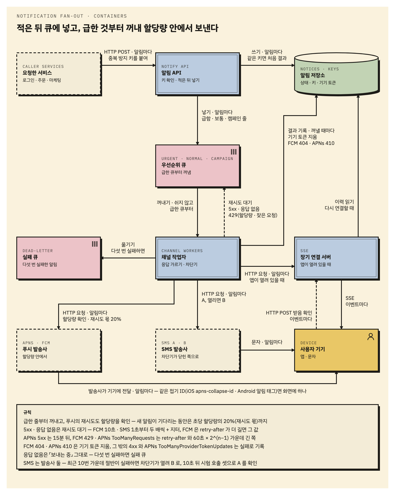
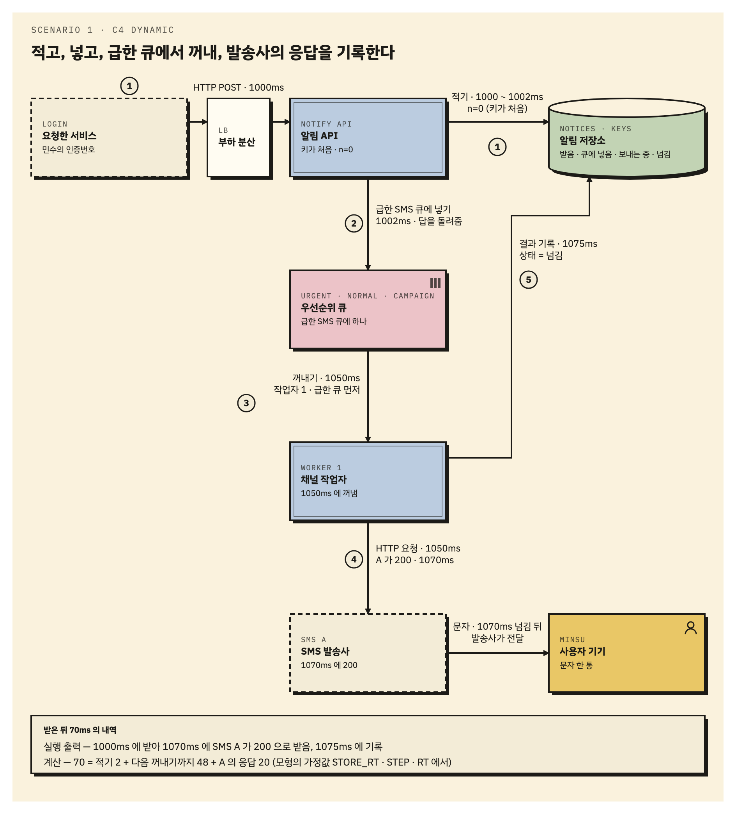
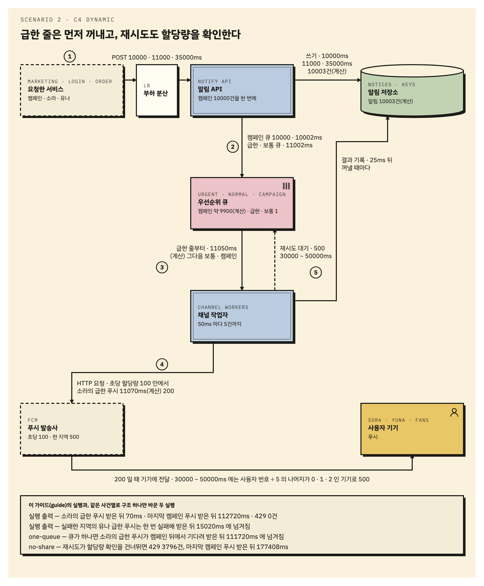
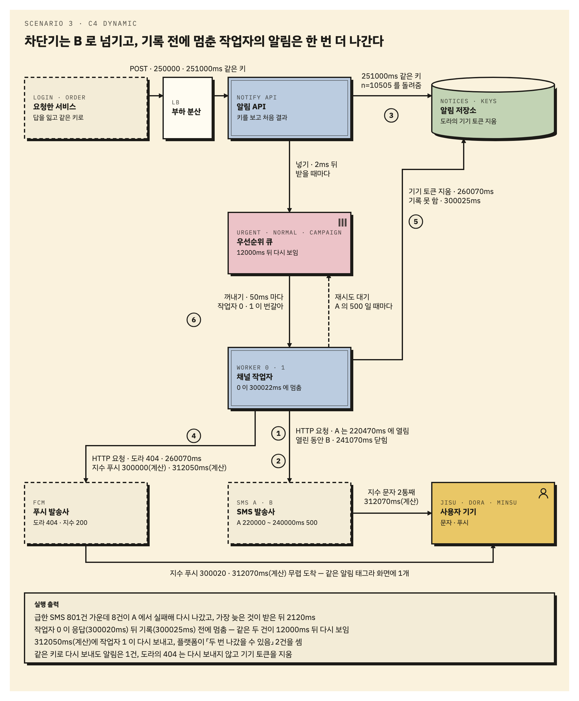

# 알림 대량 발송 — 받은 알림은 먼저 적고, 급한 줄부터 꺼내며, 재시도도 할당량을 확인한 뒤에만 보낸다

## 문제와 요구사항

사내의 여러 서비스가 사용자에게 알림을 보내는 상황을 떠올려 봅시다. 로그인 서비스는 민수에게 인증번호 문자를, 주문 서비스는 지수에게 배달 상태 알림을, 마케팅 서비스는 할인 행사 알림을 1백만 명에게 보내요. 이 서비스들이 「누구에게 무엇을」만 넘기면 실제 전달을 맡는 사내 플랫폼이 알림 시스템입니다. 교육용 분석인 Hello Interview 도 이것을 「Product services hand it a message and a recipient, and the platform takes care of actually delivering it.」로 정의해요([Hello Interview — Notification System](https://www.hellointerview.com/learn/system-design/problem-breakdowns/notification-system)). 실제 전달은 외부 발송사가 합니다. 발송사는 알림을 기기나 전화로 실어 나르는 외부 서비스예요. 아이폰 앱 알림은 APNs(Apple Push Notification service, 애플의 앱 알림 발송 서비스)가, 안드로이드 앱 알림은 FCM(Firebase Cloud Messaging, 구글의 앱 알림 발송 서비스)이 맡고, SMS(Short Message Service, 휴대전화 문자)는 문자 발송 대행사가 맡습니다. 앱 화면 밖에 뜨는 앱 알림을 이 글은 푸시라고 불러요.

가장 먼저 떠오르는 구조는 요청한 서비스가 발송사를 바로 부르는 것입니다. 그러면 캠페인 1백만 건이 먼저 줄을 차지한 순간 민수의 인증번호가 그 뒤에서 기다리고, 발송사가 한 지역에서 실패하면 각 서비스의 재시도가 한꺼번에 몰려 발송사의 한도를 넘깁니다. LY 의 푸시 플랫폼 글은 실제로 이런 일이 있었다고 적어요. 리전 장애로 재시도가 몰려 할당량을 넘겼고, 「전체 푸시 요청이 일시적으로 '429 too many request' 응답을 받았었습니다.」([LY Pushsphere 글](https://techblog.lycorp.co.jp/ko/pushsphere-reliable-and-prompt-high-volume-push-notification)). 429 는 「요청이 너무 많다」는 HTTP(앱과 서버가 주고받는 요청과 응답의 규약) 응답 코드예요.

```text
바로 부르기                                  이 글
  마케팅 ──▶ FCM  (1백만 건)                    요청한 서비스 ──▶ 알림 API ──▶ 알림 저장소에 먼저 적음
  로그인 ──▶ SMS 대행사  (인증번호)                                      └──▶ 우선순위 큐 (급함 · 보통 · 캠페인)
  ↳ 발송사가 실패하면 서비스마다 다시 부름           채널 작업자 ──▶ 급한 큐부터 꺼냄 ──▶ 발송사 (할당량 안에서)
  ↳ 인증번호가 캠페인 뒤에서 기다림                  응답 ──▶ 성공 기록 · 재시도 대기 · 기기 토큰 지우기 · 「실패」 기록 (다섯 번 실패하면 실패 큐)
```

그림의 이름을 먼저 소개합니다. 알림 API(Application Programming Interface, 프로그램끼리 요청을 주고받는 약속)는 요청한 서비스의 알림을 받는 입구예요. 알림 저장소는 받은 알림과 그 상태를 적어 두는 데이터베이스입니다. 큐는 넣은 차례대로 쌓아 두었다가 꺼내 주는 대기열이고, 우선순위 큐는 그 대기열을 급한 정도별로 나눈 것이에요. 나눈 하나하나를 줄(급한 줄 · 보통 줄 · 캠페인 줄)이라고 부르고, 「급한 큐」와 「급한 줄」은 같은 것을 가리켜요. 이 글에서 우선순위는 「우리 큐에서 무엇을 먼저 꺼낼지」 한 가지 뜻으로만 씁니다. 채널 작업자는 큐에서 알림을 꺼내 발송사에 보내는 프로세스예요. 할당량은 발송사가 정한 단위 시간당 보낼 수 있는 한도이고, 실패 큐(dead-letter queue)는 정한 횟수(이 글은 다섯 번)만큼 실패한 알림을 따로 모아 두는 큐입니다. 재시도 대기는 실패한 알림을 정한 시간만큼 기다리게 했다가 큐에 다시 넣는 일이고, 차단기는 한 발송사의 실패가 쌓이면 그 발송사로 가는 호출을 잠시 막는 장치예요. ID(identifier)는 무엇인지 가리키는 값입니다. 기기 토큰은 발송사가 앱 설치 하나에 붙여 준 주소이고, 앱을 지우면 더는 쓸 수 없게 돼요.

```text
우선순위       우리 큐에서 무엇을 먼저 꺼낼지              급함 > 보통 > 캠페인
발송사 긴급도   발송사가 기기를 언제 깨울지 (apns-priority · FCM priority)   ← 우선순위와 다른 값
중복 방지 키    요청한 서비스가 붙임, 같은 요청을 한 번만 받게      login-minsu-1
알림 번호      이 플랫폼이 알림마다 붙임                    n=0
접기 ID        같은 알림을 사용자 화면에서 하나로 보이게 하는 값 (iOS apns-collapse-id · Android 알림 태그)   알림 번호로 만듦
```

끝까지 읽으면 인증번호 하나가 어느 상자를 어떤 순서로 지나 70ms 만에 발송사에 넘겨지는지 실행 출력으로 확인할 수 있어요. 캠페인 1백만 건 뒤에 들어온 급한 알림이 왜 기다리지 않는지, 발송사가 실패할 때 재시도가 왜 한도를 넘기지 않는지, SMS 발송사가 멈추거나 작업자가 멈출 때 무엇이 한 번 더 나가는지도 숫자로 봅니다. 요구 수치가 바뀌면 어느 구조로 옮겨야 하는지도 판단할 수 있게 돼요. 기능 요구는 아래 셋입니다.

1. 요청한 서비스가 받는 사람 · 채널(푸시나 SMS) · 급한 정도 · 중복 방지 키를 넘기면, 알림이 그 사람의 기기나 전화로 나갑니다. 중복 방지 키는 요청한 서비스가 요청마다 만들어 붙이는 문자열이에요.
2. 같은 요청을 다시 보내도(응답을 받지 못해 다시 보낸 경우) 알림은 하나만 만들어집니다.
3. 한 번에 많은 사람에게 보내는 캠페인을 보낼 수 있고, 그동안에도 급한 알림이 나갑니다.

비기능 요구는 아래처럼 수치로 고정합니다. 근거 칸의 인용은 리서치 노트에서 원문과 글자 그대로 대조한 것이고, 링크는 참고 자료에 다시 모았어요. Hello Interview 의 수치는 어느 회사의 운영 값이 아니라 그 교육용 분석이 설계 대상으로 정한 가정이라, 빌려 쓴 행에는 그렇게 밝혔습니다.

| 항목 | 수치 | 근거 |
| --- | --- | --- |
| 1. 평시 발송량 | 하루 1천만 건(초당 평균 약 116건, 규모 추정 [1]) | 이 가이드의 가정 — 교육용 분석이 정한 가정을 빌렸어요(「Say we deliver 10M notifications a day. Spread evenly, that's about 100 per second which is honestly almost nothing.」). 사용자 1천만 명 규모의 서비스가 한 사람에게 하루 한 건꼴로 보내는 양으로 봤습니다 |
| 2. 몰릴 때 받는 양 | 초당 5천 건(평시의 50배)이 들어와도 받아 적음 | 이 가이드의 가정 — 같은 분석의 가정을 빌렸어요(「So we'll design for surges of 5,000 notifications per second or roughly 50x our sustained rate.」). LY 의 글은 많은 사용자가 같은 일을 겪으면 발송량이 「평소의 수배에서 수십배까지」 치솟는다고 적고 그 예로 지진을 들어요. 그 위쪽 끝에 맞췄습니다 |
| 3. 캠페인 | 1백만 명 캠페인 하나를 받은 뒤 5분 안에 모두 발송사에 넘김 | 이 가이드의 가정 — 같은 분석의 가정을 빌렸어요(「Delivering 1M inside 5 minutes works out to over 3,000 per second, and that's a single campaign.」). 할인 행사 알림은 몇 분 늦어도 되지만 행사가 시작되고 수십 분이 지나면 알릴 까닭이 줄어든다고 봤습니다 |
| 4. 급한 알림 | 인증번호 · 로그인 승인처럼 급한 알림은 캠페인이 진행 중이어도 받은 뒤 5초 안에 발송사에 넘김 | 이 가이드의 가정 — 같은 분석이 깊이 들어가는 절의 제목으로만 던진 질문(「How do we deliver high priority notifications within 5 seconds, even during a campaign blast?」, 본문은 유료)을 빌렸어요. 받는 사람이 로그인 화면에서 기다리는 알림이라 몇 초를 넘기면 다시 요청하게 된다고 봤습니다 |
| 5. 보통 알림 | 주문 · 배달 상태 같은 보통 알림은 받은 뒤 60초 안에 발송사에 넘김 | 이 가이드의 가정 — 화면 앞에서 기다리는 알림은 아니지만, 1분 넘게 늦으면 그사이 상태가 바뀌어 알림이 낡는다고 봤어요 |
| 6. 앱이 열려 있을 때 | 앱 화면을 보고 있는 사용자에게는 받은 뒤 1초 안에 화면에 띄움 | 이 가이드의 가정 — 화면을 보는 동안 생긴 일(새 메시지 · 주문 접수)은 바로 떠야 화면과 알림이 어긋나지 않는다고 봤어요 |
| 7. 정확도 — 빠짐 | 받았다고 답한 알림은 서버 한 대가 멈춰도 사라지지 않음. 발송사가 받았다고 답했거나, 보내지 못한 사실과 이유가 남아 요청한 서비스가 볼 수 있음. 허용 0 | 이 가이드의 가정 — 받았다고 답한 뒤 사라지면 요청한 서비스는 다시 보낼 기회를 잃어요. 우아한형제들의 SSE(Server-Sent Events, 서버가 열린 HTTP 연결로 이벤트를 계속 내려보내는 방식) 글도 「중요한 이벤트가 유실되거나 중복으로 전송된다면 사용자 경험을 크게 해치게 됩니다.」라고 적어요. 발송사가 받은 뒤 기기까지 전달하는 쪽은 다루지 않습니다(아래) |
| 8. 정확도 — 같은 요청 | 같은 중복 방지 키로 받은 뒤 24시간 안에 다시 보내도 알림은 하나만 만들어짐. 허용 0 | 이 가이드의 가정 — 응답을 잃은 서비스는 받았는지 알 수 없어 다시 보내요. 요청한 서비스가 장애에서 돌아와 다시 보내기까지 하루를 넘기지 않는다고 본 어림이 24시간입니다 |
| 9. 정확도 — 두 번 | 장애가 없을 때 같은 알림이 발송사로 두 번 나가는 일은 0. 서버가 멈추거나 발송사가 응답하지 않을 때 두 번 나간 알림은 그 수를 셀 수 있고, 사용자 화면에는 한 번만 보임 | 이 가이드의 가정 — 셀 수 있어야 요청한 서비스가 사용자에게 안내하거나 운영자가 장애의 영향을 가늠할 수 있어요. 사례 목록은 이 문제의 어려운 점을 「중복·유실 금지」로 적어요. 그런데 Kafka(기록을 순서대로 쌓는 메시지 로그) 설계 문서는 바깥 시스템까지 정확히 한 번 전달하려면 그 시스템의 협력이 있어야 한다고 적습니다(「Exactly-once delivery for other destination systems generally requires cooperation with such systems」, [Apache Kafka 설계 문서](https://kafka.apache.org/44/design/design/)). 발송사는 그런 장치를 주지 않으니(판단), 「금지」를 그대로 두면 어떤 구조도 지킬 수 없어요. 그래서 두 번 나가는 것을 장애 때로 묶어 세고, 사용자가 보는 화면 쪽 요구로 적었습니다 |
| 10. SMS 발송사 하나가 멈출 때 | 급한 SMS 는 4행이 그대로(받은 뒤 5초 안) | 이 가이드의 가정 — 우아한형제들은 2021-06-18 오후 5시 SMS 외부 시스템 장애로 서비스 전역에서 SMS 를 보내지 못했고, 「인증 문자 메시지를 발송할 수 없어」 라이더가 로그인하지 못했다고 적어요([우아한형제들 메시지 발송 이중화 글](https://techblog.woowahan.com/7724/)). 발송사 하나의 장애가 사용자의 로그인을 막지 않게 잡았습니다 |
| 11. 푸시 발송사 일부가 실패할 때 | 실패한 알림을 다시 보내느라 새 알림이 할당량 초과(429)로 거절되는 일 0 | 이 가이드의 가정 — LY 의 글이 적은 사건(리전 장애 뒤 재시도가 몰려 전체 요청이 429)이 근거예요. 실패와 상관없는 사용자의 알림까지 막히면 한 지역의 장애가 전체로 번집니다 |

일부러 다루지 않는 것도 적어 둡니다.

- 발송사가 알림을 받은 뒤 기기까지 전달하는 일은 다루지 않아요. 그 구간은 발송사가 맡는 일이고, APNs 문서도 「As a best-effort service, APNs may reorder notifications you send to the same device token.」라고 적습니다([APNs 요청 문서](https://developer.apple.com/documentation/usernotifications/sending-notification-requests-to-apns)). best-effort 는 「최선을 다하지만 보장하지는 않는다」는 뜻이에요. 7행의 「사라지지 않음」은 발송사가 받았다고 답한 데까지입니다.
- 이메일 채널은 다루지 않아요. 이메일 발송사의 장애와 이중화를 다룬 1차 글을 찾지 못했습니다.
- 받는 사람의 수신 동의 · 야간 발송 금지 · 사람마다의 빈도 제한, 채널 고르기(푸시 대신 문자), 알림 내용 만들기(템플릿 · 번역), 캠페인 대상 고르기는 범위 밖이에요.
- 앱이 기기 토큰을 등록하는 흐름은 다루지 않습니다. 기기 토큰은 이미 알림 저장소에 있다고 둬요.
- 알림 저장소 · 우선순위 큐 · 실패 큐가 잃지 않는다는 것은 범위 밖으로 빼지 않았어요. 이 부품들은 이 글이 고른 구조에만 있는 것이라, 기술 상세 설명의 「이 구조의 가정(실행 밖)」과 결정의 「포기하는 것」에 적었습니다.

## 규모 추정

식에 쓰는 이름을 먼저 짚어 둡니다. 할당량은 FCM 의 기본값을 씁니다. FCM 문서는 기본 할당량을 분당 60만 건으로 적어요(「The default quota of 600k messages per minute covers over 99% of FCM developers」, [FCM 할당량 문서](https://firebase.google.com/docs/cloud-messaging/throttling-and-quotas)). 같은 회사의 다른 문서는 같은 값을 「600K Quota Tokens for each 1-minute Token Bucket」로 적어 단위가 「메시지」와 「할당량 토큰」으로 다르고, 두 문서가 그 관계를 풀지 않습니다([FCM 대규모 발송 권고](https://firebase.google.com/docs/cloud-messaging/scale-fcm)). 토큰 버킷은 정해진 속도로 할당량 토큰이 채워지고 요청마다 하나씩 빠지는 한도 장치예요(FCM 은 1분 구간이 끝날 때마다 가득 채움). 이 글은 메시지 하나가 할당량 토큰 하나를 쓴다고 둡니다(가정). 재시도는 실패한 알림을 발송사에 다시 보내는 일이고, 지수 백오프는 다시 보낼 때마다 기다리는 시간을 두 배씩 늘리는 방법, 지터는 그 시간에 무작위 값을 더해 재시도가 한 시각에 몰리지 않게 하는 방법이에요. 가시성 시간(visibility timeout)은 작업자가 꺼낸 메시지를 큐가 다른 작업자에게 보이지 않게 숨겨 두는 시간입니다. 그 기본값은 AWS(Amazon Web Services) 의 큐 서비스인 SQS(Amazon Simple Queue Service) 문서에서 가져왔어요([SQS 가시성 시간 문서](https://docs.aws.amazon.com/AWSSimpleQueueService/latest/SQSDeveloperGuide/sqs-visibility-timeout.html)). 장기 연결 서버는 앱이 열려 있는 동안 기기와 연결을 계속 열어 두고 알림을 바로 내려보내는 서버예요. 그 한 대의 연결 수는 Netflix 의 WebSocket(한 연결로 서버와 앱이 양쪽에서 메시지를 주고받는 프로토콜) 서버 글에서 왔습니다([Netflix Pushy 글](https://netflixtechblog.com/pushy-to-the-limit-evolving-netflixs-websocket-proxy-for-the-future-b468bc0ff658)). 그 글의 20만은 서버 한 대의 평균이고, 함께 적힌 40만은 최대가 아니라 「breathing room」(여유)으로 적힌 값이에요.

```text
(입력)  하루 10,000,000 건(요구 1행) · 몰릴 때 초당 5,000 건(2행) · 캠페인 1,000,000 건을 300 초 안에(3행) · 급한 알림 5 초(4행)
        FCM 기본 할당량 분당 600,000 건(출처 — FCM 할당량 문서). 이 가이드는 기본 할당량을 쓴다고 둠(가정)
        재시도 횟수 3 번(출처 — LY Pushsphere 글의 「최대 가능한 재시도 횟수 = 3」) · 발송사가 실패시키는 비율 f(가정, 모두 실패면 1)
        평소 할당량 사용률 30%(가정)
        FCM 발송 요청의 타임아웃 10 초 이상(출처 — FCM 대규모 발송 권고) · SQS 가시성 시간 기본 30 초(출처 — SQS 문서)
        중복 방지 키 하나와 처음 결과 100 B(가정 — 키 문자열 약 40 B + 알림 번호와 상태 약 60 B)
        앱을 열어 둔 동시 접속 10,000,000(가정) · 장기 연결 서버 한 대의 평균 연결 200,000(출처 — Netflix Pushy 글)
        캠페인 하나의 가장 큰 크기 10,000,000 명(가정 — 1행의 하루 양을 캠페인 하나로 한꺼번에 보내는 극단, [5])
        다시 연결이 몰리는 시간 1 초 · 흩는 시간 10 초(가정 — 지터가 없을 때와, HTML(웹 문서 형식) 표준이 몇 초쯤으로 적은 다시 연결 간격의 몇 배로 흩을 때, [9])

[1] 평시                         10,000,000 ÷ 86,400 ≈ 115.7 건/초
[2] 캠페인 하나                   1,000,000 ÷ 300 ≈ 3,333 건/초   (3행을 지키는 최소 속도)
[3] FCM 할당량                    600,000 ÷ 60 = 10,000 건/초 ≥ [2] 3,333 · 2행 5,000
                                  캠페인 1,000,000 건을 할당량으로 보내는 시간 = 1,000,000 ÷ 10,000 = 100 초
[4] 큐 하나일 때 급한 알림        캠페인 1,000,000 건 뒤 → 1,000,000 ÷ 10,000 = 100 초 > 4행 5 초
                                  5 초 안에 들려면 앞에 있는 알림이 10,000 × 5 = 50,000 건 이하
[5] 1천만 명 캠페인               10,000,000 ÷ 600,000 ≈ 16.7 분 — 그동안 할당량을 모두 캠페인이 씀
[6] 횟수만 정한 재시도            발송사가 모두 실패시키면(f = 1) 시도 = 처음 1 + 재시도 3 = 4 배 → 30% × 4 = 120% > 100%
                                  시도마다 따로 실패하면 시도 = 1 + f + f² + f³ 배 → f = 0.6 이면 1 + 0.6 + 0.36 + 0.216 ≈ 2.18 배
                                  한 지역이 장애 동안 계속 실패하면 시도 = 1 + 3f 배 → f = 0.6 이면 1 + 3 × 0.6 = 2.8 배
[7] 작업자 안에서 붙잡는 재시도   타임아웃 10 초 × 시도 4 번(처음 1 + 재시도 3) = 40 초 > SQS 가시성 시간 기본 30 초 → 30 초가 지나면 다른 작업자도 같은 알림을 받음
[8] 중복 방지 키 저장             10,000,000 건/일 × 1 일 × 100 B = 1,000,000,000 B = 1 GB (24시간 기억, 8행)
[9] 장기 연결 서버                10,000,000 ÷ 200,000 = 50 대 · 한 대가 멈추면 200,000 대가 다시 연결
                                  지터 없이 1 초 안에 몰리면 초당 200,000 · 10 초에 흩으면 초당 20,000
```

이 계산이 구조를 정합니다. [4] 는 큐 하나를 뺍니다. 캠페인 1백만 건 뒤에 놓인 인증번호는 할당량을 다 써도 100초를 기다리고, 4행의 5초를 지키려면 앞에 5만 건 넘게 있으면 안 되기 때문이에요. 그래서 급한 알림을 따로 꺼내는 우선순위 큐가 필요합니다. [5] 는 할당량을 쓰는 방식을 정해요. 1천만 명 캠페인은 할당량 전체를 16.7분 동안 씁니다. 그 1분치를 분이 시작될 때 한꺼번에 쓰면, 그 분 안에 들어온 급한 알림은 꺼내도 보낼 할당량 토큰이 없어요. 그래서 작업자는 할당량을 초당 1만 건으로 고르게 나눠 쓰고, 꺼낼 때마다 급한 줄을 먼저 봅니다(판단). [6] 은 횟수만 정한 재시도를 뺍니다. 평소 30% 를 쓰던 시스템도 발송사가 모두 실패시키면 시도가 120% 가 되어 할당량을 넘기고, 넘긴 요청이 429 를 받아 또 재시도가 됩니다. 그래서 재시도도 할당량 확인을 거치게 했어요. 새 알림이 기다리는 동안 재시도가 쓸 수 있는 크기(재시도 몫, 초당 할당량의 20%)도 정해 뒀습니다. [7] 은 재시도를 작업자 안에서 붙잡고 하지 않고 큐에 다시 넣는 이유예요. [3] 은 할당량 하나로 2행 · 3행을 받을 수 있다는 것을 보입니다. 다만 [5] 처럼 캠페인이 10배면 3행을 어겨요(전환점 1).

```text
급한 알림이 기다리는 시간 (초, 할당량 초당 10,000 건)

큐 하나 — 캠페인 1,000,000 건 뒤      ████████████████████████████████████████  100
큐 하나 — 앞에 50,000 건               ██  5   (4행의 경계)
우선순위 큐 — 급한 큐를 먼저           ▏ 다음 꺼내기 한 번 (모형에서 받은 뒤 70ms 에 넘겨짐, 시나리오 2)
```

[8] 은 중복 방지 키를 하루 동안 기억해도 1 GB 라는 것을 보여요. 작습니다. 100 B 는 재지 않은 가정이라, 열 배여도 10 GB 예요. [9] 는 장기 연결 서버를 다시 띄울 때 지터가 필요한 이유예요. 20만 대가 1초 안에 몰리는 것과 10초에 흩는 것은 초당 연결 처리가 10배 차이입니다.

## 시스템 개념도



알림이 지나는 주된 길은 이렇습니다. 요청한 서비스가 중복 방지 키를 붙여 HTTP POST 요청을 보내면 알림 API 가 받아요. 알림 API 는 알림 저장소에서 그 키를 찾아, 처음 보는 키면 알림을 「받음」 상태로 적고 우선순위 큐의 급한 · 보통 · 캠페인 줄 가운데 하나에 넣고 「큐에 넣음」으로 고친 뒤 받았다고 답합니다. 이미 있는 키면 처음 결과를 그대로 돌려줘요. 채널 작업자는 우선순위 큐에서 급한 줄부터 알림을 꺼내 푸시는 푸시 발송사에, SMS 는 SMS 발송사 둘 가운데 차단기(실패가 쌓이면 그 발송사로 가는 호출을 막는 장치)가 닫힌 쪽(닫힘은 차단기가 그 발송사로 호출을 보내는 상태)에 보내요. 발송사의 응답은 넷으로 갈라 기록합니다. 성공(200)이면 「넘김」으로 적어요. 다시 보내도 되는 실패(FCM 429 · APNs TooManyRequests · 5xx 와 응답 없음)면 기다릴 시간을 두어 큐에 다시 넣습니다(재시도 대기). TooManyRequests 는 같은 기기 토큰에 요청이 잇달아 너무 많이 왔다고 APNs 가 답하는 429 의 사유이고, 5xx 는 서버 쪽 오류를 뜻하는 500번대 응답이에요. 개념도의 「규칙」 상자에 나오는 retry-after 는 발송사가 응답 머리에 적어 주는, 다시 보내기 전에 기다릴 시간이고, 2^(n−1) 은 n 번째 재시도면 2 를 n−1 번 곱한 배수예요. 채널 작업자는 보내기 직전에 알림을 「보내는 중」으로 적고, 응답이 없을 때는 그 상태를 그대로 둬요. 더는 쓸 수 없는 기기 토큰(FCM 은 404, APNs 는 410)이면 기기 토큰을 지워요. 그 밖의 4xx(요청이 잘못됐다는 400번대 응답 가운데 기기 토큰을 지우는 응답과 429 를 뺀 것으로, FCM 400 · 401 · 403, APNs 400 · 403 · 404 · 405 · 413)와, APNs 의 인증 토큰(우리 서버가 APNs 에 자기를 증명하려고 요청마다 붙이는 토큰)을 너무 자주 바꿨다는 429(`TooManyProviderTokenUpdates`)면 다시 보내지 않고 「실패」로 적어요. 다섯 번 실패한 알림은 실패 큐로 옮깁니다. 사용자가 앱을 열어 둔 동안에는 채널 작업자가 장기 연결 서버에 먼저 넘기고, 장기 연결 서버가 SSE(Server-Sent Events, 서버가 열린 HTTP 연결로 이벤트를 계속 내려보내는 방식)로 기기에 보냅니다. 이 글에서 「발송사에 넘김」은 발송사가 200 으로 받았다고 답한 것을 말해요.

## 시나리오로 따라가기

### 시나리오 1 — 민수의 인증번호 SMS 하나가 알림 저장소에 적히고 급한 큐를 거쳐, 받은 뒤 70ms 만에 SMS 발송사 A 에 넘겨진다

다른 알림도 장애도 없는 1000ms 에, 로그인 서비스가 민수에게 인증번호 SMS 하나를 보내 달라고 요청해요. 중복 방지 키는 `login-minsu-1` 입니다. 나와야 하는 것은 알림 하나가 받은 뒤 5초 안에 발송사에 넘겨지는 것(요구 4행)과, 받았다고 답한 그 알림이 서버 한 대가 멈춰도 기록으로 남는 것(7행)이에요. 시각은 모형의 가상 시계 값이고, 모형은 실제의 100분의 1 크기입니다(상황 설정).



1. 1000ms 에 로그인 서비스의 HTTP POST 요청이 앞단의 부하 분산(LB, Load Balancer — 요청을 여러 서버에 나눠 주는 장치)을 거쳐 알림 API 에 와요. 알림 API 는 알림 저장소에서 키 `login-minsu-1` 을 찾고, 처음 보는 키라 알림 번호 0 을 붙여 「받음」으로 적습니다. 알림 번호는 이 플랫폼이 알림마다 붙이는 번호예요. 키를 찾는 일을 알림 API 가 맡는 이유는, 같은 요청이 두 번 들어와도 큐에 넣기 전에 걸러야 알림이 둘로 늘지 않기 때문입니다(8행).
2. 1002ms 에 알림 API 가 알림 0 을 우선순위 큐의 급한 SMS 줄에 넣고, 「큐에 넣음」으로 고친 뒤 받았다고 답해요. 적고 나서 넣고, 넣고 나서 답합니다. 순서를 바꿔 답부터 하고 적기 전에 알림 API 가 멈추면, 로그인 서비스는 받았다고 알고 있는데 알림은 어디에도 없어요(7행을 어김).
3. 1050ms 에 작업자 1 이 우선순위 큐에서 급한 줄을 먼저 보고 알림 0 을 꺼냅니다. 모형의 작업자는 50ms 마다 한 번씩 꺼내므로(꺼내기 차례), 1002ms 에 들어온 알림은 다음 차례인 1050ms 에 나가요. 꺼낼 때마다 급한 줄을 먼저 보는 것이 4행을 지키는 규칙입니다.
4. 1050ms 에 작업자 1 이 알림 0 을 「보내는 중」으로 적고 SMS 발송사 A 에 보내요. 다시 꺼낸 알림이 이미 「보내는 중」이면 두 번 나갔을 수 있다고 세려고 먼저 적습니다(시나리오 3, 모형에서 적는 시간은 0). A 의 차단기가 닫혀 있어서(최근 호출이 실패하지 않음) A 로 갑니다. 1070ms 에 A 가 200 으로 받았다고 답하고, 이 순간이 「발송사에 넘김」이에요. 민수의 전화로 문자를 실어 나르는 일은 이제 발송사가 맡아요.
5. 1075ms 에 작업자 1 이 결과를 알림 저장소에 「넘김」으로 적고 큐에서 알림 0 을 지워요. 지우기 전에 적는 이유는, 지운 뒤 적기 전에 작업자가 멈추면 알림은 큐에도 없고 결과도 없어 「보내는 중」 상태로 남기 때문입니다. 반대로 이 순서 때문에 「발송사가 받은 뒤 · 적기 전」에 멈추면 같은 알림이 한 번 더 나가요(시나리오 3).

```text
t=1000ms login: urgent sms for minsu key=login-minsu-1 is stored as n=0 and queued at 1002ms, the reply goes back
t=1050ms worker 1: takes n=0 first from the urgent sms queue, sms A answers 200 at 1070ms, recorded at 1075ms, handed over 70ms after it was received
```

잠깐, 확인 하나만 해 볼까요? 받은 뒤 70ms 는 어디서 나왔을까요? 모형은 단계마다 정해 둔 시간을 더해요.

```text
1000ms   알림 API 가 받음
+2       알림 저장소에 적기 (가정한 저장소 왕복 STORE_RT)
+48      급한 줄에서 다음 꺼내기 차례까지 (50ms 마다 꺼냄, 1002 다음은 1050)
+20      SMS 발송사 A 의 응답 (가정한 발송사 왕복 RT)
합계     2 + 48 + 20 = 70ms   (요구 4행의 5초 안)
그 뒤 +5 결과 기록 (1075ms) — 넘김 시각에는 들지 않음
```

이 시나리오가 보여 준 것은 알림 하나가 지나는 순서와 그 순서의 이유입니다. 순서가 전부예요. 적고 → 넣고 → 답하고, 보내고 → 응답을 받고 → 적고 → 지워요. 앞의 순서는 7행의 「사라지지 않음」을 지키고, 뒤의 순서는 대가로 「한 번 더 나갈 수 있는 틈」을 남깁니다. 틈은 발송사가 200 으로 받은 뒤 우리가 기록하기 전까지의 시간이에요. 70ms 는 4행과 10행의 첫 근거로 요구 충족 확인에 가요.

### 시나리오 2 — 캠페인 1만 건(실제 1백만 건) 뒤에 들어온 급한 푸시가 70ms 만에 넘겨지고(큐 하나면 111720ms 뒤), 한 지역이 실패해도 재시도가 할당량을 확인한 뒤에만 나가 429 가 0건이다(확인을 건너뛰면 3796건)

10000ms 에 마케팅 서비스가 1만 명(모형 값, 실제는 1백만 명)에게 보내는 캠페인을 한 번에 요청해요. 1초 뒤인 11000ms 에 로그인 서비스가 소라에게 급한 로그인 승인 푸시를, 주문 서비스가 소라에게 보통 주문 푸시를 보냅니다. 푸시 발송사의 할당량은 초당 100건(실제 1만 건)이에요. 30000ms 부터 50000ms 까지는 FCM 대역(모형에서 FCM 대신 답하는 코드, 구현 코드 절의 대역 표)의 한 지역이 실패해, 사용자 번호를 5로 나눈 나머지가 0 · 1 · 2 인 기기(60%)로 가는 푸시가 500 을 받아요. 35000ms 에는 그 지역에 있는 유나에게 급한 푸시가 하나 들어옵니다. 같은 사건열을 큐 하나(`one-queue`)로, 그리고 재시도가 할당량 확인을 건너뛰는 구조(`no-share`)로도 실행해 비교해요. 나와야 하는 것은 캠페인 중에도 급한 알림 5초(4행) · 보통 알림 60초(5행), 캠페인 5분(3행), 새 알림의 429 0건(11행)입니다.



1. 10000ms 에 알림 API 가 캠페인 1만 건을 알림 저장소에 적고 10002ms 에 우선순위 큐의 캠페인 줄에 넣어요. 키는 캠페인 이름에 사용자 번호를 붙인 것이라, 마케팅 서비스가 같은 캠페인을 다시 보내도 늘지 않습니다.
2. 11002ms 에 소라의 급한 푸시는 급한 줄에, 보통 푸시는 보통 줄에 들어가요. 이때 캠페인 줄에는 아직 보내지 않은 알림이 약 9900건 있습니다(계산 — 10000 − 1초 × 100). 줄을 나눠 두는 이유는, 줄이 하나면 넣은 차례대로만 꺼낼 수 있어 소라의 알림이 그 9900건 뒤에 놓이기 때문이에요.
3. 11050ms(계산 — 11002ms 다음 차례) 꺼내기 차례에 작업자가 급한 줄 → 보통 줄 → 캠페인 줄 순으로 꺼내요. 소라의 두 푸시가 이 차례의 첫 두 자리를 차지하고, 11070ms(계산 — 11050 + 응답 20)에 FCM 대역이 200 으로 받습니다. 받은 뒤 70ms 예요. 같은 사건열을 큐 하나로 실행하면 소라의 급한 푸시는 캠페인 뒤에서 111720ms 를 기다렸습니다(`one-queue`). 규모 추정 [4] 의 100초와 같은 꼴이에요.
4. 작업자는 차례마다 할당량 토큰을 확인하고, 1초에 100개(실제 1만 개)를 50ms 차례 20번에 5개씩 나눠 씁니다. 1초치를 한 차례에 다 쓰면 그 초의 뒤쪽에 들어온 급한 알림은 할당량 토큰이 없어 다음 초까지 기다려요(규모 추정 [5] 의 판단). 그래서 「급한 줄 먼저」와 「고르게 나눠 쓰기」가 짝을 이룹니다.
5. 30000ms 부터 실패한 지역의 푸시가 500 을 받아요. 작업자는 기록할 때 이 알림을 재시도 대기로 큐에 다시 넣습니다. 기다리는 시간은 10초 × 2^(실패 횟수 − 1) 에 지터를 더한 값이에요(설계는 retry-after 가 오면 그 값과 10초 × 2^(n−1) 가운데 긴 쪽, 이 모형의 대역은 retry-after 를 보내지 않음). 10초는 FCM 문서의 「Wait at least 10 seconds before retrying a failed request.」에서 왔습니다(FCM 대규모 발송 권고). 429 였다면 설계는 retry-after 와 60초 × 2^(실패 횟수 − 1) 가운데 긴 쪽을 기다리지만, 이 모형은 429 도 같은 식으로 기다려요(대역 표). 기다림이 끝난 알림은 우선순위 큐의 재시도 줄로 돌아오고, 재시도도 새 알림처럼 할당량 토큰이 남아 있어야 꺼냅니다. 새 알림이 기다리는 동안 재시도가 쓰는 할당량 토큰은 초당 100 가운데 20(재시도 몫)까지이고, 새 알림이 없으면 남은 할당량 토큰도 써요. 할당량 확인을 거쳤으니 할당량을 넘는 요청이 없고 429 는 0건이었어요. 같은 사건열에서 재시도가 할당량 확인을 건너뛰면(`no-share`) 41900ms 부터 109987ms 까지 429 가 3796건 나왔고, 그 가운데 2361건은 처음 보내는 새 푸시였습니다. 지역은 50000ms 에 돌아왔는데도 429 가 약 60초 더 이어졌어요(계산 — 109987 − 50000). 429 를 받은 푸시가 다시 재시도가 되어 할당량을 넘는 요청을 계속 만들었기 때문입니다.
6. 35050ms(계산 — 35002ms 다음 차례)에 보낸 유나의 급한 푸시는 실패한 지역이라 500 을 받고, 10초 넘게 기다린 뒤 50000ms(계산 — 받은 35000 + 15020 − 응답 20) 차례에 다시 나가 받은 뒤 15020ms 에 넘겨졌어요. 급한 알림이라도 발송사가 실패하면 4행의 5초를 지키지 못합니다. APNs 라면 5xx 뒤 15분을 기다려야 해요(APNs 응답 문서). 보통 푸시도 실패가 30초를 넘으면 70초(계산 — 10 + 20 + 40) 넘게 기다릴 수 있고 60초를 넘으면 반드시 기다려(계산 — 세 번째 시도가 30 ~ 60초 사이에 나가므로) 5행의 60초를 넘깁니다. FCM 이 10초를 기다리라고 하고, 푸시는 기기 토큰이 발송사마다 따로라 다른 발송사로 넘길 수 없기 때문이에요(판단, 기술 상세 설명의 푸시 발송사). 캠페인의 마지막 푸시는 받은 뒤 112720ms 에 넘겨졌습니다. 실제 크기로 옮기면 1백만 건이 112.7초쯤(계산)이라 3행의 5분 안이에요(규모 추정 [3] 의 100초에 장애로 늘어난 시간을 더한 값, 상황 설정의 축소 비율).

```text
t=10000ms marketing: a campaign for 10000 users is stored and queued at 10002ms, the reply goes back
t=11000ms login: urgent push for sora key=approve-sora-1 is stored as n=10001 and queued at 11002ms, the reply goes back
t=11000ms order: normal push for sora key=order-sora-1 is stored as n=10002 and queued at 11002ms, the reply goes back
t=35000ms login: urgent push for yuna key=approve-yuna-1 is stored as n=10003 and queued at 35002ms, the reply goes back
guide: sora's urgent push was handed over 70ms after it was received, her normal push after 70ms, the last of the 10000 campaign pushes after 112720ms
one-queue: sora's urgent push was handed over 111720ms after it was received, her normal push after 111720ms, the last of the 10000 campaign pushes after 112720ms
guide: fcm region down 30000-50000ms, retries took at most 20 of the 100 tokens a second while new pushes waited, 429 from fcm 0 (0 on a first try), yuna's urgent push in the failed region after 15020ms and 1 failures, pushes through on a first try in that time 734, the last campaign push after 112720ms, failure queue 0
no-share: fcm region down 30000-50000ms, retries skip the quota check, 429 from fcm 3796 from 41900ms to 109987ms (2361 on a first try), yuna's urgent push in the failed region after 34538ms and 2 failures, pushes through on a first try in that time 718, the last campaign push after 177408ms, failure queue 0
```

같은 순간의 큐를 두 구조로 나란히 그리면 이렇습니다.

```text
11002ms 의 큐 (건수는 계산)        큐 하나 (one-queue)                     우선순위 큐 (guide)
                                   [ 캠페인 ×9900 | 소라 급함 | 소라 보통 ]     급한 줄  [ 소라 급함 ]
                                                                             보통 줄  [ 소라 보통 ]
                                                                             캠페인 줄 [ 캠페인 ×9900 ]
다음 꺼내기 (11050ms, 계산)              캠페인 5건                                소라 급함 · 소라 보통 · 캠페인 3건
소라의 급한 푸시가 넘겨질 때까지     111720ms                                  70ms
```

여기서 헷갈리기 쉬운 포인트는 「재시도를 빨리 할수록 실패한 알림이 빨리 나간다」는 생각입니다. 정본(이 글에서 바꾸지 않은 코드 `code/` 와 그 실행 출력)에 값을 찍는 줄을 더해 보면, 유나의 재시도 대기는 guide · no-share · 몫 50 세 실행 모두 49492ms 에 끝났어요(변형 실행 V12(바꾼 것: 정본 Java 의 `send` · `settle` · `tick` 에 값을 찍는 줄을 하나씩 더함. 세 줄 모두 `probe` 라는 글자와 실행 이름을 앞에 찍고, `send` 는 유나를 보낸 시각과 그 초에 쓴 재시도 몫, `settle` 은 유나가 받은 실패 코드 · 응답 시각 · 기다림 · 지터 · 재시도 대기가 끝나는 시각, `tick` 은 49450ms 부터 50000ms 까지의 꺼내기 차례마다 쓴 재시도 몫과 급한 재시도 줄에 있는 알림 수를 찍음. 지터는 한 번 뽑은 값을 변수에 받아 찍고 그대로 씀. 결과에는 손대지 않음), 지터 4422ms. 몫 50 은 변형 실행 V13(바꾼 것: V12 의 찍는 줄에 더해 `SHARE = 20` 을 `SHARE = 50` 으로)). `no-share` 는 그 순간 곧바로 보냈다가 아직 실패 중인 지역에서 500 을 한 번 더 받아 20초 넘게 더 기다렸고, 받은 뒤 34538ms 에 넘겨졌어요. `guide` 는 그 초의 재시도 몫 20 을 캠페인 재시도가 이미 다 써서 50000ms 차례까지 기다렸고, 지역이 돌아온 다음에 나가 받은 뒤 15020ms 에 넘겨졌습니다. 이 실행에서는 늦게 나간 것이 유나에게 오히려 나았던 셈이에요. 캠페인의 마지막 푸시는 `no-share` 가 받은 뒤 177408ms 로 `guide` 의 받은 뒤 112720ms 보다 64688ms 늦었어요(계산 — 177408 − 112720). 할당량을 넘긴 요청이 429 를 받고 다시 재시도가 되어, 그만큼 할당량을 더 썼기 때문입니다.

> 재시도도 할당량을 쓴다 — 확인 없이 보내면 새 알림의 자리를 빼앗고, 빼앗긴 알림이 다시 재시도가 된다.

이 시나리오가 보여 준 것은 몰림을 받아내는 두 장치입니다. 우선순위 큐는 캠페인이 줄을 차지해도 급한 알림 70ms(4행)와 보통 알림 70ms(5행)를 지키고, 재시도의 할당량 확인은 한 지역의 실패가 429 로 번지지 않게 해요(11행). 캠페인 1만 건은 받은 뒤 112720ms 만에 끝나(끝난 시각은 122720ms, 계산) 3행으로 갑니다. 지키지 못한 것도 하나 보였어요. 푸시 발송사가 실패하는 동안의 급한 푸시는 5초를 넘깁니다(유나의 15020ms, 4행의 미충족).

### 시나리오 3 — SMS 발송사 A 가 멈추면 차단기가 열려 B 로 넘기고, 작업자 0 이 발송사 응답 뒤 기록 전에 멈추면 같은 알림이 12000ms 뒤 다시 보여 312050ms(계산)에 한 번 더 나가 푸시는 같은 알림 태그라 화면에 하나만 남지만 SMS 는 두 통이 간다

200000ms 부터 280000ms 까지 로그인 서비스가 100ms 마다 급한 인증번호 SMS 를 하나씩, 모두 801건 보내요(모형 값, 실제는 초당 1천 건). 220000ms 부터 240000ms 까지 SMS 발송사 A 가 모든 요청에 500 을 돌려줍니다. 250000ms 에 로그인 서비스는 민수의 인증번호를 보낸 뒤 응답을 잃고, 1초 뒤 같은 키로 다시 보내요. 260000ms 에는 앱을 지운 도라에게 주문 푸시가 갑니다. 299990ms 에 주문 서비스가 지수에게 주문 푸시와 주문 SMS 를 하나씩 보내고, 300022ms 에 작업자 0 이 멈춰요. 나와야 하는 것은 A 가 멈춰도 급한 SMS 5초(10행), 같은 요청은 하나(8행), 받은 알림은 사라지지 않음(7행), 그리고 두 번 나간 알림의 수와 화면에 보이는 횟수(9행)입니다. 차단기의 상태는 닫힘(호출을 보냄) · 열림(호출을 막음) · 반열림(시험 호출 몇 개만 보내 회복을 확인함) 셋이에요.



1. 220000ms 부터 A 로 간 SMS 가 500 을 받아요. 작업자는 A 로 보낸 호출의 결과를 차단기에 남기고, 최근 10번 가운데 5번이 실패한 220470ms 에 차단기가 열립니다. 그 뒤의 SMS 는 B 로 가요. 실패한 5건은 재시도 대기에서 1초 × 2^(실패 횟수 − 1) 와 지터만큼 기다린 뒤 다시 나가는데, 그때 A 의 차단기가 열려 있어 B 로 갑니다. 차단기를 작업자가 맡는 이유는, 발송사를 고르는 순간에 바로 최근 결과를 볼 수 있는 곳이 보내는 쪽이기 때문이에요.
2. 열리고 10초가 지난 뒤 첫 SMS 차례인 230550ms 무렵(계산 — 220470 + 10000 뒤 100ms 마다 오는 SMS 의 꺼내기 차례) 차단기가 반열림이 되어, 그 뒤 SMS 셋을 시험 호출로 A 에 보내요. A 는 아직 멈춰 있어 셋 다 실패하고, 230770ms 에 차단기가 다시 열립니다. 이 셋도 재시도 대기를 거쳐 B 로 나가요. 두 번째 반열림(240850ms 무렵, 같은 식으로 계산)에서는 A 가 240000ms 에 돌아와 있어 시험 호출 셋이 모두 통과하고, 241070ms 에 차단기가 닫혀 SMS 가 다시 A 로 갑니다. 사람이 장애를 보고 전환하지 않아도, 열리는 데 470ms · 돌아오는 데 1070ms 가 걸렸어요(계산 — 220470 − 220000 · 241070 − 240000). 801건 가운데 A 에서 실패한 것은 8건(처음 5 + 시험 3)이고, 가장 늦은 급한 SMS 도 받은 뒤 2120ms 에 넘겨졌습니다.
3. 250000ms 에 알림 API 가 민수의 두 번째 인증번호를 알림 10505 로 적고 넣은 뒤 답했지만, 그 답이 로그인 서비스에 오지 않아요. 251000ms 에 로그인 서비스가 같은 키 `login-minsu-2` 로 다시 보내면, 알림 API 는 알림 저장소에서 그 키를 찾아 처음 결과(알림 10505, 이미 넘김)를 돌려주고 아무것도 더 넣지 않습니다. 키를 알림 저장소에 알림과 함께 적는 이유는, 키만 따로 적으면 「키는 있는데 알림이 없는」 상태가 남을 수 있기 때문이에요.
4. 260070ms 에 도라의 푸시가 FCM 대역에서 404 `UNREGISTERED`(그 기기 토큰이 더는 쓸 수 없음)를 받아요. 작업자는 다시 보내지 않고 알림 저장소에서 도라의 기기 토큰을 지웁니다. 다시 보내도 결과가 같고 할당량만 쓰기 때문이에요. FCM 문서도 400 · 401 · 403 · 404 는 「abort, and do not retry」라고 적습니다(FCM 대규모 발송 권고).
5. 300000ms(계산 — 응답 300020 − 20) 꺼내기 차례에 작업자 0 이 지수의 푸시(알림 10807)와 SMS(알림 10808)를 꺼내 「보내는 중」으로 적고 FCM 대역과 SMS 발송사 A 에 보내요. 300020ms 에 둘 다 200 으로 받았다고 답했고, 기록은 300025ms 에 할 차례였는데 작업자 0 이 300022ms 에 멈춥니다. 큐는 꺼낸 알림을 지우지 않고 가시성 시간 동안 숨겨만 두므로, 두 알림은 아직 큐에 있어요.
6. 가시성 시간 12000ms 가 지난 312000ms 에 두 알림이 큐에 다시 보이고, 다음 차례인 312050ms(계산)에 작업자 1 이 꺼냅니다. 두 알림이 이미 「보내는 중」이라, 작업자 1 은 「두 번 나갔을 수 있음」으로 센 뒤 다시 보내요. 발송사가 첫 번째를 받았는지 플랫폼은 모르니 세는 것은 가능성이고, 다시 보내지 않으면 첫 번째가 실제로 나가지 못한 경우 알림을 잃습니다(7행). 지수의 기기에는 푸시가 두 번 도착해요. 두 번 모두 같은 접기 ID(같은 알림을 사용자 화면에서 하나로 보이게 하는 값)를 달고 있어, 뒤에 온 것이 화면의 앞 알림을 바꾸고 화면에는 하나만 남습니다(`on screen 1`). 모형의 기기는 Android 의 알림 태그를 흉내 내요(기술 상세 설명의 푸시 발송사). SMS 에는 그런 장치가 없어 문자가 두 통 갑니다(`on screen 2`). 플랫폼이 센 「두 번 나갔을 수 있음」 2건(`flagged by the platform as maybe sent twice 2`)과 기기 대역이 센 실제 두 번 도착 2건(`arrived twice on devices 2`)이 이 실행에서는 같았어요.

```text
t=220470ms sms A: 5 of the last 10 calls failed, the breaker opens and sms go to B
t=230770ms sms A: half-open, 3 of 3 test calls failed, the breaker opens again
t=241070ms sms A: half-open, 3 test calls passed, the breaker closes and sms go to A again
t=250000ms login: urgent sms for minsu key=login-minsu-2 is stored as n=10505 and queued at 250002ms, the reply is lost
t=251000ms login: sends key=login-minsu-2 again, the api answers with n=10505 (handed over) and adds nothing, notifications for that key 1
t=260070ms fcm: 404 UNREGISTERED for dora's push n=10606, the token is removed and the push is not retried
t=300022ms worker 0: stops after the vendors answered 200 at 300020ms for normal push n=10807 to fcm and normal sms n=10808 to sms A, before recording at 300025ms
t=312000ms queue: the same 2 become visible again 12000ms after worker 0 took them, worker 1 sends them again
sms: 801 urgent from 200000ms to 280000ms, sent to A 605 times and to B 208 times, 8 failed at A and went out later, the slowest was handed over 2120ms after it was received
jisu's device: push n=10807 arrived 2 times, on screen 1 (the same tag replaces it), sms n=10808 arrived 2 times, on screen 2
guide: 10809 notifications, handed over 10808, token removed 1, failure queue 0, still waiting 0, arrived twice on devices 2, flagged by the platform as maybe sent twice 2
```

차단기 A 의 상태를 시간 순서로 다시 보면 이렇습니다.

```text
시각(ms)     220000      220470           230770              240000      241070
A            500 시작                                            회복
차단기 A     닫힘  ──▶   열림 ──(10초)──▶  반열림: 시험 3 실패 ──▶ 열림 ──(10초)──▶ 반열림: 시험 3 통과 ──▶ 닫힘
SMS 가 가는 곳 A          B                 시험 3 은 A, 나머지 B        B               A
```

두 번 나가는 틈도 그림으로 봅시다. 같은 원리가 생기는 자리는 이 하나만이 아닙니다.

```text
작업자 0     꺼냄 300000(계산) ── 보냄 ── 200 받음 300020 ──✕ 멈춤 300022 ── (기록 300025 은 없음)
큐           300000(계산) 부터 숨김 ──────────────── 가시성 시간 12000ms ────────▶ 312000 다시 보임 ──▶ 작업자 1 이 다시 보냄
지수의 기기   푸시 1회 · 문자 1통 (300020 무렵)                                   푸시 2회(같은 알림 태그 → 화면에 1개) · 문자 2통

같은 알림이 발송사로 두 번 나갈 수 있는 자리
  ① 작업자가 응답 뒤 기록 전에 멈춤                                          — 이 실행에서 2건
  ② 발송사가 받았는데 응답이 오지 않아 다시 보냄 — 「보내는 중」을 그대로 두어 셈      — 모형 밖(발송사 대역은 늘 응답함)
  ③ 발송사가 5xx · 다시 보내는 429 로 답했지만 실제로는 받았던 알림을 다시 보냄 — 셀 수 없음   — 모형 밖(대역의 500 · 429 는 늘 받지 않음)
  ④ 한 번의 처리가 가시성 시간보다 길어 다른 작업자도 꺼냄                      — 모형 밖(처리가 늘 25ms)
  ⑤ 큐 자체가 같은 메시지를 두 번 내줌(SQS 표준 큐) — 장애가 없어도 생김         — 모형 밖(모형의 큐는 한 번만 내줌)
  ⑥ 알림 API 가 큐에 넣은 뒤 「큐에 넣음」을 적기 전에 멈춰, 「받음」 다시 넣기가 한 번 더 넣음 — 모형 밖
  ⑦ 실패 큐에서 다시 넣은 알림이 사실은 발송사가 받았던 것(③과 같은 원리) — 셀 수 없음 — 모형 밖
  ⑧ 요청한 서비스가 24시간 뒤 같은 키로 다시 보냄(새 알림이 됨) — 셀 수 없음        — 모형 밖
  ⑤ · ⑥ 의 사본이 첫 사본이 끝난 뒤에 꺼내지면 작업자가 상태(넘김 · 기기 토큰 지움 · 실패 · 실패 큐)를 보고 버림(판단, 실행 밖)
  사본 둘이 함께 「보내는 중」이면(④ 포함) 막지 못하고 「두 번 나갔을 수 있음」으로 세기만 함 — ① · ② · ④ · ⑤ · ⑥ 은 셈
```

이 시나리오가 보여 준 것은 장애 셋이 어디서 무엇을 남기는가입니다. 이 실행에서 틀린 값이 남는 경로는 한 곳이에요. SMS 발송사 A 의 장애는 차단기 덕에 급한 SMS 를 2120ms 안에 B 로 넘겨 10행을 지켰어요. 응답을 잃은 요청은 중복 방지 키 덕에 알림 1건으로 남아 8행을 지켰고, 더는 쓸 수 없는 기기 토큰은 다시 보내지 않았습니다. 작업자가 응답 뒤 기록 전에 멈추면 같은 알림이 한 번 더 나가요. 푸시는 같은 알림 태그로 화면에 하나만 남아 9행을 지키지만, SMS 는 두 통이 가서 9행을 지키지 못합니다. 이것이 이 구조에 남는 「틀린 값」이에요. 플랫폼은 「보내는 중」 상태로 그 가능성을 세는 데까지 할 수 있습니다(`flagged by the platform as maybe sent twice 2`). 같은 일이 생길 수 있는 다른 자리는 위 그림의 ②~⑧ 이에요. 받은 10809건은 넘김 10808 · 기기 토큰 지움 1 · 실패 큐 0 · 기다림 0 으로 모두 기록에 남아 7행을 지켰습니다.

## 기술 상세 설명

### 구성 요소 — 요청한 서비스

알림을 보내 달라고 요청하는 사내 서비스들이에요. 로그인 서비스 · 주문 서비스 · 마케팅 서비스가 여기에 들어갑니다. 이 서비스들은 발송사를 모르고, 받는 사람 · 채널 · 급한 정도 · 내용 · 중복 방지 키만 알림 API 에 넘겨요.

맡는 일은 시나리오 1 의 1단계에서 요청을 보내는 것, 시나리오 3 의 3단계에서 응답을 잃었을 때 같은 키로 다시 보내는 것이에요. 키를 요청한 서비스가 만드는 이유는 「이것이 같은 요청인가」를 아는 곳이 요청한 쪽뿐이기 때문입니다. 알림 API 가 받을 때마다 새 번호를 붙이면 응답을 잃고 다시 보낸 요청과 새 요청을 가를 수 없어요.

```http no-compile
POST /notifications                       ← 알림 API 로 보내는 요청의 모양 (이 가이드의 설계)
{
  "key": "login-minsu-2",                 ← 중복 방지 키. 응답을 잃고 다시 보낼 때도 같은 값
  "user": 1, "channel": "sms", "urgency": "urgent",
  "body": "인증번호 482913"
}
```

같은 자리에 올 수 있는 다른 방법은 요청한 서비스가 발송사를 직접 부르는 것이에요. 부품이 줄고 지연도 짧지만, 몰림을 받아 줄 곳이 없고 재시도와 할당량 관리를 서비스마다 따로 해야 합니다. 시나리오 2 의 `no-share` 처럼 할당량을 보지 않는 재시도가 한 서비스에만 있어도, 할당량을 함께 쓰는 다른 서비스의 새 알림까지 429 를 받아요. 그래서 요청한 서비스는 넘기기만 하고, 보내는 일은 한곳에 모았습니다.

| 설정값 · 한계 | 값 | 이유 · 보장하지 않는 것 |
| --- | --- | --- |
| 다시 보내기 | 응답을 받지 못하면 같은 키로, 24시간 안에 | 요구 8행. 24시간이 지난 뒤 같은 키로 보내면 새 알림이 되어 두 번 나갈 수 있음(알림 저장소의 키 기억 기간) |
| 키 만들기 | 요청마다 하나, 다시 보낼 때는 같은 값 | 요청한 서비스가 키를 잘못 만들어 다른 요청에 같은 키를 쓰면 뒤 요청이 처음 결과를 돌려받아 나가지 않음 — 알림 API 는 이를 가를 수 없음 |

### 구성 요소 — 알림 API

요청한 서비스의 알림을 받는 HTTP 서버예요. 받은 요청의 중복 방지 키를 확인하고, 알림을 적고, 큐에 넣고, 받았다고 답합니다. 상태를 메모리에 두지 않아 여러 대를 띄울 수 있어요.

맡는 일은 시나리오 1 의 1 · 2단계(키 확인 → 적기 → 넣기 → 답하기), 시나리오 2 의 1 · 2단계(캠페인 1만 건과 소라의 알림을 줄에 나눠 넣기), 시나리오 3 의 3단계(같은 키에 처음 결과를 돌려주기)입니다.

```text
요청 (키 K) ──▶ 알림 저장소에 K 가 있나?
                 ├─ 있음 ──▶ 처음 결과(알림 번호 · 상태)를 돌려줌. 큐에 넣지 않음      ← 시나리오 3 의 3단계
                 └─ 없음 ──▶ 「받음」으로 K 와 함께 적음 ──▶ 우선순위 큐에 넣음 ──▶ 「큐에 넣음」으로 고침 ──▶ 받았다고 답함
                                         ↑ 순서: 적기 → 넣기 → 고치기 → 답하기
```

같은 자리에 올 수 있는 다른 방법은 키 확인을 큐에 맡기는 것이에요. SQS FIFO 큐(넣은 차례를 지키는 SQS 의 큐 종류)는 같은 중복 제거 ID 를 5분 동안 한 번만 받습니다. 다만 그 범위가 「If you retry the `SendMessage` action within the 5-minute deduplication interval, Amazon SQS doesn't introduce any duplicates into the queue.」로 5분이에요([SQS 정확히 한 번 처리 문서](https://docs.aws.amazon.com/AWSSimpleQueueService/latest/SQSDeveloperGuide/FIFO-queues-exactly-once-processing.html)). 요구 8행의 24시간을 덮지 못하고, 처음 결과를 돌려줄 수도 없어요. 그래서 키는 알림 API 가 알림 저장소에서 확인합니다. 알림 ID 는 APNs 문서가 `apns-id` 로 정의한 값(「A canonical UUID that's the unique ID for the notification.」, UUID 는 겹치지 않게 만든 128비트 식별 값)인데, 오류를 추적할 때 쓰는 값이지 중복을 막는 값이 아니에요(APNs 요청 문서). 그래서 중복 방지 키를 따로 둡니다.

**부하 분산.** 요청한 서비스의 요청은 알림 API 앞의 부하 분산을 지나 여러 대 가운데 한 대로 가요(경로 그림의 LB). 알림 API 는 상태를 알림 저장소에만 두므로, 한 대가 멈추면 부하 분산이 남은 대로 요청을 보내고 요청한 서비스는 같은 키로 다시 보내면 됩니다. 같은 키의 요청 둘이 서로 다른 대에 동시에 오면 두 대가 모두 「키 없음」을 볼 수 있어요. 그래서 키를 적는 일은 알림 저장소의 유일 제약(같은 키를 두 번 적지 못하게 하는 저장소 규칙)으로 하나만 성공하게 하고, 실패한 쪽은 처음 결과를 다시 읽어 돌려줍니다(판단). 모형은 요청을 하나씩 처리해 이 경합이 없어요(대역 표).

| 설정값 · 한계 | 값 | 이유 · 보장하지 않는 것 |
| --- | --- | --- |
| 순서 | 「받음」 적기 → 넣기 → 「큐에 넣음」 적기 → 답하기 | 답한 뒤 적으면 그 사이에 멈출 때 7행을 어김(시나리오 1 의 2단계) |
| 적은 뒤 넣기 전에 멈춤 | 「받음」(아직 큐에 넣지 못함)으로 1분 넘게 남은 알림만 큐에 다시 넣음(판단, 실행 밖) | 답을 하지 않았으니 7행을 어긴 것은 아니지만, 요청한 서비스가 같은 키로 다시 보내면 「받음」이 돌아와 아무도 넣지 않는 알림이 남음. 큐에 넣은 알림은 「큐에 넣음」으로 고쳐 두므로, 캠페인처럼 큐에서 오래 기다리는 알림이나 재시도 대기 중인 알림은 다시 넣지 않음. 큐에 넣은 뒤 「큐에 넣음」을 적기 전에 멈추면 같은 알림이 큐에 둘 들어갈 수 있음(시나리오 3 의 그림 ⑥) |
| 같은 키 동시 도착 | 저장소의 유일 제약으로 하나만 | 판단, 실행 밖 |

### 구성 요소 — 알림 저장소

받은 알림과 그 상태를 적어 두는 데이터베이스예요. 알림마다 알림 번호 · 중복 방지 키 · 받는 사람 · 채널 · 급한 정도 · 상태 · 실패 횟수를 두고, 받는 사람마다 기기 토큰을 둡니다. 상태는 일곱이에요. 그림의 4xx 는 요청이 잘못됐다는 뜻의 400번대 응답이에요.

```text
받음 ──(큐에 넣음)──▶ 큐에 넣음 ──(작업자가 꺼내 보내기 직전)──▶ 보내는 중
보내는 중 ──(200)──▶ 넘김
          ──(FCM 404 · APNs 410)──▶ 기기 토큰 지움       ← 다시 보내지 않음
          ──(그 밖의 4xx · APNs TooManyProviderTokenUpdates)──▶ 실패  ← 다시 보내지 않음, 기기 토큰은 그대로(APNs 404 · 405 도 여기)
          ──(응답 없음)──▶ 보내는 중 그대로, 실패 횟수 + 1, 재시도 대기  ← 다시 꺼낼 때 「두 번 나갔을 수 있음」으로 셈
          ──(FCM 429 · APNs TooManyRequests · 5xx, 실패 횟수 + 1)──▶ 큐에 넣음(재시도 대기) ──▶ … ──(다섯 번째 실패)──▶ 실패 큐
다섯 번째 실패가 응답 없음이면 ──▶ 실패 큐, 「두 번 나갔을 수 있음」 표시를 남김(판단)
다시 꺼낸 알림이 이미 「보내는 중」이면 ──▶ 「두 번 나갔을 수 있음」으로 셈
```

맡는 일은 시나리오 1 의 1 · 2단계에서 「받음」 · 「큐에 넣음」으로 적고 4단계에서 「보내는 중」, 5단계에서 「넘김」으로 고치는 것, 시나리오 3 의 6단계에서 「보내는 중」인 알림을 다시 꺼낼 때 「두 번 나갔을 수 있음」을 세게 하는 것, 시나리오 3 의 3단계에서 키로 처음 결과를 찾아 주는 것, 4단계에서 도라의 기기 토큰을 지우는 것이에요. 요청한 서비스는 알림 번호로 이 상태를 읽어 「보내지 못한 사실과 이유」를 봅니다(7행).

같은 자리에 올 수 있는 다른 방법은 알림을 큐에만 두고 따로 적지 않는 것이에요. 큐는 꺼내서 지우면 기록이 남지 않아, 요청한 서비스가 「그 알림이 나갔는가」를 물을 곳이 없어요. 키의 처음 결과를 돌려줄 수도 없습니다. LinkedIn 의 알림 시스템 ATC(Air Traffic Controller)도 이미 처리한 요청을 버린다고 적지만(「ATC handles the duplicated requests by dropping any request it has already processed」, [LinkedIn ATC 글](https://www.linkedin.com/blog/engineering/messaging-notifications/air-traffic-controller-member-first-notifications-at-linkedin)), 무엇을 키로 삼고 얼마나 기억하는지는 적지 않아요. 이 글의 키와 24시간은 요구 8행에서 정한 값입니다.

| 설정값 · 한계 | 값 | 이유 · 보장하지 않는 것 |
| --- | --- | --- |
| 키 기억 기간 | 24시간 | 요구 8행. 하루 1천만 건이면 약 1 GB(규모 추정 [8], 키 하나 100 B 는 가정) |
| 보내는 중 | 발송사에 보내기 직전에 적음 | 알림마다 쓰기가 한 번 더 듦(평시 초당 약 116번 더, 계산 — 규모 추정 [1]). 다시 꺼낸 알림이 「보내는 중」이면 「두 번 나갔을 수 있음」으로 셈 — 발송사가 받았는지는 모르므로 확정이 아니라 가능성 |
| 결과 기록 | 작업자가 한 번에 꺼낸 알림들(묶음, 채널 작업자 항목)마다 한 번에 | 발송사의 응답 뒤 기록 전에 작업자가 멈추면 같은 알림이 한 번 더 나감(시나리오 3 의 5 · 6단계) |
| 저장소의 보존 | 이 구조의 가정(실행 밖) | 적은 알림을 잃지 않는다고 둠(여러 벌 복제). 저장소를 잃으면 받았다고 답한 알림의 상태가 사라져 7행을 어기고, 키를 잃으면 같은 요청이 둘이 되어 8행을 어김. 저장소가 멈춘 동안은 알림 API 가 받지 못하고 작업자도 「보내는 중」을 적지 못해 1 · 2 · 3 · 4 · 5 · 6 · 10행을 어김. 이 저장소는 고른 구조(대안 비교의 C)에만 있는 부품이라 이 구조가 지는 부담 |

### 구성 요소 — 우선순위 큐

넣은 차례대로 쌓아 두었다가 꺼내 주는 큐를 급한 정도별로 나눈 것이에요. 채널마다 급한 줄 · 보통 줄 · 캠페인 줄 셋을 두고, 재시도 대기가 끝난 알림이 들어가는 재시도 줄을 따로 둡니다.

맡는 일은 시나리오 2 의 2 · 3단계(캠페인 약 9900건(계산)이 기다려도 급한 줄을 먼저 내주기), 5단계(재시도 대기가 끝난 알림을 재시도 줄로 받기), 시나리오 3 의 5 · 6단계(꺼낸 알림을 지우지 않고 가시성 시간 동안 숨겼다가 다시 보이기)예요.

```text
꺼내기 차례마다 보는 순서 (채널마다)
  급한 재시도 줄* → 급한 줄 → 보통 재시도 줄* → 보통 줄 → 캠페인 재시도 줄* → 캠페인 줄
  * 푸시: 재시도도 할당량 토큰이 남아야 꺼내고, 새 알림이 기다리는 동안은 재시도 몫(초당 할당량의 20%)까지만.
    몫이 다 찬 초에는 급한 줄의 재시도도 캠페인 새 알림 뒤에서 다음 초까지 기다림(우선순위 역전, 정본에서 약 508ms — 변형 실행 V12(바꾼 것: 정본 Java 의 `send` · `settle` · `tick` 에 값을 찍는 줄을 하나씩 더함. 세 줄 모두 `probe` 라는 글자와 실행 이름을 앞에 찍고, `send` 는 유나를 보낸 시각과 그 초에 쓴 재시도 몫, `settle` 은 유나가 받은 실패 코드 · 응답 시각 · 기다림 · 지터 · 재시도 대기가 끝나는 시각, `tick` 은 49450ms 부터 50000ms 까지의 꺼내기 차례마다 쓴 재시도 몫과 급한 재시도 줄에 있는 알림 수를 찍음. 지터는 한 번 뽑은 값을 변수에 받아 찍고 그대로 씀. 결과에는 손대지 않음))
    새 알림이 하나도 기다리지 않으면 20% 를 넘어 남은 할당량 토큰도 씀
  * SMS: 모형의 SMS 발송사에는 할당량이 없어 할당량 확인도 재시도 몫도 없이 차례대로 꺼냄(이 가이드의 가정)
```

같은 자리에 올 수 있는 다른 방법은 큐 하나에 급한 정도를 적어 두고 꺼낼 때 고르는 것과, Kafka 토픽(Kafka 에서 기록을 이름별로 모아 두는 곳)을 급한 정도별로 나누는 것이에요. 큐 하나는 [4] 의 계산대로 캠페인 뒤에서 급한 알림이 기다립니다. 시나리오 2 의 `one-queue` 에서 111720ms 였어요. 토픽을 나누는 방법은 LinkedIn 이 「For messaging, we use high-priority Kafka topics to prioritize member messages.」로 적은 것과 같은 꼴입니다(LinkedIn ATC 글). 이 문제에서는 실패한 알림 하나만 지연을 두어 다시 넣고, 처리한 알림을 하나씩 지워야 해요. 그래서 메시지마다 숨기고 지우는 작업 큐로 두었습니다(판단). LINE 도 2019년 새해에 「The push queue in messaging servers became full, losing pushes.」를 겪은 뒤 역할별로 큐를 나눴다고 적어요([LINE 연말 대비 글](https://engineering.linecorp.com/en/blog/how-line-messaging-servers-prepare-for-new-years-traffic/)). 그 글의 낱말은 「우선순위」가 아니라 「역할별 분리」입니다.

**가시성 시간과 적어도 한 번.** 작업자가 꺼낸 알림은 지워지지 않고 숨겨지기만 해요. 작업자가 기록을 마치고 지우면 끝나고, 지우지 못한 채 가시성 시간이 지나면 다시 보입니다. SQS 문서가 이 동작을 적어요(「If you don't delete it before the timeout expires, the message becomes visible again in the queue and can be retrieved by another consumer.」, SQS 가시성 시간 문서). 그래서 작업자가 멈춰도 알림을 잃지 않지만, 같은 알림을 두 번 내줄 수 있어요. SQS 표준 큐도 「Standard queues ensure at-least-once message delivery, but due to the highly distributed architecture, more than one copy of a message might be delivered」라고 적습니다([SQS 표준 큐 문서](https://docs.aws.amazon.com/AWSSimpleQueueService/latest/SQSDeveloperGuide/standard-queues.html)). 이것을 적어도 한 번(at-least-once) 전달이라고 해요.

```text
가시성 시간을 고르는 범위
  한 번의 처리 = 발송사 타임아웃 10 초(FCM 권고의 하한 — 「Set at least a 10 second timeout on send requests before retrying.」) + 기록  <  가시성 시간 12 초  (여유 약 2 초, 판단)
  짧으면 ── 처리 중인 알림을 다른 작업자가 또 꺼냄(두 번 나감)
  길면 ──── 작업자가 멈췄을 때 그 알림이 그만큼 늦음(급한 알림이면 4행을 어김)
```

| 설정값 · 한계 | 값 | 이유 · 보장하지 않는 것 |
| --- | --- | --- |
| 줄 | 채널마다 급함 · 보통 · 캠페인 + 재시도 줄 | 4행 · 5행. 모형은 푸시 · SMS 각 셋 |
| 가시성 시간 | 12초 | 위 그림의 범위. 작업자가 발송사가 받기 전에 멈추면 그 묶음의 알림은 12초 넘게 늦어, 그 안의 급한 알림은 4행을 어김(실행 밖 — 시나리오 3 의 묶음은 발송사가 이미 받은 뒤라 늦지 않고 사본만 다시 나감) |
| 전달 | 적어도 한 번 | 같은 알림을 두 번 내줄 수 있음(시나리오 3 의 그림 ① · ④ · ⑤) |
| 큐의 보존 | 이 구조의 가정(실행 밖) | 넣은 알림을 잃지 않는다고 둠(여러 벌 복제). 큐를 잃으면 그 알림들은 저장소에 「큐에 넣음」으로 남아 상태는 보이지만(7행) 아무도 꺼내지 않아 3 · 4 · 5 · 6 · 10행을 어김 — 운영자가 저장소에서 찾아 다시 넣어야 함. 큐 서버가 멈춘 동안은 알림 API 도 넣지 못하고 아무것도 나가지 않아 1 · 2 · 3 · 4 · 5 · 6 · 10행을 어김. 큐가 가득 차면 알림 API 가 받기를 거절해 요청한 서비스가 다시 보내게 함(판단). LINE 2019년의 사고는 큐가 차서 푸시를 잃은 일이었음 |

### 구성 요소 — 채널 작업자

우선순위 큐에서 알림을 꺼내 발송사에 보내고, 응답을 갈라 기록하는 프로세스예요. 여러 대가 함께 꺼내고, 모형에서는 작업자 0 · 1 이 50ms 마다 번갈아 한 묶음(푸시 5건과 SMS 5건까지)을 꺼냅니다. 묶음은 작업자가 한 번에 꺼내 보내고 결과를 한 번에 기록하는 알림들이에요.

맡는 일은 네 가지입니다. 시나리오 1 의 3 · 4 · 5단계에서 꺼내고 보내고 기록하기, 시나리오 2 의 4 · 5단계에서 할당량 토큰 확인과 재시도 몫 지키기, 시나리오 3 의 1 · 2단계에서 SMS 발송사를 차단기로 고르기, 3 의 4단계에서 응답을 가르기예요.

```text
발송사 응답                 할 일                                                  근거
200                        「넘김」으로 기록                                       —
5xx                        실패 횟수 + 1, 재시도 대기로 다시 넣기                   FCM 「For 500 errors: retry with exponential backoff.」
                             FCM: retry-after 가 있으면 그 값과 10초 × 2^(n−1)       FCM 503 「Honor the Retry-After header if it is included in the response from the FCM Connection Server.」 · 5xx 전체에 씀(판단)
                                  가운데 긴 쪽 + 지터(그 기다림 미만)                   FCM 「Wait at least 10 seconds before retrying a failed request.」
                             APNs: 15분 뒤                                        APNs 「After 15 minutes, you can retry …」
                             SMS: 1초 × 2^(n−1) + 지터(그 기다림 미만)               이 가이드의 설정(SMS 발송사의 문서는 이번에 보지 않음)
429(FCM 할당량 초과 ·       실패 횟수 + 1, retry-after 와 60초 × 2^(n−1)             FCM 「Use exponential backoff with a minimum initial delay of 1 minute to retry rejected messages.」
  APNs TooManyRequests)      가운데 긴 쪽만큼 기다려 재시도 대기로 다시 넣기         · 「retry after waiting for the duration set in the retry-after header」 — 두 문서를 함께 지키는 쪽(판단)
429(APNs TooManyProvider    「실패」로 기록, 다시 보내지 않음,                       APNs 「Update the authentication token no more than once every 20 minutes.」
  TokenUpdates)              인증 토큰 갱신을 20분에 한 번 이하로 고침
응답 없음(타임아웃)          「보내는 중」을 그대로 두고 실패 횟수 + 1,                이 가이드의 설계(판단) — 9행의 「셀 수 있음」
                             5xx 처럼 재시도 대기 — 다시 꺼내면 「두 번 나갔을 수 있음」으로 셈
다섯 번째 실패               실패 큐로 옮김. 마지막 실패가 응답 없음이면               이 가이드의 설정(판단)
                             「두 번 나갔을 수 있음」 표시를 남긴 채로
FCM 404 · APNs 410          기기 토큰 지우기, 다시 보내지 않음                        FCM 「For 400, 401, 403, 404 errors: abort, and do not retry.」 · APNs 410
그 밖의 4xx                 「실패」로 기록, 다시 보내지 않음, 기기 토큰은 그대로        같은 FCM 문장 · APNs 의 재시도 금지 목록(Forbidden · PayloadTooLarge 등)
                             APNs 404(BadPath) · 405(MethodNotAllowed) 도 여기      APNs 「The request contained an invalid :path value.」
```

**같은 429 에 두 문서가 다르게 말합니다.** FCM 오류 코드 문서는 할당량 초과에 「exponential backoff with a minimum initial delay of 1 minute」를 요구하고([FCM 오류 코드 문서](https://firebase.google.com/docs/cloud-messaging/error-codes)), 대규모 발송 권고는 「For 429 errors: retry after waiting for the duration set in the retry-after header.」와 헤더가 없으면 60초를 적어요. 어느 쪽이 앞서는지는 두 문서가 정하지 않습니다(확인 안 함). 이 글은 429 가 나지 않게 하는 쪽을 골랐고(재시도도 할당량을 확인), 429 를 받으면 retry-after 와 60초 × 2^(n−1) 가운데 긴 쪽만큼 기다립니다(판단 — 오류 코드 문서의 「Use exponential backoff with a minimum initial delay of 1 minute to retry rejected messages.」와 권고 문서의 retry-after 를 함께 지키도록). 5xx 가운데 오류 코드 문서가 Retry-After 를 따르라고 요구하는 것은 503(`UNAVAILABLE`) 줄이에요(「Honor the Retry-After header if it is included in the response from the FCM Connection Server.」). 이 문서에는 REST(HTTP 로 자원을 주고받는 API 방식) 표와 Admin SDK(Firebase 가 서버용으로 내놓은 라이브러리, SDK 는 Software Development Kit) 표가 따로 있어요. Admin SDK 표의 `messaging/internal-error` 줄은 다시 보내도 된다고 하고, 그때는 앞에 있는 `messaging/server-unavailable` 줄에 적힌 요구를 따르라고 적어요(「You could retry the same request following the requirements listed in the earlier `messaging/server-unavailable` row.」). REST 표의 500(`INTERNAL`) 줄은 다시 보내도 된다고 하면서 지수 백오프 안내와 FCM 장애 상태 페이지를 가리킬 뿐, Retry-After 는 말하지 않아요(「You could retry the same request following suggestions in …」). 이 글은 5xx 에 retry-after 가 있으면 그 값과 10초 × 2^(n−1) 가운데 긴 쪽을 기다립니다(판단, 5xx 전체에 씀). 이 모형에서는 FCM 대역이 retry-after 를 보내지 않고, 429 도 5xx 와 같은 10초 식으로 다룹니다(대역 표). APNs 는 5xx 를 「After 15 minutes, you can retry JSON payloads that receive response status codes that begin with 5XX.」로 적어, 이 글도 APNs 의 5xx 는 15분 뒤에 다시 보냅니다([APNs 응답 문서](https://developer.apple.com/documentation/usernotifications/handling-notification-responses-from-apns)). APNs 의 429 는 할당량이 아니라 두 가지 뜻이에요. `TooManyRequests` 는 같은 기기 토큰에 요청이 잦다는 뜻이고(「Too many requests were made consecutively to the same device token.」), 문서가 「You can retry with a delay, if you get the error code TooManyRequests.」라고만 적어 이 글은 FCM 429 와 같은 기다림(retry-after 와 60초 × 2^(n−1) 가운데 긴 쪽)을 씁니다(판단). `TooManyProviderTokenUpdates` 는 우리 서버가 APNs 인증 토큰을 너무 자주 바꾼다는 뜻이에요(「The provider’s authentication token is being updated too often. Update the authentication token no more than once every 20 minutes.」). 기다렸다 다시 보낼 일이 아니라 인증 토큰 갱신을 20분에 한 번 이하로 고칠 일이라, 그 알림은 「실패」로 적습니다(판단).

**재시도의 할당량 확인과 재시도 몫.** 재시도가 할당량 확인을 거치지 않으면 시나리오 2 의 `no-share` 처럼 429 가 3796건 나옵니다. 그래서 푸시의 재시도도 할당량 토큰을 써야 보낼 수 있어요. 새 알림이 기다리는 동안 재시도가 쓸 수 있는 크기를 재시도 몫이라 부르고, 초당 할당량의 20% 로 둡니다. 할당량이 없는 모형의 SMS 에는 둘 다 걸지 않아요. LY 의 글도 「재시도하기 전에 현재 할당량이 얼마나 남아 있는지 확인하는 로직을 추가했습니다.」라고 적고, 그 이유를 「제한된 할당량 안에서 새로운 요청을 처리하는 것이 더 합리적인 선택일 것입니다.」로 듭니다(LY Pushsphere 글). AWS 의 글도 재시도를 토큰 버킷으로 제한하는 방법을 적어요(「We have found that we can mitigate this risk by limiting retries locally using a token bucket」, [AWS Builders' Library 글](https://builder.aws.com/content/3EumjoZascWd1oZiEgL8ORlv3qE/timeouts-retries-and-backoff-with-jitter)).

```text
몫의 크기를 바꾼 변형 실행 (같은 사건열, guide — 유나 · 마지막 캠페인은 받은 뒤 걸린 시간)
  몫 0  (변형 실행 V1, 바꾼 것: `SHARE = 20` 을 `SHARE = 0` 으로)    429 0 · 유나 75070ms · 첫 시도 통과 800 · 마지막 캠페인 112070ms
  몫 20 (정본)                                                      429 0 · 유나 15020ms · 첫 시도 통과 734 · 마지막 캠페인 112720ms
  몫 50 (변형 실행 V2, 바꾼 것: `SHARE = 20` 을 `SHARE = 50` 으로)   429 0 · 유나 49220ms · 첫 시도 통과 682 · 마지막 캠페인 113270ms
```

429 를 0 으로 만든 것은 몫의 크기가 아니라 「재시도도 할당량 확인을 거친다」는 규칙이에요. 셋 모두 0 입니다. 몫의 크기가 가르는 것은 재시도가 새 알림 사이에 끼어 나가는가예요. 몫이 0 이면 실패한 유나의 급한 푸시가 캠페인 줄이 빌 때까지 기다려 받은 뒤 75070ms 에 나갔어요(변형 실행 V1). 급한 줄의 재시도가 캠페인의 새 알림 뒤로 가는 우선순위 역전입니다. 몫이 50 이면 새 알림의 첫 시도 통과가 682건으로 줄고 마지막 캠페인 푸시가 550ms 늦어졌어요(변형 실행 V2, 계산 — 113270 − 112720). 몫이 20 이어도 역전은 생겨요. 정본에서 유나의 재시도 대기는 49492ms 에 끝났어요. 그런데 그 초의 몫 20 을 캠페인 재시도가 이미 다 써서 49500 ~ 49950ms 의 열 차례 동안 캠페인 새 알림이 먼저 나갔고, 유나는 다음 초의 첫 차례인 50000ms 에 나갔습니다(변형 실행 V12(바꾼 것: 정본 Java 의 `send` · `settle` · `tick` 에 값을 찍는 줄을 하나씩 더함. 세 줄 모두 `probe` 라는 글자와 실행 이름을 앞에 찍고, `send` 는 유나를 보낸 시각과 그 초에 쓴 재시도 몫, `settle` 은 유나가 받은 실패 코드 · 응답 시각 · 기다림 · 지터 · 재시도 대기가 끝나는 시각, `tick` 은 49450ms 부터 50000ms 까지의 꺼내기 차례마다 쓴 재시도 몫과 급한 재시도 줄에 있는 알림 수를 찍음. 지터는 한 번 뽑은 값을 변수에 받아 찍고 그대로 씀. 결과에는 손대지 않음)). 약 508ms 의 역전이에요(계산 — 50000 − 49492). 몫 50 에서 유나가 받은 뒤 49220ms 만에 넘겨진 것은 몫이 남아 49500ms 차례에 곧바로 나갔다가 아직 실패 중인 지역에서 500 을 한 번 더 받았기 때문이에요(변형 실행 V13(바꾼 것: V12 의 찍는 줄에 더해 `SHARE = 20` 을 `SHARE = 50` 으로)). 몫이 클수록 유나가 늦다는 뜻은 아니고, 이 실행에서 재시도 시각과 지역이 돌아오는 시각이 그렇게 맞물린 결과입니다. 20% 는 새 알림을 크게 줄이지 않으면서 재시도를 계속 내보내는 값으로 고른 판단이에요.

**차단기.** 차단기는 최근 호출의 실패율을 보고 그 발송사로 가는 호출을 막는 장치예요. Resilience4j(자바용 장애 대응 라이브러리) 문서가 상태 전이를 이렇게 적습니다([Resilience4j 차단기 문서](https://resilience4j.readme.io/docs/circuitbreaker)). 실패율이 기준 이상이면 닫힘에서 열림으로(「The state of the CircuitBreaker changes from CLOSED to OPEN when the failure rate is equal or greater」), 정한 시간이 지나면 열림에서 반열림으로(「After a wait time duration has elapsed, the CircuitBreaker state changes from OPEN to HALF_OPEN」), 반열림에서 시험 호출의 실패율이 기준 아래면 닫힘으로(「If the failure rate and slow call rate is below the threshold, the state changes back to CLOSED.」) 가요. 기준 이상이면 다시 열립니다. 이 글은 SMS 발송사마다 차단기를 하나씩 두고, 보낼 때 A 의 차단기가 호출을 허락하면 A 로, 아니면 B 로 보내요.

```text
차단기 설정 (이 가이드)       최근 10번 · 5번 이상 쌓인 뒤 · 실패율 50% 이상 → 열림 · 10초 뒤 반열림 · 시험 3번 · 실패율 50% 이상이면 다시 열림
시나리오 3 (정본)             220000 A 멈춤 → 220470 열림 → 230770 다시 열림 → 241070 닫힘 · A 에서 실패 8 · 가장 늦은 급한 SMS 2120ms
차단기 없음 (변형 실행 V4)     A 로 1435번 · B 로 0번 · A 에서 실패 200 · 가장 늦은 급한 SMS 28170ms · 실패 큐 1
  바꾼 것: `FAIL_PERCENT = 50` 을 `FAIL_PERCENT = 101` 로 (열리지 않음)
열림 시간 2초 (변형 실행 V5)   반열림마다 시험 3 실패가 222770 부터 238870 까지 8번 · A 에서 실패 29 · 가장 늦은 급한 SMS 2120ms
  바꾼 것: `OPEN_FOR = 10_000` 을 `OPEN_FOR = 2_000` 으로
```

차단기가 없으면 A 가 멈춘 20초 동안 급한 SMS 가 모두 A 로 가서 실패하고, 1 · 2 · 4 · 8초의 재시도도 A 로 갑니다. 가장 늦은 급한 SMS 가 28170ms 로 10행의 5초를 넘겼고, 다섯 번 실패한 1건은 실패 큐로 갔어요(변형 실행 V4). 열림 시간을 2초로 줄이는 것은 회복을 빨리 확인하려는 값이지만, 변형 실행 V5 에서는 닫힌 시각이 정본과 같은 241070ms 였고 A 가 아직 멈춘 동안 반열림을 거듭해 A 에서의 실패만 8건에서 29건으로 늘었어요. 반대로 열림 시간이 길면 A 가 회복한 뒤에도 다음 반열림까지 B 로만 보내요. 정본에서는 A 가 240000ms 에 회복하고 241070ms 에 닫혀 그 시간이 1070ms 였어요(시나리오 3 의 2단계). 10초는 그 둘 사이에서 고른 판단입니다. 최근 10번은 한두 번의 우연한 실패로 열리지 않을 만큼의 개수이고, 50% 는 호출의 절반이 실패하면 그 발송사를 믿기 어렵다는 기준이며, 시험 3번은 한 번의 우연한 성공으로 닫히지 않게 고른 값이에요(셋 다 판단). 차단기의 단점도 있어요. AWS 의 글은 차단기가 시험하기 어려운 모드 전환을 들여온다고 적습니다(「circuit breakers introduce modal behavior into systems that can be difficult to test」, AWS Builders' Library 글).

같은 자리에 올 수 있는 다른 방법은 사람이 알람을 보고 발송사를 바꾸는 것이에요. 우아한형제들은 설정 서버를 10초마다 읽어 배포 없이 비율을 바꾸고, 두 번째 장애 때는 「장애를 인지함과 동시에 안정적으로 SMS를 발송할 수 있는 외부 시스템으로 트래픽을 100% 전환하였습니다.」라고 적어요. 다만 「현재는 알람이나 제보를 통해 사람이 장애를 인지하고 판단하여 트래픽을 전환하고 있습니다.」라고 적고, 그 이유로 「장애라고 판단할 수 있는 기준을 정하기 어렵기 때문이었습니다.」를 들어요(우아한형제들 메시지 발송 이중화 글). 알람에서 전환까지 걸린 시간은 숫자로 적혀 있지 않아 비교하지 못했습니다. 이 글은 기준을 숫자(최근 10번의 50%)로 정해 470ms(계산 — 220470 − 220000) 만에 바꾸는 쪽을 골랐고, 기준이 틀리면 정상인 A 를 막을 수 있다는 것이 그 대가예요(판단).

| 설정값 · 한계 | 값 | 이유 · 보장하지 않는 것 |
| --- | --- | --- |
| 묶음 | 50ms 마다 푸시 5건 · SMS 5건까지(모형) | 초당 할당량 100 을 차례 20번에 고르게 나눠 씀(규모 추정 [5]) |
| 재시도 | 5xx 는 FCM 10초 · SMS 1초를 첫 기다림으로 두 배씩(지터는 그 기다림 미만, FCM 은 retry-after 가 더 길면 그 값), APNs 5xx 는 15분 뒤, FCM 429 · APNs TooManyRequests 는 retry-after 와 60초 × 2^(n−1) 가운데 긴 쪽(APNs TooManyProviderTokenUpdates 는 다시 보내지 않음) | FCM 의 10초 권고와 503 의 Retry-After 요구(5xx 전체에 씀) · APNs 문서 · FCM 429 두 문서를 함께 지키는 쪽(판단). SMS 의 1초는 10행의 5초 안에 다시 보낼 수 있게 짧게 고른 가정 — 첫 재시도는 1 ~ 2초 뒤지만 두 번째까지 가면 3 ~ 6초라 5초를 넘을 수 있음(계산). 이 모형에서는 FCM 대역이 retry-after 를 보내지 않고, 429 도 5xx 와 같은 10초 식으로 다룸(대역 표) |
| 정한 횟수 | 다섯 번 실패하면 실패 큐 | 처음 1번 + 재시도 4번. 푸시면 기다림이 최소 10 + 20 + 40 + 80 = 150초(계산)라 그보다 짧은 장애에서는 실패 큐로 가지 않음 |
| 재시도 몫 | 초당 할당량의 20%, 할당량이 있는 푸시에만 | 위 변형 실행 표. 판단 |
| 차단기 | 최근 10번 · 50% · 10초 · 시험 3번 | 위 변형 실행 표. 작업자마다 따로 있는 것이 보통이지만 모형은 발송사마다 하나를 함께 씀(대역 표) |
| 차단기 상태 | 작업자의 메모리 | 작업자가 다시 뜨면 닫힘에서 시작해 실패를 다시 쌓아야 열림 — 그동안의 SMS 는 A 로 가서 실패함(판단, 실행 밖) |
| 기록 | 묶음의 응답을 모두 받은 뒤 한 번에 | 응답 뒤 기록 전에 멈추면 그 묶음이 다시 나감 — 묶음이 클수록 두 번 나가는 틈에 걸린 알림이 많음(모형에서 최대 10건, 시나리오 3 에서는 2건) |

### 구성 요소 — 실패 큐

정한 횟수(다섯 번)만큼 실패한 알림을 따로 모아 두는 큐예요. 영어로 dead-letter queue 라고 부릅니다. 여기에 온 알림은 더 보내지 않고, 운영자가 원인을 보고 다시 넣거나 버려요.

맡는 일은 채널 작업자가 다섯 번째 실패를 기록할 때 그 알림을 받는 것입니다. 정본 실행에서는 실패 큐로 간 알림이 0건이었어요(`failure queue 0`). 지역 장애를 길게 하고 정한 횟수를 줄인 변형 실행 V7(바꾼 것: `REGION_DOWN = {30_000, 50_000}` 을 `REGION_DOWN = {30_000, 120_000}` 으로, `MAX_ATTEMPTS = 5` 를 `MAX_ATTEMPTS = 3` 으로)에서는 `guide` 가 77건, 재시도가 할당량 확인을 건너뛴 `no-share` 가 2941건을 실패 큐로 보냈어요. 429 도 실패로 세니 `no-share` 는 횟수를 빨리 다 씁니다.

```text
변형 실행 V7 — 지역 장애 90초, 세 번 실패하면 실패 큐
  guide      429 0      실패 큐 77     넘김 10731
  no-share   429 7813   실패 큐 2941
```

같은 자리에 올 수 있는 다른 방법은 실패한 알림을 알림 저장소에 「실패」로만 적고 큐는 두지 않는 것이에요. 그래도 7행은 지켜지지만, 운영자가 원인을 고친 뒤 다시 넣을 알림을 찾으려면 저장소 전체를 차례로 읽어야 합니다. 큐로 두면 쌓인 수가 곧 감시 지표가 되고, 다시 넣는 일도 큐에서 큐로 옮기는 일이 돼요(판단). SQS 는 이 장치를 큐의 설정으로 줍니다. 받은 횟수가 `maxReceiveCount` 를 넘으면 실패 큐로 옮기는데, 기본값을 10 으로 적어요([SQS CreateQueue 문서](https://docs.aws.amazon.com/AWSSimpleQueueService/latest/APIReference/API_CreateQueue.html)). 다만 개발자 안내서는 같은 값을 「the number of times a consumer can receive a message from a source queue before it is moved to a dead-letter queue.」로 적어([SQS 실패 큐 문서](https://docs.aws.amazon.com/AWSSimpleQueueService/latest/SQSDeveloperGuide/sqs-dead-letter-queues.html)), 정확히 몇 번째 받기에서 옮기는지(이르면 · 넘으면)를 두 문서가 똑같이 말하지 않아요. 그래서 이 글의 「다섯 번 실패하면」은 작업자가 실패 횟수를 세어 옮기는 이 모형의 규칙이고, 큐의 받기 횟수는 작업자가 멈춰 기록하지 못한 알림을 거르는 뒷받침으로만 씁니다.

```json no-compile
{
  "VisibilityTimeout": "12",
  "RedrivePolicy": "{\"deadLetterTargetArn\":\"arn:aws:sqs:ap-northeast-2:123456789012:notify-dead-letter\",\"maxReceiveCount\":\"10\"}"
}
```

| 설정값 · 한계 | 값 | 이유 · 보장하지 않는 것 |
| --- | --- | --- |
| 옮기는 조건 | 작업자가 센 실패가 다섯 번(모형의 규칙). 마지막 실패가 응답 없음이면 「두 번 나갔을 수 있음」 표시를 남긴 채 옮김(판단) | 큐의 `maxReceiveCount` 경계는 두 문서가 다르게 적어 확정하지 못함(확인 안 함) |
| 다시 넣기 | 운영자가 원인을 고친 뒤(실행 밖) | 다시 넣을 때 같은 알림 번호와 접기 ID 를 써야 화면에서 하나로 보임. 실패가 사실은 발송사가 받았던 것이면 다시 넣은 SMS 는 두 통이 됨(시나리오 3 의 그림 ⑦) |
| 실패 큐의 보존 | 이 구조의 가정(실행 밖) | 옮긴 알림을 잃지 않는다고 둠. 잃어도 알림 저장소에 상태가 남아 7행은 지켜지지만, 다시 넣을 목록을 저장소에서 다시 찾아야 함 |

### 구성 요소 — 푸시 발송사

앱 알림을 기기까지 실어 나르는 외부 서비스예요. 아이폰은 APNs, 안드로이드는 FCM 이 맡고, 우리는 기기 토큰과 내용을 HTTP 요청으로 넘깁니다. 받았다는 200 뒤의 전달은 발송사가 맡는 일이에요.

맡는 일은 시나리오 2 의 3 · 5 · 6단계(할당량 안의 요청에 200, 실패한 지역에 500), 시나리오 3 의 4단계(지운 앱의 기기 토큰에 404), 5 · 6단계(같은 접기 ID 의 두 요청을 기기에서 하나로)예요.

```text
채널 작업자 ──HTTP 요청──▶ 푸시 발송사 ──(발송사의 전달, best-effort)──▶ 기기
              기기 토큰 · 내용 · 접기 ID · 발송사 긴급도 · 수명(TTL)
◀── 200 넘김 · 429(FCM 할당량 초과 · APNs 같은 기기 토큰에 잦은 요청이나 인증 토큰을 너무 자주 바꿈) · 5xx 발송사 오류
    · FCM 404 / APNs 410 더는 쓸 수 없는 기기 토큰 · 그 밖의 4xx 잘못된 요청(APNs 404 BadPath 포함)
```

**발송사 긴급도는 우선순위와 다른 값입니다.** APNs 의 `apns-priority` 는 10 이면 「to send the notification immediately」이고 5 면 기기의 전력 사정을 따르며(APNs 요청 문서), FCM 의 `high` 는 「FCM attempts to deliver high priority messages immediately」예요([FCM 발송사 긴급도 문서](https://firebase.google.com/docs/cloud-messaging/android-message-priority)). 둘 다 기기에서 언제 깨워 보여 줄지를 정하는 값이라, 이 글은 발송사 긴급도라고 부릅니다. 우리 큐에서 무엇을 먼저 꺼낼지(우선순위)와는 상관없어요(판단). FCM 은 오용하면 「your messages may be deprioritized to normal priority」라고 적으니, 캠페인에는 발송사 긴급도를 높이지 않습니다.

```json no-compile
{
  "message": {
    "token": "<기기 토큰>",
    "notification": { "title": "주문 접수", "body": "주문 5521 을 받았어요" },
    "android": { "priority": "HIGH", "ttl": "60s", "notification": { "tag": "n10807" } }
  }
}
```

접기 ID 는 발송사마다 이름이 달라요. iOS 는 `apns-collapse-id` 이고, APNs 문서는 이것을 「An identifier you use to merge multiple notifications into a single notification for the user.」로 정의하며 「When sending the same notification more than once, use the same value in this header to merge the requests.」라고 적습니다(APNs 요청 문서). Android 에서 같은 일을 하는 값은 알림 태그(`android.notification.tag`)예요. FCM 문서는 「If specified and a notification with the same tag is already being shown, the new notification replaces the existing one in the notification drawer.」로 적어요([FCM 메시지 REST 문서](https://firebase.google.com/docs/reference/fcm/rest/v1/projects.messages)). 이름이 비슷한 FCM 의 `collapse_key` 는 다른 일을 합니다. 같은 문서가 이것을 「An identifier of a group of messages that can be collapsed, so that only the last message gets sent when delivery can be resumed.」로 정의해요. 기기에 아직 전달되지 않은 메시지 가운데 마지막 것만 보내는 값이라, 이미 화면에 뜬 알림을 합치지 않습니다. 이 글은 접기 ID 를 알림 번호로 만들어 iOS 는 `apns-collapse-id` 에, Android 는 알림 태그에 넣어요. 같은 알림을 다시 보내면 같은 값이고, 다른 알림은 다른 값이에요. 알림 종류(「주문 상태」)로 만들면 서로 다른 두 알림 가운데 마지막 것만 남아 앞의 것이 사라지기 때문입니다. `collapse_key` 는 쓰지 않아요. 알림마다 다른 값을 넣으면 FCM 이 한 번에 받아 주는 `collapse_key` 값이 넷뿐이라 걸리기 때문입니다(「A maximum of 4 different collapse keys is allowed at any given time.」, 판단). `ttl` 은 발송사가 알림을 보관해 두는 최대 시간이에요. FCM 은 그 범위를 「The value must be a duration from 0 to 2,419,200 seconds (28 days)」로 적습니다([FCM 메시지 수명 문서](https://firebase.google.com/docs/cloud-messaging/customize-messages/setting-message-lifespan)).

같은 자리에 올 수 있는 다른 방법은 푸시 발송사를 둘 두고 SMS 처럼 넘기는 것이에요. 그런데 기기 토큰은 발송사가 앱 설치마다 붙여 준 주소라, 아이폰 기기 토큰을 FCM 에 넘길 수 없어요. APNs 와 FCM 사이를 자동으로 넘긴 1차 사례도 찾지 못했습니다(판단, 문서 문장으로 확인하지 않음). LY 의 Pushsphere 는 차단기가 열리면 「엔드포인트 매니저는 문제가 발생한 엔드포인트를 엔드포인트 풀에서 즉시 제거하고」 새 엔드포인트를 채우는데, 이것은 같은 발송사 안의 주소(엔드포인트)를 바꾸는 것이지 발송사를 바꾸는 것이 아니에요. 그래서 이 글의 푸시는 발송사 하나에 재시도와 할당량 확인으로 대응하고, 앱이 열려 있으면 장기 연결 서버로 먼저 보냅니다.

| 설정값 · 한계 | 값 | 이유 · 보장하지 않는 것 |
| --- | --- | --- |
| 할당량 | 분당 60만 건을 초당 1만 건으로 나눠 씀 | FCM 할당량 문서. 할당량의 분은 시계에 맞춰지지 않음(「Quotas are per-minute, but these minutes are not aligned to the clock.」) — 우리 쪽 1초 구간과 발송사의 1분 구간이 어긋나면 고르게 나눠도 429 가 날 수 있음(실행 밖, 모형은 둘을 맞춤) |
| 기기 하나의 한도 | 안드로이드 기기 하나에 분당 240 · 시간당 5천 | FCM 할당량 문서. `collapse_key` 를 단 메시지의 한도(「We limit collapsible messages to a burst of 20 messages per app per device, with a refill of 1 message every 3 minutes.」)는 이 글이 `collapse_key` 를 쓰지 않아 걸리지 않음. 같은 기기로 가는 새 알림과 재시도를 합쳐 분당 240 에 걸릴 수 있음(실행 밖) |
| 429 | FCM 은 할당량 초과, APNs `TooManyRequests` 는 같은 기기 토큰에 잦은 요청, APNs `TooManyProviderTokenUpdates` 는 인증 토큰을 너무 자주 바꿈 | FCM 429 와 APNs `TooManyRequests` 는 retry-after 와 60초 × 2^(n−1) 가운데 긴 쪽만큼 기다린 뒤(판단), `TooManyProviderTokenUpdates` 는 다시 보내지 않고 인증 토큰 갱신을 20분에 한 번 이하로 고침 |
| FCM 404 · APNs 410 | 기기 토큰 지우기 | FCM `UNREGISTERED` 는 HTTP 404(FCM 오류 코드 문서), APNs 는 410(「The device token is no longer active for the topic.」) |
| 전달 | 발송사의 best-effort | APNs 는 순서를 바꾸고 제한 · 보관 · 미전달이 있을 수 있다고 적음(「Your notifications may also get throttled, saved in storage, and in some cases, not delivered.」). 7행은 200 까지 |
| 발송사가 실패할 때 | 급한 푸시도 FCM 은 10초 넘게, APNs 는 15분 기다림 | 시나리오 2 의 유나 15020ms. 4행의 미충족. 실패가 30초를 넘으면 보통 푸시도 70초(계산 — 10 + 20 + 40) 넘게 기다릴 수 있고 60초를 넘으면 반드시 기다려(계산 — 세 번째 시도가 30 ~ 60초 사이에 나가므로) 5행의 미충족 |

### 구성 요소 — SMS 발송사

휴대전화 번호로 문자를 보내 주는 외부 대행사예요. 이 글은 대행사 A 와 B 를 둘 다 계약해 두고, 평소에는 A 로 보내다가 A 의 차단기가 열리면 B 로 보냅니다.

맡는 일은 시나리오 1 의 4단계(민수의 인증번호에 200), 시나리오 3 의 1 · 2단계(A 는 220000ms 부터 20초 동안 500, B 는 늘 200), 5단계(지수의 주문 문자에 200)예요.

```text
평소              A ◀── 모든 SMS                         B (대기)
A 의 차단기 열림   A ✕                                    B ◀── 모든 SMS
반열림             A ◀── 시험 3건                          B ◀── 나머지
```

같은 자리에 올 수 있는 다른 방법은 대행사 하나만 쓰는 것과, 둘에 늘 나눠 보내는 것이에요. 하나만 쓰면 우아한형제들의 2021-06-18 처럼 그 대행사가 멈춘 동안 SMS 가 전혀 나가지 않아요(요구 10행의 근거). 늘 나눠 보내면 한쪽이 멈출 때 실패하는 비율은 절반이지만, 차단기가 발송사마다 따로 열리므로 열리기까지 A 에서 실패하는 수는 같고 열리는 데 걸리는 시간만 길어져요(판단). 두 대행사 모두를 평소에도 운영해야 하는 것도 대가입니다. 우아한형제들은 A 가 동시 처리량을 넘으면 「B 외부 시스템에 트래픽을 50:50으로 분산할 수 있어야 합니다.」를 요구로 적었어요. 운영 결과가 아니라 요구로 적힌 문장입니다. 푸시와 달리 SMS 는 받는 사람의 전화번호만 있으면 어느 대행사로든 보낼 수 있어서 넘길 수 있어요(판단).

| 설정값 · 한계 | 값 | 이유 · 보장하지 않는 것 |
| --- | --- | --- |
| 고르는 규칙 | A 의 차단기가 허락하면 A, 아니면 B | 둘 다 열리면 A 로 보내 실패를 재시도 대기로 돌림(모형의 규칙, 이 실행에는 없음) |
| 두 번 보내기 | 막는 장치 없음 | 같은 문자를 두 번 보내면 두 통이 감(시나리오 3 의 6단계). 대행사가 중복 방지 키를 받아 주는지는 확인 안 함 |
| B 의 할당량 · 비용 | 확인 안 함 | B 가 A 의 양을 다 받을 수 있다고 둠(이 구조의 가정, 실행 밖) |

### 구성 요소 — 장기 연결 서버

앱이 열려 있는 동안 기기와 연결을 계속 열어 두고 이벤트를 내려보내는 서버예요. 이 글은 SSE 를 씁니다. 연결이 끊기면 앱이 다시 연결하면서 마지막으로 받은 이벤트 ID 를 `Last-Event-ID` 헤더로 알려요. HTML 표준은 이 헤더를 「The Last-Event-ID HTTP request header reports an EventSource object's last event ID string to the server」로 적습니다([HTML 표준의 SSE](https://html.spec.whatwg.org/multipage/server-sent-events.html)). 놓친 이벤트를 다시 보내는 일은 서버의 설계예요(판단). 이 글에서 「다시 연결」은 앱과 장기 연결 서버 사이의 연결을 다시 맺는 일이고, 발송사에 다시 보내는 「재시도」와 다른 말입니다.

```text no-compile
id: 10812                                  ← 이벤트 ID = 알림 번호
data: {"title":"새 메시지","body":"..."}

(끊긴 뒤 다시 연결)  GET /events  Last-Event-ID: 10812  ──▶ 서버가 알림 저장소에서 10812 뒤의 것만 다시 보냄
```

맡는 일은 앱이 열려 있는 사용자에게 받은 뒤 1초 안에 띄우는 것(요구 6행)이에요. 채널 작업자가 받는 사람의 연결이 있으면 장기 연결 서버에 먼저 넘기고, 기기가 정한 시간(예: 1초, 판단) 안에 받았다고 확인하지 않으면 푸시로 보냅니다. 모형은 이 상자를 실행하지 않아요(대역 표). 근거는 공개 사례와 계산입니다. Netflix 는 서버 한 대가 평균 20만 연결을 맡는다고 적어요. 같은 글이 적은 지연(중앙값 1ms 아래 · p99 4ms 아래, p99 는 100번 가운데 99번이 그보다 빠른 값)은 「For these requests where caching removed KeyValue from the hot path, we were able to greatly speed things up.」로 범위를 정한 요청들의 값이라, 6행의 근거로 쓰지 않습니다. 6행의 1초는 판단으로 남아요. 한 대가 멈추면 그 연결이 곧바로 다시 연결하므로(「When a Pushy instance goes down, the devices that were connected to it will immediately try to reconnect.」), 다시 연결에 지터를 둬야 해요(규모 추정 [9]). 우아한형제들은 서버를 다시 띄울 때 「각 세션 지속 시간을 random의 jitter 시간을 설정해 골고루 분포되도록 하였습니다.」라고 적었어요([우아한형제들 SSE 글](https://techblog.woowahan.com/23199/)).

같은 자리에 올 수 있는 다른 기술은 WebSocket 과 gRPC(구글이 만든 원격 호출 프레임워크) 양방향 스트림이에요. SSE 를 가르는 성질은 둘로 봤습니다(판단). 보통의 HTTP 요청 위에서 동작해 별도 프로토콜로 올리는 단계가 없고, 끊긴 뒤 다시 연결할 때 마지막 이벤트 ID 를 알리는 `Last-Event-ID` 가 표준에 있어요(HTML 표준의 SSE). WebSocket 표준인 RFC 6455 는 비정상 종료 뒤 다시 연결할 때 첫 시도를 무작위로 늦추라고 적지만(「The first reconnect attempt SHOULD be delayed by a random amount of time.」), 놓친 메시지를 이어 받는 장치는 정하지 않아요(2026-11-23 원문 대조 — `Last-Event-ID` 와 같은 낱말 0개, [RFC 6455](https://www.rfc-editor.org/rfc/rfc6455)). 그래서 WebSocket 에서 같은 일을 하려면 그 규칙을 직접 만들어야 해요. 받음 확인은 따로 HTTP 요청으로 보내면 돼요. 우아한형제들도 「WebSocket의 양방향 통신은 오버엔지니어링이 될 수 있습니다」라는 이유로 SSE 를 골랐어요. 다만 그 글은 PC 클라이언트에만 적용했고 모바일 앱은 향후 과제로 남겼습니다. Uber 는 반대로 SSE 에서 gRPC 로 옮겼는데, 같은 연결로 받음 확인을 바로 보내려는 것이었어요(「The acknowledgement can be sent over the same stream instantly without extra networking calls from the mobile client.」, [Uber 푸시 플랫폼 글](https://www.uber.com/blog/ubers-next-gen-push-platform-on-grpc/)). 받음 확인이 잦아 별도 요청이 부담이 되면 그쪽으로 옮깁니다(전환점 4).

| 설정값 · 한계 | 값 | 이유 · 보장하지 않는 것 |
| --- | --- | --- |
| 서버 수 | 동시 접속 1천만 ÷ 20만 = 50대 | 규모 추정 [9], 동시 접속은 가정 |
| 다시 연결 | 지터를 두어 10초에 흩음(판단) | 지터가 없으면 초당 20만 연결이 몰림(규모 추정 [9]) |
| 놓친 이벤트 | `Last-Event-ID` 뒤의 것을 알림 저장소에서 다시 보냄 | 보관 기간은 알림 저장소의 기간을 따름. 우아한형제들 글은 이력 보관 기간을 적지 않음 |
| 앱이 꺼져 있을 때 | 쓸 수 없음 — 푸시로 | 장기 연결은 푸시를 대신하지 않고 앞에 놓는 길(판단). 실행 밖 |

### 구성 요소 — 사용자 기기

알림을 받는 사람의 휴대전화예요. 앱은 푸시와 장기 연결로, 전화는 문자로 알림을 받습니다.

맡는 일은 시나리오 3 의 6단계에서 같은 접기 ID(Android 알림 태그)의 푸시 두 개를 화면에 하나로 남기는 것, 문자 두 통을 그대로 보여 주는 것이에요. 앱이 열려 있으면 장기 연결로 받은 이벤트에 받음 확인을 보내고, 끊기면 `Last-Event-ID` 로 다시 연결합니다.

```text
지수의 기기 (시나리오 3)
  푸시  n=10807 접기 ID n10807  ── 300020 무렵 도착 · 312070(계산) 무렵 도착 ──▶ 화면에 1개 (같은 알림 태그라 뒤의 것이 앞의 것을 바꿈)
  문자  n=10808                  ── 300020 무렵 도착 · 312070(계산) 무렵 도착 ──▶ 문자 2통
```

같은 자리에서 중복을 거를 다른 방법은 앱이 받은 알림 번호를 기억해 두 번째를 버리는 것이에요. 접기 ID 는 발송사와 기기의 운영체제가 처리해 앱이 꺼져 있어도 합쳐지지만, 앱이 직접 거르는 방법은 앱이 깨어나야 합니다(판단). 문자는 어느 쪽도 쓸 수 없어 두 통이 남아요.

| 설정값 · 한계 | 값 | 이유 · 보장하지 않는 것 |
| --- | --- | --- |
| 화면에서 하나로 | 같은 접기 ID(iOS `apns-collapse-id` · Android 알림 태그)면 뒤의 것이 앞의 것을 바꿈 | 두 번째 도착에 소리 · 진동이 다시 나는지는 확인 안 함. 문자에는 이 장치가 없음 — SMS 의 두 번은 9행의 미충족 |
| 받음 확인 | 장기 연결의 이벤트마다 | 실행 밖. 확인이 오지 않으면 푸시로 다시 보내므로, 확인만 잃은 경우 앱 화면과 푸시에 같은 알림이 둘 보일 수 있음 — 같은 접기 ID 를 써도 앱 화면 쪽은 합쳐지지 않음(판단) |

## 대안 비교

### 후보 구조 비교

후보는 다섯이에요. 기준은 이 문제에 걸리는 다섯으로 맞췄습니다. 캠페인 중 급한 알림이 5초 안에 나가는가(요구 4행), 발송사 일부가 실패할 때 429 가 번지는가(11행), 받은 알림이 사라지거나 두 번 나가는가(7 · 9행), 발송사 하나가 멈출 때 어떻게 되는가(10행), 따로 운영할 것이 몇인가를 봐요. AWS Well-Architected 의 여섯 기둥(운영 우수성 · 보안 · 신뢰성 · 성능 효율 · 비용 최적화 · 지속 가능성)으로 빠진 기준을 점검하면, 성능은 급한 알림의 지연이, 신뢰성은 빠짐 · 두 번 · 발송사 장애가 맡아요. 비용은 발송사 할당량과 SMS 두 통(문자는 건마다 요금이 듦)이 대신하고, 운영 우수성은 따로 운영할 것의 수로 봅니다. 보안과 지속 가능성은 이 문제에서 후보를 가르지 않아 뺐어요(판단).

| 후보 | 급한 알림(4행) | 429 (11행) | 빠짐 · 두 번(7 · 9행) | 이 글의 근거 | 얻는 것 | 포기하는 것 |
| --- | --- | --- | --- | --- | --- | --- |
| A. 요청한 서비스가 발송사를 바로 호출 | 캠페인을 보내는 서비스와 할당량을 나눠 씀 | 서비스마다 재시도 규칙이 따로라 막을 곳이 없음 | 받아 둘 곳이 없어 발송사가 멈추면 요청한 서비스가 떠안음 | 출처 — LINE 2019년 사고(0시의 몰림이 푸시 부품의 full GC(메모리를 비우느라 프로그램 전체가 잠시 멈추는 쓰레기 수집)로 이어져 큐가 차고 푸시를 잃음). 모형에 없음 | 부품이 가장 적고 지연이 짧음 | 몰림 · 재시도 · 할당량을 서비스마다 따로 관리 |
| B. 큐 하나 + 작업자 + 횟수만 정한 재시도 | 캠페인 뒤에서 기다림 | 재시도가 할당량을 넘김 | 큐가 받아 줌 | 모형 — `one-queue` 에서 111720ms, `no-share` 에서 429 3796건. 계산 — 규모 추정 [4] · [6] | 부품이 적고 몰림을 큐가 받음 | 4 · 5 · 11행 |
| C. 우선순위 큐 + 응답별 재시도 · 실패 큐 + 재시도의 할당량 확인 + SMS 이중화와 차단기 + 중복 방지 키 + 장기 연결(이 가이드) | 70ms(푸시 발송사 장애 중에는 15020ms) | 0건 | 받은 알림 0 사라짐, 두 번은 「보내는 중」으로 그 가능성을 세어 2건(기기 대역도 2건) | 모형 — `guide` 의 출력 전부 | 4행(푸시 발송사 장애 중 · 작업자가 발송사가 받기 전에 멈춘 묶음 제외) · 5행(푸시 발송사 장애가 30초(계산) 넘으면 제외) · 7 · 8행 · 10행(급한 SMS 가 드물 때 제외, 변형 실행 V10(바꾼 것: `i <= 800; i++) reqs.add(new Req(200_000 + 100L * i` 를 `i <= 80; i++) reqs.add(new Req(200_000 + 1_000L * i` 로)에서 받은 뒤 5670ms · 전환점 2) · 11행 | 부품이 많음, 저장소 · 큐 · 실패 큐의 보존은 이 구조의 가정(알림 저장소 · 큐 서버가 멈춘 동안 1 · 2 · 3 · 4 · 5 · 6 · 10행을 어기고, 알림 저장소를 잃으면 7 · 8행을 어기며, 우선순위 큐를 잃으면 3 · 4 · 5 · 6 · 10행을 어김), 응답 뒤 기록 전의 두 번이 남음(SMS 는 두 통), 발송사 장애 중의 급한 푸시 |
| D. 정확히 한 번(발송사 호출까지 한 트랜잭션 — 여러 일을 모두 하거나 하나도 하지 않는 처리 단위) | C 와 같음 | C 와 같음 | 두 번 0 | 출처 — Kafka 설계 문서(바깥 시스템은 협력이 있어야 함). 판단 — 발송사가 그런 장치를 주지 않음. 모형에 없음 | 9행을 SMS 까지 | 발송사의 협력이 없어 만들 수 없음 |
| E. 장기 연결만 | 앱이 열려 있으면 짧음 | 발송사 할당량을 쓰지 않음 | 앱이 꺼져 있으면 받지 못함 | 출처 — Netflix Pushy 글 · 우아한형제들 SSE 글(모바일은 아직 도입 전). 모형에 없음 | 지연이 짧고 할당량이 필요 없음 | 앱이 꺼진 사용자 전부, 연결 서버를 따로 운영 |

B 의 두 약점은 모형에서 하나씩 떼어 확인했어요. `one-queue` 는 C 에서 줄만 하나로 합쳤고, `no-share` 는 C 에서 재시도가 할당량 확인을 건너뛰게만 했습니다. 그래서 111720ms 와 3796건은 각각 그 한 가지 차이의 결과예요. 두 차이를 함께 가진 B 를 한 번에 실행한 것은 아닙니다.

여기서 헷갈리기 쉬운 포인트는 B 와 C 예요. 둘 다 큐가 있고 작업자가 꺼내 보내니 「줄만 나누고 재시도 규칙만 바꾼 것」으로 보입니다. 같은 사건열의 수치로 보면 차이가 커요.

```text
                              B 쪽 (줄 하나 · 확인 없는 재시도)              C (이 가이드)
소라의 급한 푸시(받은 뒤)         111720ms (one-queue)                          70ms
429                           3796건, 41900 ~ 109987ms (no-share)           0건
마지막 캠페인 푸시(받은 뒤)        177408ms (no-share)                           112720ms
유나의 급한 푸시(실패 지역, 받은 뒤)      34538ms · 실패 2번 (no-share)                  15020ms · 실패 1번
지역이 돌아온 뒤                429 가 약 60초(계산) 더 이어짐                     재시도가 할당량 확인을 거쳐 빠짐
```

B 에서 급한 알림이 늦는 것은 큐 하나가 넣은 차례대로만 꺼내기 때문이고, 그 크기는 앞에 있는 알림 수를 할당량으로 나눈 값입니다(규모 추정 [4], 계산). 캠페인이 1천 건이면 0.1초(1천 ÷ 1만으로 계산)라 B 로도 4행을 지켜요. 캠페인이 5만 건을 넘는 순간부터 B 는 4행을 어깁니다. B 에서 429 가 번지는 것은 할당량을 넘긴 요청이 다시 재시도가 되기 때문이에요. 지역이 50000ms 에 돌아왔는데도 429 가 109987ms 까지 이어진 것이 그 증거입니다. 모형과 LY 의 사건처럼 한 지역이 장애 동안 계속 실패하면 같은 알림이 거듭 실패하므로, 실패한 비율 f 가 60% 일 때 시도는 새 알림의 2.8배이고(계산 — 규모 추정 [6] 의 1 + 3f) 평소 사용률이 약 36% 를 넘으면 할당량을 넘겨요(계산 — 100% ÷ 2.8). 모형은 캠페인으로 할당량을 100% 쓰는 중이라 바로 넘었습니다.

D 는 9행을 SMS 까지 지키는 유일한 후보지만 만들 수 없어요. 우리 기록과 발송사의 전송을 한 번에 묶으려면 발송사가 「이 요청은 이미 받았다」를 알려 주는 장치가 있어야 합니다. APNs 문서에는 중복 방지라는 말이 없고(리서치 노트가 `dedup` · `duplicate` · `idempot` 을 세어 0개), 알림 ID 는 추적용이에요. 그래서 C 는 두 번을 없애는 대신 「보내는 중」 상태로 그 가능성을 세고(`flagged by the platform as maybe sent twice 2`), 푸시는 접기 ID 로 화면에 하나만 남깁니다. E 는 C 안에서 앱이 열려 있을 때만 먼저 쓰는 경로로 들어 있어요.

### 결정

```text
맥락: 하루 1천만 건(초당 평균 약 116건, 규모 추정 [1])(요구 표 1행),
      초당 5천 건(평시의 50배)이 들어와도 받아 적음(2행),
      1백만 명 캠페인 하나를 받은 뒤 5분 안에 모두 발송사에 넘김(3행),
      인증번호 · 로그인 승인처럼 급한 알림은 캠페인이 진행 중이어도 받은 뒤 5초 안에 발송사에 넘김(4행),
      주문 · 배달 상태 같은 보통 알림은 받은 뒤 60초 안에 발송사에 넘김(5행),
      앱 화면을 보고 있는 사용자에게는 받은 뒤 1초 안에 화면에 띄움(6행),
      받았다고 답한 알림은 서버 한 대가 멈춰도 사라지지 않음. 발송사가 받았다고 답했거나, 보내지 못한 사실과 이유가 남아
        요청한 서비스가 볼 수 있음. 허용 0(7행),
      같은 중복 방지 키로 받은 뒤 24시간 안에 다시 보내도 알림은 하나만 만들어짐. 허용 0(8행),
      장애가 없을 때 같은 알림이 발송사로 두 번 나가는 일은 0. 서버가 멈추거나 발송사가 응답하지 않을 때 두 번 나간 알림은
        그 수를 셀 수 있고, 사용자 화면에는 한 번만 보임(9행),
      SMS 발송사 하나가 멈출 때 급한 SMS 는 4행이 그대로(받은 뒤 5초 안)(10행),
      푸시 발송사 일부가 실패할 때 실패한 알림을 다시 보내느라 새 알림이 할당량 초과(429)로 거절되는 일 0(11행).
      규모 추정 [4] 가 큐 하나를, [6] 이 횟수만 정한 재시도를, [7] 이 작업자 안에서 붙잡는 재시도를 빼고,
      [5] 가 할당량을 고르게 나눠 쓰는 방식을 정한다.
결정: C — 알림 API 가 중복 방지 키를 알림 저장소에서 확인해 처음 보는 키면 알림을 「받음」으로 적고, 채널마다 급함 · 보통 · 캠페인
      줄로 나눈 우선순위 큐에 넣고 「큐에 넣음」으로 고친 뒤 답한다. 같은 키면 처음 결과를 돌려준다(키는 24시간 기억).
      「받음」으로 1분 넘게 남은 알림(큐에 넣지 못한 것)만 다시 넣는다.
      채널 작업자는 급한 줄부터 꺼내 푸시 발송사 할당량을 초당으로 나눠 고르게 쓰고, 보내기 직전에 「보내는 중」으로 적고, 응답을 가른다 —
      200 은 「넘김」, 5xx 는 지수 백오프와 지터(FCM 10초 · SMS 1초부터, FCM 은 retry-after 가 더 길면 그 값, APNs 는 15분 뒤)만큼
      재시도 대기로 다시 넣고, FCM 429 · APNs TooManyRequests 는 retry-after 와 60초 × 2^(n−1) 가운데 긴 쪽만큼 기다려 다시 넣고,
      APNs TooManyProviderTokenUpdates 는 「실패」로 적고 인증 토큰 갱신을 20분에 한 번 이하로 고치고,
      FCM 404 · APNs 410 은 기기 토큰을 지우고, 그 밖의 4xx(APNs 404 · 405 포함)는 「실패」로 적는다.
      응답이 없으면 「보내는 중」을 그대로 두고 실패 횟수를 하나 늘려 재시도 대기로 넣어, 다시 꺼낼 때 「두 번 나갔을 수 있음」으로 센다.
      다섯 번째 실패가 응답 없음이면 실패 큐로 옮기되 「두 번 나갔을 수 있음」 표시를 남긴다(판단).
      다섯 번 실패하면 실패 큐로 옮긴다. 다시 꺼낸 알림이 이미 「보내는 중」이면 「두 번 나갔을 수 있음」으로 센다.
      푸시의 재시도도 할당량 토큰을 확인하고, 새 알림이 기다리는 동안은 초당 할당량의 20%(재시도 몫)까지만 꺼낸다.
      SMS 에는 할당량 · 재시도 몫이 없다(이 가이드의 가정).
      SMS 는 발송사 A · B 에 차단기(최근 10번 · 50% · 10초 · 시험 3번)를 두어 A 가 열리면 B 로 보낸다.
      결과는 묶음의 응답을 받은 뒤 적고 나서 큐에서 지우며, 큐는 꺼낸 알림을 가시성 시간 12초 동안 숨긴다.
      접기 ID(iOS `apns-collapse-id` · Android 알림 태그)는 알림 번호로 만들고, 앱이 열려 있으면 장기 연결 서버(SSE)로 먼저 보내 1초 안에 받음 확인이 없으면 푸시로 보낸다.
      알림 저장소 · 우선순위 큐 · 실패 큐는 잃지 않는다고 둔다(이 구조의 가정).
결과: 얻는 것 — 캠페인 1만 건(실제 1백만) 뒤의 급한 푸시 70ms(one-queue 의 111720ms 와 비교), 보통 푸시 70ms,
        마지막 캠페인 푸시 받은 뒤 112720ms(3행의 5분 안), 지역 장애 중 429 0건(no-share 의 3796건과 비교),
        SMS 발송사 A 가 멈춰도 가장 늦은 급한 SMS 2120ms, 같은 키의 요청은 알림 1건, 받은 10809건이 모두 기록에 남음(실행 끝), 두 번 나갔을 수 있는 알림 2건을 플랫폼이 셈.
      포기하는 것 — 같은 알림이 발송사로 두 번 나가는 경우가 남는다. 처리하던 서버가 응답 뒤 · 기록 전에 멈출 때
          (실행에서 2건, 푸시는 화면에 1개 · SMS 는 2통 — 9행의 SMS 쪽 미충족), 발송사가 받고도 응답하지 않거나 5xx · 다시 보내는 429(FCM 429 · APNs TooManyRequests)로 답할 때,
          처리가 가시성 시간보다 길 때, 큐가 장애 없이 같은 메시지를 두 번 내줄 때, 알림 API 가 큐에 넣은 뒤 「큐에 넣음」을 적기 전에 멈출 때,
          실패 큐에서 다시 넣은 알림이 사실은 받았던 것일 때, 24시간 뒤 같은 키로 다시 보낼 때
          (실행 밖 — 시나리오 3 의 그림 ②~⑧, 「장애가 없을 때 0」은 이 구조의 가정). 그 가운데 5xx · 다시 보내는 429 로 답했지만 받았던 경우 ·
          실패 큐에서 다시 넣은 경우 · 24시간 뒤 같은 키는 플랫폼이 셀 수도 없음(9행 「셀 수 있음」의 미충족),
        지연 요구를 지키지 못하는 경우도 남는다 — 푸시 발송사가 실패하는 동안의 급한 푸시(유나 15020ms, APNs 5xx 면 15분 — 4행),
          실패가 30초(계산)를 넘을 때의 보통 푸시(70초 넘게 기다릴 수 있고 60초를 넘으면 반드시, 계산 — 5행),
          작업자가 발송사가 받기 전에 멈춘 묶음의 알림(가시성 시간 12초, 실행 밖), 재시도 몫이 다 찬 초의 급한 재시도
          (캠페인 새 알림 뒤에서 다음 초까지 — 정본에서 약 508ms, 변형 실행 V12(바꾼 것: 정본 Java 의 `send` · `settle` · `tick` 에 값을 찍는 줄을 하나씩 더함. 세 줄 모두 `probe` 라는 글자와 실행 이름을 앞에 찍고, `send` 는 유나를 보낸 시각과 그 초에 쓴 재시도 몫, `settle` 은 유나가 받은 실패 코드 · 응답 시각 · 기다림 · 지터 · 재시도 대기가 끝나는 시각, `tick` 은 49450ms 부터 50000ms 까지의 꺼내기 차례마다 쓴 재시도 몫과 급한 재시도 줄에 있는 알림 수를 찍음. 지터는 한 번 뽑은 값을 변수에 받아 찍고 그대로 씀. 결과에는 손대지 않음) — 우선순위 역전),
          급한 SMS 가 드물 때(변형 실행 V10(바꾼 것: `i <= 800; i++) reqs.add(new Req(200_000 + 100L * i` 를 `i <= 80; i++) reqs.add(new Req(200_000 + 1_000L * i` 로)에서 받은 뒤 5670ms, 전환점 2 — 10행),
        부품이 멈추거나 잃을 때 — 알림 저장소 · 큐 서버가 멈춘 동안은 받지도 보내지도 못해 1 · 2 · 3 · 4 · 5 · 6 · 10행을 어기며(이 구조의 가정), 알림 저장소를 잃으면 7 · 8행을 어기고, 우선순위 큐를 잃으면 상태는 남지만 아무도 꺼내지 않아
          3 · 4 · 5 · 6 · 10행을 어기며, 실패 큐를 잃으면 상태는 남아 7행은 지키지만 다시 넣을 목록을 저장소에서 찾아야 하고,
          작업자가 다시 뜨면 차단기가 닫힘에서 시작해 실패를 다시 쌓아야 열림(이 구조의 가정 · 판단, 실행 밖),
        차단기의 기준이 틀리면 정상인 A 를 막을 수 있음(판단), 알림마다 「보내는 중」 쓰기가 한 번 더 듦, 부품이 열이라 운영할 것이 많음.
      새로 생기는 일 — 알림 저장소 · 큐 · 실패 큐의 복제, 「받음」(큐에 넣지 못함)으로 1분 넘게 남은 알림 다시 넣기, 24시간 지난 키 지우기,
        실패 큐의 원인 보기와 다시 넣기, SMS 발송사 두 곳의 계약과 B 의 처리량 확인, 장기 연결 서버 50대(규모 추정 [9]),
        감시할 것 — 줄마다 기다리는 알림 수와 급한 알림의 넘김까지 걸린 시간, 초당 재시도가 쓴 할당량 토큰과 429 수,
        차단기 상태 변화, 실패 큐에 쌓인 수, 「두 번 나갔을 수 있음」으로 센 수.
      버린 안의 근거 — 모형으로 가른 것과 계산 · 판단을 나눈다.
        A (바로 호출): 출처 — LINE 2019년 사고. 계산 — 규모 추정 [6]. 모형에 없음.
        B (큐 하나 · 횟수만 정한 재시도): 모형 — one-queue 에서 111720ms, no-share 에서 429 3796건 · 마지막 캠페인 받은 뒤 177408ms
            (두 차이를 하나씩 뗀 실행). 계산 — 규모 추정 [4] · [6].
        C 에서 재시도 몫 0: 모형 — 변형 실행 V1(바꾼 것: `SHARE = 20` 을 `SHARE = 0` 으로)에서 유나 받은 뒤 75070ms.
        C 에서 차단기 없이: 모형 — 변형 실행 V4(바꾼 것: `FAIL_PERCENT = 50` 을 `FAIL_PERCENT = 101` 로)에서
            가장 늦은 급한 SMS 28170ms · 실패 큐 1.
        D (정확히 한 번): 출처 — Kafka 설계 문서. 판단 — 발송사가 협력 장치를 주지 않음. 모형에 없음.
        E (장기 연결만): 출처 — Netflix Pushy 글 · 우아한형제들 SSE 글. 판단 — 앱이 꺼진 사용자. 모형에 없음.
```

### 전환점

이 구조가 최적이 아니게 되는 조건은 여섯입니다.

1. 캠페인이 할당량 안에서 3행을 어길 때. 초당 1만 건이면 5분에 300만 건이 한도예요(계산 — 1만 × 300). 캠페인이 300만 명을 넘거나 1천만 명이면(16.7분, 규모 추정 [5]) 이 구조로도 3행을 지킬 수 없습니다. 발송사에 할당량을 늘려 달라고 요청하거나(늘릴 수 있는 상한은 확인 안 함), 캠페인을 시간대로 나눠 보내요. 급한 알림은 줄이 따로라 그동안에도 4행이 그대로입니다.
2. 급한 SMS 가 드물어 차단기의 최근 10번이 빨리 차지 않을 때. 차단기는 최근 호출 가운데 절반 이상이 실패해야 열리고, 그 호출에는 새 SMS 와 함께 실패한 SMS 의 재시도도 들어가요. 급한 SMS 를 1초에 한 건으로 줄인 변형 실행 V10(바꾼 것: `i <= 800; i++) reqs.add(new Req(200_000 + 100L * i` 를 `i <= 80; i++) reqs.add(new Req(200_000 + 1_000L * i` 로)에서는 A 가 멈추고 3070ms 뒤(계산 — 223070 − 220000)에 열렸고, 가장 늦은 급한 SMS 가 받은 뒤 5670ms 에 넘겨져 10행의 5초를 넘겼어요. 모형의 초당 10건에서는 470ms(계산)와 2120ms 였습니다. 그보다 드물면 발송사에 주기적으로 상태를 묻는 확인 호출을 두거나, 우아한형제들처럼 사람이 판단해 바꾸는 쪽이 낫습니다(판단).
3. 9행이 SMS 까지 「두 번 0」이 되어야 할 때(문자 한 통마다 요금이 커지거나, 두 번 온 문자가 사용자에게 다른 뜻이 되는 경우). C 로는 지킬 수 없어요. 발송사가 중복 방지 키를 받아 주는지 확인하고(확인 안 함), 받아 주지 않으면 「보내는 중」인 채로 다시 꺼낸 알림을 다시 보내지 않는 쪽(많아야 한 번)으로 옮깁니다. 그때는 7행의 「사라지지 않음」을 포기해요.
4. 앱을 열어 둔 사용자가 많고 받음 확인이 잦을 때. 동시 접속이 1억이면 장기 연결 서버가 500대예요(계산 — 1억 ÷ 20만). 받음 확인을 별도 HTTP 요청으로 보내는 비용이 커지면 Uber 처럼 같은 연결로 확인을 보내는 양방향 스트림(gRPC)으로 옮깁니다. 앱이 꺼진 사용자가 거의 없는 서비스라면 E 의 비중을 키워 푸시 할당량을 덜 써요.
5. 요청한 서비스가 하루 넘게 지나서 다시 보낼 때(8행의 24시간이 바뀔 때). 키 기억 기간을 늘려야 하고, 7일이면 7 GB 예요(계산 — 규모 추정 [8] 의 7배, 100 B 는 가정).
6. 4행을 푸시 발송사가 실패하는 동안에도 지키려 할 때. 지금 구조는 이때 4행을 지키지 못해요(요구 충족 확인의 4행). FCM 의 10초 기다림(APNs 는 15분)과 기기 토큰 때문에 넘길 곳이 없기 때문입니다(유나 15020ms). 급한 알림을 그동안 SMS 로 바꿔 보내는 채널 바꾸기가 필요하고, 이것은 이 글이 범위 밖에 둔 「채널 고르기」를 들여오는 일입니다(판단).

## 구현 코드

### 상황 설정

시나리오 1 ~ 3 과 그 비교를 한 프로그램에서 차례로 재현합니다. 양과 속도는 100분의 1로 줄였어요. 캠페인은 1만 명, 푸시 할당량은 초당 100건, 급한 인증번호 SMS 는 초당 10건입니다. 줄이지 않은 것은 시각과 시간이에요. 재시도의 첫 기다림(푸시 10초 · SMS 1초), 가시성 시간 12초, 차단기의 열림 10초, 발송사 응답 20ms 는 줄이지 않은 값(설계값이거나 가정)으로 뒀습니다. 급한 알림이 큐 하나에서 기다리는 시간은 「앞에 있는 알림 수 ÷ 할당량」이라 둘을 같은 비율로 줄이면 그대로예요. 크기를 두 배로 늘린 변형 실행 V6(바꾼 것: `FANS = 10_000` 을 `20_000` 으로, `QUOTA = 100` 을 `200` 으로, `PER_TICK = 5` 를 `10` 으로, `SHARE = 20` 을 `40` 으로, `OTP_USERS = 20_000` 을 `40_000` 으로, `MAX = 11_000` 을 `21_000` 으로)에서도 소라의 급한 푸시는 `one-queue` 에서 받은 뒤 111720ms, 마지막 캠페인 푸시는 `guide` 에서 받은 뒤 112720ms 로 정본과 같았어요. 다만 `no-share` 의 마지막 캠페인 푸시는 받은 뒤 259835ms 로 정본의 받은 뒤 177408ms 와 달랐고, 실패한 지역의 유나 급한 푸시도 `guide` 에서 39020ms · 실패 2번으로 정본(15020ms · 1번)과 달랐어요. 재시도 시각은 지터 수열과 크기에 따라 달라져 크기에 비례하지 않습니다. 같았던 것은 「유나의 급한 푸시가 5초를 넘긴다」는 결론과, 재시도가 할당량 확인을 건너뛰면 429 가 생긴다는 결론이에요(`no-share` 에서 429 7645건, `guide` 에서 0건).

다르게 읽어야 하는 값도 있어요. 차단기는 최근 호출 10번을 보는데, SMS 가 실제로 초당 1천 건이면 새 SMS 만으로도 실패 5건이 5ms 만에 쌓입니다(5 ÷ 1천 초로 계산). 그래서 모형의 열리기까지 470ms(계산 — 220470 − 220000)는 실제보다 긴 쪽이에요(판단, 실패가 처음부터 모든 호출에 생기고 차단기 하나가 모든 호출을 볼 때). 차단기가 작업자마다 따로면 작업자 N 대가 실패를 나눠 보므로 열리는 데 약 5N ms 가 걸려요(계산 — 5건 × N 대 ÷ 초당 1천 건). 작업자가 94대를 넘어야 모형의 470ms 보다 길어집니다(계산 — 470 ÷ 5). 작업자가 50ms 마다 꺼내는 것은 모형의 차례이고, 실제 작업자는 쉬지 않고 꺼내요. 시나리오 1 의 70ms 가운데 48ms(계산 — 1050 − 1002)가 이 차례에서 와요.

| 실제 구성 요소 | 코드의 타입 | 대역이 흉내 내는 것 | 흉내 내지 않는 것 |
| --- | --- | --- | --- |
| 요청한 서비스 | `Req` · `reqs` | 로그인 · 주문 · 마케팅의 요청과 시각, 응답을 잃고 1초 뒤 같은 키로 다시 보내기 | 요청한 서비스가 다시 보내는 규칙(모형은 정해 둔 시각에 한 번), 키를 잘못 만드는 일 |
| 부하 분산 | 없음 | — | 장치와 그 지연, 알림 API 여러 대 |
| 알림 API | `request` · `keys` | 키 확인 → 적기 → 2ms 뒤 넣기, 같은 키면 처음 결과, 캠페인을 사용자마다의 알림으로 나눔 | 같은 키의 동시 도착(모형은 요청을 하나씩 처리), 적은 뒤 넣기 전에 멈춤, 「받음」(큐에 넣지 못함)으로 1분 넘게 남은 알림 다시 넣기, 캠페인 1만 건을 적는 시간(모형은 2ms) |
| 알림 저장소 | `notices` · `state` · `attempts` · `handed` · `maybeTwice` | 알림마다 상태(받음 · 넘김 · 기기 토큰 지움 · 실패 큐 · 보내는 중) · 실패 횟수 · 넘긴 시각, 키에서 알림 번호 찾기, 「보내는 중」인 알림을 다시 보낼 때 「두 번 나갔을 수 있음」 세기 | 「받음」과 「큐에 넣음」의 구분(알림 API 가 멈추지 않아 둘을 「받음」 하나로 둠), 그 밖의 4xx 의 「실패」, 「보내는 중」을 적는 시간, 24시간 뒤 키 지우기, 디스크 · 복제 · 멈춤, 기기 토큰 표(도라의 기기 토큰은 FCM 대역의 404 로만 나타남) |
| 우선순위 큐 | `fresh` · `ready` · `lane` · `put` | 채널마다 급함 · 보통 · 캠페인 줄과 재시도 줄, `one-queue` 는 채널마다 줄 하나, 멈춘 작업자가 꺼낸 묶음을 12000ms 뒤 다시 보이기 | 큐가 같은 알림을 두 번 내주는 일, 처리가 가시성 시간보다 긴 경우(모형의 처리는 늘 25ms), 큐의 용량과 멈춤, 멈추지 않은 작업자의 묶음 숨기기(기록하면 바로 끝남) |
| 채널 작업자 | `tick` · `take` · `send` · `write` · `settle` · `crash` · `Batch` | 작업자 0 · 1 이 50ms 마다 번갈아 묶음(푸시 5 · SMS 5까지), 푸시의 할당량 토큰 확인과 재시도 몫, 응답 가르기, 지수 백오프와 지터, 다섯 번 실패하면 실패 큐, 응답 뒤 기록 전에 멈춤 | 작업자 여러 대의 실제 병렬, 멈춘 작업자의 재시작(작업자 0 은 끝까지 멈춰 있음), 발송사 타임아웃, 429 를 5xx 와 다르게 기다리는 규칙(모형은 FCM 대역의 429 도 10초 식 지수 백오프 — 설계의 「retry-after 와 60초 × 2^(n−1) 가운데 긴 쪽」을 쓰면 `no-share` 의 수치가 달라짐), APNs 5xx 의 15분, FCM 5xx 의 retry-after, 그 밖의 4xx, APNs TooManyProviderTokenUpdates, 장기 연결 서버로 먼저 보내기 |
| 차단기 | `Breaker` · `Circuit` | 최근 10번 · 5번 이상 · 50% · 10초 · 시험 3번, A 가 막히면 B | 작업자마다 따로인 차단기(모형은 발송사마다 하나를 함께 씀), 느린 호출을 실패로 세는 규칙 |
| 실패 큐 | `state` 의 `FAILURE_QUEUE` | 다섯 번 실패한 알림을 옮김(상태로만 셈) | 별도의 큐, 다시 넣기, 큐의 받기 횟수(`maxReceiveCount`) |
| 푸시 발송사 | `send` 의 FCM 대역 | 1초 구간마다 할당량 100(실제 1만), 30000 ~ 50000ms 에 사용자 번호 % 5 < 3 인 기기로 500, 도라의 404, 응답 20ms | 분 단위 버킷과 시계에 맞지 않는 1분 구간, APNs, 기기당 한도, 발송사 긴급도, 응답 없음, 500 인데 실제로는 전달된 경우, FCM `collapse_key`(이 글은 쓰지 않음) |
| SMS 발송사 | `send` 의 SMS A · B 대역 | A 는 220000 ~ 240000ms 에 500, B 는 늘 200, 응답 20ms, 할당량 없음(재시도 몫도 없음) | 대행사의 처리량 한도 · 비용 · 응답 없음, B 의 장애 |
| 장기 연결 서버 | 없음 | — | 전부(실행 밖) — 기술 상세 설명의 근거와 규모 추정 [9] 로 봄 |
| 사용자 기기 | `deliveries` · `shown` | 발송사가 200 을 줄 때마다 도착 수를 셈. 푸시는 Android 알림 태그처럼 같은 알림 번호가 이미 화면에 있으면 바꿔 화면의 수를 늘리지 않고, 문자는 도착마다 화면에 하나 | iOS 의 `apns-collapse-id`, 소리 · 진동, 앱의 받음 확인, 문자 망 |
| 규모 | `FANS` · `QUOTA` · `PER_TICK` · 인증번호 SMS 간격 | 캠페인 1만 명(실제 1백만) · 할당량 초당 100(실제 1만) · 급한 SMS 초당 10(실제 1천) | 실제 크기. 시간 값(재시도 기다림 · 가시성 시간 · 차단기 열림 · 발송사 응답)은 줄이지 않음 |
| 시간 | `VirtualClock` | 사건을 (시각, 등록 순서)로 처리 | 실제 시계 |
| 무작위 | `below`(선형 합동 생성기 — 앞의 값에 정해진 수를 곱한 나머지로 다음 값을 내는 의사 난수 생성기, 씨앗 2026) | 재시도 지터 | 표준 난수 — 세 언어가 같은 수열을 내도록 직접 구현 |

선형 합동 생성기는 앞의 값에 정해진 수를 곱하고 더한 뒤 정해진 수로 나눈 나머지를 다음 값으로 삼는 의사 난수 생성기예요. 여기서는 더하는 수를 0 으로 둔 형태(`x = x × 48271 mod 2147483647`)라 곱한 값이 2⁴⁷ 보다 작아 세 언어가 같은 수열을 냅니다. 가상 시계가 일으키는 사건은 아래와 같고, 같은 시각이면 먼저 등록한 사건이 먼저예요.

```text
시각                               사건                                                         시나리오
매 50ms                            꺼내기 차례: 작업자 (시각 ÷ 50) % 2 가 묶음을 꺼냄 (TICK)          전체
받은 시각 + 2ms                     알림 저장소에 적은 알림을 줄에 넣음 (ENQ)                         전체
꺼낸 시각 + 25ms                    응답(+20ms)을 받은 묶음을 기록 (WRITE)                           전체
1000ms                             로그인 → 민수에게 급한 SMS                                       1
10000ms                            마케팅 → 캠페인 1만 명                                           2
11000ms                            로그인 · 주문 → 소라에게 급한 푸시 · 보통 푸시                      2
30000 ~ 50000ms                    FCM 대역의 한 지역이 500                                         2
35000ms                            로그인 → 유나(실패 지역)에게 급한 푸시                             2
실패 기록 + 기다림                   재시도 대기가 끝나 재시도 줄로 (READY, no-share 의 푸시는 RESEND)   2 · 3
200000 + 100 × i ms (i ≤ 800)      로그인 → 인증번호 SMS                                            3
220000 ~ 240000ms                  SMS 발송사 A 가 500                                              3
250000 · 251000ms                  로그인 → 민수에게 급한 SMS, 응답을 잃음 · 같은 키로 다시            3
260000ms                           주문 → 도라에게 보통 푸시 (기기 토큰이 더는 쓸 수 없음)             3
299990ms                           주문 → 지수에게 보통 푸시 · 보통 SMS                              3
300022ms                           작업자 0 이 멈춤 (CRASH)                                         3
꺼낸 시각 + 12000ms                 멈춘 작업자가 꺼낸 묶음이 다시 보임 (VISIBLE)                       3
330000ms                           실행 끝 (UNTIL)
```

비교는 같은 사건열을 구조 하나만 바꿔 처음부터 다시 실행했어요. `one-queue` 는 채널마다 줄을 하나로 합치고, `no-share` 는 푸시의 재시도를 할당량 확인 없이 기다림이 끝난 시각에 바로 보냅니다. 출력의 `t=` 줄과 `guide:` 줄은 이 가이드(guide) 실행의 일이에요. `handed over … after it was received` 는 알림 API 가 받은 시각부터 발송사가 200 으로 받기까지의 시간, `pushes through on a first try in that time` 은 지역 장애 동안 첫 시도에 넘겨진 푸시 수, `retries took at most …` 는 새 알림이 기다린 초들에서 재시도가 쓴 할당량 토큰의 가장 큰 수입니다. `arrived twice on devices` 는 기기 대역이 센, 두 번 이상 도착한 알림 수(모형의 관측값)이고, `flagged by the platform as maybe sent twice` 는 플랫폼이 「보내는 중」 상태로 센 「두 번 나갔을 수 있음」의 수예요. `on screen` 은 기기 대역이 알림 태그 규칙으로 센 화면의 알림 수입니다. 아래가 세 언어 구현의 실행 출력이고 가이드 폴더의 `code/expected-output.txt` 와 같은 27줄입니다. 이 글의 실행 수치는 변형 실행이라고 밝힌 자리를 빼면 전부 이 출력에서 왔어요. 변형 실행은 정본 Java 를 복사해 상수나 요청을 만드는 줄을 바꾸거나 값을 찍는 줄을 더한 스크립트로 실행했고, 정본 `code/` 는 바꾸지 않았습니다.

```text
-- scenario 1: login asks for one urgent sms while nothing else is running --
t=1000ms login: urgent sms for minsu key=login-minsu-1 is stored as n=0 and queued at 1002ms, the reply goes back
t=1050ms worker 1: takes n=0 first from the urgent sms queue, sms A answers 200 at 1070ms, recorded at 1075ms, handed over 70ms after it was received
-- scenario 2: a campaign for 10000 users comes first, urgent and normal pushes 1000ms later, an fcm region fails --
t=10000ms marketing: a campaign for 10000 users is stored and queued at 10002ms, the reply goes back
t=11000ms login: urgent push for sora key=approve-sora-1 is stored as n=10001 and queued at 11002ms, the reply goes back
t=11000ms order: normal push for sora key=order-sora-1 is stored as n=10002 and queued at 11002ms, the reply goes back
t=35000ms login: urgent push for yuna key=approve-yuna-1 is stored as n=10003 and queued at 35002ms, the reply goes back
guide: sora's urgent push was handed over 70ms after it was received, her normal push after 70ms, the last of the 10000 campaign pushes after 112720ms
one-queue: sora's urgent push was handed over 111720ms after it was received, her normal push after 111720ms, the last of the 10000 campaign pushes after 112720ms
guide: fcm region down 30000-50000ms, retries took at most 20 of the 100 tokens a second while new pushes waited, 429 from fcm 0 (0 on a first try), yuna's urgent push in the failed region after 15020ms and 1 failures, pushes through on a first try in that time 734, the last campaign push after 112720ms, failure queue 0
no-share: fcm region down 30000-50000ms, retries skip the quota check, 429 from fcm 3796 from 41900ms to 109987ms (2361 on a first try), yuna's urgent push in the failed region after 34538ms and 2 failures, pushes through on a first try in that time 718, the last campaign push after 177408ms, failure queue 0
-- scenario 3: sms A fails 220000-240000ms, a reply is lost, a token is gone, worker 0 stops before recording --
t=220470ms sms A: 5 of the last 10 calls failed, the breaker opens and sms go to B
t=230770ms sms A: half-open, 3 of 3 test calls failed, the breaker opens again
t=241070ms sms A: half-open, 3 test calls passed, the breaker closes and sms go to A again
t=250000ms login: urgent sms for minsu key=login-minsu-2 is stored as n=10505 and queued at 250002ms, the reply is lost
t=251000ms login: sends key=login-minsu-2 again, the api answers with n=10505 (handed over) and adds nothing, notifications for that key 1
t=260000ms order: normal push for dora key=order-dora-1 is stored as n=10606 and queued at 260002ms, the reply goes back
t=260070ms fcm: 404 UNREGISTERED for dora's push n=10606, the token is removed and the push is not retried
t=299990ms order: normal push for jisu key=order-jisu-5521 is stored as n=10807 and queued at 299992ms, the reply goes back
t=299990ms order: normal sms for jisu key=order-jisu-5521-sms is stored as n=10808 and queued at 299992ms, the reply goes back
t=300022ms worker 0: stops after the vendors answered 200 at 300020ms for normal push n=10807 to fcm and normal sms n=10808 to sms A, before recording at 300025ms
t=312000ms queue: the same 2 become visible again 12000ms after worker 0 took them, worker 1 sends them again
sms: 801 urgent from 200000ms to 280000ms, sent to A 605 times and to B 208 times, 8 failed at A and went out later, the slowest was handed over 2120ms after it was received
jisu's device: push n=10807 arrived 2 times, on screen 1 (the same tag replaces it), sms n=10808 arrived 2 times, on screen 2
guide: 10809 notifications, handed over 10808, token removed 1, failure queue 0, still waiting 0, arrived twice on devices 2, flagged by the platform as maybe sent twice 2
```

### 구현

```java
import java.util.*;
import java.util.function.Predicate;

enum Mode { GUIDE, ONE_QUEUE, NO_SHARE }
enum Kind { TICK, REQ, ENQ, WRITE, READY, RESEND, CRASH, VISIBLE }
record Ev(long at, long seq, Kind kind, int a) {}
record Req(long at, String service, int user, int count, int ch, int prio, String key, boolean lostReply) {}
record Notice(int id, int user, int ch, int prio, String key, long received) {}
record Batch(int worker, long takenAt, ArrayList<int[]> items) {}

final class VirtualClock {
    private final PriorityQueue<Ev> queue =
            new PriorityQueue<>(Comparator.comparingLong(Ev::at).thenComparingLong(Ev::seq));
    private long seq = 0;
    void schedule(long at, Kind kind, int a) { queue.add(new Ev(at, seq++, kind, a)); }
    Ev next() { return queue.poll(); }
}

enum Circuit { CLOSED, OPEN, HALF_OPEN }

final class Breaker {
    static final int WINDOW = 10, MIN_CALLS = 5, FAIL_PERCENT = 50, TRIALS = 3;
    static final long OPEN_FOR = 10_000;
    final ArrayDeque<Boolean> recent = new ArrayDeque<>();
    Circuit state = Circuit.CLOSED;
    int allowed, judged, failed;
    long openedAt;

    boolean allow(long t) {
        if (state == Circuit.OPEN && t - openedAt >= OPEN_FOR) state = Circuit.HALF_OPEN;
        if (state == Circuit.HALF_OPEN && allowed < TRIALS) return ++allowed > 0;
        return state == Circuit.CLOSED;
    }

    String record(boolean ok, long t) {
        if (state == Circuit.OPEN) return null;
        if (state == Circuit.HALF_OPEN) {
            judged++;
            failed += ok ? 0 : 1;
            if (judged < TRIALS) return null;
            if (failed * 100 >= FAIL_PERCENT * TRIALS) return open(t, "half-open, " + failed + " of " + TRIALS + " test calls failed, the breaker opens again");
            state = Circuit.CLOSED;
            return "half-open, " + TRIALS + " test calls passed, the breaker closes and sms go to A again";
        }
        recent.add(ok);
        if (recent.size() > WINDOW) recent.poll();
        long bad = recent.stream().filter(b -> !b).count();
        if (recent.size() < MIN_CALLS || bad * 100 < FAIL_PERCENT * recent.size()) return null;
        return open(t, bad + " of the last " + recent.size() + " calls failed, the breaker opens and sms go to B");
    }

    String open(long t, String why) {
        state = Circuit.OPEN;
        openedAt = t;
        allowed = judged = failed = 0;
        recent.clear();
        return why;
    }
}

public final class NotificationFanout {
    static final int PUSH = 0, SMS = 1, URGENT = 0, NORMAL = 1, CAMPAIGN = 2, FCM = 0, SMS_A = 1, SMS_B = 2;
    static final int HANDED = 1, TOKEN_REMOVED = 2, FAILURE_QUEUE = 3, SENDING = 4, MAX = 11_000;
    static final int MINSU = 1, SORA = 3, JISU = 4, DORA = 8, YUNA = 10, FANS = 10_000, OTP_USERS = 20_000;
    static final int PER_TICK = 5, QUOTA = 100, SHARE = 20, MAX_ATTEMPTS = 5;
    static final long STEP = 50, RT = 20, WRITE_AFTER = 25, STORE_RT = 2, VISIBILITY = 12_000;
    static final long[] REGION_DOWN = {30_000, 50_000}, A_DOWN = {220_000, 240_000};
    static final long[] BACKOFF = {10_000, 1_000};
    static final long CRASH_AT = 300_022, UNTIL = 330_000;
    static final String[] STATE = {"waiting", "handed over", "token removed", "failure queue", "sending"};
    static final String[] VENDOR = {"fcm", "sms A", "sms B"};
    static final String[] PRIO = {"urgent", "normal", "campaign"};

    final Mode mode;
    final VirtualClock clock = new VirtualClock();
    final ArrayList<Req> reqs = new ArrayList<>();
    final ArrayList<Notice> notices = new ArrayList<>();
    final HashMap<String, Integer> keys = new HashMap<>();
    final ArrayList<Batch> batches = new ArrayList<>();
    final ArrayList<ArrayList<String>> notes = new ArrayList<>(List.of(new ArrayList<>(), new ArrayList<>(), new ArrayList<>()));
    final Breaker[] breakers = {new Breaker(), new Breaker()};
    final boolean[] dead = new boolean[2];
    final int[] attempts = new int[MAX], deliveries = new int[MAX], state = new int[MAX], shown = new int[MAX];
    final long[] handed = new long[MAX];
    final ArrayList<ArrayDeque<Integer>> fresh = new ArrayList<>(), ready = new ArrayList<>();
    long seed = 2_026, window = -1, fcmWindow = -1, first429 = -1, last429 = -1;
    int used, retryUsed, fcmCount, got429, new429, maxRetryShare, maybeTwice;
    final int[] sentTo = new int[3];

    NotificationFanout(Mode mode) {
        this.mode = mode;
        Arrays.fill(handed, -1);
        for (int i = 0; i < 6; i++) fresh.add(new ArrayDeque<>());
        for (int i = 0; i < 6; i++) ready.add(new ArrayDeque<>());
        reqs.add(new Req(1_000, "login", MINSU, 1, SMS, URGENT, "login-minsu-1", false));
        reqs.add(new Req(10_000, "marketing", 1_000, FANS, PUSH, CAMPAIGN, "sale", false));
        reqs.add(new Req(11_000, "login", SORA, 1, PUSH, URGENT, "approve-sora-1", false));
        reqs.add(new Req(11_000, "order", SORA, 1, PUSH, NORMAL, "order-sora-1", false));
        reqs.add(new Req(35_000, "login", YUNA, 1, PUSH, URGENT, "approve-yuna-1", false));
        for (int i = 0; i <= 800; i++) reqs.add(new Req(200_000 + 100L * i, "login", OTP_USERS + i, 1, SMS, URGENT, "otp-" + i, false));
        reqs.add(new Req(250_000, "login", MINSU, 1, SMS, URGENT, "login-minsu-2", true));
        reqs.add(new Req(251_000, "login", MINSU, 1, SMS, URGENT, "login-minsu-2", false));
        reqs.add(new Req(260_000, "order", DORA, 1, PUSH, NORMAL, "order-dora-1", false));
        reqs.add(new Req(299_990, "order", JISU, 1, PUSH, NORMAL, "order-jisu-5521", false));
        reqs.add(new Req(299_990, "order", JISU, 1, SMS, NORMAL, "order-jisu-5521-sms", false));
        for (int i = 0; i < reqs.size(); i++) clock.schedule(reqs.get(i).at(), Kind.REQ, i);
        clock.schedule(CRASH_AT, Kind.CRASH, 0);
        clock.schedule(0, Kind.TICK, 0);
    }

    static String who(int u) { return u == MINSU ? "minsu" : u == SORA ? "sora" : u == JISU ? "jisu" : u == DORA ? "dora" : u == YUNA ? "yuna" : "user " + u; }
    static String kind(Notice n) { return PRIO[n.prio()] + (n.ch() == PUSH ? " push" : " sms"); }
    ArrayDeque<Integer> lane(ArrayList<ArrayDeque<Integer>> q, int id) { return q.get(notices.get(id).ch() * 3 + (mode == Mode.ONE_QUEUE ? 0 : notices.get(id).prio())); }
    void note(long t, String what) { notes.get(t < 10_000 ? 0 : t < 200_000 ? 1 : 2).add("t=" + t + "ms " + what); }
    long count(Predicate<Notice> p) { return notices.stream().filter(p).count(); }
    long slowest(Predicate<Notice> p) { return notices.stream().filter(p).mapToLong(n -> handed[n.id()] - n.received()).max().orElse(-1); }
    Notice named(int user, int ch, int prio) { return notices.stream().filter(n -> n.user() == user && n.ch() == ch && n.prio() == prio).findFirst().orElseThrow(); }

    long below(long n) {
        seed = seed * 48_271 % 2_147_483_647;
        return seed % n;
    }

    static NotificationFanout run(Mode mode) {
        NotificationFanout s = new NotificationFanout(mode);
        for (Ev e = s.clock.next(); e != null && e.at() <= UNTIL; e = s.clock.next()) s.handle(e);
        return s;
    }

    void handle(Ev e) {
        long t = e.at();
        switch (e.kind()) {
            case TICK -> tick(t);
            case REQ -> request(reqs.get(e.a()), t);
            case ENQ -> lane(fresh, e.a()).add(e.a());
            case WRITE -> write(batches.get(e.a()));
            case READY -> lane(ready, e.a()).add(e.a());
            case RESEND -> settle(notices.get(e.a()), send(notices.get(e.a()), t, FCM), FCM, t + RT);
            case CRASH -> crash(t);
            default -> lane(fresh, e.a()).addFirst(e.a());
        }
    }

    void request(Req r, long t) {
        if (keys.containsKey(r.key())) {
            int old = keys.get(r.key());
            note(t, r.service() + ": sends key=" + r.key() + " again, the api answers with n=" + old + " (" + STATE[state[old]] + ") and adds nothing, notifications for that key " + count(n -> n.key().equals(r.key())));
            return;
        }
        for (int u = r.user(); u < r.user() + r.count(); u++) {
            keys.put(r.count() > 1 ? r.key() + "-" + u : r.key(), notices.size());
            clock.schedule(t + STORE_RT, Kind.ENQ, notices.size());
            notices.add(new Notice(notices.size(), u, r.ch(), r.prio(), r.count() > 1 ? r.key() + "-" + u : r.key(), t));
        }
        Notice n = notices.get(notices.size() - 1);
        String what = r.count() > 1 ? "a campaign for " + r.count() + " users is stored" : kind(n) + " for " + who(n.user()) + " key=" + r.key() + " is stored as n=" + n.id();
        if (r.user() < OTP_USERS) note(t, r.service() + ": " + what + " and queued at " + (t + STORE_RT) + "ms, " + (r.lostReply() ? "the reply is lost" : "the reply goes back"));
    }

    void tick(long t) {
        if (t + STEP <= UNTIL) clock.schedule(t + STEP, Kind.TICK, 0);
        int w = (int) (t / STEP % 2);
        if (dead[w]) return;
        if (t / 1_000 != window) {
            window = t / 1_000;
            used = 0;
            retryUsed = 0;
        }
        Batch b = new Batch(w, t, new ArrayList<>());
        for (int k = 0; k < PER_TICK && used < QUOTA; k++) {
            Integer id = take(PUSH);
            if (id == null) break;
            used++;
            b.items().add(new int[] {id, FCM, send(notices.get(id), t, FCM)});
        }
        if (fresh.get(0).size() + fresh.get(1).size() + fresh.get(2).size() > 0) maxRetryShare = Math.max(maxRetryShare, retryUsed);
        for (int k = 0; k < PER_TICK; k++) {
            Integer id = take(SMS);
            if (id == null) break;
            int v = breakers[0].allow(t) ? SMS_A : breakers[1].allow(t) ? SMS_B : SMS_A;
            b.items().add(new int[] {id, v, send(notices.get(id), t, v)});
        }
        if (b.items().isEmpty()) return;
        batches.add(b);
        clock.schedule(t + WRITE_AFTER, Kind.WRITE, batches.size() - 1);
    }

    Integer take(int ch) {
        for (int pass = 0; pass < 2; pass++) {
            for (int c = ch * 3; c < ch * 3 + 3; c++) {
                if (!ready.get(c).isEmpty() && (pass == 1 || ch == SMS || retryUsed < SHARE)) {
                    retryUsed += ch == PUSH ? 1 : 0;
                    return ready.get(c).poll();
                }
                if (pass == 0 && !fresh.get(c).isEmpty()) return fresh.get(c).poll();
            }
        }
        return null;
    }

    int send(Notice n, long t, int v) {
        maybeTwice += state[n.id()] == SENDING ? 1 : 0;
        state[n.id()] = SENDING;
        if (v == FCM && t / 1_000 != fcmWindow) fcmCount = 0;
        if (v == FCM) fcmWindow = t / 1_000;
        fcmCount += v == FCM ? 1 : 0;
        boolean down = v == FCM && t >= REGION_DOWN[0] && t < REGION_DOWN[1] && n.user() % 5 < 3 || v == SMS_A && t >= A_DOWN[0] && t < A_DOWN[1];
        int code = v == FCM && fcmCount > QUOTA ? 429 : v == FCM && n.user() == DORA ? 404 : down ? 500 : 200;
        if (code == 429 && first429 < 0) first429 = t;
        if (code == 429) last429 = t;
        got429 += code == 429 ? 1 : 0;
        new429 += code == 429 && attempts[n.id()] == 0 ? 1 : 0;
        sentTo[v]++;
        deliveries[n.id()] += code == 200 ? 1 : 0;
        if (code == 200 && (n.ch() == SMS || deliveries[n.id()] == 1)) shown[n.id()]++;
        if (code == 200 && handed[n.id()] < 0) handed[n.id()] = t + RT;
        return code;
    }

    void write(Batch b) {
        if (dead[b.worker()]) return;
        for (int[] it : b.items()) {
            Notice n = notices.get(it[0]);
            settle(n, it[2], it[1], b.takenAt() + RT);
            if (n.user() == MINSU && n.received() < 10_000) note(b.takenAt(), "worker " + b.worker() + ": takes n=" + n.id() + " first from the urgent sms queue, " + VENDOR[it[1]] + " answers " + it[2] + " at " + (b.takenAt() + RT) + "ms, recorded at " + (b.takenAt() + WRITE_AFTER) + "ms, handed over " + (handed[n.id()] - n.received()) + "ms after it was received");
        }
    }

    void settle(Notice n, int code, int v, long at) {
        String change = v == FCM ? null : breakers[v - 1].record(code == 200, at);
        if (change != null) note(at, VENDOR[v] + ": " + change);
        if (code == 404) note(at, "fcm: 404 UNREGISTERED for " + who(n.user()) + "'s push n=" + n.id() + ", the token is removed and the push is not retried");
        state[n.id()] = code == 200 ? HANDED : code == 404 ? TOKEN_REMOVED : 0;
        if (code == 200 || code == 404) return;
        attempts[n.id()]++;
        if (attempts[n.id()] >= MAX_ATTEMPTS) state[n.id()] = FAILURE_QUEUE;
        if (attempts[n.id()] >= MAX_ATTEMPTS) return;
        long d = BACKOFF[n.ch()] << (attempts[n.id()] - 1);
        clock.schedule(at + d + below(d), mode == Mode.NO_SHARE && n.ch() == PUSH ? Kind.RESEND : Kind.READY, n.id());
    }

    void crash(long t) {
        dead[0] = true;
        for (Batch b : batches) {
            if (b.worker() != 0 || b.takenAt() + WRITE_AFTER <= t) continue;
            StringBuilder what = new StringBuilder();
            for (int[] it : b.items()) clock.schedule(b.takenAt() + VISIBILITY, Kind.VISIBLE, it[0]);
            for (int[] it : b.items()) what.append(what.length() == 0 ? "" : " and ").append(kind(notices.get(it[0]))).append(" n=").append(it[0]).append(" to ").append(VENDOR[it[1]]);
            note(t, "worker 0: stops after the vendors answered 200 at " + (b.takenAt() + RT) + "ms for " + what + ", before recording at " + (b.takenAt() + WRITE_AFTER) + "ms");
            note(b.takenAt() + VISIBILITY, "queue: the same " + b.items().size() + " become visible again " + VISIBILITY + "ms after worker 0 took them, worker 1 sends them again");
        }
    }

    String pushLine(String label) {
        long urgent = handed[named(SORA, PUSH, URGENT).id()] - 11_000, normal = handed[named(SORA, PUSH, NORMAL).id()] - 11_000;
        return label + ": sora's urgent push was handed over " + urgent + "ms after it was received, her normal push after " + normal + "ms, the last of the " + FANS + " campaign pushes after " + slowest(n -> n.prio() == CAMPAIGN) + "ms";
    }

    String regionLine(String label) {
        long firstTry = count(n -> n.ch() == PUSH && attempts[n.id()] == 0 && handed[n.id()] >= REGION_DOWN[0] && handed[n.id()] < REGION_DOWN[1]);
        String share = mode == Mode.NO_SHARE ? "retries skip the quota check" : "retries took at most " + maxRetryShare + " of the " + QUOTA + " tokens a second while new pushes waited";
        String when = got429 == 0 ? "" : " from " + first429 + "ms to " + last429 + "ms";
        Notice yuna = named(YUNA, PUSH, URGENT);
        return label + ": fcm region down " + REGION_DOWN[0] + "-" + REGION_DOWN[1] + "ms, " + share + ", 429 from fcm " + got429 + when + " (" + new429 + " on a first try), yuna's urgent push in the failed region after " + (handed[yuna.id()] - yuna.received()) + "ms and " + attempts[yuna.id()] + " failures, pushes through on a first try in that time " + firstTry + ", the last campaign push after " + slowest(n -> n.prio() == CAMPAIGN) + "ms, failure queue " + count(n -> state[n.id()] == FAILURE_QUEUE);
    }

    void report() {
        Predicate<Notice> otp = n -> n.user() >= OTP_USERS;
        notes.get(2).add("sms: " + count(otp) + " urgent from 200000ms to 280000ms, sent to A " + sentTo[SMS_A] + " times and to B " + sentTo[SMS_B] + " times, " + count(n -> otp.test(n) && attempts[n.id()] > 0) + " failed at A and went out later, the slowest was handed over " + slowest(otp) + "ms after it was received");
        Notice p = named(JISU, PUSH, NORMAL), s = named(JISU, SMS, NORMAL);
        notes.get(2).add("jisu's device: push n=" + p.id() + " arrived " + deliveries[p.id()] + " times, on screen " + shown[p.id()] + " (the same tag replaces it), sms n=" + s.id() + " arrived " + deliveries[s.id()] + " times, on screen " + shown[s.id()]);
        notes.get(2).add("guide: " + notices.size() + " notifications, handed over " + count(n -> state[n.id()] == HANDED) + ", token removed " + count(n -> state[n.id()] == TOKEN_REMOVED) + ", failure queue " + count(n -> state[n.id()] == FAILURE_QUEUE) + ", still waiting " + count(n -> state[n.id()] == 0) + ", arrived twice on devices " + count(n -> deliveries[n.id()] > 1) + ", flagged by the platform as maybe sent twice " + maybeTwice);
    }

    static final String[] HEADS = {"-- scenario 1: login asks for one urgent sms while nothing else is running --", "-- scenario 2: a campaign for 10000 users comes first, urgent and normal pushes 1000ms later, an fcm region fails --", "-- scenario 3: sms A fails 220000-240000ms, a reply is lost, a token is gone, worker 0 stops before recording --"};

    public static void main(String[] args) {
        NotificationFanout g = run(Mode.GUIDE), one = run(Mode.ONE_QUEUE), none = run(Mode.NO_SHARE);
        g.report();
        g.notes.get(1).addAll(List.of(g.pushLine("guide"), one.pushLine("one-queue"), g.regionLine("guide"), none.regionLine("no-share")));
        for (int i = 0; i < 3; i++) {
            System.out.println(HEADS[i]);
            g.notes.get(i).forEach(System.out::println);
        }
    }
}
```

```typescript
enum Mode { GUIDE, ONE_QUEUE, NO_SHARE }
enum Kind { TICK, REQ, ENQ, WRITE, READY, RESEND, CRASH, VISIBLE }
interface Ev { at: number; seq: number; kind: Kind; a: number }
interface Req { at: number; service: string; user: number; count: number; ch: number; prio: number; key: string; lostReply: boolean }
interface Notice { id: number; user: number; ch: number; prio: number; key: string; received: number }
interface Batch { worker: number; takenAt: number; items: number[][] }

class VirtualClock {
  private queue: Ev[] = [];
  private seq = 0;
  schedule(at: number, kind: Kind, a: number): void {
    const e = { at, seq: this.seq++, kind, a };
    let lo = 0;
    let hi = this.queue.length;
    while (lo < hi) {
      const mid = (lo + hi) >> 1;
      const m = this.queue[mid]!;
      if (m.at > at || (m.at === at && m.seq > e.seq)) lo = mid + 1;
      else hi = mid;
    }
    this.queue.splice(lo, 0, e);
  }
  next(): Ev | undefined { return this.queue.pop(); }
}

enum Circuit { CLOSED, OPEN, HALF_OPEN }
const WINDOW = 10, MIN_CALLS = 5, FAIL_PERCENT = 50, TRIALS = 3, OPEN_FOR = 10_000;

class Breaker {
  recent: boolean[] = [];
  state = Circuit.CLOSED;
  allowed = 0;
  judged = 0;
  failed = 0;
  openedAt = 0;

  allow(t: number): boolean {
    if (this.state === Circuit.OPEN && t - this.openedAt >= OPEN_FOR) this.state = Circuit.HALF_OPEN;
    if (this.state === Circuit.HALF_OPEN && this.allowed < TRIALS) return ++this.allowed > 0;
    return this.state === Circuit.CLOSED;
  }

  record(ok: boolean, t: number): string | null {
    if (this.state === Circuit.OPEN) return null;
    if (this.state === Circuit.HALF_OPEN) {
      this.judged++;
      this.failed += ok ? 0 : 1;
      if (this.judged < TRIALS) return null;
      if (this.failed * 100 >= FAIL_PERCENT * TRIALS) return this.open(t, "half-open, " + this.failed + " of " + TRIALS + " test calls failed, the breaker opens again");
      this.state = Circuit.CLOSED;
      return "half-open, " + TRIALS + " test calls passed, the breaker closes and sms go to A again";
    }
    this.recent.push(ok);
    if (this.recent.length > WINDOW) this.recent.shift();
    const bad = this.recent.filter((b) => !b).length;
    if (this.recent.length < MIN_CALLS || bad * 100 < FAIL_PERCENT * this.recent.length) return null;
    return this.open(t, bad + " of the last " + this.recent.length + " calls failed, the breaker opens and sms go to B");
  }

  open(t: number, why: string): string {
    this.state = Circuit.OPEN;
    this.openedAt = t;
    this.allowed = this.judged = this.failed = 0;
    this.recent = [];
    return why;
  }
}

const PUSH = 0, SMS = 1, URGENT = 0, NORMAL = 1, CAMPAIGN = 2, FCM = 0, SMS_A = 1, SMS_B = 2;
const HANDED = 1, TOKEN_REMOVED = 2, FAILURE_QUEUE = 3, SENDING = 4, MAX = 11_000;
const MINSU = 1, SORA = 3, JISU = 4, DORA = 8, YUNA = 10, FANS = 10_000, OTP_USERS = 20_000;
const PER_TICK = 5, QUOTA = 100, SHARE = 20, MAX_ATTEMPTS = 5;
const STEP = 50, RT = 20, WRITE_AFTER = 25, STORE_RT = 2, VISIBILITY = 12_000;
const REGION_DOWN = [30_000, 50_000] as const, A_DOWN = [220_000, 240_000] as const, BACKOFF = [10_000, 1_000] as const;
const CRASH_AT = 300_022, UNTIL = 330_000;
const STATE = ["waiting", "handed over", "token removed", "failure queue", "sending"];
const VENDOR = ["fcm", "sms A", "sms B"];
const PRIO = ["urgent", "normal", "campaign"];

function who(u: number): string { return u === MINSU ? "minsu" : u === SORA ? "sora" : u === JISU ? "jisu" : u === DORA ? "dora" : u === YUNA ? "yuna" : "user " + u; }
function kind(n: Notice): string { return PRIO[n.prio] + (n.ch === PUSH ? " push" : " sms"); }
function req(at: number, service: string, user: number, count: number, ch: number, prio: number, key: string, lostReply: boolean): Req { return { at, service, user, count, ch, prio, key, lostReply }; }

class NotificationFanout {
  readonly clock = new VirtualClock();
  readonly reqs: Req[] = [];
  readonly notices: Notice[] = [];
  readonly keys = new Map<string, number>();
  readonly batches: Batch[] = [];
  readonly notes: string[][] = [[], [], []];
  readonly breakers = [new Breaker(), new Breaker()];
  readonly dead = [false, false];
  readonly attempts = new Array<number>(MAX).fill(0);
  readonly deliveries = new Array<number>(MAX).fill(0);
  readonly shown = new Array<number>(MAX).fill(0);
  readonly state = new Array<number>(MAX).fill(0);
  readonly handed = new Array<number>(MAX).fill(-1);
  readonly fresh: number[][] = [[], [], [], [], [], []];
  readonly ready: number[][] = [[], [], [], [], [], []];
  readonly sentTo = [0, 0, 0];
  seed = 2_026;
  window = -1;
  fcmWindow = -1;
  first429 = -1;
  last429 = -1;
  used = 0;
  retryUsed = 0;
  fcmCount = 0;
  got429 = 0;
  new429 = 0;
  maxRetryShare = 0;
  maybeTwice = 0;

  constructor(readonly mode: Mode) {
    this.reqs.push(req(1_000, "login", MINSU, 1, SMS, URGENT, "login-minsu-1", false));
    this.reqs.push(req(10_000, "marketing", 1_000, FANS, PUSH, CAMPAIGN, "sale", false));
    this.reqs.push(req(11_000, "login", SORA, 1, PUSH, URGENT, "approve-sora-1", false));
    this.reqs.push(req(11_000, "order", SORA, 1, PUSH, NORMAL, "order-sora-1", false));
    this.reqs.push(req(35_000, "login", YUNA, 1, PUSH, URGENT, "approve-yuna-1", false));
    for (let i = 0; i <= 800; i++) this.reqs.push(req(200_000 + 100 * i, "login", OTP_USERS + i, 1, SMS, URGENT, "otp-" + i, false));
    this.reqs.push(req(250_000, "login", MINSU, 1, SMS, URGENT, "login-minsu-2", true));
    this.reqs.push(req(251_000, "login", MINSU, 1, SMS, URGENT, "login-minsu-2", false));
    this.reqs.push(req(260_000, "order", DORA, 1, PUSH, NORMAL, "order-dora-1", false));
    this.reqs.push(req(299_990, "order", JISU, 1, PUSH, NORMAL, "order-jisu-5521", false));
    this.reqs.push(req(299_990, "order", JISU, 1, SMS, NORMAL, "order-jisu-5521-sms", false));
    this.reqs.forEach((r, i) => this.clock.schedule(r.at, Kind.REQ, i));
    this.clock.schedule(CRASH_AT, Kind.CRASH, 0);
    this.clock.schedule(0, Kind.TICK, 0);
  }

  lane(q: number[][], id: number): number[] { return q[this.notices[id]!.ch * 3 + (this.mode === Mode.ONE_QUEUE ? 0 : this.notices[id]!.prio)]!; }
  note(t: number, what: string): void { this.notes[t < 10_000 ? 0 : t < 200_000 ? 1 : 2]!.push("t=" + t + "ms " + what); }
  count(p: (n: Notice) => boolean): number { return this.notices.filter(p).length; }
  slowest(p: (n: Notice) => boolean): number { return this.notices.filter(p).reduce((m, n) => Math.max(m, this.handed[n.id]! - n.received), -1); }
  named(user: number, ch: number, prio: number): Notice { return this.notices.find((n) => n.user === user && n.ch === ch && n.prio === prio)!; }

  below(n: number): number {
    this.seed = (this.seed * 48_271) % 2_147_483_647;
    return this.seed % n;
  }

  static run(mode: Mode): NotificationFanout {
    const s = new NotificationFanout(mode);
    for (let e = s.clock.next(); e !== undefined && e.at <= UNTIL; e = s.clock.next()) s.handle(e);
    return s;
  }

  handle(e: Ev): void {
    const t = e.at;
    switch (e.kind) {
      case Kind.TICK: return this.tick(t);
      case Kind.REQ: return this.request(this.reqs[e.a]!, t);
      case Kind.ENQ: return void this.lane(this.fresh, e.a).push(e.a);
      case Kind.WRITE: return this.write(this.batches[e.a]!);
      case Kind.READY: return void this.lane(this.ready, e.a).push(e.a);
      case Kind.RESEND: return this.settle(this.notices[e.a]!, this.send(this.notices[e.a]!, t, FCM), FCM, t + RT);
      case Kind.CRASH: return this.crash(t);
      default: return void this.lane(this.fresh, e.a).unshift(e.a);
    }
  }

  request(r: Req, t: number): void {
    const old = this.keys.get(r.key);
    if (old !== undefined) {
      this.note(t, r.service + ": sends key=" + r.key + " again, the api answers with n=" + old + " (" + STATE[this.state[old]!] + ") and adds nothing, notifications for that key " + this.count((n) => n.key === r.key));
      return;
    }
    for (let u = r.user; u < r.user + r.count; u++) {
      this.keys.set(r.count > 1 ? r.key + "-" + u : r.key, this.notices.length);
      this.clock.schedule(t + STORE_RT, Kind.ENQ, this.notices.length);
      this.notices.push({ id: this.notices.length, user: u, ch: r.ch, prio: r.prio, key: r.count > 1 ? r.key + "-" + u : r.key, received: t });
    }
    const n = this.notices[this.notices.length - 1]!;
    const what = r.count > 1 ? "a campaign for " + r.count + " users is stored" : kind(n) + " for " + who(n.user) + " key=" + r.key + " is stored as n=" + n.id;
    if (r.user < OTP_USERS) this.note(t, r.service + ": " + what + " and queued at " + (t + STORE_RT) + "ms, " + (r.lostReply ? "the reply is lost" : "the reply goes back"));
  }

  tick(t: number): void {
    if (t + STEP <= UNTIL) this.clock.schedule(t + STEP, Kind.TICK, 0);
    const w = Math.floor(t / STEP) % 2;
    if (this.dead[w]) return;
    if (Math.floor(t / 1_000) !== this.window) [this.window, this.used, this.retryUsed] = [Math.floor(t / 1_000), 0, 0];
    const b: Batch = { worker: w, takenAt: t, items: [] };
    for (let k = 0; k < PER_TICK && this.used < QUOTA; k++) {
      const id = this.take(PUSH);
      if (id === undefined) break;
      this.used++;
      b.items.push([id, FCM, this.send(this.notices[id]!, t, FCM)]);
    }
    if (this.fresh[0]!.length + this.fresh[1]!.length + this.fresh[2]!.length > 0) this.maxRetryShare = Math.max(this.maxRetryShare, this.retryUsed);
    for (let k = 0; k < PER_TICK; k++) {
      const id = this.take(SMS);
      if (id === undefined) break;
      const v = this.breakers[0]!.allow(t) ? SMS_A : this.breakers[1]!.allow(t) ? SMS_B : SMS_A;
      b.items.push([id, v, this.send(this.notices[id]!, t, v)]);
    }
    if (b.items.length === 0) return;
    this.batches.push(b);
    this.clock.schedule(t + WRITE_AFTER, Kind.WRITE, this.batches.length - 1);
  }

  take(ch: number): number | undefined {
    for (let pass = 0; pass < 2; pass++) {
      for (let c = ch * 3; c < ch * 3 + 3; c++) {
        if (this.ready[c]!.length > 0 && (pass === 1 || ch === SMS || this.retryUsed < SHARE)) {
          this.retryUsed += ch === PUSH ? 1 : 0;
          return this.ready[c]!.shift();
        }
        if (pass === 0 && this.fresh[c]!.length > 0) return this.fresh[c]!.shift();
      }
    }
    return undefined;
  }

  send(n: Notice, t: number, v: number): number {
    this.maybeTwice += this.state[n.id] === SENDING ? 1 : 0;
    this.state[n.id] = SENDING;
    if (v === FCM) this.fcmCount = Math.floor(t / 1_000) === this.fcmWindow ? this.fcmCount + 1 : 1;
    if (v === FCM) this.fcmWindow = Math.floor(t / 1_000);
    const down = (v === FCM && t >= REGION_DOWN[0] && t < REGION_DOWN[1] && n.user % 5 < 3) || (v === SMS_A && t >= A_DOWN[0] && t < A_DOWN[1]);
    const code = v === FCM && this.fcmCount > QUOTA ? 429 : v === FCM && n.user === DORA ? 404 : down ? 500 : 200;
    if (code === 429 && this.first429 < 0) this.first429 = t;
    if (code === 429) this.last429 = t;
    this.got429 += code === 429 ? 1 : 0;
    this.new429 += code === 429 && this.attempts[n.id] === 0 ? 1 : 0;
    this.sentTo[v]!++;
    this.deliveries[n.id]! += code === 200 ? 1 : 0;
    if (code === 200 && (n.ch === SMS || this.deliveries[n.id] === 1)) this.shown[n.id]!++;
    if (code === 200 && this.handed[n.id]! < 0) this.handed[n.id] = t + RT;
    return code;
  }

  write(b: Batch): void {
    if (this.dead[b.worker]) return;
    for (const [id, v, code] of b.items) {
      const n = this.notices[id!]!;
      this.settle(n, code!, v!, b.takenAt + RT);
      if (n.user === MINSU && n.received < 10_000) this.note(b.takenAt, "worker " + b.worker + ": takes n=" + n.id + " first from the urgent sms queue, " + VENDOR[v!] + " answers " + code + " at " + (b.takenAt + RT) + "ms, recorded at " + (b.takenAt + WRITE_AFTER) + "ms, handed over " + (this.handed[n.id]! - n.received) + "ms after it was received");
    }
  }

  settle(n: Notice, code: number, v: number, at: number): void {
    const change = v === FCM ? null : this.breakers[v - 1]!.record(code === 200, at);
    if (change !== null) this.note(at, VENDOR[v] + ": " + change);
    if (code === 404) this.note(at, "fcm: 404 UNREGISTERED for " + who(n.user) + "'s push n=" + n.id + ", the token is removed and the push is not retried");
    this.state[n.id] = code === 200 ? HANDED : code === 404 ? TOKEN_REMOVED : 0;
    if (code === 200 || code === 404) return;
    this.attempts[n.id]!++;
    if (this.attempts[n.id]! >= MAX_ATTEMPTS) this.state[n.id] = FAILURE_QUEUE;
    if (this.attempts[n.id]! >= MAX_ATTEMPTS) return;
    const d = BACKOFF[n.ch === PUSH ? 0 : 1] << (this.attempts[n.id]! - 1);
    this.clock.schedule(at + d + this.below(d), this.mode === Mode.NO_SHARE && n.ch === PUSH ? Kind.RESEND : Kind.READY, n.id);
  }

  crash(t: number): void {
    this.dead[0] = true;
    for (const b of this.batches) {
      if (b.worker !== 0 || b.takenAt + WRITE_AFTER <= t) continue;
      for (const it of b.items) this.clock.schedule(b.takenAt + VISIBILITY, Kind.VISIBLE, it[0]!);
      const what = b.items.map((it) => kind(this.notices[it[0]!]!) + " n=" + it[0] + " to " + VENDOR[it[1]!]).join(" and ");
      this.note(t, "worker 0: stops after the vendors answered 200 at " + (b.takenAt + RT) + "ms for " + what + ", before recording at " + (b.takenAt + WRITE_AFTER) + "ms");
      this.note(b.takenAt + VISIBILITY, "queue: the same " + b.items.length + " become visible again " + VISIBILITY + "ms after worker 0 took them, worker 1 sends them again");
    }
  }

  pushLine(label: string): string {
    const urgent = this.handed[this.named(SORA, PUSH, URGENT).id]! - 11_000, normal = this.handed[this.named(SORA, PUSH, NORMAL).id]! - 11_000;
    return label + ": sora's urgent push was handed over " + urgent + "ms after it was received, her normal push after " + normal + "ms, the last of the " + FANS + " campaign pushes after " + this.slowest((n) => n.prio === CAMPAIGN) + "ms";
  }

  regionLine(label: string): string {
    const firstTry = this.count((n) => n.ch === PUSH && this.attempts[n.id] === 0 && this.handed[n.id]! >= REGION_DOWN[0] && this.handed[n.id]! < REGION_DOWN[1]);
    const share = this.mode === Mode.NO_SHARE ? "retries skip the quota check" : "retries took at most " + this.maxRetryShare + " of the " + QUOTA + " tokens a second while new pushes waited";
    const when = this.got429 === 0 ? "" : " from " + this.first429 + "ms to " + this.last429 + "ms";
    const yuna = this.named(YUNA, PUSH, URGENT);
    return label + ": fcm region down " + REGION_DOWN[0] + "-" + REGION_DOWN[1] + "ms, " + share + ", 429 from fcm " + this.got429 + when + " (" + this.new429 + " on a first try), yuna's urgent push in the failed region after " + (this.handed[yuna.id]! - yuna.received) + "ms and " + this.attempts[yuna.id] + " failures, pushes through on a first try in that time " + firstTry + ", the last campaign push after " + this.slowest((n) => n.prio === CAMPAIGN) + "ms, failure queue " + this.count((n) => this.state[n.id] === FAILURE_QUEUE);
  }

  report(): void {
    const otp = (n: Notice): boolean => n.user >= OTP_USERS;
    this.notes[2]!.push("sms: " + this.count(otp) + " urgent from 200000ms to 280000ms, sent to A " + this.sentTo[SMS_A] + " times and to B " + this.sentTo[SMS_B] + " times, " + this.count((n) => otp(n) && this.attempts[n.id]! > 0) + " failed at A and went out later, the slowest was handed over " + this.slowest(otp) + "ms after it was received");
    const p = this.named(JISU, PUSH, NORMAL), s = this.named(JISU, SMS, NORMAL);
    this.notes[2]!.push("jisu's device: push n=" + p.id + " arrived " + this.deliveries[p.id] + " times, on screen " + this.shown[p.id] + " (the same tag replaces it), sms n=" + s.id + " arrived " + this.deliveries[s.id] + " times, on screen " + this.shown[s.id]);
    this.notes[2]!.push("guide: " + this.notices.length + " notifications, handed over " + this.count((n) => this.state[n.id] === HANDED) + ", token removed " + this.count((n) => this.state[n.id] === TOKEN_REMOVED) + ", failure queue " + this.count((n) => this.state[n.id] === FAILURE_QUEUE) + ", still waiting " + this.count((n) => this.state[n.id] === 0) + ", arrived twice on devices " + this.count((n) => this.deliveries[n.id]! > 1) + ", flagged by the platform as maybe sent twice " + this.maybeTwice);
  }
}

const HEADS = ["-- scenario 1: login asks for one urgent sms while nothing else is running --", "-- scenario 2: a campaign for 10000 users comes first, urgent and normal pushes 1000ms later, an fcm region fails --", "-- scenario 3: sms A fails 220000-240000ms, a reply is lost, a token is gone, worker 0 stops before recording --"];

const g = NotificationFanout.run(Mode.GUIDE), one = NotificationFanout.run(Mode.ONE_QUEUE), none = NotificationFanout.run(Mode.NO_SHARE);
g.report();
g.notes[1]!.push(g.pushLine("guide"), one.pushLine("one-queue"), g.regionLine("guide"), none.regionLine("no-share"));
HEADS.forEach((head, i) => {
  console.log(head);
  g.notes[i]!.forEach((line) => console.log(line));
});
```

```rust
use std::cmp::Reverse;
use std::collections::{BinaryHeap, HashMap, VecDeque};
#[derive(PartialEq, Clone, Copy, Default)] enum Mode { #[default] Guide, OneQueue, NoShare }
#[derive(PartialEq, Eq, PartialOrd, Ord)] enum Kind { Tick, Req, Enq, Write, Ready, Resend, Crash, Visible }
#[derive(PartialEq, Eq, PartialOrd, Ord)] struct Ev { at: i64, seq: u64, kind: Kind, a: usize }
struct Req { at: i64, service: &'static str, user: i64, count: i64, ch: usize, prio: usize, key: String, lost_reply: bool }
struct Notice { id: usize, user: i64, ch: usize, prio: usize, key: String, received: i64 }
struct Batch { worker: usize, taken_at: i64, items: Vec<[usize; 3]> }
#[derive(Default)] struct VirtualClock { queue: BinaryHeap<Reverse<Ev>>, seq: u64 }
impl VirtualClock {
    fn schedule(&mut self, at: i64, kind: Kind, a: usize) {
        self.queue.push(Reverse(Ev { at, seq: self.seq, kind, a }));
        self.seq += 1;
    }
    fn next(&mut self) -> Option<Ev> { self.queue.pop().map(|Reverse(e)| e) }
}
const WINDOW: usize = 10;
const MIN_CALLS: usize = 5;
const FAIL_PERCENT: usize = 50;
const TRIALS: usize = 3;
const OPEN_FOR: i64 = 10_000;
#[derive(PartialEq, Default)] enum Circuit { #[default] Closed, Open, HalfOpen }
#[derive(Default)] struct Breaker { recent: VecDeque<bool>, state: Circuit, allowed: usize, judged: usize, failed: usize, opened_at: i64 }
impl Breaker {
    fn allow(&mut self, t: i64) -> bool {
        if self.state == Circuit::Open && t - self.opened_at >= OPEN_FOR { self.state = Circuit::HalfOpen; }
        if self.state == Circuit::HalfOpen && self.allowed < TRIALS {
            self.allowed += 1;
            return true;
        }
        self.state == Circuit::Closed
    }

    fn record(&mut self, ok: bool, t: i64) -> Option<String> {
        if self.state == Circuit::Open { return None; }
        if self.state == Circuit::HalfOpen {
            self.judged += 1;
            self.failed += if ok { 0 } else { 1 };
            if self.judged < TRIALS { return None; }
            if self.failed * 100 >= FAIL_PERCENT * TRIALS { return Some(self.open(t, format!("half-open, {} of {} test calls failed, the breaker opens again", self.failed, TRIALS))); }
            self.state = Circuit::Closed;
            return Some(format!("half-open, {} test calls passed, the breaker closes and sms go to A again", TRIALS));
        }
        self.recent.push_back(ok);
        if self.recent.len() > WINDOW { self.recent.pop_front(); }
        let bad = self.recent.iter().filter(|b| !**b).count();
        if self.recent.len() < MIN_CALLS || bad * 100 < FAIL_PERCENT * self.recent.len() { return None; }
        Some(self.open(t, format!("{} of the last {} calls failed, the breaker opens and sms go to B", bad, self.recent.len())))
    }

    fn open(&mut self, t: i64, why: String) -> String {
        *self = Breaker { state: Circuit::Open, opened_at: t, ..Default::default() };
        why
    }
}
const PUSH: usize = 0;
const SMS: usize = 1;
const URGENT: usize = 0;
const NORMAL: usize = 1;
const CAMPAIGN: usize = 2;
const FCM: usize = 0;
const SMS_A: usize = 1;
const SMS_B: usize = 2;
const HANDED: usize = 1;
const TOKEN_REMOVED: usize = 2;
const FAILURE_QUEUE: usize = 3;
const SENDING: usize = 4;
const MAX: usize = 11_000;
const MINSU: i64 = 1;
const SORA: i64 = 3;
const JISU: i64 = 4;
const DORA: i64 = 8;
const YUNA: i64 = 10;
const FANS: i64 = 10_000;
const OTP_USERS: i64 = 20_000;
const PER_TICK: usize = 5;
const QUOTA: usize = 100;
const SHARE: usize = 20;
const MAX_ATTEMPTS: usize = 5;
const STEP: i64 = 50;
const RT: i64 = 20;
const WRITE_AFTER: i64 = 25;
const STORE_RT: i64 = 2;
const VISIBILITY: i64 = 12_000;
const REGION_DOWN: (i64, i64) = (30_000, 50_000);
const BACKOFF: [i64; 2] = [10_000, 1_000];
const A_DOWN: (i64, i64) = (220_000, 240_000);
const CRASH_AT: i64 = 300_022;
const UNTIL: i64 = 330_000;
const STATE: [&str; 5] = ["waiting", "handed over", "token removed", "failure queue", "sending"];
const VENDOR: [&str; 3] = ["fcm", "sms A", "sms B"];
const PRIO: [&str; 3] = ["urgent", "normal", "campaign"];
fn who(u: i64) -> String { match u { MINSU => "minsu".to_string(), SORA => "sora".to_string(), JISU => "jisu".to_string(), DORA => "dora".to_string(), YUNA => "yuna".to_string(), _ => format!("user {}", u) } }
fn kind(n: &Notice) -> String { format!("{}{}", PRIO[n.prio], if n.ch == PUSH { " push" } else { " sms" }) }
fn req(at: i64, service: &'static str, user: i64, count: i64, ch: usize, prio: usize, key: &str, lost_reply: bool) -> Req { Req { at, service, user, count, ch, prio, key: key.to_string(), lost_reply } }
#[derive(Default)] struct Sim {
    mode: Mode, clock: VirtualClock, reqs: Vec<Req>, notices: Vec<Notice>, keys: HashMap<String, usize>, batches: Vec<Batch>,
    notes: [Vec<String>; 3], breakers: [Breaker; 2], dead: [bool; 2], attempts: Vec<usize>, deliveries: Vec<usize>, state: Vec<usize>, shown: Vec<usize>,
    handed: Vec<i64>, fresh: Vec<VecDeque<usize>>, ready: Vec<VecDeque<usize>>, seed: i64, window: i64, fcm_window: i64, first429: i64,
    last429: i64, used: usize, retry_used: usize, fcm_count: usize, got429: usize, new429: usize, max_retry_share: usize, sent_to: [usize; 3], maybe_twice: usize,
}
impl Sim {
    fn new(mode: Mode) -> Sim {
        let mut s = Sim { mode, seed: 2_026, window: -1, fcm_window: -1, first429: -1, last429: -1, ..Default::default() };
        (s.attempts, s.deliveries, s.state, s.shown, s.handed) = (vec![0; MAX], vec![0; MAX], vec![0; MAX], vec![0; MAX], vec![-1; MAX]);
        (s.fresh, s.ready) = (vec![VecDeque::new(); 6], vec![VecDeque::new(); 6]);
        s.reqs.push(req(1_000, "login", MINSU, 1, SMS, URGENT, "login-minsu-1", false));
        s.reqs.push(req(10_000, "marketing", 1_000, FANS, PUSH, CAMPAIGN, "sale", false));
        s.reqs.push(req(11_000, "login", SORA, 1, PUSH, URGENT, "approve-sora-1", false));
        s.reqs.push(req(11_000, "order", SORA, 1, PUSH, NORMAL, "order-sora-1", false));
        s.reqs.push(req(35_000, "login", YUNA, 1, PUSH, URGENT, "approve-yuna-1", false));
        for i in 0..=800 { s.reqs.push(req(200_000 + 100 * i, "login", OTP_USERS + i, 1, SMS, URGENT, &format!("otp-{}", i), false)); }
        s.reqs.push(req(250_000, "login", MINSU, 1, SMS, URGENT, "login-minsu-2", true));
        s.reqs.push(req(251_000, "login", MINSU, 1, SMS, URGENT, "login-minsu-2", false));
        s.reqs.push(req(260_000, "order", DORA, 1, PUSH, NORMAL, "order-dora-1", false));
        s.reqs.push(req(299_990, "order", JISU, 1, PUSH, NORMAL, "order-jisu-5521", false));
        s.reqs.push(req(299_990, "order", JISU, 1, SMS, NORMAL, "order-jisu-5521-sms", false));
        for i in 0..s.reqs.len() { s.clock.schedule(s.reqs[i].at, Kind::Req, i); }
        s.clock.schedule(CRASH_AT, Kind::Crash, 0);
        s.clock.schedule(0, Kind::Tick, 0);
        s
    }
    fn put(&mut self, id: usize, retry: bool, front: bool) {
        let l = self.notices[id].ch * 3 + if self.mode == Mode::OneQueue { 0 } else { self.notices[id].prio };
        let q = if retry { &mut self.ready[l] } else { &mut self.fresh[l] };
        if front { q.push_front(id) } else { q.push_back(id) }
    }
    fn note(&mut self, t: i64, what: String) { self.notes[if t < 10_000 { 0 } else if t < 200_000 { 1 } else { 2 }].push(format!("t={}ms {}", t, what)); }
    fn count(&self, p: impl Fn(&Notice) -> bool) -> usize { self.notices.iter().filter(|n| p(n)).count() }
    fn slowest(&self, p: impl Fn(&Notice) -> bool) -> i64 { self.notices.iter().filter(|n| p(n)).map(|n| self.handed[n.id] - n.received).max().unwrap_or(-1) }
    fn named(&self, user: i64, ch: usize, prio: usize) -> usize { self.notices.iter().position(|n| n.user == user && n.ch == ch && n.prio == prio).unwrap() }
    fn below(&mut self, n: i64) -> i64 {
        self.seed = self.seed * 48_271 % 2_147_483_647;
        self.seed % n
    }
    fn run(mode: Mode) -> Sim {
        let mut s = Sim::new(mode);
        while let Some(e) = s.clock.next().filter(|e| e.at <= UNTIL) { s.handle(e); }
        s
    }
    fn handle(&mut self, e: Ev) {
        let t = e.at;
        match e.kind {
            Kind::Tick => self.tick(t),
            Kind::Req => self.request(e.a, t),
            Kind::Enq => self.put(e.a, false, false),
            Kind::Write => self.write(e.a),
            Kind::Ready => self.put(e.a, true, false),
            Kind::Resend => {
                let code = self.send(e.a, t, FCM);
                self.settle(e.a, code, FCM, t + RT);
            }
            Kind::Crash => self.crash(t),
            Kind::Visible => self.put(e.a, false, true),
        }
    }

    fn request(&mut self, ri: usize, t: i64) {
        let (service, user, count, ch, prio, lost) = (self.reqs[ri].service, self.reqs[ri].user, self.reqs[ri].count, self.reqs[ri].ch, self.reqs[ri].prio, self.reqs[ri].lost_reply);
        let key = self.reqs[ri].key.clone();
        if let Some(&old) = self.keys.get(&key) {
            let same = self.count(|n| n.key == key);
            self.note(t, format!("{}: sends key={} again, the api answers with n={} ({}) and adds nothing, notifications for that key {}", service, key, old, STATE[self.state[old]], same));
            return;
        }
        for u in user..user + count {
            let k = if count > 1 { format!("{}-{}", key, u) } else { key.clone() };
            self.keys.insert(k.clone(), self.notices.len());
            self.clock.schedule(t + STORE_RT, Kind::Enq, self.notices.len());
            self.notices.push(Notice { id: self.notices.len(), user: u, ch, prio, key: k, received: t });
        }
        let n = &self.notices[self.notices.len() - 1];
        let what = if count > 1 { format!("a campaign for {} users is stored", count) } else { format!("{} for {} key={} is stored as n={}", kind(n), who(n.user), key, n.id) };
        if user < OTP_USERS { self.note(t, format!("{}: {} and queued at {}ms, {}", service, what, t + STORE_RT, if lost { "the reply is lost" } else { "the reply goes back" })); }
    }
    fn tick(&mut self, t: i64) {
        if t + STEP <= UNTIL { self.clock.schedule(t + STEP, Kind::Tick, 0); }
        let w = (t / STEP % 2) as usize;
        if self.dead[w] { return; }
        if t / 1_000 != self.window { (self.window, self.used, self.retry_used) = (t / 1_000, 0, 0); }
        let mut items = Vec::new();
        for _ in 0..PER_TICK {
            if self.used >= QUOTA { break; }
            let Some(id) = self.take(PUSH) else { break };
            self.used += 1;
            items.push([id, FCM, self.send(id, t, FCM)]);
        }
        if self.fresh[0].len() + self.fresh[1].len() + self.fresh[2].len() > 0 { self.max_retry_share = self.max_retry_share.max(self.retry_used); }
        for _ in 0..PER_TICK {
            let Some(id) = self.take(SMS) else { break };
            let v = if self.breakers[0].allow(t) { SMS_A } else if self.breakers[1].allow(t) { SMS_B } else { SMS_A };
            items.push([id, v, self.send(id, t, v)]);
        }
        if items.is_empty() { return; }
        self.batches.push(Batch { worker: w, taken_at: t, items });
        self.clock.schedule(t + WRITE_AFTER, Kind::Write, self.batches.len() - 1);
    }
    fn take(&mut self, ch: usize) -> Option<usize> {
        for pass in 0..2 {
            for c in ch * 3..ch * 3 + 3 {
                if !self.ready[c].is_empty() && (pass == 1 || ch == SMS || self.retry_used < SHARE) {
                    self.retry_used += if ch == PUSH { 1 } else { 0 };
                    return self.ready[c].pop_front();
                }
                if pass == 0 && !self.fresh[c].is_empty() { return self.fresh[c].pop_front(); }
            }
        }
        None
    }

    fn send(&mut self, id: usize, t: i64, v: usize) -> usize {
        self.maybe_twice += if self.state[id] == SENDING { 1 } else { 0 };
        self.state[id] = SENDING;
        if v == FCM { (self.fcm_count, self.fcm_window) = (if t / 1_000 == self.fcm_window { self.fcm_count + 1 } else { 1 }, t / 1_000); }
        let user = self.notices[id].user;
        let down = (v == FCM && t >= REGION_DOWN.0 && t < REGION_DOWN.1 && user % 5 < 3) || (v == SMS_A && t >= A_DOWN.0 && t < A_DOWN.1);
        let code = if v == FCM && self.fcm_count > QUOTA { 429 } else if v == FCM && user == DORA { 404 } else if down { 500 } else { 200 };
        if code == 429 && self.first429 < 0 { self.first429 = t; }
        if code == 429 { self.last429 = t; }
        self.got429 += if code == 429 { 1 } else { 0 };
        self.new429 += if code == 429 && self.attempts[id] == 0 { 1 } else { 0 };
        self.sent_to[v] += 1;
        self.deliveries[id] += if code == 200 { 1 } else { 0 };
        if code == 200 && (self.notices[id].ch == SMS || self.deliveries[id] == 1) { self.shown[id] += 1; }
        if code == 200 && self.handed[id] < 0 { self.handed[id] = t + RT; }
        code
    }
    fn write(&mut self, bi: usize) {
        let (w, taken) = (self.batches[bi].worker, self.batches[bi].taken_at);
        if self.dead[w] { return; }
        for k in 0..self.batches[bi].items.len() {
            let [id, v, code] = self.batches[bi].items[k];
            self.settle(id, code, v, taken + RT);
            if self.notices[id].user == MINSU && self.notices[id].received < 10_000 { self.note(taken, format!("worker {}: takes n={} first from the urgent sms queue, {} answers {} at {}ms, recorded at {}ms, handed over {}ms after it was received", w, id, VENDOR[v], code, taken + RT, taken + WRITE_AFTER, self.handed[id] - self.notices[id].received)); }
        }
    }
    fn settle(&mut self, id: usize, code: usize, v: usize, at: i64) {
        let change = if v == FCM { None } else { self.breakers[v - 1].record(code == 200, at) };
        if let Some(c) = change { self.note(at, format!("{}: {}", VENDOR[v], c)); }
        if code == 404 { self.note(at, format!("fcm: 404 UNREGISTERED for {}'s push n={}, the token is removed and the push is not retried", who(self.notices[id].user), id)); }
        self.state[id] = if code == 200 { HANDED } else if code == 404 { TOKEN_REMOVED } else { 0 };
        if code == 200 || code == 404 { return; }
        self.attempts[id] += 1;
        if self.attempts[id] >= MAX_ATTEMPTS { self.state[id] = FAILURE_QUEUE; }
        if self.attempts[id] >= MAX_ATTEMPTS { return; }
        let d = BACKOFF[self.notices[id].ch] << (self.attempts[id] - 1);
        let wait = d + self.below(d);
        self.clock.schedule(at + wait, if self.mode == Mode::NoShare && self.notices[id].ch == PUSH { Kind::Resend } else { Kind::Ready }, id);
    }

    fn crash(&mut self, t: i64) {
        self.dead[0] = true;
        for bi in 0..self.batches.len() {
            let (w, taken) = (self.batches[bi].worker, self.batches[bi].taken_at);
            if w != 0 || taken + WRITE_AFTER <= t { continue; }
            let items = self.batches[bi].items.clone();
            for it in &items { self.clock.schedule(taken + VISIBILITY, Kind::Visible, it[0]); }
            let what: Vec<String> = items.iter().map(|it| format!("{} n={} to {}", kind(&self.notices[it[0]]), it[0], VENDOR[it[1]])).collect();
            self.note(t, format!("worker 0: stops after the vendors answered 200 at {}ms for {}, before recording at {}ms", taken + RT, what.join(" and "), taken + WRITE_AFTER));
            self.note(taken + VISIBILITY, format!("queue: the same {} become visible again {}ms after worker 0 took them, worker 1 sends them again", items.len(), VISIBILITY));
        }
    }

    fn push_line(&self, label: &str) -> String {
        let (urgent, normal) = (self.handed[self.named(SORA, PUSH, URGENT)] - 11_000, self.handed[self.named(SORA, PUSH, NORMAL)] - 11_000);
        format!("{}: sora's urgent push was handed over {}ms after it was received, her normal push after {}ms, the last of the {} campaign pushes after {}ms", label, urgent, normal, FANS, self.slowest(|n| n.prio == CAMPAIGN))
    }
    fn region_line(&self, label: &str) -> String {
        let first_try = self.count(|n| n.ch == PUSH && self.attempts[n.id] == 0 && self.handed[n.id] >= REGION_DOWN.0 && self.handed[n.id] < REGION_DOWN.1);
        let share = if self.mode == Mode::NoShare { "retries skip the quota check".to_string() } else { format!("retries took at most {} of the {} tokens a second while new pushes waited", self.max_retry_share, QUOTA) };
        let when = if self.got429 == 0 { String::new() } else { format!(" from {}ms to {}ms", self.first429, self.last429) };
        let yuna = self.named(YUNA, PUSH, URGENT);
        format!("{}: fcm region down {}-{}ms, {}, 429 from fcm {}{} ({} on a first try), yuna's urgent push in the failed region after {}ms and {} failures, pushes through on a first try in that time {}, the last campaign push after {}ms, failure queue {}", label, REGION_DOWN.0, REGION_DOWN.1, share, self.got429, when, self.new429, self.handed[yuna] - self.notices[yuna].received, self.attempts[yuna], first_try, self.slowest(|n| n.prio == CAMPAIGN), self.count(|n| self.state[n.id] == FAILURE_QUEUE))
    }
    fn report(&mut self) {
        let otp = |n: &Notice| n.user >= OTP_USERS;
        let sms = format!("sms: {} urgent from 200000ms to 280000ms, sent to A {} times and to B {} times, {} failed at A and went out later, the slowest was handed over {}ms after it was received", self.count(otp), self.sent_to[SMS_A], self.sent_to[SMS_B], self.count(|n| otp(n) && self.attempts[n.id] > 0), self.slowest(otp));
        let (p, s) = (self.named(JISU, PUSH, NORMAL), self.named(JISU, SMS, NORMAL));
        let device = format!("jisu's device: push n={} arrived {} times, on screen {} (the same tag replaces it), sms n={} arrived {} times, on screen {}", p, self.deliveries[p], self.shown[p], s, self.deliveries[s], self.shown[s]);
        let total = format!("guide: {} notifications, handed over {}, token removed {}, failure queue {}, still waiting {}, arrived twice on devices {}, flagged by the platform as maybe sent twice {}", self.notices.len(), self.count(|n| self.state[n.id] == HANDED), self.count(|n| self.state[n.id] == TOKEN_REMOVED), self.count(|n| self.state[n.id] == FAILURE_QUEUE), self.count(|n| self.state[n.id] == 0), self.count(|n| self.deliveries[n.id] > 1), self.maybe_twice);
        self.notes[2].extend([sms, device, total]);
    }
}
const HEADS: [&str; 3] = ["-- scenario 1: login asks for one urgent sms while nothing else is running --", "-- scenario 2: a campaign for 10000 users comes first, urgent and normal pushes 1000ms later, an fcm region fails --", "-- scenario 3: sms A fails 220000-240000ms, a reply is lost, a token is gone, worker 0 stops before recording --"];

fn main() {
    let mut g = Sim::run(Mode::Guide);
    let (one, none) = (Sim::run(Mode::OneQueue), Sim::run(Mode::NoShare));
    g.report();
    let lines = [g.push_line("guide"), one.push_line("one-queue"), g.region_line("guide"), none.region_line("no-share")];
    g.notes[1].extend(lines);
    for (i, head) in HEADS.iter().enumerate() {
        println!("{}", head);
        for line in &g.notes[i] { println!("{}", line); }
    }
}
```

세 프로그램은 Java 21.0.11, TypeScript 5.9.3(Node.js 22.22.3 에서 실행), Rust 1.95.0 으로 실행했고 출력이 글자까지 같습니다. 줄 번호는 각 펜스의 첫 줄을 1 로 센 것이에요.

| 시나리오 단계 | Java | TypeScript | Rust |
| --- | --- | --- | --- |
| 시나리오 1 의 1 · 2단계 · 3 의 3단계 — 키 확인 → 적기 → 2ms 뒤 넣기 | `request` 144 ~ 158행, 키 145 · 적기 151 · 153 · 넣기 152 | 162 ~ 176행, 163 · 169 · 171 · 170 | 158 ~ 175행, 161 · 168 · 170 · 169 |
| 시나리오 1 의 3단계 · 2 의 3단계 — 급한 줄부터 꺼내기, 재시도 몫 | `take` 188 ~ 199행, 몫 191 · 192 | 202 ~ 213행, 205 · 206 | 198 ~ 209행, 201 · 202 |
| 시나리오 2 의 4단계 — 차례마다 할당량 토큰 | `tick` 160 ~ 186행, 170 | 178 ~ 200행, 184 | 176 ~ 197행, 183 |
| 시나리오 1 의 4단계 · 3 의 1 · 2단계 — 차단기로 SMS 발송사 고르기 | `tick` 180 · `Breaker.allow` 29 ~ 33 · `record` 35 ~ 50 | 194 · 37 ~ 41 · 43 ~ 58 | 191 · 25 ~ 32 · 34 ~ 49 |
| 시나리오 2 의 5단계 · 3 의 4단계 — 발송사 대역의 응답(429 · 404 · 500) | `send` 201 ~ 218행, 207 · 208 | 215 ~ 231행, 220 · 221 | 211 ~ 227행, 216 · 217 |
| 시나리오 1 의 5단계 · 2 의 5단계 · 3 의 4단계 — 응답 가르기, 지수 백오프와 지터, 실패 큐 | `settle` 229 ~ 240행, 상태 233 · 기다림 238 · 239 | 242 ~ 253행, 246 · 251 · 252 | 237 ~ 249행, 241 · 246 ~ 248 |
| 시나리오 3 의 5 · 6단계 — 응답 뒤 기록 전에 멈춤, 다시 보임 | `write` 220 ~ 227 · `crash` 242 ~ 252행, 245 · 247 | 233 ~ 240 · 255 ~ 264행, 258 · 259 | 228 ~ 236 · 251 ~ 262행, 255 · 257 |
| 시나리오 3 의 6단계 — 「보내는 중」으로 두 번 나갔을 수 있음 세기 · 도착 수와 화면의 수(기기 대역) | `send` 202 · 203 · 214 · 215행 | 216 · 217 · 227 · 228행 | 212 · 213 · 223 · 224행 |

여기서 가장 중요한 줄은 둘입니다. 멈춘 작업자의 묶음을 고르는 줄과 멈춘 작업자의 기록을 건너뛰는 줄이에요.

| 언어 | 행 | 기록하지 못한 묶음을 고름 · 멈춘 작업자는 기록하지 않음 |
| --- | --- | --- |
| Java | 245 · 221 | `b.takenAt() + WRITE_AFTER <= t` 이면 건너뜀 · `if (dead[b.worker()]) return;` |
| TypeScript | 258 · 234 | `b.takenAt + WRITE_AFTER <= t` 이면 건너뜀 · `if (this.dead[b.worker]) return;` |
| Rust | 255 · 230 | `taken + WRITE_AFTER <= t` 이면 건너뜀 · `if self.dead[w] { return; }` |

두 줄이 짝을 이뤄 「발송사는 받았는데 우리 기록에는 없는」 상태를 만듭니다. 발송사 대역은 꺼낸 순간(`send`) 도착 수를 늘리고, 기록(`settle`)은 25ms 뒤의 `write` 에서 해요. 그 사이 작업자가 멈추면 도착 수는 1 이고 상태는 「보내는 중」인 채로 남고, 가시성 시간 뒤 다시 보낸 알림이 도착 수를 2 로 만들며 「두 번 나갔을 수 있음」을 하나 셉니다. 시나리오 3 의 `arrived twice on devices 2` 와 `flagged by the platform as maybe sent twice 2` 가 이 두 줄의 결과예요. 반대로 `write` 를 꺼낸 순간에 바로 하면 이 틈이 사라지는 것처럼 보이지만, 실제로는 발송사의 응답을 받기 전에 「넘김」으로 적게 되어 실패한 알림을 넘긴 것으로 기록합니다(7행을 어김). 그래서 이 구조는 틈을 없애지 않고 세요.

언어 차이는 셋만 짚어요. 사건 대기열은 Java 가 `PriorityQueue` 에 (시각, 등록 순서) 비교기를, Rust 가 `BinaryHeap<Reverse<Ev>>` 를 쓰고, TypeScript 는 표준 우선순위 큐가 없어 내림차순 배열에 이분 탐색으로 자리를 찾아 끼우고 끝에서 꺼냅니다. TypeScript 는 정수 나눗셈이 없어 `Math.floor(t / 1_000)` 로 1초 구간을 셉니다. Rust 는 빌림 규칙 때문에 발송사 응답(`send`)을 먼저 받아 둔 뒤 `settle` 을 부르고, 차단기를 열 때 구조체를 새 값으로 바꿔(`*self = Breaker { … }`) 기록을 한 번에 비웁니다.

## 요구 충족 확인

| 요구(요구 표의 행) | 충족을 보이는 자리 | 확인한 것 |
| --- | --- | --- |
| 1. 평시 발송량 — 하루 1천만 건 | 규모 추정 [1] · [3] | 실행 밖 — 계산(초당 115.7건, 할당량 초당 1만 건의 1.2%). 모형은 평시 흐름을 따로 만들지 않음. 알림 저장소 · 큐 서버가 멈춘 동안은 어김(이 구조의 가정, 실행 밖) |
| 2. 몰릴 때 받는 양 — 초당 5천 건 | 규모 추정 [3], 시나리오 2 의 1단계 | 실행 밖 — 계산(할당량 초당 1만 건 ≥ 5천 건). 모형은 캠페인 1만 건을 한 번에 받아 `stored and queued at 10002ms` 로 줄에 넣었지만, 알림 API 와 알림 저장소가 초당 5천 건을 적는 속도는 재지 않음(확인 안 함). 알림 저장소 · 큐 서버가 멈춘 동안은 어김(이 구조의 가정, 실행 밖) |
| 3. 캠페인 — 1백만 명을 5분 안 | 시나리오 2 의 6단계, 상황 설정 | `the last of the 10000 campaign pushes after 112720ms`. 1백만 명 자체는 실행 밖 — 100분의 1로 줄였고, 실행 밖 — 변형 실행 V6(바꾼 것: `FANS = 10_000` 을 `20_000` 으로, `QUOTA = 100` 을 `200` 으로, `PER_TICK = 5` 를 `10` 으로, `SHARE = 20` 을 `40` 으로, `OTP_USERS = 20_000` 을 `40_000` 으로, `MAX = 11_000` 을 `21_000` 으로)에서도 받은 뒤 112720ms. 알림 저장소 · 큐 서버가 멈춘 동안은 어김(이 구조의 가정, 실행 밖). 우선순위 큐를 잃으면 나가지 않음(이 구조의 가정, 실행 밖) |
| 4. 급한 알림 — 5초 안 | 시나리오 1 의 3 · 4단계, 시나리오 2 의 3 · 6단계 | `handed over 70ms after it was received`(민수), `sora's urgent push was handed over 70ms`. 비교 `one-queue: sora's urgent push was handed over 111720ms`. 미충족 — 푸시 발송사가 실패하는 동안의 급한 푸시: `yuna's urgent push in the failed region after 15020ms and 1 failures`(FCM 의 10초 기다림), APNs 5xx 면 15분(실행 밖 — APNs 응답 문서). 작업자가 발송사가 받기 전에 멈출 때 그 묶음 안의 급한 알림은 가시성 시간 12초 넘게 늦음(실행 밖 — 계산). 알림 저장소 · 큐 서버가 멈춘 동안은 어김(이 구조의 가정, 실행 밖). 우선순위 큐를 잃으면 나가지 않음(이 구조의 가정, 실행 밖) |
| 5. 보통 알림 — 60초 안 | 시나리오 2 의 3단계 | `her normal push after 70ms`. 비교 `one-queue: … her normal push after 111720ms`. 미충족 — 푸시 발송사의 실패가 30초를 넘으면 보통 푸시도 70초(계산 — 10 + 20 + 40) 넘게 기다릴 수 있고 60초를 넘으면 반드시 기다려(계산 — 세 번째 시도가 30 ~ 60초 사이에 나가므로) 60초를 넘김(실행 밖, 정본의 지역 장애는 20초). 작업자가 발송사가 받기 전에 멈추면 그 묶음의 보통 알림은 가시성 시간 12초 넘게 늦지만 60초 안(실행 밖 — 계산, 가시성 시간 12000 + 다음 꺼내기 차례까지 50 + 응답 20 = 12070ms < 60000ms). 시나리오 3 의 지수는 발송사가 이미 300020ms 에 받아 늦지 않았고 사본만 한 번 더 나감. 알림 저장소 · 큐 서버가 멈춘 동안은 어김(이 구조의 가정, 실행 밖). 우선순위 큐를 잃으면 나가지 않음(이 구조의 가정, 실행 밖) |
| 6. 앱이 열려 있을 때 — 1초 안 | 기술 상세 설명의 장기 연결 서버 | 실행 밖 — 판단(받음 확인이 1초 안에 없으면 푸시로). 근거로 쓸 공개 수치를 찾지 못함 — Netflix 의 지연은 캐시로 조회를 뺀 요청에 한정된 값이라 쓰지 않음. 모형에 장기 연결 서버가 없음. 알림 저장소 · 큐 서버가 멈춘 동안은 어김(이 구조의 가정, 실행 밖). 우선순위 큐를 잃으면 나가지 않음(이 구조의 가정, 실행 밖) |
| 7. 정확도 — 빠짐 0 | 시나리오 1 의 1 · 2 · 5단계, 시나리오 3 의 5 · 6단계 | 서버 종류별로 나눠 봄. 실행으로 보인 것: `guide: 10809 notifications, handed over 10808, token removed 1, failure queue 0, still waiting 0` — 받은 알림이 모두 상태로 남음. 채널 작업자가 멈춤 — `worker 0: stops after the vendors answered 200 … before recording`, `the same 2 become visible again 12000ms after worker 0 took them` 로 잃지 않음. 발송사 장애 — `8 failed at A and went out later`, 지역 장애 뒤 `failure queue 0`. 실행 밖 — 변형 실행 V7(바꾼 것: `REGION_DOWN = {30_000, 50_000}` 을 `REGION_DOWN = {30_000, 120_000}` 으로, `MAX_ATTEMPTS = 5` 를 `MAX_ATTEMPTS = 3` 으로)에서 실패 큐 77 — 보내지 못한 사실이 상태로 남음. 판단(실행 밖): 알림 API 가 멈춤 — 상태를 두지 않아 부하 분산이 남은 대로 보내고 요청한 서비스가 같은 키로 다시 보냄, 적은 뒤 넣기 전에 멈추면 「받음」(큐에 넣지 못함)으로 1분 넘게 남은 알림 다시 넣기로 풂. 장기 연결 서버가 멈춤 — 기기가 다시 연결해 `Last-Event-ID` 뒤의 것을 받음. 부품별로 — 알림 저장소는 잃지 않음(이 구조의 가정, 복제) — 잃으면 7 · 8행을 어김. 우선순위 큐를 잃으면 상태는 「큐에 넣음」으로 남아 7행은 지키지만 나가지 않음(3 · 4 · 5 · 6 · 10행, 이 구조의 가정). 실패 큐를 잃어도 상태가 저장소에 남아 7행은 지킴. 차단기 상태를 잃으면 닫힘에서 다시 시작(판단, 실행 밖). 범위 밖: 발송사가 200 뒤 기기까지 전달하는 일 |
| 8. 정확도 — 같은 요청 하나 | 시나리오 3 의 3단계 | `login: sends key=login-minsu-2 again, the api answers with n=10505 (handed over) and adds nothing, notifications for that key 1`. 24시간 기억과 같은 키의 동시 도착은 실행 밖 — 판단(알림 저장소의 유일 제약). 알림 저장소를 잃으면 키가 사라져 같은 요청이 둘이 됨(이 구조의 가정, 실행 밖) |
| 9. 정확도 — 두 번 | 시나리오 3 의 5 · 6단계 | 작업자가 멈추지 않은 시나리오 1 · 2 에서는 두 번 도착한 알림이 없음 — 실행 전체에서 `arrived twice on devices 2`(기기 대역이 센 모형의 관측값)이고 그 2건이 작업자 0 의 묶음. 셀 수 있음 — 플랫폼이 「보내는 중」으로 센 `flagged by the platform as maybe sent twice 2`(가능성, 확정 아님). 발송사가 응답하지 않은 경우도 「보내는 중」을 그대로 두어 셈(실행 밖 — 판단, 그림 ②). 미충족 — 5xx · 다시 보내는 429(FCM 429 · APNs TooManyRequests)로 답했지만 받았던 경우 · 실패 큐에서 다시 넣은 경우 · 24시간 뒤 같은 키는 셀 수 없음(그림 ③ · ⑦ · ⑧). 화면에 한 번 — 푸시는 충족(`on screen 1`, 모형은 Android 알림 태그를 흉내 냄 · iOS 의 `apns-collapse-id` 는 실행 밖 — APNs 요청 문서). 미충족 — SMS 는 `on screen 2`. 「장애가 없을 때 0」은 이 구조의 가정(실행 밖) — 큐가 장애 없이 같은 메시지를 두 번 내주는 일(SQS 표준 큐 문서)은 작업자가 꺼낼 때 끝난 알림을 버려 줄이지만, 두 사본이 함께 「보내는 중」이면 막지 못함. 그 밖의 경우(발송사가 받고도 응답 없음 · 5xx · 다시 보내는 429, 처리가 가시성 시간보다 김, 「큐에 넣음」 전 멈춤, 실패 큐에서 다시 넣기, 24시간 뒤 같은 키)는 모형에 없음(시나리오 3 의 그림 ②~⑧) |
| 10. SMS 발송사 하나가 멈출 때 — 4행 그대로 | 시나리오 3 의 1 · 2단계 | `sms A: 5 of the last 10 calls failed, the breaker opens and sms go to B`, `the slowest was handed over 2120ms after it was received`. 비교 — 실행 밖 — 변형 실행 V4(바꾼 것: `FAIL_PERCENT = 50` 을 `FAIL_PERCENT = 101` 로)에서 28170ms. 미충족 — 급한 SMS 가 드물 때: 실행 밖 — 변형 실행 V10(바꾼 것: `i <= 800; i++) reqs.add(new Req(200_000 + 100L * i` 를 `i <= 80; i++) reqs.add(new Req(200_000 + 1_000L * i` 로)에서 가장 늦은 급한 SMS 가 받은 뒤 5670ms(전환점 2). 알림 저장소 · 큐 서버가 멈춘 동안은 어김(이 구조의 가정, 실행 밖). 우선순위 큐를 잃으면 나가지 않음(이 구조의 가정, 실행 밖) |
| 11. 푸시 발송사 일부가 실패할 때 — 429 0 | 시나리오 2 의 5단계 | `guide: … 429 from fcm 0 (0 on a first try)`. 비교 `no-share: … 429 from fcm 3796 from 41900ms to 109987ms (2361 on a first try)`. 할당량의 분이 시계에 맞지 않아 생길 수 있는 429 는 실행 밖(모형은 1초 구간을 맞춤) |

## 실제 사례

원문과 대조한 출처로 확인한 사례만 싣습니다. 마지막 열이 이 가이드 구조의 어느 상자 · 단계에 해당하는지예요. 사례마다 시점이 달라 한 흐름으로 잇지 않았어요.

| 사례 | 확인한 것 | 이 가이드의 자리 |
| --- | --- | --- |
| LY Pushsphere, 2025-11([글](https://techblog.lycorp.co.jp/ko/pushsphere-reliable-and-prompt-high-volume-push-notification)) | 리전 장애로 재시도가 몰려 전체 푸시 요청이 429, 하드코딩된 「최대 가능한 재시도 횟수 = 3」, 재시도 전에 남은 할당량 확인, 차단기가 열리면 엔드포인트 풀에서 그 엔드포인트를 즉시 뺌, 「L7 로드 밸런서는 Pushsphere 요구 사항인 40만 QPS를 처리할 수 없기 때문에 해결책이 될 수 없었습니다.」(L7 은 요청 내용까지 보고 나누는 7계층 방식, QPS 는 초당 질의 수, 40만은 요구 사항으로 적힌 값), 연간 30건 이상이던 알람이 「2025년도에 단 4건의 알람만 받았습니다」 | 채널 작업자의 재시도 할당량 확인, 시나리오 2 의 5단계. 차단기는 같은 발송사 안의 엔드포인트를 바꾸는 것이라 이 글의 SMS 발송사 바꾸기와 다름 |
| 우아한형제들 메시지 발송 이중화, 2022-03([글](https://techblog.woowahan.com/7724/)) | 2021-06-18 SMS 외부 시스템 장애로 인증 문자를 보내지 못함, SMS 발송사 둘, 설정 서버를 10초마다 읽어 비율 바꾸기, 2021-10-19 장애 때 100% 전환, 사람이 판단해 전환(자동 전환은 계획), 50:50 은 요구로 적힌 문장. 차단기 · 큐 · 중복 방지는 글에 없음 | SMS 발송사, 요구 10행의 근거. 이 가이드는 사람 대신 차단기가 바꿈 |
| LINE 연말 대비, 2020-04 글(2019년 사고)([글](https://engineering.linecorp.com/en/blog/how-line-messaging-servers-prepare-for-new-years-traffic/)) | 0시의 몰림으로 푸시 부품의 힙이 늘어 full GC, 「The push queue in messaging servers became full, losing pushes.」, 조치로 「Introduce circuit breaker to automatically block requests and isolate failures」와 역할별 알림 큐 분리 | 우선순위 큐(역할별 분리), 큐의 보존이 이 구조의 가정인 이유. 푸시 전용 글이 아니라 메시징 서버 전체의 대비 |
| LinkedIn ATC(Air Traffic Controller, LinkedIn 의 알림 시스템), 2018-03([글](https://www.linkedin.com/blog/engineering/messaging-notifications/air-traffic-controller-member-first-notifications-at-linkedin)) | 높은 우선순위 Kafka 토픽, 이미 처리한 요청 버리기, 위쪽 서비스의 속도 제한, 「currently processes over a billion requests per day」 | 우선순위 큐, 알림 API 의 중복 방지. 무엇을 키로 삼고 얼마나 기억하는지는 글에 없음 |
| 우아한형제들 SSE, 2025-10([글](https://techblog.woowahan.com/23199/)) | SSE 와 Kafka, 파트너별 파티션, 이력 보관과 `Last-Event-ID` 로 다시 보내기, 중요 이벤트의 받음 확인, 다시 띄울 때 지터, 「일평균 약 4천만 건의 이벤트를 안정적으로 처리」(일평균) | 장기 연결 서버. PC 클라이언트에만 적용했고 모바일 앱은 향후 과제, 이력 보관 기간은 글에 없음 |
| Netflix Pushy, 2024-09([글](https://netflixtechblog.com/pushy-to-the-limit-evolving-netflixs-websocket-proxy-for-the-future-b468bc0ff658)) | WebSocket 연결 유지, 서버 한 대 평균 20만 연결과 여유 40만, 멈춘 서버의 기기가 곧바로 다시 연결, 캐시로 조회를 뺀 요청에 한한 지연 중앙값 1ms 아래 · p99 4ms 아래, 「it regularly reaches 300,000 messages sent per second」(도달값, 같은 글에 어느 24시간의 평균으로 직접 16만 · 간접 5만도 적힘) | 장기 연결 서버, 규모 추정 [9]. 99.999% 는 정의가 글에 없어 쓰지 않음 |
| Uber, 2022-08([글](https://www.uber.com/blog/ubers-next-gen-push-platform-on-grpc/)) | 옛 SSE 구조의 heartbeat(연결이 살아 있다는 신호) 4초 · 신호가 없으면 7초 뒤 다시 연결 · 확인 응답을 30초마다 모아 보냄, 새 gRPC 구조의 heartbeat 5초와 같은 스트림의 즉시 확인, 문제 시 gRPC 에서 SSE 로 되돌림 | 장기 연결 서버의 다른 기술, 전환점 4. 앱과 Uber 서버 사이의 연결이지 APNs · FCM 으로 되돌리는 것이 아님 |

이 사례들이 이 가이드의 선택을 대신 정당화하지는 않습니다. 줄을 나눈 이유는 규모 추정 [4] 와 시나리오 2 의 `one-queue` 줄이, 재시도도 할당량을 확인하는 이유는 규모 추정 [6] 과 `no-share` 줄이, 차단기를 둔 이유는 시나리오 3 의 `sms` 줄과 변형 실행 V4 가 따로 보여요.

## 스스로 점검하기

1. 재시도 몫을 20% 에서 0 으로 줄이면 시나리오 2 의 429 는 몇 건이 되고, 유나의 급한 푸시는 어떻게 될까요? 왜 그렇게 될까요?

   > 풀이 — 429 는 그대로 0건이고, 유나의 급한 푸시는 받은 뒤 75070ms 에야 넘겨집니다(변형 실행 V1, 바꾼 것: `SHARE = 20` 을 `SHARE = 0` 으로). 429 를 막는 것은 몫의 크기가 아니라 「재시도도 할당량 확인을 거친다」는 규칙이라 0 이 유지돼요(기술 상세 설명의 채널 작업자, 몫의 크기를 바꾼 변형 실행 표). 몫이 0 이면 재시도는 새 알림이 하나도 기다리지 않을 때만 나가므로, 급한 줄의 재시도가 캠페인 줄의 새 알림이 다 나갈 때까지 기다리는 우선순위 역전이 생깁니다(우선순위 큐의 꺼내는 순서 그림).

2. 시나리오 3 에서 작업자 0 이 300022ms 가 아니라 300015ms 에 멈췄다면 지수의 기기에는 무엇이 몇 번 도착할까요? 300030ms 라면요?

   > 풀이 — 300015ms 면 두 번씩 도착합니다. 변형 실행 V8(바꾼 것: `CRASH_AT = 300_022` 를 `CRASH_AT = 300_015` 로)에서 `push n=10807 arrived 2 times` · `sms n=10808 arrived 2 times` 였어요. 모형의 발송사 대역은 꺼낸 순간(300000ms, 계산) 도착을 세고, 기록은 300025ms 라 그 사이 어디서 멈춰도 「받고 · 적기 전」이기 때문입니다(시나리오 3 의 5단계, 구현 해설의 두 줄). 그래서 이 실행의 출력은 300015ms 에 멈췄는데도 `answered 200 at 300020ms` 라고 적어요. 실제 발송사라면 300015ms 는 응답이 오기 전이라, 발송사가 받았는지 모르는 채 다시 보내는 「응답 없음」 경우와 같고, 이때도 「보내는 중」이 남아 있어 플랫폼이 셉니다(시나리오 3 의 그림 ②). 300030ms 면 300025ms 에 기록과 지우기가 끝나 한 번씩만 도착해요. 변형 실행 V9(바꾼 것: `CRASH_AT = 300_022` 를 `CRASH_AT = 300_030` 으로)에서 `arrived 1 times` 와 `arrived twice on devices 0, flagged by the platform as maybe sent twice 0` 이었습니다. 어느 경우든 푸시는 같은 알림 태그로 화면에 1개, SMS 는 도착한 만큼 보여요(요구 충족 확인의 9행).

3. 급한 인증번호 SMS 가 100ms 마다가 아니라 30초에 한 건뿐인 서비스라면, SMS 발송사 A 가 오래 멈출 때 이 구조의 차단기로 10행을 지킬 수 있을까요?

   > 풀이 — 지키지 못합니다. 변형 실행 V11(바꾼 것: `i <= 800; i++) reqs.add(new Req(200_000 + 100L * i` 를 `i <= 4; i++) reqs.add(new Req(200_000 + 30_000L * i` 로, `A_DOWN = {220_000, 240_000}` 을 `A_DOWN = {200_000, 330_000}` 으로)에서 차단기는 200000ms 에 첫 SMS 를 받고 11720ms(계산) 뒤인 211720ms 에 열렸고(`4 of the last 5 calls failed`), 가장 늦은 급한 SMS 는 받은 뒤 21520ms 에 넘겨졌어요. 다음 SMS 가 오기 전에 첫 SMS 의 재시도(1초부터 두 배씩 — 1 · 2 · 4초, 지터는 그 기다림 미만)가 차단기의 최근 호출을 채워서 열리기는 하지만, 그때는 이미 재시도를 여러 번 기다린 뒤입니다(기술 상세 설명의 채널 작업자, 차단기 설정과 응답 표). 「4 of 5」인 것은 최근 호출에 시나리오 1 의 성공 1건이 남아 있어서예요. 전환점 2 대로 발송사에 주기적으로 상태를 묻는 확인 호출이나 사람이 판단해 바꾸는 쪽으로 옮깁니다.

## 참고 자료

웹 자료는 리서치 노트를 쓴 2026-11-23 에 확인했고, 본문에 실은 수치와 인용은 같은 날 원문과 대조했습니다. 아래 사실은 리서치 노트에 없던 것이라 이 가이드를 쓴 2026-11-23 에 원문을 다시 열어 확인했어요.

- FCM 오류 코드 문서 — `UNREGISTERED` 의 HTTP 코드가 404 라는 표기(「`UNREGISTERED` (HTTP error code = 404)」)
- FCM 메시지 REST 문서 — `AndroidConfig` 의 `priority` · `ttl` 필드와 `ttl` 이 `s` 로 끝나는 길이 문자열이라는 표기(no-compile 조각)
- SQS CreateQueue 문서 — `VisibilityTimeout` 속성과 `RedrivePolicy` 의 `deadLetterTargetArn` · `maxReceiveCount` 필드(no-compile 조각)
- HTML 표준의 SSE — 이벤트 스트림의 `id` 필드(no-compile 조각)
- RFC 6455 — 다시 연결의 첫 시도를 무작위로 늦추라는 문장, 놓친 메시지를 이어 받는 장치가 없음(낱말 대조)
- FCM 오류 코드 문서 — REST 표의 500 `INTERNAL` 줄(「You could retry the same request following suggestions in …」)과 Admin SDK 표의 `messaging/server-unavailable` · `messaging/internal-error` 줄(internal-error 는 다시 보내도 되고, 그때는 server-unavailable 줄에 적힌 요구를 따름)
- APNs 응답 문서 — 404 `BadPath`(「The request contained an invalid :path value.」) · 405 `MethodNotAllowed`, 413 `PayloadTooLarge`, 429 `TooManyProviderTokenUpdates`(인증 토큰을 20분에 한 번 이하로 바꾸라는 뜻)

#### 1차 자료 — 기업 엔지니어링 글

- [LY Corporation Tech Blog — Pushsphere: LINE 메신저의 빠르고 신뢰할 수 있는 대량 푸시 알림 비법](https://techblog.lycorp.co.jp/ko/pushsphere-reliable-and-prompt-high-volume-push-notification) — 리전 장애 뒤 429, 재시도 횟수 3, 할당량을 보고 재시도, 엔드포인트 교체, 수배 ~ 수십배, 40만 QPS 요구, 알람 4건. 요구 2 · 11행 · 규모 추정 [6] · 채널 작업자 · 푸시 발송사 · 실제 사례. 게시일 2025-11-13
- [우아한형제들 기술블로그 — 메시지 발송 이중화 여정기](https://techblog.woowahan.com/7724/) — SMS 장애와 로그인, 발송사 둘, 사람이 판단, 「장애를 인지함과 동시에」 100% 전환, 50:50 요구. 요구 10행 · 채널 작업자 · SMS 발송사 · 실제 사례. 게시일 2022-03-16
- [우아한형제들 기술블로그 — Server-Sent Events로 실시간 알림 전달하기](https://techblog.woowahan.com/23199/) — 유실 · 중복의 영향, 지터, SSE 를 고른 이유, 일평균 4천만. 요구 7행 · 장기 연결 서버 · 실제 사례. 게시일 2025-10-24
- [LINE Engineering — How LINE messaging servers prepare for New Year's traffic](https://engineering.linecorp.com/en/blog/how-line-messaging-servers-prepare-for-new-years-traffic/) — 큐가 차서 푸시를 잃음, 차단기, 역할별 큐 분리. 우선순위 큐 · 대안 비교의 A · 실제 사례. 게시일 2020-04-14
- [LinkedIn Engineering — Air Traffic Controller: Member-First Notifications at LinkedIn](https://www.linkedin.com/blog/engineering/messaging-notifications/air-traffic-controller-member-first-notifications-at-linkedin) — 높은 우선순위 토픽, 이미 처리한 요청 버리기, 하루 10억. 알림 저장소 · 우선순위 큐 · 실제 사례. 게시일 2018-03-01
- [Netflix Technology Blog — Pushy to the Limit: Evolving Netflix's WebSocket proxy for the future](https://netflixtechblog.com/pushy-to-the-limit-evolving-netflixs-websocket-proxy-for-the-future-b468bc0ff658) — 서버 한 대 평균 20만 · 여유 40만, 곧바로 다시 연결, 캐시를 쓴 요청에 한한 지연(6행의 근거로 쓰지 않음), 초당 30만 도달. 규모 추정 [9] · 장기 연결 서버 · 요구 충족 6행 · 실제 사례. 게시일 2024-09-10
- [Uber — Uber's Next Gen Push Platform on gRPC](https://www.uber.com/blog/ubers-next-gen-push-platform-on-grpc/) — 같은 스트림의 즉시 확인, heartbeat 4초(옛 SSE) · 5초(새 gRPC), SSE 로 되돌림. 장기 연결 서버 · 전환점 4 · 실제 사례. 게시일 2022-08-16

#### 1차 자료 — 공식 문서 · 표준

- [Firebase Cloud Messaging — Throttling and quotas](https://firebase.google.com/docs/cloud-messaging/throttling-and-quotas) — 기본 분당 60만, 분은 시계에 맞지 않음, 기기당 240 · 5천, `collapse_key` 메시지 20 과 3분에 1. 규모 추정 · 푸시 발송사 · 사용자 기기. 게시일 확인 안 함
- [Firebase Cloud Messaging — Best practices for sending at scale](https://firebase.google.com/docs/cloud-messaging/scale-fcm) — 600K Quota Tokens, 최소 10초, 10초 타임아웃, 오류별 처리, 429 의 retry-after · 60초, 지터. 규모 추정 · 시나리오 2 · 3 · 채널 작업자. 갱신 2026-11-18(페이지 표기)
- [Firebase Cloud Messaging — REST error codes for the HTTP v1 API](https://firebase.google.com/docs/cloud-messaging/error-codes) — 할당량 초과에 최소 1분 지수 백오프, `UNREGISTERED` 와 HTTP 404, 503 · 500 줄과 Admin SDK 표의 `messaging/server-unavailable` · `messaging/internal-error` 줄. 채널 작업자 · 푸시 발송사. 리서치 노트 밖에서 이 가이드가 확인한 표기를 포함. 게시일 확인 안 함
- [Firebase Cloud Messaging — Setting the lifespan of a message](https://firebase.google.com/docs/cloud-messaging/customize-messages/setting-message-lifespan) — TTL 0 ~ 28일. 푸시 발송사. 게시일 확인 안 함
- [Firebase Cloud Messaging — Setting the priority of a message](https://firebase.google.com/docs/cloud-messaging/android-message-priority) — `high` 는 즉시 시도, 오용하면 낮춰짐. 푸시 발송사. 게시일 확인 안 함
- [Firebase — REST Resource: projects.messages](https://firebase.google.com/docs/reference/fcm/rest/v1/projects.messages) — `collapse_key` 의 정의(전달을 다시 할 수 있을 때 마지막 것만, `collapse_key` 값은 한 번에 넷), 알림 태그(같은 태그면 알림 서랍의 알림을 바꿈), `AndroidConfig` 필드. 푸시 발송사 · 사용자 기기. 리서치 노트 밖에서 이 가이드가 확인한 필드를 포함. 갱신 2026-10-28(페이지 표기)
- [Apple — Sending notification requests to APNs](https://developer.apple.com/documentation/usernotifications/sending-notification-requests-to-apns) — best-effort, `apns-id` · `apns-collapse-id`(여러 알림을 사용자에게 하나로) · `apns-priority`, 제한 · 보관 · 미전달. 다루지 않는 것 · 알림 API · 푸시 발송사. 게시일 확인 안 함
- [Apple — Handling notification responses from APNs](https://developer.apple.com/documentation/usernotifications/handling-notification-responses-from-apns) — 410 의 뜻, 429 `TooManyRequests` · `TooManyProviderTokenUpdates`, 5xx 는 15분 뒤, 다시 보내면 안 되는 오류 목록. 채널 작업자 · 푸시 발송사. 게시일 확인 안 함
- [Amazon SQS — Visibility timeout](https://docs.aws.amazon.com/AWSSimpleQueueService/latest/SQSDeveloperGuide/sqs-visibility-timeout.html) — 기본 30초, 지우지 않으면 다시 보임. 규모 추정 [7] · 우선순위 큐. 게시일 확인 안 함
- [Amazon SQS — Standard queues](https://docs.aws.amazon.com/AWSSimpleQueueService/latest/SQSDeveloperGuide/standard-queues.html) — 적어도 한 번, 두 번 내줄 수 있음. 우선순위 큐 · 시나리오 3 의 그림 ⑤. 게시일 확인 안 함
- [Amazon SQS — Using dead-letter queues](https://docs.aws.amazon.com/AWSSimpleQueueService/latest/SQSDeveloperGuide/sqs-dead-letter-queues.html) — `maxReceiveCount` 의 정의(개발자 안내서). 실패 큐. 게시일 확인 안 함
- [Amazon SQS — CreateQueue API](https://docs.aws.amazon.com/AWSSimpleQueueService/latest/APIReference/API_CreateQueue.html) — `maxReceiveCount` 기본 10과 옮기는 조건, `VisibilityTimeout` · `RedrivePolicy` 필드. 실패 큐. 리서치 노트 밖에서 이 가이드가 확인한 필드를 포함. 게시일 확인 안 함
- [Amazon SQS — Exactly-once processing](https://docs.aws.amazon.com/AWSSimpleQueueService/latest/SQSDeveloperGuide/FIFO-queues-exactly-once-processing.html) — FIFO 큐의 5분 중복 제거. 알림 API. 게시일 확인 안 함
- [Apache Kafka 4.4 — Design, Message Delivery Semantics](https://kafka.apache.org/44/design/design/) — 바깥 시스템까지 정확히 한 번은 협력이 필요. 요구 9행 · 대안 비교의 D. 게시일 확인 안 함
- [WHATWG HTML Standard — Server-sent events](https://html.spec.whatwg.org/multipage/server-sent-events.html) — `Last-Event-ID`, 이벤트의 `id` 필드. 장기 연결 서버. 리서치 노트 밖에서 이 가이드가 확인한 필드를 포함. Living Standard, 게시일 확인 안 함
- [RFC 6455 — The WebSocket Protocol](https://www.rfc-editor.org/rfc/rfc6455) — 비정상 종료 뒤 다시 연결의 첫 시도를 무작위로 늦추라는 문장, 놓친 메시지를 이어 받는 장치가 없음(2026-11-23 낱말 대조). 장기 연결 서버. 리서치 노트 밖에서 이 가이드가 확인한 문장을 포함. 게시일 2011-12
- [AWS Builders' Library — Timeouts, retries, and backoff with jitter](https://builder.aws.com/content/3EumjoZascWd1oZiEgL8ORlv3qE/timeouts-retries-and-backoff-with-jitter) — 토큰 버킷으로 재시도 제한, 차단기의 모드 전환. 채널 작업자. 게시일 2019-12-05
- [Resilience4j — CircuitBreaker](https://resilience4j.readme.io/docs/circuitbreaker) — 닫힘 · 열림 · 반열림의 전이. 채널 작업자. 게시일 확인 안 함

#### 2차 자료 — 교육용 분석

- [Hello Interview — Notification System](https://www.hellointerview.com/learn/system-design/problem-breakdowns/notification-system) — 플랫폼의 정의, 하루 1천만 · 초당 약 100 · 5천(50배) · 1백만을 5분, 급한 알림 5초의 절 제목. 어느 회사의 값이 아니라 교육용 분석이 정한 가정이고 본문 일부는 유료. 요구 1 ~ 4행. 게시일 2026-07-28(페이지 메타데이터)
