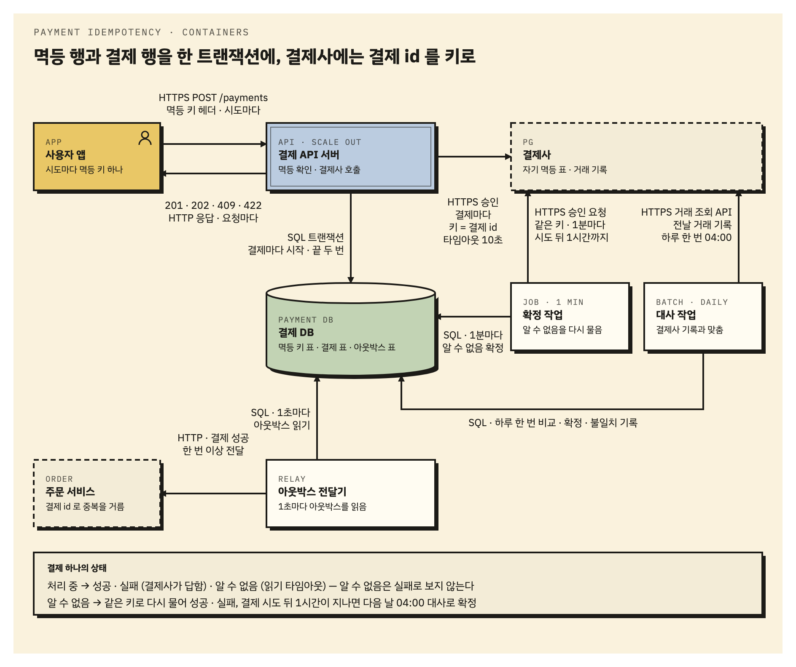
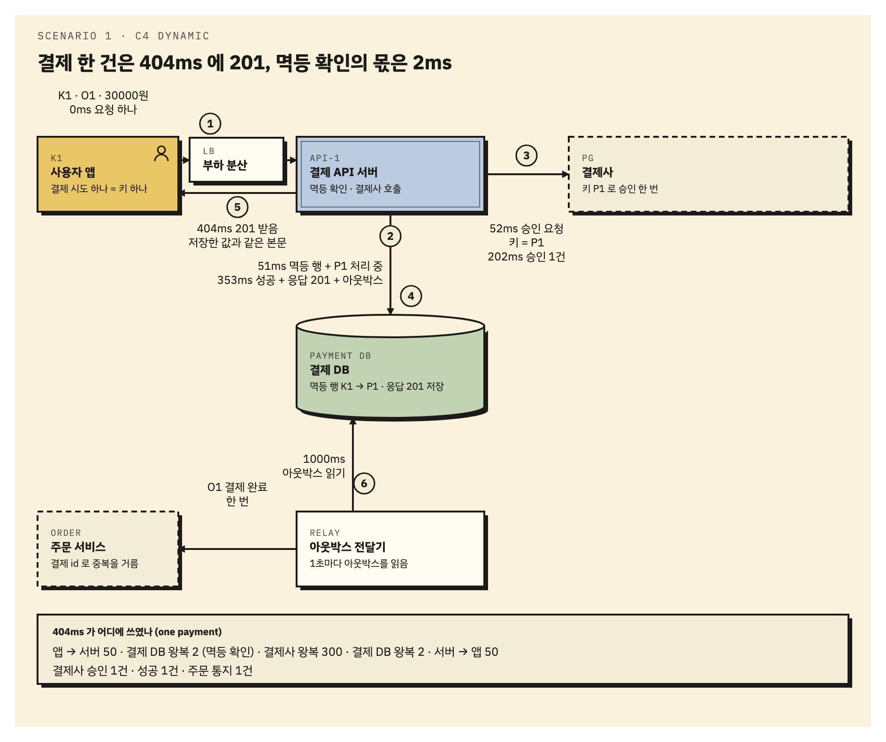
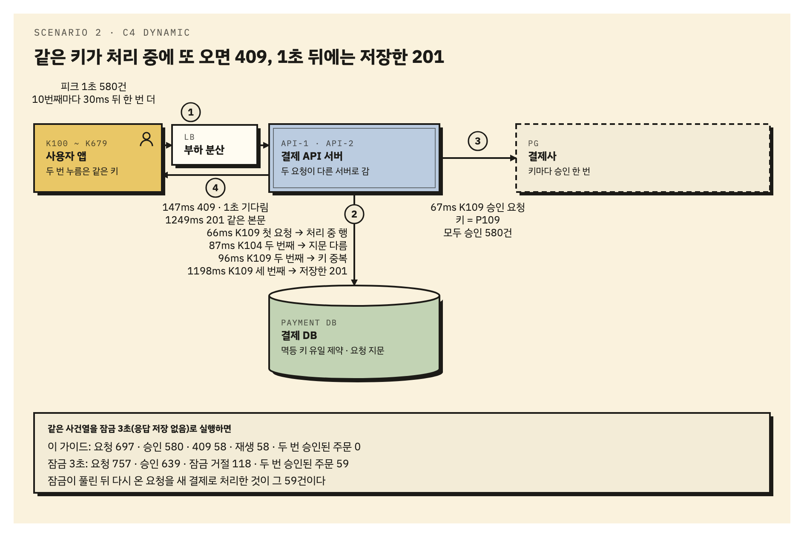
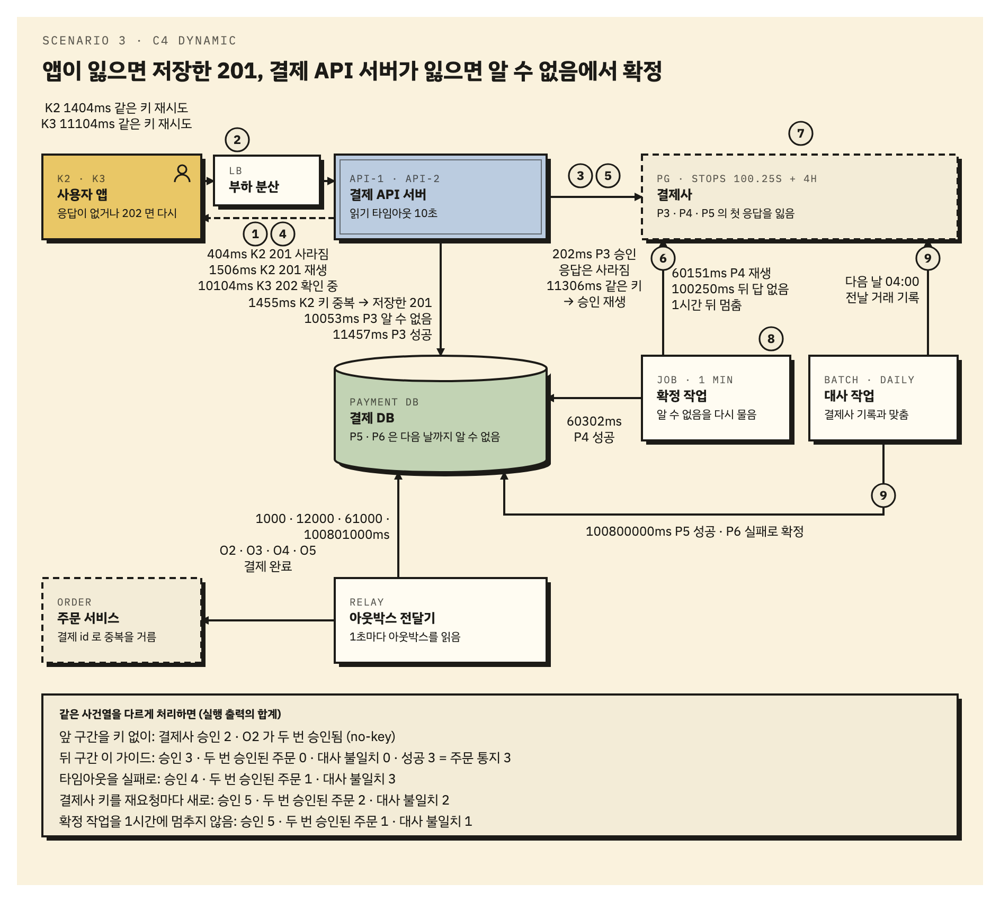

# 결제 · 송금 중복 방지 — 멱등 키를 결제와 같은 트랜잭션에 쓰고, 결과를 모르는 결제는 실패 대신 「알 수 없음」으로 두어 같은 키로 다시 묻는다

## 문제와 요구사항

지하철에서 쇼핑 앱으로 3만 원짜리 주문을 결제한다고 해 봅시다. 결제 버튼을 누르자 서버는 결제사(PG, 카드 결제를 대신 처리해 주는 결제 대행사)에서 승인을 받고 결제를 마쳤어요. 그런데 성공 응답이 휴대폰으로 오는 길에 연결이 끊깁니다. 앱은 결제가 됐는지 모릅니다. 가장 먼저 떠오르는 구조는 결제 API(Application Programming Interface, 프로그램이 서비스를 부르는 창구)가 요청마다 결제사를 부르는 것인데, 이 구조에서 앱이 같은 요청을 다시 보내면 결제사 승인이 하나 더 생겨요. 다시 보내지 않으면 사용자는 돈이 나갔는지 모르는 채 남고요.

HTTP(웹의 요청 · 응답 규약)의 의미를 정한 RFC 9110 이 바로 이 사정을 다룹니다. RFC(Request for Comments)는 인터넷 표준을 싣는 문서 번호 체계예요. 이 문서는 POST(데이터를 보내는 HTTP 메서드)처럼 멱등하지 않은 메서드라면, 요청이 실제로 멱등하다는 것을 알 수단이나 원래 요청이 적용되지 않았음을 알아낼 수단이 없는 한 클라이언트가 자동으로 재시도하지 말라고(SHOULD NOT) 적습니다([RFC 9110](https://www.rfc-editor.org/rfc/rfc9110.html)). 멱등하다는 것은 같은 요청을 여러 번 보내도 한 번 보낸 것과 결과가 같다는 뜻입니다. 결제 요청은 POST 이니 그 수단을 서버가 만들어 줘야 해요.

```text
멱등 키 없이 다시 보내면                          멱등 키를 붙여 다시 보내면 (이 글)
  0ms     POST 결제 → 결제사 승인 #1 → 성공          0ms     POST 결제 + 키 → 결제사 승인 #1 → 성공, 응답 저장
  404ms   응답이 앱에 가는 길에서 사라짐               404ms   응답이 앱에 가는 길에서 사라짐
  1404ms  POST 결제 (같은 내용) → 결제사 승인 #2     1404ms  POST 결제 + 같은 키 → 저장한 응답 그대로, 새 승인 없음
  결과: 3만 원이 두 번 나감                          결과: 승인 1건
```

이 글은 결제 시도마다 앱이 만든 멱등 키(결제 시도 하나를 가리키는 값으로, 앱이 요청 헤더에 붙임)를 결제 DB(데이터베이스)의 표에 결제 행과 **같은 트랜잭션**(여러 쓰기를 모두 반영하거나 하나도 반영하지 않는 묶음)으로 쓰는 구조를 따라갑니다. 결제사가 답하지 않은 결제는 실패로 보지 않고 「알 수 없음」으로 두었다가 같은 키로 다시 물어요. 끝까지 읽으면 재시도 · 두 번 누름 · 결제사 타임아웃이 각각 어느 자리에서 승인 한 건으로 맞춰지는지를 실행 출력으로 확인할 수 있습니다. 요구 수치가 바뀌면 어느 구조로 옮겨야 하는지도 판단할 수 있게 돼요. 기능 요구는 아래 셋입니다.

1. 사용자는 결제 버튼을 눌러 주문을 결제하고, 성공 · 실패 · 확인 중 가운데 하나를 응답으로 받습니다.
2. 앱은 응답을 받지 못하면 같은 결제 시도를 다시 보낼 수 있고, 그 재시도로 돈이 두 번 나가지 않습니다.
3. 결제가 성공하면 주문이 결제 완료로 바뀝니다.

비기능 요구는 아래처럼 수치로 고정합니다. 근거 칸의 출처 수치는 리서치 노트에서 원문과 대조한 것이고, 링크는 참고 자료에 다시 모았어요.

| 항목 | 수치 | 근거 |
| --- | --- | --- |
| 요청 규모 | 결제 시도 하루 500만 건, 피크는 평균의 10배 | 이 가이드의 가정 — 출처 수치는 찾지 못했습니다. 결제 DB 한 대의 부하를 가늠해 볼 수 있는 크기로 잡았어요 |
| 정확도 — 이중 승인 | 같은 결제 시도(같은 멱등 키)를 몇 번 다시 보내도 결제사 승인은 1건 | 이 가이드의 가정 — 이중 승인은 사용자의 돈이 두 번 나가는 일이라 허용 오차를 두지 않습니다. 키를 잃은 앱이 같은 주문을 새 시도로 다시 결제하는 경우는 이 행 밖이고, 대안 비교의 결정에 한계로 적었어요 |
| 재시도의 응답 | 끝난 결제 시도를 같은 키로 다시 보내면 첫 응답과 같은 상태 코드와 본문 | 이 가이드의 가정 — Stripe 는 API v1 에서 같은 키로 온 첫 요청의 상태 코드와 본문을 저장해 두었다가 재시도에 그대로 돌려줍니다(v2 는 다르게 동작, [Stripe 멱등 요청 문서](https://docs.stripe.com/api/idempotent_requests)). Adyen 도 이미 처리한 요청의 재시도에는 첫 응답을 돌려준다고 적어요([Adyen 멱등 문서](https://docs.adyen.com/development-resources/api-idempotency)). PayPal 처럼 그 시점의 상태를 돌려주는 곳도 있어요([PayPal 멱등 문서](https://developer.paypal.com/api/rest/reference/idempotency/)) |
| 처리 중 · 다른 본문 | 처리 중인 키의 재시도에는 409, 같은 키에 다른 본문에는 422 | IETF(인터넷 표준을 만드는 기구)의 멱등 키 헤더 초안이 권하는(SHOULD) 상태 코드입니다. 409 는 지금 상태와 부딪힌다는 뜻이고 422 는 요청 본문을 처리할 수 없다는 뜻이에요. 아직 RFC 가 아닌 초안입니다([IETF 초안 -08](https://datatracker.ietf.org/doc/html/draft-ietf-httpapi-idempotency-key-header-08)) |
| 정확도 — 결과를 모르는 건 | 결제사는 승인했는데 우리 기록은 실패로 남는 건 0건 | 카카오페이는 타임아웃처럼 결과를 판단하기 어려운 경우를 쉽게 실패로 간주하면 난감한 상황이 생길 수 있다고 적었습니다([카카오페이 상품권 글](https://tech.kakaopay.com/post/msa-transaction/)). Stripe 도 500 응답(서버 오류)을 받은 요청의 결과를 확정되지 않은 것으로 다루라고 해요([Stripe 오류 처리 문서](https://docs.stripe.com/error-low-level)) |
| 확정 시한 | 결과를 모르는 건도 결제한 날의 다음 날 안에 성공이나 실패로 확정 | 이 가이드의 가정 — 「확인 중」을 받은 사용자가 늦어도 결제 다음 날에는 돈이 나갔는지 알게 하려는 시한입니다 |
| 앱의 응답 대기 | 결제사가 답하지 않아도 앱은 결제 요청 뒤 15초 안에 응답(「확인 중」 포함)을 받음 | 이 가이드의 가정 — 응답 없는 결제 화면을 보던 사용자가 버튼을 다시 누르거나 앱을 닫기 전에 「확인 중」이라도 보여 주려는 상한입니다 |
| 멱등 확인 지연 | 멱등 확인이 결제 한 건에 더하는 시간은 저장소 왕복 한 번(같은 데이터센터 안 2ms, 가정) 이내 | 이 가이드의 가정 — 결제사 호출(왕복 300ms, 가정)보다 훨씬 작게 둡니다 |
| 키 보관 | 멱등 키와 저장한 응답을 24시간 보관 | 이 가이드의 가정 — 앱이 같은 결제 시도를 다시 보낼 수 있는 기간입니다. Stripe API v1 은 키가 적어도 24시간이 지난 뒤에 지울 수 있다고 적어요(Stripe 멱등 요청 문서). Shopify 는 재시도를 받아 줄 기간 동안 키가 유일해야 하고 그 기간이 대개 24시간 이하라고 적습니다([Shopify 글](https://shopify.engineering/building-resilient-payment-systems)) |
| 정확도 — 주문 통지 | 결제 DB 에 성공으로 남은 결제는 모두 주문 서비스에 결제 완료로 통지되고, 성공이 아닌 결제는 통지되지 않음 | 이 가이드의 가정 — 결제는 됐는데 주문이 결제 대기로 남거나 그 반대면 상담과 환불이 생깁니다 |

일부러 다루지 않는 것도 적어 둡니다.

- 송금(계좌 이체)의 은행 쪽 처리, 결제사에 보내는 취소 전문, 부분 취소와 환불은 범위 밖입니다. 송금도 「요청 하나 · 외부 기관 호출 하나 · 결과를 모를 수 있음」이라는 같은 모양이라 같은 구조가 쓰인다는 것만 짚어 둘게요(판단). 이 글의 상황은 카드 결제로 고정합니다.
- 결제 수단 등록, 본인 인증, 이상 거래 탐지는 다루지 않습니다.
- 정산(상점 계좌로 돈이 들어오는 일)과 수수료 계산은 범위 밖입니다. 대사(결제사의 거래 기록과 우리 기록을 맞춰 보는 일)는 거래 기록만 맞추고, 대사가 찾은 불일치를 바로잡는 절차(환불 · 사람 확인)는 기록하는 데까지만 다뤄요.
- 결제사를 여럿 두고 나눠 보내거나, 결제사가 멈추면 다른 결제사로 넘기는 일은 다루지 않습니다.

## 규모 추정

식에 쓰는 이름을 먼저 소개합니다. 멱등 키 표는 키 하나에 행 하나를 두는 표이고, 읽기 타임아웃은 결제사의 답을 기다리는 시간의 상한입니다. 재시도 대기를 1초 · 2초 · 4초처럼 실패할 때마다 두 배로 늘리는 것을 지수 백오프라고 해요. 지터는 그 대기 시간에 더하는 작은 무작위 시간입니다. 출처 수치는 없고 모두 이 가이드의 가정과 그 계산입니다.

```text
(입력)  하루 결제 시도 5,000,000 건(요구 1행, 가정) · 피크는 평균의 10배(요구 1행, 가정) · 멱등 행 하나 1KB(가정)
        키 보관 24시간(요구 9행) · 결제사 읽기 타임아웃이 나는 비율 0.05%(가정) · 앱이 응답을 잃는 비율 0.05%(가정)

[1] 평균 결제 시도       5,000,000 ÷ 86,400초 ≈ 57.9 건/초
[2] 피크 결제 시도       57.9 × 10 ≈ 579 → 약 580 건/초 (실행은 580 으로 둠)
[3] 결제 DB 트랜잭션     결제 한 건 = 시작 1 + 끝 1 → 580 × 2 = 1,160 트랜잭션/초 (피크)
[4] 멱등 키 표의 크기     5,000,000 행 × 1KB ≈ 5GB (24시간 보관) · 15일 보관이면 5GB × 15 = 75GB
[5] 결과를 모르는 결제   5,000,000 × 0.05% = 2,500 건/일   (비율이 100만 분의 1 이어도 5,000,000 ÷ 1,000,000 = 5 건/일)
[6] 키 없이 재시도하면    5,000,000 × 0.05% = 2,500 건/일이 결제사 승인을 두 번 받음
[7] 재시도가 겹치는 모양  대기 1초 · 2초 · 4초(가정) — 지터가 없으면 같은 순간에 실패한 요청이 같은 순간에 다시 옴
```

이 계산에서 빠지는 구조가 둘입니다. [6] 이 멱등 키 없는 재시도를 뺍니다. 앱이 응답을 잃을 때마다 다시 보내면 하루 2,500건이 두 번 승인돼요. 재시도를 막으면 그 2,500명은 결제가 됐는지 모르는 채로 남습니다. [5] 는 사람이 확인하는 구조를 뺍니다. 결제사 타임아웃이 하루 2,500건이면 상담원이 결제사 화면을 하나씩 열어 볼 양이 아니에요(판단). Shopify 는 결제 처리 중에 100만 분의 1 확률로 일어나는 일도 자기 규모에서는 하루에 여러 번 일어난다고 적었습니다(Shopify 글). 이 글의 규모에 넣어도 하루 5건이에요(계산). 그래서 결과를 모르는 결제를 확정하는 일은 자동이어야 하고, 그 일을 확정 작업과 대사 작업이 맡습니다.

[3] 과 [4] 는 구조를 빼지 않고 크기를 정합니다. 이 글은 멱등 행을 결제 행의 시작 · 끝 트랜잭션에 함께 넣으므로 멱등 확인 때문에 트랜잭션이 늘지 않아요. 결제 DB 한 대가 초당 1,160 트랜잭션을 받는지는 하드웨어에 달려 있어 확인 안 함이고, 넘으면 전환점 2 로 갑니다. 멱등 키를 Redis(데이터를 메모리에 두는 키-값 저장소)에 두면 결제 행을 끝에 한 번만 써서 [3] 을 절반으로 줄일 수는 있어요. 그 대신 「처리 중」이라는 사실이 Redis 에만 남습니다(판단, 대안 비교의 C). [7] 은 앱에 지터를 요구하고, 처리 중인 키에 같은 키가 또 오는 경우를 시나리오 2 로 보냅니다.

## 시스템 개념도



요청이 지나는 주된 길은 이렇습니다. 사용자 앱이 멱등 키를 붙인 HTTPS(암호화한 HTTP) POST 를 보내면 결제 API 서버가 결제 DB 에 시작 트랜잭션을 씁니다. 멱등 행과 결제 행(처리 중)이 함께 들어가요. 그다음 결제사에 우리 결제 id 를 멱등 키로 붙여 승인을 요청하고, 답이 오면 끝 트랜잭션으로 결제 상태 · 저장할 응답 · 아웃박스 행을 함께 씁니다. 아웃박스 행은 다른 서비스에 보낼 메시지를 담아 두는 표의 행이에요. 아웃박스 전달기가 그 행을 읽어 주문 서비스에 알립니다. 결제사가 10초 안에 답하지 않은 결제는 「알 수 없음」으로 남아요. 그 결제는 확정 작업(알 수 없음인 결제를 1분마다 다시 묻는 배치 작업)이 같은 키로 다시 묻거나, 대사 작업(하루 한 번 결제사 기록과 맞춰 보는 배치 작업)이 다음 날 확정합니다.

## 시나리오로 따라가기

### 시나리오 1 — 결제 한 건이 멱등 행 · 결제사 승인 · 응답 저장을 거쳐 404ms 에 201 로 끝나고, 주문은 다음 1초 경계에 결제 완료로 바뀐다

사용자가 주문 O1 을 3만 원에 결제합니다. 앱은 이 결제 시도에 멱등 키 K1 을 만들어요. 부하도 장애도 없고 요청은 하나뿐입니다. 한 방향 시간은 앱과 결제 API 서버 사이 50ms, 결제 API 서버와 결제 DB 사이 1ms, 결제 API 서버와 결제사 사이 150ms 로 둡니다(모두 가정). 나와야 하는 것은 결제사 승인 1건, 앱이 받는 201(새로 만들었다는 HTTP 성공 코드)과 본문, 주문 통지 1건이에요.



1. 0ms 에 앱이 `POST /payments` 에 `Idempotency-Key: K1` 헤더를 붙여 보내고, 50ms 에 부하 분산(요청을 여러 서버에 나눠 주는 장치)이 api-1 에 넘깁니다. 키를 앱이 만드는 이유는 결과를 모를 수 있는 쪽이 앱이기 때문이에요. 다시 보낼 때 「이것은 아까 그 시도」라고 말할 수 있는 것도 앱뿐입니다. Stripe 도 클라이언트가 작업마다 고유한 ID 를 만들어 서버에 보내고 같은 ID 로 재시도하는 방식을 설명합니다([Stripe 블로그](https://stripe.com/blog/idempotency)).
2. 51ms 에 api-1 이 결제 DB 에 시작 트랜잭션을 씁니다. 멱등 키 표에 K1 행(요청 지문 · 결제 id P1)을, 결제 표에 P1(처리 중)을 한 트랜잭션으로 넣어요. 요청 지문은 요청 본문으로 셈한 정수 해시입니다. 결제사를 부르기 전에 쓰는 이유는 같은 키가 처리 중에 또 오면 이 행이 막아야 하기 때문이에요(시나리오 2 의 4단계). 두 행을 한 트랜잭션에 넣는 이유는 「멱등 행은 있는데 결제 행이 없음」 같은 반쪽 상태를 만들지 않기 위해서입니다.
3. 52ms 에 api-1 이 결제사에 승인을 요청하고 202ms 에 결제사가 P1 을 승인합니다. 결제사 쪽 멱등 키는 앱의 K1 이 아니라 우리 결제 id P1 이에요. 나중에 확정 작업이 다시 물을 때 결제 행에서 같은 값을 읽어 보낼 수 있어야 하고(시나리오 3 의 6단계), 대사 작업이 결제사 기록과 짝을 지을 값도 결제 id 이기 때문입니다.
4. 353ms 에 api-1 이 결제사의 답으로 끝 트랜잭션을 씁니다. P1 을 성공으로 바꾸고, 멱등 행에 응답(201 과 본문)을 저장하고, 아웃박스 표에 「P1 성공」 행을 넣는 일이 한 트랜잭션이에요. 셋을 나누면 둘 사이에서 멈출 때 「성공인데 저장한 응답이 없음」이나 「성공인데 주문에 알릴 행이 없음」이 생깁니다.
5. 354ms 에 201 이 나가 404ms 에 앱이 받습니다. 받은 본문은 4단계에서 저장한 값과 같아요. 응답을 보내기 전에 저장부터 마치는 이유는 서버가 응답이 앱에 갔는지 알 수 없기 때문입니다. 이 응답이 사라졌다면 앱의 재시도는 이 저장한 값을 받아요(시나리오 3 의 1 · 2단계).
6. 1000ms 에 아웃박스 전달기가 아웃박스 행을 읽어 주문 서비스에 「O1 결제 완료」를 보냅니다. 주문 통지를 앱의 응답이 아니라 결제 DB 의 기록에서 내보내는 이유는, 앱이 응답을 받든 못 받든 성공한 결제는 주문에 알려져야 하기 때문이에요.

```text
t=50ms K1 req=0 lb -> api-1 POST /payments order=O1&amount=30000
t=51ms K1 req=0 db: INSERT idempotency row + payment P1 (processing), commit
t=52ms K1 req=0 api -> pg approve, idempotency key P1
t=202ms K1 pg: approve P1 amount=30000 (approvals of P1: 1)
t=353ms K1 db: payment P1 succeeded, save response 201 + outbox row, commit
t=404ms K1 req=0 app: 201 {"payment":"P1","status":"succeeded"}
t=1000ms K1 relay: outbox P1 -> order service, O1 paid
one payment: requests=1 pg-approvals=1 orders-charged-twice=0 payments-succeeded=1 order-notices=1
```

잠깐, 확인 하나만 해 볼까요? 앱이 결제 버튼을 누르고 201 을 받기까지 404ms 가운데 멱등 확인이 더한 몫은 얼마일까요?

2ms 입니다. 50ms 에 서버에 온 요청이 52ms 에 결제사로 나갔으니 그 사이가 시작 트랜잭션의 왕복 한 번이에요. 나머지는 멱등 키가 없어도 드는 시간입니다. 결제사 왕복 300ms 가 대부분을 차지해요.

```text
0ms      앱이 보냄
50ms     api-1 에 도착                         앱 → 서버 50ms
52ms     시작 트랜잭션 끝, 결제사로 보냄          결제 DB 왕복 2ms   ← 멱등 확인이 더한 몫
352ms    결제사의 답이 api-1 에 도착 (계산)        결제사 왕복 300ms
354ms    끝 트랜잭션 끝, 201 이 나감              결제 DB 왕복 2ms
404ms    앱이 201 을 받음                       서버 → 앱 50ms
합계     50 + 2 + 300 + 2 + 50 = 404ms
```

이 시나리오가 보여 준 것은 결제 한 건이 지나는 순서와 그 순서의 이유입니다. 결제사 승인은 1건이었어요(이중 승인 행). 멱등 확인 지연 행에는 50ms 에서 52ms 까지의 2ms 가 들어갑니다. 성공한 결제는 아웃박스를 거쳐 주문 통지 1건이 됐고, 이것이 주문 통지 행의 근거예요. 4단계에서 저장한 응답은 이 시나리오에서는 쓰이지 않습니다. 쓰이는 자리는 응답 하나를 잃는 시나리오 3 이에요.

### 시나리오 2 — 피크 1초에 같은 키가 겹쳐도 승인은 580건이고, 처리 중인 키에는 409, 금액만 다른 같은 키에는 422 가 간다

피크 1초에 결제 시도 580건(K100 ~ K679)이 들어옵니다. 평균의 10배라 규모 추정 [2] 의 값이에요. 10번째 시도마다 사용자가 30ms 뒤 버튼을 한 번 더 눌러 같은 키의 요청이 58건 더 옵니다(가정). K104 는 같은 키로 금액만 21,000원으로 바꾼 요청이 한 번 더 와요. 키를 잘못 재사용하는 앱을 흉내 낸 것입니다. 나와야 하는 것은 결제사 승인이 키 수와 같은 580건이고, 겹친 요청은 409 뒤에 저장한 응답을 받고, K104 의 두 번째 요청은 422 를 받는 것이에요.



1. 부하 분산이 요청을 도착 순서대로 api-1 과 api-2 에 번갈아 넘깁니다. 같은 키의 두 요청이 서로 다른 서버로 가니 서버 메모리로는 서로를 모릅니다. 그래서 판정은 결제 DB 의 유일 제약(같은 값을 가진 행을 두 번 넣지 못하게 하는 규칙)에 맡겨요.
2. 66ms 에 K109 의 첫 요청이 시작 트랜잭션으로 멱등 행과 결제 행 P109 를 만들고, 67ms 에 결제사로 갑니다. 결제사보다 먼저 멱등 행을 쓰므로, 결제사의 답을 기다리는 동안 뒤에 온 같은 키의 요청이 이 행에 막힙니다(4단계).
3. 87ms 에 K104 의 두 번째 요청이 같은 INSERT(DB 에 행을 넣는 명령)를 시도하다 키 중복으로 실패하고, api 가 그 행의 지문을 비교해 422 를 돌려줍니다. 저장된 지문은 831817018(2만 원), 새 요청은 831846809(21,000원)예요. 지문을 처리 상태보다 먼저 보는 이유는 다른 본문에 같은 키를 쓴 것이 앱의 잘못이기 때문입니다. 이때 2만 원 결제의 응답을 돌려주면 앱은 21,000원이 결제됐다고 읽어요.
4. 96ms 에 K109 의 두 번째 요청도 키 중복으로 실패합니다. api 가 그 행을 읽어 보니 지문은 같고 저장한 응답은 없으며 결제는 처리 중이에요. 그래서 결제사를 부르지 않고 409 를 돌려줍니다. 기다렸다 답하지 않는 이유는 결제사 호출이 끝날 때까지(이 실행에서 300ms 남짓) 연결을 붙잡지 않으려는 것입니다(판단). IETF 초안이 처리 중인 키에 권하는 코드도 409 이고(IETF 초안 -08), Stripe 는 409 를 받으면 같은 키 · 같은 매개변수로 기다렸다 다시 보내라고 안내해요(Stripe 오류 처리 문서).
5. 147ms 에 409 를 받은 앱이 1초 기다렸다 같은 키로 다시 보냅니다. 1198ms 에 INSERT 가 키 중복으로 실패하고 이번에는 저장한 응답이 있어 재생돼요. 1249ms 에 받은 본문은 첫 요청이 419ms 에 받은 본문과 같습니다. 첫 요청의 끝 트랜잭션이 저장한 바로 그 값을 돌려주기 때문이에요.
6. 실행 전체로 보면 요청 697건에 결제사 승인 580건입니다. 409 와 재생이 각각 58건이에요. 결제 DB 트랜잭션은 1,277건으로, 결제마다 시작 · 끝 두 번(580 × 2 = 1,160)에 겹친 요청 58건 · 그 재시도 58건 · 422 한 건의 시작 트랜잭션을 더한 값입니다(계산: 1,160 + 58 + 58 + 1). 규모 추정 [3] 의 「결제 한 건에 두 번」은 겹친 요청까지 세면 그만큼 늘어나요.

```text
t=66ms K109 req=9 db: INSERT idempotency row + payment P109 (processing), commit
t=67ms K109 req=9 api -> pg approve, idempotency key P109
t=87ms K104 req=638 db: same key, fingerprint 831846809 != 831817018 -> 422
t=96ms K109 req=580 db: duplicate key, payment P109 processing -> 409
t=147ms K109 req=580 app: 409 {"error":"in progress"}
t=419ms K109 req=9 app: 201 {"payment":"P109","status":"succeeded"}
t=1198ms K109 req=639 db: duplicate key, response saved -> replay it with Idempotent-Replayed: true
t=1249ms K109 req=639 app: 201 {"payment":"P109","status":"succeeded"}
idempotency-table: requests=697 pg-approvals=580 orders-charged-twice=0 payments-succeeded=580 order-notices=580 db-tx=1277 409=58 replayed=58
redis-lock-3s: requests=757 pg-approvals=639 orders-charged-twice=59 payments-succeeded=639 order-notices=639 db-tx=1396 lock-busy=118
```

마지막 줄은 같은 사건열을 대안 B 로 실행한 결과입니다. 버튼을 누르면 키마다 3초짜리 잠금을 걸고 응답은 저장하지 않는 구조예요. 잠금이 살아 있는 동안 온 요청은 막지만(`lock-busy=118`), 3초가 지난 뒤 온 재시도는 새 결제로 처리해 59개 주문이 두 번 승인됐습니다(`orders-charged-twice=59`). K109 하나를 모형의 상수로 따라가면 이렇게 됩니다(계산 — 출력에는 합계만 있습니다).

```text
K109 (잠금 3초, 응답 저장 없음)
66ms     첫 요청: 잠금 걸기 (3066ms 까지) → 결제 P109 → 승인 #1
96ms     두 번째 요청: 잠금 중 → 409
1198ms   1초 뒤 재시도: 아직 잠금 중 → 409
3300ms   2초 더 기다린 재시도: 잠금이 3066ms 에 풀림 → 새 결제 → 승인 #2
```

이 시나리오가 보여 준 것은 피크에 겹친 요청을 결제 DB 의 유일 제약 하나가 받아 낸다는 점입니다. 승인은 키 수와 같은 580건이고 두 번 승인된 주문은 0건이에요(요청 규모 행 · 이중 승인 행). 처리 중인 키는 409, 금액이 다른 같은 키는 422 를 받았고(처리 중 · 다른 본문 행), 재시도는 첫 응답과 글자까지 같은 본문을 받았습니다(재시도의 응답 행). 잠금 3초와의 차이는 대안 비교에서 다시 씁니다.

### 시나리오 3 — 앱으로 가는 응답을 잃으면 같은 키가 저장한 201 을 받고, 결제사의 승인 응답을 잃으면 「알 수 없음」으로 두었다 같은 키나 다음 날 대사로 승인 한 건에 맞춘다

메시지를 잃는 장애 둘을 앞뒤 두 구간으로 나눠 실행합니다. 두 구간은 따로 실행해서 시각이 각각 0ms 에서 시작해요. 앞 구간에서는 주문 O2(3만 원, 키 K2)가 시나리오 1 과 같은 길로 결제되는데, 201 이 앱으로 가는 길에서 연결이 끊겨 사라집니다. 앱은 1초 뒤 같은 키로 다시 보내요. 뒤 구간에서는 결제사가 주문 O3 · O4 · O5 의 첫 승인 응답을 잃습니다. 승인은 했는데 답이 오다 사라지는 경우예요. 게다가 결제사는 100250ms(약 100초)부터 4시간 동안 아무 요청에도 답하지 않습니다(가정). 결제 API 서버의 읽기 타임아웃은 10초입니다. K3 의 앱은 「확인 중」을 받으면 1초 뒤 같은 키로 다시 보내고, K4 · K5 · K6 의 앱은 닫혔어요. 확정 작업은 1분마다 실행되고 결제 시도 뒤 1시간까지만 다시 묻습니다. 결제사는 멱등 키를 3시간 기억한다고 둡니다(포트원 V2 의 보관 시간을 예로 썼어요). 대사 작업은 다음 날 04:00 에 실행돼요. 나와야 하는 것은 같은 키의 재시도가 저장한 201 을 받는 것, 결제사가 승인한 결제가 실패로 남지 않는 것, 승인이 결제 시도마다 1건이고 모두 다음 날 안에 확정되는 것입니다.



1. (앞 구간) K2 는 353ms 까지 시나리오 1 의 1 ~ 4단계와 같은 길을 갑니다. 결제사 승인이 끝났고, 멱등 행에는 201 과 본문이 저장됐어요. 354ms 에 나간 201 이 404ms 에 앱으로 가는 길에서 연결이 끊겨 사라집니다. 결제사와 결제 DB 쪽 일은 모두 끝났는데 앱만 그 사실을 모릅니다. 응답을 보내기 전에 저장부터 마친 것(시나리오 1 의 5단계)이 다음 단계에서 쓰여요.
2. 연결 오류를 본 앱이 1초 기다렸다 1404ms 에 같은 키 K2 로 다시 보내고, 부하 분산이 이번에는 api-2 에 넘깁니다. 1455ms 에 시작 트랜잭션의 INSERT 가 키 중복으로 실패하자 api-2 는 그 행을 읽어요. 저장된 응답이 있으니 새 결제를 만들지 않고 그 응답을 `Idempotent-Replayed: true` 헤더와 함께 돌려줍니다(Stripe 가 재생한 응답에 붙이는 헤더, [Stripe 오류 처리 문서](https://docs.stripe.com/error-low-level)). api-2 는 api-1 의 메모리를 볼 수 없으므로, 재생이 되는 이유는 응답이 서버가 아니라 결제 DB 에 있기 때문입니다. 1506ms 에 앱이 201 을 받아요.
3. (뒤 구간) 202ms 에 결제사가 P3 를 승인했지만 응답이 사라집니다. 결제 API 서버는 10초를 기다린 뒤 10053ms 에 결제 행 P3 를 「알 수 없음」으로 커밋해요. 실패로 쓰지 않는 이유는 서버 쪽에서 「결제사가 승인했는데 답이 사라짐」과 「요청이 결제사에 가지 못함」을 가를 수 없기 때문입니다. 실패로 쓰면 앞의 경우에 사용자가 다시 결제해 돈이 두 번 나가요(아래 비교 실행).
4. 10104ms 에 앱이 202(요청은 받았지만 처리가 끝나지 않았다는 코드)와 `"status":"unknown"` 본문을 받아 「확인 중」을 보여 줍니다. 요청한 지 10.1초라 앱의 응답 대기 15초 안이에요. 멱등 행에는 이 응답을 저장하지 않습니다. 확정 전이라서, 다음 재시도가 저장한 「확인 중」을 받는 대신 결제사에 다시 물어야 하기 때문이에요.
5. 11104ms 에 앱이 같은 키로 다시 보내고, 11155ms 의 시작 트랜잭션이 키 중복 · 결제 알 수 없음을 읽습니다. 그래서 결제 API 서버가 같은 결제사 키 P3 로 다시 승인을 요청해요. 11306ms 에 결제사는 키 P3 를 기억하고 있어 새로 승인하지 않고 앞의 승인을 재생합니다(P3 의 승인은 여전히 1건). 토스페이먼츠 개발자센터도 「네트워크 이슈나 타임아웃 문제로 응답을 받지 못했을 때도 안전하게 같은 요청을 다시 보낼 수 있습니다.」라고 적어요([토스페이먼츠 멱등키 문서](https://docs.tosspayments.com/reference/using-api/idempotency-key)). 11457ms 에 성공 · 응답 저장 · 아웃박스가 한 트랜잭션으로 커밋되고 11508ms 에 앱이 201 을 받습니다.
6. K4 의 앱은 닫혀 있어 아무도 다시 묻지 않습니다. 그래서 60000ms 에 확정 작업이 알 수 없음인 P4 를 찾아 같은 키로 다시 물어요. 60151ms 에 결제사가 승인을 재생하고 60302ms 에 P4 가 성공으로 커밋됩니다. 확정 작업이 따로 있는 이유가 이 경우예요. 앱의 재시도에만 맡기면 앱이 닫힌 결제는 다음 날까지 알 수 없음으로 남습니다.
7. 100202ms 에 결제사가 P5 를 승인했지만 응답이 사라지고, 100250ms 부터 결제사가 멈춥니다. 110202ms 에 K6 의 승인 요청은 결제사에 가지 못해요. 두 결제 모두 10초 뒤 알 수 없음으로 커밋됩니다(110053 · 120053ms). 결제 API 서버 쪽에서 P5 와 P6 은 똑같이 보이지만, 결제사 쪽에서는 하나만 승인돼 있어요.
8. 확정 작업은 결제 시도 뒤 1시간까지 1분마다 P5 · P6 을 같은 키로 다시 묻지만, 결제사가 멈춰 있어 답이 없습니다. 1시간이 지나면 묻기를 멈춰요. 뒤 구간에서 확정 작업은 모두 120번 다시 물었습니다(P4 의 한 번 포함). 멈추는 이유는 결제사가 키를 3시간만 기억하기 때문이에요. 키가 지워진 뒤 같은 키로 부르면 결제사는 그것을 새 요청으로 처리합니다. Stripe 문서가 API v1 에서 원래 키가 지워진 뒤 재사용된 키에는 새 요청을 만든다고 적은 것과 같은 동작이에요([Stripe 멱등 요청 문서](https://docs.stripe.com/api/idempotent_requests)).
9. 다음 날 04:00(100800000ms)에 대사 작업이 결제사의 전날 거래 기록과 결제 표를 결제 id 로 짝 짓습니다. P5 는 결제사 기록에 승인이 있어 성공으로, P6 은 없어서 실패로 확정돼요. 성공으로 바뀐 P5 는 아웃박스를 거쳐 100801000ms 에 주문 O5 를 결제 완료로 바꿉니다. P3 · P4 는 양쪽 기록이 같아 맞음(`matched=2`)으로 끝나요.

```text
t=50ms K2 req=0 lb -> api-1 POST /payments order=O2&amount=30000
t=353ms K2 db: payment P2 succeeded, save response 201 + outbox row, commit
t=404ms K2 req=0 app: connection dropped, response lost
t=1000ms K2 relay: outbox P2 -> order service, O2 paid
t=1454ms K2 req=1 lb -> api-2 POST /payments order=O2&amount=30000
t=1455ms K2 req=1 db: duplicate key, response saved -> replay it with Idempotent-Replayed: true
t=1506ms K2 req=1 app: 201 {"payment":"P2","status":"succeeded"}
with-key: requests=2 pg-approvals=1 orders-charged-twice=0 payments-succeeded=1 order-notices=1
no-key: requests=2 pg-approvals=2 orders-charged-twice=1 payments-succeeded=2 order-notices=2
```

잠깐, 확인 하나만 해 볼까요? 앞 구간에서 앱이 재시도마다 새 키를 만든다면, 곧 키가 없는 것과 같다면 결제사 승인은 몇 건일까요?

두 건입니다(`no-key: ... pg-approvals=2 orders-charged-twice=1`). 1455ms 의 INSERT 가 새 키라서 성공하고, 새 결제 행이 생겨 결제사에 새 키로 승인을 요청하기 때문이에요. 주문 통지도 두 번 나갑니다(`order-notices=2`). 멱등 키가 막는 것은 「같은 요청」이 아니라 「같은 결제 시도」라서, 시도를 가리키는 값이 재시도 사이에 바뀌면 서버가 둘을 같은 시도로 볼 근거가 없어요.

```text
                       같은 키 K2 (이 가이드)                  재시도마다 새 키
1455ms 시작 트랜잭션    INSERT K2 → 키 중복 → 저장한 201         INSERT 새 키 → 성공 → 새 결제 (처리 중)
결제사                 새 요청 없음                              새 결제사 키로 승인 요청 → 승인 #2
결과                   승인 1 · 주문 통지 1                       승인 2 · 주문 통지 2 · O2 가 두 번 승인됨
```

뒤 구간의 출력은 아래와 같습니다.

```text
t=202ms K3 pg: approve P3 amount=50000 (approvals of P3: 1), response lost
t=10053ms K3 db: payment P3 unknown after pg read timeout, commit
t=10104ms K3 req=0 app: 202 {"payment":"P3","status":"unknown"}
t=11155ms K3 req=4 db: duplicate key, payment P3 unknown -> ask pg again with key P3
t=11306ms K3 pg: key P3 seen, replay its approval (approvals of P3: 1)
t=11457ms K3 db: payment P3 succeeded, save response 201 + outbox row, commit
t=11508ms K3 req=4 app: 201 {"payment":"P3","status":"succeeded"}
t=60151ms K4 pg: key P4 seen, replay its approval (approvals of P4: 1)
t=60302ms K4 db: payment P4 succeeded, save response 201 + outbox row, commit (confirm job)
t=100202ms K5 pg: approve P5 amount=70000 (approvals of P5: 1), response lost
t=110202ms K6 pg: down, approve request for P6 never arrives
t=100800000ms reconcile with pg records: matched=2 unknown->succeeded=1 unknown->failed=1 anomalies=0 (confirm job asked pg again 120 times before)
t=100801000ms K5 relay: outbox P5 -> order service, O5 paid
```

정합성이 걸린 문제라 틀린 값이 남는 길도 봐야 합니다. 뒤 구간의 사건열을 처리 방식만 세 가지로 바꿔 실행했어요. 이 셋은 코드에 함께 들어 있는 비교 실행이라 출력도 정본 실행의 출력에 있습니다.

| 같은 사건열에서 바꾼 것 | 실행 출력 | 무엇이 틀리게 남는가 |
| --- | --- | --- |
| 바꾸지 않음 (이 가이드) | `this guide: requests=5 pg-approvals=3 orders-charged-twice=0 payments-succeeded=3 order-notices=3 anomalies=0` | 없음 |
| 읽기 타임아웃을 실패로 확정하고 실패 응답 402 로 답함 | `timeout-as-failure: requests=5 pg-approvals=4 orders-charged-twice=1 payments-succeeded=1 order-notices=1 anomalies=3` | 다시 결제한 K3 의 주문 O3 이 두 번 승인됨. P3 · P4 · P5 는 결제사가 승인했는데 우리 기록은 실패라 다음 날 대사가 불일치 3건으로 찾음 |
| 결제사에 다시 물을 때마다 새 결제사 키 | `new-pg-key-per-retry: requests=5 pg-approvals=5 orders-charged-twice=2 payments-succeeded=3 order-notices=3 anomalies=2` | 다시 물은 P3 · P4 가 결제사에서 새 승인이 됨 |
| 확정 작업이 1시간에서 멈추지 않음 | `no-confirm-cutoff: requests=5 pg-approvals=5 orders-charged-twice=1 payments-succeeded=4 order-notices=4 anomalies=1` | 결제사가 다시 답하기 시작했을 때 3시간이 지나 키 P5 를 잊은 뒤라, 같은 키로 물은 P5 가 새 승인이 됨 |

첫 비교 실행이 가장 조용히 틀립니다. 사용자는 실패를 보고 다시 결제해서 성공을 받고, 우리 기록에는 O3 의 실패 한 건과 성공 한 건이 깔끔하게 남아요. 성공은 1건이고 주문 통지도 1건이라 결제 DB 안에서는 어긋난 데가 보이지 않습니다. 결제사 쪽에만 승인이 둘 있고, 그 사실은 다음 날 대사에서야 불일치로 잡혀 환불할 대상이 됩니다. 카카오페이 글이 「쉽게 실패로 간주하면」 난감해진다고 쓴 상황이 이것이에요.

이 시나리오가 보여 준 것은 응답 하나를 어느 쪽에서 잃든 승인이 결제 시도마다 1건으로 남는다는 점입니다. 앞 구간에서 앱은 같은 키로 첫 응답과 같은 201 을 받았고, 이것이 재시도의 응답 행의 근거예요. 뒤 구간에서 결과를 모르는 결제는 실패가 아니라 알 수 없음으로 남았다가 같은 키로 다시 묻거나 다음 날 대사로 결제사 기록에 맞춰졌습니다(결과를 모르는 건 행). 실패로 쓰는 순간 틀린 값이 생겨요. 확정 시한 행에는 P3 · P4 가 그날, P5 · P6 이 다음 날 04:00 에 확정된 것이 들어갑니다. 결제사가 답하지 않아도 앱이 10104ms 에 「확인 중」을 받은 것은 앱의 응답 대기 행으로, 두 구간 모두 승인이 결제 시도마다 1건인 것은 이중 승인 행으로, 성공 3건과 주문 통지 3건이 같은 것은 주문 통지 행으로 가요.

## 기술 상세 설명

### 구성 요소 — 사용자 앱

결제 화면이 있는 모바일 앱이나 웹 페이지입니다. 결제 버튼을 누르는 것이 결제 시도 하나이고, 앱은 시도마다 멱등 키 하나를 만들어 요청 헤더에 붙여요. 같은 시도를 다시 보낼 때는 그 키를 그대로 씁니다.

맡는 일은 시나리오 1 의 1단계에서 키를 만들어 보내는 것, 시나리오 3 의 2단계에서 응답을 잃으면 같은 키로 다시 보내는 것입니다. 시나리오 2 의 5단계에서는 409 를 받고 기다렸다 다시 보내고, 시나리오 3 의 5단계에서는 202 를 받고 다시 보내요.

```http no-compile
POST /payments HTTP/1.1
Idempotency-Key: <결제 시도마다 만든 UUID v4>
Content-Type: application/x-www-form-urlencoded

order=O1&amount=30000

HTTP/1.1 201 Created
Content-Type: application/json

{"payment":"P1","status":"succeeded"}

# 같은 키로 다시 보낸 요청의 응답 (시나리오 3 의 2단계와 같은 꼴)
HTTP/1.1 201 Created
Idempotent-Replayed: true
Content-Type: application/json

{"payment":"P1","status":"succeeded"}
```

키를 앱이 만드는 방식과 견줄 것은 서버가 먼저 결제 시도를 만들어 그 id 를 앱에 내려주는 두 단계 방식입니다. 그 방식에서는 「시도 만들기」 요청의 응답이 사라지면 같은 문제가 그 요청에서 다시 생겨요(판단). 앱이 키를 만들면 첫 요청부터 같은 시도를 가리킬 수 있습니다. 화면에서 버튼만 막는 방식(대안 B 의 앞부분)과도 견줘 봅니다. 버튼 막기는 한 화면에서 두 번 누르는 것만 막아요. 앱을 다시 켜거나 연결이 끊긴 뒤에 다시 보내는 요청은 막지 못합니다(판단).

키의 형식은 Stripe 가 V4 UUID 처럼 충돌을 피할 만큼 무작위인 문자열을 권하고(Stripe 멱등 요청 문서), IETF 초안도 UUID 같은 무작위 식별자를 권합니다(RECOMMENDED, IETF 초안 -08). UUID(Universally Unique Identifier)는 따로 만들어도 겹칠 일이 거의 없게 설계된 식별자예요. Shopify 는 무작위 UUID 대신 ULID(Universally Unique Lexicographically Sortable Identifier, 만든 시각 순으로 정렬되는 식별자)를 씁니다. 시각 순으로 정렬돼 DB 의 B-tree 색인(정렬된 트리로 만든 색인)에 유리하다는 것이 이유이고, 한 고처리량 시스템에서 키를 바꾼 뒤 INSERT 문장의 시간이 50% 줄었다고 적었어요(Shopify 글). 이 글은 UUID v4 로 두고, 멱등 키 표의 INSERT 가 피크에 느려지면 ULID 로 바꿉니다(판단).

| 설정값 · 한계 | 값 | 이유 · 보장하지 않는 것 |
| --- | --- | --- |
| 키를 만드는 때 | 결제 버튼을 처음 누를 때 한 번, 그 시도의 두 번 누름과 재시도는 같은 키 | 키가 가리키는 것은 주문이 아니라 결제 시도 하나. 실패한 결제를 다른 카드로 다시 하면 새 시도라 새 키 |
| 재시도 대기 | 1초 · 2초 · 4초에 지터 | 규모 추정 [7]. Stripe 는 지터로 같은 순간에 몰리는 재시도를 흩는다고 적음(Stripe 블로그). 실행은 지터 없이 1 · 2 · 4초 |
| 409 를 받으면 | 기다렸다 같은 키 · 같은 본문으로 다시 | Stripe 오류 처리 문서의 안내 |
| 202 「확인 중」을 받으면 | 화면에 확인 중을 보이고 같은 키로 다시 물음 | 앱이 닫히면 묻지 않음 — 그 경우는 확정 작업이 맡음(시나리오 3 의 6단계) |
| 키의 내용 | 무작위 값만 | Stripe 는 이메일 같은 개인 정보를 키에 쓰지 말라고 적음(Stripe 멱등 요청 문서) |
| 키를 잃으면 | 같은 시도라고 말할 수단이 없음 | 앱을 지우거나 기기를 바꾸면 새 시도가 되어, 같은 주문에 두 번째 승인이 생길 수 있음. 이 구조는 그것을 막지 않고 주문 서비스의 경보와 대사로 찾아냄. 그래서 앱은 다시 결제하기 전에 주문 화면의 결제 상태부터 보여 줌(판단) |

### 구성 요소 — 결제 API 서버

결제 요청을 받아 멱등 확인 · 결제사 호출 · 결과 기록 · 응답을 차례로 실행하는 서버 프로그램입니다. 키의 상태를 자기 메모리에 두지 않고 모두 결제 DB 에 두므로, 요청이 늘면 대수를 늘려 받아요.

맡는 일은 시나리오 1 의 2 ~ 5단계 전부와 시나리오 2 의 3 · 4단계(422 · 409), 시나리오 3 의 2단계(재생)와 3 · 5단계(알 수 없음과 같은 키로 다시 묻기)입니다. 순서는 아래 표와 같고, 어느 두 줄을 바꿔도 시나리오 하나가 틀린 값을 냅니다.

```text
순서             하는 일                                                  바꾸면
1 시작 트랜잭션   멱등 행(키 · 지문 · 결제 id) + 결제 행(처리 중) INSERT      1 · 2 를 바꾸면 겹친 요청이 둘 다 결제사로 감 (스스로 점검하기 3)
                  키 중복이면 행을 읽어 고름:
                  지문 다름 → 422 · 저장한 응답 있음 → 재생 ·
                  처리 중 → 409 · 알 수 없음 → 2 로 (같은 결제 id)
2 결제사 호출     결제사 키 = 결제 id, 읽기 타임아웃 10초                       다시 물을 때 새 키면 두 번 승인 (시나리오 3 의 비교 실행)
                  타임아웃이면 알 수 없음으로 3 을 씀                           실패로 쓰면 다시 결제해 두 번 승인 (시나리오 3 의 비교 실행)
3 끝 트랜잭션     결제 상태 + 응답 저장 + 아웃박스 행                           응답 저장을 따로 쓰면 그 사이에서 멈출 때 재시도가 409 만 받음
4 응답            201 · 202 · 409 · 422                                        3 보다 먼저 보내면 앱은 성공을 봤는데 기록은 처리 중으로 남을 수 있음
```

멱등 처리를 이 서버 안에서 하는 것과 견줄 것은 앞단의 게이트웨이(서버 앞에서 요청과 응답을 중계하는 프록시)에 두는 방식입니다. 게이트웨이도 키와 응답을 저장해 재생할 수는 있어요. 하지만 결제 행이 쓰이는 트랜잭션 안에 들어갈 수 없어서 키와 결제가 서로 다른 저장소에 남습니다. 그러면 대안 C 와 같은 어긋남이 생겨요(판단). 그래서 키 확인을 결제 행을 쓰는 이 서버의 시작 트랜잭션에 둡니다.

읽기 타임아웃은 출처끼리 값이 크게 다릅니다. 포트원은 결제사 응답이 늦을 수 있다며 최소 60초의 읽기 타임아웃을 권하고([포트원 V2 개요](https://developers.portone.io/api/rest-v2/overview)), Shopify 는 일반적인 원격 호출에 연결 1초 · 쓰기와 읽기 5초를 괜찮은 출발점으로 제안했어요(Shopify 글). 두 글은 서로를 비교하지 않으니 이 글이 요구로 고릅니다. 앱의 응답 대기가 15초(요구 7행)라서 그 안에 「확인 중」까지 보내려면 읽기 타임아웃은 10초 남짓이어야 해요. 짧게 잡으면 알 수 없음이 늘고(규모 추정 [5] 의 0.05% 는 이 값에서의 가정), 길게 잡으면 연결을 오래 붙잡고 15초를 넘깁니다. 알 수 없음이 늘어도 안전한 이유는 같은 키로 다시 물어 확정하기 때문이에요(시나리오 3).

```text
읽기 타임아웃    앱이 응답을 받는 때 (이 실행)          알 수 없음
10초 (이 글)      10.1초 — 15초 안 (시나리오 3 의 4단계)   그만큼 생김 → 같은 키로 다시 물어 확정
60초 (포트원 권고) 60초 넘게 기다림 — 15초를 넘김          줄어듦 (얼마나 줄지는 결제사에 달려 확인 안 함)
```

요청을 서버들에 나누는 일은 앞단의 부하 분산이 맡습니다. 배포 세부라 개념도에는 그리지 않았고, 세 시나리오의 경로 그림에만 「부하 분산」으로 그렸어요. 이 글은 도착 순서대로 서버를 번갈아 고르는 방식을 가정합니다. 같은 시도의 재시도가 다른 서버로 갈 수 있다는 점(시나리오 3 의 2단계 · 시나리오 2 의 1단계)이 저장한 응답을 서버 메모리가 아니라 결제 DB 에 두는 이유예요.

| 설정값 · 한계 | 값 | 이유 · 보장하지 않는 것 |
| --- | --- | --- |
| 유일 제약의 열 | (사용자 id, 멱등 키) | 토스페이먼츠는 멱등 키와 API 키 · API 주소 · HTTP 메서드의 조합으로 같은 요청인지 가린다고 적음([토스페이먼츠 블로그](https://www.tosspayments.com/blog/articles/dev-1)). 이 글은 결제 API 하나라 주소와 메서드는 고정이고, 키를 사용자 범위로 둠(판단). 실행은 키 하나로 흉내 냄 |
| 요청 지문 | 본문의 정수 해시 | 실행은 h = (h × 31 + 글자 코드) mod 1000000007 — 세 언어에서 같은 값이 나오는 간단한 해시. 실제로는 충돌에 강한 해시가 안전함(판단) |
| 409 의 결과 | 저장하지 않음 | Stripe 도 API v1 에서 동시에 실행 중인 요청과 부딪힌 경우에는 멱등 결과를 저장하지 않는다고 적음(Stripe 멱등 요청 문서) |
| 처리 중으로 남은 행 | 서버가 결제사 호출 뒤 끝 트랜잭션 전에 멈추면 결제 행이 처리 중으로 남음 | 재시도는 409 만 받게 됨. 처리 중으로 읽기 타임아웃(10초)보다 오래 남은 행은 확정 작업이 알 수 없음처럼 다시 묻게 함(판단, 실행 밖 — 스스로 점검하기 2) |

### 구성 요소 — 결제 DB

트랜잭션과 유일 제약을 갖춘 관계형 DB 하나에 표 셋을 둡니다. 멱등 키 표는 키마다 요청 지문 · 결제 id · 저장한 응답을, 결제 표는 결제마다 주문 · 금액 · 상태를, 아웃박스 표는 주문 서비스에 보낼 메시지를 담아요. 이 글은 DB 제품을 정하지 않고, 아래는 SQL(관계형 DB 의 질의 언어)로 쓴 표와 두 트랜잭션입니다.

맡는 일은 시나리오 1 의 2단계 시작 트랜잭션과 4단계 끝 트랜잭션입니다. 시나리오 2 의 3 · 4단계에서는 유일 제약으로 겹친 요청을 막고, 시나리오 3 에서는 알 수 없음을 기록했다가 확정 작업과 대사 작업의 확정을 받아요.

```sql no-compile
CREATE TABLE idempotency_keys (
  user_id      bigint    NOT NULL,
  idem_key     text      NOT NULL,
  fingerprint  bigint    NOT NULL,
  payment_id   bigint    NOT NULL,
  status_code  integer,               -- 결제가 끝난 뒤에만 채움
  response     text,
  created_at   timestamp NOT NULL,
  PRIMARY KEY (user_id, idem_key)     -- 유일 제약: 같은 사용자의 같은 키는 한 행
);
CREATE TABLE payments (
  payment_id  bigint PRIMARY KEY,
  order_id    bigint NOT NULL,
  amount      bigint NOT NULL,        -- 원
  status      text   NOT NULL         -- processing · unknown · succeeded · failed
);
CREATE TABLE outbox (
  seq         bigint PRIMARY KEY,
  payment_id  bigint NOT NULL,
  event       text   NOT NULL
);

-- 시작 트랜잭션 (시나리오 1 의 2단계). 키 중복이면 유일 제약 오류 → 되돌리고 그 행을 읽음
BEGIN;
INSERT INTO idempotency_keys (user_id, idem_key, fingerprint, payment_id, created_at)
  VALUES (7, 'K1', 944410991, 1, CURRENT_TIMESTAMP);   -- 지문은 실행의 해시로 셈한 order=O1&amount=30000 의 값
INSERT INTO payments (payment_id, order_id, amount, status) VALUES (1, 1, 30000, 'processing');
COMMIT;

-- 끝 트랜잭션 (4단계). 첫 UPDATE 가 0행이면(이미 성공이나 실패로 확정됨) ROLLBACK 하고 아래 둘을 쓰지 않음
-- 그래서 확정 작업과 앱 재시도가 같은 결제를 함께 확정해도 응답 저장과 아웃박스 행은 한 번
BEGIN;
UPDATE payments SET status = 'succeeded' WHERE payment_id = 1 AND status IN ('processing', 'unknown');
UPDATE idempotency_keys SET status_code = 201, response = '{"payment":"P1","status":"succeeded"}'
  WHERE user_id = 7 AND idem_key = 'K1';
INSERT INTO outbox (seq, payment_id, event) VALUES (1, 1, 'payment.succeeded');
COMMIT;
```

멱등 키를 결제 DB 안에 두는 것과 견줄 것은 Redis 에 두는 방식(대안 C)입니다. Redis 쪽이 빠를 수 있지만 키와 결제가 두 저장소에 따로 쓰여요. 아웃박스 패턴을 정리한 Chris Richardson 은 그 문제를 데이터베이스를 갱신하는 일과 메시지를 보내는 일을 어떻게 원자적으로 함께 하느냐는 질문으로 적었습니다([트랜잭셔널 아웃박스](https://microservices.io/patterns/data/transactional-outbox.html)). 키와 결제 행도 같은 질문을 받아요(판단). 아래는 그 두 쓰기 사이에서 서버가 멈출 때 남는 상태입니다.

```text
멈추는 자리                         C (키는 Redis, 결제는 DB)                       D (같은 DB, 같은 트랜잭션 — 이 가이드)
시작: 키를 쓴 뒤 결제 행 전          Redis 에 「처리 중」, DB 에 결제 없음              둘 다 없거나 둘 다 있음
                                    → 재시도는 409, 키가 만료되면 새 결제 id 로 다시    → 재시도가 처음부터 다시
끝: 결제 성공 뒤 응답 저장 전         DB 는 성공, Redis 는 처리 중                       둘 다 처리 중이거나 둘 다 성공
                                    → 재시도는 409 를 계속 받음                        → 처리 중이면 확정 작업이 같은 키로 다시
```

같은 계열의 [선착순 쿠폰 발급](../first-come-coupon/first-come-coupon-guide_v1.1.1.md) 편도 마지막 확인을 DB 의 유일 제약에 맡겼습니다. 쿠폰은 판정을 Redis 에서 하고 DB 가 넘친 기록을 막았지만, 이 글은 판정 자체를 DB 에서 해요. 결제는 규모 추정 [2] 의 피크 초당 580건이 쿠폰의 정각 초당 30만 건보다 훨씬 작고, 판정 저장소가 둘이 되는 대가가 「돈이 두 번 나감」이기 때문입니다(판단).

| 설정값 · 한계 | 값 | 이유 · 보장하지 않는 것 |
| --- | --- | --- |
| 키 보관 | 24시간, 지난 행은 하루 한 번 지움 | 요구 9행. 규모 추정 [4] 로 약 5GB. 지우는 방법(배치 삭제 · 날짜별 분할)은 이 글이 정하지 않음 |
| 읽는 곳 | 주 DB 에서만 | 복제본에서 읽으면 방금 쓴 멱등 행이 아직 보이지 않아 키 중복을 놓칠 수 있음(판단) |
| 결제 상태 | 처리 중 · 알 수 없음 · 성공 · 실패 | 알 수 없음은 결제사를 부르는 우리 쪽에만 생기는 상태(판단). Stripe PaymentIntent 의 상태 일곱([PaymentIntent 객체 문서](https://docs.stripe.com/api/payment_intents/object))과 토스페이먼츠 결제 객체의 상태 여덟(토스페이먼츠 코어 API)은 결제사가 보는 상태라 그런 값이 없음 |
| 처리량 | 한 대 | 피크 초당 1,160 트랜잭션(규모 추정 [3])을 받는지는 확인 안 함 — 넘으면 전환점 2 |

### 구성 요소 — 결제사

카드사와 가맹점 사이에서 카드 결제의 승인을 대신 처리해 주는 회사입니다. 이 글이 만들지 않는 바깥 시스템이에요. 토스페이먼츠 · 포트원 · Stripe · Adyen · PayPal 이 결제 API 에 멱등 키를 받습니다(각 회사 문서, 아래 표).

맡는 일은 시나리오 1 의 3단계에서 우리 결제 id 를 키로 승인하는 것, 시나리오 3 의 5 · 6단계에서 같은 키의 재요청에 앞의 승인을 재생하는 것입니다. 9단계에서는 대사 작업에 거래 기록을 줘요. 결제 API 서버도 결제사 앞에서는 클라이언트라서, 앱과 결제 API 서버 사이의 문제가 결제 API 서버와 결제사 사이에서 한 번 더 생깁니다. 그래서 결제사 쪽에도 멱등 키가 필요해요.

| 결제사 · 표준 | 키 길이 | 보관 | 처리 중에 같은 키 | 같은 키에 다른 본문 |
| --- | --- | --- | --- | --- |
| IETF 초안 -08 | 문자열, 상한 없음 | 수치 없음, 만료 정책을 정해 공개(SHOULD) | 409(SHOULD) | 422(SHOULD) |
| Stripe API v1 | 255자까지 | 적어도 24시간, 그 뒤 지울 수 있음 | 409, 결과를 저장하지 않음 | 오류(상태 코드는 확인 안 함) |
| 토스페이먼츠 | 300자까지 | 처음 요청한 날부터 15일 | 409 `IDEMPOTENT_REQUEST_PROCESSING` | 확인 안 함 |
| 포트원 V2 | 확인 안 함 | 3시간(추후 바뀔 수 있다고 적음) | 409 `IDEMPOTENCY_OUTSTANDING_REQUEST` | 다른 요청에 같은 키를 쓰지 말라고 적음, 응답은 확인 안 함 |
| Adyen | 64자까지 | 처음 보낸 뒤 7 ~ 14일 | 첫 요청이 끝나기 전에 온 중복에 422 또는 409, 오류 코드 704. 이미 처리한 요청의 재시도에는 첫 응답 | 확인 안 함 |
| PayPal Orders | UUID(38자 안) 권장 | 6시간, 72시간까지 늘릴 수 있음 | 확인 안 함 | 확인 안 함 |

(근거: IETF 초안 -08 의 2.2 · 2.3 · 2.7 절 · Stripe 멱등 요청 문서 · Stripe 오류 처리 문서 · 토스페이먼츠 멱등키 문서 · 포트원 V2 개요 · [Adyen 멱등 문서](https://docs.adyen.com/development-resources/api-idempotency) · PayPal 멱등 문서 · [PayPal Orders 사용 예](https://developer.paypal.com/api/rest/integration/orders-api/api-use-cases/advanced))

결제사 키를 무엇으로 할지는 셋을 견줍니다. 앱의 키 K1 을 그대로 보내면 그 키는 사용자 범위라서 결제사 쪽에서는 다른 사용자의 키와 겹칠 수 있어요(판단). 다시 물을 때마다 새 키를 만들면 결제사가 새 승인을 냅니다(시나리오 3 의 `new-pg-key-per-retry`). 우리 결제 id 는 결제 행에 있어 누가 다시 묻든 같은 값을 읽을 수 있고, 대사에서 짝 짓는 값과도 같습니다. 그래서 결제 id 를 고릅니다.

```text
결제사 키로 쓰는 값          다시 물을 때 같은 값인가              결제사 기록과 짝 짓기
앱의 키 K1                  같음                                사용자 범위라 다른 사용자의 키와 겹칠 수 있음 (판단)
다시 물을 때마다 새 키         다름 → 새 승인 (new-pg-key-per-retry)  결제 하나에 결제사 키 여럿
우리 결제 id (이 가이드)      같음 — 결제 행에서 읽음                대사에서 짝 짓는 값과 같음
```

보관 기간이 3시간부터 15일까지 퍼져 있어요. 하나로 묶지 않습니다. 이 글의 확정 작업은 결제사가 키를 기억하는 기간보다 짧은 창 안에서만 같은 키로 다시 묻습니다. 실행은 포트원의 3시간을 예로 썼어요. 같은 키에 다른 본문을 무엇으로 돌려주는지는 결제사마다 확인되지 않은 곳이 많습니다. 토스페이먼츠 블로그가 422 를 돌려줘야 한다고 쓴 것은 멱등성의 일반 설명이고, 토스페이먼츠 API 가 실제로 무엇을 돌려주는지는 확인 안 함이에요(토스페이먼츠 블로그). PayPal 은 첫 응답이 아니라 같은 헤더를 쓴 이전 요청의 최신 상태를 돌려준다고 적습니다(PayPal 멱등 문서). PayPal 의 모든 API 가 이 헤더를 받는 것도 아니에요.

| 설정값 · 한계 | 값 | 이유 · 보장하지 않는 것 |
| --- | --- | --- |
| 결제사 키 | 우리 결제 id | 위 견줌. 결제사 기록에도 결제 id 가 남도록 승인 요청의 주문 번호 · 참조 값 칸에 같은 값을 넣음 — 대사의 짝 짓기 값(대사 작업 항목) |
| 다시 묻는 창 | 결제 시도 뒤 1시간까지 | 결제사의 키 보관(실행은 3시간)보다 짧게. 지난 뒤 같은 키는 새 요청이 됨(시나리오 3 의 8단계, `no-confirm-cutoff`) |
| 결제사의 처리 중 409 | 다음 확정 작업 주기에 다시 | 토스페이먼츠 · 포트원은 처리 중인 키에 409 를 돌려줌. 실행은 이 경우를 흉내 내지 않음 |
| 결제사가 멱등 키를 받지 않으면 | 같은 키로 다시 물을 수 없음 | 전환점 1 — 다시 승인하기 전에 조회부터 |

### 구성 요소 — 확정 작업

1분마다 실행되는 배치 작업(정해진 때 실행되는 프로그램)입니다. 결제 표에서 알 수 없음인 결제를 읽어, 그 결제 id 를 키로 결제사에 다시 승인을 요청해요. 처리 중으로 읽기 타임아웃(10초)보다 오래 남은 결제도 같은 방식으로 다시 물어야 합니다(판단, 실행 밖 — 스스로 점검하기 2).

맡는 일은 시나리오 3 의 6단계에서 앱이 닫힌 P4 를 60302ms 에 성공으로 확정하는 것, 8단계에서 결제사가 멈춘 동안 1시간까지 다시 묻다가 멈추는 것입니다.

```text
확정 작업 한 번 (1분마다)
1  결제 표에서 status = unknown 이거나 processing 으로 10초보다 오래 남았고, 결제 시도 뒤 1시간이 안 된 결제를 읽음
   (processing 쪽은 판단, 실행 밖 — 실행의 confirm 은 unknown 만 읽음)
2  결제마다 결제사에 같은 키(결제 id)로 승인 요청 — 읽기 타임아웃 10초
3  답이 오면 끝 트랜잭션: 상태 · 응답 저장 · 아웃박스 (WHERE status IN ('processing', 'unknown'))
4  답이 없으면 그대로 두고 다음 주기에 다시
```

같은 자리에 올 수 있는 것은 셋입니다. 앱의 재시도에만 맡기면 앱이 닫힌 결제는 아무도 묻지 않아요(시나리오 3 의 K4). 사람이 확인하면 하루 2,500건을 감당하지 못합니다(규모 추정 [5], 판단). 결제사 웹훅(결제사가 결과를 우리 쪽에 HTTP 로 알려 주는 호출)으로 받는 방식도 있어요. Stripe 는 API v1 의 24시간 재시도 기간이 지나도 결과를 모르면 옛 키로도 새 키로도 다시 보내지 말고, 객체를 조회하고 웹훅으로 맞추라고 적습니다(Stripe 오류 처리 문서). 웹훅은 결제사가 결과를 알 때만 오니, 요청이 결제사에 가지 못한 P6 같은 결제에는 오지 않아요(판단). 결제사가 다시 답하는 동안이라면, 같은 키로 다시 물을 때 결제사가 받은 적 없는 요청도 처리되므로 P6 같은 결제에도 답이 생깁니다. 그래서 이 글은 같은 키로 다시 묻는 작업을 두고, 웹훅은 결제사가 주는 경우 덧붙일 수 있는 길로 둡니다(판단).

| 설정값 · 한계 | 값 | 이유 · 보장하지 않는 것 |
| --- | --- | --- |
| 주기 | 1분 | 사용자가 「확인 중」을 보는 시간을 줄이려는 값(판단). 결제사 호출이 1분에 알 수 없음 수만큼 늘어남 |
| 다시 묻는 창 | 결제 시도 뒤 1시간까지 | 결제사 키 보관(실행 3시간)보다 짧게 둔 여유. 결제사가 키를 정확히 언제 지우는지와 두 시계의 차이를 모르기 때문(판단) |
| 늦은 첫 승인 | 결제사에 가지 못한 요청은 다시 물을 때 처음 승인됨 | 사용자가 누른 뒤 최대 1시간 뒤에 승인될 수 있음. 변형 실행(바꾼 것: Java 판의 `DOWN_TO` 를 `DOWN_FROM + 2_700_000` 으로, 곧 결제사 멈춤 4시간을 45분으로)에서 `t=2820151ms K6 pg: approve P6 amount=15000 (approvals of P6: 1)` 이 나옴. 승인은 1건이지만 사용자가 결제를 잊었을 수 있으니, 짧게 하려면 창을 줄이고 나머지를 대사에 맡김(판단) |
| 같은 결제를 앱과 함께 물을 때 | 끝 트랜잭션의 상태 조건으로 한 번만 바뀜 | 둘 다 결제사 키가 같으니 승인도 1건. 실행의 `commit` 이 처리 중 · 알 수 없음일 때만 상태를 바꿈 |

### 구성 요소 — 대사 작업

하루 한 번 결제사의 거래 조회 API(HTTPS)로 전날 거래 기록을 받아, 우리 결제 표와 결제 id 로 짝 지어 맞춰 보는 배치 작업입니다. 대사(reconciliation)는 두 기록을 맞춰 보는 일이에요. 토스페이먼츠의 거래 조회 API 는 거래가 처리된 시점을 기준으로 기록을 주고 거래가 일어난 당일부터 조회할 수 있으며, 같은 문서는 거래 기록을 비교하는 일을 「거래 대사」라고도 부릅니다(토스페이먼츠 코어 API). Shopify 는 대사를 두고 「With reconciliation we make sure that our records are consistent with those of our financial partners.」라고 적었습니다. 맞지 않으면 그 건을 DB 에 기록한다고도 적었어요(Shopify 글).

맡는 일은 시나리오 3 의 9단계에서 P5 를 성공으로, P6 을 실패로 확정하고 P3 · P4 를 맞음으로 넘기는 것입니다. 시나리오 3 의 비교 실행 셋에서는 불일치를 세어 기록해요(`anomalies`). 판정은 아래 격자 하나입니다.

```text
우리 기록 \ 결제사 기록   승인 0건            승인 1건                      승인 2건 이상
성공                     불일치              맞음                          불일치
실패                     맞음                불일치 (환불 대상)             불일치
알 수 없음               실패로 확정          성공으로 확정 + 아웃박스        불일치
처리 중                  맞음으로 셈          불일치                        불일치
```

같은 자리에 올 수 있는 것은 확정 작업만 두는 방식과 결제사 웹훅만 받는 방식입니다. 둘 다 빈자리가 있어요. 확정 작업만 두면 결제사의 키 보관이 지난 결제는 다시 물을 수 없어요(시나리오 3 의 `no-confirm-cutoff`). 웹훅만 받으면 요청이 결제사에 가지 못한 결제는 결과가 오지 않습니다(판단). 대사는 결제사의 기록 전체를 받아 보므로 「결제사에 없음」까지 확인할 수 있어요. 그것이 알 수 없음을 실패로 확정할 수 있는 유일한 근거라서 대사를 둡니다. Shopify 는 보정에 기대기보다 처음부터 불일치가 생기지 않게 하는 쪽을 선호한다고 적었어요(Shopify 글). 이 글도 대사를 마지막 확인으로 두고, 불일치를 만들지 않는 일은 멱등 키와 알 수 없음이 맡습니다.

| 설정값 · 한계 | 값 | 이유 · 보장하지 않는 것 |
| --- | --- | --- |
| 때 | 매일 04:00, 전날 거래 | 요구 6행 「결제한 날의 다음 날 안」을 지키려는 결정. 하루가 끝난 뒤 그날 거래를 한꺼번에 받아 맞춤(판단). 거래 기록이 당일부터 조회되는 결제사라면 더 자주 맞출 수도 있음(전환점 5) |
| 짝 짓는 값 | 우리 결제 id | 결제사 기록에 우리가 보낸 값이 남아야 짝을 지을 수 있음(판단). Stripe 의 지급 대사 보고서는 지급을 그것에 묶인 결제 묶음과 맞추는 데 쓰고([Stripe 지급 대사 보고서](https://docs.stripe.com/reports/payout-reconciliation)), Adyen 의 정산 상세 보고서에는 상점이 결제 요청에 넣은 참조 값 열이 있음([Adyen 정산 상세 보고서](https://docs.adyen.com/reporting/settlement-reconciliation/transaction-level/settlement-details-report)) |
| 불일치 | 기록까지 | 환불 · 사람 확인은 다루지 않는 것. 실행은 `anomalies` 로 셈 |
| 결제사 기록의 완전성 | 그날 기록이 빠짐없다고 봄 | 알 수 없음을 실패로 확정하는 근거가 「결제사 기록에 없음」이라, 기록이 늦게 오는 결제사면 하루 더 기다려야 함(판단, 실행 밖) |
| 처리 중인 결제 | 확정하지 않음. 결제사 기록에 승인이 있으면 불일치, 없으면 맞음으로 셈 | 서버가 끝 트랜잭션 전에 멈춘 결제(스스로 점검하기 2). 실행의 `reconcile` 은 알 수 없음만 확정함 |

### 구성 요소 — 아웃박스 전달기

아웃박스 표를 1초마다 읽어 주문 서비스에 보내는 프로그램입니다. 트랜잭셔널 아웃박스는 보낼 메시지를 먼저 같은 DB 의 표에 쓰고 따로 전달하는 방법이에요. 그 결과를 정리한 문장이 「Messages are guaranteed to be sent if and only if the database transaction commits」입니다(트랜잭셔널 아웃박스). 이 정의는 결제를 특정하지 않은 일반론이고, 결제에 쓰는 것은 이 글의 적용입니다.

맡는 일은 시나리오 1 의 6단계에서 P1 의 행을 1000ms 에 보내는 것, 시나리오 3 의 9단계에서 대사가 확정한 P5 의 행을 다음 날 100801000ms 에 보내는 것입니다.

```text
결제 API 서버가 커밋 뒤 직접 부르면                아웃박스 (이 가이드)
커밋 → (멈춤) → 주문 서비스 호출 없음               커밋 = 결제 성공 + 아웃박스 행
  → 결제는 성공, 주문은 결제 대기                     → 전달기가 다음 1초에 읽어 보냄
주문 서비스 호출 → 커밋 실패                         커밋이 실패하면 아웃박스 행도 없음
  → 주문은 결제 완료, 결제 기록은 없음                 → 통지도 없음
```

직접 부르는 방식과 견주면 둘 사이에서 멈출 때 주문 통지 행이 어긋납니다(위 그림, 판단). 두 저장소를 함께 커밋시키는 2PC(두 단계 커밋, 여러 참여자에게 먼저 준비를 묻고 모두 준비되면 함께 커밋하는 방식)는 같은 글이 「2PC is not an option.」이라고 배제합니다(트랜잭셔널 아웃박스). 그래서 메시지를 결제 행과 같은 트랜잭션에 넣는 아웃박스를 고릅니다.

| 설정값 · 한계 | 값 | 이유 · 보장하지 않는 것 |
| --- | --- | --- |
| 주기 | 1초 | 주문 화면이 결제보다 최대 1초 늦게 바뀜. 실행은 다음 1초 경계에 읽음 |
| 전달 횟수 | 한 번 이상 | 보낸 뒤 「보냄」 표시 전에 멈추면 다시 보냄(판단) — 주문 서비스가 결제 id 로 거름. 실행은 한 번만 보냄 |
| 보낸 행 | 표시하거나 지움 | 아웃박스 표가 커지지 않게. 방법은 이 글이 정하지 않음 |

### 구성 요소 — 주문 서비스

주문과 그 상태를 가진 다른 서비스입니다. 이 글이 만들지 않는 쪽이고, 결제가 끝났다는 통지를 받아 주문을 결제 완료로 바꿔요.

맡는 일은 시나리오 1 의 6단계에서 「O1 결제 완료」를 한 번 받는 것입니다. 시나리오 3 에서는 O3 · O4 의 통지를 그날 받고 O5 의 통지를 다음 날 대사 뒤에 받아요.

```text
주문 서비스가 받는 통지 (이 실행)
시나리오 1           O1 (1000ms) — 한 번
시나리오 2           580건 = 성공한 결제 580건
시나리오 3 앞 구간    O2 (1000ms) — 앱으로 가는 응답이 사라진 것과 상관없이 한 번
시나리오 3 뒤 구간    O3 (12000ms) · O4 (61000ms) · O5 (100801000ms) = 성공한 결제 3건, 실패로 확정된 P6 은 통지 없음
```

통지를 받는 방식과 견줄 것은 결제 API 서버가 결제 중에 주문 서비스를 동기로 부르는 방식입니다. 동기로 부르면 주문 서비스가 멈출 때 결제 응답도 함께 늦어져서 두 서비스의 장애가 서로 번져요(판단). 통지를 받으면 결제는 주문 서비스와 상관없이 끝나고 주문은 최대 1초 늦게 따라옵니다.

| 설정값 · 한계 | 값 | 이유 · 보장하지 않는 것 |
| --- | --- | --- |
| 중복 통지 | 결제 id 로 거름 | 아웃박스 전달기가 한 번 이상 보내므로(판단). 실행은 통지 수만 셈 |
| 결제 완료 전환 | 주문마다 한 번 | 같은 주문의 두 번째 결제 완료는 이중 승인의 신호라 경보로 올림(판단) |
| 대사로 확정된 결제 | 다음 날 통지 | 그 전까지 주문은 결제 대기로 보임(시나리오 3 의 O5) |

## 대안 비교

### 후보 구조 비교

후보는 다섯입니다. 기준은 이 문제에 걸리는 여섯 가지로 맞췄어요. 응답을 잃은 재시도와 겹친 요청이 두 번 승인되는가, 재시도가 무엇을 받는가, 결과를 모를 때 어떻게 하는가, 주문 통지는 어디서 나가는가를 봅니다. 그리고 얻는 것과 포기하는 것을 적어요. AWS(Amazon Web Services) Well-Architected 의 여섯 기둥으로 빠진 기준을 점검하면, 신뢰성은 이중 승인과 결과를 모를 때가 맡고 성능은 멱등 확인 지연(모든 후보가 저장소 왕복 한 번 안팎)이 맡습니다. 운영 우수성은 얻는 것 · 포기하는 것의 운영 부담이 맡아요. 보안은 키에 개인 정보를 넣지 않는 것만 다루고, 비용과 지속 가능성은 모든 후보가 DB · Redis 한두 대 수준이라 가르지 않습니다(판단).

| 후보 | 중복을 막는 곳 | 응답을 잃은 재시도 · 겹친 요청 | 결과를 모를 때 | 주문 통지 | 얻는 것 | 포기하는 것 |
| --- | --- | --- | --- | --- | --- | --- |
| A. 멱등 키 없음, 앱은 재시도하지 않음 | 없음 | 사용자가 다시 누르면 두 번 승인 — 시나리오 3 앞 구간의 `no-key: ... pg-approvals=2` | 실패로 보거나 사람이 확인 — 하루 2,500건(규모 추정 [5]) | 결제마다 | 부품이 없음 | 이중 승인 행, 결과를 모르는 사용자 |
| B. 버튼 막기 + 키마다 Redis 잠금 3초, 응답 저장 없음 | 잠금이 살아 있는 동안만 | 3초 안의 겹침은 막고 그 뒤의 재시도는 새 결제 — 시나리오 2 의 `redis-lock-3s: ... pg-approvals=639 orders-charged-twice=59` | 다루지 않음 | 결제마다 | 겹친 요청이 결제사로 가지 않음, 쓰기가 적음 | 늦게 온 재시도의 이중 승인, 재시도가 받을 응답 |
| C. 멱등 키와 응답은 Redis, 결제는 DB | Redis | 저장한 응답 재생 | 두 저장소 사이의 어긋남이 새로 생김(판단 — 결제 DB 항목의 그림) | 결제 DB 에서 | 키 확인이 DB 를 쓰지 않음, 결제 행을 한 번만 쓰면 [3] 이 절반 | 두 저장소를 맞추는 감시와 절차 |
| D. 결제 DB 안 멱등 표(같은 트랜잭션) + 알 수 없음 + 결제사 키 = 결제 id + 확정 · 대사 + 아웃박스 (이 가이드) | DB 유일 제약 | 재생, 겹친 요청은 409 — 시나리오 1 ~ 3 에서 승인 = 결제 시도 수 | 같은 키로 다시 묻기 · 다음 날 대사 — 시나리오 3 | 아웃박스로 성공만 | 저장소가 하나라 반쪽 상태가 없음 | 결제마다 DB 트랜잭션 둘, 부품 셋(확정 · 대사 · 전달기) |
| E. 주문 id 유일 제약(주문당 결제 한 건) | DB 유일 제약 | 같은 주문의 재시도는 막음 | 다루지 않음 | 결제 DB 에서 | 키를 따로 만들지 않음 | 실패한 결제를 다른 카드로 다시 하는 것도 막음(판단) |

B 와 D 에 붙는 선례가 한 글에 따로 있습니다. 카카오페이 혜택 서버는 퀴즈 보상의 중복 클릭(「따닥 이슈」)을 Redis 분산 락으로 막고 그 TTL(Time To Live, 키가 사라지기까지의 시간)을 3초로 두었어요. B 의 선례입니다. 같은 글의 다른 절은 매일모으기 서비스를 옮기는 이야기입니다. 그 절의 필자는 처음에 중복 요청에 실패 응답을 주도록 구현했어요. 그 구현을 두고 적은 말은 「하지만 이는 멱등성이 지켜지지 않는다고 판단되어」입니다. 그 뒤 멱등성을 지키는 로직을 더했어요([카카오페이 혜택 글](https://tech.kakaopay.com/post/troubleshooting-logs-as-a-junior-developer/)). 중복 요청에 실패를 주지 않는 쪽으로 바꾼 일이라 D 의 응답 저장 쪽 선례로 둡니다. 두 일은 서로 다른 서비스의 다른 문제라, 잠금을 쓰다가 멱등성 로직으로 옮긴 기록으로 읽지 않습니다. 대상도 결제가 아니라 페이포인트 리워드 지급이에요.

여기서 헷갈리기 쉬운 포인트는 B 와 D 입니다. 둘 다 처리 중인 같은 키를 결제사에 보내지 않아요. 시나리오 2 에서 B 는 겹친 요청을 118번 잠금으로 막았고, D 는 58번 409 로 막았습니다. 다른 점은 처리가 끝난 뒤에 무엇이 남느냐 하나인데, 그 차이가 승인 수를 가릅니다. D 는 끝 트랜잭션이 응답을 저장해 두므로 1초 뒤에 오든 하루 뒤에 오든 같은 키는 재생으로 끝나요. B 는 아무것도 남기지 않으므로 잠금이 풀린 3초 뒤의 재시도를 처음 보는 요청으로 처리합니다. 같은 사건열에서 승인이 D 580건, B 639건이었고 그 차이 59건이 모두 두 번 승인된 주문이에요(`orders-charged-twice=59`). 잠금을 길게 잡으면 그 59건은 줄겠지만, 재시도가 잠금보다 늦게 오는 순간 같은 일이 생기고 재시도가 받을 응답도 여전히 없습니다(판단).

```text
                         B (잠금 3초)                          D (이 가이드)
처리 중에 같은 키         잠금 중 → 409 (118번)                  유일 제약 → 409 (58번)
처리가 끝난 뒤 남는 것     잠금뿐 (3초 뒤 사라짐)                  멱등 행 + 저장한 응답 (24시간)
3초 뒤의 재시도           새 결제 → 승인 #2                      저장한 201 재생
피크 1초 580건의 승인      639                                   580
```

C 와 D 는 이 글의 모형으로 가르지 못했습니다. 모형에 C 가 없어서예요. 위 결제 DB 항목의 그림처럼 C 는 두 쓰기 사이에서 멈출 때 「Redis 는 처리 중, DB 는 성공」 같은 상태가 남고, 키가 만료된 뒤의 재시도는 새 결제 id 로 결제사에 갈 수 있습니다(판단). E 는 실패한 결제 뒤의 재결제를 막아요. Stripe 는 결제 시도가 실패하면 PaymentIntent 가 다시 결제할 수 있게 `requires_payment_method` 로 돌아간다고 적습니다([Stripe PaymentIntent 수명 문서](https://docs.stripe.com/payments/paymentintents/lifecycle)). 같은 주문의 두 번째 결제 시도가 정상인 경우가 있다는 뜻이고, 주문 id 를 키로 쓰면 그 재결제를 막거나 막지 않으려고 예외를 둬야 해요(판단).

### 결정

```text
맥락: 결제 시도 하루 500만 건 · 피크는 평균의 10배(요구 표 1행)에서,
      같은 결제 시도(같은 멱등 키)를 몇 번 다시 보내도 결제사 승인은 1건(2행),
      끝난 결제 시도를 같은 키로 다시 보내면 첫 응답과 같은 상태 코드와 본문(3행),
      처리 중인 키의 재시도에는 409, 같은 키에 다른 본문에는 422(4행),
      결제사는 승인했는데 우리 기록은 실패로 남는 건 0건(5행),
      결과를 모르는 건도 결제한 날의 다음 날 안에 성공이나 실패로 확정(6행),
      결제사가 답하지 않아도 앱은 결제 요청 뒤 15초 안에 응답(「확인 중」 포함)을 받음(7행),
      멱등 확인이 결제 한 건에 더하는 시간은 저장소 왕복 한 번(같은 데이터센터 안 2ms, 가정) 이내(8행),
      멱등 키와 저장한 응답을 24시간 보관(9행),
      결제 DB 에 성공으로 남은 결제는 모두 주문 서비스에 결제 완료로 통지되고, 성공이 아닌 결제는 통지되지 않음(10행).
      규모 추정 [6] 이 키 없는 재시도를, [5] 가 사람이 확인하는 구조를 뺀다.
결정: D — 앱이 결제 시도마다 멱등 키를 만들고, 결제 API 서버가 멱등 행과 결제 행(처리 중)을 결제 DB 에 한 트랜잭션으로 쓴다.
      키 중복이면 지문이 다를 때 422, 응답이 저장돼 있으면 재생, 처리 중이면 409, 알 수 없음이면 같은 결제 id 로 다시 묻는다.
      결제사에는 우리 결제 id 를 멱등 키로 보내고, 읽기 타임아웃 10초가 지나면 실패가 아니라 알 수 없음으로 커밋한다.
      결과는 결제 상태 · 저장할 응답 · 아웃박스 행을 한 트랜잭션으로 쓴다.
      확정 작업이 1분마다 알 수 없음을 같은 키로 다시 묻고(결제 시도 뒤 1시간까지), 대사 작업이 다음 날 04:00 에 나머지를 확정한다.
결과: 얻는 것 — 승인이 결제 시도마다 1건(시나리오 1 의 1건 · 시나리오 2 의 580 / 580 · 시나리오 3 의 앞 구간 1건과 뒤 구간 3건),
      재시도가 첫 응답과 같은 본문(시나리오 2 의 419ms 와 1249ms), 멱등 확인 2ms(시나리오 1),
      결제사가 4시간 멈춰도 승인한 결제가 실패로 남지 않음(시나리오 3 의 anomalies=0), 성공 = 주문 통지.
      포기하는 것 — 결제마다 DB 트랜잭션 둘(피크 1,160 트랜잭션/초, 규모 추정 [3]), 「확인 중」을 보는 사용자(최장 다음 날 04:00),
      결제사에 가지 못한 요청이 다시 물을 때 늦게 승인될 수 있음(확정 작업의 한계).
      주문 단위 이중 승인 — 키를 잃은 앱이 같은 주문을 새 시도로 다시 결제하면 승인이 둘이 될 수 있고,
      이 구조는 그것을 막지 않고 찾아낸다(주문 서비스의 경보 · 다음 날 대사).
      새로 생기는 일 — 확정 작업 · 대사 작업 · 아웃박스 전달기의 운영, 키 보관 24시간이 지난 행 지우기,
      알 수 없음의 수 · 처리 중으로 오래 남은 행 · 대사 불일치 감시, 쓰는 결제사의 키 보관 기간 확인(확정 작업의 창보다 길어야 함).
      버린 안의 근거 — 모형으로 가른 것과 판단을 나눈다.
        A (키 없음): 모형 — 시나리오 3 앞 구간의 no-key 에서 같은 사건열이 승인 2건 · 두 번 승인된 주문 1.
        B (잠금 3초): 모형 — 시나리오 2 의 redis-lock-3s 에서 승인 639 · 두 번 승인된 주문 59.
        C (키는 Redis): 판단 — 이 글의 모형에 없음. 두 쓰기 사이에서 멈출 때의 상태는 결제 DB 항목의 그림으로만 보임.
        E (주문 id 유일): 판단 — 모형에 없음. 실패 뒤 재결제가 정상이라는 근거는 Stripe PaymentIntent 수명 문서.
        타임아웃을 실패로: 모형 — 시나리오 3 의 timeout-as-failure 에서 승인 4 · 두 번 승인된 주문 1 · 불일치 3.
        다시 물을 때 새 결제사 키: 모형 — 시나리오 3 의 new-pg-key-per-retry 에서 승인 5 · 두 번 승인된 주문 2.
        확정 작업의 창을 두지 않음: 모형 — 시나리오 3 의 no-confirm-cutoff 에서 승인 5 · 두 번 승인된 주문 1.
```

### 전환점

이 구조가 최적이 아니게 되는 조건은 다섯입니다.

1. 쓰는 결제사가 멱등 키를 받지 않을 때. 같은 키로 다시 물으면 새 승인이 되므로 확정 작업과 앱 재시도의 「같은 키로 다시」를 쓸 수 없어요. 그때는 다시 승인하기 전에 반드시 결제사의 조회 API 로 결제 id 의 승인 여부를 먼저 확인하고, 없을 때만 다시 승인합니다. 조회와 승인 사이에 원래 요청이 늦게 처리될 틈이 남으므로 다시 승인하기 전에 충분히 기다리고, 남는 경우는 대사가 찾게 둡니다(판단).
2. 피크 트랜잭션이 결제 DB 한 대가 받는 쓰기를 넘을 때. 규모 추정 [3] 의 피크 초당 1,160 트랜잭션이 자기 DB 에서 잰 한계보다 크면, 멱등 표와 결제 표를 같은 키(사용자 id)로 함께 여러 DB 에 나눕니다. 같은 사용자의 멱등 행과 결제 행이 같은 조각에 있어야 한 트랜잭션을 지킬 수 있어요. C 로 옮겨 [3] 을 줄이는 것은 두 저장소 문제를 받아들일 때만입니다(판단).
3. 앱이 같은 시도를 다시 보낼 수 있는 기간이 24시간보다 길어질 때(요구 9행이 바뀔 때). 보관 기간을 늘리고 규모 추정 [4] 를 다시 셉니다. 15일이면 약 75GB 예요(계산). 결제사의 키 보관도 그보다 길어야 결제사 쪽 재요청이 재생으로 끝납니다(판단).
4. 쓰는 결제사의 키 보관 기간이 확정 작업의 창(1시간)보다 짧을 때. 예를 들어 30분이면, 결제사가 30분 넘게 멈췄다 돌아온 뒤의 재질의가 새 승인이 됩니다. 확정 작업의 창을 그보다 짧게 줄이고 나머지는 대사에 맡겨요. 스스로 점검하기 1 의 변형 실행이 그 수치를 보입니다.
5. 확정 시한이 「결제한 날의 다음 날 안」보다 짧아질 때(요구 6행이 바뀔 때, 예를 들어 1시간 안). 하루 한 번 대사로는 지킬 수 없으므로 대사를 더 자주 실행하거나 결제사 웹훅으로 결과를 받습니다. 토스페이먼츠는 거래 기록을 거래가 일어난 당일부터 조회할 수 있다고 적어요(토스페이먼츠 코어 API). 이런 결제사라면 그날 거래를 1시간마다 맞출 수 있습니다(판단). 거래가 기록에 나타나기까지 걸리는 시간은 결제사마다 달라 이 글의 모형 밖입니다(판단).

## 구현 코드

### 상황 설정

시나리오 1 ~ 3(시나리오 3 은 앞 · 뒤 두 구간)과 대안 비교의 B, 그리고 시나리오 3 의 비교 실행 셋을 한 실행에서 차례로 재현합니다. 키 이름 · 금액 · 시각 · 네트워크 시간은 본문의 값 그대로예요. 시간은 정수 밀리초, 금액은 정수(원)로 셉니다. 요청 지문은 본문 문자열로 셈한 정수 해시이고, 암호 해시는 쓰지 않습니다.

| 실제 구성 요소 | 코드의 타입 | 대역이 흉내 내는 것 | 흉내 내지 않는 것 |
| --- | --- | --- | --- |
| 사용자 앱 | `Req` 와 `receive` | 시도마다 키, 응답을 잃거나 409 · 202 를 받으면 같은 키로 1 · 2 · 4초 뒤 다시. 402 를 받으면 새 키로 다시 결제(타임아웃을 실패로 다루는 비교 실행에서만) | 지터, 앱 재시작 |
| 부하 분산 | 요청 번호 `r % 2` | 도착 순서대로 api-1 · api-2 에 번갈아 | 서버 상태를 보는 분배 |
| 결제 API 서버 | `begin` · `call` · `commit` | 시작 트랜잭션의 다섯 갈래(새 키 · 422 · 재생 · 409 · 다시 묻기), 읽기 타임아웃 10초, 끝 트랜잭션 | 서버 처리 시간, 서버 멈춤 |
| 결제 DB | `idem` · `saved` · `pays` · `states` · `outbox` | 한 사건 안에서 여러 표를 함께 바꿈(트랜잭션), 키가 있으면 새 행을 만들지 않음(유일 제약), 상태 조건이 있는 갱신 | 디스크, 복제, 키 보관 만료, 트랜잭션끼리의 기다림 |
| 결제사 | `pg` 와 `pgSeen` · `pgLog` | 키마다 승인 한 번, 3시간 지난 키는 새 요청, 첫 응답을 잃는 주문 셋(O3 · O4 · O5), 100250ms 부터 4시간 멈춤 | 승인 거절, 결제사 쪽 처리 중 409, 처리 시간의 흔들림 |
| 확정 작업 | `confirm` | 1분마다 알 수 없음을 같은 키로 다시, 결제 시도 뒤 1시간까지 | 처리 중으로 남은 행 |
| 대사 작업 | `reconcile` | 다음 날 04:00, 결제사 승인 수와 우리 상태로 맞음 · 확정 · 불일치 | 거래 조회 API 응답, 금액 비교 |
| 아웃박스 전달기 | `relay` | 다음 1초 경계에 아웃박스를 읽어 통지 | 같은 메시지를 두 번 보내기 |
| 주문 서비스 | 통지 수 `relayed` | 받은 통지의 수 | 주문 상태, 중복 거르기 |
| 잠금 3초 (대안 B) | `Mode.LOCK` 과 `locks` | 키마다 3초 잠금, 저장한 응답 없음 | Redis 왕복 |
| 네트워크 | `APP_NET` · `DB_NET` · `PG_NET` | 한 방향 50ms · 1ms · 150ms | 흔들림, 패킷 손실 |
| 시간 | `VirtualClock` | 사건을 (시각, 등록 순서)로 처리 | 실제 시계 |

가상 시계가 일으키는 사건은 아래와 같습니다. 같은 시각이면 먼저 등록한 사건이 먼저예요. 결제사의 답과 읽기 타임아웃은 둘 다 끝 트랜잭션(COMMIT) 사건으로 등록하고, 먼저 처리된 하나만 결제를 바꿉니다.

```text
시각                            사건                                                          시나리오
0ms                            K1 결제 요청                                                   1
0ms (따로 실행)                 K2 결제 요청 — 첫 응답은 앱에 가는 길에서 사라짐                   3 앞 구간
i × 1000 ÷ 580 ms (i = 0~579)  K100 ~ K679 결제 요청 580건                                      2
위 시각 + 30ms                  10번째마다 같은 키로 한 번 더(58건), K104 는 금액 21000 으로 한 번 더  2
보낸 시각 + 51ms                 시작 트랜잭션 (BEGIN)                                          전체
시작 트랜잭션 + 151ms            결제사가 승인 요청을 받음 (PG)                                   전체
결제사 + 151ms                  결제사의 답으로 끝 트랜잭션 (COMMIT) — 답을 잃으면 없음             전체
시작 트랜잭션 + 10002ms          답이 없었으면 읽기 타임아웃으로 끝 트랜잭션 (COMMIT, 알 수 없음)     3
끝 트랜잭션 + 51ms               앱이 응답을 받음 (REPLY)                                        전체
다음 1초 경계                   아웃박스 전달기 (RELAY)                                          전체
0 · 1000 · 100000 · 110000ms    K3 · K4 · K5 · K6 결제 요청 (O3 · O4 · O5 는 첫 응답을 잃음)         3 뒤 구간
100250ms ~ 4시간                결제사가 답하지 않음                                              3
60000ms 부터 1분마다             확정 작업 (CONFIRM)                                              3
100800000ms (다음 날 04:00)      대사 작업 (RECONCILE)                                            3
```

출력의 `t=` 줄은 따라가는 키(시나리오 1 의 K1, 2 의 K109, 3 의 K2 · K3)의 요청 줄과, 시나리오 1 · 3 의 결제사 · 결제 DB · 전달기 줄입니다. `req=` 는 그 실행의 요청 번호예요. 시나리오 2 의 422 줄만은 K104 를 따라가지 않아도 찍습니다. `pg-approvals` 는 결제사 승인 수, `orders-charged-twice` 는 승인을 두 번 이상 받은 주문 수, `order-notices` 는 주문 서비스가 받은 통지 수입니다. `db-tx` 는 시작 · 끝 트랜잭션 수, `anomalies` 는 대사가 찾은 불일치 수예요. 아래가 세 언어 구현의 실행 출력이고 가이드 폴더의 `code/expected-output.txt` 와 같은 61줄입니다. 이 글의 실행 수치는 변형 실행이라고 밝힌 자리를 빼면 전부 이 출력에서 왔습니다.

```text
-- scenario 1: K1 pays 30000 for O1, one request and no failure --
t=50ms K1 req=0 lb -> api-1 POST /payments order=O1&amount=30000
t=51ms K1 req=0 db: INSERT idempotency row + payment P1 (processing), commit
t=52ms K1 req=0 api -> pg approve, idempotency key P1
t=202ms K1 pg: approve P1 amount=30000 (approvals of P1: 1)
t=353ms K1 db: payment P1 succeeded, save response 201 + outbox row, commit
t=404ms K1 req=0 app: 201 {"payment":"P1","status":"succeeded"}
t=1000ms K1 relay: outbox P1 -> order service, O1 paid
one payment: requests=1 pg-approvals=1 orders-charged-twice=0 payments-succeeded=1 order-notices=1
-- scenario 2: 580 attempts in the peak second, every 10th pressed twice 30ms apart, K104 resent with another amount --
t=66ms K109 req=9 db: INSERT idempotency row + payment P109 (processing), commit
t=67ms K109 req=9 api -> pg approve, idempotency key P109
t=87ms K104 req=638 db: same key, fingerprint 831846809 != 831817018 -> 422
t=96ms K109 req=580 db: duplicate key, payment P109 processing -> 409
t=147ms K109 req=580 app: 409 {"error":"in progress"}
t=419ms K109 req=9 app: 201 {"payment":"P109","status":"succeeded"}
t=1198ms K109 req=639 db: duplicate key, response saved -> replay it with Idempotent-Replayed: true
t=1249ms K109 req=639 app: 201 {"payment":"P109","status":"succeeded"}
idempotency-table: requests=697 pg-approvals=580 orders-charged-twice=0 payments-succeeded=580 order-notices=580 db-tx=1277 409=58 replayed=58
redis-lock-3s: requests=757 pg-approvals=639 orders-charged-twice=59 payments-succeeded=639 order-notices=639 db-tx=1396 lock-busy=118
-- scenario 3: first the response to K2 is lost on its way to the app --
t=50ms K2 req=0 lb -> api-1 POST /payments order=O2&amount=30000
t=51ms K2 req=0 db: INSERT idempotency row + payment P2 (processing), commit
t=52ms K2 req=0 api -> pg approve, idempotency key P2
t=202ms K2 pg: approve P2 amount=30000 (approvals of P2: 1)
t=353ms K2 db: payment P2 succeeded, save response 201 + outbox row, commit
t=404ms K2 req=0 app: connection dropped, response lost
t=1000ms K2 relay: outbox P2 -> order service, O2 paid
t=1454ms K2 req=1 lb -> api-2 POST /payments order=O2&amount=30000
t=1455ms K2 req=1 db: duplicate key, response saved -> replay it with Idempotent-Replayed: true
t=1506ms K2 req=1 app: 201 {"payment":"P2","status":"succeeded"}
with-key: requests=2 pg-approvals=1 orders-charged-twice=0 payments-succeeded=1 order-notices=1
no-key: requests=2 pg-approvals=2 orders-charged-twice=1 payments-succeeded=2 order-notices=2
-- then pg loses the approval responses for P3 P4 P5 and stops answering from 100250ms for 4 hours --
t=50ms K3 req=0 lb -> api-1 POST /payments order=O3&amount=50000
t=51ms K3 req=0 db: INSERT idempotency row + payment P3 (processing), commit
t=52ms K3 req=0 api -> pg approve, idempotency key P3
t=202ms K3 pg: approve P3 amount=50000 (approvals of P3: 1), response lost
t=1202ms K4 pg: approve P4 amount=40000 (approvals of P4: 1), response lost
t=10053ms K3 db: payment P3 unknown after pg read timeout, commit
t=10104ms K3 req=0 app: 202 {"payment":"P3","status":"unknown"}
t=11053ms K4 db: payment P4 unknown after pg read timeout, commit
t=11154ms K3 req=4 lb -> api-1 POST /payments order=O3&amount=50000
t=11155ms K3 req=4 db: duplicate key, payment P3 unknown -> ask pg again with key P3
t=11306ms K3 pg: key P3 seen, replay its approval (approvals of P3: 1)
t=11457ms K3 db: payment P3 succeeded, save response 201 + outbox row, commit
t=11508ms K3 req=4 app: 201 {"payment":"P3","status":"succeeded"}
t=12000ms K3 relay: outbox P3 -> order service, O3 paid
t=60151ms K4 pg: key P4 seen, replay its approval (approvals of P4: 1)
t=60302ms K4 db: payment P4 succeeded, save response 201 + outbox row, commit (confirm job)
t=61000ms K4 relay: outbox P4 -> order service, O4 paid
t=100202ms K5 pg: approve P5 amount=70000 (approvals of P5: 1), response lost
t=110053ms K5 db: payment P5 unknown after pg read timeout, commit
t=110202ms K6 pg: down, approve request for P6 never arrives
t=120053ms K6 db: payment P6 unknown after pg read timeout, commit
t=100800000ms reconcile with pg records: matched=2 unknown->succeeded=1 unknown->failed=1 anomalies=0 (confirm job asked pg again 120 times before)
t=100801000ms K5 relay: outbox P5 -> order service, O5 paid
this guide: requests=5 pg-approvals=3 orders-charged-twice=0 payments-succeeded=3 order-notices=3 anomalies=0
timeout-as-failure: requests=5 pg-approvals=4 orders-charged-twice=1 payments-succeeded=1 order-notices=1 anomalies=3
new-pg-key-per-retry: requests=5 pg-approvals=5 orders-charged-twice=2 payments-succeeded=3 order-notices=3 anomalies=2
no-confirm-cutoff: requests=5 pg-approvals=5 orders-charged-twice=1 payments-succeeded=4 order-notices=4 anomalies=1
```

### 구현

```java
import java.util.ArrayList;
import java.util.Comparator;
import java.util.List;
import java.util.PriorityQueue;
import java.util.TreeMap;
import java.util.TreeSet;

enum Kind { BEGIN, PG, COMMIT, REPLY, RELAY, CONFIRM, RECONCILE }

enum Mode { KEYED, NO_KEY, LOCK, TIMEOUT_FAILS, NEW_PG_KEY, NO_CUTOFF }

enum St { PROCESSING, UNKNOWN, SUCCEEDED, FAILED }

record Ev(long at, long seq, Kind kind, int arg) {}
record Reply(int code, String body) {}
record Pay(int key, int order, int amount, long started) {}
record Idem(long fp, int pay) {}
record Call(int pay, int req) {}

record Req(int key, int order, int amount, int tries, boolean retries, boolean lose) {
    String body() { return "order=O" + order + "&amount=" + amount; }
}

final class VirtualClock {
    private final PriorityQueue<Ev> queue =
            new PriorityQueue<>(Comparator.comparingLong(Ev::at).thenComparingLong(Ev::seq));
    private long seq = 0;

    void schedule(long at, Kind kind, int arg) { queue.add(new Ev(at, seq++, kind, arg)); }

    Ev next() { return queue.poll(); }
}

public final class PaymentIdempotency {
    static final long APP_NET = 50, DB_NET = 1, PG_NET = 150, PG_TIMEOUT = 10_000, LOCK_TTL = 3_000;
    static final long RELAY_EVERY = 1_000, CONFIRM_EVERY = 60_000, CONFIRM_FOR = 3_600_000;
    static final long PG_KEEP = 10_800_000, RECONCILE_AT = 100_800_000, DOWN_FROM = 100_250, DOWN_TO = DOWN_FROM + 14_400_000;
    static final long[] BACKOFF = {1_000, 2_000, 4_000};
    static final String[] NAMES = {"processing", "unknown", "succeeded", "failed"};

    final Mode mode;
    final boolean loud;
    final int traced;
    final VirtualClock clock = new VirtualClock();
    final List<Req> reqs = new ArrayList<>();
    final List<Reply> replies = new ArrayList<>();
    final List<Pay> pays = new ArrayList<>();
    final List<St> states = new ArrayList<>();
    final List<Call> calls = new ArrayList<>();
    final List<Integer> outbox = new ArrayList<>(), pgLog = new ArrayList<>();
    final TreeSet<Integer> waiting = new TreeSet<>(), lost = new TreeSet<>(List.of(3, 4, 5));
    final TreeMap<Integer, Idem> idem = new TreeMap<>();
    final TreeMap<Integer, Reply> saved = new TreeMap<>();
    final TreeMap<Integer, Long> locks = new TreeMap<>();
    final TreeMap<Long, Long> pgSeen = new TreeMap<>();
    long dbTx;
    int nextKey, relayed, conflicts, replayed, busy, asks, anomalies;

    PaymentIdempotency(Mode mode, boolean loud, int traced) {
        this.mode = mode;
        this.loud = loud;
        this.traced = traced;
    }

    static long fingerprint(String body) {
        long h = 0;
        for (char ch : body.toCharArray()) h = (h * 31 + ch) % 1_000_000_007L;
        return h;
    }

    void say(long at, int r, String what) {
        if (reqs.get(r).key() == traced) System.out.println("t=" + at + "ms K" + traced + " req=" + r + " " + what);
    }

    void note(long at, int p, String what) { if (loud) System.out.println("t=" + at + "ms K" + pays.get(p).key() + " " + what); }

    void send(long at, int key, int order, int amount, int tries, boolean retries, boolean lose) {
        nextKey = Math.max(nextKey, key + 1);
        reqs.add(new Req(key, order, amount, tries, retries, lose));
        replies.add(null);
        clock.schedule(at + APP_NET + DB_NET, Kind.BEGIN, reqs.size() - 1);
    }

    Reply reply(int p) {
        St st = states.get(p);
        int code = st == St.SUCCEEDED ? 201 : st == St.FAILED ? 402 : 202;
        return new Reply(code, "{\"payment\":\"P" + pays.get(p).key() + "\",\"status\":\"" + NAMES[st.ordinal()] + "\"}");
    }

    void call(long now, int p, int r) {
        calls.add(new Call(p, r));
        waiting.add(calls.size() - 1);
        clock.schedule(now + DB_NET + PG_NET, Kind.PG, calls.size() - 1);
        clock.schedule(now + DB_NET + PG_TIMEOUT + DB_NET, Kind.COMMIT, -calls.size());
    }

    void answer(long now, int r, Reply reply) {
        replies.set(r, reply);
        clock.schedule(now + DB_NET + APP_NET, Kind.REPLY, r);
    }

    void settle(long now, int p, St st) {
        states.set(p, st);
        if (st != St.UNKNOWN && idem.containsKey(pays.get(p).key())) saved.put(pays.get(p).key(), reply(p));
        if (st != St.SUCCEEDED) return;
        outbox.add(p);
        clock.schedule((now / RELAY_EVERY + 1) * RELAY_EVERY, Kind.RELAY, 0);
    }

    void begin(long now, int r, Req q) {
        dbTx++;
        if (loud) say(now - DB_NET, r, "lb -> api-" + (r % 2 + 1) + " POST /payments " + q.body());
        Idem row = idem.get(q.key());
        long f = fingerprint(q.body());
        if (mode == Mode.LOCK && locks.getOrDefault(q.key(), 0L) > now) {
            busy++;
            answer(now, r, new Reply(409, "{\"error\":\"locked\"}"));
        } else if (mode == Mode.LOCK || row == null) {
            pays.add(new Pay(q.key(), q.order(), q.amount(), now));
            states.add(St.PROCESSING);
            if (mode == Mode.LOCK) locks.put(q.key(), now + LOCK_TTL);
            else idem.put(q.key(), new Idem(f, pays.size() - 1));
            say(now, r, "db: INSERT idempotency row + payment P" + q.key() + " (processing), commit");
            say(now + DB_NET, r, "api -> pg approve, idempotency key P" + q.key());
            call(now, pays.size() - 1, r);
        } else if (row.fp() != f) {
            System.out.println("t=" + now + "ms K" + q.key() + " req=" + r + " db: same key, fingerprint " + f + " != " + row.fp() + " -> 422");
            answer(now, r, new Reply(422, "{\"error\":\"different request body\"}"));
        } else if (saved.containsKey(q.key())) {
            replayed++;
            say(now, r, "db: duplicate key, response saved -> replay it with Idempotent-Replayed: true");
            answer(now, r, saved.get(q.key()));
        } else if (states.get(row.pay()) == St.PROCESSING) {
            conflicts++;
            say(now, r, "db: duplicate key, payment P" + q.key() + " processing -> 409");
            answer(now, r, new Reply(409, "{\"error\":\"in progress\"}"));
        } else {
            say(now, r, "db: duplicate key, payment P" + q.key() + " unknown -> ask pg again with key P" + q.key());
            call(now, row.pay(), r);
        }
    }

    void pg(long now, int id) {
        Call c = calls.get(id);
        Pay p = pays.get(c.pay());
        if (now >= DOWN_FROM && now < DOWN_TO) {
            if (c.req() >= 0) note(now, c.pay(), "pg: down, approve request for P" + p.key() + " never arrives");
            return;
        }
        long key = mode == Mode.NEW_PG_KEY ? 1_000_000L + id : c.pay();
        Long seen = pgSeen.get(key);
        boolean fresh = seen == null || now - seen >= PG_KEEP;
        if (fresh) {
            pgSeen.put(key, now);
            pgLog.add(c.pay());
        }
        boolean drop = lost.remove(p.order());
        String what = fresh ? "pg: approve P" + p.key() + " amount=" + p.amount() : "pg: key P" + p.key() + " seen, replay its approval";
        long n = pgLog.stream().filter(x -> x == c.pay()).count();
        note(now, c.pay(), what + " (approvals of P" + p.key() + ": " + n + ")" + (drop ? ", response lost" : ""));
        if (!drop) clock.schedule(now + PG_NET + DB_NET, Kind.COMMIT, id + 1);
    }

    void commit(long now, int id, boolean ok) {
        if (!waiting.remove(id)) return;
        dbTx++;
        Call c = calls.get(id);
        St st = states.get(c.pay());
        St next = ok ? St.SUCCEEDED : mode == Mode.TIMEOUT_FAILS ? St.FAILED : St.UNKNOWN;
        if (st == St.PROCESSING || (st == St.UNKNOWN && next != St.UNKNOWN)) {
            settle(now, c.pay(), next);
            String why = ok ? ", save response 201 + outbox row, commit" : " after pg read timeout, commit";
            note(now, c.pay(), "db: payment P" + pays.get(c.pay()).key() + " " + NAMES[next.ordinal()] + why + (c.req() < 0 ? " (confirm job)" : ""));
        }
        if (c.req() >= 0) answer(now, c.req(), reply(c.pay()));
    }

    void receive(long now, int r, Req q, Reply a) {
        say(now, r, q.lose() ? "app: connection dropped, response lost" : "app: " + a.code() + " " + a.body());
        boolean again = q.lose() || a.code() == 409 || (a.code() == 202 && q.retries());
        boolean anew = !q.lose() && a.code() == 402 && q.retries();
        int key = anew || mode == Mode.NO_KEY ? nextKey : q.key();
        if (again || anew) send(now + BACKOFF[Math.min(q.tries(), 2)], key, q.order(), q.amount(), q.tries() + 1, q.retries() && !anew, false);
    }

    void relay(long now) {
        for (; relayed < outbox.size(); relayed++) {
            Pay p = pays.get(outbox.get(relayed));
            note(now, outbox.get(relayed), "relay: outbox P" + p.key() + " -> order service, O" + p.order() + " paid");
        }
    }

    void confirm(long now) {
        for (int p = 0; p < pays.size(); p++) {
            boolean young = now - pays.get(p).started() < CONFIRM_FOR || mode == Mode.NO_CUTOFF;
            if (states.get(p) == St.UNKNOWN && young) {
                asks++;
                call(now, p, -1);
            }
        }
        if (now + CONFIRM_EVERY < RECONCILE_AT) clock.schedule(now + CONFIRM_EVERY, Kind.CONFIRM, 0);
    }

    void reconcile(long now) {
        int[] got = new int[pays.size()];
        for (int p : pgLog) got[p]++;
        int matched = 0, succeeded = 0, failed = 0;
        for (int p = 0; p < pays.size(); p++) {
            St st = states.get(p);
            if (st == St.UNKNOWN && got[p] < 2) {
                settle(now, p, got[p] == 1 ? St.SUCCEEDED : St.FAILED);
                succeeded += got[p];
                failed += 1 - got[p];
            } else if ((st == St.SUCCEEDED ? 1 : 0) == got[p]) matched++;
            else anomalies++;
        }
        if (loud) System.out.println("t=" + now + "ms reconcile with pg records: matched=" + matched + " unknown->succeeded=" + succeeded
                + " unknown->failed=" + failed + " anomalies=" + anomalies + " (confirm job asked pg again " + asks + " times before)");
    }

    String stats() {
        TreeMap<Integer, Integer> charged = new TreeMap<>();
        for (int p : pgLog) charged.merge(pays.get(p).order(), 1, Integer::sum);
        long twice = charged.values().stream().filter(n -> n > 1).count();
        long succeeded = states.stream().filter(s -> s == St.SUCCEEDED).count();
        return "requests=" + reqs.size() + " pg-approvals=" + pgLog.size() + " orders-charged-twice=" + twice
                + " payments-succeeded=" + succeeded + " order-notices=" + relayed;
    }

    PaymentIdempotency run() {
        for (Ev ev = clock.next(); ev != null; ev = clock.next()) {
            long now = ev.at();
            int a = ev.arg();
            switch (ev.kind()) {
                case BEGIN -> begin(now, a, reqs.get(a));
                case PG -> pg(now, a);
                case COMMIT -> commit(now, a > 0 ? a - 1 : -a - 1, a > 0);
                case REPLY -> receive(now, a, reqs.get(a), replies.get(a));
                case RELAY -> relay(now);
                case CONFIRM -> confirm(now);
                case RECONCILE -> reconcile(now);
            }
        }
        return this;
    }

    public static void main(String[] args) {
        System.out.println("-- scenario 1: K1 pays 30000 for O1, one request and no failure --");
        PaymentIdempotency one = new PaymentIdempotency(Mode.KEYED, true, 1);
        one.send(0, 1, 1, 30_000, 0, true, false);
        System.out.println("one payment: " + one.run().stats());
        System.out.println("-- scenario 2: 580 attempts in the peak second, every 10th pressed twice 30ms apart, K104 resent with another amount --");
        for (Mode m : new Mode[] {Mode.KEYED, Mode.LOCK}) {
            PaymentIdempotency s = new PaymentIdempotency(m, false, m == Mode.KEYED ? 109 : 0);
            for (int i = 0; i < 580; i++) s.send(i * 1000L / 580, 100 + i, 100 + i, 20_000, 0, true, false);
            for (int i = 9; i < 580; i += 10) s.send(i * 1000L / 580 + 30, 100 + i, 100 + i, 20_000, 0, true, false);
            s.send(4 * 1000L / 580 + 30, 104, 104, 21_000, 0, true, false);
            s.run();
            String extra = m == Mode.KEYED ? " 409=" + s.conflicts + " replayed=" + s.replayed : " lock-busy=" + s.busy;
            System.out.println((m == Mode.KEYED ? "idempotency-table: " : "redis-lock-3s: ") + s.stats() + " db-tx=" + s.dbTx + extra);
        }
        System.out.println("-- scenario 3: first the response to K2 is lost on its way to the app --");
        PaymentIdempotency lostReply = new PaymentIdempotency(Mode.KEYED, true, 2);
        lostReply.send(0, 2, 2, 30_000, 0, true, true);
        System.out.println("with-key: " + lostReply.run().stats());
        PaymentIdempotency bare = new PaymentIdempotency(Mode.NO_KEY, false, 0);
        bare.send(0, 2, 2, 30_000, 0, true, true);
        System.out.println("no-key: " + bare.run().stats());
        System.out.println("-- then pg loses the approval responses for P3 P4 P5 and stops answering from 100250ms for 4 hours --");
        for (Mode m : new Mode[] {Mode.KEYED, Mode.TIMEOUT_FAILS, Mode.NEW_PG_KEY, Mode.NO_CUTOFF}) {
            PaymentIdempotency s = new PaymentIdempotency(m, m == Mode.KEYED, m == Mode.KEYED ? 3 : 0);
            s.send(0, 3, 3, 50_000, 0, true, false);
            s.send(1_000, 4, 4, 40_000, 0, false, false);
            s.send(100_000, 5, 5, 70_000, 0, false, false);
            s.send(110_000, 6, 6, 15_000, 0, false, false);
            s.clock.schedule(CONFIRM_EVERY, Kind.CONFIRM, 0);
            s.clock.schedule(RECONCILE_AT, Kind.RECONCILE, 0);
            String name = m == Mode.KEYED ? "this guide" : m == Mode.TIMEOUT_FAILS ? "timeout-as-failure" : m == Mode.NEW_PG_KEY ? "new-pg-key-per-retry" : "no-confirm-cutoff";
            System.out.println(name + ": " + s.run().stats() + " anomalies=" + s.anomalies);
        }
    }
}
```

```typescript
enum Kind { BEGIN, PG, COMMIT, REPLY, RELAY, CONFIRM, RECONCILE }

enum Mode { KEYED, NO_KEY, LOCK, TIMEOUT_FAILS, NEW_PG_KEY, NO_CUTOFF }

enum St { PROCESSING, UNKNOWN, SUCCEEDED, FAILED }

interface Ev { at: number; seq: number; kind: Kind; arg: number }
interface Reply { code: number; body: string }
interface Pay { key: number; order: number; amount: number; started: number }
interface Idem { fp: number; pay: number }
interface Call { pay: number; req: number }
interface Req { key: number; order: number; amount: number; body: string; tries: number; retries: boolean; lose: boolean }

class VirtualClock {
  private queue: Ev[] = [];
  private seq = 0;

  schedule(at: number, kind: Kind, arg: number): void {
    let i = this.queue.length;
    while (i > 0 && this.queue[i - 1]!.at > at) i--;
    this.queue.splice(i, 0, { at, seq: this.seq++, kind, arg });
  }

  next(): Ev | undefined { return this.queue.shift(); }
}

const APP_NET = 50, DB_NET = 1, PG_NET = 150, PG_TIMEOUT = 10_000, LOCK_TTL = 3_000;
const RELAY_EVERY = 1_000, CONFIRM_EVERY = 60_000, CONFIRM_FOR = 3_600_000;
const PG_KEEP = 10_800_000, RECONCILE_AT = 100_800_000, DOWN_FROM = 100_250, DOWN_TO = DOWN_FROM + 14_400_000;
const BACKOFF = [1_000, 2_000, 4_000];
const NAMES = ["processing", "unknown", "succeeded", "failed"];

class PaymentIdempotency {
  readonly clock = new VirtualClock();
  readonly reqs: Req[] = [];
  readonly replies: (Reply | undefined)[] = [];
  readonly pays: Pay[] = [];
  readonly states: St[] = [];
  readonly calls: Call[] = [];
  readonly outbox: number[] = [];
  readonly pgLog: number[] = [];
  readonly waiting = new Set<number>();
  readonly lost = new Set<number>([3, 4, 5]);
  readonly idem = new Map<number, Idem>();
  readonly saved = new Map<number, Reply>();
  readonly locks = new Map<number, number>();
  readonly pgSeen = new Map<number, number>();
  dbTx = 0;
  nextKey = 0;
  relayed = 0;
  conflicts = 0;
  replayed = 0;
  busy = 0;
  asks = 0;
  anomalies = 0;

  constructor(readonly mode: Mode, readonly loud: boolean, readonly traced: number) {}

  static fingerprint(body: string): number {
    let h = 0;
    for (let i = 0; i < body.length; i++) h = (h * 31 + body.charCodeAt(i)) % 1_000_000_007;
    return h;
  }

  say(at: number, r: number, what: string): void {
    if (this.reqs[r]!.key === this.traced) console.log(`t=${at}ms K${this.traced} req=${r} ${what}`);
  }

  note(at: number, p: number, what: string): void { if (this.loud) console.log(`t=${at}ms K${this.pays[p]!.key} ${what}`); }

  send(at: number, key: number, order: number, amount: number, tries: number, retries: boolean, lose: boolean): void {
    this.nextKey = Math.max(this.nextKey, key + 1);
    this.reqs.push({ key, order, amount, body: `order=O${order}&amount=${amount}`, tries, retries, lose });
    this.replies.push(undefined);
    this.clock.schedule(at + APP_NET + DB_NET, Kind.BEGIN, this.reqs.length - 1);
  }

  reply(p: number): Reply {
    const st = this.states[p]!;
    const code = st === St.SUCCEEDED ? 201 : st === St.FAILED ? 402 : 202;
    return { code, body: `{"payment":"P${this.pays[p]!.key}","status":"${NAMES[st]}"}` };
  }

  call(now: number, p: number, r: number): void {
    this.calls.push({ pay: p, req: r });
    this.waiting.add(this.calls.length - 1);
    this.clock.schedule(now + DB_NET + PG_NET, Kind.PG, this.calls.length - 1);
    this.clock.schedule(now + DB_NET + PG_TIMEOUT + DB_NET, Kind.COMMIT, -this.calls.length);
  }

  answer(now: number, r: number, reply: Reply): void {
    this.replies[r] = reply;
    this.clock.schedule(now + DB_NET + APP_NET, Kind.REPLY, r);
  }

  settle(now: number, p: number, st: St): void {
    this.states[p] = st;
    if (st !== St.UNKNOWN && this.idem.has(this.pays[p]!.key)) this.saved.set(this.pays[p]!.key, this.reply(p));
    if (st !== St.SUCCEEDED) return;
    this.outbox.push(p);
    this.clock.schedule((Math.floor(now / RELAY_EVERY) + 1) * RELAY_EVERY, Kind.RELAY, 0);
  }

  begin(now: number, r: number, q: Req): void {
    this.dbTx++;
    if (this.loud) this.say(now - DB_NET, r, `lb -> api-${(r % 2) + 1} POST /payments ${q.body}`);
    const row = this.idem.get(q.key);
    const f = PaymentIdempotency.fingerprint(q.body);
    if (this.mode === Mode.LOCK && (this.locks.get(q.key) ?? 0) > now) {
      this.busy++;
      this.answer(now, r, { code: 409, body: `{"error":"locked"}` });
    } else if (this.mode === Mode.LOCK || row === undefined) {
      this.pays.push({ key: q.key, order: q.order, amount: q.amount, started: now });
      this.states.push(St.PROCESSING);
      if (this.mode === Mode.LOCK) this.locks.set(q.key, now + LOCK_TTL);
      else this.idem.set(q.key, { fp: f, pay: this.pays.length - 1 });
      this.say(now, r, `db: INSERT idempotency row + payment P${q.key} (processing), commit`);
      this.say(now + DB_NET, r, `api -> pg approve, idempotency key P${q.key}`);
      this.call(now, this.pays.length - 1, r);
    } else if (row.fp !== f) {
      console.log(`t=${now}ms K${q.key} req=${r} db: same key, fingerprint ${f} != ${row.fp} -> 422`);
      this.answer(now, r, { code: 422, body: `{"error":"different request body"}` });
    } else if (this.saved.has(q.key)) {
      this.replayed++;
      this.say(now, r, "db: duplicate key, response saved -> replay it with Idempotent-Replayed: true");
      this.answer(now, r, this.saved.get(q.key)!);
    } else if (this.states[row.pay] === St.PROCESSING) {
      this.conflicts++;
      this.say(now, r, `db: duplicate key, payment P${q.key} processing -> 409`);
      this.answer(now, r, { code: 409, body: `{"error":"in progress"}` });
    } else {
      this.say(now, r, `db: duplicate key, payment P${q.key} unknown -> ask pg again with key P${q.key}`);
      this.call(now, row.pay, r);
    }
  }

  pg(now: number, id: number): void {
    const c = this.calls[id]!;
    const p = this.pays[c.pay]!;
    if (now >= DOWN_FROM && now < DOWN_TO) {
      if (c.req >= 0) this.note(now, c.pay, `pg: down, approve request for P${p.key} never arrives`);
      return;
    }
    const key = this.mode === Mode.NEW_PG_KEY ? 1_000_000 + id : c.pay;
    const seen = this.pgSeen.get(key);
    const fresh = seen === undefined || now - seen >= PG_KEEP;
    if (fresh) {
      this.pgSeen.set(key, now);
      this.pgLog.push(c.pay);
    }
    const drop = this.lost.delete(p.order);
    const what = fresh ? `pg: approve P${p.key} amount=${p.amount}` : `pg: key P${p.key} seen, replay its approval`;
    const n = this.pgLog.filter((x) => x === c.pay).length;
    this.note(now, c.pay, `${what} (approvals of P${p.key}: ${n})${drop ? ", response lost" : ""}`);
    if (!drop) this.clock.schedule(now + PG_NET + DB_NET, Kind.COMMIT, id + 1);
  }

  commit(now: number, id: number, ok: boolean): void {
    if (!this.waiting.delete(id)) return;
    this.dbTx++;
    const c = this.calls[id]!;
    const st = this.states[c.pay]!;
    const next = ok ? St.SUCCEEDED : this.mode === Mode.TIMEOUT_FAILS ? St.FAILED : St.UNKNOWN;
    if (st === St.PROCESSING || (st === St.UNKNOWN && next !== St.UNKNOWN)) {
      this.settle(now, c.pay, next);
      const why = ok ? ", save response 201 + outbox row, commit" : " after pg read timeout, commit";
      this.note(now, c.pay, `db: payment P${this.pays[c.pay]!.key} ${NAMES[next]}${why}${c.req < 0 ? " (confirm job)" : ""}`);
    }
    if (c.req >= 0) this.answer(now, c.req, this.reply(c.pay));
  }

  receive(now: number, r: number, q: Req, a: Reply): void {
    this.say(now, r, q.lose ? "app: connection dropped, response lost" : `app: ${a.code} ${a.body}`);
    const again = q.lose || a.code === 409 || (a.code === 202 && q.retries);
    const anew = !q.lose && a.code === 402 && q.retries;
    const key = anew || this.mode === Mode.NO_KEY ? this.nextKey : q.key;
    if (again || anew) this.send(now + BACKOFF[Math.min(q.tries, 2)]!, key, q.order, q.amount, q.tries + 1, q.retries && !anew, false);
  }

  relay(now: number): void {
    for (; this.relayed < this.outbox.length; this.relayed++) {
      const p = this.pays[this.outbox[this.relayed]!]!;
      this.note(now, this.outbox[this.relayed]!, `relay: outbox P${p.key} -> order service, O${p.order} paid`);
    }
  }

  confirm(now: number): void {
    for (let p = 0; p < this.pays.length; p++) {
      const young = now - this.pays[p]!.started < CONFIRM_FOR || this.mode === Mode.NO_CUTOFF;
      if (this.states[p] === St.UNKNOWN && young) {
        this.asks++;
        this.call(now, p, -1);
      }
    }
    if (now + CONFIRM_EVERY < RECONCILE_AT) this.clock.schedule(now + CONFIRM_EVERY, Kind.CONFIRM, 0);
  }

  reconcile(now: number): void {
    const got: number[] = new Array<number>(this.pays.length).fill(0);
    for (const p of this.pgLog) got[p]!++;
    let matched = 0, succeeded = 0, failed = 0;
    for (let p = 0; p < this.pays.length; p++) {
      const st = this.states[p]!;
      if (st === St.UNKNOWN && got[p]! < 2) {
        this.settle(now, p, got[p] === 1 ? St.SUCCEEDED : St.FAILED);
        succeeded += got[p]!;
        failed += 1 - got[p]!;
      } else if ((st === St.SUCCEEDED ? 1 : 0) === got[p]) matched++;
      else this.anomalies++;
    }
    if (this.loud) console.log(`t=${now}ms reconcile with pg records: matched=${matched} unknown->succeeded=${succeeded}`
      + ` unknown->failed=${failed} anomalies=${this.anomalies} (confirm job asked pg again ${this.asks} times before)`);
  }

  stats(): string {
    const charged = new Map<number, number>();
    for (const p of this.pgLog) charged.set(this.pays[p]!.order, (charged.get(this.pays[p]!.order) ?? 0) + 1);
    const twice = [...charged.values()].filter((n) => n > 1).length;
    const succeeded = this.states.filter((s) => s === St.SUCCEEDED).length;
    return `requests=${this.reqs.length} pg-approvals=${this.pgLog.length} orders-charged-twice=${twice}`
      + ` payments-succeeded=${succeeded} order-notices=${this.relayed}`;
  }

  run(): this {
    for (let ev = this.clock.next(); ev !== undefined; ev = this.clock.next()) {
      const now = ev.at;
      const a = ev.arg;
      switch (ev.kind) {
        case Kind.BEGIN: this.begin(now, a, this.reqs[a]!);
          break;
        case Kind.PG: this.pg(now, a);
          break;
        case Kind.COMMIT: this.commit(now, a > 0 ? a - 1 : -a - 1, a > 0);
          break;
        case Kind.REPLY: this.receive(now, a, this.reqs[a]!, this.replies[a]!);
          break;
        case Kind.RELAY: this.relay(now);
          break;
        case Kind.CONFIRM: this.confirm(now);
          break;
        case Kind.RECONCILE: this.reconcile(now);
          break;
      }
    }
    return this;
  }
}

console.log("-- scenario 1: K1 pays 30000 for O1, one request and no failure --");
const one = new PaymentIdempotency(Mode.KEYED, true, 1);
one.send(0, 1, 1, 30_000, 0, true, false);
console.log(`one payment: ${one.run().stats()}`);
console.log("-- scenario 2: 580 attempts in the peak second, every 10th pressed twice 30ms apart, K104 resent with another amount --");
for (const m of [Mode.KEYED, Mode.LOCK]) {
  const s = new PaymentIdempotency(m, false, m === Mode.KEYED ? 109 : 0);
  for (let i = 0; i < 580; i++) s.send(Math.floor((i * 1000) / 580), 100 + i, 100 + i, 20_000, 0, true, false);
  for (let i = 9; i < 580; i += 10) s.send(Math.floor((i * 1000) / 580) + 30, 100 + i, 100 + i, 20_000, 0, true, false);
  s.send(Math.floor((4 * 1000) / 580) + 30, 104, 104, 21_000, 0, true, false);
  s.run();
  const extra = m === Mode.KEYED ? ` 409=${s.conflicts} replayed=${s.replayed}` : ` lock-busy=${s.busy}`;
  console.log(`${m === Mode.KEYED ? "idempotency-table" : "redis-lock-3s"}: ${s.stats()} db-tx=${s.dbTx}${extra}`);
}
console.log("-- scenario 3: first the response to K2 is lost on its way to the app --");
const lostReply = new PaymentIdempotency(Mode.KEYED, true, 2);
lostReply.send(0, 2, 2, 30_000, 0, true, true);
console.log(`with-key: ${lostReply.run().stats()}`);
const bare = new PaymentIdempotency(Mode.NO_KEY, false, 0);
bare.send(0, 2, 2, 30_000, 0, true, true);
console.log(`no-key: ${bare.run().stats()}`);
console.log("-- then pg loses the approval responses for P3 P4 P5 and stops answering from 100250ms for 4 hours --");
for (const m of [Mode.KEYED, Mode.TIMEOUT_FAILS, Mode.NEW_PG_KEY, Mode.NO_CUTOFF]) {
  const s = new PaymentIdempotency(m, m === Mode.KEYED, m === Mode.KEYED ? 3 : 0);
  s.send(0, 3, 3, 50_000, 0, true, false);
  s.send(1_000, 4, 4, 40_000, 0, false, false);
  s.send(100_000, 5, 5, 70_000, 0, false, false);
  s.send(110_000, 6, 6, 15_000, 0, false, false);
  s.clock.schedule(CONFIRM_EVERY, Kind.CONFIRM, 0);
  s.clock.schedule(RECONCILE_AT, Kind.RECONCILE, 0);
  const name = m === Mode.KEYED ? "this guide" : m === Mode.TIMEOUT_FAILS ? "timeout-as-failure" : m === Mode.NEW_PG_KEY ? "new-pg-key-per-retry" : "no-confirm-cutoff";
  console.log(`${name}: ${s.run().stats()} anomalies=${s.anomalies}`);
}
```

```rust
use std::cmp::Reverse;
use std::collections::{BTreeMap, BTreeSet, BinaryHeap};

#[derive(PartialEq, Eq, PartialOrd, Ord, Clone, Copy)]
enum Kind { Begin, Pg, Commit, Reply, Relay, Confirm, Reconcile }

#[derive(PartialEq, Eq, Clone, Copy, Default)]
enum Mode { #[default] Keyed, NoKey, Lock, TimeoutFails, NewPgKey, NoCutoff }

#[derive(PartialEq, Eq, Clone, Copy)]
enum St { Processing, Unknown, Succeeded, Failed }

#[derive(PartialEq, Eq, PartialOrd, Ord)]
struct Ev { at: i64, seq: u64, kind: Kind, arg: i64 }

#[derive(Clone)]
struct Reply { code: i64, body: String }

#[derive(Clone)]
struct Req { key: i64, order: i64, amount: i64, body: String, tries: usize, retries: bool, lose: bool }

struct Pay { key: i64, order: i64, amount: i64, started: i64 }
struct Call { pay: usize, req: i64 }

#[derive(Default)]
struct VirtualClock { queue: BinaryHeap<Reverse<Ev>>, seq: u64 }

impl VirtualClock {
    fn schedule(&mut self, at: i64, kind: Kind, arg: i64) {
        self.queue.push(Reverse(Ev { at, seq: self.seq, kind, arg }));
        self.seq += 1;
    }

    fn next(&mut self) -> Option<Ev> { self.queue.pop().map(|Reverse(e)| e) }
}

const APP_NET: i64 = 50;
const DB_NET: i64 = 1;
const PG_NET: i64 = 150;
const PG_TIMEOUT: i64 = 10_000;
const LOCK_TTL: i64 = 3_000;
const RELAY_EVERY: i64 = 1_000;
const CONFIRM_EVERY: i64 = 60_000;
const CONFIRM_FOR: i64 = 3_600_000;
const PG_KEEP: i64 = 10_800_000;
const RECONCILE_AT: i64 = 100_800_000;
const DOWN_FROM: i64 = 100_250;
const DOWN_TO: i64 = DOWN_FROM + 14_400_000;
const BACKOFF: [i64; 3] = [1_000, 2_000, 4_000];
const NAMES: [&str; 4] = ["processing", "unknown", "succeeded", "failed"];

#[derive(Default)]
struct PaymentIdempotency {
    mode: Mode, loud: bool, traced: i64, clock: VirtualClock,
    reqs: Vec<Req>, replies: Vec<Option<Reply>>, pays: Vec<Pay>, states: Vec<St>, calls: Vec<Call>, outbox: Vec<usize>, pg_log: Vec<usize>,
    waiting: BTreeSet<usize>, lost: BTreeSet<i64>, idem: BTreeMap<i64, (i64, usize)>, saved: BTreeMap<i64, Reply>,
    locks: BTreeMap<i64, i64>, pg_seen: BTreeMap<i64, i64>,
    db_tx: i64, next_key: i64, relayed: usize, conflicts: i64, replayed: i64, busy: i64, asks: i64, anomalies: i64,
}

fn fingerprint(body: &str) -> i64 {
    let mut h: i64 = 0;
    for ch in body.bytes() { h = (h * 31 + ch as i64) % 1_000_000_007; }
    h
}

impl PaymentIdempotency {
    fn new(mode: Mode, loud: bool, traced: i64) -> Self {
        PaymentIdempotency { mode, loud, traced, lost: [3, 4, 5].into(), ..Default::default() }
    }

    fn say(&self, at: i64, r: usize, what: &str) {
        if self.reqs[r].key == self.traced { println!("t={}ms K{} req={} {}", at, self.traced, r, what); }
    }

    fn note(&self, at: i64, p: usize, what: &str) { if self.loud { println!("t={}ms K{} {}", at, self.pays[p].key, what); } }

    fn send(&mut self, at: i64, key: i64, order: i64, amount: i64, tries: usize, retries: bool, lose: bool) {
        self.next_key = self.next_key.max(key + 1);
        self.reqs.push(Req { key, order, amount, body: format!("order=O{}&amount={}", order, amount), tries, retries, lose });
        self.replies.push(None);
        self.clock.schedule(at + APP_NET + DB_NET, Kind::Begin, self.reqs.len() as i64 - 1);
    }

    fn reply(&self, p: usize) -> Reply {
        let st = self.states[p];
        let code = if st == St::Succeeded { 201 } else if st == St::Failed { 402 } else { 202 };
        Reply { code, body: format!("{{\"payment\":\"P{}\",\"status\":\"{}\"}}", self.pays[p].key, NAMES[st as usize]) }
    }

    fn call(&mut self, now: i64, p: usize, r: i64) {
        self.calls.push(Call { pay: p, req: r });
        self.waiting.insert(self.calls.len() - 1);
        self.clock.schedule(now + DB_NET + PG_NET, Kind::Pg, self.calls.len() as i64 - 1);
        self.clock.schedule(now + DB_NET + PG_TIMEOUT + DB_NET, Kind::Commit, -(self.calls.len() as i64));
    }

    fn answer(&mut self, now: i64, r: usize, reply: Reply) {
        self.replies[r] = Some(reply);
        self.clock.schedule(now + DB_NET + APP_NET, Kind::Reply, r as i64);
    }

    fn settle(&mut self, now: i64, p: usize, st: St) {
        self.states[p] = st;
        if st != St::Unknown && self.idem.contains_key(&self.pays[p].key) { self.saved.insert(self.pays[p].key, self.reply(p)); }
        if st != St::Succeeded { return; }
        self.outbox.push(p);
        self.clock.schedule((now / RELAY_EVERY + 1) * RELAY_EVERY, Kind::Relay, 0);
    }

    fn begin(&mut self, now: i64, r: usize) {
        self.db_tx += 1;
        let q = self.reqs[r].clone();
        if self.loud { self.say(now - DB_NET, r, &format!("lb -> api-{} POST /payments {}", r % 2 + 1, q.body)); }
        let row = self.idem.get(&q.key).copied();
        let f = fingerprint(&q.body);
        let (fp, pay) = row.unwrap_or((f, 0));
        if self.mode == Mode::Lock && *self.locks.get(&q.key).unwrap_or(&0) > now {
            self.busy += 1;
            self.answer(now, r, Reply { code: 409, body: "{\"error\":\"locked\"}".to_string() });
        } else if self.mode == Mode::Lock || row.is_none() {
            self.pays.push(Pay { key: q.key, order: q.order, amount: q.amount, started: now });
            self.states.push(St::Processing);
            if self.mode == Mode::Lock { self.locks.insert(q.key, now + LOCK_TTL); } else { self.idem.insert(q.key, (f, self.pays.len() - 1)); }
            self.say(now, r, &format!("db: INSERT idempotency row + payment P{} (processing), commit", q.key));
            self.say(now + DB_NET, r, &format!("api -> pg approve, idempotency key P{}", q.key));
            self.call(now, self.pays.len() - 1, r as i64);
        } else if fp != f {
            println!("t={}ms K{} req={} db: same key, fingerprint {} != {} -> 422", now, q.key, r, f, fp);
            self.answer(now, r, Reply { code: 422, body: "{\"error\":\"different request body\"}".to_string() });
        } else if let Some(s) = self.saved.get(&q.key).cloned() {
            self.replayed += 1;
            self.say(now, r, "db: duplicate key, response saved -> replay it with Idempotent-Replayed: true");
            self.answer(now, r, s);
        } else if self.states[pay] == St::Processing {
            self.conflicts += 1;
            self.say(now, r, &format!("db: duplicate key, payment P{} processing -> 409", q.key));
            self.answer(now, r, Reply { code: 409, body: "{\"error\":\"in progress\"}".to_string() });
        } else {
            self.say(now, r, &format!("db: duplicate key, payment P{} unknown -> ask pg again with key P{}", q.key, q.key));
            self.call(now, pay, r as i64);
        }
    }

    fn pg(&mut self, now: i64, id: usize) {
        let (cp, creq) = (self.calls[id].pay, self.calls[id].req);
        let (key, order, amount) = (self.pays[cp].key, self.pays[cp].order, self.pays[cp].amount);
        if now >= DOWN_FROM && now < DOWN_TO {
            if creq >= 0 { self.note(now, cp, &format!("pg: down, approve request for P{} never arrives", key)); }
            return;
        }
        let pg_key = if self.mode == Mode::NewPgKey { 1_000_000 + id as i64 } else { cp as i64 };
        let fresh = self.pg_seen.get(&pg_key).map_or(true, |&seen| now - seen >= PG_KEEP);
        if fresh {
            self.pg_seen.insert(pg_key, now);
            self.pg_log.push(cp);
        }
        let drop = self.lost.remove(&order);
        let what = if fresh { format!("pg: approve P{} amount={}", key, amount) } else { format!("pg: key P{} seen, replay its approval", key) };
        let n = self.pg_log.iter().filter(|&&x| x == cp).count();
        self.note(now, cp, &format!("{} (approvals of P{}: {}){}", what, key, n, if drop { ", response lost" } else { "" }));
        if !drop { self.clock.schedule(now + PG_NET + DB_NET, Kind::Commit, id as i64 + 1); }
    }

    fn commit(&mut self, now: i64, id: usize, ok: bool) {
        if !self.waiting.remove(&id) { return; }
        self.db_tx += 1;
        let (cp, creq) = (self.calls[id].pay, self.calls[id].req);
        let st = self.states[cp];
        let next = if ok { St::Succeeded } else if self.mode == Mode::TimeoutFails { St::Failed } else { St::Unknown };
        if st == St::Processing || (st == St::Unknown && next != St::Unknown) {
            self.settle(now, cp, next);
            let why = if ok { ", save response 201 + outbox row, commit" } else { " after pg read timeout, commit" };
            let who = if creq < 0 { " (confirm job)" } else { "" };
            self.note(now, cp, &format!("db: payment P{} {}{}{}", self.pays[cp].key, NAMES[next as usize], why, who));
        }
        if creq >= 0 { self.answer(now, creq as usize, self.reply(cp)); }
    }

    fn receive(&mut self, now: i64, r: usize) {
        let q = self.reqs[r].clone();
        let a = self.replies[r].clone().unwrap();
        self.say(now, r, &if q.lose { "app: connection dropped, response lost".to_string() } else { format!("app: {} {}", a.code, a.body) });
        let again = q.lose || a.code == 409 || (a.code == 202 && q.retries);
        let anew = !q.lose && a.code == 402 && q.retries;
        let key = if anew || self.mode == Mode::NoKey { self.next_key } else { q.key };
        if again || anew { self.send(now + BACKOFF[q.tries.min(2)], key, q.order, q.amount, q.tries + 1, q.retries && !anew, false); }
    }

    fn relay(&mut self, now: i64) {
        while self.relayed < self.outbox.len() {
            let p = self.outbox[self.relayed];
            self.note(now, p, &format!("relay: outbox P{} -> order service, O{} paid", self.pays[p].key, self.pays[p].order));
            self.relayed += 1;
        }
    }

    fn confirm(&mut self, now: i64) {
        for p in 0..self.pays.len() {
            let young = now - self.pays[p].started < CONFIRM_FOR || self.mode == Mode::NoCutoff;
            if self.states[p] == St::Unknown && young {
                self.asks += 1;
                self.call(now, p, -1);
            }
        }
        if now + CONFIRM_EVERY < RECONCILE_AT { self.clock.schedule(now + CONFIRM_EVERY, Kind::Confirm, 0); }
    }

    fn reconcile(&mut self, now: i64) {
        let mut got = vec![0usize; self.pays.len()];
        for &p in &self.pg_log { got[p] += 1; }
        let (mut matched, mut succeeded, mut failed) = (0, 0, 0);
        for p in 0..self.pays.len() {
            let st = self.states[p];
            if st == St::Unknown && got[p] < 2 {
                self.settle(now, p, if got[p] == 1 { St::Succeeded } else { St::Failed });
                succeeded += got[p];
                failed += 1 - got[p];
            } else if (if st == St::Succeeded { 1 } else { 0 }) == got[p] { matched += 1; }
            else { self.anomalies += 1; }
        }
        if self.loud {
            println!("t={}ms reconcile with pg records: matched={} unknown->succeeded={} unknown->failed={} anomalies={} (confirm job asked pg again {} times before)",
                now, matched, succeeded, failed, self.anomalies, self.asks);
        }
    }

    fn stats(&self) -> String {
        let mut charged: BTreeMap<i64, i64> = BTreeMap::new();
        for &p in &self.pg_log { *charged.entry(self.pays[p].order).or_insert(0) += 1; }
        let twice = charged.values().filter(|&&n| n > 1).count();
        let succeeded = self.states.iter().filter(|&&s| s == St::Succeeded).count();
        format!("requests={} pg-approvals={} orders-charged-twice={} payments-succeeded={} order-notices={}",
            self.reqs.len(), self.pg_log.len(), twice, succeeded, self.relayed)
    }

    fn run(&mut self) -> &mut Self {
        while let Some(ev) = self.clock.next() {
            let (now, a) = (ev.at, ev.arg);
            match ev.kind {
                Kind::Begin => self.begin(now, a as usize),
                Kind::Pg => self.pg(now, a as usize),
                Kind::Commit => self.commit(now, (if a > 0 { a - 1 } else { -a - 1 }) as usize, a > 0),
                Kind::Reply => self.receive(now, a as usize),
                Kind::Relay => self.relay(now),
                Kind::Confirm => self.confirm(now),
                Kind::Reconcile => self.reconcile(now),
            }
        }
        self
    }
}

fn main() {
    println!("-- scenario 1: K1 pays 30000 for O1, one request and no failure --");
    let mut one = PaymentIdempotency::new(Mode::Keyed, true, 1);
    one.send(0, 1, 1, 30_000, 0, true, false);
    println!("one payment: {}", one.run().stats());
    println!("-- scenario 2: 580 attempts in the peak second, every 10th pressed twice 30ms apart, K104 resent with another amount --");
    for m in [Mode::Keyed, Mode::Lock] {
        let mut s = PaymentIdempotency::new(m, false, if m == Mode::Keyed { 109 } else { 0 });
        for i in 0..580 { s.send(i * 1000 / 580, 100 + i, 100 + i, 20_000, 0, true, false); }
        for i in (9..580).step_by(10) { s.send(i * 1000 / 580 + 30, 100 + i, 100 + i, 20_000, 0, true, false); }
        s.send(4 * 1000 / 580 + 30, 104, 104, 21_000, 0, true, false);
        s.run();
        let extra = if m == Mode::Keyed { format!(" 409={} replayed={}", s.conflicts, s.replayed) } else { format!(" lock-busy={}", s.busy) };
        let name = if m == Mode::Keyed { "idempotency-table" } else { "redis-lock-3s" };
        println!("{}: {} db-tx={}{}", name, s.stats(), s.db_tx, extra);
    }
    println!("-- scenario 3: first the response to K2 is lost on its way to the app --");
    let mut lost_reply = PaymentIdempotency::new(Mode::Keyed, true, 2);
    lost_reply.send(0, 2, 2, 30_000, 0, true, true);
    println!("with-key: {}", lost_reply.run().stats());
    let mut bare = PaymentIdempotency::new(Mode::NoKey, false, 0);
    bare.send(0, 2, 2, 30_000, 0, true, true);
    println!("no-key: {}", bare.run().stats());
    println!("-- then pg loses the approval responses for P3 P4 P5 and stops answering from 100250ms for 4 hours --");
    for m in [Mode::Keyed, Mode::TimeoutFails, Mode::NewPgKey, Mode::NoCutoff] {
        let mut s = PaymentIdempotency::new(m, m == Mode::Keyed, if m == Mode::Keyed { 3 } else { 0 });
        s.send(0, 3, 3, 50_000, 0, true, false);
        s.send(1_000, 4, 4, 40_000, 0, false, false);
        s.send(100_000, 5, 5, 70_000, 0, false, false);
        s.send(110_000, 6, 6, 15_000, 0, false, false);
        s.clock.schedule(CONFIRM_EVERY, Kind::Confirm, 0);
        s.clock.schedule(RECONCILE_AT, Kind::Reconcile, 0);
        let name = match m { Mode::Keyed => "this guide", Mode::TimeoutFails => "timeout-as-failure", Mode::NewPgKey => "new-pg-key-per-retry", _ => "no-confirm-cutoff" };
        let stats = s.run().stats();
        println!("{}: {} anomalies={}", name, stats, s.anomalies);
    }
}
```

세 프로그램은 Java 21.0.11, TypeScript 5.9.3(Node.js 22.22.3 에서 실행), Rust 1.95.0 으로 실행했고 출력이 글자까지 같습니다. 줄 번호는 각 펜스의 첫 줄을 1 로 센 것이에요.

| 시나리오 단계 | Java | TypeScript | Rust |
| --- | --- | --- | --- |
| 시나리오 1 의 1단계 — 요청이 오고 부하 분산이 서버를 고름 | `send` 77 ~ 82행, 112행 (`r % 2`) | 71 ~ 76행, 106행 | 78 ~ 83행, 114행 |
| 시나리오 1 의 2단계 — 시작 트랜잭션: 멱등 행 + 결제 행 | 118 ~ 125행 (멱등 행은 122행) | 112 ~ 119행 (116행) | 121 ~ 127행 (124행) |
| 시나리오 1 의 3단계 — 결제사 호출과 결제사 쪽 멱등 | `call` 90 ~ 95행, `pg` 150 ~ 156행 | 84 ~ 89행, 144 ~ 150행 | 91 ~ 96행, 152 ~ 157행 |
| 시나리오 1 의 4단계 — 끝 트랜잭션: 상태 · 응답 저장 · 아웃박스 | `commit` 164 ~ 176행, `settle` 102 ~ 108행 | 158 ~ 170행, 96 ~ 102행 | 165 ~ 178행, 103 ~ 109행 |
| 시나리오 1 의 5단계 · 시나리오 3 의 1단계 — 응답을 앱에 보냄, 앱으로 가는 길에서 잃음 | `answer` 97 ~ 100행, 179행 | 91 ~ 94행, 173행 | 98 ~ 101행, 183행 |
| 시나리오 1 의 6단계 — 아웃박스 전달 | `relay` 186 ~ 191행 | 180 ~ 185행 | 190 ~ 196행 |
| 시나리오 3 의 2단계 · 시나리오 2 의 5단계 — 같은 키로 다시 보냄과 재생 | `receive` 178 ~ 184행, 재생 129 ~ 132행 | 172 ~ 178행, 123 ~ 126행 | 180 ~ 188행, 131 ~ 134행 |
| 시나리오 2 의 3단계 — 요청 지문과 422 | `fingerprint` 65 ~ 69행, 126 ~ 128행 | 59 ~ 63행, 120 ~ 122행 | 61 ~ 65행, 128 ~ 130행 |
| 시나리오 2 의 4단계 — 처리 중이면 409 | 133 ~ 136행 | 127 ~ 130행 | 135 ~ 138행 |
| 시나리오 2 — 대안 B 의 잠금 3초 | 115 ~ 117행, 121행 | 109 ~ 111행, 115행 | 118 ~ 120행, 124행 |
| 시나리오 3 의 3단계 — 읽기 타임아웃과 알 수 없음 | 94행, 165행, 169 ~ 170행 | 88행, 159행, 163 ~ 164행 | 95행, 166행, 170 ~ 171행 |
| 시나리오 3 의 5단계 — 알 수 없음이면 같은 키로 다시 | 137 ~ 139행 | 131 ~ 133행 | 139 ~ 141행 |
| 시나리오 3 의 6 · 8단계 — 확정 작업과 1시간 창 | `confirm` 193 ~ 202행 | 187 ~ 196행 | 198 ~ 207행 |
| 시나리오 3 의 7단계 — 결제사 멈춤, 키 보관 3시간 | 146 ~ 149행, 152행 | 140 ~ 143행, 146행 | 148 ~ 151행, 153행 |
| 시나리오 3 의 9단계 — 대사 | `reconcile` 204 ~ 219행 | 198 ~ 213행 | 209 ~ 226행 |
| 시나리오 3 의 비교 실행 셋 — 실패로 확정 · 새 결제사 키 · 창 없음 | 169행 · 150행 · 195행 | 163행 · 144행 · 189행 | 170행 · 152행 · 200행 |

여기서 가장 중요한 줄은 멱등 행을 넣는 한 줄입니다.

| 언어 | 행 | 멱등 행을 넣는 줄 |
| --- | --- | --- |
| Java | 122 | `else idem.put(q.key(), new Idem(f, pays.size() - 1));` |
| TypeScript | 116 | `else this.idem.set(q.key, { fp: f, pay: this.pays.length - 1 });` |
| Rust | 124 | `... else { self.idem.insert(q.key, (f, self.pays.len() - 1)); }` |

이 줄은 바로 위의 결제 행 추가(Java 119 ~ 120행)와 같은 사건 안에서 실행됩니다. 모형에서 사건 하나가 곧 트랜잭션 하나라서, 두 행이 함께 생기거나 둘 다 없어요. 그리고 이 줄이 키 옆에 적는 것이 결제 id 입니다. 재시도든 확정 작업이든 키로 이 행을 찾으면 같은 결제 id 가 나오고, Java 150행이 그 결제 id 를 결제사 키로 씁니다(`long key = mode == Mode.NEW_PG_KEY ? 1_000_000L + id : c.pay();`). 앞부분을 호출마다 새 값으로 바꾼 것이 비교 실행 `new-pg-key-per-retry` 이고, 그 실행에서 승인이 3건에서 5건으로 늘었어요. 이 한 줄이 시작 트랜잭션 밖으로 나가면 겹친 요청 둘이 모두 새 결제를 만들고, 결제 id 를 남기지 않으면 다시 물을 때 쓸 같은 키가 없어집니다.

언어 차이는 셋만 짚습니다. 사건 대기열은 Java 가 `PriorityQueue` 에 (시각, 등록 순서) 비교기를, Rust 가 `BinaryHeap<Reverse<Ev>>` 를 쓰고, TypeScript 는 표준 우선순위 큐가 없어 배열 끝에서부터 자리를 찾아 끼워 넣습니다. 정수 나눗셈은 Java · Rust 가 그대로 쓰고 TypeScript 는 `Math.floor` 로 같은 값을 냅니다(요청 시각과 1초 경계). 요청 지문은 Java 가 `char`, TypeScript 가 `charCodeAt`, Rust 가 `bytes` 로 글자 코드를 읽는데 본문이 영문 · 숫자뿐이라 세 언어의 값이 같아요. Rust 는 `#[derive(Default)]` 로 큰 구조체를 만들고, 요청 본문을 함수 대신 필드로 둡니다.

## 요구 충족 확인

| 요구(요구 표의 행) | 충족을 보이는 자리 | 확인한 것 |
| --- | --- | --- |
| 요청 규모 — 결제 시도 하루 500만 건, 피크는 평균의 10배 | 규모 추정 [1] · [2] · [3], 시나리오 2 | 실행은 피크 1초만: `-- scenario 2: 580 attempts in the peak second ...`, `idempotency-table: requests=697 pg-approvals=580 ... db-tx=1277`. 하루 500만 건과 DB 한 대의 처리량은 실행 밖 — 계산으로 보임(피크 초당 1,160 트랜잭션, DB 가 받는지는 확인 안 함) |
| 정확도 — 같은 결제 시도(같은 멱등 키)를 몇 번 다시 보내도 결제사 승인은 1건 | 시나리오 1 의 3단계 · 시나리오 2 의 4 · 6단계 · 시나리오 3 의 2 · 5 · 6단계 | `one payment: requests=1 pg-approvals=1 ...`, `with-key: requests=2 pg-approvals=1 orders-charged-twice=0 ...`, `idempotency-table: ... pg-approvals=580 orders-charged-twice=0 ...`, `this guide: ... pg-approvals=3 orders-charged-twice=0 ...`, `t=11306ms K3 pg: key P3 seen, replay its approval (approvals of P3: 1)`. 비교 — `no-key: ... orders-charged-twice=1`, `redis-lock-3s: ... orders-charged-twice=59`. 실행 밖 — 키를 잃은 새 시도(앱을 지우고 같은 주문을 다시 결제)는 이 행이 다루지 않고, 이 구조는 그런 주문 단위 이중 승인을 막지 않고 주문 서비스의 경보와 대사로 찾아냄 |
| 재시도의 응답 — 끝난 결제 시도를 같은 키로 다시 보내면 첫 응답과 같은 상태 코드와 본문 | 시나리오 2 의 5단계 · 시나리오 3 의 1 · 2단계 | `t=419ms K109 req=9 app: 201 {"payment":"P109","status":"succeeded"}` 와 `t=1249ms K109 req=639 app: 201 {"payment":"P109","status":"succeeded"}` 가 같음. 시나리오 3 의 앞 구간은 첫 응답이 사라져, `t=353ms K2 db: payment P2 succeeded, save response 201 + outbox row, commit` 로 저장한 값이 `t=1506ms K2 req=1 app: 201 {"payment":"P2","status":"succeeded"}` 로 감 |
| 처리 중 · 다른 본문 — 처리 중인 키의 재시도에는 409, 같은 키에 다른 본문에는 422 | 시나리오 2 의 3 · 4단계 | `t=96ms K109 req=580 db: duplicate key, payment P109 processing -> 409`, `t=87ms K104 req=638 db: same key, fingerprint 831846809 != 831817018 -> 422`, `idempotency-table: ... 409=58 replayed=58` |
| 정확도 — 결제사는 승인했는데 우리 기록은 실패로 남는 건 0건 | 시나리오 3 의 3 · 7 · 9단계 | `t=10053ms K3 db: payment P3 unknown after pg read timeout, commit`, `t=100800000ms reconcile with pg records: matched=2 unknown->succeeded=1 unknown->failed=1 anomalies=0 ...` 의 실패 1건은 결제사 기록에 승인이 없는 P6. 비교 — `timeout-as-failure: ... anomalies=3` |
| 확정 시한 — 결과를 모르는 건도 결제한 날의 다음 날 안에 성공이나 실패로 확정 | 시나리오 3 의 5 · 6 · 9단계 | `t=11457ms K3 db: payment P3 succeeded ...`, `t=60302ms K4 db: payment P4 succeeded ... (confirm job)`, P5 · P6 은 `t=100800000ms reconcile ...` 에서 확정. 100800000ms 는 실행을 시작한 날 0시에서 28시간, 곧 다음 날 04:00(계산). 대사가 받는 결제사 거래 기록이 빠짐없는지는 결제사에 달려 실행 밖 |
| 앱의 응답 대기 — 결제사가 답하지 않아도 결제 요청 뒤 15초 안에 응답 | 시나리오 3 의 4단계 | `t=10104ms K3 req=0 app: 202 {"payment":"P3","status":"unknown"}` — 0ms 에 보낸 요청이 10.104초에 응답을 받음. 앱 쪽 네트워크의 흔들림은 실행 밖 |
| 멱등 확인 지연 — 저장소 왕복 한 번(2ms, 가정) 이내 | 시나리오 1 의 2 · 3단계 | `t=50ms K1 req=0 lb -> api-1 ...` → `t=52ms K1 req=0 api -> pg approve, idempotency key P1` 로 2ms. 왕복 2ms 는 가정한 네트워크 값이고 DB 의 처리 시간은 실행 밖 |
| 키 보관 — 멱등 키와 저장한 응답을 24시간 | 규모 추정 [4] | 실행 밖 — 실행은 키를 지우지 않고 가장 늦은 재시도도 수 초 안. 24시간 보관의 저장량은 계산(약 5GB) |
| 정확도 — 주문 통지: 성공으로 남은 결제는 모두 통지, 성공이 아닌 결제는 통지 없음 | 시나리오 1 의 6단계 · 시나리오 2 의 6단계 · 시나리오 3 의 1 · 9단계 | `one payment: ... payments-succeeded=1 order-notices=1`. 응답이 사라진 앞 구간도 `t=1000ms K2 relay: outbox P2 -> order service, O2 paid` 와 `with-key: ... payments-succeeded=1 order-notices=1`. `idempotency-table: ... payments-succeeded=580 order-notices=580`, `this guide: ... payments-succeeded=3 order-notices=3`, 대사로 확정된 P5 는 `t=100801000ms K5 relay: outbox P5 -> order service, O5 paid`. 같은 메시지를 두 번 보내는 경우와 주문 서비스의 거르기는 실행 밖 |

## 실제 사례

리서치 노트에서 원문과 대조한 출처로 확인한 사례만 싣습니다. 마지막 열이 이 가이드 구조의 어느 상자 · 단계에 해당하는지예요.

| 사례 | 확인한 것 | 이 가이드의 자리 |
| --- | --- | --- |
| Stripe ([블로그](https://stripe.com/blog/idempotency) · [멱등 요청 문서](https://docs.stripe.com/api/idempotent_requests) · [오류 처리 문서](https://docs.stripe.com/error-low-level)) | 클라이언트가 만든 멱등 키. API v1 기준으로 실행이 시작된 뒤의 첫 응답(500 포함)을 저장해 재생, 키 255자, 적어도 24시간 뒤 지울 수 있음, 동시에 실행 중인 요청과 부딪히면 결과를 저장하지 않음, 다른 매개변수는 오류, `Idempotent-Replayed` 헤더, 500 은 불확정, 지수 백오프와 지터 | 사용자 앱 · 결제 API 서버(재생 · 409) · 시나리오 3 의 2 · 3단계 |
| Shopify, 2022 ([글](https://shopify.engineering/building-resilient-payment-systems)) | 재시도를 받아 줄 기간 동안 키가 유일해야 하고 그 기간은 대개 24시간 이하, 한 고처리량 시스템에서 ULID 로 INSERT 시간 50% 감소, 연결 1초 · 쓰기와 읽기 5초를 출발점으로 제안, 100만 분의 1 도 하루에 여러 번, 대사와 불일치 기록 | 요구 표의 키 보관 · 사용자 앱의 키 형식 · 결제 API 서버의 타임아웃 · 규모 추정 [5] · 대사 작업 |
| 토스페이먼츠 ([블로그](https://www.tosspayments.com/blog/articles/dev-1) · [멱등키 문서](https://docs.tosspayments.com/reference/using-api/idempotency-key) · [코어 API](https://docs.tosspayments.com/reference)) | 멱등 키와 API 키 · 주소 · 메서드의 조합으로 같은 요청을 가림, 키 300자 · 15일, 처리 중 409 `IDEMPOTENT_REQUEST_PROCESSING`, 타임아웃 뒤 같은 요청을 다시 보낼 수 있음, 거래 조회 API 는 거래 시점 기준으로 당일부터 조회되고 거래 기록 비교를 거래 대사라고도 부름 | 결제 API 서버의 유일 제약 · 결제사(키 보관과 재요청) · 시나리오 3 의 5단계 · 대사 작업이 받는 거래 기록 |
| 카카오페이 상품권, 2022 ([글](https://tech.kakaopay.com/post/msa-transaction/)) | 타임아웃처럼 결과를 판단하기 어려운 경우를 성공 · 실패 · 알 수 없음으로 나누고, 알 수 없음은 저장한 뒤 사용자에게 재시도를 안내하며, 재시도 때 그 건을 확인해 후처리를 다시 함. 그래도 실패하면 다른 장치로 보정한다고 적었고 그 장치는 글에 없음 | 결제 표의 알 수 없음 · 시나리오 3 의 3 · 4 · 5단계 · 비교 실행 `timeout-as-failure` |
| 카카오페이 혜택, 2024 ([글](https://tech.kakaopay.com/post/troubleshooting-logs-as-a-junior-developer/)) | 퀴즈 보상의 중복 클릭(「따닥 이슈」)을 Redis 분산 락 TTL 3초로 막음. 다른 절에서는 매일모으기 서비스를 옮길 때, 중복 요청에 실패 응답을 주던 구현을 멱등성이 지켜지지 않는다고 판단해 멱등성 로직으로 바꿈. 두 일은 서로 다른 절의 다른 문제. 대상은 결제가 아니라 페이포인트 리워드 지급 | 앞의 것은 대안 B 와 시나리오 2 의 `redis-lock-3s`, 뒤의 것은 D 의 응답 저장 쪽 선례 |
| 포트원 ([V2 개요](https://developers.portone.io/api/rest-v2/overview)) | 키 3시간 보장(추후 바뀔 수 있음), 처리 중 409 `IDEMPOTENCY_OUTSTANDING_REQUEST`, 읽기 타임아웃 최소 60초 권장, 같은 키 재시도로 결과 확인 | 결제사의 키 보관(실행의 3시간) · 결제 API 서버의 타임아웃 견줌 |
| Adyen ([멱등 문서](https://docs.adyen.com/development-resources/api-idempotency)) | 키 64자, 처음 보낸 뒤 7 ~ 14일, 첫 요청이 끝나기 전에 온 중복에 422 또는 409 와 오류 코드 704, 이미 처리한 요청의 재시도에는 첫 응답을 돌려줌 | 결제사의 규칙 표 · 요구 표 3행(재시도의 응답)과 같은 쪽 |
| PayPal ([멱등 문서](https://developer.paypal.com/api/rest/reference/idempotency/) · [Orders 사용 예](https://developer.paypal.com/api/rest/integration/orders-api/api-use-cases/advanced)) | `PayPal-Request-Id` 로 이전 요청의 최신 상태를 돌려줌(첫 응답이 아님), Orders 6시간 · 72시간까지, 모든 API 가 지원하지는 않음 | 요구 표의 재시도의 응답(대비) · 결제사의 규칙 표 · 전환점 1 |

이 사례들이 이 가이드의 선택을 대신 정당화하지는 않습니다. 각 사례는 그 회사의 조건에서 그 방식이 쓰였다는 사실을 보여 줄 뿐이에요. 이 문제에서 D 가 맞는 이유는 규모 추정 [5] · [6] 과 시나리오 1 ~ 3 의 실행 출력이 따로 보입니다.

## 스스로 점검하기

1. 결제사를 바꿨더니 그 결제사는 멱등 키를 30분만 기억한다고 합시다. 확정 작업의 창(결제 시도 뒤 1시간)은 그대로 두었고, 결제사가 4시간이 아니라 45분 멈췄다 돌아온다고 해 봅시다. 시나리오 3 의 P5 는 어떻게 되나요? 창을 얼마로 줄여야 하나요?

   > 풀이 — 두 번 승인됩니다. 먼저 결제사가 45분 멈춘 것만 바꾼 변형 실행(바꾼 것: Java 판의 `DOWN_TO` 를 `DOWN_FROM + 2_700_000` 으로)에서는, 결제사가 돌아온 뒤 확정 작업이 `t=2820151ms K5 pg: key P5 seen, replay its approval (approvals of P5: 1)` 로 승인을 재생해 `this guide: ... orders-charged-twice=0` 이었어요. 여기에 키 보관을 30분으로 바꾸면(바꾼 것: 위에 더해 `PG_KEEP` 을 `1_800_000` 으로) 같은 시각의 재질의가 `t=2820151ms K5 pg: approve P5 amount=70000 (approvals of P5: 2)` 가 되어 `orders-charged-twice=1 ... anomalies=1` 입니다. P5 의 승인은 100202ms 이고 재질의는 그보다 약 45분 뒤라, 결제사가 이미 키를 잊었기 때문이에요(시나리오 3 의 8단계). 창을 키 보관보다 짧은 20분으로 줄이면(바꾼 것: 위 둘에 더해 `CONFIRM_FOR` 를 `1_200_000` 으로) P5 · P6 은 대사로 넘어가 `reconcile ... unknown->succeeded=1 unknown->failed=1 anomalies=0` · `this guide: ... orders-charged-twice=0` 입니다. 전환점 4 가 이 경우예요.

2. 결제 API 서버가 결제사의 승인 답을 받은 직후, 끝 트랜잭션을 쓰기 전에 멈췄다고 해 봅시다. 결제 DB 에는 무엇이 남고, 앱이 같은 키로 다시 보내면 무엇을 받나요? 이 구조가 그 결제를 확정하려면 무엇이 더 있어야 하나요?

   > 풀이 — 시작 트랜잭션만 커밋된 상태라 멱등 행과 결제 행이 처리 중으로 남습니다(시나리오 1 의 2단계). 결제사 쪽에는 승인이 하나 있어요. 앱의 재시도는 키 중복 · 저장한 응답 없음 · 처리 중이라 409 를 받고(시나리오 2 의 4단계), 기다렸다 다시 보내도 계속 409 입니다. 처리 중을 바꿀 쪽이 없기 때문이에요. 확정 작업이 알 수 없음만 보면 이 결제는 아무도 확정하지 않습니다. 다음 날 대사도 처리 중인 결제는 확정하지 않고, 결제사 기록에 승인이 있으니 불일치 한 건으로 셀 뿐이에요(대사 작업의 격자 · 설정값). 그래서 결제 API 서버 항목의 설정값처럼, 읽기 타임아웃(10초)보다 오래 처리 중으로 남은 행도 확정 작업이 알 수 없음처럼 같은 키로 다시 물어야 해요. 결제사 키가 결제 id 라서 그 재질의는 승인을 재생할 뿐 새 승인을 만들지 않습니다(시나리오 3 의 5단계). 이 글의 실행은 서버 멈춤을 흉내 내지 않아 실행 밖입니다.

3. 결제 API 서버의 순서를 바꿔, 결제사를 먼저 부르고 승인이 오면 멱등 행 · 결제 행 · 응답을 한 트랜잭션에 쓴다고 해 봅시다. 트랜잭션이 하나 줄어 보이는데, 시나리오 2 의 K109 는 어떻게 되나요?

   > 풀이 — 두 번 승인됩니다. 시나리오 2 의 시각으로 셈하면(계산 — 모형의 상수로 셈한 시각), K109 의 첫 요청은 65ms 쯤 서버에 와서 바로 결제사로 가고, 승인 답은 왕복 300ms 뒤인 365ms 쯤 와서 그때야 멱등 행이 생깁니다. 95ms 쯤 온 두 번째 요청은 아직 멱등 행이 없으니 키 중복에 걸리지 않고 새 결제 id 로 결제사를 불러요. 결제사 키가 다르니 결제사도 새 승인을 냅니다. 그 뒤 두 번째 요청이 멱등 행을 쓰려 할 때 키 중복이 나지만 승인은 이미 두 건이에요. 평소 겹침이 없을 때는 출력이 같아 보이고, 겹친 순간에만 조용히 두 번 승인됩니다. 결제 API 서버 항목의 순서 표에서 1 · 2 를 바꾼 경우이고, 멱등 행을 결제사보다 먼저 쓰는 이유가 이것이에요.

## 참고 자료

웹 자료는 리서치 노트를 쓴 2026-11-17 에 확인했고, 본문에 실은 수치와 인용은 같은 날 원문과 대조했습니다. IETF 초안은 이 가이드를 쓴 2026-11-17 에 데이터트래커에서 다시 열어 -08 이 최신판(만료 2027-04-25, RFC 아님)인 것을 확인했어요.

#### 1차 자료 — 기업 엔지니어링 글

- [Stripe — Designing robust and predictable APIs with idempotency](https://stripe.com/blog/idempotency) — 클라이언트가 작업마다 고유 ID 를 만들어 재시도에 씀, 지수 백오프와 지터. 시나리오 1 의 1단계 · 사용자 앱 · 실제 사례. 게시일 2017-02-22
- [Shopify — Building Resilient Payment Systems](https://shopify.engineering/building-resilient-payment-systems) — 재시도 기간 동안의 키 유일성과 대개 24시간 이하, ULID 와 INSERT 시간 50%, 타임아웃 출발점, 100만 분의 1, 대사 · 불일치 기록 · 예방 선호. 요구 표 · 규모 추정 · 사용자 앱 · 결제 API 서버 · 대사 작업 · 실제 사례. 게시일 2022-07-28
- [토스페이먼츠 — 멱등성이 뭔가요?](https://www.tosspayments.com/blog/articles/dev-1) — 멱등 키와 API 키 · 주소 · 메서드의 조합, 422 · 409 의 일반 설명. 결제 API 서버의 유일 제약 · 결제사 · 실제 사례. 게시일 2023-01-11
- [카카오페이 — MSA 환경에서 네트워크 예외를 잘 다루는 방법](https://tech.kakaopay.com/post/msa-transaction/) — 결과를 판단하기 어려운 경우, 쉽게 실패로 간주하면 난감해짐, 성공 · 실패 · 알 수 없음, 알 수 없음 저장과 재시도 안내. 요구 표 5행 · 시나리오 3 · 실제 사례. 게시일 2022-05-25
- [카카오페이 — 유저향 서비스를 개발하며 마주쳤던 이슈와 해결 방안](https://tech.kakaopay.com/post/troubleshooting-logs-as-a-junior-developer/) — 퀴즈 보상의 중복 클릭에 Redis 분산 락 TTL 3초(「따닥 이슈」 절), 매일모으기 서비스를 옮길 때 중복 요청에 실패 응답을 주던 구현을 멱등성 로직으로 바꿈(다른 절), 대상은 페이포인트 리워드 지급. 대안 B · 대안 비교의 선례 · 실제 사례. 게시일 2024-11-05
- [Chris Richardson — Pattern: Transactional outbox](https://microservices.io/patterns/data/transactional-outbox.html) — DB 갱신과 메시지 전송을 원자적으로 하는 문제, 트랜잭션이 커밋될 때만 메시지가 보내짐, 2PC 배제. 결제 DB(대안 C) · 아웃박스 전달기. 게시일 확인 안 함

#### 1차 자료 — 공식 문서 · 표준

- [RFC 9110 — HTTP Semantics](https://www.rfc-editor.org/rfc/rfc9110.html) — 멱등 메서드의 정의, 멱등하지 않은 메서드는 멱등하다는 것을 알 수단이나 원래 요청이 적용되지 않았음을 알 수단이 없으면 자동 재시도하지 않음(SHOULD NOT). 문제와 요구사항. 게시일 2022-06
- [IETF — draft-ietf-httpapi-idempotency-key-header-08](https://datatracker.ietf.org/doc/html/draft-ietf-httpapi-idempotency-key-header-08) — 키 유일성(MUST) · UUID 권장(RECOMMENDED) · 만료 정책 공개(SHOULD)(2.2 · 2.3 절), 처리 중 409 · 다른 본문 422(SHOULD, 2.7 절), RFC 가 아닌 초안. 요구 표 4행 · 시나리오 2 · 사용자 앱 · 결제사. 게시일 2026-10-22(초안, 만료 2027-04-25)
- [Stripe API Reference — Idempotent requests](https://docs.stripe.com/api/idempotent_requests) — API v1 기준(v2 는 다르게 동작). 첫 응답의 상태 코드와 본문 저장(500 포함), 255자, V4 UUID 권장, 적어도 24시간 뒤 지울 수 있음(v1), 매개변수 비교, 동시 충돌은 저장하지 않음, 지운 뒤 같은 키는 새 요청, 키에 개인 정보를 쓰지 말 것. 요구 표 · 시나리오 3 의 8단계 · 사용자 앱 · 결제 API 서버 · 결제사 · 실제 사례. 게시일 확인 안 함
- [Stripe — Advanced error handling](https://docs.stripe.com/error-low-level) — 500 은 불확정, 창이 지나도 모르면 옛 키도 새 키도 쓰지 말고 조회와 웹훅으로 맞춤, `Idempotent-Replayed: true`, 409 면 같은 키 · 같은 매개변수로 기다렸다 재시도. 요구 표 5행 · 시나리오 2 · 3 · 사용자 앱 · 확정 작업 · 실제 사례. 게시일 확인 안 함
- [Stripe — How PaymentIntents and SetupIntents work](https://docs.stripe.com/payments/paymentintents/lifecycle) — 결제 시도가 실패하면 `requires_payment_method` 로 돌아가 다시 결제할 수 있음. 결제 DB 의 결제 상태 · 대안 E. 게시일 확인 안 함
- [Stripe API Reference — The PaymentIntent object](https://docs.stripe.com/api/payment_intents/object) — PaymentIntent 의 상태 일곱. 결제 DB 의 결제 상태. 게시일 확인 안 함
- [Stripe — Payout reconciliation report](https://docs.stripe.com/reports/payout-reconciliation) — 지급을 그것에 묶인 결제 묶음과 맞추는 데 씀. 대사 작업의 짝 짓는 값. 게시일 확인 안 함
- [토스페이먼츠 개발자센터 — 멱등키](https://docs.tosspayments.com/reference/using-api/idempotency-key) — 15일 · 300자, `IDEMPOTENT_REQUEST_PROCESSING`, 타임아웃 뒤 같은 요청을 안전하게 다시 보낼 수 있음. 시나리오 3 의 5단계 · 결제사 · 실제 사례. 게시일 확인 안 함
- [토스페이먼츠 개발자센터 — 코어 API](https://docs.tosspayments.com/reference) — 결제 상태 이름, 거래 조회 API 는 거래가 처리된 시점 기준으로 당일부터 조회, 거래 기록을 비교하는 일을 거래 대사라고도 부름. 결제 DB 의 결제 상태 · 대사 작업 · 전환점 5 · 실제 사례. 게시일 확인 안 함
- [포트원 개발자센터 — REST API V2 개요](https://developers.portone.io/api/rest-v2/overview) — 키 3시간(추후 바뀔 수 있음), 다른 요청에 같은 키 금지, `IDEMPOTENCY_OUTSTANDING_REQUEST`, 읽기 타임아웃 최소 60초 권장, 같은 키 재시도로 결과 확인. 결제 API 서버 · 결제사 · 시나리오 3 의 가정 · 실제 사례. 게시일 확인 안 함
- [Adyen — API idempotency](https://docs.adyen.com/development-resources/api-idempotency) — 64자, 7 ~ 14일, 첫 요청이 끝나기 전에 온 중복에 422 또는 409 와 704, 이미 처리한 요청의 재시도에는 첫 응답. 요구 표 3행 · 결제사 · 실제 사례. 게시일 확인 안 함
- [Adyen — Settlement details report](https://docs.adyen.com/reporting/settlement-reconciliation/transaction-level/settlement-details-report) — 거래 단위 대사, 상점이 넣은 참조 값 열. 대사 작업의 짝 짓는 값. 게시일 확인 안 함
- [PayPal — Idempotency](https://developer.paypal.com/api/rest/reference/idempotency/) — 이전 요청의 최신 상태를 돌려줌, 38자, 모든 API 가 지원하지는 않음. 요구 표 3행 · 결제사 · 실제 사례. 최종 수정 2026-10-02(페이지 표기)
- [PayPal — Orders API use cases](https://developer.paypal.com/api/rest/integration/orders-api/api-use-cases/advanced) — Orders 의 키 보관 6시간, 72시간까지. 결제사 · 실제 사례. 게시일 확인 안 함

#### 같은 계열의 가이드

- [선착순 쿠폰 발급](../first-come-coupon/first-come-coupon-guide_v1.1.1.md) — 마지막 확인을 DB 유일 제약에 맡긴 앞 편, 사건 순서로 경합을 재현하는 코드 틀. 결제 DB 항목. 게시일 2026-11-16(v1.1.1)
