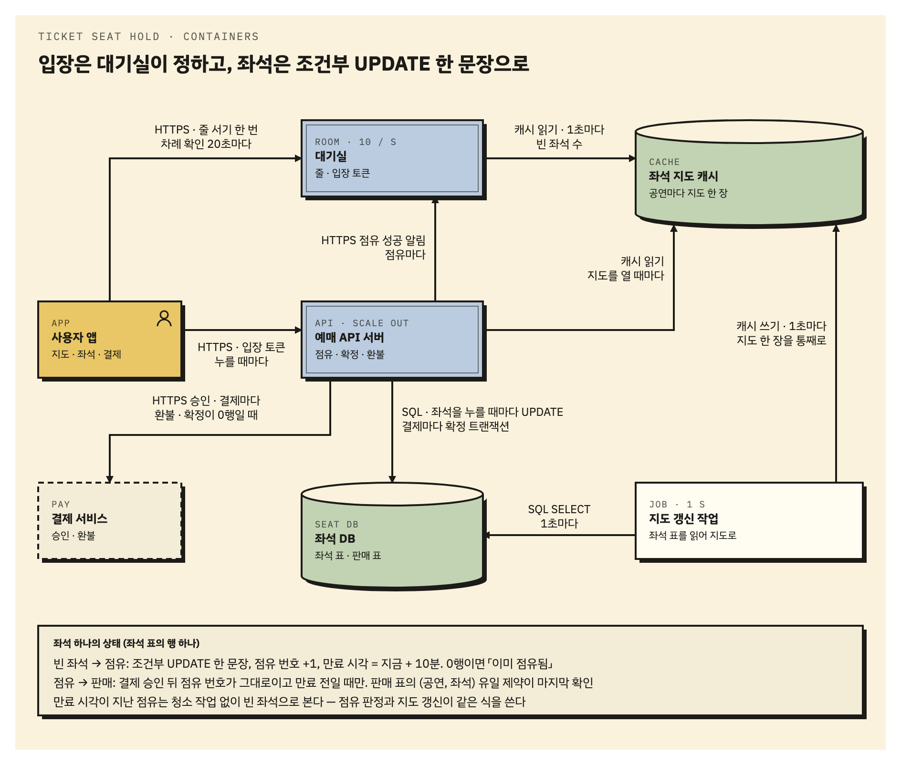
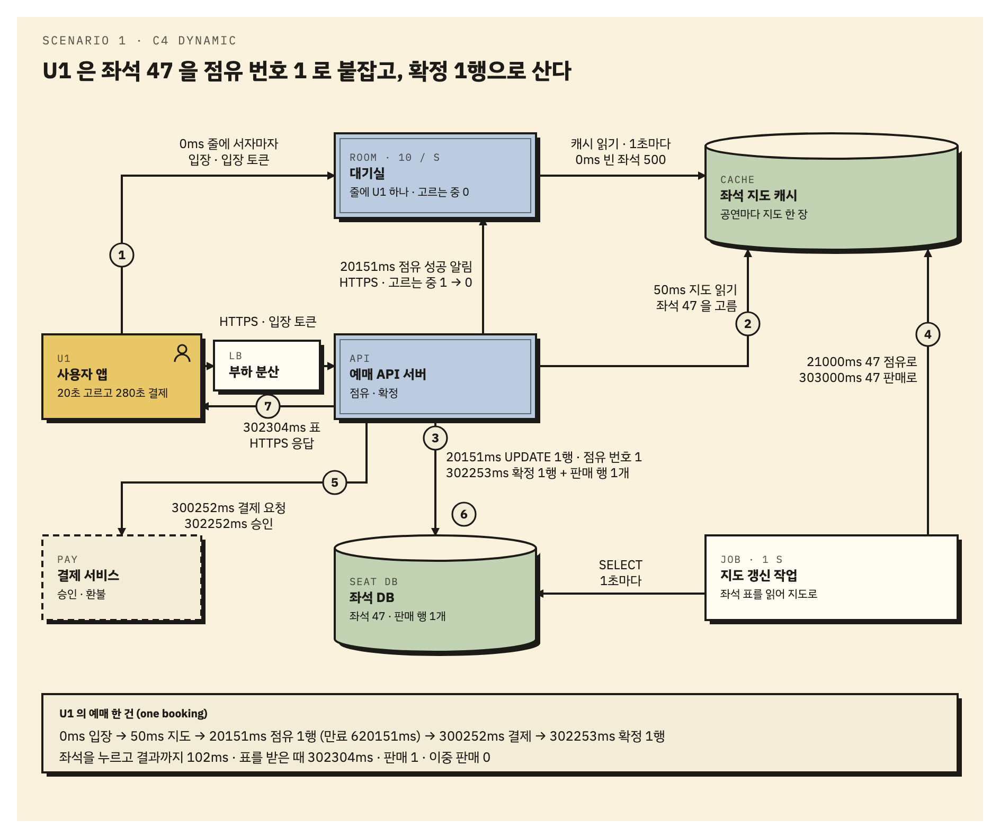
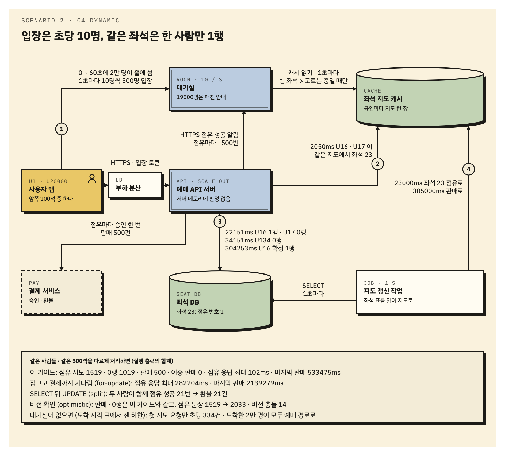
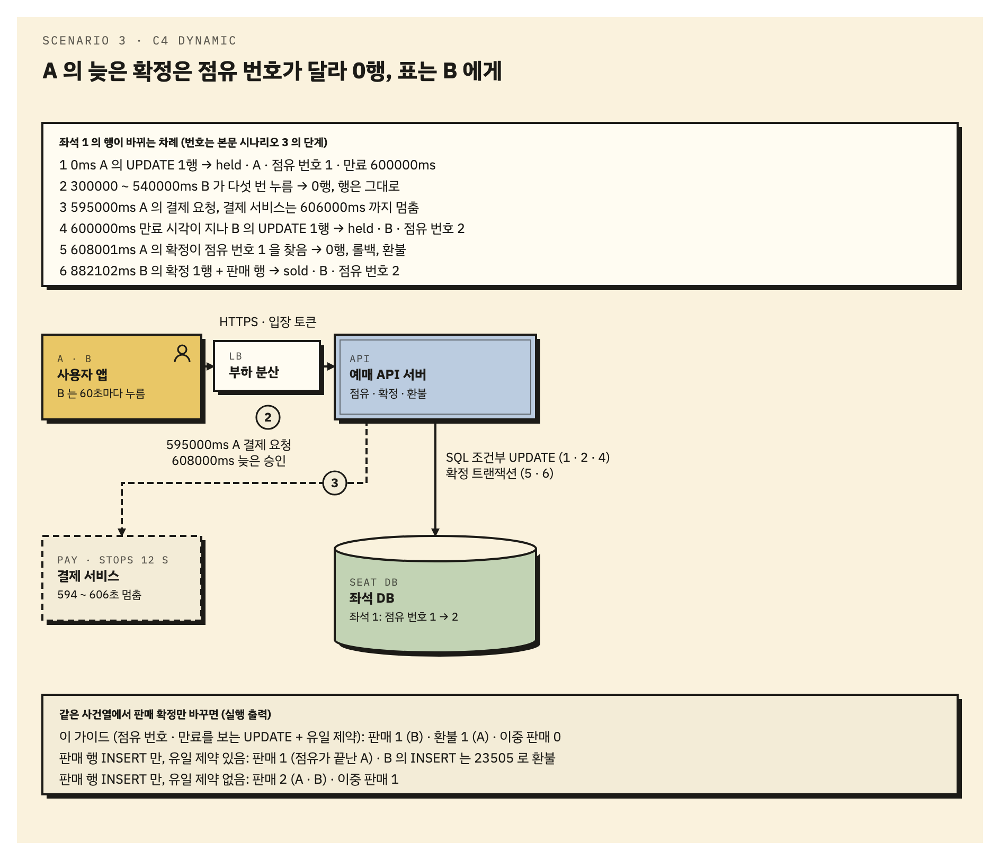

# 티켓 예매와 좌석 선점 — 대기실이 입장 속도를 정하고, 좌석은 점유 번호와 만료 시각을 단 조건부 UPDATE 한 문장으로 붙잡는다

## 문제와 요구사항

저녁 8시 정각에 스타디움 공연 한 회의 좌석 5만 석 예매가 열린다고 해 봅시다. 열리고 1분 안에 1천만 명이 예매 페이지로 들어와요. 한 사람이 좌석 지도를 보고 자리를 고른 뒤 결제를 마치기까지는 몇 분이 걸리니, 그동안 같은 좌석을 다른 사람이 사지 못하게 잠시 붙잡아 둬야 합니다. 붙잡은 사람이 결제하지 않고 떠나면 그 좌석은 다시 팔려야 하고요. 가장 먼저 떠오르는 구조는 예매 서버가 모든 요청을 그대로 받고, DB(데이터베이스)에서 좌석이 비었는지 SELECT(행을 읽는 SQL 문장)로 읽은 뒤 비었으면 UPDATE(행을 고치는 SQL 문장)로 점유를 쓰는 것입니다. SQL 은 관계형 DB 에 묻고 쓰는 질의 언어예요. 이 구조는 두 곳에서 문제가 생깁니다. 첫 1분의 요청이 초당 16만 건을 넘고(규모 추정 [3]), 같은 빈 좌석을 같은 순간에 읽은 두 사람이 둘 다 「점유 성공」을 받아요. 아래 그림의 오른쪽은 이 글이 쓰는 조건부 UPDATE 로, WHERE(고칠 행을 고르는 조건 절)에 「빈 좌석이면」을 달아 조건에 맞을 때만 행을 고칩니다.

```text
읽고 나서 쓰기 (문장 둘)                         조건부 UPDATE 한 문장 (이 글)
  U16: SELECT 좌석 23 → 빈 좌석                    U16: UPDATE 좌석 23 … WHERE 빈 좌석이면 → 1행 → 점유
  U17: SELECT 좌석 23 → 빈 좌석                    U17: UPDATE 좌석 23 … WHERE 빈 좌석이면 → 0행 → 「이미 점유됨」
  U16: UPDATE → 점유 번호 1
  U17: UPDATE → 점유 번호 2   ← 두 사람 모두 「점유 성공」
```

이 글은 대기실이 입장 속도를 정하고, 좌석은 좌석 DB 의 행 하나를 조건부 UPDATE 한 문장으로 붙잡는 구조를 따라갑니다. 대기실은 몰려든 사람을 줄 세워 정해진 속도로만 예매 화면에 들여보내는 서버예요. 좌석 행에는 상태 · 점유자 · 점유 번호 · 만료 시각을 둡니다. 점유 번호는 그 좌석을 점유할 때마다 1씩 늘어나는 번호이고, 만료 시각은 점유가 끝나는 시각이에요. 결제가 끝나면 점유 번호가 그대로이고 만료 전일 때만 판매로 바꾸고, 판매 표의 유일 제약(같은 값을 가진 행을 두 번 넣지 못하게 하는 규칙)이 마지막으로 확인합니다. 끝까지 읽으면 몰려든 사람 · 같은 좌석을 같은 순간 누른 두 사람 · 만료 뒤에 도착한 결제를 각각 어느 자리에서 막는지 실행 출력으로 확인할 수 있어요. 요구 수치가 바뀌면 어느 구조로 옮겨야 하는지도 판단할 수 있게 됩니다. 기능 요구는 아래 셋입니다.

1. 사용자는 판매가 열리면 줄에 들어가고, 차례가 오면 좌석 지도를 봅니다.
2. 좌석을 누르면 그 좌석을 정해진 시간 동안 붙잡고, 그 안에 결제하면 표를 받습니다.
3. 결제하지 않고 떠나거나 정해진 시간이 지나면 그 좌석은 다른 사람이 붙잡을 수 있게 됩니다.

비기능 요구는 아래처럼 수치로 고정합니다. 근거 칸의 출처 수치는 리서치 노트에서 원문과 대조한 것이고, 링크는 참고 자료에 다시 모았어요.

| 항목 | 수치 | 근거 |
| --- | --- | --- |
| 좌석 수 | 한 공연 5만 석 | 이 가이드의 가정 — 스타디움 공연 한 회의 크기로 잡았어요 |
| 몰리는 사람 | 판매가 열린 뒤 1분 안에 1천만 명이 들어옴 | 이 가이드의 가정 — 1천만 명은 Hello Interview 의 면접용 분석이 인기 공연의 예로 든 값(「popular events (10 million users, one event)」)을 빌렸고, 1분은 이 가이드가 정했어요. 어느 회사의 운영값이 아닙니다([Hello Interview 분석](https://www.hellointerview.com/learn/system-design/problem-breakdowns/ticketmaster)). 규모의 감으로는 미국 티켓 판매 회사 Ticketmaster 가 한 투어(52회 공연)의 사전 판매에 350만 명 넘게 사전 등록했고 약 150만 명이 판매 코드를 받았다고 적은 것이 있어요([Ticketmaster 보도자료](https://business.ticketmaster.com/press-release/taylor-swift-the-eras-tour-onsale-explained/)) |
| 순서 | 판매가 열린 뒤 온 사람은 온 순서대로 예매 화면에 들어감 | 티켓 판매 회사 SeatGeek 은 도착 순(「first-in, first-out is the fair approach that we can use in our business」)을 자기 사업에서 쓸 수 있는 공정한 방식이라고 했어요([SeatGeek 발표](https://www.infoq.com/presentations/ticketing-system-virtual-waiting-room/)). Ticketmaster 대기열 안내도 판매가 시작된 뒤 줄에 들어오면 맨 뒤에 선다고 적습니다([Ticketmaster 대기열 안내](https://help.ticketmaster.com/hc/en-us/articles/9781366115985-What-is-the-Ticketmaster-Smart-Queue-)) |
| 예매 경로의 응답 | 지도를 열거나 좌석을 누르면 1초 안에 결과(지도 · 점유 성공 · 이미 점유됨)를 받음 | 이 가이드의 가정 — 좌석을 누른 사람이 결과를 기다리다 같은 자리를 다시 누르기 전에 답하려는 상한이에요 |
| 지도의 신선도 | 지도에 보이는 좌석 상태는 실제보다 최대 2초 늦어도 됨 | 이 가이드의 가정 — 지도는 고르는 데 쓰는 안내라서, 빈 좌석으로 보였던 자리를 누르고 「이미 점유됨」을 받으면 다른 자리를 고르면 된다고 봤어요(판단). Hello Interview 는 인기 공연에서 불러온 좌석 지도가 금방 낡는 것을 고칠 문제로 보고 바뀐 좌석을 서버가 보내 주는 방식을 듭니다. 이 글은 그 낡음을 2초까지 받아들이고 판정을 점유 UPDATE 에 맡겨요(판단, 사용자 앱 항목) |
| 점유 시간 | 좌석을 누른 사람이 10분 동안 붙잡고, 그동안 다른 사람의 점유는 실패 | 이 가이드의 가정 — Hello Interview 가 좌석을 붙잡는 시간의 예로 든 10분을 빌렸어요. Ticketmaster 는 결제 전에 표를 붙잡는 시간을 제한하되 그 길이를 수요에 따라 바꾼다고만 적고 값을 밝히지 않습니다([Ticketmaster 결제 시간 안내](https://help.ticketmaster.com/hc/en-us/articles/9642204793617-Why-is-there-a-time-limit-for-checking-out)). 같은 회사 대기열 안내의 10분은 줄에서 차례가 온 자리를 붙잡는 시간이라 이 값과 다른 것이에요 |
| 재판매 | 점유 시간이 끝난 좌석은 끝난 뒤 5초 안에 다른 사람이 점유할 수 있음 | 이 가이드의 가정 — 매진이 가까우면 풀린 좌석 하나를 여럿이 기다려요. 풀린 좌석을 아무도 잡을 수 없는 시간은 그대로 판매가 늦어지는 시간이라, 기다리는 사람이 지도를 다시 열고 누르는 몇 초 안으로 잡았어요 |
| 정확도 — 이중 판매 | 한 좌석의 판매는 1건 이하(이중 판매 0건) | 이 가이드의 가정 — 같은 좌석에 표가 두 장 나가면 한 사람은 공연장에서 앉을 자리가 없어요. 허용 오차를 두지 않습니다 |
| 정확도 — 늦은 결제 | 점유 시간이 끝난 뒤 도착한 결제는 판매가 되지 않고(0건) 모두 환불 | 이 가이드의 가정 — 점유 시간이 끝났으면 다음 사람 차례예요. 늦게 끝난 결제를 판매로 받으면 그사이 좌석을 붙잡은 다음 사람의 판매를 막게 되어 점유 시간이 뜻을 잃습니다 |

공개 사례가 밝힌 것은 주로 앞단의 대기실입니다. 좌석을 어떻게 붙잡고 이중 판매를 무엇으로 막는지 밝힌 기업 글은 찾지 못했어요. SeatGeek 발표도 두 사람이 같은 순간 예약하려 할 때 누구에게 줄지를 문제로 들지만 답은 적지 않습니다(SeatGeek 발표). 그래서 점유 쪽은 PostgreSQL(관계형 DB 제품) · Redis(데이터를 메모리에 두는 키-값 저장소) · DynamoDB(Amazon 의 클라우드 키-값 DB 서비스)의 공식 문서와, 잠금의 안전성을 다룬 Kleppmann 의 글, 교육용 분석인 Hello Interview 를 근거로 이 글이 설계한 것입니다(판단). 일부러 다루지 않는 것도 적어 둡니다.

- 결제가 두 번 되지 않게 하는 일은 [결제 · 송금 중복 방지](../payment-idempotency/payment-idempotency-guide_v1.0.0.md) 편이 다룹니다. 이 글은 결제를 승인과 환불만 하는 바깥 서비스로 둡니다.
- 여러 좌석을 한 번에 붙잡는 연석 예매(일부 좌석만 잡혔을 때의 처리)는 범위 밖이에요. 규모 추정에는 Ticketmaster 의 평균 3장을 쓰지만, 실행은 한 사람이 좌석 하나를 삽니다.
- 대기실을 여러 지역에 나눠 띄우고 전역 입장 한도를 맞추는 방법은 다루지 않습니다. 규모 추정 [4] 가 그 필요를 보이지만, 이 글의 모형은 대기실 한 곳이에요.
- 봇 · 매크로 차단, 본인 인증, 한 계정에 순번 하나 같은 대기실의 규칙 집행은 다루지 않습니다.
- 좌석 DB 의 복제와 장애 조치(멈춘 주 DB 대신 복제본을 올리는 일)는 범위 밖입니다.

## 규모 추정

식에 쓰는 이름을 먼저 소개합니다. 입장 속도는 대기실이 1초에 예매 화면으로 들여보내는 사람 수예요. 예매 경로는 들어온 사람의 지도 · 점유 · 결제 · 확정 요청이 지나는 길로, 예매 API 서버와 좌석 지도 캐시 · 좌석 DB 가 여기에 있습니다. API(Application Programming Interface)는 프로그램이 서비스를 부르는 창구예요. 차례 확인은 줄에 선 앱이 대기실에 차례가 왔는지 묻는 요청입니다. 출처 수치는 Ticketmaster 보도자료와 Hello Interview 예시뿐이고, 나머지는 이 가이드의 가정과 그 계산이에요.

```text
(입력)  좌석 50,000 석(요구 1행) · 판매가 열린 뒤 1분에 10,000,000 명(요구 2행) · 산 팬 대부분이 평균 3장(Ticketmaster, 과거 평균)
        경기장 공연 한 회 판매에 보통 1시간(Ticketmaster) · 고르고 결제하는 데 평균 5분(가정) · 차례 확인 20초마다(설정)
        점유 시도는 한 사람에 3번(가정) · 지도 읽기는 점유 시도의 100배(Hello Interview 의 읽기 : 쓰기 예시 100:1)

[1] 사는 사람 수              50,000 석 ÷ 3 장 ≈ 16,667 명                → 1천만 명의 약 0.17%
[2] 구매 속도                 16,667 명 ÷ 3,600 초 ≈ 4.6 명/초            (좌석으로는 50,000 ÷ 3,600 ≈ 14 석/초)
[3] 대기실이 없으면            10,000,000 명 ÷ 60 초 ≈ 166,667 건/초       (한 사람이 지도를 한 번만 열어도)
[4] 대기실이 받는 차례 확인     10,000,000 명 ÷ 20 초 = 500,000 건/초
[5] 입장 속도                 구매 속도 4.6 명/초의 약 2배 → 10 명/초(설정)
    예매 경로의 동시 사용자      10 명/초 × 300 초(5분) = 3,000 명           → 1천만 명과 10,000,000 ÷ 3,000 ≈ 3,333 배 차이
    사는 사람이 다 들어가는 데   16,667 명 ÷ 10 명/초 ≈ 1,667 초 ≈ 28 분
[6] 좌석 DB 의 점유 쓰기        10 명/초 × 3 번 = 30 건/초
[7] 좌석 지도 읽기              30 건/초 × 100 = 3,000 건/초                → 좌석 지도 캐시가 받음
    좌석 DB 가 받는 지도 읽기    지도 갱신 작업의 SELECT 1 건/초 (5만 행을 한 번에)
```

이 계산에서 빠지는 구조가 있어요. [3] 이 대기실 없는 구조(대안 비교의 E)를 뺍니다. 판매 속도는 초당 14석인데 예매 경로가 받는 첫 요청이 초당 16만 7천 건이면, 그 요청의 대부분은 살 좌석이 없는 사람의 것이에요([1] 의 0.17%). Ticketmaster 는 한 판매에서 시스템 요청이 35억 건으로 이전 최고치의 4배였다고 적었습니다([Ticketmaster 보도자료](https://business.ticketmaster.com/press-release/taylor-swift-the-eras-tour-onsale-explained/)). 봇 공격과 코드 없는 팬이 몰린 결과라고 같은 글이 적었고, 판매 시간 길이가 글에 없어 이 글은 그 값을 초당 값으로 바꾸지 않아요. [4] 는 대기실도 한 대로는 받을 수 없다는 뜻이라, 대기실은 여러 지역에 나눠 띄우는 제품을 쓰게 됩니다(판단). 이 글은 그 안쪽을 다루지 않고 모형에서는 대기실을 한 곳으로 둡니다.

[5] ~ [7] 은 크기를 정합니다. 대기실이 초당 10명만 들이면 예매 경로의 동시 사용자는 3천 명 안팎이고, 좌석 DB 의 점유 쓰기는 초당 30건 안팎이에요. 쓰기 양으로는 좌석 DB 한 대로 감당할 크기라서(판단 — DB 한 대의 한계는 확인 안 함), 어려운 것은 양이 아니라 같은 좌석에 몰리는 경합입니다. 그래서 점유를 좌석 행 하나에 대한 조건부 UPDATE 한 문장으로 하고, 지도 읽기는 [7] 처럼 캐시로 떼어 좌석 DB 의 쓰기 경로에 두지 않아요.

## 시스템 개념도



요청이 지나는 주된 길은 이렇습니다. 사용자 앱이 대기실에 HTTPS(암호화한 HTTP, HTTP 는 웹의 요청 · 응답 규약) 요청으로 줄에 들어가 20초마다 차례를 묻고, 차례가 오면 입장 토큰을 받아요. 입장 토큰은 예매 화면에 들어와도 된다는 표시입니다. 대기실은 1초마다 좌석 지도 캐시에서 빈 좌석 수를 읽고, 그 수가 「들어와서 아직 좌석을 붙잡지 않은 사람」보다 많을 때만 초당 10명까지 들여보내요. 그 사람 수는 예매 API 서버가 점유에 성공할 때마다 대기실에 알려 줄어듭니다. 들어온 앱은 예매 API 서버에서 지도를 받는데, 그 지도는 지도 갱신 작업이 1초마다 좌석 DB 를 읽어 캐시에 써 둔 것입니다. 좌석을 누르면 예매 API 서버가 좌석 DB 에 조건부 UPDATE 한 문장을 보내요. 결제 서비스의 승인이 오면 확정 트랜잭션(여러 쓰기를 모두 반영하거나 하나도 반영하지 않는 묶음)으로 판매를 씁니다.

## 시나리오로 따라가기

### 시나리오 1 — 줄 맨 앞의 U1 이 좌석 47 을 점유 번호 1 로 10분 붙잡고, 결제 승인 뒤 확정 1행과 판매 행 하나로 302304ms 에 표를 받는다

판매가 열린 0ms 에 U1 이 대기실에 들어옵니다. 다른 사람은 없고 장애도 없어요. 한 사람의 예매 한 건이 처음부터 끝까지 가는 길입니다. 실행 규모는 좌석 500석인 공연이에요(상황 설정). 한 방향 시간은 앱과 예매 API 서버 사이 50ms, 예매 API 서버와 좌석 DB 사이 1ms 이고, 결제 서비스의 승인은 왕복 2초로 둡니다(모두 가정). U1 은 지도를 받고 20초 뒤에 좌석을 누르고, 점유를 받은 뒤 280초 동안 결제 정보를 넣어요(가정, 합쳐서 규모 추정의 5분). 나와야 하는 것은 점유 1행, 확정 1행, 판매 행 하나, 그리고 U1 의 표입니다.



1. 0ms 에 U1 이 줄에 들어오고, 같은 순간 대기실이 U1 을 들여보내며 입장 토큰을 줍니다. 대기실은 1초마다 두 가지를 봐요. 그 1초에 10명을 넘지 않았는가, 그리고 좌석 지도 캐시의 빈 좌석 수(0ms 에 500)가 들어와서 아직 좌석을 붙잡지 않은 사람 수(0명)보다 많은가입니다. 두 번째 조건을 두는 이유는 살 좌석이 없는 사람을 예매 화면에 들이지 않기 위해서예요. 들어온 사람마다 고를 좌석이 있어야 들여보낸 일이 판매로 이어집니다.
2. 50ms 에 U1 의 지도 요청이 예매 API 서버에 오고, 서버는 좌석 지도 캐시에서 0ms 에 만든 지도(빈 좌석 500)를 읽어 돌려줍니다. U1 은 앞쪽 빈 좌석 가운데 좌석 47 을 골라요. 지도를 좌석 DB 가 아니라 캐시에서 읽는 이유는 지도 읽기가 점유 쓰기의 100배라서(규모 추정 [7]), 그 읽기를 좌석 DB 에 보내면 점유 UPDATE 가 쓰는 DB 를 함께 나눠 쓰게 되기 때문입니다.
3. 20151ms 에 좌석 DB 가 U1 의 조건부 UPDATE 를 받습니다. 조건은 「빈 좌석이거나, 점유됐지만 만료 시각이 지났다」예요. 맞으면 상태를 점유로, 점유자를 U1 로 바꾸고, 점유 번호를 1 늘려 1로, 만료 시각을 지금 + 10분인 620151ms 로 씁니다. 바뀐 행이 1이라 점유 성공이고, 예매 API 서버는 이것을 대기실에 알려 고르는 중인 사람에서 U1 을 뺍니다. 조건과 쓰기를 한 문장에 두는 이유는 둘 사이에 다른 사람의 쓰기가 끼어들 틈을 없애려는 것입니다(시나리오 2 의 비교). 만료 시각을 행에 적어 두는 이유는, 만료를 따로 처리하는 청소 작업 없이 다음 사람의 UPDATE 조건이 스스로 판정하게 하려는 것이에요(시나리오 3 의 4단계).
4. 21000ms 에 지도 갱신 작업이 좌석 표를 읽어 좌석 47 을 점유로 그린 지도를 캐시에 씁니다. 점유가 지도에 보이기까지 849ms 걸렸어요. 지도를 1초마다 따로 만드는 이유는 지도 요청이 몇 건이든 좌석 DB 가 받는 지도 읽기를 1초에 한 번으로 묶기 위해서입니다.
5. 300252ms 에 U1 의 결제 요청이 예매 API 서버에 오고, 서버가 결제 서비스에 승인을 요청합니다. 302252ms 에 승인이 돌아와요. 결제를 판매 확정보다 먼저 하는 이유는, 판매부터 쓰면 결제가 거절될 때 판매를 되돌려야 하고 그사이 지도에는 판매로 보이기 때문입니다(판단).
6. 302253ms 에 확정 트랜잭션이 「상태가 점유이고 점유 번호가 1 이며 만료 시각이 지나지 않았다」를 조건으로 상태를 판매로 바꿔 1행을 받고, 판매 표에 (공연, 좌석 47) 행을 넣어 커밋(트랜잭션의 쓰기를 확정하는 일)합니다. 점유 번호를 조건에 넣는 이유는 U1 이 받은 점유가 아직 그대로인지 보려는 것이에요. 그사이 만료되고 다른 사람이 붙잡았다면 번호가 달라져 0행이 됩니다(시나리오 3 의 5단계).
7. 302304ms 에 U1 이 표를 받고, 303000ms 에 지도가 좌석 47 을 판매로 보입니다. 확정에서 지도까지 747ms 예요. 표를 커밋 뒤에 보내는 이유는 앱이 표를 본 순간 판매 행이 이미 남아 있게 하려는 것입니다. 지도가 747ms 늦게 따라와도 괜찮은 이유는 그사이 좌석 47 을 누른 사람이 있어도 UPDATE 가 0행을 주기 때문이에요.

```text
t=0ms U1 room: arrived at 0ms, admitted with a token
t=50ms U1 api: seat map refreshed at 0ms, free=500, picks seat 47
t=20151ms U1 db: UPDATE seat 47 -> 1 row, hold_no=1 until=620151ms
t=21000ms map: seat 47 shows held
t=300252ms U1 api: pay 110000 won -> payment service
t=302253ms U1 db: payment approved, confirm UPDATE seat 47 hold_no=1 -> 1 row, INSERT sale -> 1 row, commit
t=302304ms U1 app: ticket for seat 47
t=303000ms map: seat 47 shows sold
one booking: tries=1 hold-statements=1 held=1 refused=0 told-held-twice=0 refunds=0 sales=1 double-sold=0 hold-reply-max=102ms
```

잠깐, 확인 하나만 해 볼까요? U1 이 좌석 47 을 누르고 「점유 성공」을 받기까지 몇 ms 걸렸을까요?

102ms 입니다(`hold-reply-max=102ms`). U1 은 100ms 에 지도를 받고 20초 뒤인 20100ms 에 눌렀어요. 그 뒤는 네트워크 왕복 둘과 UPDATE 한 문장뿐이라 기다리는 자리가 없습니다.

```text
20100ms  U1 이 좌석 47 을 누름
20150ms  예매 API 서버에 도착              앱 → 서버 50ms
20151ms  좌석 DB 의 UPDATE → 1행           서버 → DB 1ms
20152ms  서버가 결과를 받음                DB → 서버 1ms
20202ms  앱이 「점유 성공」을 받음          서버 → 앱 50ms
합계     50 + 1 + 1 + 50 = 102ms          (요구 4행의 1초 안)
```

이 시나리오가 보여 준 것은 예매 한 건이 지나는 순서와 그 순서의 이유입니다. 점유는 102ms 에 답이 왔고 지도 요청은 왕복 100ms 라, 예매 경로의 응답 행에 들어가요. 점유와 판매가 지도에 보이기까지 849ms · 747ms 는 지도의 신선도 행으로 갑니다. 만료 시각 620151ms 는 점유 20151ms 에서 정확히 10분 뒤이고, 판매 행이 하나인 것이 이중 판매 행의 첫 근거예요. 만료 시각과 점유 번호가 실제로 무언가를 막는 일은 이 시나리오에 없습니다. 막는 자리는 같은 좌석에 두 사람이 오는 시나리오 2 와, 점유가 끝난 뒤 결제가 오는 시나리오 3 이에요.

### 시나리오 2 — 2만 명이 1분 안에 몰려도 대기실이 초당 10명씩 500명만 들이고, 같은 순간 좌석 23 을 누른 두 사람 가운데 한 명만 1행을 받아 500석이 이중 판매 없이 팔린다

실행 규모로 줄여, 좌석 500석에 판매가 열린 뒤 60초 동안 2만 명이 3ms 간격으로 들어옵니다(초당 333 ~ 334명). 실제 규모의 좌석당 200명(1천만 ÷ 5만)을 좌석당 40명으로 줄인 것이에요. 대기실은 초당 10명까지 들입니다. 들어온 사람은 지도에서 앞쪽 빈 좌석 100석 가운데 하나를 고르고, 20초 뒤에 누르고, 점유하면 280초 뒤에 결제해요(가정). 어느 자리를 고를지는 정해진 씨앗에서 만든 의사 난수(정해진 식으로 만드는, 난수처럼 보이는 수열)로 정합니다. 누른 좌석이 「이미 점유됨」이면 바로 지도를 다시 열어 고르고요. 나와야 하는 것은 500석이 한 번씩만 팔리는 것, 점유 응답이 1초 안인 것, 예매 경로가 받는 요청이 도착 속도와 상관없이 일정한 것입니다.



1. 대기실이 1초마다 줄의 맨 앞부터 최대 10명을 들입니다. 빈 좌석 수가 고르는 중인 사람 수보다 많을 때만이에요. 실행에서 들어온 사람은 500명이고(`admitted=500`), 마지막으로 들어온 사람은 1497ms 에 도착한 사람입니다. 3ms 간격 도착이니 맨 앞 500명이 도착 순서대로 들어갔어요(요구 3행). 나머지 19500명은 줄에서 기다리다 534000ms 에 매진 안내를 받습니다. 몰린 2만 명을 받는 곳이 대기실이라서, 예매 경로가 받은 요청은 초당 최대 48건이에요.
2. 2050ms 에 같은 1초(2000ms)에 들어온 10명이 같은 지도를 받고, 그중 U16 과 U17 이 좌석 23 을 고릅니다. 14050ms 에 들어온 U134 도 좌석 23 을 골라요. 지도는 1초마다 새로 만들지만 U16 이 아직 누르지 않아서 좌석 23 은 빈 좌석으로 보입니다. 같은 좌석에 사람이 몰리는 까닭은 지도가 1초 낡아서가 아니라, 사람이 고르는 20초 동안 다른 사람의 선택이 지도에 아직 없기 때문이에요.
3. 22151ms 에 U16 과 U17 의 UPDATE 가 같은 ms 에 좌석 DB 에 도착합니다. U16 이 1행(점유 번호 1)을 받고, U17 은 0행을 받아 「이미 점유됨」으로 끝나요. 34151ms 에 온 U134 도 0행입니다. 같은 순간 와도 하나만 1행인 이유는 DB 가 같은 행을 고치는 두 문장을 차례로 처리하고, 뒤의 문장이 바뀐 행에 조건을 다시 맞춰 보기 때문이에요. PostgreSQL 의 기본 격리 수준(트랜잭션끼리 서로의 변경을 어디까지 보는지 정하는 단계)인 Read Committed 에서는, UPDATE 가 고치려는 행을 다른 트랜잭션이 이미 고쳤으면 그 트랜잭션이 끝나기를 기다립니다. 앞의 것이 커밋되면 고쳐진 행에 WHERE 조건을 다시 맞춰 보고, 맞을 때만 고쳐요([PostgreSQL 18 격리 수준 문서](https://www.postgresql.org/docs/current/transaction-iso.html)). U17 이 다시 맞춰 본 행은 이미 점유라서 조건에 맞지 않습니다.
4. 23000ms 에 지도 갱신 작업이 좌석 23 을 점유로 그리고, U16 의 확정(304253ms) 뒤 305000ms 에 판매로 그립니다. 0행을 받은 U17 과 U134 는 기다리지 않고 102ms 만에 답을 받아 지도를 다시 열어요(`hold-reply-max=102ms`). 같은 좌석을 다시 누르지 않고 지도를 여는 이유는 0행이 「남이 붙잡았거나 이미 팔린 좌석」이라는 뜻이라, 다시 눌러도 그 점유가 끝나기 전에는 0행만 받기 때문입니다. 실행 전체에서 점유 시도는 1519번, 그 가운데 0행이 1019번이었습니다. 규모 추정 [6] 은 한 사람에 3번을 가정했고 이 실행에서는 1519 ÷ 500 ≈ 3.0 번이었어요(계산).
5. 마지막 판매는 533475ms 이고 500석이 모두 한 번씩 팔렸습니다(`sales=500 double-sold=0`). 좌석 DB 가 받는 점유 쓰기는 몰려온 사람 수가 아니라 대기실의 입장 속도를 따라갑니다. 도착을 2만 명에서 200만 명으로 늘린 변형 실행(바꾼 것: Java 판 `main` 의 시나리오 2 에서 사람 수 `20_000` 을 `2_000_000` 으로)에서도 `guide room: admitted=500 ... booking-requests-per-second-max=49 ...` 가 나왔어요. 들어온 사람은 500명 그대로이고, 예매 경로의 초당 요청은 48건에서 49건이 됐습니다.

```text
t=2050ms U16 api: seat map refreshed at 2000ms, free=500, picks seat 23
t=2050ms U17 api: seat map refreshed at 2000ms, free=500, picks seat 23
t=14050ms U134 api: seat map refreshed at 14000ms, free=500, picks seat 23
t=22151ms U16 db: UPDATE seat 23 -> 1 row, hold_no=1 until=622151ms
t=22151ms U17 db: UPDATE seat 23 -> 0 rows, held by U16 until 622151ms
t=23000ms map: seat 23 shows held
t=34151ms U134 db: UPDATE seat 23 -> 0 rows, held by U16 until 622151ms
t=302252ms U16 api: pay 110000 won -> payment service
t=304253ms U16 db: payment approved, confirm UPDATE seat 23 hold_no=1 -> 1 row, INSERT sale -> 1 row, commit
t=305000ms map: seat 23 shows sold
guide: tries=1519 hold-statements=1519 held=500 refused=1019 told-held-twice=0 refunds=0 sales=500 double-sold=0 hold-reply-max=102ms
guide room: admitted=500 last-admitted-arrived=1497ms on-booking-path-max=500 booking-requests-per-second-max=48 last-sale=533475ms sold-out-notice=534000ms in-line=19500
no room: every arrival opens the seat map at once, booking-requests-per-second-max=334 on-booking-path-max=20000
```

마지막 줄은 대기실이 없을 때 예매 경로가 받는 양입니다. 도착 시각 표에서 도착한 사람이 모두 바로 지도를 연다고만 센 값(시뮬레이션이 아닌 하한)인데도 첫 요청만 초당 334건이에요. `on-booking-path-max=20000` 은 잰 동시 사용자가 아니라 도착한 2만 명이 모두 예매 경로로 들어온다는 뜻입니다. 점유와 결제 요청까지 더하면 이보다 많습니다.

같은 사건열을 점유만 「SELECT 로 빈 좌석인지 읽고, 비었으면 조건 없는 UPDATE」 두 문장으로 나눠 실행하면 좌석 23 이 이렇게 됩니다. 확정은 이 글과 같이 점유 번호를 봅니다.

```text
t=22151ms U16 db: SELECT seat 23 -> free, hold_no=0
t=22151ms U17 db: SELECT seat 23 -> free, hold_no=0
t=22153ms U16 db: UPDATE seat 23 -> 1 row, hold_no=1 until=622153ms
t=22153ms U17 db: UPDATE seat 23 -> 1 row, hold_no=2 until=622153ms, but U16 was told held too
t=34151ms U134 db: SELECT seat 23 -> held by U17 until 622153ms
t=302254ms U16 api: pay 110000 won -> payment service
t=302254ms U17 api: pay 110000 won -> payment service
t=304255ms U16 db: payment approved, confirm UPDATE seat 23 hold_no=1 -> 0 rows (seat hold_no=2), rollback, no INSERT, refund 110000 won
t=304255ms U17 db: payment approved, confirm UPDATE seat 23 hold_no=2 -> 1 row, INSERT sale -> 1 row, commit
split-select-update: tries=1550 hold-statements=2071 held=521 refused=1029 told-held-twice=21 refunds=21 sales=500 double-sold=0 hold-reply-max=104ms
```

U16 과 U17 이 둘 다 「점유 성공」을 받고 둘 다 결제했어요. 판매가 하나로 끝난 것은 확정이 점유 번호를 봤기 때문이고, U16 은 결제한 뒤 환불을 받습니다. 이런 좌석이 실행 전체에서 21석이었어요(`told-held-twice=21 refunds=21`). 앞 편 [선착순 쿠폰 발급](../first-come-coupon/first-come-coupon-guide_v1.1.1.md) 에서 확인과 차감을 두 명령으로 나눴을 때 쿠폰이 넘쳤던 것과 같은 틈입니다. 이 실행의 다른 비교 두 줄(잠그고 결제까지 기다림 · 버전 확인)은 대안 비교에서 씁니다.

이 시나리오가 보여 준 것은 부하를 받는 곳과 바뀌지 않는 것입니다. 2만 명을 받은 곳은 대기실이에요. 들어온 사람 수 500 은 도착이 2만 명일 때나 200만 명일 때(5단계의 변형 실행)나 같았고, 예매 경로가 받은 요청은 초당 최대 48건 · 49건이었어요. 이것이 몰리는 사람 행의 근거입니다. 줄 맨 앞 500명이 도착 순서대로 들어간 것은 순서 행으로 갑니다. 0행 1019번이 모두 102ms 안에 답을 받은 것은 예매 경로의 응답 행으로, 판매 500 · 이중 판매 0 은 이중 판매 행으로 가요. 점유를 두 문장으로 나누면 「점유 성공」 응답이 틀리게 나가고, 그 뒤를 점유 번호가 막는다는 것도 보였어요.

### 시나리오 3 — 결제 서비스가 12초 멈춘 사이 A 의 점유가 600000ms 에 끝나면, B 가 마지막 좌석을 점유 번호 2 로 붙잡고 A 의 늦은 확정은 0행이 되어 환불된다

매진 직전이라 남은 좌석은 좌석 1 하나입니다. A 가 0ms 에 좌석 1 을 붙잡았고(만료 600000ms), B 는 좌석이 풀리기를 기다리며 300000ms 부터 60초마다 좌석 1 을 누릅니다(가정). A 는 결제 정보를 넣느라 595000ms 에야 결제를 요청해요. 그런데 결제 서비스가 594000ms 부터 606000ms 까지 12초 멈춰 있어서, A 의 결제는 결제 서비스가 다시 처리한 뒤 608000ms 에 승인이 돌아옵니다(가정). A 의 점유는 그보다 8초 앞서 끝났어요. 결제 서비스 안에서 결제가 두 번 되지 않게 하는 일은 결제 · 송금 중복 방지 편이 다루므로, 여기서 결제 서비스는 늦게라도 승인 한 번을 돌려준다고 둡니다. 나와야 하는 것은 B 가 600000ms 에 바로 좌석을 붙잡는 것, A 의 늦은 결제가 판매가 되지 않고 환불되는 것, 판매가 한 건인 것입니다.



1. 0ms 에 A 의 UPDATE 가 1행을 받습니다. 좌석 1 의 행은 점유 · A · 점유 번호 1 · 만료 600000ms 가 돼요. 점유를 잠금이 아니라 행의 값으로 남기는 이유는 A 가 결제하는 몇 분 동안 트랜잭션이나 잠금을 열어 두지 않기 위해서입니다(대안 비교의 A).
2. 300000ms 부터 540000ms 까지 B 가 다섯 번 누르지만 모두 0행입니다. 조건의 앞쪽(빈 좌석)도 뒤쪽(만료 시각이 지났다)도 맞지 않기 때문이에요. 점유 시간 10분 동안 다른 사람의 점유가 실패한다는 요구 6행이 이 0행 다섯 번입니다.
3. 595000ms 에 A 의 결제 요청이 예매 API 서버에 오고 서버가 결제 서비스를 부르지만, 결제 서비스가 멈춰 있어 답이 없습니다. 예매 API 서버가 결제를 부르기 전에 점유가 아직 유효한지 볼 수는 있어요. 595000ms 에는 유효하니 그 확인은 통과하고, 결제 도중에 만료되는 것은 막지 못합니다(판단). 그래서 확정 단계의 조건과 환불이 함께 있어야 해요.
4. 600000ms 에 B 의 UPDATE 가 1행을 받습니다. 만료 시각 600000ms 가 지금보다 늦지 않으니 「점유됐지만 만료 시각이 지났다」에 맞아요. 점유 번호는 2, 만료 시각은 1200000ms 가 됩니다. 만료된 바로 그 ms 에 다음 사람이 붙잡았으니 요구 7행의 5초 안이고(결과 0ms), 그 사이에 실행된 청소 작업은 없어요. 점유 판정은 「만료 시각 ≤ 지금」을, 확정 판정은 「만료 시각 > 지금」을 쓰므로 두 판정이 함께 맞는 ms 는 없습니다.
5. 608001ms 에 A 의 확정 트랜잭션이 「점유 번호 = 1」을 조건으로 UPDATE 하지만 행의 점유 번호는 2 라서 0행입니다. 트랜잭션을 되돌리고 판매 행 INSERT(행을 넣는 SQL 문장)를 하지 않은 채 결제 서비스에 환불을 요청해요. 점유 번호를 조건에 넣는 이유가 이 순간에 있어요. 「점유이고 만료 전」만 보면, 608001ms 의 행은 B 가 다시 잡은 점유이고 만료 시각이 1200000ms 라 그 조건에 맞아 A 의 늦은 확정이 1행을 받습니다. 변형 실행(바꾼 것: Java 판 `confirm` 의 확정 조건에서 점유 번호 비교 `x.no == p.no &&` 를 뺌)에서 `t=608001ms A db: payment approved, confirm UPDATE seat 1 hold_no=1 -> 1 row, INSERT sale -> 1 row, commit` 이 나왔고, B 의 확정은 0행 · 환불이 되어 `seat 1 sold to A` 였어요. 점유 번호가 「A 가 받은 그 점유」인지를 가려 이것을 막습니다.
6. 880101ms 에 B 가 결제를 요청하고, 882102ms 에 B 의 확정이 「점유 번호 = 2」로 1행을 받은 뒤 판매 행을 넣어 커밋합니다. 1행인 이유는 B 가 받은 점유 번호 2 가 행에 그대로 있고 만료 시각 1200000ms 가 아직 지나지 않았기 때문이에요. 판매 행이 판매 표의 유일 제약에 걸리지 않고 들어가는 것은 A 의 확정이 판매 행을 넣지 않고 되돌아갔기 때문입니다.

```text
t=0ms A db: UPDATE seat 1 -> 1 row, hold_no=1 until=600000ms
t=300000ms B db: UPDATE seat 1 -> 0 rows, held by A until 600000ms
t=360000ms B db: UPDATE seat 1 -> 0 rows, held by A until 600000ms
t=420000ms B db: UPDATE seat 1 -> 0 rows, held by A until 600000ms
t=480000ms B db: UPDATE seat 1 -> 0 rows, held by A until 600000ms
t=540000ms B db: UPDATE seat 1 -> 0 rows, held by A until 600000ms
t=595000ms A api: pay 110000 won -> payment service, which is down until 606000ms
t=600000ms B db: UPDATE seat 1 -> 1 row, hold_no=2 until=1200000ms
t=608001ms A db: payment approved, confirm UPDATE seat 1 hold_no=1 -> 0 rows (seat hold_no=2), rollback, no INSERT, refund 110000 won
t=880101ms B api: pay 110000 won -> payment service
t=882102ms B db: payment approved, confirm UPDATE seat 1 hold_no=2 -> 1 row, INSERT sale -> 1 row, commit
guide: tries=7 hold-statements=7 held=2 refused=5 told-held-twice=0 refunds=1 sales=1 double-sold=0 hold-reply-max=102ms seat 1 sold to B
```

좌석 1 의 행 하나만 따라가면 이렇습니다.

```text
            상태   점유자  점유 번호  만료 시각
0ms         점유   A       1          600000ms     ← A 의 UPDATE 1행
300000ms ~  점유   A       1          600000ms     ← B 의 UPDATE 0행 다섯 번, 행은 그대로
600000ms    점유   B       2          1200000ms    ← 만료 시각 600000 ≤ 지금 600000 이라 B 의 UPDATE 1행
608001ms    점유   B       2          1200000ms    ← A 의 확정이 점유 번호 1 을 찾음 → 0행, 행은 그대로
882102ms    판매   B       2          1200000ms    ← B 의 확정 1행 + 판매 행
```

> 붙잡을 때 번호를 받고, 살 때 그 번호를 낸다. 번호가 바뀌었으면 내 차례는 끝났다.

정합성이 걸린 문제라 틀린 값이 남는 길도 봐야 합니다. 같은 사건열에서 확정만 바꿔 실행했어요. 「판매 행 INSERT 만」은 결제가 끝나면 좌석 행을 보지 않고 판매 표에 행만 넣는 확정입니다. 이 둘은 코드에 함께 들어 있는 비교 실행이라 출력도 정본 실행의 출력에 있어요.

```text
t=608001ms A db: payment approved, INSERT sale seat 1 -> 1 row, commit
t=882102ms B db: payment approved, INSERT sale seat 1 -> 23505 unique_violation, rollback, refund 110000 won
insert-only: tries=7 hold-statements=7 held=2 refused=5 told-held-twice=0 refunds=1 sales=1 double-sold=0 hold-reply-max=102ms seat 1 sold to A
t=608001ms A db: payment approved, INSERT sale seat 1 -> 1 row, commit
t=882102ms B db: payment approved, INSERT sale seat 1 -> 1 row, commit
insert-only-no-unique: tries=7 hold-statements=7 held=2 refused=5 told-held-twice=0 refunds=0 sales=2 double-sold=1 hold-reply-max=102ms seat 1 sold to A B
```

첫 비교가 가장 조용히 틀립니다. 판매는 한 건이고 이중 판매도 0이라 판매 표만 보면 어긋난 데가 없어요. 그런데 표는 점유가 끝난 A 에게 갔고, 600000ms 부터 좌석을 붙잡고 있던 B 는 결제한 뒤 23505(PostgreSQL 의 유일 제약 위반 오류 코드)로 환불을 받습니다. 늦은 결제 행이 어긋난 것이고, 판매 표의 유일 제약은 두 번째 판매만 막을 뿐 누가 사야 하는지는 모릅니다. 유일 제약까지 없으면 좌석 1 이 A · B 에게 두 번 팔려요(`double-sold=1`). 유일 제약은 마지막 확인이고, 판매가 맞는 사람에게 가게 하는 것은 확정의 점유 번호 조건입니다.

이 시나리오가 보여 준 것은 점유가 끝난 뒤의 결제가 판매가 되지 않는 길입니다. B 의 0행 다섯 번이 점유 시간 행의 근거이고, 만료된 600000ms 에 B 가 바로 1행을 받은 것이 재판매 행의 근거예요. A 의 확정 0행과 환불은 늦은 결제 행으로, 판매 1 · 이중 판매 0 은 이중 판매 행으로 갑니다. 확정이 좌석 행을 보지 않으면 판매가 틀린 사람에게 가고, 유일 제약도 없으면 두 번 팔린다는 것이 틀린 값이 남는 길이에요.

## 기술 상세 설명

### 구성 요소 — 사용자 앱

예매 화면이 있는 모바일 앱이나 웹 페이지입니다. 줄 서기 화면, 좌석 지도, 결제 화면 셋이 있어요. 줄에 들어갈 때 대기실에서 받은 입장 토큰을 그 뒤의 예매 요청마다 붙입니다.

맡는 일은 시나리오 1 의 1 · 2 · 5 · 7단계에서 줄에 들어가고 지도를 받고 결제를 요청하고 표를 받는 것입니다. 시나리오 2 의 4단계에서는 「이미 점유됨」을 받으면 바로 지도를 다시 열고, 시나리오 3 의 2단계에서는 B 가 같은 좌석을 다시 눌러요.

```text
지도가 바뀌는 때                     앱이 받아 오기 (이 글)                       서버가 보내 주기      
앱에 오는 때                         지도를 열 때 · 「이미 점유됨」을 받을 때          좌석이 바뀔 때마다 연결된 앱 모두에
지도 자체의 낡음                     지도 갱신 1초 + 받아 온 뒤 지난 시간             지도 갱신 1초
같은 좌석에 몰리는 까닭(고르는 20초)   그대로                                       그대로
```

지도를 앱이 받아 오는 방식과 견줄 것은 서버가 바뀐 좌석을 연결을 통해 보내 주는 방식입니다. Hello Interview 는 좌석 지도에 SSE(Server-Sent Events, 서버가 연결을 열어 둔 채 이벤트를 보내는 HTTP 방식)를 듭니다(Hello Interview 분석). 보내 주는 방식은 지도의 낡음을 줄이지만, 시나리오 2 에서 같은 좌석에 사람이 몰린 까닭은 지도의 1초 낡음이 아니라 사람이 고르는 20초였어요(시나리오 2 의 2단계). 그래서 이 글은 누를 때와 실패할 때 지도를 다시 받는 쪽을 고릅니다(판단).

| 설정값 · 한계 | 값 | 이유 · 보장하지 않는 것 |
| --- | --- | --- |
| 차례 확인 | 20초마다 | 규모 추정 [4] 의 크기를 정하는 값. 실행은 흉내 내지 않고 들어온 순간 앱이 안다고 둠 |
| 「이미 점유됨」을 받으면 | 바로 지도를 다시 받아 다른 좌석을 고름 | 같은 좌석을 다시 누르게 두면 0행만 늘어남(판단). 시나리오 3 의 B 처럼 한 좌석만 기다리는 사람도 있음 |
| 입장 토큰 | 예매 요청마다 붙임 | Cloudflare 는 암호화한 쿠키(브라우저가 요청마다 붙여 보내는 작은 값)로 주고([Cloudflare 대기실 글](https://blog.cloudflare.com/building-waiting-room-on-workers-and-durable-objects)), AWS(Amazon Web Services) 대기실은 줄의 앞에 온 사용자에게 세션 토큰을 줌([AWS Virtual Waiting Room 소개 글](https://aws.amazon.com/blogs/compute/introducing-aws-virtual-waiting-room/)) |
| 고르는 시간 · 결제 정보를 넣는 시간 | 20초 · 280초(실행의 가정) | 합쳐 규모 추정의 평균 5분. 사람마다 다른 시간은 실행 밖 |

### 구성 요소 — 대기실

몰려든 사람을 줄 세우고 정해진 속도로만 뒤의 서비스로 들여보내는 서버입니다. 웹 앞단의 네트워크 서비스 회사 Cloudflare 는 사용자를 줄 세우면 활성 사용자 수가 설정한 한도 근처에 머문다고 적었어요([Cloudflare 대기실 글](https://blog.cloudflare.com/building-waiting-room-on-workers-and-durable-objects)). SeatGeek 은 줄에 들어온 사용자에게 방문자 토큰을 주고, 주기적으로 실행되는 교환 함수가 줄을 비우며 방문자 토큰을 접근 토큰으로 바꿉니다(SeatGeek 발표).

맡는 일은 시나리오 1 의 1단계와 시나리오 2 의 1단계입니다. 1초마다 좌석 지도 캐시의 빈 좌석 수를 읽고, 그 수가 들어와서 아직 좌석을 붙잡지 않은 사람 수보다 많으면 줄의 맨 앞부터 10명까지 입장 토큰을 줘요. 아직 좌석을 붙잡지 않은 사람 수는 예매 API 서버가 점유마다 보내는 점유 성공 알림으로 줄입니다. 지도가 모든 좌석을 판매로 보이면 줄에 남은 사람에게 매진을 알립니다.

```text
1초마다 (시나리오 2 의 1단계)
1  빈 좌석 수(지도) > 고르는 중인 사람 수 ?       아니면 이번 1초는 아무도 들이지 않음
2  맞으면 줄의 맨 앞부터, 10명 · 줄 끝 · 1 이 거짓이 될 때까지 입장 토큰
3  지도에서 모든 좌석이 판매 → 줄에 남은 사람에게 매진 안내 (실행: 534000ms 에 19500명)
```

같은 자리에 올 수 있는 다른 방법은 대기실 없이 예매 API 서버를 늘리는 것(대안 비교의 E)과, 서버 앞에서 처리율 제한으로 넘친 요청을 거절하는 것입니다. 서버를 늘려도 판매 속도는 좌석 수가 정해 초당 14석이고(규모 추정 [2]), 늘린 서버는 살 좌석이 없는 요청을 받는 데 쓰여요(판단). 처리율 제한([API 처리율 제한](../api-rate-limiting/api-rate-limiting-guide_v1.0.0.md) 편)은 넘친 요청을 거절하므로, 거절받은 사람이 다시 시도하는 속도 경쟁이 되어 먼저 온 사람이 먼저 들어간다는 순서(요구 3행)를 주지 못합니다(판단). 대기실은 줄이 순서를 기억하니 순서와 속도를 함께 줘요.

입장 조건에 빈 좌석 수를 넣은 데에는 선례가 있습니다. SeatGeek 과 AWS 의 공동 글은 판매가 열리기 전에 만드는 접근 토큰 수를 남은 표 수와 같게 둔다고 적었어요([SeatGeek · AWS 글](https://aws.amazon.com/blogs/architecture/build-a-virtual-waiting-room-with-amazon-dynamodb-and-aws-lambda-at-seatgeek/)). 이것은 입장 토큰의 이야기이지 좌석 점유 장치가 아니에요. 이 글은 그 생각을 「빈 좌석 수 > 고르는 중인 사람 수」로 옮겼습니다(판단). 판매가 열리기 전에 와 있던 사람의 순서는 곳마다 다릅니다. 대기실 제품 Queue-it 은 판매 예정 시각 전에 온 방문자를 무작위로 섞어 자리를 주고, 그 뒤에 온 방문자는 온 순서대로 줘요([Queue-it 문서](https://queue-it.com/developers/how-queue-it-works)). 섞는 이유를 적은 문장은 찾지 못했습니다(확인 안 함). 일찍 온 순서를 그대로 쓰면 새로 고침을 빨리 누르는 경쟁이 되기 쉽다는 것이 이 글의 짐작이에요(판단). 실행은 모두 판매가 열린 뒤에 도착해 이 경우를 흉내 내지 않습니다.

| 설정값 · 한계 | 값 | 이유 · 보장하지 않는 것 |
| --- | --- | --- |
| 입장 속도 | 1초에 최대 10명 | 규모 추정 [5] — 구매 속도 4.6 명/초의 약 2배. 들어와서 사지 않는 사람을 감안한 여유(판단) |
| 입장 조건 | 빈 좌석 수 > 고르는 중인 사람 수 | 고르는 중인 사람 수는 예매 API 서버가 점유에 성공한 토큰을 대기실에 알려 셈(판단, 실행은 한 프로그램 안의 수로 흉내 냄) |
| 순서 | 판매가 열린 뒤 온 순서 | 요구 3행. 판매 전에 온 사람을 섞는 방식(Queue-it)은 실행 밖 |
| 여러 지역에 나눠 띄우기 | 다루지 않음 | Cloudflare 는 데이터센터마다 상태를 모아 전역 쪽으로 주기적으로 보냄(Cloudflare 대기실 글). 규모 추정 [4] 의 50만 건/초는 그런 구조를 요구함(판단) |
| 토큰 없는 요청 | 예매 API 서버가 받지 않음 | 각 문서가 토큰으로 보호 구간을 지킨다고 적지만 예매 API 의 거절 동작을 적은 문장은 없음(판단, 실행 밖) |

### 구성 요소 — 예매 API 서버

지도 · 점유 · 결제 · 확정 요청을 받는 서버 프로그램입니다. 좌석 상태를 자기 메모리에 두지 않고 모두 좌석 DB 에 두므로, 요청이 늘면 대수를 늘려 받아요.

맡는 일은 시나리오 1 의 2 · 3 · 5 · 6단계, 시나리오 2 의 3단계, 시나리오 3 의 3 · 5단계입니다. 점유에 성공하면 대기실에 점유 성공을 알려 고르는 중인 사람 수를 줄이게 해요(시나리오 1 의 3단계). 요청마다 하는 일과 그 순서는 아래와 같고, 순서를 바꾸면 시나리오 하나가 틀린 값을 냅니다.

```text
요청          하는 일                                                바꾸면
지도 열기     좌석 지도 캐시에서 지도 한 장을 읽어 돌려줌                 좌석 DB 에서 읽으면 지도 읽기가 점유 쓰기와 같은 DB 로 감 (규모 추정 [7])
좌석 누르기   좌석 DB 에 조건부 UPDATE 한 문장 → 1행이면 점유 번호를 돌려줌   SELECT 뒤 UPDATE 로 나누면 두 사람이 「점유 성공」 (시나리오 2 의 split)
              1행이면 대기실에 점유 성공을 알림
              0행이면 「이미 점유됨」으로 끝 (그 뒤 쓰기 없음)
결제          결제 서비스에 승인 요청, 점유 번호를 결제와 함께 둠           판매를 먼저 쓰면 결제가 거절될 때 판매를 되돌려야 함 (판단)
확정          점유 번호 · 만료를 조건으로 판매 UPDATE + 판매 행 INSERT        좌석 행을 안 보면 점유가 끝난 사람에게 팔림 (시나리오 3 의 insert-only)
              0행이거나 23505 면 되돌리고 환불 요청
```

판정을 이 서버 메모리(서버 안의 잠금 같은 것)에 두는 방식과 견주면, 서버가 여러 대일 때 다른 서버가 잡은 잠금을 보지 못해 같은 좌석을 두 서버가 각자 줄 수 있어요(판단). 그래서 판정은 모든 서버가 같이 쓰는 좌석 DB 한 곳에서 합니다.

요청을 서버들에 나누는 일은 앞단의 부하 분산(요청을 여러 서버에 나눠 주는 장치)이 맡습니다. 배포 세부라 개념도에는 그리지 않았고, 세 시나리오의 경로 그림에만 「부하 분산」으로 그렸어요. 같은 좌석을 누른 U16 과 U17 의 요청이 서로 다른 서버로 가더라도 결과가 같은 이유는 판정이 서버가 아니라 좌석 DB 에 있기 때문입니다(시나리오 2 의 3단계). 실행은 부하 분산과 서버 대수를 흉내 내지 않아요.

| 설정값 · 한계 | 값 | 이유 · 보장하지 않는 것 |
| --- | --- | --- |
| 점유 한 번 | UPDATE 한 문장, 트랜잭션은 그 문장 하나 | 결제를 기다리는 동안 열어 두는 트랜잭션이 없음. 시나리오 1 의 점유 응답 102ms |
| 결제 승인을 기다리는 동안 | 좌석 DB 에 잡아 둔 잠금이 없음 | 점유는 행의 값(점유 번호 · 만료 시각)으로 남음. 잠금이 아님 |
| 결제 전 점유 확인 | 할 수 있으나 결제 도중 만료는 막지 못함 | 시나리오 3 의 3단계. 확정의 조건과 환불이 함께 있어야 함(판단) |
| 결제와 함께 두는 값 | 점유할 때 받은 점유 번호 | 확정 조건에 그 번호를 씀. 실행은 사용자마다 마지막 점유 번호 하나를 둠(스스로 점검하기 3) |

### 구성 요소 — 좌석 지도 캐시

공연마다 좌석 상태 지도 한 장(좌석 번호별 빈 좌석 · 점유 · 판매)을 메모리에 두는 키-값 저장소입니다. 이 글은 제품을 정하지 않아요. 지도 갱신 작업이 1초마다 통째로 덮어쓰고, 예매 API 서버와 대기실은 읽기만 합니다.

맡는 일은 시나리오 1 의 2단계와 시나리오 2 의 2단계에서 지도를 내주는 것, 대기실에 빈 좌석 수를 주는 것입니다(두 시나리오의 1단계).

```text
지도를 읽는 곳            좌석 DB 가 받는 지도 읽기
요청마다 좌석 DB          초당 3,000 건 (규모 추정 [7])
캐시 (이 글)              지도 갱신 작업의 SELECT 초당 1 건
```

견줄 것은 지도를 좌석 DB 에서 요청마다 바로 읽는 방식입니다. PostgreSQL 의 행 잠금은 읽기를 막지 않고 같은 행에 쓰거나 잠그려는 쪽만 막는다고 문서가 적으니([PostgreSQL 18 명시적 잠금 문서](https://www.postgresql.org/docs/current/explicit-locking.html)), 읽기가 점유를 기다리게 하지는 않아요. 문제는 양입니다. 규모 추정 [7] 의 초당 3천 건이 좌석 DB 로 가면 점유 UPDATE 가 쓰는 DB 의 일이 그만큼 늘어나요(판단). 캐시에 두면 좌석 DB 가 받는 지도 읽기는 지도 갱신 작업의 1초에 한 번으로 묶입니다.

| 설정값 · 한계 | 값 | 이유 · 보장하지 않는 것 |
| --- | --- | --- |
| 담는 것 | 공연마다 지도 한 장, 1초마다 통째로 덮어씀 | 좌석 하나만 고치는 방식보다 맞춰 볼 일이 적음(지도 갱신 작업 항목) |
| 낡음 | 최대 1초 + 지도를 만드는 시간 | 요구 5행(2초). 실행에서 점유 849ms · 판매 747ms 뒤에 보임 |
| 판정 | 하지 않음 | 지도에서 빈 좌석이어도 점유는 0행일 수 있음(시나리오 2 의 3단계). 판정은 좌석 DB 의 UPDATE 만 함 |

### 구성 요소 — 지도 갱신 작업

1초마다 좌석 표를 읽어 지도를 만들고 캐시에 쓰는 배치 작업(정해진 때 실행되는 프로그램)입니다. 만료 시각이 지난 점유를 빈 좌석으로 계산하는 일도 여기서 해요.

맡는 일은 시나리오 1 의 4 · 7단계와 시나리오 2 의 4단계에서 점유와 판매를 지도에 옮기는 것입니다.

```sql no-compile
-- 1초마다. 만료 시각이 지난 점유는 빈 좌석으로 계산 (점유 UPDATE 의 조건과 같은 식)
SELECT seat_id,
       CASE WHEN status = 'sold' THEN 'sold'
            WHEN status = 'held' AND hold_until > :now THEN 'held'
            ELSE 'available' END AS shown
  FROM seats
 WHERE show_id = :show;
```

견줄 것은 점유 UPDATE 를 할 때마다 예매 API 서버가 캐시의 좌석 하나도 함께 고치는 방식입니다. 그러면 지도가 더 빨리 따라오지만 좌석 DB 와 캐시를 따로 쓰게 되어, 둘 사이에서 서버가 멈추면 캐시가 틀린 채 남아요(판단). 1초마다 좌석 DB 에서 통째로 다시 만들면 캐시가 틀려도 다음 1초에 맞춰집니다. 그리고 이 작업이 만료를 계산하므로 만료된 점유를 빈 좌석으로 되돌리는 청소 작업이 필요 없어요. 청소 작업이 없으면 만료된 점유는 좌석 행에 「held」로 남지만, 점유 UPDATE 의 조건과 이 SELECT 가 같은 식으로 빈 좌석으로 봅니다.

| 설정값 · 한계 | 값 | 이유 · 보장하지 않는 것 |
| --- | --- | --- |
| 주기 | 1초 | 요구 5행(지도 2초)을 지키는 값. 좌석 DB 가 받는 지도 읽기는 1초에 SELECT 한 번(5만 행) |
| 만료 계산 | `hold_until > :now` 일 때만 점유 | 점유 UPDATE 의 `hold_until <= :now`(만료됨)와 같은 경계를 씀 |
| 청소 작업 | 두지 않음 | 정확성에 필요 없음. 만료를 1분마다 실행하는 청소 작업에 맡기면 풀린 좌석을 최대 1분 동안 아무도 잡지 못해 요구 7행(5초)을 넘음(판단). 둔다면 상태만 빈 좌석으로 바꾸고 점유 번호는 그대로 둬야 함(좌석 DB 항목) |
| 이 작업이 멈추면 | 지도가 그 순간에 굳음 | 판정은 좌석 DB 가 하므로 이중 판매는 생기지 않고, 지도를 믿은 점유가 0행을 더 받음(판단, 실행 밖) |

### 구성 요소 — 좌석 DB

트랜잭션과 유일 제약을 갖춘 관계형 DB 하나에 좌석 표와 판매 표를 둡니다. 이 글은 PostgreSQL 18 문서를 기준으로 씁니다.

맡는 일은 시나리오 1 의 3 · 6단계, 시나리오 2 의 3단계, 시나리오 3 의 1 · 2 · 4 · 5 · 6단계 전부입니다. 점유 · 만료 · 확정 · 마지막 확인이 모두 이 DB 의 같은 행과 판매 표에서 끝나요.

```sql no-compile
CREATE TABLE seats (
  show_id     bigint      NOT NULL,
  seat_id     integer     NOT NULL,
  status      text        NOT NULL DEFAULT 'available',  -- available · held · sold
  holder      bigint,
  hold_no     bigint      NOT NULL DEFAULT 0,            -- 점유할 때마다 1 씩 늘고 줄지 않음
  hold_until  timestamptz,
  PRIMARY KEY (show_id, seat_id)
);
CREATE TABLE sales (
  show_id     bigint      NOT NULL,
  seat_id     integer     NOT NULL,
  buyer       bigint      NOT NULL,
  hold_no     bigint      NOT NULL,
  payment_id  text        NOT NULL,
  UNIQUE (show_id, seat_id)                               -- 마지막 확인: 한 좌석에 판매 행 하나
);

-- 점유 (시나리오 1 의 3단계). :now 는 좌석 DB 한 곳의 시계로 잰 지금 시각
UPDATE seats
   SET status = 'held', holder = :user, hold_no = hold_no + 1, hold_until = :now + interval '10 minutes'
 WHERE show_id = :show AND seat_id = :seat
   AND (status = 'available' OR (status = 'held' AND hold_until <= :now))
RETURNING hold_no;   -- 1행이면 이 번호를 결제와 함께 둠. 0행이면 「이미 점유됨」으로 답하고 끝, 그 뒤 쓰기 없음

-- 확정 (6단계). 결제 승인 뒤 한 트랜잭션
BEGIN;
UPDATE seats SET status = 'sold'
 WHERE show_id = :show AND seat_id = :seat
   AND status = 'held' AND hold_no = :my_hold_no AND hold_until > :now;
-- 이 UPDATE 가 0행이면 ROLLBACK 하고 아래 INSERT 를 하지 않음. 결제 서비스에 환불을 요청
INSERT INTO sales (show_id, seat_id, buyer, hold_no, payment_id)
  VALUES (:show, :seat, :user, :my_hold_no, :payment_id);
COMMIT;   -- INSERT 가 23505 unique_violation 이면 ROLLBACK 하고 환불
```

UPDATE 가 끝나면 PostgreSQL 은 바꾼 행의 수를 명령 결과로 돌려주고, RETURNING 절이 있으면 실제로 바뀐 행마다 적은 값을 계산해 돌려줘요([PostgreSQL 18 UPDATE 문서](https://www.postgresql.org/docs/current/sql-update.html)). 그래서 예매 API 서버는 문장 하나로 점유 여부(1행 · 0행)와 받은 점유 번호를 함께 압니다. 유일 제약은 한 열이나 여러 열의 값이 표의 모든 행 사이에서 유일하도록 보장하고, 어기면 오류 코드 23505 `unique_violation` 이 납니다([PostgreSQL 18 제약 문서](https://www.postgresql.org/docs/current/ddl-constraints.html) · [오류 코드 표](https://www.postgresql.org/docs/current/errcodes-appendix.html)). `INSERT … ON CONFLICT` 로 오류 대신 다른 동작을 고를 수도 있지만([PostgreSQL 18 INSERT 문서](https://www.postgresql.org/docs/current/sql-insert.html)), 확정에서는 그 오류가 곧 되돌리고 환불할 신호라 쓰지 않아요.

여기서 가장 중요한 열은 `hold_no` 입니다. 분산 시스템 연구자 Martin Kleppmann 은 펜싱 토큰을 클라이언트가 잠금을 얻을 때마다 커지는 번호로 설명합니다. 저장소는 더 큰 번호의 쓰기를 이미 받았으면 낡은 번호의 쓰기를 거절하고, 잠금이 만료된 뒤 토큰 33 을 가진 늦은 쓰기가 그렇게 거절되는 예를 들어요([Kleppmann 글](https://martin.kleppmann.com/2016/02/08/how-to-do-distributed-locking.html)). 이 글은 그것을 좌석 행 안으로 옮겼어요(판단). 잠금 서비스가 따로 없고, 번호를 주는 것도 거절하는 것도 같은 행의 UPDATE 입니다. 그래서 이 번호는 줄면 안 됩니다. 청소 작업이 만료된 행에서 `hold_no` 를 0 으로 되돌린다고 해 봅시다. 그러면 다음 사람이 다시 1번을 받고, 앞 사람이 번호 1 로 늦게 보낸 확정이 그 사람의 점유를 판매로 바꿀 수 있어요.

```text
hold_no 가 늘기만 할 때 (이 글)                  청소 작업이 hold_no 를 0 으로 되돌리면
A 점유 → 1, 만료                                  A 점유 → 1, 만료 → 청소: available, 0
B 점유 → 2                                        B 점유 → 1
A 의 늦은 확정 hold_no = 1 → 0행 → 환불             A 의 늦은 확정 hold_no = 1 → 1행 → A 에게 판매
```

견줄 것은 대안 비교에서 다섯 후보로 펼칩니다. 여기서는 하나만 짚을게요. 점유를 Redis 같은 다른 저장소에 두고 판매만 이 DB 에 쓰면, 판매를 쓰는 순간 그 점유가 아직 유효한지 이 DB 가 모릅니다. 점유와 판매를 같은 DB 의 같은 행에서 판정하는 것이 이 항목을 고른 이유예요(판단, 시나리오 3 의 insert-only 비교).

| 설정값 · 한계 | 값 | 이유 · 보장하지 않는 것 |
| --- | --- | --- |
| `hold_no` | 점유할 때마다 1 증가, 줄지 않음 | 확정이 「내가 받은 그 점유」인지 보는 값. 되돌리면 위 그림의 오른쪽이 됨 |
| 만료 경계 | 점유는 `hold_until <= :now` 면 빈 좌석, 확정은 `hold_until > :now` 일 때만 | 두 판정이 함께 맞는 순간이 없음(시나리오 3 의 4단계) |
| 시계 | 좌석 DB 한 곳의 시계로 잼 | 서버마다 시계가 다르면 만료 판정이 서버마다 달라짐(판단). Redis 문서는 TTL(만료까지의 수명) 만료에 단조 시계(뒤로 가지 않는 시계)를 쓰지 않아, 벽시계(시스템이 알려 주는 현재 시각)가 움직이면 잠금을 둘이 가질 수 있다고 적음([Redis 분산 잠금 문서](https://redis.io/docs/latest/develop/clients/patterns/distributed-locks/)). 한 시계에 기대는 점은 이 글도 같음(판단) |
| 청소 작업 | 두지 않음 | 지도 갱신 작업 항목 |
| 판매 표의 유일 제약 | (공연, 좌석) | 확정 코드가 틀려도 같은 좌석의 두 번째 판매 행은 받지 않음. 누가 사야 하는지는 모름(시나리오 3 의 insert-only) |
| 읽는 곳 | 점유 · 확정은 주 DB 에서만 | 복제본은 방금 쓴 점유를 아직 모를 수 있음(판단) |
| 한 대의 처리량 | 점유 쓰기 초당 30건 안팎(규모 추정 [6]) | DB 한 대가 받는 조건부 UPDATE 의 한계는 확인 안 함 — 넘으면 전환점 2 |

### 구성 요소 — 결제 서비스

결제 승인과 환불을 맡는 바깥 서비스입니다. 이 글이 만드는 부분이 아니고, 안쪽 구조는 [결제 · 송금 중복 방지](../payment-idempotency/payment-idempotency-guide_v1.0.0.md) 편이 다뤄요. 그 편의 멱등 키(같은 결제 시도를 가리키는 값)가 결제가 두 번 되지 않게 합니다.

맡는 일은 시나리오 1 의 5단계에서 승인하는 것, 시나리오 3 의 3 · 5단계에서 멈췄다가 늦게 승인하고 환불을 받는 것입니다. 시나리오 2 의 split 비교와 시나리오 3 의 insert-only 비교에서도 환불을 받아요.

```text
시나리오 3 의 차례로 보면        늦은 결제를 환불 (이 글)                  결제를 시작할 때 점유를 늘림 (판단, 실행 밖)
600000ms                       A 의 점유가 끝나고 B 가 점유 번호 2         A 의 점유가 늘어나 B 의 누름은 0행
608001ms                       A 의 확정 0행 → 환불                       A 의 확정 1행 → A 에게 판매
새로 생기는 규칙                없음                                      몇 번 · 몇 분까지 늘릴지 (판단)
```

견줄 것은 결제를 시작할 때 점유를 연장하는 방식입니다. 결제 버튼을 누른 순간 만료 시각을 몇 분 늘리면 늦은 결제의 환불이 줄어요. 그 대신 결제 서비스가 시나리오 3 처럼 멈추면 연장한 만큼 좌석이 묶이고, 연장을 몇 번까지 허락할지라는 규칙이 하나 더 생깁니다(판단). 이 글은 점유 시간을 늘리지 않고, 늦은 결제를 환불하는 쪽을 고릅니다. Ticketmaster 는 결제 전에 붙잡는 시간을 수요에 따라 바꾼다고 적었어요(Ticketmaster 결제 시간 안내). 어느 쪽이 그 회사의 방식인지는 확인 안 함입니다.

| 설정값 · 한계 | 값 | 이유 · 보장하지 않는 것 |
| --- | --- | --- |
| 승인 왕복 | 2초(가정) | 실행의 값. 결제 서비스 안의 재시도와 타임아웃은 결제 편이 다룸 |
| 환불하는 때 | 확정 UPDATE 가 0행이거나 판매 행이 23505 일 때 | 늦은 결제 행. 환불 자체가 실패하는 경우는 실행 밖 |
| 멈춤 | 시나리오 3 은 594000 ~ 606000ms | 멈춘 동안 온 요청은 다시 살아난 뒤 처리한다고 둠(가정) |

## 대안 비교

### 후보 구조 비교

후보는 다섯입니다. 기준은 이 문제에 걸리는 다섯 가지로 맞췄어요. 같은 좌석을 같은 순간 누를 때, 점유가 끝난 뒤 결제가 올 때, 점유 응답이 얼마나 걸리는가, 판매가 언제 끝나는가, 판정 저장소가 몇 곳인가를 봅니다. AWS Well-Architected 의 여섯 기둥(운영 우수성 · 보안 · 신뢰성 · 성능 효율 · 비용 최적화 · 지속 가능성)으로 빠진 기준을 점검하면, 신뢰성은 이중 판매와 늦은 결제가 맡고 성능은 점유 응답과 판매가 끝나는 시간이 맡습니다. 운영 우수성은 저장소 수가 맡아요. 보안(봇 차단)은 다루지 않는 것이고, 비용과 지속 가능성은 모든 후보가 DB 한 대에 캐시 · Redis 한두 대 수준이라 가르지 않습니다(판단).

| 후보 | 점유를 두는 곳 | 같은 좌석을 같은 순간 | 점유가 끝난 뒤의 결제 | 점유 응답 · 판매가 끝나는 때 | 얻는 것 | 포기하는 것 |
| --- | --- | --- | --- | --- | --- | --- |
| A. `SELECT … FOR UPDATE`(읽은 행을 트랜잭션이 끝날 때까지 다른 쓰기에서 잠그는 문장)로 좌석 행을 잠그고 결제 끝까지 트랜잭션을 염 | DB 행 잠금 | 뒤 사람이 앞 사람의 트랜잭션이 끝날 때까지 기다림 | 트랜잭션이 열려 있는 동안은 다른 사람이 못 씀 | 시나리오 2 의 `for-update`: 점유 응답 최대 282204ms · 마지막 판매 2139279ms | 만료를 따로 판정하지 않음 | 결제 시간만큼 트랜잭션과 연결이 묶임, 잠금이 지도에 보이지 않음 |
| B. Redis `SET NX PX`(키가 없을 때만 만료 시간을 붙여 쓰는 명령)로 점유, 판매는 DB 에 씀 | Redis 키 | 키를 처음 쓴 한 사람만 성공 | 판매를 쓰는 DB 가 점유의 만료를 모름 — 시나리오 3 의 `insert-only` 와 같은 길(판단) | 모형에 없음 | 점유 판정이 DB 를 쓰지 않음 | 판정 저장소가 둘, 복제 장애 때 두 사람이 같은 잠금(Redis 문서) |
| C. 좌석 행의 상태 · 점유 번호 · 만료 시각 + 조건부 UPDATE, 판매 표 유일 제약, 대기실 (이 가이드) | DB 좌석 행 | 1행 받은 한 사람만, 나머지 즉시 0행 — 시나리오 2 의 `guide` | 점유 번호 · 만료 조건으로 0행 → 환불 — 시나리오 3 의 `guide` | 점유 응답 최대 102ms · 마지막 판매 533475ms | 판정 저장소가 하나, 청소 작업 없음 | 지도 갱신 작업 · 대기실이 따로 필요 |
| D. 버전 열 낙관적 잠금(버전을 읽고, 버전이 그대로일 때만 쓰기) | DB 좌석 행 | 늦게 쓴 쪽이 버전 충돌로 실패 — 시나리오 2 의 `optimistic-version` | 버전이 바뀌었으면 실패 | 점유 응답 최대 104ms, 판매 · 0행은 C 와 같음 | C 와 같은 정확도 | 점유마다 문장 둘(읽고 쓰기), 충돌 14번 |
| E. C 에서 대기실을 뺌 | DB 좌석 행 | C 와 같음 | C 와 같음 | 시나리오 2 의 `no room`(도착 시각 표에서 센 하한): 첫 요청만 초당 334건, 도착한 2만 명이 모두 예매 경로로 | 줄이 없음 | 몰린 요청이 그대로 예매 경로로(규모 추정 [3]) |

A 는 이 글의 모형에서 결제를 기다리는 동안 잠금을 잡은 채 있으므로, 같은 좌석을 고른 사람이 앞 사람의 결제가 끝날 때까지 282초를 기다립니다. PostgreSQL 의 행 잠금은 트랜잭션이 끝날 때 풀리니([PostgreSQL 18 명시적 잠금 문서](https://www.postgresql.org/docs/current/explicit-locking.html)), 결제 몇 분 동안 트랜잭션을 열어 둘 수밖에 없어요. Hello Interview 도 이 방식을 나쁜 해법으로 두고 DB 잠금은 짧게 쓰는 것이라고 적었습니다(Hello Interview 분석). 그리고 모형의 A 는 잠그기만 하고 상태 열은 확정에서야 바꾸므로 잠금이 지도에 보이지 않아요. 잠긴 좌석을 다른 사람이 계속 고르고 기다리니 마지막 판매가 C 의 533초에서 2139초로 늦어졌습니다. `NOWAIT`(잠글 수 없으면 기다리지 않고 바로 오류를 냄, [PostgreSQL 18 SELECT 문서](https://www.postgresql.org/docs/current/sql-select.html))를 붙이면 기다림은 없어지지만, 트랜잭션이 결제 시간 동안 열려 있는 것은 그대로예요(판단).

```text
같은 좌석을 뒤에 누른 사람     A (잠그고 결제까지)                         C (이 가이드)
좌석 DB 에서                  앞 사람의 트랜잭션이 끝날 때까지 기다림          조건이 맞지 않아 바로 0행
답을 받기까지 (실행 최대)       282204ms                                    102ms
열려 있는 트랜잭션             점유마다 하나, 결제가 끝날 때까지               없음 (UPDATE 한 문장으로 끝남)
```

B 는 Redis 문서 둘의 강조가 다릅니다. `SET` 문서는 `NX`(키가 없을 때만 씀)와 `PX`(밀리초 단위 만료 시간)로 잠그는 패턴을 소개하면서 그 패턴보다 Redlock(여러 Redis 에 잠금을 거는 알고리즘)을 권합니다([Redis SET 문서](https://redis.io/docs/latest/commands/set/)). 분산 잠금 문서는 단일 인스턴스 잠금을 가끔의 경합을 받아들일 수 있는 곳에서는 쓸 만하다고 봅니다. 같은 문서는 복제가 비동기라서 주 노드가 바뀔 때 두 클라이언트가 같은 잠금을 가질 수 있다고 적고, 정확성이 중요하면 펜싱 토큰을 쓰라고 해요(Redis 분산 잠금 문서). Kleppmann 은 잠금의 목적을 같은 일을 두 번 하지 않는 효율과 상태를 망가뜨리지 않는 정확성으로 나누고, 정확성이 목적이면 Redlock 을 쓰지 말라고 했습니다(Kleppmann 글). 이것은 저자의 견해이고 Redis 원저자의 반론이 있으며, 그 반론 글은 확인하지 않았어요. 이중 판매 0 은 정확성 요구라서 B 를 쓰더라도 결국 DB 쪽 확인(점유 번호나 유일 제약)이 다시 필요하고, 그러면 판정이 두 곳으로 나뉩니다(판단). 다만 같은 좌석으로 몰리는 요청을 DB 에 보내기 전에 줄이는 효율용 잠금으로는 쓸 수 있어요(전환점 2).

여기서 헷갈리기 쉬운 포인트는 C 와 D 입니다. 둘 다 「조건이 맞을 때만 쓴다」라서 같은 순간의 두 사람 가운데 한 명만 성공하고, 시나리오 2 의 사건열에서 점유 시도 1519번 · 0행 1019번 · 판매 500 · 이중 판매 0 까지 같았어요. 다른 점은 조건을 무엇으로 거느냐 하나입니다. D 는 버전을 먼저 SELECT 로 읽어 와서 「그 버전 그대로면」을 조건으로 쓰고, C 는 읽지 않고 「빈 좌석이거나 만료됐으면」을 조건으로 바로 씁니다. 그래서 D 는 빈 좌석으로 읽힌 점유마다 문장이 하나 더 들고(점유 문장 1519 → 2033), 읽기와 쓰기 사이에 다른 사람이 쓰면 버전 충돌로 실패해요(14번). 결과는 같지만 왕복이 하나 더 있어 점유 응답도 102ms 에서 104ms 가 됩니다. DynamoDB 문서는 낙관적 잠금을 충돌이 드물 때 쓰는 방식으로 설명합니다([DynamoDB 동시 갱신 문서](https://docs.aws.amazon.com/amazondynamodb/latest/developerguide/BestPractices_ImplementingVersionControl.html)). 인기 좌석은 그 반대예요(판단). C 는 D 의 생각에서 「먼저 읽기」를 빼고, 버전 대신 상태 조건으로 한 번에 판정한 것입니다(판단).

```text
                       C (조건부 UPDATE, 이 가이드)                 D (버전 열 낙관적 잠금)
좌석을 누르면           UPDATE … WHERE 빈 좌석이거나 만료됨 → 1행 · 0행   SELECT 버전 → UPDATE … WHERE 버전 = 읽은 값 → 1행 · 0행
같은 순간 두 사람        앞 사람 1행, 뒤 사람 0행                       앞 사람 1행, 뒤 사람 버전 충돌
시나리오 2 의 점유 문장  1519                                         2033 (충돌 14)
점유 응답 최대           102ms                                        104ms
판매 · 이중 판매         500 · 0                                       500 · 0
```

### 결정

```text
맥락: 한 공연 5만 석(요구 표 1행)에,
      판매가 열린 뒤 1분 안에 1천만 명이 들어옴(2행),
      판매가 열린 뒤 온 사람은 온 순서대로 예매 화면에 들어감(3행),
      지도를 열거나 좌석을 누르면 1초 안에 결과(지도 · 점유 성공 · 이미 점유됨)를 받음(4행),
      지도에 보이는 좌석 상태는 실제보다 최대 2초 늦어도 됨(5행),
      좌석을 누른 사람이 10분 동안 붙잡고, 그동안 다른 사람의 점유는 실패(6행),
      점유 시간이 끝난 좌석은 끝난 뒤 5초 안에 다른 사람이 점유할 수 있음(7행),
      한 좌석의 판매는 1건 이하(이중 판매 0건)(8행),
      점유 시간이 끝난 뒤 도착한 결제는 판매가 되지 않고(0건) 모두 환불(9행).
      규모 추정 [3] 이 대기실 없는 구조를 빼고, [6] 은 점유 쓰기가 양보다 같은 좌석의 경합이 문제임을 보인다.
결정: C — 대기실이 1초에 10명까지, 빈 좌석 수가 고르는 중인 사람 수보다 많을 때만 온 순서대로 들인다.
      좌석 행에 상태 · 점유자 · 점유 번호 · 만료 시각을 두고, 점유는 「빈 좌석이거나 만료 시각이 지났으면」을 조건으로 한
      UPDATE 한 문장으로 한다(점유 번호 + 1, 만료 시각 = 지금 + 10분). 0행이면 그 자리에서 「이미 점유됨」으로 끝낸다.
      결제 승인 뒤 확정은 「점유 번호가 그대로이고 만료 전」을 조건으로 판매 UPDATE + 판매 행 INSERT 를 한 트랜잭션으로 쓰고,
      0행이거나 23505 면 되돌리고 환불한다. 판매 표의 (공연, 좌석) 유일 제약이 마지막 확인이다.
      좌석 지도는 지도 갱신 작업이 1초마다 좌석 표에서 만들어 캐시에 쓰고, 만료는 점유와 같은 식으로 계산한다. 청소 작업은 두지 않는다.
결과: 얻는 것 — 판매 500 · 이중 판매 0(시나리오 2), 점유 응답 최대 102ms(시나리오 1 · 2),
      맨 앞 500명이 온 순서대로 입장하고 예매 경로는 초당 최대 48건(시나리오 2),
      만료된 600000ms 에 다음 사람이 바로 점유하고 늦은 결제는 0행 · 환불(시나리오 3), 판정 저장소가 좌석 DB 하나.
      포기하는 것 — 0행을 받고 다시 고르는 사람(시나리오 2 에서 0행 1019번), 점유가 끝난 뒤 결제한 사람의 환불,
      줄에서 기다리는 시간(실제 규모에서 사는 사람이 다 들어가는 데 약 28분, 규모 추정 [5]).
      새로 생기는 일 — 대기실 운영(입장 속도 · 매진 안내), 지도 갱신 작업의 주기 감시,
      환불 건수 · 0행 비율 · 좌석 DB 의 점유 UPDATE 지연 감시, 결제가 점유 번호를 함께 가지고 가게 하는 연동.
      버린 안의 근거 — 모형으로 가른 것과 판단을 나눈다.
        A (FOR UPDATE 로 결제까지): 모형 — 시나리오 2 의 for-update 에서 점유 응답 최대 282204ms(요구 4행의 1초를 넘음) · 마지막 판매 2139279ms.
        B (Redis 점유 + DB 판매): 판단 — 모형에 Redis 가 없음. 판매가 점유의 만료를 모르는 길은 시나리오 3 의 insert-only(판매가 A 에게) ·
            insert-only-no-unique(이중 판매 1)로 보임. 복제 장애 때 두 사람이 같은 잠금을 갖는 것은 Redis 분산 잠금 문서.
        D (버전 열): 모형 — 시나리오 2 의 optimistic-version 에서 결과는 C 와 같고 점유 문장 2033(C 는 1519) · 점유 응답 104ms.
            버리는 이유는 더 나빠서가 아니라 같은 결과에 문장 하나가 더 들기 때문.
        E (대기실 없음): 계산(도착 시각 표에서 센 하한) — 시나리오 2 의 no room 줄. 첫 지도 요청만 초당 334건이고,
            도착한 2만 명이 모두 예매 경로로 들어옴(2만은 잰 동시 사용자가 아니라 도착한 사람 수). C 는 실행에서 초당 최대 48건 · 동시 500명.
        점유를 SELECT 뒤 UPDATE 로 나눔: 모형 — 시나리오 2 의 split-select-update 에서 두 사람이 함께 점유 성공 21번 · 환불 21건.
```

### 전환점

이 구조가 최적이 아니게 되는 조건은 넷입니다.

1. 좌석을 지정하지 않는 판매로 바뀔 때. 구역만 고르고 자리는 배정하는 판매라면 사람이 특정 좌석을 다툴 일이 없어요. 그때는 그 구역의 빈 좌석 가운데 잠글 수 있는 하나를 `SELECT … FOR UPDATE SKIP LOCKED` 로 집는 방식이 경합을 줄입니다. PostgreSQL 문서는 `SKIP LOCKED`(바로 잠글 수 없는 행은 건너뜀)가 일관되지 않은 모습을 보여 일반 업무에는 맞지 않지만, 큐처럼 쓰는 표에서 여러 소비자가 잠금을 다투지 않게 하는 데는 쓸 수 있다고 적어요(PostgreSQL 18 SELECT 문서). 이 글의 판매는 좌석을 지정하므로 맞지 않습니다(판단).
2. 점유 쓰기가 좌석 DB 한 대가 받는 조건부 UPDATE 속도를 넘을 때. 규모 추정 [6] 의 초당 30건은 공연 하나의 값이라, 같은 시각에 여는 공연이 많아져 합이 자기 DB 에서 잰 한계를 넘으면 공연별로 여러 DB 에 나눕니다. 한 공연의 좌석과 판매 표는 같은 조각에 둬야 확정을 한 트랜잭션으로 지킬 수 있어요. 한 좌석에 몰리는 0행이 DB 를 채우면, B 의 Redis 잠금을 DB 앞의 효율용 거름망으로 더하고 판정은 그대로 DB 에 둡니다(판단).
3. 판매가 열린 뒤 1분의 도착이 입장 속도 × 60초(초당 10명이면 600명)보다 적을 때(요구 2행이 바뀔 때). 줄이 생기지 않아 대기실은 도착한 사람을 다음 1초 경계에 들일 뿐이니 E 로 옮겨도 됩니다(스스로 점검하기 1). 다만 SeatGeek 은 모든 행사를 대기실 뒤에 둔다고 했어요(SeatGeek 발표). 예상보다 많이 몰리는 경우에 대비하는 값이라, 끌지 말지는 운영이 고릅니다(판단).
4. 점유가 끝난 뒤의 결제를 판매로 받아야 하는 요구가 생길 때(요구 9행이 바뀔 때). 예를 들어 결제가 시작된 좌석은 결제가 끝날 때까지 남이 못 가져가야 한다면, 결제를 시작할 때 만료 시각을 늘리는 단계를 확정 앞에 더합니다. 늘리는 UPDATE 도 「점유 번호가 그대로이고 만료 전」을 조건으로 해야 이미 남이 붙잡은 좌석을 다시 가져오지 않아요(판단). 결제 서비스 항목에서 견준 방식입니다.

## 구현 코드

### 상황 설정

시나리오 1 ~ 3 과 시나리오 2 · 3 의 비교 실행을 한 실행에서 차례로 재현합니다. 규모만 줄였어요. 좌석은 5만 석 대신 500석이고, 몰리는 사람은 1분에 1천만 명 대신 60초에 2만 명입니다(좌석당 200명을 40명으로). 시나리오 3 은 남은 좌석 하나에 A · B 두 사람이에요. 시간은 정수 밀리초, 금액은 정수(원)로 셉니다. 표 가격 110000원은 실행의 가정이에요.

| 실제 구성 요소 | 코드의 타입 | 대역이 흉내 내는 것 | 흉내 내지 않는 것 |
| --- | --- | --- | --- |
| 사용자 앱 | `User` 와 `openMap` · `pay` | 지도를 받고 20초 뒤 누름, 점유하면 280초 뒤 결제, 「이미 점유됨」이면 바로 지도를 다시 받음, 지도에 빈 좌석이 없으면 떠남(for-update 실행에서 쓰임). 시나리오 3 의 B 는 60초마다 같은 좌석을 누름 | 차례 확인(20초마다), 사람마다 다른 시간, 좌석을 붙잡은 뒤 결제하지 않고 떠남 |
| 대기실 | `admit` | 1초마다 도착 순서대로 최대 10명, 빈 좌석 수 > 고르는 중인 사람 수일 때만, 지도가 모두 판매면 매진 안내 | 입장 토큰의 서명과 만료, 여러 지역, 판매 전 도착자 섞기 |
| 부하 분산 · 예매 API 서버 | `hold` · `write` · `grant` · `refuse` · `confirm` | 점유 · 확정의 판정과 순서, 비교 실행의 다섯 갈래(`Mode`) | 서버 대수와 부하 분산, 서버 처리 시간, 서버 멈춤 |
| 좌석 지도 캐시 | `Seat.shown` · `mapFree` · `mapSold` | 1초마다 통째로 바뀌는 지도 한 장 | 캐시 서버의 메모리와 멈춤 |
| 지도 갱신 작업 | `refresh` | 1초마다 좌석 표를 읽어 만료를 계산한 지도를 씀 | 5만 행을 읽는 시간 |
| 좌석 DB | `Seat` 배열과 `Seat.sales` | 조건부 UPDATE 를 사건 하나로(그 사이에 다른 사건이 끼지 않음), 점유 번호 · 만료 시각, 판매 행 수와 유일 제약(23505) | 디스크, 복제, 실제 행 잠금(A 의 잠금은 `lock` 시각으로 흉내 냄) |
| 결제 서비스 | `approval` | 승인 왕복 2초, 멈춘 동안 온 요청은 다시 살아난 뒤 처리 | 승인 거절, 결제 서비스 안의 멱등 처리, 환불 실패 |
| 네트워크 | `APP_NET` · `DB_NET` | 한 방향 50ms · 1ms | 흔들림, 패킷 손실 |
| 시간 | `VirtualClock` | 사건을 (시각, 등록 순서)로 처리 | 실제 시계 |
| 무작위 | `below` (선형 합동 생성기, 씨앗 2026) | 앞쪽 빈 좌석 100석 가운데 어느 자리를 고를지 | 표준 난수 — 세 언어가 같은 수열을 내도록 직접 구현함 |

선형 합동 생성기는 앞의 값에 정해진 수를 곱하고 더한 뒤 정해진 수로 나눈 나머지를 다음 값으로 삼는 의사 난수 생성기입니다. 여기서는 더하는 수를 0 으로 둔 형태(`x = x × 48271 mod 2147483647`)라 곱한 값이 2⁴⁷ 보다 작아서 세 언어가 같은 수열을 냅니다. 가상 시계가 일으키는 사건은 아래와 같습니다. 같은 시각이면 먼저 등록한 사건이 먼저예요.

```text
시각                                사건                                                             시나리오
0, 1000, 2000 … ms                  지도 갱신(REFRESH) 다음 대기실 입장(ADMIT)                           1 · 2
들어온 시각 + 50ms                   지도 요청이 예매 API 서버에 도착(MAP), 좌석을 고름                      1 · 2
지도 + 50 + 20000 + 50 + 1 ms        점유 UPDATE 가 좌석 DB 에 도착(HOLD)                                 전체
0 ~ 60000ms, 3ms 간격               2만 명 도착 — 사건이 아니라 도착 시각 표로, 입장 때 읽음                   2
점유 + 1 + 50 + 280000 + 50 ms       결제 요청이 예매 API 서버에 도착(PAY)                                  전체
결제 + 2000 + 1 ms                   결제 승인 뒤 확정 트랜잭션(CONFIRM)                                    전체
SELECT + 2ms                        두 문장으로 나눈 비교 실행의 UPDATE(WRITE)                             2
0ms · 300000 ~ 600000ms (60초마다)   A 의 점유 · B 의 누름(HOLD)                                           3
594000 ~ 606000ms                   결제 서비스 멈춤 — 그동안 온 결제 요청은 606000ms 에 처리               3
```

출력의 `t=` 줄은 따라가는 사람(시나리오 1 의 U1)이나 따라가는 좌석(시나리오 2 의 좌석 23, 시나리오 3 의 좌석 1)의 일입니다. 시나리오 3 의 두 비교 실행은 확정 결과 줄만 찍어요. `tries` 는 점유 시도 수, `hold-statements` 는 점유에 쓴 SQL 문장 수, `held` 는 「점유 성공」 응답 수, `refused` 는 「이미 점유됨」 응답 수입니다. `told-held-twice` 는 남이 아직 점유하고 있는 좌석에 「점유 성공」을 한 번 더 준 횟수, `double-sold` 는 판매 행이 둘 이상인 좌석 수, `hold-reply-max` 는 좌석을 누르고 결과를 받기까지 가장 오래 걸린 시간이에요. `on-booking-path-max` 는 예매 화면에 들어와 아직 끝나지 않은 사람 수의 최대, `booking-requests-per-second-max` 는 예매 경로가 1초에 받은 요청(지도 · 점유 · 결제 · 확정)의 최대, `in-line` 은 매진 안내를 받은 사람 수입니다. 아래가 세 언어 구현의 실행 출력이고 가이드 폴더의 `code/expected-output.txt` 와 같은 61줄이에요. 이 글의 실행 수치는 변형 실행이라고 밝힌 자리를 빼면 전부 이 출력에서 왔습니다.

```text
-- scenario 1: U1 is first in line and buys one of 500 seats, no load and no failure --
t=0ms U1 room: arrived at 0ms, admitted with a token
t=50ms U1 api: seat map refreshed at 0ms, free=500, picks seat 47
t=20151ms U1 db: UPDATE seat 47 -> 1 row, hold_no=1 until=620151ms
t=21000ms map: seat 47 shows held
t=300252ms U1 api: pay 110000 won -> payment service
t=302253ms U1 db: payment approved, confirm UPDATE seat 47 hold_no=1 -> 1 row, INSERT sale -> 1 row, commit
t=302304ms U1 app: ticket for seat 47
t=303000ms map: seat 47 shows sold
one booking: tries=1 hold-statements=1 held=1 refused=0 told-held-twice=0 refunds=0 sales=1 double-sold=0 hold-reply-max=102ms
-- scenario 2: 20000 people arrive within 60s for 500 seats, the room admits up to 10 per second --
t=2050ms U16 api: seat map refreshed at 2000ms, free=500, picks seat 23
t=2050ms U17 api: seat map refreshed at 2000ms, free=500, picks seat 23
t=14050ms U134 api: seat map refreshed at 14000ms, free=500, picks seat 23
t=22151ms U16 db: UPDATE seat 23 -> 1 row, hold_no=1 until=622151ms
t=22151ms U17 db: UPDATE seat 23 -> 0 rows, held by U16 until 622151ms
t=23000ms map: seat 23 shows held
t=34151ms U134 db: UPDATE seat 23 -> 0 rows, held by U16 until 622151ms
t=302252ms U16 api: pay 110000 won -> payment service
t=304253ms U16 db: payment approved, confirm UPDATE seat 23 hold_no=1 -> 1 row, INSERT sale -> 1 row, commit
t=305000ms map: seat 23 shows sold
guide: tries=1519 hold-statements=1519 held=500 refused=1019 told-held-twice=0 refunds=0 sales=500 double-sold=0 hold-reply-max=102ms
guide room: admitted=500 last-admitted-arrived=1497ms on-booking-path-max=500 booking-requests-per-second-max=48 last-sale=533475ms sold-out-notice=534000ms in-line=19500
for-update: tries=3556 hold-statements=3556 held=500 refused=3056 told-held-twice=0 refunds=0 sales=500 double-sold=0 hold-reply-max=282204ms
for-update room: admitted=600 last-admitted-arrived=1797ms on-booking-path-max=600 booking-requests-per-second-max=200 last-sale=2139279ms sold-out-notice=2140000ms in-line=19400
t=2050ms U16 api: seat map refreshed at 2000ms, free=500, picks seat 23
t=2050ms U17 api: seat map refreshed at 2000ms, free=500, picks seat 23
t=14050ms U134 api: seat map refreshed at 14000ms, free=500, picks seat 23
t=22151ms U16 db: SELECT seat 23 -> free, hold_no=0
t=22151ms U17 db: SELECT seat 23 -> free, hold_no=0
t=22153ms U16 db: UPDATE seat 23 -> 1 row, hold_no=1 until=622153ms
t=22153ms U17 db: UPDATE seat 23 -> 1 row, hold_no=2 until=622153ms, but U16 was told held too
t=23000ms map: seat 23 shows held
t=34151ms U134 db: SELECT seat 23 -> held by U17 until 622153ms
t=302254ms U16 api: pay 110000 won -> payment service
t=302254ms U17 api: pay 110000 won -> payment service
t=304255ms U16 db: payment approved, confirm UPDATE seat 23 hold_no=1 -> 0 rows (seat hold_no=2), rollback, no INSERT, refund 110000 won
t=304255ms U17 db: payment approved, confirm UPDATE seat 23 hold_no=2 -> 1 row, INSERT sale -> 1 row, commit
t=305000ms map: seat 23 shows sold
split-select-update: tries=1550 hold-statements=2071 held=521 refused=1029 told-held-twice=21 refunds=21 sales=500 double-sold=0 hold-reply-max=104ms
optimistic-version: tries=1519 hold-statements=2033 held=500 refused=1019 told-held-twice=0 refunds=0 sales=500 double-sold=0 hold-reply-max=104ms version-conflicts=14
no room: every arrival opens the seat map at once, booking-requests-per-second-max=334 on-booking-path-max=20000
-- scenario 3: A holds the last seat, the payment service stops 594000~606000ms while A pays, B presses every 60s from 300000ms --
t=0ms A db: UPDATE seat 1 -> 1 row, hold_no=1 until=600000ms
t=300000ms B db: UPDATE seat 1 -> 0 rows, held by A until 600000ms
t=360000ms B db: UPDATE seat 1 -> 0 rows, held by A until 600000ms
t=420000ms B db: UPDATE seat 1 -> 0 rows, held by A until 600000ms
t=480000ms B db: UPDATE seat 1 -> 0 rows, held by A until 600000ms
t=540000ms B db: UPDATE seat 1 -> 0 rows, held by A until 600000ms
t=595000ms A api: pay 110000 won -> payment service, which is down until 606000ms
t=600000ms B db: UPDATE seat 1 -> 1 row, hold_no=2 until=1200000ms
t=608001ms A db: payment approved, confirm UPDATE seat 1 hold_no=1 -> 0 rows (seat hold_no=2), rollback, no INSERT, refund 110000 won
t=880101ms B api: pay 110000 won -> payment service
t=882102ms B db: payment approved, confirm UPDATE seat 1 hold_no=2 -> 1 row, INSERT sale -> 1 row, commit
guide: tries=7 hold-statements=7 held=2 refused=5 told-held-twice=0 refunds=1 sales=1 double-sold=0 hold-reply-max=102ms seat 1 sold to B
t=608001ms A db: payment approved, INSERT sale seat 1 -> 1 row, commit
t=882102ms B db: payment approved, INSERT sale seat 1 -> 23505 unique_violation, rollback, refund 110000 won
insert-only: tries=7 hold-statements=7 held=2 refused=5 told-held-twice=0 refunds=1 sales=1 double-sold=0 hold-reply-max=102ms seat 1 sold to A
t=608001ms A db: payment approved, INSERT sale seat 1 -> 1 row, commit
t=882102ms B db: payment approved, INSERT sale seat 1 -> 1 row, commit
insert-only-no-unique: tries=7 hold-statements=7 held=2 refused=5 told-held-twice=0 refunds=0 sales=2 double-sold=1 hold-reply-max=102ms seat 1 sold to A B
```

### 구현

```java
import java.util.Arrays;
import java.util.Comparator;
import java.util.PriorityQueue;
import java.util.TreeMap;

enum Kind { REFRESH, ADMIT, MAP, HOLD, WRITE, PAY, CONFIRM }

enum Mode { GUIDE, FOR_UPDATE, SPLIT, OPTIMISTIC, INSERT_ONLY, NO_UNIQUE }

record Ev(long at, long seq, Kind kind, int arg) {}

final class VirtualClock {
    private final PriorityQueue<Ev> queue =
            new PriorityQueue<>(Comparator.comparingLong(Ev::at).thenComparingLong(Ev::seq));
    private long seq = 0;

    void schedule(long at, Kind kind, int arg) { queue.add(new Ev(at, seq++, kind, arg)); }

    Ev next() { return queue.poll(); }
}

final class Seat {
    int status, holder, no, sales, shown;
    long until, lock;
}

final class User {
    int want, no, read;
    long entry = TicketSeatHold.ENTRY, first = -1;
}

public final class TicketSeatHold {
    static final long APP_NET = 50, DB_NET = 1, PICK = 20_000, ENTRY = 280_000, PAY_RTT = 2_000;
    static final long HOLD_TTL = 600_000, TICK = 1_000, SPAN = 60_000, PRICE = 110_000;
    static final int RATE = 10, WINDOW = 100, FREE = 0, HELD = 1, SOLD = 2;
    static final String[] SHOWN = {"free", "held", "sold"};

    final Mode mode;
    final boolean room;
    final int tracedUser;
    final Seat[] seat;
    final User[] user;
    final VirtualClock clock = new VirtualClock();
    final TreeMap<Long, Integer> perSecond = new TreeMap<>();
    final StringBuilder soldTo = new StringBuilder();
    String[] names;
    long seed = 2026, downFrom = -1, downTo = -1, mapAt, lastSale, waitMax, soldOutAt;
    int tracedSeat, admitted, choosing, inside, insideMax, mapFree, mapSold;
    int tries, statements, ok, refused, twice, conflicts, refunds;

    TicketSeatHold(Mode mode, int seats, int people, boolean room, int tracedUser, int tracedSeat) {
        this.mode = mode;
        this.room = room;
        this.tracedUser = tracedUser;
        this.tracedSeat = tracedSeat;
        seat = new Seat[seats];
        user = new User[people];
        Arrays.setAll(seat, i -> new Seat());
        Arrays.setAll(user, i -> new User());
        if (room) clock.schedule(0, Kind.REFRESH, 0);
        if (room) clock.schedule(0, Kind.ADMIT, 0);
    }

    String name(int u) { return names != null ? names[u] : "U" + (u + 1); }
    long arrive(int u) { return u * SPAN / user.length; }
    boolean busy() { return inside > 0 || (room && soldOutAt == 0 && admitted < user.length); }
    void count(long now) { perSecond.merge(now / TICK, 1, Integer::sum); }

    void trace(long at, int u, int s, String what) {
        if (u == tracedUser || (s >= 0 && s == tracedSeat)) System.out.println("t=" + at + "ms " + name(u) + " " + what);
    }

    int below(int n) {
        seed = seed * 48_271 % 2_147_483_647;
        return (int) (seed % n);
    }

    int shown(Seat x, long now) { return x.status == SOLD ? SOLD : x.status == HELD && x.until > now ? HELD : FREE; }
    boolean free(Seat x, long now) { return mode == Mode.FOR_UPDATE ? x.status != SOLD && x.lock < now : shown(x, now) == FREE; }
    String state(Seat x, long now) { return shown(x, now) == SOLD ? "sold" : "held by " + name(x.holder) + " until " + x.until + "ms"; }
    long approval(long payAt) { return (payAt >= downFrom && payAt < downTo ? downTo : payAt) + PAY_RTT; }

    void refresh(long now) {
        mapAt = now;
        mapFree = 0;
        mapSold = 0;
        for (int s = 0; s < seat.length; s++) {
            int was = seat[s].shown;
            seat[s].shown = shown(seat[s], now);
            if (seat[s].shown == FREE) mapFree++;
            if (seat[s].shown == SOLD) mapSold++;
            if (s == tracedSeat && seat[s].shown != was) System.out.println("t=" + now + "ms map: seat " + (s + 1) + " shows " + SHOWN[seat[s].shown]);
        }
        if (busy()) clock.schedule(now + TICK, Kind.REFRESH, 0);
    }

    void admit(long now) {
        if (mapSold == seat.length && soldOutAt == 0) soldOutAt = now;
        for (int n = 0; soldOutAt == 0 && admitted < user.length && arrive(admitted) <= now && n < RATE && choosing < mapFree; n++) {
            int u = admitted++;
            choosing++;
            inside++;
            insideMax = Math.max(insideMax, inside);
            trace(now, u, -1, "room: arrived at " + arrive(u) + "ms, admitted with a token");
            clock.schedule(now + APP_NET, Kind.MAP, u);
        }
        if (busy()) clock.schedule(now + TICK, Kind.ADMIT, 0);
    }

    void openMap(long now, int u) {
        count(now);
        if (mapFree == 0) {
            choosing--;
            inside--;
            trace(now, u, -1, "api: no free seat on the map, leaves");
            return;
        }
        int r = below(Math.min(mapFree, WINDOW));
        int s = -1;
        for (int seen = -1; seen < r; ) if (seat[++s].shown == FREE) seen++;
        user[u].want = s;
        if (u == tracedUser) tracedSeat = s;
        trace(now, u, s, "api: seat map refreshed at " + mapAt + "ms, free=" + mapFree + ", picks seat " + (s + 1));
        clock.schedule(now + APP_NET + PICK + APP_NET + DB_NET, Kind.HOLD, u);
    }

    void hold(long now, int u) {
        User p = user[u];
        Seat x = seat[p.want];
        if (p.first < 0) {
            p.first = now;
            tries++;
            statements++;
            count(now);
        }
        boolean twoStep = mode == Mode.SPLIT || mode == Mode.OPTIMISTIC;
        if (mode == Mode.FOR_UPDATE && x.status != SOLD && x.lock >= now) {
            trace(now, u, p.want, "db: SELECT seat " + (p.want + 1) + " FOR UPDATE -> waits for " + name(x.holder) + "'s lock until " + x.lock + "ms");
            clock.schedule(x.lock, Kind.HOLD, u);
        } else if (!free(x, now)) {
            refuse(now, u, "db: " + (twoStep ? "SELECT" : "UPDATE") + " seat " + (p.want + 1) + " -> " + (twoStep ? "" : "0 rows, ") + state(x, now));
        } else if (twoStep) {
            p.read = x.no;
            trace(now, u, p.want, "db: SELECT seat " + (p.want + 1) + " -> free, hold_no=" + x.no);
            clock.schedule(now + 2 * DB_NET, Kind.WRITE, u);
        } else grant(now, u);
    }

    void write(long now, int u) {
        User p = user[u];
        statements++;
        if (mode == Mode.OPTIMISTIC && seat[p.want].no != p.read) {
            conflicts++;
            refuse(now, u, "db: UPDATE seat " + (p.want + 1) + " WHERE hold_no=" + p.read + " -> 0 rows, version changed");
        } else grant(now, u);
    }

    void grant(long now, int u) {
        User p = user[u];
        Seat x = seat[p.want];
        boolean other = x.status == HELD && x.until > now;
        String before = other ? ", but " + name(x.holder) + " was told held too" : "";
        if (other) twice++;
        if (mode != Mode.FOR_UPDATE) x.status = HELD;
        x.holder = u;
        x.no++;
        x.until = now + HOLD_TTL;
        p.no = x.no;
        ok++;
        choosing--;
        waitMax = Math.max(waitMax, now - p.first);
        p.first = -1;
        long payAt = now + DB_NET + APP_NET + p.entry + APP_NET;
        if (mode == Mode.FOR_UPDATE) x.lock = approval(payAt) + DB_NET;
        String how = mode == Mode.FOR_UPDATE ? "FOR UPDATE -> locked until " + x.lock + "ms" : "-> 1 row, hold_no=" + x.no + " until=" + x.until + "ms";
        trace(now, u, p.want, "db: " + (mode == Mode.FOR_UPDATE ? "SELECT" : "UPDATE") + " seat " + (p.want + 1) + " " + how + before);
        clock.schedule(payAt, Kind.PAY, u);
    }

    void refuse(long now, int u, String what) {
        User p = user[u];
        refused++;
        waitMax = Math.max(waitMax, now - p.first);
        p.first = -1;
        trace(now, u, p.want, what);
        if (room) clock.schedule(now + DB_NET + APP_NET + APP_NET, Kind.MAP, u);
    }

    void pay(long now, int u) {
        count(now);
        boolean down = now >= downFrom && now < downTo;
        trace(now, u, user[u].want, "api: pay " + PRICE + " won -> payment service" + (down ? ", which is down until " + downTo + "ms" : ""));
        clock.schedule(approval(now) + DB_NET, Kind.CONFIRM, u);
    }

    void confirm(long now, int u) {
        User p = user[u];
        Seat x = seat[p.want];
        count(now);
        inside--;
        boolean rowCheck = mode != Mode.INSERT_ONLY && mode != Mode.NO_UNIQUE;
        boolean mine = mode == Mode.FOR_UPDATE || (x.status == HELD && x.no == p.no && x.until > now);
        String update = "confirm UPDATE seat " + (p.want + 1) + " hold_no=" + p.no + " -> ";
        if (rowCheck && !mine) refund(now, u, update + "0 rows (seat hold_no=" + x.no + "), rollback, no INSERT");
        else if (mode != Mode.NO_UNIQUE && x.sales > 0) refund(now, u, "INSERT sale seat " + (p.want + 1) + " -> 23505 unique_violation, rollback");
        else {
            if (rowCheck) x.status = SOLD;
            x.sales++;
            lastSale = now;
            soldTo.append(' ').append(name(u));
            result(now, u, "db: payment approved, " + (rowCheck ? update + "1 row, INSERT sale" : "INSERT sale seat " + (p.want + 1)) + " -> 1 row, commit");
            if (u == tracedUser) System.out.println("t=" + (now + DB_NET + APP_NET) + "ms " + name(u) + " app: ticket for seat " + (p.want + 1));
        }
    }

    void refund(long now, int u, String what) {
        refunds++;
        result(now, u, "db: payment approved, " + what + ", refund " + PRICE + " won");
    }

    void result(long at, int u, String what) {
        if (names != null && tracedSeat < 0) System.out.println("t=" + at + "ms " + name(u) + " " + what);
        else trace(at, u, user[u].want, what);
    }

    TicketSeatHold run() {
        for (Ev ev = clock.next(); ev != null; ev = clock.next()) {
            switch (ev.kind()) {
                case REFRESH -> refresh(ev.at());
                case ADMIT -> admit(ev.at());
                case MAP -> openMap(ev.at(), ev.arg());
                case HOLD -> hold(ev.at(), ev.arg());
                case WRITE -> write(ev.at(), ev.arg());
                case PAY -> pay(ev.at(), ev.arg());
                case CONFIRM -> confirm(ev.at(), ev.arg());
            }
        }
        return this;
    }

    String stats() {
        int sold = Arrays.stream(seat).mapToInt(x -> x.sales).sum();
        long twiceSold = Arrays.stream(seat).filter(x -> x.sales > 1).count();
        return "tries=" + tries + " hold-statements=" + statements + " held=" + ok + " refused=" + refused + " told-held-twice=" + twice
                + " refunds=" + refunds + " sales=" + sold + " double-sold=" + twiceSold + " hold-reply-max=" + (waitMax + 2 * (APP_NET + DB_NET)) + "ms";
    }

    String roomStats() {
        return "admitted=" + admitted + " last-admitted-arrived=" + arrive(admitted - 1) + "ms on-booking-path-max=" + insideMax
                + " booking-requests-per-second-max=" + perSecond.values().stream().max(Integer::compare).get() + " last-sale=" + lastSale + "ms sold-out-notice=" + soldOutAt + "ms in-line=" + (user.length - admitted);
    }

    static int arrivalsPeak(int people) {
        TreeMap<Long, Integer> per = new TreeMap<>();
        for (long u = 0; u < people; u++) per.merge(u * SPAN / people / TICK, 1, Integer::sum);
        return per.values().stream().max(Integer::compare).get();
    }

    public static void main(String[] args) {
        System.out.println("-- scenario 1: U1 is first in line and buys one of 500 seats, no load and no failure --");
        TicketSeatHold one = new TicketSeatHold(Mode.GUIDE, 500, 1, true, 0, -1).run();
        System.out.println("one booking: " + one.stats());
        System.out.println("-- scenario 2: 20000 people arrive within 60s for 500 seats, the room admits up to 10 per second --");
        Mode[] modes = {Mode.GUIDE, Mode.FOR_UPDATE, Mode.SPLIT, Mode.OPTIMISTIC};
        String[] labels = {"guide", "for-update", "split-select-update", "optimistic-version"};
        for (int i = 0; i < modes.length; i++) {
            TicketSeatHold s = new TicketSeatHold(modes[i], 500, 20_000, true, -1, i % 2 == 0 ? 22 : -1).run();
            System.out.println(labels[i] + ": " + s.stats() + (modes[i] == Mode.OPTIMISTIC ? " version-conflicts=" + s.conflicts : ""));
            if (i < 2) System.out.println(labels[i] + " room: " + s.roomStats());
        }
        System.out.println("no room: every arrival opens the seat map at once, booking-requests-per-second-max=" + arrivalsPeak(20_000) + " on-booking-path-max=20000");
        System.out.println("-- scenario 3: A holds the last seat, the payment service stops 594000~606000ms while A pays, B presses every 60s from 300000ms --");
        Mode[] late = {Mode.GUIDE, Mode.INSERT_ONLY, Mode.NO_UNIQUE};
        String[] lateLabels = {"guide", "insert-only", "insert-only-no-unique"};
        for (int i = 0; i < late.length; i++) {
            TicketSeatHold s = new TicketSeatHold(late[i], 1, 2, false, -1, i == 0 ? 0 : -1);
            s.names = new String[] {"A", "B"};
            s.downFrom = 594_000;
            s.downTo = 606_000;
            s.user[0].entry = 594_899;
            s.clock.schedule(0, Kind.HOLD, 0);
            for (long t = 300_000; t <= 600_000; t += 60_000) s.clock.schedule(t, Kind.HOLD, 1);
            System.out.println(lateLabels[i] + ": " + s.run().stats() + " seat 1 sold to" + s.soldTo);
        }
    }
}
```

```typescript
enum Kind { REFRESH, ADMIT, MAP, HOLD, WRITE, PAY, CONFIRM }

enum Mode { GUIDE, FOR_UPDATE, SPLIT, OPTIMISTIC, INSERT_ONLY, NO_UNIQUE }

interface Ev { at: number; seq: number; kind: Kind; arg: number }

const APP_NET = 50, DB_NET = 1, PICK = 20_000, ENTRY = 280_000, PAY_RTT = 2_000;
const HOLD_TTL = 600_000, TICK = 1_000, SPAN = 60_000, PRICE = 110_000;
const RATE = 10, WINDOW = 100, FREE = 0, HELD = 1, SOLD = 2;
const SHOWN = ["free", "held", "sold"];

class VirtualClock {
  private queue: Ev[] = [];
  private seq = 0;

  schedule(at: number, kind: Kind, arg: number): void {
    let i = this.queue.length;
    while (i > 0 && this.queue[i - 1]!.at > at) i--;
    this.queue.splice(i, 0, { at, seq: this.seq++, kind, arg });
  }

  next(): Ev | undefined { return this.queue.shift(); }
}

interface Seat { status: number; holder: number; no: number; sales: number; shown: number; until: number; lock: number }
interface User { want: number; no: number; read: number; entry: number; first: number }

class TicketSeatHold {
  readonly seat: Seat[];
  readonly user: User[];
  readonly clock = new VirtualClock();
  readonly perSecond = new Map<number, number>();
  soldTo = "";
  names: string[] | null = null;
  seed = 2026;
  downFrom = -1;
  downTo = -1;
  mapAt = 0;
  lastSale = 0;
  waitMax = 0;
  soldOutAt = 0;
  admitted = 0;
  choosing = 0;
  inside = 0;
  insideMax = 0;
  mapFree = 0;
  mapSold = 0;
  tries = 0;
  statements = 0;
  ok = 0;
  refused = 0;
  twice = 0;
  conflicts = 0;
  refunds = 0;

  constructor(readonly mode: Mode, seats: number, people: number, readonly room: boolean, readonly tracedUser: number, public tracedSeat: number) {
    this.seat = Array.from({ length: seats }, () => ({ status: 0, holder: 0, no: 0, sales: 0, shown: 0, until: 0, lock: 0 }));
    this.user = Array.from({ length: people }, () => ({ want: 0, no: 0, read: 0, entry: ENTRY, first: -1 }));
    if (room) this.clock.schedule(0, Kind.REFRESH, 0);
    if (room) this.clock.schedule(0, Kind.ADMIT, 0);
  }

  name(u: number): string { return this.names !== null ? this.names[u]! : "U" + (u + 1); }
  arrive(u: number): number { return Math.floor(u * SPAN / this.user.length); }
  busy(): boolean { return this.inside > 0 || (this.room && this.soldOutAt === 0 && this.admitted < this.user.length); }
  count(now: number): void { this.perSecond.set(Math.floor(now / TICK), (this.perSecond.get(Math.floor(now / TICK)) ?? 0) + 1); }

  below(n: number): number {
    this.seed = this.seed * 48_271 % 2_147_483_647;
    return this.seed % n;
  }

  shown(x: Seat, now: number): number { return x.status === SOLD ? SOLD : x.status === HELD && x.until > now ? HELD : FREE; }
  free(x: Seat, now: number): boolean { return this.mode === Mode.FOR_UPDATE ? x.status !== SOLD && x.lock < now : this.shown(x, now) === FREE; }
  state(x: Seat, now: number): string { return this.shown(x, now) === SOLD ? "sold" : "held by " + this.name(x.holder) + " until " + x.until + "ms"; }
  approval(payAt: number): number { return (payAt >= this.downFrom && payAt < this.downTo ? this.downTo : payAt) + PAY_RTT; }

  trace(at: number, u: number, s: number, what: string): void {
    if (u === this.tracedUser || (s >= 0 && s === this.tracedSeat)) console.log("t=" + at + "ms " + this.name(u) + " " + what);
  }

  refresh(now: number): void {
    this.mapAt = now;
    this.mapFree = 0;
    this.mapSold = 0;
    for (let s = 0; s < this.seat.length; s++) {
      const x = this.seat[s]!;
      const was = x.shown;
      x.shown = this.shown(x, now);
      if (x.shown === FREE) this.mapFree++;
      if (x.shown === SOLD) this.mapSold++;
      if (s === this.tracedSeat && x.shown !== was) console.log("t=" + now + "ms map: seat " + (s + 1) + " shows " + SHOWN[x.shown]);
    }
    if (this.busy()) this.clock.schedule(now + TICK, Kind.REFRESH, 0);
  }

  admit(now: number): void {
    if (this.mapSold === this.seat.length && this.soldOutAt === 0) this.soldOutAt = now;
    for (let n = 0; this.soldOutAt === 0 && this.admitted < this.user.length && this.arrive(this.admitted) <= now && n < RATE && this.choosing < this.mapFree; n++) {
      const u = this.admitted++;
      this.choosing++;
      this.inside++;
      this.insideMax = Math.max(this.insideMax, this.inside);
      this.trace(now, u, -1, "room: arrived at " + this.arrive(u) + "ms, admitted with a token");
      this.clock.schedule(now + APP_NET, Kind.MAP, u);
    }
    if (this.busy()) this.clock.schedule(now + TICK, Kind.ADMIT, 0);
  }

  openMap(now: number, u: number): void {
    this.count(now);
    if (this.mapFree === 0) {
      this.choosing--;
      this.inside--;
      this.trace(now, u, -1, "api: no free seat on the map, leaves");
      return;
    }
    const r = this.below(Math.min(this.mapFree, WINDOW));
    let s = -1;
    for (let seen = -1; seen < r; ) if (this.seat[++s]!.shown === FREE) seen++;
    this.user[u]!.want = s;
    if (u === this.tracedUser) this.tracedSeat = s;
    this.trace(now, u, s, "api: seat map refreshed at " + this.mapAt + "ms, free=" + this.mapFree + ", picks seat " + (s + 1));
    this.clock.schedule(now + APP_NET + PICK + APP_NET + DB_NET, Kind.HOLD, u);
  }

  hold(now: number, u: number): void {
    const p = this.user[u]!;
    const x = this.seat[p.want]!;
    if (p.first < 0) {
      p.first = now;
      this.tries++;
      this.statements++;
      this.count(now);
    }
    const twoStep = this.mode === Mode.SPLIT || this.mode === Mode.OPTIMISTIC;
    if (this.mode === Mode.FOR_UPDATE && x.status !== SOLD && x.lock >= now) {
      this.trace(now, u, p.want, "db: SELECT seat " + (p.want + 1) + " FOR UPDATE -> waits for " + this.name(x.holder) + "'s lock until " + x.lock + "ms");
      this.clock.schedule(x.lock, Kind.HOLD, u);
    } else if (!this.free(x, now)) {
      this.refuse(now, u, "db: " + (twoStep ? "SELECT" : "UPDATE") + " seat " + (p.want + 1) + " -> " + (twoStep ? "" : "0 rows, ") + this.state(x, now));
    } else if (twoStep) {
      p.read = x.no;
      this.trace(now, u, p.want, "db: SELECT seat " + (p.want + 1) + " -> free, hold_no=" + x.no);
      this.clock.schedule(now + 2 * DB_NET, Kind.WRITE, u);
    } else this.grant(now, u);
  }

  write(now: number, u: number): void {
    const p = this.user[u]!;
    this.statements++;
    if (this.mode === Mode.OPTIMISTIC && this.seat[p.want]!.no !== p.read) {
      this.conflicts++;
      this.refuse(now, u, "db: UPDATE seat " + (p.want + 1) + " WHERE hold_no=" + p.read + " -> 0 rows, version changed");
    } else this.grant(now, u);
  }

  grant(now: number, u: number): void {
    const p = this.user[u]!;
    const x = this.seat[p.want]!;
    const other = x.status === HELD && x.until > now;
    const before = other ? ", but " + this.name(x.holder) + " was told held too" : "";
    if (other) this.twice++;
    if (this.mode !== Mode.FOR_UPDATE) x.status = HELD;
    x.holder = u;
    x.no++;
    x.until = now + HOLD_TTL;
    p.no = x.no;
    this.ok++;
    this.choosing--;
    this.waitMax = Math.max(this.waitMax, now - p.first);
    p.first = -1;
    const payAt = now + DB_NET + APP_NET + p.entry + APP_NET;
    if (this.mode === Mode.FOR_UPDATE) x.lock = this.approval(payAt) + DB_NET;
    const how = this.mode === Mode.FOR_UPDATE ? "FOR UPDATE -> locked until " + x.lock + "ms" : "-> 1 row, hold_no=" + x.no + " until=" + x.until + "ms";
    this.trace(now, u, p.want, "db: " + (this.mode === Mode.FOR_UPDATE ? "SELECT" : "UPDATE") + " seat " + (p.want + 1) + " " + how + before);
    this.clock.schedule(payAt, Kind.PAY, u);
  }

  refuse(now: number, u: number, what: string): void {
    const p = this.user[u]!;
    this.refused++;
    this.waitMax = Math.max(this.waitMax, now - p.first);
    p.first = -1;
    this.trace(now, u, p.want, what);
    if (this.room) this.clock.schedule(now + DB_NET + APP_NET + APP_NET, Kind.MAP, u);
  }

  pay(now: number, u: number): void {
    this.count(now);
    const down = now >= this.downFrom && now < this.downTo;
    this.trace(now, u, this.user[u]!.want, "api: pay " + PRICE + " won -> payment service" + (down ? ", which is down until " + this.downTo + "ms" : ""));
    this.clock.schedule(this.approval(now) + DB_NET, Kind.CONFIRM, u);
  }

  confirm(now: number, u: number): void {
    const p = this.user[u]!;
    const x = this.seat[p.want]!;
    this.count(now);
    this.inside--;
    const rowCheck = this.mode !== Mode.INSERT_ONLY && this.mode !== Mode.NO_UNIQUE;
    const mine = this.mode === Mode.FOR_UPDATE || (x.status === HELD && x.no === p.no && x.until > now);
    const update = "confirm UPDATE seat " + (p.want + 1) + " hold_no=" + p.no + " -> ";
    if (rowCheck && !mine) this.refund(now, u, update + "0 rows (seat hold_no=" + x.no + "), rollback, no INSERT");
    else if (this.mode !== Mode.NO_UNIQUE && x.sales > 0) this.refund(now, u, "INSERT sale seat " + (p.want + 1) + " -> 23505 unique_violation, rollback");
    else {
      if (rowCheck) x.status = SOLD;
      x.sales++;
      this.lastSale = now;
      this.soldTo += " " + this.name(u);
      this.result(now, u, "db: payment approved, " + (rowCheck ? update + "1 row, INSERT sale" : "INSERT sale seat " + (p.want + 1)) + " -> 1 row, commit");
      if (u === this.tracedUser) console.log("t=" + (now + DB_NET + APP_NET) + "ms " + this.name(u) + " app: ticket for seat " + (p.want + 1));
    }
  }

  refund(now: number, u: number, what: string): void {
    this.refunds++;
    this.result(now, u, "db: payment approved, " + what + ", refund " + PRICE + " won");
  }

  result(at: number, u: number, what: string): void {
    if (this.names !== null && this.tracedSeat < 0) console.log("t=" + at + "ms " + this.name(u) + " " + what);
    else this.trace(at, u, this.user[u]!.want, what);
  }

  run(): this {
    for (let ev = this.clock.next(); ev !== undefined; ev = this.clock.next()) {
      switch (ev.kind) {
        case Kind.REFRESH: this.refresh(ev.at);
          break;
        case Kind.ADMIT: this.admit(ev.at);
          break;
        case Kind.MAP: this.openMap(ev.at, ev.arg);
          break;
        case Kind.HOLD: this.hold(ev.at, ev.arg);
          break;
        case Kind.WRITE: this.write(ev.at, ev.arg);
          break;
        case Kind.PAY: this.pay(ev.at, ev.arg);
          break;
        case Kind.CONFIRM: this.confirm(ev.at, ev.arg);
          break;
      }
    }
    return this;
  }

  stats(): string {
    const sold = this.seat.reduce((n, x) => n + x.sales, 0);
    const twiceSold = this.seat.filter((x) => x.sales > 1).length;
    return "tries=" + this.tries + " hold-statements=" + this.statements + " held=" + this.ok + " refused=" + this.refused + " told-held-twice=" + this.twice
      + " refunds=" + this.refunds + " sales=" + sold + " double-sold=" + twiceSold + " hold-reply-max=" + (this.waitMax + 2 * (APP_NET + DB_NET)) + "ms";
  }

  roomStats(): string {
    return "admitted=" + this.admitted + " last-admitted-arrived=" + this.arrive(this.admitted - 1) + "ms on-booking-path-max=" + this.insideMax
      + " booking-requests-per-second-max=" + Math.max(...this.perSecond.values()) + " last-sale=" + this.lastSale + "ms sold-out-notice=" + this.soldOutAt + "ms in-line=" + (this.user.length - this.admitted);
  }

  static arrivalsPeak(people: number): number {
    const per = new Map<number, number>();
    for (let u = 0; u < people; u++) per.set(Math.floor(Math.floor(u * SPAN / people) / TICK), (per.get(Math.floor(Math.floor(u * SPAN / people) / TICK)) ?? 0) + 1);
    return Math.max(...per.values());
  }
}

console.log("-- scenario 1: U1 is first in line and buys one of 500 seats, no load and no failure --");
const one = new TicketSeatHold(Mode.GUIDE, 500, 1, true, 0, -1).run();
console.log("one booking: " + one.stats());
console.log("-- scenario 2: 20000 people arrive within 60s for 500 seats, the room admits up to 10 per second --");
const modes = [Mode.GUIDE, Mode.FOR_UPDATE, Mode.SPLIT, Mode.OPTIMISTIC];
const labels = ["guide", "for-update", "split-select-update", "optimistic-version"];
for (let i = 0; i < modes.length; i++) {
  const s = new TicketSeatHold(modes[i]!, 500, 20_000, true, -1, i % 2 === 0 ? 22 : -1).run();
  console.log(labels[i] + ": " + s.stats() + (modes[i] === Mode.OPTIMISTIC ? " version-conflicts=" + s.conflicts : ""));
  if (i < 2) console.log(labels[i] + " room: " + s.roomStats());
}
console.log("no room: every arrival opens the seat map at once, booking-requests-per-second-max=" + TicketSeatHold.arrivalsPeak(20_000) + " on-booking-path-max=20000");
console.log("-- scenario 3: A holds the last seat, the payment service stops 594000~606000ms while A pays, B presses every 60s from 300000ms --");
const late = [Mode.GUIDE, Mode.INSERT_ONLY, Mode.NO_UNIQUE];
const lateLabels = ["guide", "insert-only", "insert-only-no-unique"];
for (let i = 0; i < late.length; i++) {
  const s = new TicketSeatHold(late[i]!, 1, 2, false, -1, i === 0 ? 0 : -1);
  s.names = ["A", "B"];
  s.downFrom = 594_000;
  s.downTo = 606_000;
  s.user[0]!.entry = 594_899;
  s.clock.schedule(0, Kind.HOLD, 0);
  for (let t = 300_000; t <= 600_000; t += 60_000) s.clock.schedule(t, Kind.HOLD, 1);
  console.log(lateLabels[i] + ": " + s.run().stats() + " seat 1 sold to" + s.soldTo);
}
```

```rust
use std::cmp::Reverse;
use std::collections::{BTreeMap, BinaryHeap};

#[derive(PartialEq, Eq, PartialOrd, Ord, Clone, Copy)]
enum Kind { Refresh, Admit, Map, Hold, Write, Pay, Confirm }

#[derive(PartialEq, Eq, Clone, Copy, Default)]
enum Mode { #[default] Guide, ForUpdate, Split, Optimistic, InsertOnly, NoUnique }

#[derive(PartialEq, Eq, PartialOrd, Ord)]
struct Ev { at: i64, seq: u64, kind: Kind, arg: usize }

#[derive(Default)]
struct VirtualClock { queue: BinaryHeap<Reverse<Ev>>, seq: u64 }

impl VirtualClock {
    fn schedule(&mut self, at: i64, kind: Kind, arg: usize) {
        self.queue.push(Reverse(Ev { at, seq: self.seq, kind, arg }));
        self.seq += 1;
    }

    fn next(&mut self) -> Option<Ev> { self.queue.pop().map(|Reverse(e)| e) }
}

#[derive(Clone, Default)]
struct Seat { status: i64, holder: usize, no: i64, sales: i64, shown: i64, until: i64, lock: i64 }

#[derive(Clone)]
struct User { want: usize, no: i64, read: i64, entry: i64, first: i64 }

const APP_NET: i64 = 50;
const DB_NET: i64 = 1;
const PICK: i64 = 20_000;
const ENTRY: i64 = 280_000;
const PAY_RTT: i64 = 2_000;
const HOLD_TTL: i64 = 600_000;
const TICK: i64 = 1_000;
const SPAN: i64 = 60_000;
const PRICE: i64 = 110_000;
const RATE: i64 = 10;
const WINDOW: i64 = 100;
const FREE: i64 = 0;
const HELD: i64 = 1;
const SOLD: i64 = 2;
const SHOWN: [&str; 3] = ["free", "held", "sold"];

#[derive(Default)]
struct TicketSeatHold {
    mode: Mode, room: bool, traced_user: i64, traced_seat: i64, seat: Vec<Seat>, user: Vec<User>, clock: VirtualClock,
    per_second: BTreeMap<i64, i64>, sold_to: String, names: Vec<&'static str>,
    seed: i64, down_from: i64, down_to: i64, map_at: i64, last_sale: i64, wait_max: i64, sold_out_at: i64,
    admitted: usize, choosing: i64, inside: i64, inside_max: i64, map_free: i64, map_sold: usize,
    tries: i64, statements: i64, ok: i64, refused: i64, twice: i64, conflicts: i64, refunds: i64,
}

impl TicketSeatHold {
    fn new(mode: Mode, seats: usize, people: usize, room: bool, traced_user: i64, traced_seat: i64) -> Self {
        let user = User { want: 0, no: 0, read: 0, entry: ENTRY, first: -1 };
        let mut s = TicketSeatHold { mode, room, traced_user, traced_seat, seat: vec![Seat::default(); seats], user: vec![user; people], seed: 2026, down_from: -1, down_to: -1, ..Default::default() };
        if room { s.clock.schedule(0, Kind::Refresh, 0); }
        if room { s.clock.schedule(0, Kind::Admit, 0); }
        s
    }

    fn name(&self, u: usize) -> String { if self.names.is_empty() { format!("U{}", u + 1) } else { self.names[u].to_string() } }
    fn arrive(&self, u: usize) -> i64 { u as i64 * SPAN / self.user.len() as i64 }
    fn busy(&self) -> bool { self.inside > 0 || (self.room && self.sold_out_at == 0 && self.admitted < self.user.len()) }
    fn count(&mut self, now: i64) { *self.per_second.entry(now / TICK).or_insert(0) += 1; }

    fn below(&mut self, n: i64) -> i64 {
        self.seed = self.seed * 48_271 % 2_147_483_647;
        self.seed % n
    }

    fn shown(x: &Seat, now: i64) -> i64 { if x.status == SOLD { SOLD } else if x.status == HELD && x.until > now { HELD } else { FREE } }
    fn free(&self, x: &Seat, now: i64) -> bool { if self.mode == Mode::ForUpdate { x.status != SOLD && x.lock < now } else { Self::shown(x, now) == FREE } }
    fn state(&self, x: &Seat, now: i64) -> String { if Self::shown(x, now) == SOLD { "sold".to_string() } else { format!("held by {} until {}ms", self.name(x.holder), x.until) } }
    fn approval(&self, pay_at: i64) -> i64 { (if pay_at >= self.down_from && pay_at < self.down_to { self.down_to } else { pay_at }) + PAY_RTT }

    fn trace(&self, at: i64, u: usize, s: i64, what: &str) {
        if u as i64 == self.traced_user || (s >= 0 && s == self.traced_seat) { println!("t={}ms {} {}", at, self.name(u), what); }
    }

    fn refresh(&mut self, now: i64) {
        self.map_at = now;
        self.map_free = 0;
        self.map_sold = 0;
        for s in 0..self.seat.len() {
            let was = self.seat[s].shown;
            self.seat[s].shown = Self::shown(&self.seat[s], now);
            if self.seat[s].shown == FREE { self.map_free += 1; }
            if self.seat[s].shown == SOLD { self.map_sold += 1; }
            if s as i64 == self.traced_seat && self.seat[s].shown != was { println!("t={}ms map: seat {} shows {}", now, s + 1, SHOWN[self.seat[s].shown as usize]); }
        }
        if self.busy() { self.clock.schedule(now + TICK, Kind::Refresh, 0); }
    }

    fn admit(&mut self, now: i64) {
        if self.map_sold == self.seat.len() && self.sold_out_at == 0 { self.sold_out_at = now; }
        let mut n = 0;
        while self.sold_out_at == 0 && self.admitted < self.user.len() && self.arrive(self.admitted) <= now && n < RATE && self.choosing < self.map_free {
            let u = self.admitted;
            self.admitted += 1;
            self.choosing += 1;
            self.inside += 1;
            self.inside_max = self.inside_max.max(self.inside);
            self.trace(now, u, -1, &format!("room: arrived at {}ms, admitted with a token", self.arrive(u)));
            self.clock.schedule(now + APP_NET, Kind::Map, u);
            n += 1;
        }
        if self.busy() { self.clock.schedule(now + TICK, Kind::Admit, 0); }
    }

    fn open_map(&mut self, now: i64, u: usize) {
        self.count(now);
        if self.map_free == 0 {
            self.choosing -= 1;
            self.inside -= 1;
            self.trace(now, u, -1, "api: no free seat on the map, leaves");
            return;
        }
        let r = self.below(self.map_free.min(WINDOW)) as usize;
        let s = (0..self.seat.len()).filter(|&i| self.seat[i].shown == FREE).nth(r).unwrap();
        self.user[u].want = s;
        if u as i64 == self.traced_user { self.traced_seat = s as i64; }
        self.trace(now, u, s as i64, &format!("api: seat map refreshed at {}ms, free={}, picks seat {}", self.map_at, self.map_free, s + 1));
        self.clock.schedule(now + APP_NET + PICK + APP_NET + DB_NET, Kind::Hold, u);
    }

    fn hold(&mut self, now: i64, u: usize) {
        let w = self.user[u].want;
        if self.user[u].first < 0 {
            self.user[u].first = now;
            self.tries += 1;
            self.statements += 1;
            self.count(now);
        }
        let two_step = self.mode == Mode::Split || self.mode == Mode::Optimistic;
        let x = self.seat[w].clone();
        if self.mode == Mode::ForUpdate && x.status != SOLD && x.lock >= now {
            self.trace(now, u, w as i64, &format!("db: SELECT seat {} FOR UPDATE -> waits for {}'s lock until {}ms", w + 1, self.name(x.holder), x.lock));
            self.clock.schedule(x.lock, Kind::Hold, u);
        } else if !self.free(&x, now) {
            self.refuse(now, u, &format!("db: {} seat {} -> {}{}", if two_step { "SELECT" } else { "UPDATE" }, w + 1, if two_step { "" } else { "0 rows, " }, self.state(&x, now)));
        } else if two_step {
            self.user[u].read = x.no;
            self.trace(now, u, w as i64, &format!("db: SELECT seat {} -> free, hold_no={}", w + 1, x.no));
            self.clock.schedule(now + 2 * DB_NET, Kind::Write, u);
        } else { self.grant(now, u); }
    }

    fn write(&mut self, now: i64, u: usize) {
        let w = self.user[u].want;
        self.statements += 1;
        if self.mode == Mode::Optimistic && self.seat[w].no != self.user[u].read {
            self.conflicts += 1;
            self.refuse(now, u, &format!("db: UPDATE seat {} WHERE hold_no={} -> 0 rows, version changed", w + 1, self.user[u].read));
        } else { self.grant(now, u); }
    }

    fn grant(&mut self, now: i64, u: usize) {
        let w = self.user[u].want;
        let other = self.seat[w].status == HELD && self.seat[w].until > now;
        let before = if other { format!(", but {} was told held too", self.name(self.seat[w].holder)) } else { String::new() };
        if other { self.twice += 1; }
        if self.mode != Mode::ForUpdate { self.seat[w].status = HELD; }
        self.seat[w].holder = u;
        self.seat[w].no += 1;
        self.seat[w].until = now + HOLD_TTL;
        self.user[u].no = self.seat[w].no;
        self.ok += 1;
        self.choosing -= 1;
        self.wait_max = self.wait_max.max(now - self.user[u].first);
        self.user[u].first = -1;
        let pay_at = now + DB_NET + APP_NET + self.user[u].entry + APP_NET;
        if self.mode == Mode::ForUpdate { self.seat[w].lock = self.approval(pay_at) + DB_NET; }
        let x = &self.seat[w];
        let how = if self.mode == Mode::ForUpdate { format!("FOR UPDATE -> locked until {}ms", x.lock) } else { format!("-> 1 row, hold_no={} until={}ms", x.no, x.until) };
        self.trace(now, u, w as i64, &format!("db: {} seat {} {}{}", if self.mode == Mode::ForUpdate { "SELECT" } else { "UPDATE" }, w + 1, how, before));
        self.clock.schedule(pay_at, Kind::Pay, u);
    }

    fn refuse(&mut self, now: i64, u: usize, what: &str) {
        self.refused += 1;
        self.wait_max = self.wait_max.max(now - self.user[u].first);
        self.user[u].first = -1;
        self.trace(now, u, self.user[u].want as i64, what);
        if self.room { self.clock.schedule(now + DB_NET + APP_NET + APP_NET, Kind::Map, u); }
    }

    fn pay(&mut self, now: i64, u: usize) {
        self.count(now);
        let down = now >= self.down_from && now < self.down_to;
        self.trace(now, u, self.user[u].want as i64, &format!("api: pay {} won -> payment service{}", PRICE, if down { format!(", which is down until {}ms", self.down_to) } else { String::new() }));
        self.clock.schedule(self.approval(now) + DB_NET, Kind::Confirm, u);
    }

    fn confirm(&mut self, now: i64, u: usize) {
        let (w, no) = (self.user[u].want, self.user[u].no);
        self.count(now);
        self.inside -= 1;
        let row_check = self.mode != Mode::InsertOnly && self.mode != Mode::NoUnique;
        let x = &self.seat[w];
        let mine = self.mode == Mode::ForUpdate || (x.status == HELD && x.no == no && x.until > now);
        let update = format!("confirm UPDATE seat {} hold_no={} -> ", w + 1, no);
        if row_check && !mine { self.refund(now, u, &format!("{}0 rows (seat hold_no={}), rollback, no INSERT", update, x.no)); }
        else if self.mode != Mode::NoUnique && x.sales > 0 { self.refund(now, u, &format!("INSERT sale seat {} -> 23505 unique_violation, rollback", w + 1)); }
        else {
            if row_check { self.seat[w].status = SOLD; }
            self.seat[w].sales += 1;
            self.last_sale = now;
            self.sold_to = format!("{} {}", self.sold_to, self.name(u));
            let head = if row_check { format!("{}1 row, INSERT sale", update) } else { format!("INSERT sale seat {}", w + 1) };
            self.result(now, u, &format!("db: payment approved, {} -> 1 row, commit", head));
            if u as i64 == self.traced_user { println!("t={}ms {} app: ticket for seat {}", now + DB_NET + APP_NET, self.name(u), w + 1); }
        }
    }

    fn refund(&mut self, now: i64, u: usize, what: &str) {
        self.refunds += 1;
        self.result(now, u, &format!("db: payment approved, {}, refund {} won", what, PRICE));
    }

    fn result(&self, at: i64, u: usize, what: &str) {
        if !self.names.is_empty() && self.traced_seat < 0 { println!("t={}ms {} {}", at, self.name(u), what); }
        else { self.trace(at, u, self.user[u].want as i64, what); }
    }

    fn run(&mut self) -> &mut Self {
        while let Some(ev) = self.clock.next() {
            match ev.kind {
                Kind::Refresh => self.refresh(ev.at),
                Kind::Admit => self.admit(ev.at),
                Kind::Map => self.open_map(ev.at, ev.arg),
                Kind::Hold => self.hold(ev.at, ev.arg),
                Kind::Write => self.write(ev.at, ev.arg),
                Kind::Pay => self.pay(ev.at, ev.arg),
                Kind::Confirm => self.confirm(ev.at, ev.arg),
            }
        }
        self
    }

    fn stats(&self) -> String {
        let sold: i64 = self.seat.iter().map(|x| x.sales).sum();
        let twice_sold = self.seat.iter().filter(|x| x.sales > 1).count();
        format!("tries={} hold-statements={} held={} refused={} told-held-twice={} refunds={} sales={} double-sold={} hold-reply-max={}ms",
            self.tries, self.statements, self.ok, self.refused, self.twice, self.refunds, sold, twice_sold, self.wait_max + 2 * (APP_NET + DB_NET))
    }

    fn room_stats(&self) -> String {
        format!("admitted={} last-admitted-arrived={}ms on-booking-path-max={} booking-requests-per-second-max={} last-sale={}ms sold-out-notice={}ms in-line={}",
            self.admitted, self.arrive(self.admitted - 1), self.inside_max, self.per_second.values().max().unwrap(), self.last_sale, self.sold_out_at, self.user.len() - self.admitted)
    }
}

fn arrivals_peak(people: i64) -> i64 {
    let mut per: BTreeMap<i64, i64> = BTreeMap::new();
    for u in 0..people { *per.entry(u * SPAN / people / TICK).or_insert(0) += 1; }
    *per.values().max().unwrap()
}

fn main() {
    println!("-- scenario 1: U1 is first in line and buys one of 500 seats, no load and no failure --");
    let mut one = TicketSeatHold::new(Mode::Guide, 500, 1, true, 0, -1);
    println!("one booking: {}", one.run().stats());
    println!("-- scenario 2: 20000 people arrive within 60s for 500 seats, the room admits up to 10 per second --");
    let modes = [Mode::Guide, Mode::ForUpdate, Mode::Split, Mode::Optimistic];
    let labels = ["guide", "for-update", "split-select-update", "optimistic-version"];
    for i in 0..modes.len() {
        let mut s = TicketSeatHold::new(modes[i], 500, 20_000, true, -1, if i % 2 == 0 { 22 } else { -1 });
        println!("{}: {}{}", labels[i], s.run().stats(), if modes[i] == Mode::Optimistic { format!(" version-conflicts={}", s.conflicts) } else { String::new() });
        if i < 2 { println!("{} room: {}", labels[i], s.room_stats()); }
    }
    println!("no room: every arrival opens the seat map at once, booking-requests-per-second-max={} on-booking-path-max=20000", arrivals_peak(20_000));
    println!("-- scenario 3: A holds the last seat, the payment service stops 594000~606000ms while A pays, B presses every 60s from 300000ms --");
    let late = [Mode::Guide, Mode::InsertOnly, Mode::NoUnique];
    let late_labels = ["guide", "insert-only", "insert-only-no-unique"];
    for i in 0..late.len() {
        let mut s = TicketSeatHold::new(late[i], 1, 2, false, -1, if i == 0 { 0 } else { -1 });
        s.names = vec!["A", "B"];
        s.down_from = 594_000;
        s.down_to = 606_000;
        s.user[0].entry = 594_899;
        s.clock.schedule(0, Kind::Hold, 0);
        for t in (300_000..=600_000).step_by(60_000) { s.clock.schedule(t, Kind::Hold, 1); }
        println!("{}: {} seat 1 sold to{}", late_labels[i], s.run().stats(), s.sold_to);
    }
}
```

세 프로그램은 Java 21.0.11, TypeScript 5.9.3(Node.js 22.22.3 에서 실행), Rust 1.95.0 으로 실행했고 출력이 글자까지 같습니다. 줄 번호는 각 펜스의 첫 줄을 1 로 센 것이에요. Java 와 TypeScript 는 대부분의 메서드가 같은 줄에 있습니다.

| 시나리오 단계 | Java | TypeScript | Rust |
| --- | --- | --- | --- |
| 시나리오 1 · 2 의 1단계 — 대기실 입장(10명 · 빈 좌석 수 > 고르는 중) | `admit` 97 ~ 108행, 조건은 99행 | 97 ~ 108행, 99행 | 98 ~ 112행, 101행 |
| 시나리오 1 · 2 의 2단계 — 지도를 받고 앞쪽 100석 가운데 고름 | `openMap` 110 ~ 125행, 고르기 118 ~ 120행, 의사 난수 `below` 73 ~ 76행 | 110 ~ 125행, 118 ~ 120행, 68 ~ 71행 | 114 ~ 128행, 122 ~ 123행, 70 ~ 73행 |
| 시나리오 1 의 3단계 · 2 의 3단계 · 3 의 1 · 2 · 4단계 — 조건부 UPDATE | `hold` 127 ~ 147행, 판정 `free` · `shown` 79 · 78행, 1행이면 `grant` 158 ~ 178행 | 127 ~ 147행, 74 · 73행, 158 ~ 178행 | 130 ~ 150행, 76 · 75행, 161 ~ 181행 |
| 시나리오 2 의 3 · 4단계 — 0행이면 바로 답하고 지도를 다시 받음 | `refuse` 180 ~ 187행 | 180 ~ 187행 | 183 ~ 189행 |
| 시나리오 1 의 4 · 7단계 · 2 의 4단계 — 지도 갱신과 만료 계산 | `refresh` 83 ~ 95행, `shown` 78행 | 82 ~ 95행, 73행 | 84 ~ 96행, 75행 |
| 시나리오 1 의 5단계 · 3 의 3단계 — 결제와 결제 서비스 멈춤 | `pay` 189 ~ 194행, `approval` 81행 | 189 ~ 194행, 76행 | 191 ~ 196행, 78행 |
| 시나리오 1 의 6단계 · 3 의 5 · 6단계 — 확정 트랜잭션, 0행 · 23505 면 환불 | `confirm` 196 ~ 214행, 조건 202행, 0행 204행, 23505 205행 | 196 ~ 214행, 202 · 204 · 205행 | 198 ~ 217행, 204 · 206 · 207행 |
| 시나리오 2 의 비교 — A 잠그고 기다림 · 두 문장 · 버전 | 137 ~ 139행 · 174행(잠금), 136 · 142 ~ 145행, `write` 149 ~ 156행 | 137 ~ 139 · 174행, 136 · 142 ~ 145행, 149 ~ 156행 | 140 ~ 142 · 176행, 138 · 145 ~ 148행, 152 ~ 159행 |
| 시나리오 3 의 비교 — 판매 행 INSERT 만 · 유일 제약 없음 | 201행, 205행 | 201행, 205행 | 202행, 207행 |

여기서 가장 중요한 줄은 확정의 조건 한 줄입니다.

| 언어 | 행 | 확정 조건 |
| --- | --- | --- |
| Java | 202 | `boolean mine = mode == Mode.FOR_UPDATE \|\| (x.status == HELD && x.no == p.no && x.until > now);` |
| TypeScript | 202 | `const mine = this.mode === Mode.FOR_UPDATE \|\| (x.status === HELD && x.no === p.no && x.until > now);` |
| Rust | 204 | `let mine = self.mode == Mode::ForUpdate \|\| (x.status == HELD && x.no == no && x.until > now);` |

괄호 안 세 조건이 SQL 확정 UPDATE 의 `status = 'held' AND hold_no = :my_hold_no AND hold_until > :now` 와 하나씩 짝을 이룹니다. 이 값이 거짓이면 두 줄 아래(Java · TypeScript 204행, Rust 206행)가 환불하고 판매 행을 늘리지 않아요. SQL 에서 0행이면 INSERT 를 하지 않는 것과 같은 동작입니다. 가운데 `x.no == p.no` 를 빼면 시나리오 3 의 608001ms 에 B 가 다시 잡은 행이 「점유이고 만료 전」에 맞아 A 의 늦은 확정이 1행을 받고, 표가 A 에게 갑니다(시나리오 3 의 5단계에 적은 변형 실행). 세 조건을 모두 빼고 판매 행만 넣은 것이 비교 실행 `insert-only` 이고, 그 실행에서 표는 점유가 끝난 A 에게 갔습니다. 점유 쪽 짝은 `free` 와 `shown` 으로 Java 79 · 78행, TypeScript 74 · 73행, Rust 76 · 75행이에요. 「점유이고 만료 시각 > 지금」이 아니면 빈 좌석으로 보므로, 점유는 `hold_until <= :now` 에서 받고 확정은 `hold_until > :now` 에서만 받습니다.

언어 차이는 셋만 짚습니다. 사건 대기열은 Java 가 `PriorityQueue` 에 (시각, 등록 순서) 비교기를, Rust 가 `BinaryHeap<Reverse<Ev>>` 를 쓰고, TypeScript 는 표준 우선순위 큐가 없어 배열 끝에서부터 자리를 찾아 끼워 넣습니다. 도착 시각 같은 정수 나눗셈은 Java · Rust 가 그대로 쓰고 TypeScript 는 `Math.floor` 로 같은 값을 내요. Rust 는 `Seat` · `User` 를 `Vec` 에 두고 인덱스로 고치며, 빌림 규칙 때문에 확정에서 좌석 값을 먼저 읽어 둔 뒤 환불을 부릅니다.

## 요구 충족 확인

| 요구(요구 표의 행) | 충족을 보이는 자리 | 확인한 것 |
| --- | --- | --- |
| 좌석 수 — 한 공연 5만 석 | 규모 추정 [1] · [2] | 실행 밖 — 계산으로 보임. 실행은 500석으로 줄였음(`-- scenario 2: 20000 people arrive within 60s for 500 seats ...`) |
| 몰리는 사람 — 판매가 열린 뒤 1분 안에 1천만 명 | 규모 추정 [3] · [4] · [5], 시나리오 2 의 1 · 5단계 | 실행은 60초에 2만 명: `guide room: admitted=500 ... on-booking-path-max=500 booking-requests-per-second-max=48 ... in-line=19500`, 비교 `no room: ... booking-requests-per-second-max=334 on-booking-path-max=20000` 은 도착 시각 표에서 센 하한이고 20000 은 도착한 사람 수. 실행 밖 — 변형 실행(바꾼 것: 시나리오 2 의 사람 수 `20_000` → `2_000_000`)에서 `admitted=500 ... booking-requests-per-second-max=49`. 1천만 명과 대기실 자체의 초당 50만 건은 실행 밖 — 계산으로 보임 |
| 순서 — 판매가 열린 뒤 온 사람은 온 순서대로 | 시나리오 2 의 1단계 | `guide room: admitted=500 last-admitted-arrived=1497ms ...` — 3ms 간격으로 온 맨 앞 500명(500번째 도착이 1497ms, 계산)이 들어감. 판매 전 도착자의 순서는 실행 밖 |
| 예매 경로의 응답 — 1초 안에 결과 | 시나리오 1 의 3단계 · 확인 질문, 시나리오 2 의 4단계 | `one booking: ... hold-reply-max=102ms`, `guide: ... refused=1019 ... hold-reply-max=102ms`. 지도 요청은 왕복 100ms(가정한 네트워크 값, 캐시 읽기 시간은 실행 밖). 비교 `for-update: ... hold-reply-max=282204ms` |
| 지도의 신선도 — 최대 2초 늦어도 됨 | 시나리오 1 의 4 · 7단계, 시나리오 2 의 4단계 | `t=20151ms U1 db: UPDATE seat 47 -> 1 row ...` → `t=21000ms map: seat 47 shows held` 로 849ms, `t=302253ms ... commit` → `t=303000ms map: seat 47 shows sold` 로 747ms. 5만 행을 읽는 시간은 실행 밖 |
| 점유 시간 — 10분 붙잡고, 그동안 다른 사람의 점유는 실패 | 시나리오 1 의 3단계, 시나리오 3 의 1 · 2단계 | `t=20151ms U1 db: UPDATE seat 47 -> 1 row, hold_no=1 until=620151ms`(10분 뒤), `t=540000ms B db: UPDATE seat 1 -> 0 rows, held by A until 600000ms` 를 비롯한 B 의 0행 다섯 줄 |
| 재판매 — 점유 시간이 끝난 좌석은 끝난 뒤 5초 안에 다른 사람이 점유할 수 있음 | 시나리오 3 의 4단계 | `t=600000ms B db: UPDATE seat 1 -> 1 row, hold_no=2 until=1200000ms` — A 의 만료 시각 600000ms 와 같은 ms 에 1행이라 결과는 0ms(5초 안). 그 사이 청소 작업 없음 |
| 정확도 — 이중 판매 0건 | 시나리오 2 의 3 · 5단계, 시나리오 3 의 6단계 | `guide: ... sales=500 double-sold=0`, `guide: ... sales=1 double-sold=0 ... seat 1 sold to B`. 비교 — `split-select-update: ... told-held-twice=21 refunds=21`, `insert-only-no-unique: ... sales=2 double-sold=1` |
| 정확도 — 늦은 결제는 판매 0건, 모두 환불 | 시나리오 3 의 3 · 5단계 | `t=608001ms A db: payment approved, confirm UPDATE seat 1 hold_no=1 -> 0 rows (seat hold_no=2), rollback, no INSERT, refund 110000 won`. 비교 — `insert-only: ... seat 1 sold to A`. 환불 요청이 실패하는 경우는 실행 밖 |

## 실제 사례

리서치 노트에서 원문과 대조한 출처로 확인한 사례만 싣습니다. 마지막 열이 이 가이드 구조의 어느 상자 · 단계에 해당하는지예요. 좌석 점유 저장소와 이중 판매 방지 장치를 밝힌 기업 글은 찾지 못해, 아래 사례는 모두 대기실 쪽이거나 요구 쪽입니다.

| 사례 | 확인한 것 | 이 가이드의 자리 |
| --- | --- | --- |
| SeatGeek ([InfoQ 발표](https://www.infoq.com/presentations/ticketing-system-virtual-waiting-room/) · [AWS 공동 글](https://aws.amazon.com/blogs/architecture/build-a-virtual-waiting-room-with-amazon-dynamodb-and-aws-lambda-at-seatgeek/)) | 자체 대기실, 방문자 토큰을 주기적으로 실행되는 교환 함수가 접근 토큰으로 바꿈, 보호 구간마다 다른 빠져나가는 속도, 도착 순, 2천 개가 넘는 보호 구간, 모든 행사를 대기실 뒤에 둠. 공동 글은 판매가 열리기 전에 만드는 접근 토큰 수를 남은 표 수와 같게 둔다고 적음(입장 토큰의 이야기). 같은 발표는 동시 예약 문제를 묻지만 답하지 않음 | 대기실의 입장 · 순서 · 입장 조건, 전환점 3 |
| Cloudflare ([대기실 글](https://blog.cloudflare.com/building-waiting-room-on-workers-and-durable-objects)) | 줄을 세워 활성 사용자를 설정한 한도 근처에 둠, 암호화한 쿠키 형태의 표, 분 단위 묶음에서 오래된 묶음부터 자리를 줌, 데이터센터마다 상태를 모아 전역 쪽으로 주기적으로 보냄. 좌석 · 재고 언급은 없음 | 대기실, 사용자 앱의 입장 토큰, 다루지 않는 것(여러 지역) |
| Ticketmaster ([보도자료](https://business.ticketmaster.com/press-release/taylor-swift-the-eras-tour-onsale-explained/) · [대기열 안내](https://help.ticketmaster.com/hc/en-us/articles/9781366115985-What-is-the-Ticketmaster-Smart-Queue-) · [결제 시간 안내](https://help.ticketmaster.com/hc/en-us/articles/9642204793617-Why-is-there-a-time-limit-for-checking-out)) | 한 투어 사전 판매에 사전 등록 350만 명 넘게 · 판매 코드 약 150만 명, 시스템 요청 35억 건(이전 최고의 4배, 봇과 코드 없는 팬이 몰린 결과), 경기장 공연 한 회는 보통 1시간에 팔림, 과거 평균으로 초대받은 팬의 약 40% 가 샀고 대부분이 평균 3장. 결제 전 붙잡는 시간은 수요에 따라 바꿈(값 없음), 대기열 차례가 오면 그 자리를 10분 붙잡음, 판매 시작 뒤 들어오면 맨 뒤 | 요구 2 · 3 · 6행, 규모 추정 [1] · [2] |
| AWS Virtual Waiting Room ([소개 글](https://aws.amazon.com/blogs/compute/introducing-aws-virtual-waiting-room/)) | 줄 번호를 받고, 앞에 오면 번호와 기기 ID 를 세션 토큰으로 바꾸며, 용량이 나면 새 사용자를 들임 | 대기실, 사용자 앱의 입장 토큰 |
| Queue-it ([문서](https://queue-it.com/developers/how-queue-it-works)) | 판매 예정 시각 전에 온 방문자는 무작위로 자리를 받고, 그 뒤는 온 순서, 설정한 처리 속도로 되돌려 보냄 | 대기실의 순서(판매 전 도착자는 실행 밖) |
| 인터파크티켓 ([예술의전당이 게시한 안내](https://www.sac.or.kr/site/main/board/sacnews/308445)) | 2024년 8월 8일부터 한 계정에 대기열 순번 하나, 여러 기기나 브라우저로 줄을 만들면 앞의 줄은 자동 종료. 구현 설명이 아니라 이용 규칙 공지 | 다루지 않는 것(대기실의 규칙 집행) |

이 사례들이 이 가이드의 선택을 대신 정당화하지는 않습니다. 대기실 사례는 그 회사들의 조건에서 줄을 세웠다는 사실을 보여 줄 뿐이고, 이 문제에서 대기실이 필요한 이유는 규모 추정 [3] 과 시나리오 2 의 `no room` 줄이 따로 보입니다. 점유 쪽 선택의 이유는 시나리오 2 · 3 의 실행 출력과 공식 문서가 맡아요.

## 스스로 점검하기

1. 작은 공연이라 판매가 열린 뒤 60초 동안 2만 명이 아니라 500명만 온다고 해 봅시다(좌석은 그대로 500석, 입장 속도도 초당 10명). 대기실은 여전히 필요할까요? 전환점의 어느 것에 해당하나요?

   > 풀이 — 줄이 생기지 않아 대기실은 사실상 하는 일이 없습니다. 변형 실행(바꾼 것: Java 판 `main` 의 시나리오 2 에서 사람 수 `20_000` 을 `500` 으로, `arrivalsPeak(20_000)` 을 `arrivalsPeak(500)` 으로)에서 `guide room: admitted=500 last-admitted-arrived=59880ms ... in-line=0` 이 나왔어요. 도착 간격이 120ms 라 1초에 많아야 9명이 오고(계산: 1000 ÷ 120 ≈ 8.3), 대기실은 1초에 10명까지 들이므로 누구도 다음 1초 경계보다 오래 기다리지 않습니다(계산). 판매는 그대로 `guide: ... sales=500 double-sold=0` 이었어요. 도착이 입장 속도 × 60초(600명)보다 적은 경우라 전환점 3 이고, 대기실을 빼고 E 로 옮겨도 됩니다. 다만 예상보다 몰리는 날에 대비해 켜 둘지는 운영이 고릅니다(전환점 3, 판단).

2. 시나리오 3 에서 결제 서비스가 12초가 아니라 3초(594000 ~ 597000ms) 멈춘다면 좌석 1 은 누구에게 갈까요? B 의 600000ms 누름은 어떻게 되나요?

   > 풀이 — A 에게 갑니다. 변형 실행(바꾼 것: Java 판 `main` 의 시나리오 3 에서 `s.downTo = 606_000` 을 `597_000` 으로)에서 `t=599001ms A db: payment approved, confirm UPDATE seat 1 hold_no=1 -> 1 row, INSERT sale -> 1 row, commit` 이 나왔어요. 승인이 597000 + 2000 = 599000ms 에 와서(계산) 확정이 만료 시각 600000ms 보다 999ms 앞서고, 확정 조건 `hold_until > :now` 가 맞기 때문입니다(시나리오 3 의 5단계 · 구현의 202행). 그 뒤 B 의 누름은 `t=600000ms B db: UPDATE seat 1 -> 0 rows, sold` 로 0행이에요. 상태가 판매라 「빈 좌석이거나 만료됐으면」에 맞지 않습니다. 결과는 `guide: ... held=1 refused=6 ... refunds=0 sales=1 double-sold=0 ... seat 1 sold to A` 였어요. 같은 장애라도 멈춘 길이가 점유 시간 안에 끝나면 아무도 환불받지 않습니다.

3. 시나리오 3 의 차례를 바꿔, 600000ms 에 좌석 1 을 다시 누른 사람이 B 가 아니라 A 자신이라고 해 봅시다. A 는 점유 번호 2 로 다시 붙잡고 새 결제를 시작했는데, 그 뒤 608001ms 에 첫 결제(점유 번호 1 로 시작한 결제)의 승인이 도착합니다. 확정 조건이 점유 번호가 아니라 「점유자가 A 이고 만료 전」이라면 무엇이 달라지나요?

   > 풀이 — 점유가 끝난 뒤 도착한 첫 결제가 판매가 됩니다(계산 — 모형의 시각으로 따진 것이고 실행하지 않았어요). 608001ms 에 좌석 1 의 행은 점유 · A · 점유 번호 2 · 만료 1200000ms 라서, 「점유자 = A 이고 만료 시각 > 지금」은 맞고 첫 결제가 1행을 받아요. 그 결제는 점유 번호 1 의 점유가 600000ms 에 끝난 뒤 도착한 것이니 늦은 결제 행(9행)을 어깁니다. 그 뒤 도착하는 A 의 두 번째 결제는 상태가 이미 판매라 0행이 되어 환불되고요. 점유 번호를 조건으로 쓰면 첫 결제는 「점유 번호 = 1」이 행의 2 와 달라 0행 · 환불이고, 두 번째 결제가 판매가 됩니다(시나리오 3 의 5단계와 같은 판정). 이것이 되려면 결제가 시작될 때의 점유 번호를 결제와 함께 보내야 해요(예매 API 서버 항목의 설정값). 이 글의 실행은 사용자마다 마지막 점유 번호 하나만 두어 이 경우를 흉내 내지 않습니다.

## 참고 자료

웹 자료는 리서치 노트를 쓴 2026-11-17 에 확인했고, 본문에 실은 수치와 인용은 같은 날 원문과 대조했습니다. PostgreSQL 의 격리 수준 문서와 UPDATE 문서는 리서치 노트에 없던 것이라, 이 가이드를 쓴 2026-11-17 에 문서 판 18.7 을 다시 열어 본문의 뜻을 확인했어요.

#### 1차 자료 — 기업 엔지니어링 글 · 발표

- [SeatGeek — High Demand Ticket On-Sales (InfoQ 발표)](https://www.infoq.com/presentations/ticketing-system-virtual-waiting-room/) — 방문자 토큰과 교환 함수, 보호 구간마다 다른 빠져나가는 속도, 도착 순을 공정한 방식으로 씀, 2천 개 넘는 보호 구간, 모든 행사를 대기실 뒤에 둠, 동시 예약 문제를 묻지만 답하지 않음. 요구 3행 · 대기실 · 전환점 3 · 실제 사례. 게시일 2022-12-29
- [AWS Architecture Blog — Build a Virtual Waiting Room with Amazon DynamoDB and AWS Lambda at SeatGeek](https://aws.amazon.com/blogs/architecture/build-a-virtual-waiting-room-with-amazon-dynamodb-and-aws-lambda-at-seatgeek/) — 판매가 열리기 전에 만드는 접근 토큰 수를 남은 표 수와 같게 둠. 대기실의 입장 조건 · 실제 사례. 게시일 2021-07-29
- [Cloudflare — Building Waiting Room on Workers and Durable Objects](https://blog.cloudflare.com/building-waiting-room-on-workers-and-durable-objects) — 줄을 세워 활성 사용자를 한도 근처에 둠, 암호화한 쿠키, 분 단위 묶음, 데이터센터에서 전역 쪽으로 주기적 보고. 대기실 · 사용자 앱 · 실제 사례. 게시일 2021-06-16
- [Ticketmaster — Taylor Swift | The Eras Tour Onsale Explained](https://business.ticketmaster.com/press-release/taylor-swift-the-eras-tour-onsale-explained/) — 사전 등록 350만 명 넘게 · 판매 코드 약 150만 명(52회 공연), 시스템 요청 35억 건 · 이전 최고의 4배, 경기장 공연 한 회 보통 1시간, 과거 평균 40% · 3장. 요구 2행 · 규모 추정 · 실제 사례. 게시일 2022-11-19
- [Ticketmaster Help — What is the Ticketmaster Smart Queue?](https://help.ticketmaster.com/hc/en-us/articles/9781366115985-What-is-the-Ticketmaster-Smart-Queue-) — 판매 시작 뒤 들어오면 맨 뒤, 차례가 오면 그 자리를 10분 붙잡음(좌석 점유 시간이 아님). 요구 3 · 6행 · 실제 사례. 게시일 확인 안 함
- [Ticketmaster Help — Why is there a time limit for checking out?](https://help.ticketmaster.com/hc/en-us/articles/9642204793617-Why-is-there-a-time-limit-for-checking-out) — 결제 전 붙잡는 시간을 제한하고 그 길이를 수요에 따라 바꿈. 요구 6행 · 결제 서비스 · 실제 사례. 게시일 확인 안 함
- [AWS Compute Blog — Introducing AWS Virtual Waiting Room](https://aws.amazon.com/blogs/compute/introducing-aws-virtual-waiting-room/) — 줄 번호와 기기 ID 를 세션 토큰으로 바꿈, 용량이 나면 들임. 사용자 앱의 입장 토큰 · 실제 사례. 게시일 2022-02-10

#### 1차 자료 — 공식 문서 · 저자 글

- [PostgreSQL 18 — Transaction Isolation](https://www.postgresql.org/docs/current/transaction-iso.html) — 13.2.1 절 Read Committed: 기본 격리 수준, UPDATE 가 찾은 행을 다른 트랜잭션이 고쳤으면 끝나기를 기다리고 커밋되면 WHERE 조건을 고쳐진 행에 다시 맞춰 봄. 시나리오 2 의 3단계. 리서치 노트 밖에서 이 가이드가 확인한 자료. 게시일 확인 안 함(문서 판 18.7)
- [PostgreSQL 18 — UPDATE](https://www.postgresql.org/docs/current/sql-update.html) — 명령 결과로 바꾼 행 수를 돌려줌, RETURNING 절은 실제로 바뀐 행마다 값을 돌려줌. 좌석 DB 의 점유 SQL. 리서치 노트 밖에서 이 가이드가 확인한 자료. 게시일 확인 안 함(문서 판 18.7)
- [PostgreSQL 18 — Explicit Locking](https://www.postgresql.org/docs/current/explicit-locking.html) — 행 잠금은 트랜잭션 끝에 풀림, 읽기를 막지 않고 같은 행에 쓰거나 잠그려는 쪽만 막음. 좌석 지도 캐시 · 대안 A. 게시일 확인 안 함(문서 판 18.7)
- [PostgreSQL 18 — SELECT](https://www.postgresql.org/docs/current/sql-select.html) — `NOWAIT` · `SKIP LOCKED` 의 정의, 건너뛰기는 일반 업무용이 아니고 큐 같은 표에 쓸 수 있음. 대안 A · 전환점 1. 게시일 확인 안 함(문서 판 18.7)
- [PostgreSQL 18 — Constraints](https://www.postgresql.org/docs/current/ddl-constraints.html) — 유일 제약의 정의. 좌석 DB 의 판매 표. 게시일 확인 안 함(문서 판 18.7)
- [PostgreSQL 18 — Error Codes](https://www.postgresql.org/docs/current/errcodes-appendix.html) — 23505 `unique_violation`. 좌석 DB · 시나리오 3. 게시일 확인 안 함(문서 판 18.7)
- [PostgreSQL 18 — INSERT](https://www.postgresql.org/docs/current/sql-insert.html) — `ON CONFLICT` 로 유일 제약 위반 오류 대신 다른 동작을 고를 수 있음. 좌석 DB. 게시일 확인 안 함(문서 판 18.7)
- [Redis — SET](https://redis.io/docs/latest/commands/set/) — `NX` · `PX` 의 정의, 잠금 패턴은 Redlock 을 권하며 소개함. 대안 B. 게시일 확인 안 함
- [Redis — Distributed Locks with Redis](https://redis.io/docs/latest/develop/clients/patterns/distributed-locks/) — 단일 인스턴스 잠금은 가끔의 경합을 받아들일 수 있는 곳에서 쓸 만함, 비동기 복제, 정확성에는 펜싱 토큰, TTL 만료에 단조 시계를 쓰지 않음. 대안 B · 좌석 DB 의 시계. 게시일 확인 안 함
- [AWS DynamoDB — Best practices for handling concurrent updates](https://docs.aws.amazon.com/amazondynamodb/latest/developerguide/BestPractices_ImplementingVersionControl.html) — 낙관적 잠금은 쓰는 순간 조건부 쓰기로 충돌을 찾고, 충돌이 드물 때 씀. 대안 D. 게시일 확인 안 함
- [Martin Kleppmann — How to do distributed locking](https://martin.kleppmann.com/2016/02/08/how-to-do-distributed-locking.html) — 펜싱 토큰을 정의하고 토큰 33 을 예로 듦, 효율과 정확성을 나눔, 정확성에는 Redlock 을 쓰지 말 것(저자 견해, Redis 원저자의 반론이 있으며 반론 글은 확인 안 함). 좌석 DB 의 점유 번호 · 대안 B. 게시일 2016-02-08
- [Queue-it — How Queue-it works](https://queue-it.com/developers/how-queue-it-works) — 판매 예정 시각 전 도착자는 무작위, 그 뒤는 온 순서, 설정한 처리 속도. 대기실의 순서 · 실제 사례. 게시일 확인 안 함
- [예술의전당 — 인터파크티켓 대기열 정책 변경 안내](https://www.sac.or.kr/site/main/board/sacnews/308445) — 2024-08-08 부터 한 계정에 대기열 순번 하나, 여러 기기면 앞의 줄 종료(이용 규칙 공지). 실제 사례. 게시 기간 2024-09-03 ~ 2024-12-31

#### 2차 자료 — 교육용 분석

- [Hello Interview — Design a Ticket Booking Site Like Ticketmaster](https://www.hellointerview.com/learn/system-design/problem-breakdowns/ticketmaster) — 면접용 예시값(인기 공연 1천만 명, 읽기 : 쓰기 100:1, 좌석을 붙잡는 10분), 긴 DB 잠금을 나쁜 해법으로 둠, 좌석 지도가 금방 낡는 것을 고칠 문제로 보고 SSE 를 듦. 어느 회사의 운영값이 아님. 요구 2 · 5 · 6행 · 규모 추정 · 사용자 앱 · 대안 A. 갱신일 확인 안 함

#### 같은 계열의 가이드

- [결제 · 송금 중복 방지](../payment-idempotency/payment-idempotency-guide_v1.0.0.md) — 결제가 두 번 되지 않게 하는 멱등 키. 다루지 않는 것 · 결제 서비스 · 시나리오 3. 게시일 2026-11-17(v1.0.0)
- [선착순 쿠폰 발급](../first-come-coupon/first-come-coupon-guide_v1.1.1.md) — 확인과 차감을 두 명령으로 나눌 때의 틈, 마지막 확인을 DB 유일 제약에 맡김. 시나리오 2 의 split 비교. 게시일 2026-11-16(v1.1.1)
- [API 처리율 제한](../api-rate-limiting/api-rate-limiting-guide_v1.0.0.md) — 넘친 요청을 거절하는 처리율 제한. 대기실 항목의 견줌. 게시일 2026-11-16(v1.0.0)
