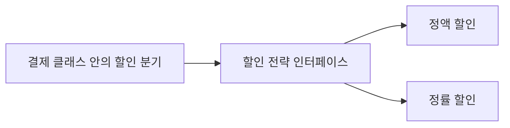
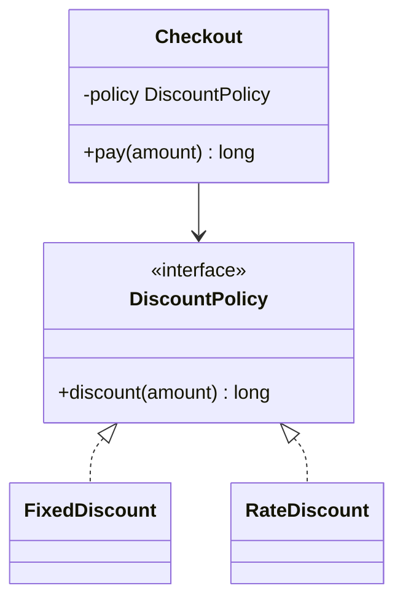

# 전략 패턴 — 계산 방법을 갈아 끼우는 부품으로 떼어 내기

## 한눈에 보는 개요

주문 금액에 할인을 매기는 코드를 떠올려 봅시다. 할인 방식이 늘어날 때마다 `if` 분기를 덧붙이면 결제 클래스가 모든 할인 규칙을 알게 돼요. 전략 패턴은 할인 계산을 인터페이스 뒤의 부품으로 떼어 내고, 결제 클래스는 그 부품을 받아 호출만 하게 만듭니다.



분류는 행위 패턴이고, 전략 객체를 고르는 쪽에서 팩토리 메서드와 자주 함께 쓰여요.

## 패턴 자세히 들여다보기

### 등장하는 개념과 정의

- **Context**: 전략을 필드로 들고 있다가 계산이 필요할 때 위임하는 쪽이에요. 예시의 `Checkout` 입니다.
- **Strategy**: 계산 방법이 지켜야 할 약속이에요. 예시의 `DiscountPolicy` 인터페이스가 맡아요.
- **ConcreteStrategy**: 약속을 실제로 구현한 계산 방법이고, 예시에는 `FixedDiscount` 와 `RateDiscount` 가 있어요.



### 동작 절차

1. 호출자가 `Checkout` 을 만들 때 할인 전략 하나를 넘깁니다. 생성 시점에 받으면 결제 도중 전략이 비어 있는 순간이 사라져요.
2. `pay` 가 불리면 `Checkout` 은 금액을 전략에 그대로 넘깁니다. 규칙을 직접 읽지 않으니 새 규칙이 생겨도 이 메서드는 그대로예요.
3. 전략이 돌려준 할인액을 빼서 최종 금액을 만듭니다.

## 사용 목적

같은 입력에 계산 방법만 다른 분기가 한 클래스에 쌓이기 시작할 때 꺼냅니다. 분기가 두 개뿐이고 늘어날 일이 없다면 조건문 한 번이 더 읽기 쉬워요.

## 패턴의 경계

### 디자인 패턴을 충족하는 최소 조건

- [필수] Context 는 구체 전략 클래스가 아니라 Strategy 타입에만 의존합니다.
- **[필수]** 전략은 Context 바깥에서 골라 넣습니다.
- [선택] 실행 중에 전략을 바꾸는 setter 를 둡니다.

### 비슷한 패턴·안티패턴과의 차이

상태 패턴도 구조는 닮았어요. 갈리는 지점은 누가 다음 객체를 고르느냐입니다. 아래처럼 부품이 스스로 다음 부품을 정하면 상태 패턴이에요.

```java no-compile
state = state.next(event);
```

분석 패턴 쪽 예시는 [분석 패턴 픽스처](good-analysis.md)에 있어요.

## 구현 예시

### 상황 설정

온라인 상점 결제 화면이 정액 할인과 정률 할인을 함께 지원해야 합니다. 금액은 원 단위 정수로 다뤄요.

### 구현

```java
interface DiscountPolicy {
    long discount(long amount);
}

final class FixedDiscount implements DiscountPolicy {
    private final long off;

    FixedDiscount(long off) {
        this.off = off;
    }

    public long discount(long amount) {
        return Math.min(off, amount);
    }
}

final class RateDiscount implements DiscountPolicy {
    private final long percent;

    RateDiscount(long percent) {
        this.percent = percent;
    }

    public long discount(long amount) {
        return amount * percent / 100;
    }
}

public final class Checkout {
    private final DiscountPolicy policy;

    public Checkout(DiscountPolicy policy) {
        this.policy = policy;
    }

    public long pay(long amount) {
        return amount - policy.discount(amount);
    }

    public static void main(String[] args) {
        System.out.println(new Checkout(new FixedDiscount(1000)).pay(5000));
        System.out.println(new Checkout(new RateDiscount(10)).pay(5000));
    }
}
```

```typescript
interface DiscountPolicy {
  discount(amount: number): number;
}

class FixedDiscount implements DiscountPolicy {
  constructor(private readonly off: number) {}

  discount(amount: number): number {
    return Math.min(this.off, amount);
  }
}

class RateDiscount implements DiscountPolicy {
  constructor(private readonly percent: number) {}

  discount(amount: number): number {
    return Math.floor((amount * this.percent) / 100);
  }
}

class Checkout {
  constructor(private readonly policy: DiscountPolicy) {}

  pay(amount: number): number {
    return amount - this.policy.discount(amount);
  }
}

console.log(new Checkout(new FixedDiscount(1000)).pay(5000));
console.log(new Checkout(new RateDiscount(10)).pay(5000));
```

```rust
trait DiscountPolicy {
    fn discount(&self, amount: u64) -> u64;
}

struct FixedDiscount {
    off: u64,
}

impl DiscountPolicy for FixedDiscount {
    fn discount(&self, amount: u64) -> u64 {
        self.off.min(amount)
    }
}

struct RateDiscount {
    percent: u64,
}

impl DiscountPolicy for RateDiscount {
    fn discount(&self, amount: u64) -> u64 {
        amount * self.percent / 100
    }
}

struct Checkout {
    policy: Box<dyn DiscountPolicy>,
}

impl Checkout {
    fn new(policy: Box<dyn DiscountPolicy>) -> Self {
        Self { policy }
    }

    fn pay(&self, amount: u64) -> u64 {
        amount - self.policy.discount(amount)
    }
}

fn main() {
    println!("{}", Checkout::new(Box::new(FixedDiscount { off: 1000 })).pay(5000));
    println!("{}", Checkout::new(Box::new(RateDiscount { percent: 10 })).pay(5000));
}
```

## 스스로 점검하기

`Checkout` 이 생성자 안에서 `RateDiscount` 를 직접 만들면 어느 최소 조건이 깨질까요? 답을 정했다면 위 조건 목록과 대조해 보세요.

## 참고 자료

- Erich Gamma, Richard Helm, Ralph Johnson, John Vlissides, *Design Patterns*, Addison-Wesley, 1994 — Strategy 장.
