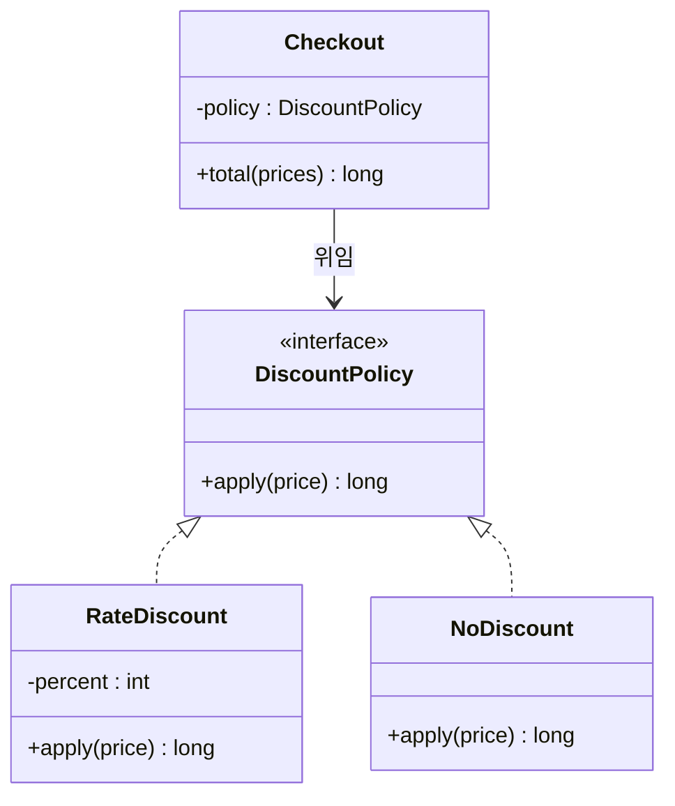

# 샘플 할인 정책 — 바뀌는 계산 규칙을 객체로 갈아 끼우기

<!-- 렌더러 픽스처(scripts/render-guides.py 시험용). 새 골격 gof-guide 의 헤딩 순서를 따른다. 이 주석은 HTML 에 나오면 안 된다. -->

## 한눈에 보는 개요

계산 규칙이 여러 개이고 실행 중에 바뀌어야 할 때, 규칙마다 `if` 분기를 늘리는 대신 **규칙 하나를 객체 하나로** 떼어 내고 쓰는 쪽은 인터페이스만 봅니다. 이 샘플은 할인 정책을 예로 듭니다.

> 분류: 행위 패턴 · 함께 쓰는 패턴: [전략 패턴 가이드](../../../pattern-guide/design-pattern-guide/strategy-pattern.md)

## 패턴 자세히 들여다보기

### 등장하는 개념과 정의

- **Checkout(문맥)** — 합계를 계산하는 쪽입니다. 할인 규칙을 직접 알지 않고 `DiscountPolicy` 에 맡깁니다.
- **DiscountPolicy(전략 인터페이스)** — `apply(price)` 하나만 약속합니다.
  - 구현체는 서로를 모릅니다.
  - 새 규칙을 더해도 `Checkout` 은 고치지 않습니다.
- **RateDiscount · NoDiscount(구체 전략)** — 약속을 각자 방식으로 지킵니다.



### 동작 절차

1. 쓰는 쪽이 규칙 객체를 골라 `Checkout` 에 넘깁니다. 고르는 책임을 문맥 밖에 두어야 문맥이 규칙 목록을 몰라도 됩니다.
2. `Checkout` 은 가격마다 `apply` 를 부릅니다.
3. 결과를 더해 돌려줍니다.

## 사용 목적

같은 입력에 대해 계산 방식만 다른 분기가 늘어나고, 그 분기가 *실행 중에* 바뀌어야 할 때 꺼냅니다. 분기가 둘뿐이고 바뀔 일이 없다면 `if` 하나가 더 읽기 쉽습니다.

## 패턴의 경계

### 디자인 패턴을 충족하는 최소 조건

1. [필수] 문맥은 규칙을 인터페이스로만 참조합니다.
2. [필수] 규칙을 바꿀 때 문맥의 코드를 고치지 않습니다.
3. [선택] 규칙 객체는 상태를 갖지 않습니다.

### 비슷한 패턴·안티패턴과의 차이

| 비교 대상 | 차이점 | 얻는 것 / 포기하는 것 |
| --- | :---: | --- |
| 템플릿 메서드 | 상속으로 단계를 바꿉니다 | 컴파일 시점 고정 / 실행 중 교체 불가 |
| 조건 분기 덩어리 | 규칙이 `switch` 안에 삽니다 | 파일 하나 / 새 규칙마다 문맥 수정 |
| 타입 합집합 매개변수 | `mode: "rate" \| "none"` 같은 `string | number` 값으로 분기합니다 | 선언이 짧음 / 분기가 호출부로 샘 |

아래는 조건 분기 덩어리를 전략이라고 오해한 코드입니다.

```java no-compile
long total(List<Long> prices, String mode) {
    if (mode.equals("rate")) { /* 할인 계산 */ }
    else if (mode.equals("none")) { /* 그대로 */ }
    // 새 규칙마다 이 메서드를 고쳐야 한다 → 전략이 아니다
}
```

## 구현 예시

### 상황 설정

온라인 상점의 결제 합계를 계산합니다. 할인 정책은 이벤트 기간에만 바뀌며, 정책을 바꿔도 결제 코드는 배포하지 않아야 합니다.

### 구현

```java
import java.util.List;

interface DiscountPolicy {
    long apply(long price);
}

final class NoDiscount implements DiscountPolicy {
    public long apply(long price) { return price; }
}

final class RateDiscount implements DiscountPolicy {
    private final int percent;
    RateDiscount(int percent) { this.percent = percent; }
    public long apply(long price) { return price * (100 - percent) / 100; }
}

final class Checkout {
    private final DiscountPolicy policy;
    Checkout(DiscountPolicy policy) { this.policy = policy; }
    long total(List<Long> prices) {
        long sum = 0;
        for (long p : prices) sum += policy.apply(p);
        return sum;
    }
}

public class Main {
    public static void main(String[] args) {
        long a = new Checkout(new RateDiscount(10)).total(List.of(1000L, 2500L));
        long b = new Checkout(new NoDiscount()).total(List.of(1000L));
        System.out.println(a > 0 && b > 0 ? a + " " + b : "error");
    }
}
```

```typescript
interface DiscountPolicy {
  apply(price: number): number;
}

const noDiscount: DiscountPolicy = { apply: (price) => price };

class RateDiscount implements DiscountPolicy {
  constructor(private readonly percent: number) {}
  apply(price: number): number {
    return Math.floor((price * (100 - this.percent)) / 100);
  }
}

class Checkout {
  constructor(private readonly policy: DiscountPolicy) {}
  total(prices: ReadonlyArray<number>): number {
    return prices.reduce((sum, p) => sum + this.policy.apply(p), 0);
  }
}

console.log(new Checkout(new RateDiscount(10)).total([1000, 2500]), new Checkout(noDiscount).total([1000]));
```

```rust
trait DiscountPolicy {
    fn apply(&self, price: u64) -> u64;
}

struct NoDiscount;

impl DiscountPolicy for NoDiscount {
    fn apply(&self, price: u64) -> u64 {
        price
    }
}

struct RateDiscount {
    percent: u64,
}

impl DiscountPolicy for RateDiscount {
    fn apply(&self, price: u64) -> u64 {
        price * (100 - self.percent) / 100
    }
}

struct Checkout<P: DiscountPolicy> {
    policy: P,
}

impl<P: DiscountPolicy> Checkout<P> {
    fn total(&self, prices: &[u64]) -> u64 {
        prices.iter().map(|&p| self.policy.apply(p)).sum()
    }
}

fn main() {
    let rate = Checkout { policy: RateDiscount { percent: 10 } };
    let none = Checkout { policy: NoDiscount };
    println!("{} {}", rate.total(&[1000, 2500]), none.total(&[1000]));
}
```

## 스스로 점검하기

- 새 할인 규칙을 더할 때 `Checkout` 의 어느 줄을 고쳐야 하나요? 답이 "없음"이 아니라면 무엇이 새고 있나요?
- 규칙 객체가 상태를 가지면 여러 결제가 한 객체를 나눠 쓸 때 무슨 일이 생기나요?

## 참고 자료

- Erich Gamma 외, *Design Patterns: Elements of Reusable Object-Oriented Software*, Addison-Wesley, 1994 — Strategy 장.
- 이 저장소의 심화 문서: [Account와 Entry의 관계 설계](<../../../pattern-guide/consideration/Account와 Entry의 관계 설계.md>)
